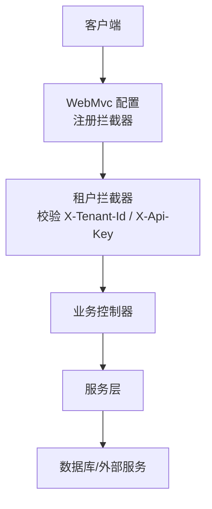
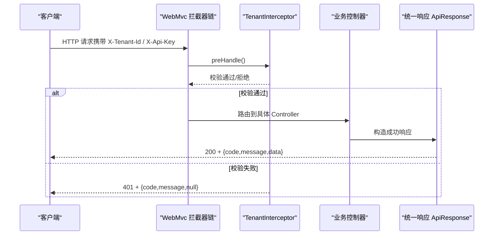

# API 接口文档

<cite>
**本文引用的文件**   
- [AgentController.java](file://src/main/java/com/agenthub/agent/controller/AgentController.java)
- [ChatRequestDTO.java](file://src/main/java/com/agenthub/agent/dto/ChatRequestDTO.java)
- [ChatResponseDTO.java](file://src/main/java/com/agenthub/agent/dto/ChatResponseDTO.java)
- [McpController.java](file://src/main/java/com/agenthub/mcp/controller/McpController.java)
- [McpServerRequest.java](file://src/main/java/com/agenthub/mcp/dto/McpServerRequest.java)
- [TenantController.java](file://src/main/java/com/agenthub/tenant/controller/TenantController.java)
- [LoginRequest.java](file://src/main/java/com/agenthub/tenant/dto/LoginRequest.java)
- [TenantCreateRequest.java](file://src/main/java/com/agenthub/tenant/dto/TenantCreateRequest.java)
- [ApiKeyResponse.java](file://src/main/java/com/agenthub/tenant/dto/ApiKeyResponse.java)
- [KnowledgeBaseController.java](file://src/main/java/com/agenthub/knowledge/controller/KnowledgeBaseController.java)
- [DocumentController.java](file://src/main/java/com/agenthub/knowledge/controller/DocumentController.java)
- [TraceController.java](file://src/main/java/com/agenthub/tracing/controller/TraceController.java)
- [ApiResponse.java](file://src/main/java/com/agenthub/common/api/ApiResponse.java)
- [BizException.java](file://src/main/java/com/agenthub/common/exception/BizException.java)
- [ErrorCode.java](file://src/main/java/com/agenthub/common/exception/ErrorCode.java)
- [GlobalExceptionHandler.java](file://src/main/java/com/agenthub/common/exception/GlobalExceptionHandler.java)
- [TenantInterceptor.java](file://src/main/java/com/agenthub/gateway/interceptor/TenantInterceptor.java)
- [WebMvcConfig.java](file://src/main/java/com/agenthub/gateway/config/WebMvcConfig.java)
- [HeaderConstants.java](file://src/main/java/com/agenthub/common/constant/HeaderConstants.java)
- [SecurityProperties.java](file://src/main/java/com/agenthub/gateway/config/SecurityProperties.java)
</cite>

## 目录
1. [简介](#简介)
2. [项目结构](#项目结构)
3. [核心组件](#核心组件)
4. [架构总览](#架构总览)
5. [详细接口说明](#详细接口说明)
6. [依赖关系分析](#依赖关系分析)
7. [性能与可用性建议](#性能与可用性建议)
8. [故障排查指南](#故障排查指南)
9. [结论](#结论)

## 简介
本文件为 AgentHub 平台的 RESTful API 接口文档，覆盖以下业务域：
- Agent 对话接口（/api/v1/agent/chat）
- MCP 服务器管理接口（/api/v1/mcp/servers/*）
- 租户管理接口（/api/v1/tenant/*）
- 知识库管理接口（/api/v1/kb/*、/api/v1/documents/*）
- 链路统计接口（/api/v1/tracing/*）

同时说明认证授权机制（API Key 验证与租户上下文传递）、统一响应格式、错误码规范以及最佳实践。

## 项目结构
平台采用 Spring MVC 控制器暴露 REST 接口，通过拦截器完成租户认证与链路追踪，使用统一响应体封装结果与错误信息。



图表来源
- [WebMvcConfig.java:10-31](file://src/main/java/com/agenthub/gateway/config/WebMvcConfig.java#L10-L31)
- [TenantInterceptor.java:18-50](file://src/main/java/com/agenthub/gateway/interceptor/TenantInterceptor.java#L18-L50)

章节来源
- [WebMvcConfig.java:10-31](file://src/main/java/com/agenthub/gateway/config/WebMvcConfig.java#L10-L31)
- [TenantInterceptor.java:18-50](file://src/main/java/com/agenthub/gateway/interceptor/TenantInterceptor.java#L18-L50)

## 核心组件
- 统一响应体 ApiResponse：所有接口返回统一的 code/message/data 结构。
- 全局异常处理 GlobalExceptionHandler：将业务异常、参数校验异常、上传大小异常等转换为统一响应。
- 租户认证拦截器 TenantInterceptor：解析并校验 X-Tenant-Id 与 X-Api-Key，设置租户上下文。
- 安全配置 SecurityProperties：控制是否启用认证及白名单路径。
- 请求头常量 HeaderConstants：定义通用请求头键名。

章节来源
- [ApiResponse.java:8-37](file://src/main/java/com/agenthub/common/api/ApiResponse.java#L8-L37)
- [GlobalExceptionHandler.java:14-47](file://src/main/java/com/agenthub/common/exception/GlobalExceptionHandler.java#L14-L47)
- [TenantInterceptor.java:18-50](file://src/main/java/com/agenthub/gateway/interceptor/TenantInterceptor.java#L18-L50)
- [SecurityProperties.java:8-20](file://src/main/java/com/agenthub/gateway/config/SecurityProperties.java#L8-L20)
- [HeaderConstants.java:3-19](file://src/main/java/com/agenthub/common/constant/HeaderConstants.java#L3-L19)

## 架构总览
下图展示一次受认证的 API 调用从进入网关到控制器处理的流程。



图表来源
- [WebMvcConfig.java:23-31](file://src/main/java/com/agenthub/gateway/config/WebMvcConfig.java#L23-L31)
- [TenantInterceptor.java:31-50](file://src/main/java/com/agenthub/gateway/interceptor/TenantInterceptor.java#L31-L50)
- [ApiResponse.java:22-36](file://src/main/java/com/agenthub/common/api/ApiResponse.java#L22-L36)

## 详细接口说明

### 通用约定
- 基础路径：/api/v1
- 认证方式：请求头 X-Tenant-Id（租户ID）与 X-Api-Key（API Key）。部分公开接口（如登录、注册）在安全配置中可被跳过认证。
- 统一响应体：
  - code：数字状态码（业务码），成功为 0
  - message：描述信息
  - data：业务数据对象或数组
- 错误响应示例：
  - {"code": 401, "message": "未认证或API Key无效", "data": null}
- 成功响应示例：
  - {"code": 0, "message": "success", "data": {...}}

章节来源
- [ApiResponse.java:8-37](file://src/main/java/com/agenthub/common/api/ApiResponse.java#L8-L37)
- [ErrorCode.java:9-26](file://src/main/java/com/agenthub/common/exception/ErrorCode.java#L9-L26)
- [HeaderConstants.java:3-19](file://src/main/java/com/agenthub/common/constant/HeaderConstants.java#L3-L19)

### 认证与授权
- 认证头：
  - X-Tenant-Id：租户ID（必填）
  - X-Api-Key：API Key（必填）
- 认证流程：
  - 若安全开关关闭或命中白名单路径，直接放行
  - 否则校验 X-Tenant-Id 是否存在且为合法数字
  - 校验 X-Api-Key 是否有效并与 X-Tenant-Id 匹配
  - 通过后设置租户上下文供下游使用
- 安全配置项：
  - agenthub.security.enabled：是否开启认证（默认 true）
  - agenthub.security.skipPaths：免认证路径列表（Ant 风格）

章节来源
- [TenantInterceptor.java:18-50](file://src/main/java/com/agenthub/gateway/interceptor/TenantInterceptor.java#L18-L50)
- [SecurityProperties.java:8-20](file://src/main/java/com/agenthub/gateway/config/SecurityProperties.java#L8-L20)
- [WebMvcConfig.java:23-31](file://src/main/java/com/agenthub/gateway/config/WebMvcConfig.java#L23-L31)

### Agent 对话接口
- 方法：POST
- URL：/api/v1/agent/chat
- 认证：需要 X-Tenant-Id 与 X-Api-Key
- 请求体：ChatRequestDTO（字段以实际 DTO 为准；包含用户消息、可选 conversationId 等）
- 响应体：ApiResponse<ChatResponseDTO>
- 行为说明：首次不传 conversationId 自动创建会话，后续传入同一 ID 实现多轮记忆

请求示例
{
  "content": "你好，请介绍一下当前知识库",
  "conversationId": "可选的会话ID"
}

响应示例
{
  "code": 0,
  "message": "success",
  "data": {
    "content": "根据知识库内容...",
    "conversationId": "生成的会话ID"
  }
}

章节来源
- [AgentController.java:14-28](file://src/main/java/com/agenthub/agent/controller/AgentController.java#L14-L28)
- [ChatRequestDTO.java](file://src/main/java/com/agenthub/agent/dto/ChatRequestDTO.java)
- [ChatResponseDTO.java](file://src/main/java/com/agenthub/agent/dto/ChatResponseDTO.java)

### MCP 服务器管理接口
- 基础路径：/api/v1/mcp/servers
- 认证：需要 X-Tenant-Id 与 X-Api-Key

#### 新增 MCP Server 配置
- 方法：POST
- URL：/api/v1/mcp/servers
- 请求体：McpServerRequest
- 响应体：ApiResponse<McpServerConfig>

请求示例
{
  "name": "example-mcp",
  "description": "示例 MCP 服务",
  "transportType": "sse",
  "baseUrl": "http://mcp-server:8080",
  "endpoint": "/mcp",
  "enabled": true
}

#### 更新 MCP Server 配置
- 方法：PUT
- URL：/api/v1/mcp/servers/{id}
- 路径参数：id（Long）
- 请求体：McpServerRequest
- 响应体：ApiResponse<McpServerConfig>

#### 删除 MCP Server 配置
- 方法：DELETE
- URL：/api/v1/mcp/servers/{id}
- 路径参数：id（Long）
- 响应体：ApiResponse<Void>

#### 获取 MCP Server 配置列表
- 方法：GET
- URL：/api/v1/mcp/servers
- 响应体：ApiResponse<List<McpServerConfig>>

#### 建立连接并注册工具到 Agent
- 方法：POST
- URL：/api/v1/mcp/servers/{id}/connect
- 路径参数：id（Long）
- 响应体：ApiResponse<List<McpSchema.Tool>>

#### 断开连接并注销工具
- 方法：POST
- URL：/api/v1/mcp/servers/{id}/disconnect
- 路径参数：id（Long）
- 响应体：ApiResponse<Void>

#### 列出已连接 Server 的工具
- 方法：GET
- URL：/api/v1/mcp/servers/{id}/tools
- 路径参数：id（Long）
- 响应体：ApiResponse<List<McpSchema.Tool>>

#### 直接调用 MCP 工具（调试/演示用）
- 方法：POST
- URL：/api/v1/mcp/servers/{id}/tools/{toolName}/call
- 路径参数：id（Long）、toolName（String）
- 请求体：Map<String, Object>（可选）
- 响应体：ApiResponse<String>

章节来源
- [McpController.java:21-83](file://src/main/java/com/agenthub/mcp/controller/McpController.java#L21-L83)
- [McpServerRequest.java:1-37](file://src/main/java/com/agenthub/mcp/dto/McpServerRequest.java#L1-L37)

### 租户管理接口
- 基础路径：/api/v1/tenant
- 注意：登录、注册等接口通常位于安全白名单，无需 X-Tenant-Id / X-Api-Key

#### 创建租户（自助注册）
- 方法：POST
- URL：/api/v1/tenant/register
- 请求体：TenantCreateRequest
- 响应体：ApiResponse<Tenant>

请求示例
{
  "tenantCode": "acme",
  "tenantName": "Acme Corp",
  "adminUsername": "admin",
  "adminPassword": "******"
}

#### 账号密码登录
- 方法：POST
- URL：/api/v1/tenant/login
- 请求体：LoginRequest
- 响应体：ApiResponse<Map<String, Object>>

请求示例
{
  "tenantCode": "acme",
  "username": "admin",
  "password": "******"
}

响应示例
{
  "code": 0,
  "message": "success",
  "data": {
    "tenantId": 1,
    "userId": 10,
    "username": "admin",
    "displayName": "管理员",
    "role": "ADMIN"
  }
}

#### 为当前租户签发 API Key
- 方法：POST
- URL：/api/v1/tenant/api-keys
- 认证：需要 X-Tenant-Id 与 X-Api-Key
- 请求体：{"name": "string"}
- 响应体：ApiResponse<ApiKeyResponse>

请求示例
{
  "name": "prod-key"
}

响应示例
{
  "code": 0,
  "message": "success",
  "data": {
    "name": "prod-key",
    "apiKey": "sk-xxxxxxxxxxxxxxxxxxxx",
    "prefix": "sk-xxxxxxxxxx"
  }
}

章节来源
- [TenantController.java:20-54](file://src/main/java/com/agenthub/tenant/controller/TenantController.java#L20-L54)
- [LoginRequest.java:1-21](file://src/main/java/com/agenthub/tenant/dto/LoginRequest.java#L1-L21)
- [TenantCreateRequest.java:1-24](file://src/main/java/com/agenthub/tenant/dto/TenantCreateRequest.java#L1-L24)
- [ApiKeyResponse.java:1-17](file://src/main/java/com/agenthub/tenant/dto/ApiKeyResponse.java#L1-L17)

### 知识库管理接口
- 知识库 CRUD：/api/v1/kb
- 文档上传与查询：/api/v1/kb/{kbId}/documents、/api/v1/documents/{docId}

#### 创建知识库
- 方法：POST
- URL：/api/v1/kb
- 请求体：KnowledgeBaseRequest
- 响应体：ApiResponse<KnowledgeBase>

#### 获取知识库列表
- 方法：GET
- URL：/api/v1/kb
- 响应体：ApiResponse<List<KnowledgeBase>>

#### 删除知识库
- 方法：DELETE
- URL：/api/v1/kb/{kbId}
- 路径参数：kbId（Long）
- 响应体：ApiResponse<Void>

#### 上传文档到知识库
- 方法：POST
- URL：/api/v1/kb/{kbId}/documents
- 路径参数：kbId（Long）
- 表单字段：file（multipart/form-data）
- 响应体：ApiResponse<Document>

#### 获取知识库文档列表
- 方法：GET
- URL：/api/v1/kb/{kbId}/documents
- 路径参数：kbId（Long）
- 响应体：ApiResponse<List<Document>>

#### 查询文档详情
- 方法：GET
- URL：/api/v1/documents/{docId}
- 路径参数：docId（Long）
- 响应体：ApiResponse<Document>

#### 失败重试
- 方法：POST
- URL：/api/v1/documents/{docId}/retry
- 路径参数：docId（Long）
- 响应体：ApiResponse<Void>

章节来源
- [KnowledgeBaseController.java:19-44](file://src/main/java/com/agenthub/knowledge/controller/KnowledgeBaseController.java#L19-L44)
- [DocumentController.java:17-51](file://src/main/java/com/agenthub/knowledge/controller/DocumentController.java#L17-L51)

### 链路统计接口
- 基础路径：/api/v1/tracing

#### 按类型聚合统计
- 方法：GET
- URL：/api/v1/tracing/stats
- 查询参数：hours（默认 24）
- 响应体：ApiResponse<List<Map<String, Object>>>

#### 最近调用明细
- 方法：GET
- URL：/api/v1/tracing/calls
- 查询参数：bizType（可选）
- 响应体：ApiResponse<List<CallStat>>

章节来源
- [TraceController.java:16-40](file://src/main/java/com/agenthub/tracing/controller/TraceController.java#L16-L40)

## 依赖关系分析
控制器与服务层的依赖关系如下：

```mermaid
classDiagram
class AgentController
class McpController
class TenantController
class KnowledgeBaseController
class DocumentController
class TraceController
AgentController --> "调用" : AgentService
McpController --> "调用" : McpServerService
TenantController --> "调用" : TenantService
KnowledgeBaseController --> "调用" : KnowledgeBaseService
DocumentController --> "调用" : DocumentService
TraceController --> "调用" : CallStatMapper
```

图表来源
- [AgentController.java:14-28](file://src/main/java/com/agenthub/agent/controller/AgentController.java#L14-L28)
- [McpController.java:21-83](file://src/main/java/com/agenthub/mcp/controller/McpController.java#L21-L83)
- [TenantController.java:20-54](file://src/main/java/com/agenthub/tenant/controller/TenantController.java#L20-L54)
- [KnowledgeBaseController.java:19-44](file://src/main/java/com/agenthub/knowledge/controller/KnowledgeBaseController.java#L19-L44)
- [DocumentController.java:17-51](file://src/main/java/com/agenthub/knowledge/controller/DocumentController.java#L17-L51)
- [TraceController.java:16-40](file://src/main/java/com/agenthub/tracing/controller/TraceController.java#L16-L40)

## 性能与可用性建议
- 分页与限流：对列表类接口（如知识库、文档、MCP 工具列表）建议增加分页与速率限制，避免大数据量拖慢响应。
- 异步任务：文档处理建议使用异步任务与状态轮询（已有重试接口），前端应实现退避重试策略。
- 缓存：对频繁读取的配置（如 MCP 工具列表）可增加短期缓存以降低后端压力。
- 超时与重试：对外部 LLM/MCP 调用的超时时间需合理配置，并在客户端侧实现幂等重试。
- 资源隔离：确保 X-Tenant-Id 与 X-Api-Key 严格校验，防止跨租户数据泄露。

## 故障排查指南
- 常见错误码
  - 401 未认证或API Key无效：检查请求头 X-Tenant-Id 与 X-Api-Key 是否正确
  - 403 无权限访问该资源：确认当前租户是否有权限访问目标资源
  - 404 资源不存在：检查路径参数是否正确
  - 400 参数错误：检查请求体字段是否符合 DTO 校验规则
  - 500 业务处理失败：查看服务端日志定位具体异常
  - 502 模型调用失败：检查 LLM 提供商配置与网络连通性
  - 503 MCP服务调用失败：检查 MCP Server 地址、传输类型与 endpoint
  - 500 异步任务处理失败：检查任务队列与消费者状态
  - 500 文件处理失败：检查文件大小限制与存储后端配置
- 全局异常处理
  - 业务异常 BizException 会被统一捕获并返回 ApiResponse.fail(...)
  - 参数校验异常会返回 PARAM_ERROR 与首个字段错误信息
  - 上传大小超限会返回 FILE_ERROR
- 认证失败
  - 若未提供 X-Tenant-Id 或 X-Api-Key，或两者不匹配，将直接返回 401
  - 可通过配置 agenthub.security.skipPaths 将特定接口加入白名单

章节来源
- [ErrorCode.java:9-26](file://src/main/java/com/agenthub/common/exception/ErrorCode.java#L9-L26)
- [GlobalExceptionHandler.java:21-46](file://src/main/java/com/agenthub/common/exception/GlobalExceptionHandler.java#L21-L46)
- [TenantInterceptor.java:31-50](file://src/main/java/com/agenthub/gateway/interceptor/TenantInterceptor.java#L31-L50)

## 结论
本文档梳理了 AgentHub 平台的 RESTful API 接口，涵盖 Agent 对话、MCP 服务器管理、租户管理、知识库管理与链路统计等核心能力，并明确了认证授权机制、统一响应格式与错误码规范。建议在集成时遵循最佳实践，做好参数校验、分页限流、异步任务与错误重试，以确保系统稳定与可扩展。