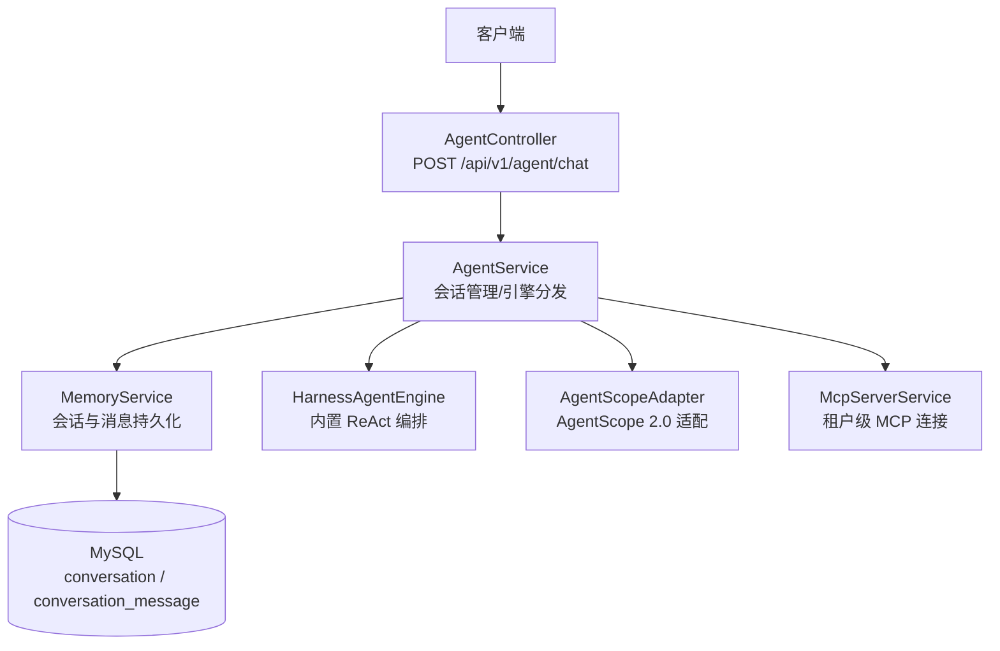
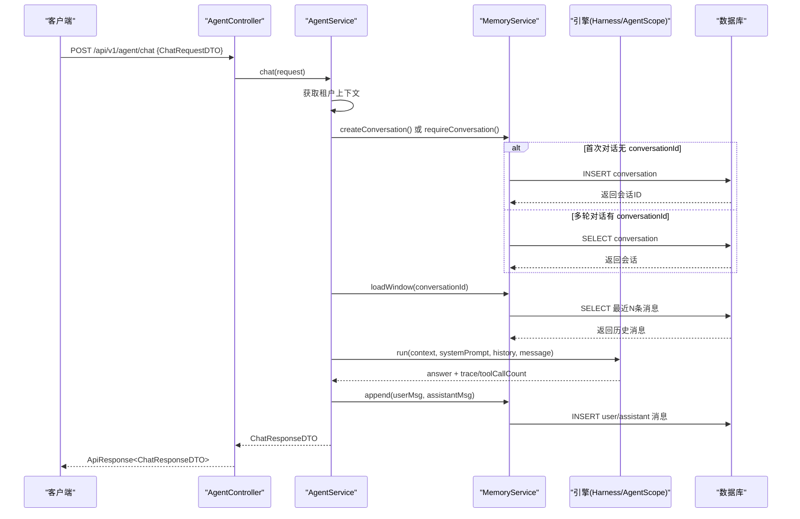
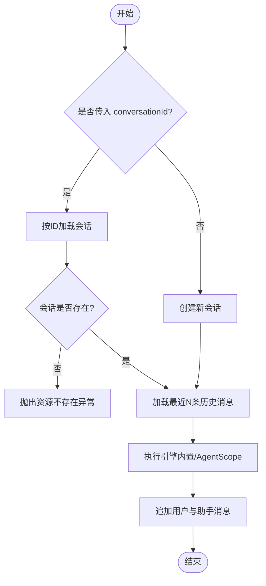
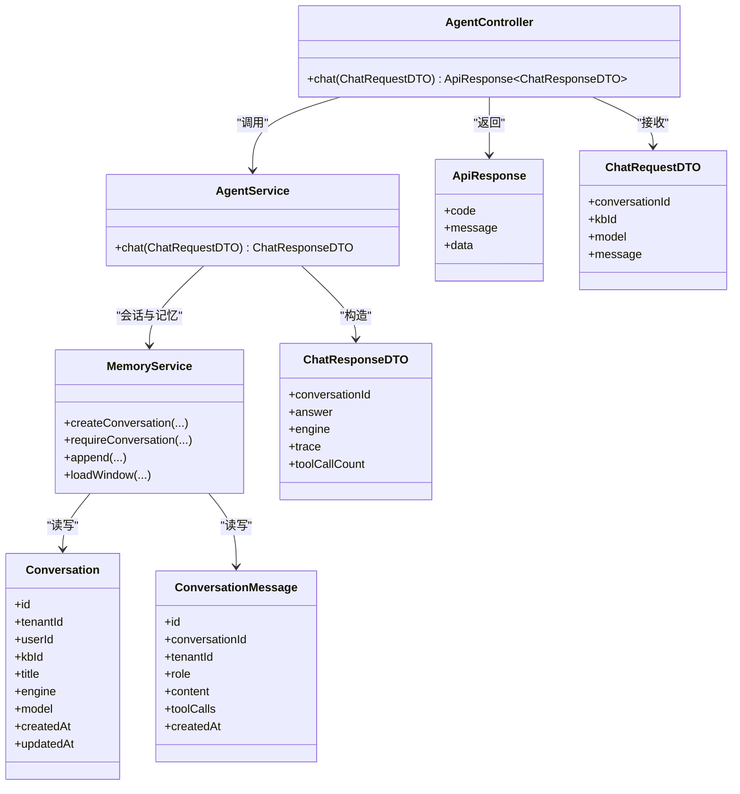

# Agent 对话接口

<cite>
**本文引用的文件**   
- [AgentController.java](file://src/main/java/com/agenthub/agent/controller/AgentController.java)
- [ChatRequestDTO.java](file://src/main/java/com/agenthub/agent/dto/ChatRequestDTO.java)
- [ChatResponseDTO.java](file://src/main/java/com/agenthub/agent/dto/ChatResponseDTO.java)
- [AgentService.java](file://src/main/java/com/agenthub/agent/service/AgentService.java)
- [MemoryService.java](file://src/main/java/com/agenthub/agent/memory/MemoryService.java)
- [Conversation.java](file://src/main/java/com/agenthub/agent/entity/Conversation.java)
- [ConversationMessage.java](file://src/main/java/com/agenthub/agent/entity/ConversationMessage.java)
- [ApiResponse.java](file://src/main/java/com/agenthub/common/api/ApiResponse.java)
- [BizException.java](file://src/main/java/com/agenthub/common/exception/BizException.java)
- [ErrorCode.java](file://src/main/java/com/agenthub/common/exception/ErrorCode.java)
- [application.yml](file://src/main/resources/application.yml)
</cite>

## 目录
1. [简介](#简介)
2. [项目结构](#项目结构)
3. [核心组件](#核心组件)
4. [架构总览](#架构总览)
5. [详细组件分析](#详细组件分析)
6. [依赖关系分析](#依赖关系分析)
7. [性能与扩展性](#性能与扩展性)
8. [故障排查指南](#故障排查指南)
9. [结论](#结论)
10. [附录：API 定义与示例](#附录api-定义与示例)

## 简介
本文件为 Agent 对话接口的详细 API 文档，聚焦 POST /api/v1/agent/chat。该接口支持：
- 首次对话自动创建会话；
- 后续多轮对话基于会话 ID 实现记忆延续；
- 可绑定知识库、选择模型路由键；
- 返回回答、工具调用轨迹与用量统计等观测信息。

## 项目结构
Agent 对话能力由控制器、服务、记忆管理、实体与统一响应/异常处理共同组成。关键路径如下：
- 控制器：暴露 REST 接口并做参数校验；
- 服务层：负责会话生命周期、记忆装载、引擎分发与结果封装；
- 记忆层：持久化会话与消息，提供窗口式历史读取；
- 实体：会话与会话消息的数据库映射；
- 通用层：统一响应体与错误码。



**图表来源**
- [AgentController.java:17-28](file://src/main/java/com/agenthub/agent/controller/AgentController.java#L17-L28)
- [AgentService.java:40-83](file://src/main/java/com/agenthub/agent/service/AgentService.java#L40-L83)
- [MemoryService.java:35-86](file://src/main/java/com/agenthub/agent/memory/MemoryService.java#L35-L86)

**章节来源**
- [AgentController.java:17-28](file://src/main/java/com/agenthub/agent/controller/AgentController.java#L17-L28)
- [AgentService.java:21-83](file://src/main/java/com/agenthub/agent/service/AgentService.java#L21-L83)
- [MemoryService.java:19-86](file://src/main/java/com/agenthub/agent/memory/MemoryService.java#L19-L86)

## 核心组件
- AgentController：对外暴露对话接口，接收 ChatRequestDTO，返回 ApiResponse<ChatResponseDTO>。
- AgentService：对话主流程，包含租户上下文获取、MCP 懒连接、会话创建/查找、历史装载、引擎执行、记忆追加与响应组装。
- MemoryService：会话与消息的增删改查，提供最近 N 条消息的窗口读取。
- Conversation / ConversationMessage：会话与会话消息的持久化实体。
- ApiResponse / BizException / ErrorCode：统一响应结构与错误处理。

**章节来源**
- [AgentController.java:17-28](file://src/main/java/com/agenthub/agent/controller/AgentController.java#L17-L28)
- [AgentService.java:21-83](file://src/main/java/com/agenthub/agent/service/AgentService.java#L21-L83)
- [MemoryService.java:19-100](file://src/main/java/com/agenthub/agent/memory/MemoryService.java#L19-L100)
- [Conversation.java:10-38](file://src/main/java/com/agenthub/agent/entity/Conversation.java#L10-L38)
- [ConversationMessage.java:10-33](file://src/main/java/com/agenthub/agent/entity/ConversationMessage.java#L10-L33)
- [ApiResponse.java:13-36](file://src/main/java/com/agenthub/common/api/ApiResponse.java#L13-L36)
- [BizException.java:8-22](file://src/main/java/com/agenthub/common/exception/BizException.java#L8-L22)
- [ErrorCode.java:11-26](file://src/main/java/com/agenthub/common/exception/ErrorCode.java#L11-L26)

## 架构总览
下图展示一次对话请求从进入控制器到返回响应的完整时序，包括首次会话创建与多轮记忆加载。



**图表来源**
- [AgentController.java:24-28](file://src/main/java/com/agenthub/agent/controller/AgentController.java#L24-L28)
- [AgentService.java:40-83](file://src/main/java/com/agenthub/agent/service/AgentService.java#L40-L83)
- [MemoryService.java:35-86](file://src/main/java/com/agenthub/agent/memory/MemoryService.java#L35-L86)

## 详细组件分析

### 接口定义与参数说明
- 接口地址：POST /api/v1/agent/chat
- 请求体：ChatRequestDTO
- 响应体：ApiResponse<ChatResponseDTO>

#### ChatRequestDTO 字段
- conversationId：Long，可选。用于多轮对话关联同一会话；为空时自动创建新会话。
- kbId：Long，可选。绑定的知识库ID，可在首次或后续请求中设置。
- model：String，可选。模型路由键；为空时使用会话默认模型或配置默认值。
- message：String，必填。用户本轮输入消息。

注意：当前 DTO 未使用 Bean Validation 注解，但控制器方法使用了 @Valid，建议对 message 增加非空校验以提升健壮性。

**章节来源**
- [ChatRequestDTO.java:8-22](file://src/main/java/com/agenthub/agent/dto/ChatRequestDTO.java#L8-L22)
- [AgentController.java:24-28](file://src/main/java/com/agenthub/agent/controller/AgentController.java#L24-L28)

#### ChatResponseDTO 字段
- conversationId：Long。本次对话所属会话ID。
- answer：String。模型最终回答文本。
- engine：String。引擎类型，builtin 或 agentscope。
- trace：List<String>。本轮工具调用轨迹（观测用）。
- toolCallCount：int。本轮工具调用次数。

注意：当前响应体字段名为 answer，而非 responseMessage；若需严格匹配“responseMessage”，请在上层进行字段映射。

**章节来源**
- [ChatResponseDTO.java:12-29](file://src/main/java/com/agenthub/agent/dto/ChatResponseDTO.java#L12-L29)

#### 统一响应体 ApiResponse
- code：int。业务状态码，成功通常为 0。
- message：String。描述信息。
- data：T。业务数据，此处为 ChatResponseDTO。

**章节来源**
- [ApiResponse.java:13-36](file://src/main/java/com/agenthub/common/api/ApiResponse.java#L13-L36)

### 会话管理与记忆机制
- 会话创建：当 conversationId 为空时，系统根据租户ID、用户ID、kbId、model、engine 创建新会话。
- 会话查找：当 conversationId 存在时，按ID查询会话；不存在则抛出资源不存在异常。
- 记忆装载：每次对话前，读取最近 memory-window 条消息作为 LLM 上下文。
- 记忆追加：每轮对话结束后，将用户消息与助手回答写入数据库，助手消息附带工具调用明细（JSON）。
- 上下文传递：通过 ChatContext 在引擎间传递租户、用户、会话、模型、trace 等信息。



**图表来源**
- [AgentService.java:40-83](file://src/main/java/com/agenthub/agent/service/AgentService.java#L40-L83)
- [MemoryService.java:35-86](file://src/main/java/com/agenthub/agent/memory/MemoryService.java#L35-L86)

**章节来源**
- [AgentService.java:40-83](file://src/main/java/com/agenthub/agent/service/AgentService.java#L40-L83)
- [MemoryService.java:35-100](file://src/main/java/com/agenthub/agent/memory/MemoryService.java#L35-L100)
- [Conversation.java:10-38](file://src/main/java/com/agenthub/agent/entity/Conversation.java#L10-L38)
- [ConversationMessage.java:10-33](file://src/main/java/com/agenthub/agent/entity/ConversationMessage.java#L10-L33)

### 引擎分发与工具调用
- 引擎类型：builtin（内置 ReAct 循环）或 agentscope（AgentScope 2.0 HarnessAgent）。
- 分发逻辑：根据 agentProperties.getEngine() 选择对应引擎执行。
- 工具调用：引擎执行过程中产生的工具调用轨迹与计数会回写到 ChatContext，并最终封装到 ChatResponseDTO。

**章节来源**
- [AgentService.java:62-83](file://src/main/java/com/agenthub/agent/service/AgentService.java#L62-L83)
- [ChatResponseDTO.java:21-29](file://src/main/java/com/agenthub/agent/dto/ChatResponseDTO.java#L21-L29)

### 错误处理
- 参数校验：控制器使用 @Valid，建议在 DTO 上补充非空校验。
- 业务异常：BizException 携带 ErrorCode，由全局异常处理器转换为 ApiResponse。
- 常见错误码：
  - NOT_FOUND：会话不存在。
  - PARAM_ERROR：参数错误。
  - BUSINESS_ERROR：业务处理失败。
  - TENANT_ERROR：租户信息缺失。
  - LLM_ERROR：模型调用失败。
  - MCP_ERROR：MCP 服务调用失败。

**章节来源**
- [BizException.java:8-22](file://src/main/java/com/agenthub/common/exception/BizException.java#L8-L22)
- [ErrorCode.java:11-26](file://src/main/java/com/agenthub/common/exception/ErrorCode.java#L11-L26)
- [MemoryService.java:48-55](file://src/main/java/com/agenthub/agent/memory/MemoryService.java#L48-L55)

## 依赖关系分析
- 控制器依赖服务层；服务层依赖记忆服务、引擎适配器与 MCP 服务；记忆服务依赖 MyBatis Mapper 访问数据库。
- 配置项 application.yml 控制引擎类型、默认模型、向量库、存储、解析器等。



**图表来源**
- [AgentController.java:17-28](file://src/main/java/com/agenthub/agent/controller/AgentController.java#L17-L28)
- [AgentService.java:21-83](file://src/main/java/com/agenthub/agent/service/AgentService.java#L21-L83)
- [MemoryService.java:19-100](file://src/main/java/com/agenthub/agent/memory/MemoryService.java#L19-L100)
- [Conversation.java:10-38](file://src/main/java/com/agenthub/agent/entity/Conversation.java#L10-L38)
- [ConversationMessage.java:10-33](file://src/main/java/com/agenthub/agent/entity/ConversationMessage.java#L10-L33)
- [ApiResponse.java:13-36](file://src/main/java/com/agenthub/common/api/ApiResponse.java#L13-L36)
- [ChatRequestDTO.java:8-22](file://src/main/java/com/agenthub/agent/dto/ChatRequestDTO.java#L8-L22)
- [ChatResponseDTO.java:12-29](file://src/main/java/com/agenthub/agent/dto/ChatResponseDTO.java#L12-L29)

**章节来源**
- [application.yml:141-149](file://src/main/resources/application.yml#L141-L149)

## 性能与扩展性
- 记忆窗口：memory-window 控制历史消息数量，默认 10，可通过配置调整以平衡上下文长度与成本。
- 异步与可观测：集成 Micrometer Tracing 与 OpenTelemetry Collector，便于链路追踪与指标采集。
- 可扩展点：
  - 记忆策略：可从窗口截断升级为摘要压缩或长期记忆（对接 AgentScope Memory 扩展）。
  - 引擎扩展：新增引擎类型需在 AgentService 中扩展 switch 分支。
  - 校验增强：在 ChatRequestDTO 上添加 Bean Validation 注解提升参数健壮性。

**章节来源**
- [application.yml:31-44](file://src/main/resources/application.yml#L31-L44)
- [application.yml:141-149](file://src/main/resources/application.yml#L141-L149)
- [MemoryService.java:32-33](file://src/main/java/com/agenthub/agent/memory/MemoryService.java#L32-L33)

## 故障排查指南
- 会话不存在：检查 conversationId 是否正确且属于当前租户；确认数据库记录存在。
- 租户信息缺失：确保请求头 X-Tenant-Id 正确传递；检查安全配置 skip-paths 是否误放行。
- 模型调用失败：检查 LLM provider 配置与网络连通性；查看 LLM_ERROR 日志。
- MCP 服务调用失败：确认 MCP Server 已连接；检查 MCP_ERROR 日志。
- 参数错误：补充 DTO 校验注解并在前端做好必填校验。

**章节来源**
- [ErrorCode.java:11-26](file://src/main/java/com/agenthub/common/exception/ErrorCode.java#L11-L26)
- [application.yml:54-62](file://src/main/resources/application.yml#L54-L62)

## 结论
POST /api/v1/agent/chat 提供了完整的 Agent 对话入口，支持自动会话创建与多轮记忆延续，具备灵活的引擎分发与工具调用观测能力。通过合理的记忆窗口配置与扩展点设计，可在保证性能的同时满足复杂业务场景。

## 附录：API 定义与示例

### 接口概览
- 方法：POST
- 路径：/api/v1/agent/chat
- 请求体：ChatRequestDTO
- 响应体：ApiResponse<ChatResponseDTO>

### 请求体 ChatRequestDTO
- conversationId：Long，可选。首次对话可不传；多轮对话请传入同一 ID。
- kbId：Long，可选。知识库ID。
- model：String，可选。模型路由键。
- message：String，必填。用户消息。

### 响应体 ChatResponseDTO
- conversationId：Long。
- answer：String。模型回答。
- engine：String。引擎类型 builtin 或 agentscope。
- trace：List<String>。工具调用轨迹。
- toolCallCount：int。工具调用次数。

### 请求示例
```json
{
  "conversationId": null,
  "kbId": 1001,
  "model": "gpt-4o-mini",
  "message": "你好，请帮我总结这份文档的核心要点。"
}
```

### 响应示例
```json
{
  "code": 0,
  "message": "success",
  "data": {
    "conversationId": 10001,
    "answer": "文档核心要点如下：...",
    "engine": "builtin",
    "trace": ["search_doc", "summarize"],
    "toolCallCount": 2
  }
}
```

### 最佳实践
- 首次对话不传 conversationId，后续多轮对话传入同一 ID。
- 在首次请求中设置 kbId 与 model，避免后续重复设置。
- 前端对 message 做非空校验，减少无效请求。
- 监控 trace 与 toolCallCount，定位工具调用瓶颈。
- 合理调整 memory-window，平衡上下文长度与成本。