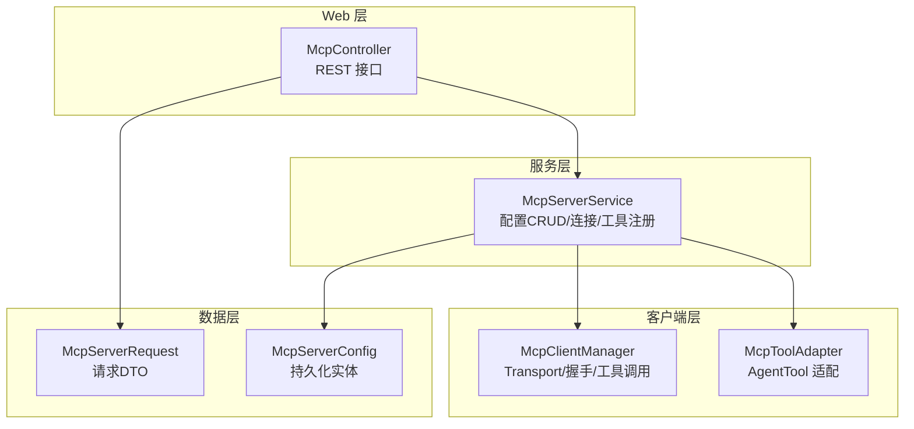
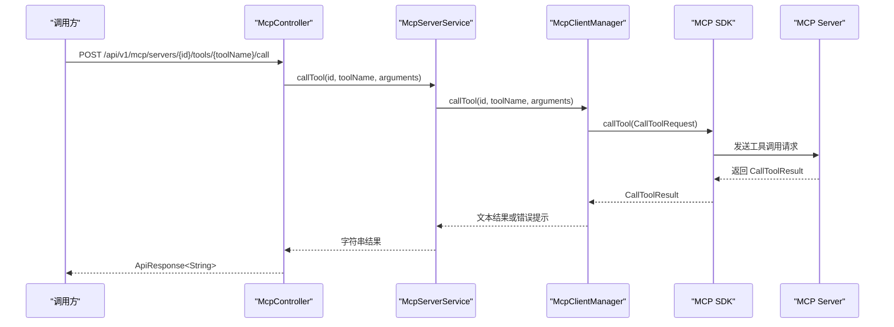
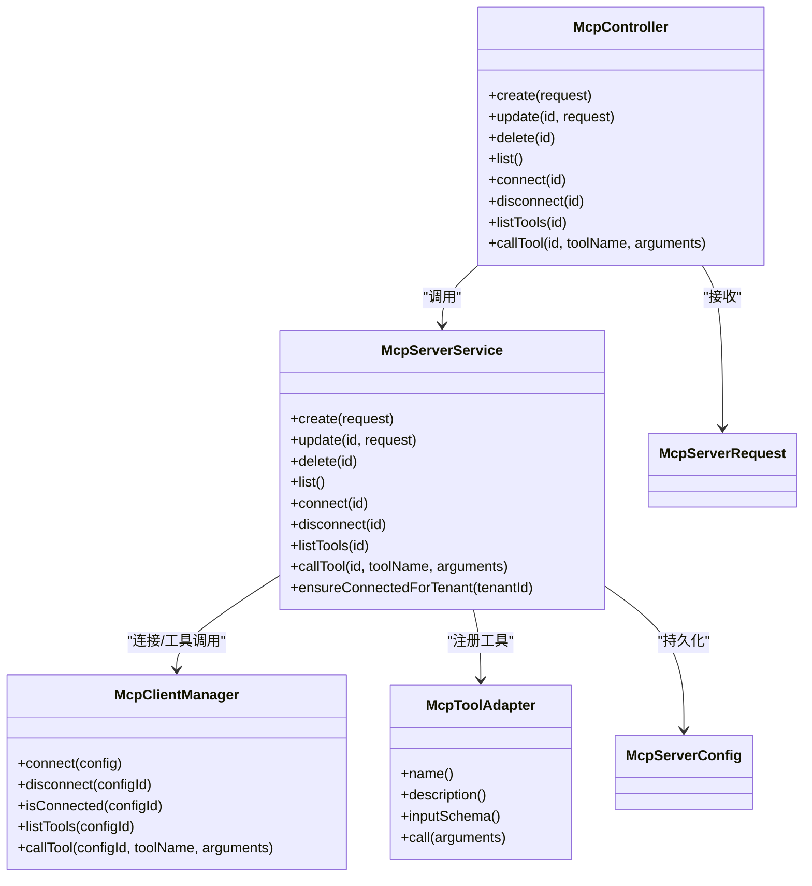
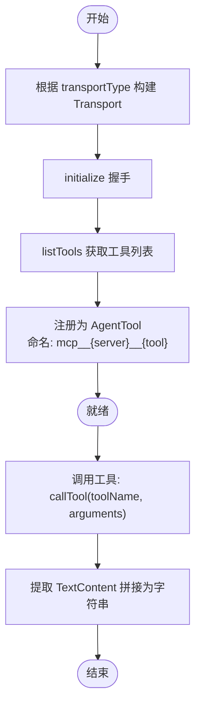

# MCP 服务器管理接口

<cite>
**本文引用的文件**   
- [McpController.java](file://src/main/java/com/agenthub/mcp/controller/McpController.java)
- [McpServerService.java](file://src/main/java/com/agenthub/mcp/service/McpServerService.java)
- [McpClientManager.java](file://src/main/java/com/agenthub/mcp/client/McpClientManager.java)
- [McpToolAdapter.java](file://src/main/java/com/agenthub/mcp/client/McpToolAdapter.java)
- [McpServerRequest.java](file://src/main/java/com/agenthub/mcp/dto/McpServerRequest.java)
- [McpServerConfig.java](file://src/main/java/com/agenthub/mcp/entity/McpServerConfig.java)
- [ApiResponse.java](file://src/main/java/com/agenthub/common/api/ApiResponse.java)
- [BizException.java](file://src/main/java/com/agenthub/common/exception/BizException.java)
- [ErrorCode.java](file://src/main/java/com/agenthub/common/exception/ErrorCode.java)
</cite>

## 目录
1. [简介](#简介)
2. [项目结构](#项目结构)
3. [核心组件](#核心组件)
4. [架构总览](#架构总览)
5. [详细组件分析](#详细组件分析)
6. [依赖关系分析](#依赖关系分析)
7. [性能与可靠性](#性能与可靠性)
8. [故障排查指南](#故障排查指南)
9. [结论](#结论)
10. [附录：API 定义与调用示例](#附录api-定义与调用示例)

## 简介
本文件为 MCP（Model Context Protocol）服务器管理接口的完整 API 文档，覆盖以下能力：
- MCP 服务器的配置增删改查
- 连接建立、断开与状态监控
- 工具发现与注册到平台工具注册表
- 直接调用 MCP 工具（调试/演示）
- 支持的传输协议类型：stdio、sse、streamable-http
- 请求参数结构与实体字段说明
- 错误处理、超时配置与重试机制建议
- MCP 协议工作原理与工具调用数据流转

## 项目结构
MCP 相关代码位于 mcp 包下，采用 Controller-Service-Client 分层：
- Controller：对外暴露 REST 接口
- Service：业务编排、校验、租户隔离、工具注册
- Client：封装 MCP SDK 客户端，负责传输层与握手、工具发现与调用
- DTO/Entity：请求体与持久化实体

图表来源
- [McpController.java:21-83](file://src/main/java/com/agenthub/mcp/controller/McpController.java#L21-L83)
- [McpServerService.java:23-109](file://src/main/java/com/agenthub/mcp/service/McpServerService.java#L23-L109)
- [McpClientManager.java:24-143](file://src/main/java/com/agenthub/mcp/client/McpClientManager.java#L24-L143)
- [McpToolAdapter.java:8-53](file://src/main/java/com/agenthub/mcp/client/McpToolAdapter.java#L8-L53)
- [McpServerRequest.java:5-36](file://src/main/java/com/agenthub/mcp/dto/McpServerRequest.java#L5-L36)
- [McpServerConfig.java:10-52](file://src/main/java/com/agenthub/mcp/entity/McpServerConfig.java#L10-L52)

章节来源
- [McpController.java:21-83](file://src/main/java/com/agenthub/mcp/controller/McpController.java#L21-L83)
- [McpServerService.java:23-109](file://src/main/java/com/agenthub/mcp/service/McpServerService.java#L23-L109)
- [McpClientManager.java:24-143](file://src/main/java/com/agenthub/mcp/client/McpClientManager.java#L24-L143)
- [McpToolAdapter.java:8-53](file://src/main/java/com/agenthub/mcp/client/McpToolAdapter.java#L8-L53)
- [McpServerRequest.java:5-36](file://src/main/java/com/agenthub/mcp/dto/McpServerRequest.java#L5-L36)
- [McpServerConfig.java:10-52](file://src/main/java/com/agenthub/mcp/entity/McpServerConfig.java#L10-L52)

## 核心组件
- McpController：提供 MCP Server 配置的 CRUD、连接管理、工具列表与直接调用的 REST 接口。
- McpServerService：实现配置校验、持久化、连接生命周期管理、工具注册与 AgentScope 刷新。
- McpClientManager：封装 MCP SDK，按传输类型构建 Transport，完成 initialize、listTools、callTool。
- McpToolAdapter：将远程 MCP Tool 包装为平台统一的 AgentTool，命名规则为 mcp__{server}__{tool}。
- McpServerRequest：创建/更新配置时的请求体。
- McpServerConfig：持久化的 MCP Server 连接配置。

章节来源
- [McpController.java:21-83](file://src/main/java/com/agenthub/mcp/controller/McpController.java#L21-L83)
- [McpServerService.java:23-109](file://src/main/java/com/agenthub/mcp/service/McpServerService.java#L23-L109)
- [McpClientManager.java:24-143](file://src/main/java/com/agenthub/mcp/client/McpClientManager.java#L24-L143)
- [McpToolAdapter.java:8-53](file://src/main/java/com/agenthub/mcp/client/McpToolAdapter.java#L8-L53)
- [McpServerRequest.java:5-36](file://src/main/java/com/agenthub/mcp/dto/McpServerRequest.java#L5-L36)
- [McpServerConfig.java:10-52](file://src/main/java/com/agenthub/mcp/entity/McpServerConfig.java#L10-L52)

## 架构总览
下图展示从 HTTP 请求到 MCP Server 工具调用的端到端流程。

图表来源
- [McpController.java:75-82](file://src/main/java/com/agenthub/mcp/controller/McpController.java#L75-L82)
- [McpServerService.java:105-109](file://src/main/java/com/agenthub/mcp/service/McpServerService.java#L105-L109)
- [McpClientManager.java:82-95](file://src/main/java/com/agenthub/mcp/client/McpClientManager.java#L82-L95)

## 详细组件分析

### 控制器：McpController
职责
- 暴露 MCP Server 配置的增删改查接口
- 暴露连接建立/断开接口
- 暴露工具列表查询与直接调用接口

关键接口
- 新增配置：POST /api/v1/mcp/servers
- 更新配置：PUT /api/v1/mcp/servers/{id}
- 删除配置：DELETE /api/v1/mcp/servers/{id}
- 配置列表：GET /api/v1/mcp/servers
- 建立连接：POST /api/v1/mcp/servers/{id}/connect
- 断开连接：POST /api/v1/mcp/servers/{id}/disconnect
- 列出工具：GET /api/v1/mcp/servers/{id}/tools
- 直接调用工具：POST /api/v1/mcp/servers/{id}/tools/{toolName}/call

章节来源
- [McpController.java:21-83](file://src/main/java/com/agenthub/mcp/controller/McpController.java#L21-L83)

### 服务层：McpServerService
职责
- 配置校验与持久化
- 连接生命周期管理（connect/disconnect）
- 工具注册到平台 ToolRegistry，并刷新 AgentScope
- 租户懒连接：ensureConnectedForTenant

关键逻辑
- validate：校验 name、transportType、baseUrl/command 等必填项
- connect：建立连接 → listTools → 注册工具 → refresh AgentScope
- disconnect：关闭连接 → 注销该 server 的全部工具 → refresh AgentScope
- ensureConnectedForTenant：启动时按租户启用配置进行懒连接

章节来源
- [McpServerService.java:23-156](file://src/main/java/com/agenthub/mcp/service/McpServerService.java#L23-L156)

### 客户端：McpClientManager
职责
- 按配置构建传输层（streamable-http、sse、stdio）
- 初始化握手（initialize）
- 工具发现（listTools）
- 工具调用（callTool），提取文本内容返回
- 连接池管理（ConcurrentHashMap<Long, McpSyncClient>）

关键细节
- 请求超时：requestTimeout(Duration.ofSeconds(30))
- 传输构建：根据 transportType 选择对应 Transport
- STDIO：解析 argsJson/envJson 构造 ServerParameters
- 异常处理：连接失败抛出 BizException(MCP_ERROR)

章节来源
- [McpClientManager.java:24-143](file://src/main/java/com/agenthub/mcp/client/McpClientManager.java#L24-L143)

### 工具适配器：McpToolAdapter
职责
- 将 MCP Server 的 Tool 包装为平台 AgentTool
- 命名规则：mcp__{serverName}__{toolName}
- 描述增强：补充来源 server 信息
- 输入 Schema：若为空则回退为 object + empty properties
- 调用转发：委托给 McpClientManager.callTool

章节来源
- [McpToolAdapter.java:8-53](file://src/main/java/com/agenthub/mcp/client/McpToolAdapter.java#L8-L53)

### 数据模型：McpServerRequest 与 McpServerConfig
McpServerRequest（请求体）
- name：配置名（唯一标识，工具名前缀）
- description：描述
- transportType：传输类型（stdio | sse | streamable-http）
- baseUrl：SSE/Streamable HTTP 服务地址
- endpoint：Streamable HTTP 的 endpoint（默认 /mcp）
- command：STDIO 模式启动命令
- argsJson：STDIO 模式启动参数（JSON 数组字符串）
- envJson：环境变量（JSON 对象字符串）
- enabled：是否启用

McpServerConfig（持久化实体）
- id：自增主键
- tenantId：租户ID
- name/description/transportType/baseUrl/endpoint/command/argsJson/envJson/enabled
- createdAt/updatedAt：时间戳

章节来源
- [McpServerRequest.java:5-36](file://src/main/java/com/agenthub/mcp/dto/McpServerRequest.java#L5-L36)
- [McpServerConfig.java:10-52](file://src/main/java/com/agenthub/mcp/entity/McpServerConfig.java#L10-L52)

## 依赖关系分析
- McpController 依赖 McpServerService 与 McpServerRequest
- McpServerService 依赖 McpServerConfigMapper、McpClientManager、ToolRegistry、AgentScopeAdapter
- McpClientManager 依赖 MCP SDK 的 McpClient/McpSyncClient 与各 Transport
- McpToolAdapter 依赖 McpClientManager 与 McpSchema.Tool

图表来源
- [McpController.java:21-83](file://src/main/java/com/agenthub/mcp/controller/McpController.java#L21-L83)
- [McpServerService.java:23-156](file://src/main/java/com/agenthub/mcp/service/McpServerService.java#L23-L156)
- [McpClientManager.java:24-143](file://src/main/java/com/agenthub/mcp/client/McpClientManager.java#L24-L143)
- [McpToolAdapter.java:8-53](file://src/main/java/com/agenthub/mcp/client/McpToolAdapter.java#L8-L53)
- [McpServerRequest.java:5-36](file://src/main/java/com/agenthub/mcp/dto/McpServerRequest.java#L5-L36)
- [McpServerConfig.java:10-52](file://src/main/java/com/agenthub/mcp/entity/McpServerConfig.java#L10-L52)

## 性能与可靠性
- 连接复用：McpClientManager 使用 ConcurrentHashMap 缓存已连接的 McpSyncClient，避免重复握手。
- 超时控制：默认请求超时 30 秒，适用于大多数工具调用场景。
- 优雅关闭：@PreDestroy 统一关闭所有连接，避免资源泄漏。
- 重试机制：当前未内置重试；建议在调用侧对网络抖动进行指数退避重试，或在网关层增加熔断与限流。
- 工具注册开销：每次 connect 会遍历工具并注册到 ToolRegistry，建议仅在必要时触发 connect，避免频繁重连。

[本节为通用指导，不直接分析具体文件]

## 故障排查指南
常见问题与定位要点
- 配置不存在：service 层 require 方法会抛出 BizException(NOT_FOUND)，检查路径参数是否正确。
- 参数校验失败：validate 会校验 name、transportType、baseUrl/command 等，检查请求体是否符合约束。
- 传输类型不支持：buildTransport 对未知类型抛错，确认 transportType 取值。
- 连接失败：connect 捕获异常后抛出 BizException(MCP_ERROR)，检查 baseUrl/endpoint/command 及网络可达性。
- 工具调用失败：callTool 捕获异常并包装为 BizException(MCP_ERROR)，检查工具名称与参数 schema 是否匹配。
- 未连接调用：require(configId) 在客户端未连接时抛错，先调用 connect。

章节来源
- [McpServerService.java:133-156](file://src/main/java/com/agenthub/mcp/service/McpServerService.java#L133-L156)
- [McpClientManager.java:41-57](file://src/main/java/com/agenthub/mcp/client/McpClientManager.java#L41-L57)
- [McpClientManager.java:108-114](file://src/main/java/com/agenthub/mcp/client/McpClientManager.java#L108-L114)
- [BizException.java](file://src/main/java/com/agenthub/common/exception/BizException.java)
- [ErrorCode.java](file://src/main/java/com/agenthub/common/exception/ErrorCode.java)

## 结论
本模块通过标准 REST 接口提供了 MCP Server 的全生命周期管理能力，支持三种传输协议，并将远程工具无缝接入平台工具注册表，供 LLM 与 Agent 编排直接使用。结合连接复用、超时控制与统一异常封装，具备较好的可维护性与扩展性。建议在外部网关层补充重试、熔断与审计能力，以进一步提升稳定性与可观测性。

[本节为总结性内容，不直接分析具体文件]

## 附录：API 定义与调用示例

### 接口总览
- 基础路径：/api/v1/mcp/servers
- 响应格式：统一 ApiResponse<T>

| 方法 | 路径 | 功能 | 请求体/路径参数 | 返回 |
|---|---|---|---|---|
| POST | /api/v1/mcp/servers | 新增配置 | McpServerRequest | ApiResponse<McpServerConfig> |
| PUT | /api/v1/mcp/servers/{id} | 更新配置 | 路径 id，请求体 McpServerRequest | ApiResponse<McpServerConfig> |
| DELETE | /api/v1/mcp/servers/{id} | 删除配置 | 路径 id | ApiResponse<Void> |
| GET | /api/v1/mcp/servers | 配置列表 | 无 | ApiResponse<List<McpServerConfig>> |
| POST | /api/v1/mcp/servers/{id}/connect | 建立连接并注册工具 | 路径 id | ApiResponse<List<McpSchema.Tool>> |
| POST | /api/v1/mcp/servers/{id}/disconnect | 断开连接并注销工具 | 路径 id | ApiResponse<Void> |
| GET | /api/v1/mcp/servers/{id}/tools | 列出已连接 Server 的工具 | 路径 id | ApiResponse<List<McpSchema.Tool>> |
| POST | /api/v1/mcp/servers/{id}/tools/{toolName}/call | 直接调用 MCP 工具 | 路径 id、toolName，请求体 Map<String,Object> | ApiResponse<String> |

章节来源
- [McpController.java:31-82](file://src/main/java/com/agenthub/mcp/controller/McpController.java#L31-L82)

### 请求参数：McpServerRequest
字段说明
- name：配置名（必填，唯一标识，工具名前缀）
- description：可选描述
- transportType：必填，取值 stdio | sse | streamable-http
- baseUrl：当 transportType 为 sse 或 streamable-http 时必填
- endpoint：streamable-http 的 endpoint，默认 /mcp
- command：stdio 模式必填，用于拉起子进程的命令
- argsJson：stdio 模式可选，JSON 数组字符串形式的启动参数
- envJson：stdio 模式可选，JSON 对象字符串形式的环境变量
- enabled：是否启用

校验规则
- name 非空
- transportType 非空且仅支持上述三种
- sse/streamable-http 必须提供 baseUrl
- stdio 必须提供 command

章节来源
- [McpServerRequest.java:5-36](file://src/main/java/com/agenthub/mcp/dto/McpServerRequest.java#L5-L36)
- [McpServerService.java:141-156](file://src/main/java/com/agenthub/mcp/service/McpServerService.java#L141-L156)

### 实体字段：McpServerConfig
字段说明
- id：自增主键
- tenantId：租户ID
- name/description/transportType/baseUrl/endpoint/command/argsJson/envJson/enabled
- createdAt/updatedAt：时间戳

章节来源
- [McpServerConfig.java:10-52](file://src/main/java/com/agenthub/mcp/entity/McpServerConfig.java#L10-L52)

### 传输协议与连接配置
- streamable-http：基于 HTTP 的可流式传输，endpoint 默认 /mcp
- sse：基于 SSE 的长连接
- stdio：本地进程模式，通过 command/argsJson/envJson 拉起子进程

章节来源
- [McpClientManager.java:117-143](file://src/main/java/com/agenthub/mcp/client/McpClientManager.java#L117-L143)

### 调用示例（概念性）
- 新增配置
  - 方法：POST
  - 路径：/api/v1/mcp/servers
  - 请求体：包含 name、transportType、baseUrl 或 command 等字段
  - 返回：ApiResponse<McpServerConfig>

- 测试连接
  - 方法：POST
  - 路径：/api/v1/mcp/servers/{id}/connect
  - 返回：ApiResponse<List<McpSchema.Tool>>

- 获取工具列表
  - 方法：GET
  - 路径：/api/v1/mcp/servers/{id}/tools
  - 返回：ApiResponse<List<McpSchema.Tool>>

- 直接调用工具
  - 方法：POST
  - 路径：/api/v1/mcp/servers/{id}/tools/{toolName}/call
  - 请求体：Map<String,Object> 作为工具参数
  - 返回：ApiResponse<String>

章节来源
- [McpController.java:31-82](file://src/main/java/com/agenthub/mcp/controller/McpController.java#L31-L82)

### 错误处理与异常码
- NOT_FOUND：配置不存在
- PARAM_ERROR：参数校验失败或不支持的传输类型
- MCP_ERROR：连接失败或工具调用失败

统一响应体由 ApiResponse 包裹，异常由 GlobalExceptionHandler 统一处理（参考 common 模块）。

章节来源
- [McpServerService.java:133-156](file://src/main/java/com/agenthub/mcp/service/McpServerService.java#L133-L156)
- [McpClientManager.java:41-57](file://src/main/java/com/agenthub/mcp/client/McpClientManager.java#L41-L57)
- [BizException.java](file://src/main/java/com/agenthub/common/exception/BizException.java)
- [ErrorCode.java](file://src/main/java/com/agenthub/common/exception/ErrorCode.java)
- [ApiResponse.java](file://src/main/java/com/agenthub/common/api/ApiResponse.java)

### MCP 协议工作原理与工具调用数据流转
- 握手阶段：客户端通过 Transport 与 MCP Server 建立连接，执行 initialize 握手。
- 工具发现：客户端调用 listTools 获取 Server 暴露的工具元数据（名称、描述、输入 Schema）。
- 工具注册：平台将每个工具包装为 AgentTool，并以 mcp__{server}__{tool} 命名注册到 ToolRegistry。
- 工具调用：LLM/Agent 通过 ToolRegistry 调用工具，最终经由 McpClientManager.callTool 向远端 MCP Server 发起调用，返回文本内容。

图表来源
- [McpClientManager.java:41-57](file://src/main/java/com/agenthub/mcp/client/McpClientManager.java#L41-L57)
- [McpClientManager.java:82-106](file://src/main/java/com/agenthub/mcp/client/McpClientManager.java#L82-L106)
- [McpToolAdapter.java:31-53](file://src/main/java/com/agenthub/mcp/client/McpToolAdapter.java#L31-L53)