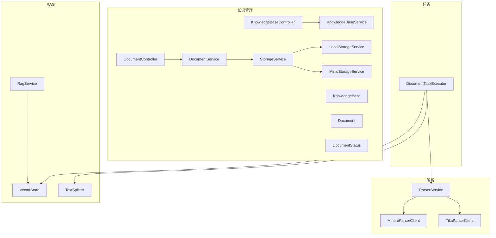
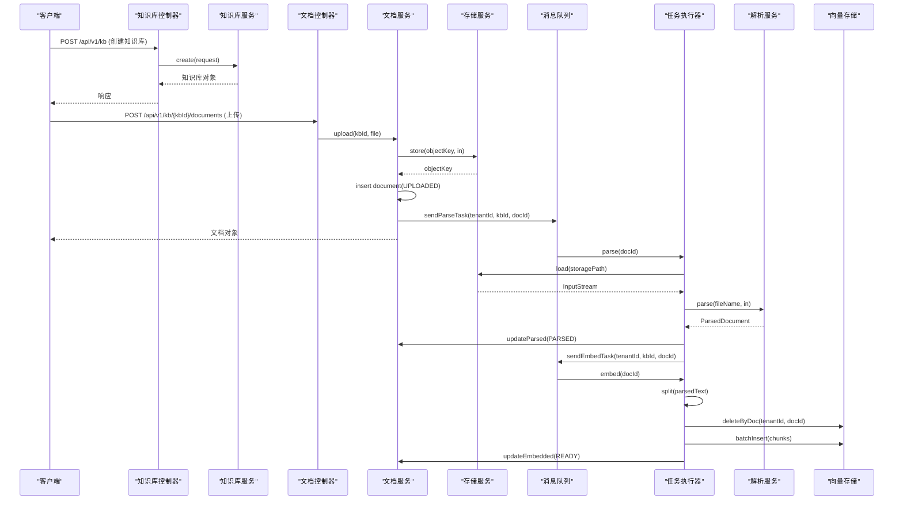
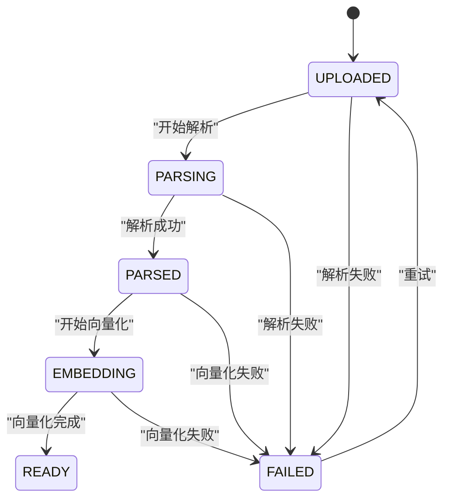
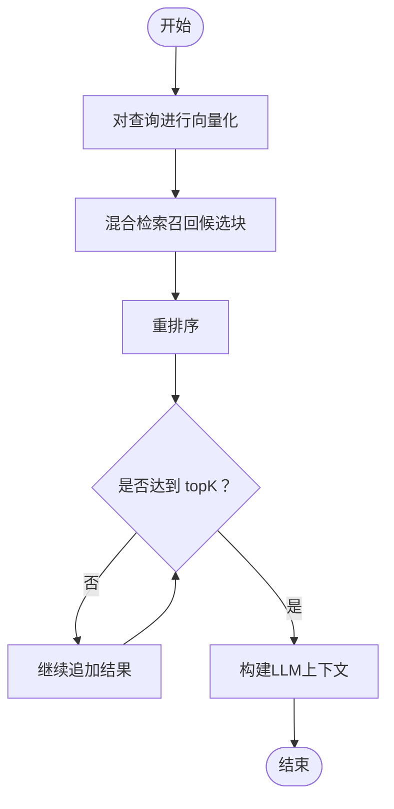
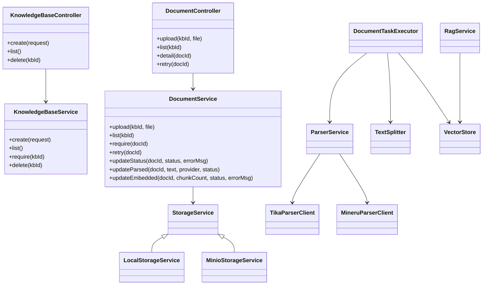

# 知识库管理接口

<cite>
**本文引用的文件**   
- [KnowledgeBaseController.java](file://src/main/java/com/agenthub/knowledge/controller/KnowledgeBaseController.java)
- [DocumentController.java](file://src/main/java/com/agenthub/knowledge/controller/DocumentController.java)
- [KnowledgeBaseRequest.java](file://src/main/java/com/agenthub/knowledge/dto/KnowledgeBaseRequest.java)
- [KnowledgeBase.java](file://src/main/java/com/agenthub/knowledge/entity/KnowledgeBase.java)
- [Document.java](file://src/main/java/com/agenthub/knowledge/entity/Document.java)
- [DocumentStatus.java](file://src/main/java/com/agenthub/knowledge/enums/DocumentStatus.java)
- [KnowledgeBaseService.java](file://src/main/java/com/agenthub/knowledge/service/KnowledgeBaseService.java)
- [DocumentService.java](file://src/main/java/com/agenthub/knowledge/service/DocumentService.java)
- [ParserService.java](file://src/main/java/com/agenthub/parser/ParserService.java)
- [TikaParserClient.java](file://src/main/java/com/agenthub/parser/tika/TikaParserClient.java)
- [MineruParserClient.java](file://src/main/java/com/agenthub/parser/mineru/MineruParserClient.java)
- [DocumentTaskExecutor.java](file://src/main/java/com/agenthub/task/executor/DocumentTaskExecutor.java)
- [StorageService.java](file://src/main/java/com/agenthub/knowledge/storage/StorageService.java)
- [LocalStorageService.java](file://src/main/java/com/agenthub/knowledge/storage/LocalStorageService.java)
- [MinioStorageService.java](file://src/main/java/com/agenthub/knowledge/storage/MinioStorageService.java)
- [RagService.java](file://src/main/java/com/agenthub/rag/service/RagService.java)
- [TextSplitter.java](file://src/main/java/com/agenthub/rag/splitter/TextSplitter.java)
- [VectorStore.java](file://src/main/java/com/agenthub/rag/store/VectorStore.java)
</cite>

## 目录
1. [简介](#简介)
2. [项目结构](#项目结构)
3. [核心组件](#核心组件)
4. [架构总览](#架构总览)
5. [详细组件分析](#详细组件分析)
6. [依赖关系分析](#依赖关系分析)
7. [性能考虑](#性能考虑)
8. [故障排查指南](#故障排查指南)
9. [结论](#结论)

## 简介
本文件为“知识库管理接口”的完整 API 文档，覆盖知识库创建、配置、文档上传、解析、向量化与检索的全流程。重点说明：
- 知识库配置请求 KnowledgeBaseRequest 的字段含义与默认值
- 文档上传接口的文件处理流程（支持格式、大小限制、解析器选择）
- 文档状态管理机制（待解析、解析中、已完成、失败等）
- 知识库 CRUD 与文档管理的接口示例
- RAG 检索增强工作流程与向量存储机制
- 性能优化建议与错误处理方案

## 项目结构
知识库相关代码位于 knowledge 包下，包含控制器、服务、实体、枚举、存储抽象与实现；解析能力在 parser 包；任务执行与异步流水线在 task 包；RAG 检索在 rag 包。

图表来源
- [KnowledgeBaseController.java:22-44](file://src/main/java/com/agenthub/knowledge/controller/KnowledgeBaseController.java#L22-L44)
- [DocumentController.java:20-51](file://src/main/java/com/agenthub/knowledge/controller/DocumentController.java#L20-L51)
- [KnowledgeBaseService.java:19-60](file://src/main/java/com/agenthub/knowledge/service/KnowledgeBaseService.java#L19-L60)
- [DocumentService.java:28-138](file://src/main/java/com/agenthub/knowledge/service/DocumentService.java#L28-L138)
- [StorageService.java:8-18](file://src/main/java/com/agenthub/knowledge/storage/StorageService.java#L8-L18)
- [LocalStorageService.java:17-65](file://src/main/java/com/agenthub/knowledge/storage/LocalStorageService.java#L17-L65)
- [MinioStorageService.java:17-82](file://src/main/java/com/agenthub/knowledge/storage/MinioStorageService.java#L17-L82)
- [ParserService.java:18-38](file://src/main/java/com/agenthub/parser/ParserService.java#L18-L38)
- [TikaParserClient.java:15-35](file://src/main/java/com/agenthub/parser/tika/TikaParserClient.java#L15-L35)
- [MineruParserClient.java:29-113](file://src/main/java/com/agenthub/parser/mineru/MineruParserClient.java#L29-L113)
- [DocumentTaskExecutor.java:36-122](file://src/main/java/com/agenthub/task/executor/DocumentTaskExecutor.java#L36-L122)
- [RagService.java:22-70](file://src/main/java/com/agenthub/rag/service/RagService.java#L22-L70)
- [TextSplitter.java:8-12](file://src/main/java/com/agenthub/rag/splitter/TextSplitter.java#L8-L12)
- [VectorStore.java:12-28](file://src/main/java/com/agenthub/rag/store/VectorStore.java#L12-L28)

章节来源
- [KnowledgeBaseController.java:22-44](file://src/main/java/com/agenthub/knowledge/controller/KnowledgeBaseController.java#L22-L44)
- [DocumentController.java:20-51](file://src/main/java/com/agenthub/knowledge/controller/DocumentController.java#L20-L51)

## 核心组件
- 知识库控制器：提供知识库的创建、查询、删除接口
- 文档控制器：提供文档上传、列表、详情、重试接口
- 知识库服务：封装知识库的增删查逻辑，并维护租户隔离
- 文档服务：封装上传、状态更新、重试等逻辑，驱动异步任务
- 解析服务：按配置路由到具体解析客户端（Tika/MinerU）
- 任务执行器：解析与向量化流水线的编排者
- 存储抽象：本地磁盘或 MinIO 的对象存储实现
- RAG 服务：检索、过滤、重排的入口
- 文本切分器：将长文本切分为块
- 向量存储：向量写入、检索、删除的抽象

章节来源
- [KnowledgeBaseService.java:19-60](file://src/main/java/com/agenthub/knowledge/service/KnowledgeBaseService.java#L19-L60)
- [DocumentService.java:28-138](file://src/main/java/com/agenthub/knowledge/service/DocumentService.java#L28-L138)
- [ParserService.java:18-38](file://src/main/java/com/agenthub/parser/ParserService.java#L18-L38)
- [DocumentTaskExecutor.java:36-122](file://src/main/java/com/agenthub/task/executor/DocumentTaskExecutor.java#L36-L122)
- [RagService.java:22-70](file://src/main/java/com/agenthub/rag/service/RagService.java#L22-L70)

## 架构总览
知识库与文档的端到端流程如下：
- 创建知识库：通过 REST 接口提交配置，服务层持久化并启用
- 上传文档：服务端校验类型、落盘、落库（UPLOADED），投递解析任务
- 解析阶段：消费者下载文件，调用解析引擎（Tika/MinerU），保存纯文本（PARSED），投递向量化任务
- 向量化阶段：切分文本、批量向量化、清理旧向量、批量入库（READY）
- 检索阶段：RAG 服务对查询进行向量化、混合检索与重排，返回片段

图表来源
- [KnowledgeBaseController.java:29-43](file://src/main/java/com/agenthub/knowledge/controller/KnowledgeBaseController.java#L29-L43)
- [KnowledgeBaseService.java:25-38](file://src/main/java/com/agenthub/knowledge/service/KnowledgeBaseService.java#L25-L38)
- [DocumentController.java:27-50](file://src/main/java/com/agenthub/knowledge/controller/DocumentController.java#L27-L50)
- [DocumentService.java:42-76](file://src/main/java/com/agenthub/knowledge/service/DocumentService.java#L42-L76)
- [DocumentTaskExecutor.java:64-121](file://src/main/java/com/agenthub/task/executor/DocumentTaskExecutor.java#L64-L121)
- [ParserService.java:30-37](file://src/main/java/com/agenthub/parser/ParserService.java#L30-L37)
- [VectorStore.java:14-27](file://src/main/java/com/agenthub/rag/store/VectorStore.java#L14-L27)

## 详细组件分析

### 知识库接口
- 创建知识库
  - 路径：POST /api/v1/kb
  - 请求体：KnowledgeBaseRequest
  - 响应：统一 ApiResponse<KnowledgeBase>
- 列出知识库
  - 路径：GET /api/v1/kb
  - 响应：统一 ApiResponse<List<KnowledgeBase>>
- 删除知识库
  - 路径：DELETE /api/v1/kb/{kbId}
  - 响应：统一 ApiResponse<Void>

章节来源
- [KnowledgeBaseController.java:29-43](file://src/main/java/com/agenthub/knowledge/controller/KnowledgeBaseController.java#L29-L43)
- [KnowledgeBaseService.java:25-59](file://src/main/java/com/agenthub/knowledge/service/KnowledgeBaseService.java#L25-L59)

### 知识库配置请求 KnowledgeBaseRequest
字段说明：
- name：必填，知识库名称
- description：可选，知识库描述
- embeddingModel：可选，向量化模型路由键；缺省使用全局默认
- chunkSize：可选，分块大小；缺省 800
- chunkOverlap：可选，分块重叠；缺省 100

章节来源
- [KnowledgeBaseRequest.java:9-25](file://src/main/java/com/agenthub/knowledge/dto/KnowledgeBaseRequest.java#L9-L25)
- [KnowledgeBaseService.java:25-38](file://src/main/java/com/agenthub/knowledge/service/KnowledgeBaseService.java#L25-L38)

### 文档管理接口
- 上传文档
  - 路径：POST /api/v1/kb/{kbId}/documents
  - 内容类型：multipart/form-data，字段名 file
  - 行为：校验文件类型 → 存储原始文件 → 落库（UPLOADED）→ 投递解析任务 → 立即返回文档对象
- 文档列表
  - 路径：GET /api/v1/kb/{kbId}/documents
  - 行为：返回该知识库下的文档列表
- 文档详情
  - 路径：GET /api/v1/documents/{docId}
  - 行为：返回文档记录，含状态、错误信息等
- 失败重试
  - 路径：POST /api/v1/documents/{docId}/retry
  - 行为：重置状态为 UPLOADED，清空错误信息，重新投递解析任务

章节来源
- [DocumentController.java:27-50](file://src/main/java/com/agenthub/knowledge/controller/DocumentController.java#L27-L50)
- [DocumentService.java:42-102](file://src/main/java/com/agenthub/knowledge/service/DocumentService.java#L42-L102)

### 文档处理流程与解析器选择
- 允许的文件类型：pdf、docx、doc、txt、md、pptx、xlsx、html
- 解析器选择：
  - 通过配置选择主解析器（如 mineru），若未配置则回退到 tika
  - Tika：本地解析，无需外部服务，适合开发环境与降级
  - MinerU：HTTP 异步调用外部服务，解析质量更高，需 GPU 以获得最佳效果
- 解析结果：保存纯文本与解析引擎标识，供后续分块与向量化使用

章节来源
- [DocumentService.java:33-49](file://src/main/java/com/agenthub/knowledge/service/DocumentService.java#L33-L49)
- [ParserService.java:30-37](file://src/main/java/com/agenthub/parser/ParserService.java#L30-L37)
- [TikaParserClient.java:15-35](file://src/main/java/com/agenthub/parser/tika/TikaParserClient.java#L15-L35)
- [MineruParserClient.java:29-113](file://src/main/java/com/agenthub/parser/mineru/MineruParserClient.java#L29-L113)

### 文档状态管理机制
状态机定义：
- UPLOADED：已上传，等待解析
- PARSING：解析中
- PARSED：解析完成，等待向量化
- EMBEDDING：向量化入库中
- READY：全流程完成，可检索
- FAILED：处理失败（可通过重试恢复）

状态转换规则：
- 上传后进入 UPLOADED
- 解析阶段：UPLOADED → PARSING → PARSED
- 向量化阶段：PARSED → EMBEDDING → READY
- 任一步骤异常：→ FAILED（可通过重试回到 UPLOADED）

图表来源
- [DocumentStatus.java:11-25](file://src/main/java/com/agenthub/knowledge/enums/DocumentStatus.java#L11-L25)
- [DocumentTaskExecutor.java:64-121](file://src/main/java/com/agenthub/task/executor/DocumentTaskExecutor.java#L64-L121)
- [DocumentService.java:95-131](file://src/main/java/com/agenthub/knowledge/service/DocumentService.java#L95-L131)

### RAG 检索增强工作流程
- 输入：知识库ID列表、查询文本、topK、embeddingModel、过滤条件
- 步骤：
  1) 根据 embeddingModel 获取嵌入客户端并对查询进行向量化
  2) 混合检索（RRF）召回候选块
  3) 重排序提升相关性
  4) 组装 RetrievalResult 并截断至 topK
- 上下文构建：将检索结果拼接为带来源标注的文本，供 LLM 使用

图表来源
- [RagService.java:39-54](file://src/main/java/com/agenthub/rag/service/RagService.java#L39-L54)
- [RagService.java:59-69](file://src/main/java/com/agenthub/rag/service/RagService.java#L59-L69)

### 向量存储机制
- 抽象接口：VectorStore 定义了批量写入、向量检索、关键字检索、按文档/知识库删除等方法
- 强制租户隔离：所有方法要求传入 tenantId，确保多租户数据隔离
- 典型实现：PGVector（当前），可扩展 Milvus/Elasticsearch 等

章节来源
- [VectorStore.java:12-28](file://src/main/java/com/agenthub/rag/store/VectorStore.java#L12-L28)

### 文件存储机制
- 抽象接口：StorageService 定义 store/load/delete
- 本地实现：LocalStorageService，基于文件系统，具备路径穿越防护
- MinIO 实现：MinioStorageService，自动创建 bucket，支持流式上传

章节来源
- [StorageService.java:8-18](file://src/main/java/com/agenthub/knowledge/storage/StorageService.java#L8-L18)
- [LocalStorageService.java:17-65](file://src/main/java/com/agenthub/knowledge/storage/LocalStorageService.java#L17-L65)
- [MinioStorageService.java:17-82](file://src/main/java/com/agenthub/knowledge/storage/MinioStorageService.java#L17-L82)

## 依赖关系分析
- 控制器依赖服务层，服务层依赖 Mapper、存储与任务生产者
- 任务执行器依赖存储服务、解析服务、文本切分器、嵌入路由与向量存储
- 解析服务通过 Spring 容器注入多个 ParserClient 实现，按配置路由
- RAG 服务依赖嵌入路由、混合检索器与重排器

图表来源
- [KnowledgeBaseController.java:22-44](file://src/main/java/com/agenthub/knowledge/controller/KnowledgeBaseController.java#L22-L44)
- [DocumentController.java:20-51](file://src/main/java/com/agenthub/knowledge/controller/DocumentController.java#L20-L51)
- [KnowledgeBaseService.java:19-60](file://src/main/java/com/agenthub/knowledge/service/KnowledgeBaseService.java#L19-L60)
- [DocumentService.java:28-138](file://src/main/java/com/agenthub/knowledge/service/DocumentService.java#L28-L138)
- [StorageService.java:8-18](file://src/main/java/com/agenthub/knowledge/storage/StorageService.java#L8-L18)
- [LocalStorageService.java:17-65](file://src/main/java/com/agenthub/knowledge/storage/LocalStorageService.java#L17-L65)
- [MinioStorageService.java:17-82](file://src/main/java/com/agenthub/knowledge/storage/MinioStorageService.java#L17-L82)
- [ParserService.java:18-38](file://src/main/java/com/agenthub/parser/ParserService.java#L18-L38)
- [TikaParserClient.java:15-35](file://src/main/java/com/agenthub/parser/tika/TikaParserClient.java#L15-L35)
- [MineruParserClient.java:29-113](file://src/main/java/com/agenthub/parser/mineru/MineruParserClient.java#L29-L113)
- [DocumentTaskExecutor.java:36-122](file://src/main/java/com/agenthub/task/executor/DocumentTaskExecutor.java#L36-L122)
- [TextSplitter.java:8-12](file://src/main/java/com/agenthub/rag/splitter/TextSplitter.java#L8-L12)
- [VectorStore.java:12-28](file://src/main/java/com/agenthub/rag/store/VectorStore.java#L12-L28)
- [RagService.java:22-70](file://src/main/java/com/agenthub/rag/service/RagService.java#L22-L70)

## 性能考虑
- 上传即返回：避免长请求阻塞，解析与向量化通过消息队列异步处理
- 幂等与重试：向量化前清理旧向量，避免重复入库；失败可重试
- 批量操作：向量化采用批量嵌入与批量入库，减少网络与数据库往返
- 存储选型：生产环境推荐 MinIO，单机或开发环境可使用本地磁盘
- 解析器选择：MinerU 解析质量高但依赖外部服务；Tika 作为降级方案
- 检索优化：混合检索（RRF）+ 重排序提升相关性；控制 topK 减少下游负载

[本节为通用指导，不直接分析具体文件]

## 故障排查指南
常见问题与定位要点：
- 文件类型不支持：检查 ALLOWED_TYPES 与扩展名提取逻辑
- 文件存储失败：确认存储服务配置（本地路径或 MinIO 参数）与权限
- 解析失败：查看解析器日志与 MinerU 服务可用性；必要时切换 Tika
- 向量化失败：检查文本是否为空、分块结果是否为空、向量存储连接与权限
- 状态卡住：通过文档详情接口查看 status 与 errorMsg，必要时调用重试接口

章节来源
- [DocumentService.java:42-76](file://src/main/java/com/agenthub/knowledge/service/DocumentService.java#L42-L76)
- [DocumentTaskExecutor.java:64-121](file://src/main/java/com/agenthub/task/executor/DocumentTaskExecutor.java#L64-L121)
- [MineruParserClient.java:47-113](file://src/main/java/com/agenthub/parser/mineru/MineruParserClient.java#L47-L113)
- [TikaParserClient.java:26-35](file://src/main/java/com/agenthub/parser/tika/TikaParserClient.java#L26-L35)

## 结论
本知识库管理系统以“上传即返回 + 异步流水线”为核心设计，结合灵活的解析器与存储抽象，实现了从文档上传、解析、向量化到检索的完整闭环。通过明确的状态机与重试机制，系统具备良好的容错性与可扩展性。在生产环境中，建议优先使用 MinerU 与 MinIO，并结合混合检索与重排序提升检索质量。