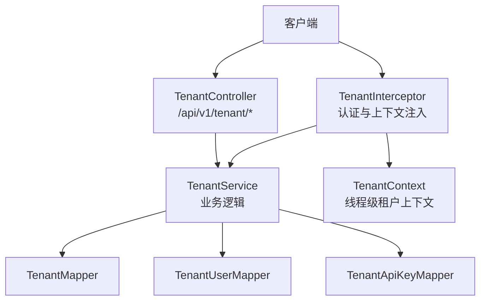
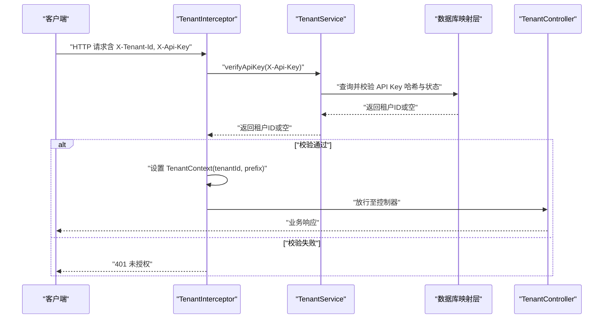
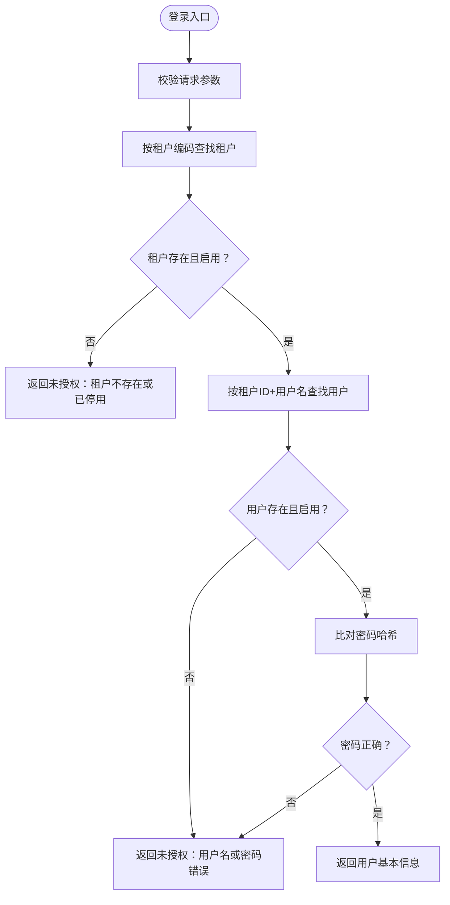
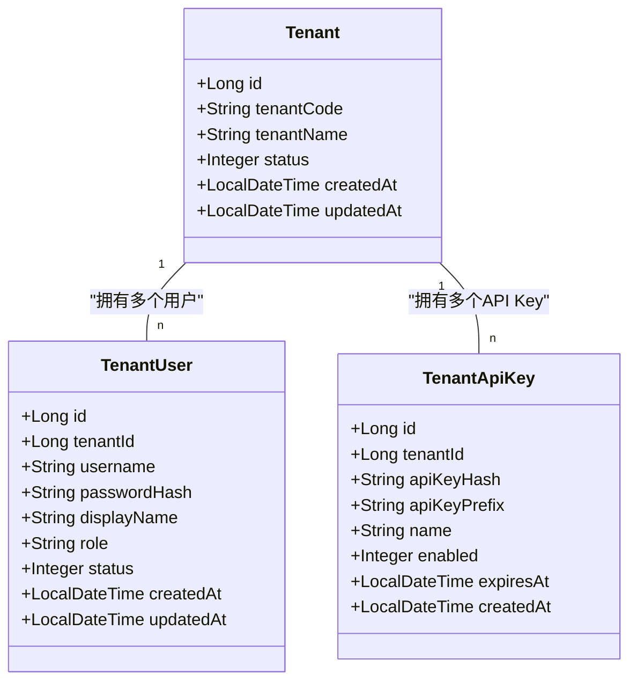
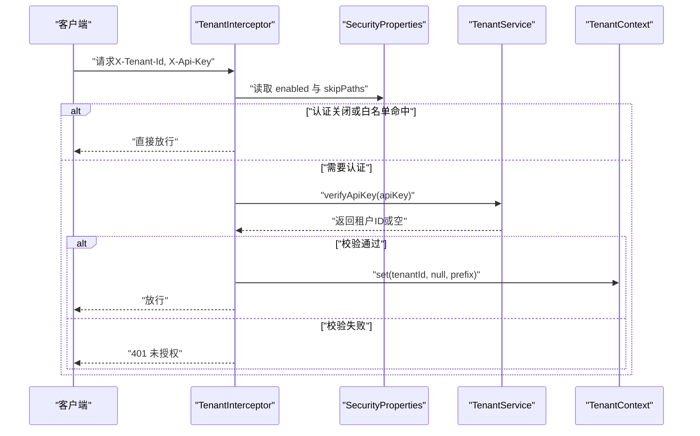
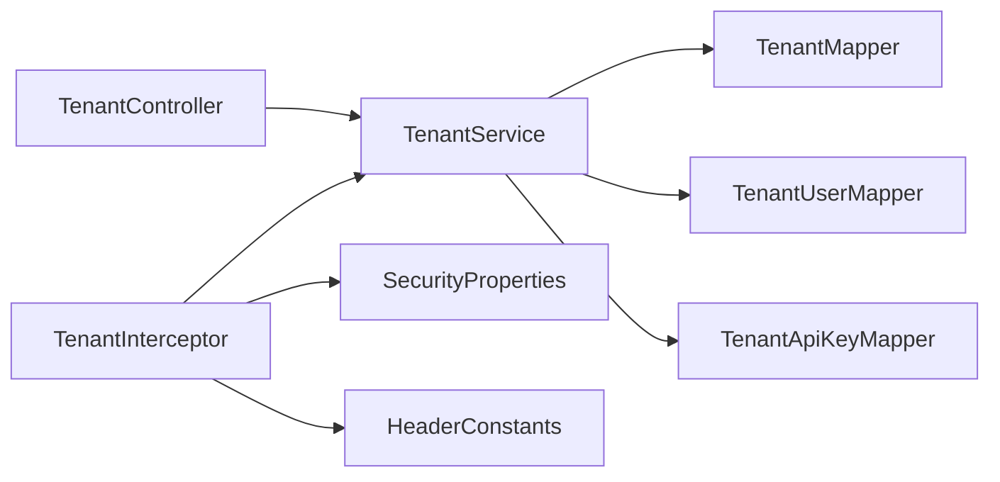

# 租户管理接口

<cite>
**本文引用的文件**   
- [TenantController.java](file://src/main/java/com/agenthub/tenant/controller/TenantController.java)
- [TenantService.java](file://src/main/java/com/agenthub/tenant/service/TenantService.java)
- [TenantCreateRequest.java](file://src/main/java/com/agenthub/tenant/dto/TenantCreateRequest.java)
- [LoginRequest.java](file://src/main/java/com/agenthub/tenant/dto/LoginRequest.java)
- [ApiKeyResponse.java](file://src/main/java/com/agenthub/tenant/dto/ApiKeyResponse.java)
- [TenantInterceptor.java](file://src/main/java/com/agenthub/gateway/interceptor/TenantInterceptor.java)
- [SecurityProperties.java](file://src/main/java/com/agenthub/gateway/config/SecurityProperties.java)
- [HeaderConstants.java](file://src/main/java/com/agenthub/common/constant/HeaderConstants.java)
- [Tenant.java](file://src/main/java/com/agenthub/tenant/entity/Tenant.java)
- [TenantUser.java](file://src/main/java/com/agenthub/tenant/entity/TenantUser.java)
- [TenantApiKey.java](file://src/main/java/com/agenthub/tenant/entity/TenantApiKey.java)
- [application.yml](file://src/main/resources/application.yml)
</cite>

## 目录
1. [简介](#简介)
2. [项目结构](#项目结构)
3. [核心组件](#核心组件)
4. [架构总览](#架构总览)
5. [详细接口说明](#详细接口说明)
6. [依赖关系分析](#依赖关系分析)
7. [性能与扩展性](#性能与扩展性)
8. [故障排查指南](#故障排查指南)
9. [结论](#结论)

## 简介
本文件为租户管理模块的 API 文档，覆盖租户注册、登录认证、API Key 签发与校验、多租户上下文传递等核心能力。重点说明：
- 租户创建请求参数 TenantCreateRequest 的字段含义与约束
- 登录请求 LoginRequest 的数据结构与返回内容
- API Key 响应 ApiKeyResponse 的结构与安全策略
- 基于 X-Tenant-Id 与 X-Api-Key 的认证流程
- 多租户数据隔离机制与安全最佳实践

## 项目结构
租户管理相关代码集中在 tenant 包，并通过 gateway 层的拦截器实现统一的认证与上下文注入。关键路径如下：
- 控制器层：/api/v1/tenant 下的注册、登录、API Key 签发
- 服务层：租户创建、用户登录、API Key 生成与校验
- 实体层：租户、租户用户、租户 API Key
- 网关拦截器：解析请求头、校验 API Key、写入租户上下文
- 配置层：安全开关与免认证路径

**图表来源**
- [TenantController.java:20-54](file://src/main/java/com/agenthub/tenant/controller/TenantController.java#L20-L54)
- [TenantService.java:32-129](file://src/main/java/com/agenthub/tenant/service/TenantService.java#L32-L129)
- [TenantInterceptor.java:18-76](file://src/main/java/com/agenthub/gateway/interceptor/TenantInterceptor.java#L18-L76)

**章节来源**
- [TenantController.java:20-54](file://src/main/java/com/agenthub/tenant/controller/TenantController.java#L20-L54)
- [TenantService.java:32-129](file://src/main/java/com/agenthub/tenant/service/TenantService.java#L32-L129)
- [TenantInterceptor.java:18-76](file://src/main/java/com/agenthub/gateway/interceptor/TenantInterceptor.java#L18-L76)

## 核心组件
- 控制器：提供 REST 端点，负责参数校验与结果封装
- 服务：实现租户创建、登录校验、API Key 签发与校验
- 实体：定义租户、租户用户、API Key 的数据模型
- 拦截器：统一鉴权、上下文注入、异常拒绝处理
- 配置：控制是否启用认证及白名单路径

**章节来源**
- [TenantController.java:20-54](file://src/main/java/com/agenthub/tenant/controller/TenantController.java#L20-L54)
- [TenantService.java:32-129](file://src/main/java/com/agenthub/tenant/service/TenantService.java#L32-L129)
- [Tenant.java:10-33](file://src/main/java/com/agenthub/tenant/entity/Tenant.java#L10-L33)
- [TenantUser.java:10-38](file://src/main/java/com/agenthub/tenant/entity/TenantUser.java#L10-L38)
- [TenantApiKey.java:10-38](file://src/main/java/com/agenthub/tenant/entity/TenantApiKey.java#L10-L38)
- [TenantInterceptor.java:18-76](file://src/main/java/com/agenthub/gateway/interceptor/TenantInterceptor.java#L18-L76)
- [SecurityProperties.java:8-20](file://src/main/java/com/agenthub/gateway/config/SecurityProperties.java#L8-L20)

## 架构总览
下图展示一次受保护接口的调用链路：客户端携带 X-Tenant-Id 与 X-Api-Key，拦截器完成校验后设置租户上下文，再进入业务控制器与服务层。

**图表来源**
- [TenantInterceptor.java:31-56](file://src/main/java/com/agenthub/gateway/interceptor/TenantInterceptor.java#L31-L56)
- [TenantService.java:94-109](file://src/main/java/com/agenthub/tenant/service/TenantService.java#L94-L109)

## 详细接口说明

### 通用约定
- 基础路径：/api/v1/tenant
- 统一响应体：ApiResponse<T>
- 认证头：
  - X-Tenant-Id：租户ID（数字）
  - X-Api-Key：API Key（字符串）
- 错误码：使用全局错误码，常见 UNAUTHORIZED 表示认证失败

**章节来源**
- [TenantController.java:20-54](file://src/main/java/com/agenthub/tenant/controller/TenantController.java#L20-L54)
- [HeaderConstants.java:6-19](file://src/main/java/com/agenthub/common/constant/HeaderConstants.java#L6-L19)

### 租户注册
- 方法：POST /api/v1/tenant/register
- 请求体：TenantCreateRequest
- 功能：创建租户，同时创建 OWNER 管理员账号，并初始化租户状态为启用

#### TenantCreateRequest 字段说明
| 字段 | 类型 | 必填 | 说明 |
| --- | --- | --- | --- |
| tenantCode | String | 是 | 租户编码，唯一标识，用于登录 |
| tenantName | String | 是 | 租户名称 |
| adminUsername | String | 是 | 管理员用户名 |
| adminPassword | String | 是 | 管理员密码（服务端仅保存哈希） |

- 成功响应：返回租户信息（不含敏感字段）
- 失败场景：参数校验失败、重复租户编码（由上层校验或数据库约束保证）

**章节来源**
- [TenantController.java:30-34](file://src/main/java/com/agenthub/tenant/controller/TenantController.java#L30-L34)
- [TenantCreateRequest.java:9-23](file://src/main/java/com/agenthub/tenant/dto/TenantCreateRequest.java#L9-L23)
- [TenantService.java:41-60](file://src/main/java/com/agenthub/tenant/service/TenantService.java#L41-L60)
- [Tenant.java:10-33](file://src/main/java/com/agenthub/tenant/entity/Tenant.java#L10-L33)

### 登录认证
- 方法：POST /api/v1/tenant/login
- 请求体：LoginRequest
- 功能：根据租户编码、用户名、密码进行认证，成功后返回用户基本信息

#### LoginRequest 字段说明
| 字段 | 类型 | 必填 | 说明 |
| --- | --- | --- | --- |
| tenantCode | String | 是 | 租户编码 |
| username | String | 是 | 用户名 |
| password | String | 是 | 密码（服务端仅比较哈希） |

- 成功响应：包含 tenantId、userId、username、displayName、role
- 失败场景：租户不存在或停用、用户名或密码错误

**图表来源**
- [TenantService.java:62-78](file://src/main/java/com/agenthub/tenant/service/TenantService.java#L62-L78)

**章节来源**
- [TenantController.java:36-46](file://src/main/java/com/agenthub/tenant/controller/TenantController.java#L36-L46)
- [LoginRequest.java:9-20](file://src/main/java/com/agenthub/tenant/dto/LoginRequest.java#L9-L20)
- [TenantService.java:62-78](file://src/main/java/com/agenthub/tenant/service/TenantService.java#L62-L78)
- [TenantUser.java:10-38](file://src/main/java/com/agenthub/tenant/entity/TenantUser.java#L10-L38)

### API Key 管理
- 方法：POST /api/v1/tenant/api-keys
- 请求体：Map<String, String>，至少包含 name 字段
- 功能：为当前租户签发 API Key，明文仅返回一次；库中只保存哈希值

#### ApiKeyResponse 字段说明
| 字段 | 类型 | 说明 |
| --- | --- | --- |
| name | String | API Key 名称 |
| apiKey | String | 完整 API Key（仅创建时返回一次） |
| prefix | String | API Key 前缀（便于展示与定位） |

- 安全策略：
  - 服务端仅存储 SHA-256 哈希
  - 支持 enabled 状态与过期时间 expiresAt 校验
  - 前端需妥善保存首次返回的 apiKey

**图表来源**
- [Tenant.java:10-33](file://src/main/java/com/agenthub/tenant/entity/Tenant.java#L10-L33)
- [TenantUser.java:10-38](file://src/main/java/com/agenthub/tenant/entity/TenantUser.java#L10-L38)
- [TenantApiKey.java:10-38](file://src/main/java/com/agenthub/tenant/entity/TenantApiKey.java#L10-L38)

**章节来源**
- [TenantController.java:48-53](file://src/main/java/com/agenthub/tenant/controller/TenantController.java#L48-L53)
- [ApiKeyResponse.java:9-16](file://src/main/java/com/agenthub/tenant/dto/ApiKeyResponse.java#L9-L16)
- [TenantService.java:80-109](file://src/main/java/com/agenthub/tenant/service/TenantService.java#L80-L109)
- [TenantApiKey.java:10-38](file://src/main/java/com/agenthub/tenant/entity/TenantApiKey.java#L10-L38)

### 认证流程与上下文传递
- 认证头：
  - X-Tenant-Id：租户ID（必须为数字）
  - X-Api-Key：API Key（必须有效且与租户匹配）
- 认证流程：
  1. 拦截器检查是否开启认证以及是否命中白名单
  2. 解析 X-Tenant-Id 与 X-Api-Key
  3. 调用服务层校验 API Key 有效性、状态与过期时间
  4. 将租户ID与 Key 前缀写入 TenantContext
  5. 下游 MyBatis 插件依据上下文自动附加租户条件，实现数据隔离
- 白名单路径：可通过配置关闭认证或添加跳过路径

**图表来源**
- [TenantInterceptor.java:31-56](file://src/main/java/com/agenthub/gateway/interceptor/TenantInterceptor.java#L31-L56)
- [SecurityProperties.java:8-20](file://src/main/java/com/agenthub/gateway/config/SecurityProperties.java#L8-L20)
- [TenantService.java:94-109](file://src/main/java/com/agenthub/tenant/service/TenantService.java#L94-L109)

**章节来源**
- [TenantInterceptor.java:18-76](file://src/main/java/com/agenthub/gateway/interceptor/TenantInterceptor.java#L18-L76)
- [HeaderConstants.java:6-19](file://src/main/java/com/agenthub/common/constant/HeaderConstants.java#L6-L19)
- [application.yml:54-62](file://src/main/resources/application.yml#L54-L62)

### 租户生命周期管理示例
以下为常用操作建议（以现有接口为基础扩展）：
- 创建租户：POST /api/v1/tenant/register
- 查询租户：GET /api/v1/tenant/{id}（需在控制器新增对应端点）
- 更新租户：PUT /api/v1/tenant/{id}（需在控制器新增对应端点）
- 删除租户：DELETE /api/v1/tenant/{id}（需在控制器新增对应端点）
- 查询用户列表：GET /api/v1/tenant/users（需在控制器新增对应端点）
- 更新用户角色：PUT /api/v1/tenant/user/{userId}/role（需在控制器新增对应端点）
- 禁用/启用 API Key：PATCH /api/v1/tenant/api-keys/{keyId}（需在控制器新增对应端点）

注意：上述“查询、更新、删除”等端点在当前仓库中未实现，需参考现有控制器与服务层模式自行补充。

[本节为概念性说明，不直接分析具体文件]

## 依赖关系分析
- 控制器依赖服务层，服务层依赖各 Mapper 进行数据访问
- 拦截器依赖安全配置与租户服务，完成认证与上下文注入
- 常量 HeaderConstants 定义了认证头键名
- application.yml 中的 agenthub.security 控制认证开关与白名单

**图表来源**
- [TenantController.java:20-54](file://src/main/java/com/agenthub/tenant/controller/TenantController.java#L20-L54)
- [TenantService.java:32-129](file://src/main/java/com/agenthub/tenant/service/TenantService.java#L32-L129)
- [TenantInterceptor.java:18-76](file://src/main/java/com/agenthub/gateway/interceptor/TenantInterceptor.java#L18-L76)
- [SecurityProperties.java:8-20](file://src/main/java/com/agenthub/gateway/config/SecurityProperties.java#L8-L20)
- [HeaderConstants.java:6-19](file://src/main/java/com/agenthub/common/constant/HeaderConstants.java#L6-L19)

**章节来源**
- [TenantController.java:20-54](file://src/main/java/com/agenthub/tenant/controller/TenantController.java#L20-L54)
- [TenantService.java:32-129](file://src/main/java/com/agenthub/tenant/service/TenantService.java#L32-L129)
- [TenantInterceptor.java:18-76](file://src/main/java/com/agenthub/gateway/interceptor/TenantInterceptor.java#L18-L76)
- [SecurityProperties.java:8-20](file://src/main/java/com/agenthub/gateway/config/SecurityProperties.java#L8-L20)
- [HeaderConstants.java:6-19](file://src/main/java/com/agenthub/common/constant/HeaderConstants.java#L6-L19)

## 性能与扩展性
- 哈希计算：演示使用 SHA-256，生产环境建议密码改用 BCrypt/Argon2，API Key 改用 HMAC-SHA256 或密钥托管方案
- 并发安全：TenantContext 在 afterCompletion 中清理，避免线程池复用导致上下文污染
- 连接池：HikariCP 默认最大连接数 20，可根据负载调整
- 可观测性：集成 Micrometer Tracing 与 OTLP，便于追踪认证与业务链路

**章节来源**
- [TenantService.java:119-127](file://src/main/java/com/agenthub/tenant/service/TenantService.java#L119-L127)
- [TenantInterceptor.java:52-56](file://src/main/java/com/agenthub/gateway/interceptor/TenantInterceptor.java#L52-L56)
- [application.yml:13-19](file://src/main/resources/application.yml#L13-L19)
- [application.yml:31-44](file://src/main/resources/application.yml#L31-L44)

## 故障排查指南
- 401 未授权：
  - 缺少 X-Tenant-Id 或 X-Api-Key
  - API Key 无效、已禁用或已过期
  - API Key 与 X-Tenant-Id 不匹配
- 登录失败：
  - 租户不存在或已停用
  - 用户名或密码错误
- 上下文残留：
  - 确保拦截器 afterCompletion 执行清理
- 配置问题：
  - 检查 agenthub.security.enabled 与 skip-paths 配置是否正确

**章节来源**
- [TenantInterceptor.java:31-75](file://src/main/java/com/agenthub/gateway/interceptor/TenantInterceptor.java#L31-L75)
- [TenantService.java:62-109](file://src/main/java/com/agenthub/tenant/service/TenantService.java#L62-L109)
- [application.yml:54-62](file://src/main/resources/application.yml#L54-L62)

## 结论
本租户管理模块提供了完整的注册、登录与 API Key 管理能力，并通过拦截器实现统一的认证与上下文注入，结合 MyBatis 租户插件可实现多租户数据隔离。建议在 production 环境中升级密码与 API Key 的安全算法，完善权限控制与审计日志，并补充查询、更新、删除等生命周期接口，以满足企业级多租户治理需求。