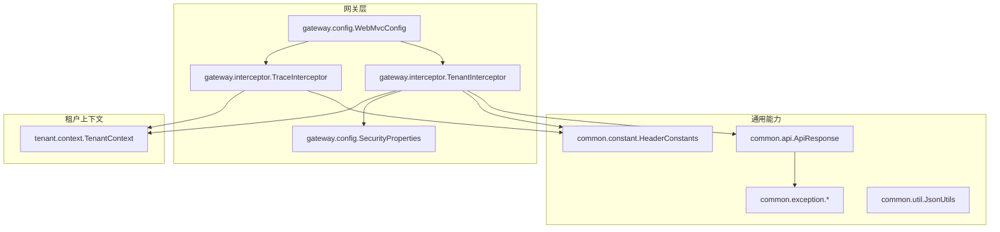
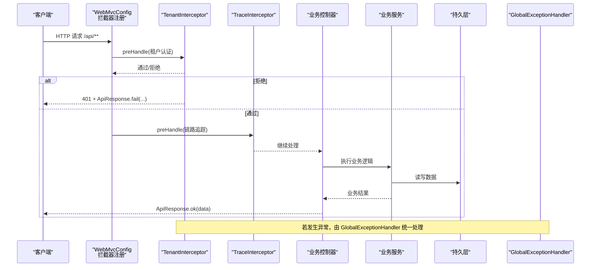
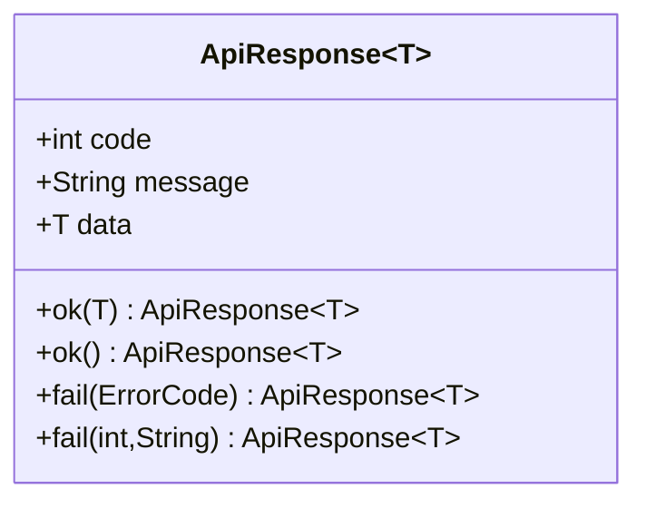
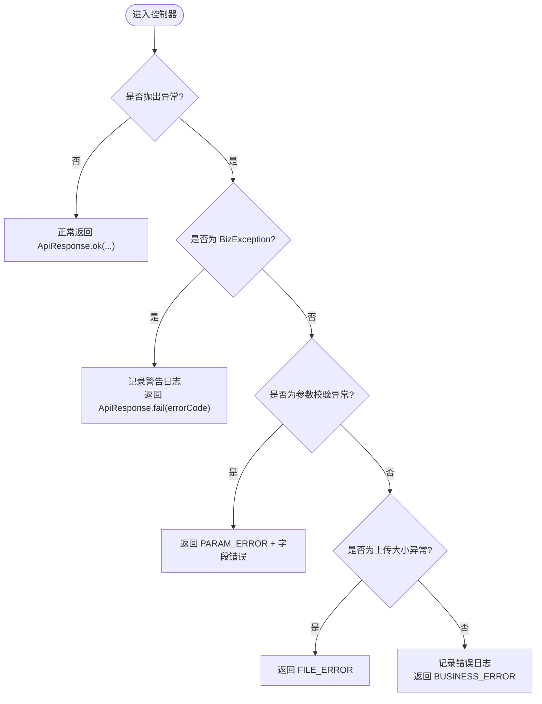
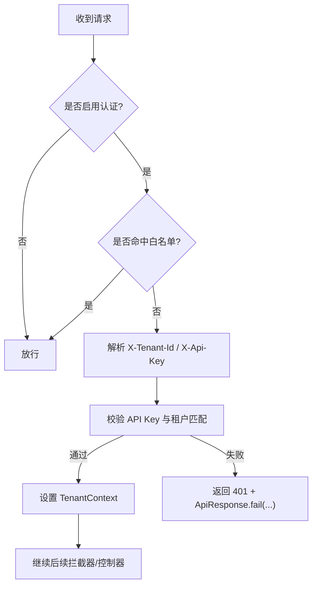
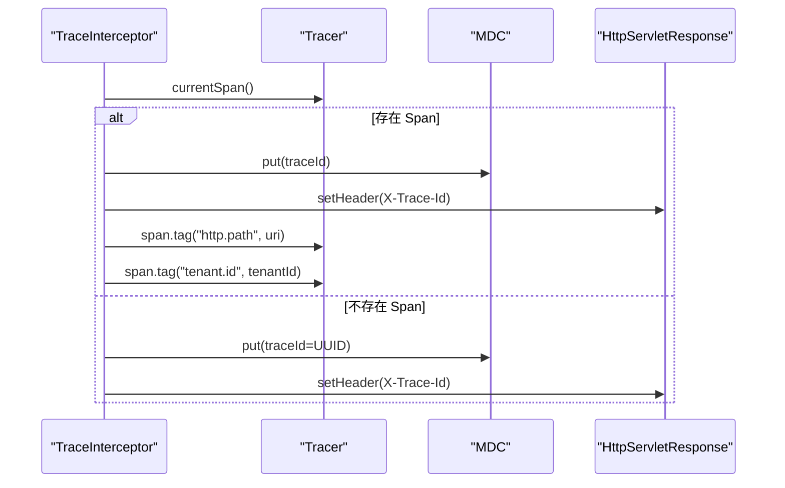
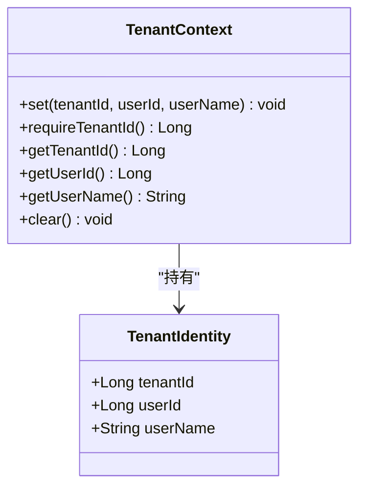
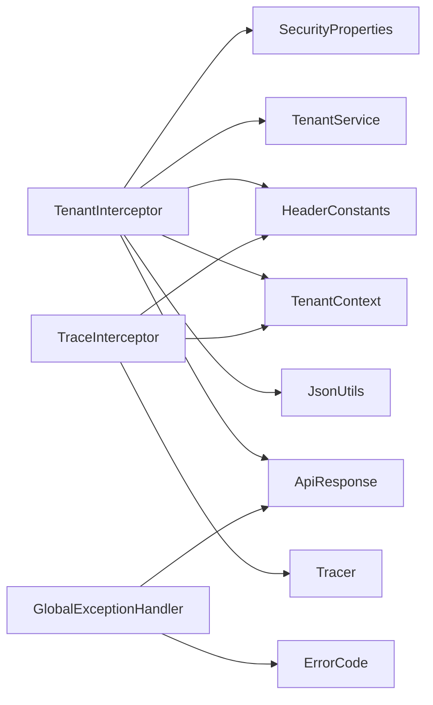

# 通用接口规范

<cite>
**本文引用的文件**   
- [ApiResponse.java](file://src/main/java/com/agenthub/common/api/ApiResponse.java)
- [BizException.java](file://src/main/java/com/agenthub/common/exception/BizException.java)
- [ErrorCode.java](file://src/main/java/com/agenthub/common/exception/ErrorCode.java)
- [GlobalExceptionHandler.java](file://src/main/java/com/agenthub/common/exception/GlobalExceptionHandler.java)
- [HeaderConstants.java](file://src/main/java/com/agenthub/common/constant/HeaderConstants.java)
- [WebMvcConfig.java](file://src/main/java/com/agenthub/gateway/config/WebMvcConfig.java)
- [TenantInterceptor.java](file://src/main/java/com/agenthub/gateway/interceptor/TenantInterceptor.java)
- [TraceInterceptor.java](file://src/main/java/com/agenthub/gateway/interceptor/TraceInterceptor.java)
- [SecurityProperties.java](file://src/main/java/com/agenthub/gateway/config/SecurityProperties.java)
- [TenantContext.java](file://src/main/java/com/agenthub/tenant/context/TenantContext.java)
- [JsonUtils.java](file://src/main/java/com/agenthub/common/util/JsonUtils.java)
</cite>

## 目录
1. [引言](#引言)
2. [项目结构](#项目结构)
3. [核心组件](#核心组件)
4. [架构总览](#架构总览)
5. [详细组件分析](#详细组件分析)
6. [依赖关系分析](#依赖关系分析)
7. [性能与可观测性](#性能与可观测性)
8. [错误码与消息规范](#错误码与消息规范)
9. [请求验证、参数绑定与数据转换](#请求验证参数绑定与数据转换)
10. [横切关注点：跨域、安全拦截与日志记录](#横切关注点跨域安全拦截与日志记录)
11. [接口开发最佳实践](#接口开发最佳实践)
12. [故障排查指南](#故障排查指南)
13. [结论](#结论)

## 引言
本规范定义平台统一的 API 响应格式、全局异常处理机制、标准请求头、错误码体系，以及请求验证、参数绑定、数据转换等通用处理逻辑。同时说明跨域、安全拦截、链路追踪等横切关注点的实现方式，并给出面向业务接口的开发建议，帮助团队在统一契约下高效协作。

## 项目结构
本项目采用分层与领域模块相结合的目录组织方式，通用能力集中在 common 包，网关层（gateway）负责租户认证、链路追踪等横切逻辑，业务模块按 agent、knowledge、llm、mcp、parser、rag、task、tenant、tracing 等划分。

**图表来源**
- [ApiResponse.java:1-38](file://src/main/java/com/agenthub/common/api/ApiResponse.java#L1-L38)
- [BizException.java:1-23](file://src/main/java/com/agenthub/common/exception/BizException.java#L1-L23)
- [ErrorCode.java:1-27](file://src/main/java/com/agenthub/common/exception/ErrorCode.java#L1-L27)
- [GlobalExceptionHandler.java:1-48](file://src/main/java/com/agenthub/common/exception/GlobalExceptionHandler.java#L1-L48)
- [HeaderConstants.java:1-20](file://src/main/java/com/agenthub/common/constant/HeaderConstants.java#L1-L20)
- [WebMvcConfig.java:1-33](file://src/main/java/com/agenthub/gateway/config/WebMvcConfig.java#L1-L33)
- [TenantInterceptor.java:1-77](file://src/main/java/com/agenthub/gateway/interceptor/TenantInterceptor.java#L1-L77)
- [TraceInterceptor.java:1-61](file://src/main/java/com/agenthub/gateway/interceptor/TraceInterceptor.java#L1-L61)
- [SecurityProperties.java:1-21](file://src/main/java/com/agenthub/gateway/config/SecurityProperties.java#L1-L21)
- [TenantContext.java:1-60](file://src/main/java/com/agenthub/tenant/context/TenantContext.java#L1-L60)
- [JsonUtils.java:1-59](file://src/main/java/com/agenthub/common/util/JsonUtils.java#L1-L59)

**章节来源**
- [WebMvcConfig.java:10-31](file://src/main/java/com/agenthub/gateway/config/WebMvcConfig.java#L10-L31)

## 核心组件
- 统一响应体 ApiResponse：所有接口返回统一结构，包含 code、message、data 三个字段，并提供 ok/fail 便捷构造方法。
- 业务异常 BizException：携带 ErrorCode，由全局异常处理器统一转换为 ApiResponse。
- 错误码枚举 ErrorCode：集中管理错误码与默认消息。
- 全局异常处理器 GlobalExceptionHandler：捕获业务异常、参数校验异常、上传大小异常及未知异常，统一输出 ApiResponse。
- 请求头常量 HeaderConstants：定义 X-Tenant-Id、X-Api-Key、X-Trace-Id 等标准头部键名。
- 租户拦截器 TenantInterceptor：解析并校验租户身份，写入 TenantContext，拒绝非法请求。
- 链路追踪拦截器 TraceInterceptor：生成或透传 traceId，注入 MDC 与响应头，为 Span 附加业务属性。
- 安全配置 SecurityProperties：控制是否启用租户认证与免认证路径白名单。
- 租户上下文 TenantContext：基于 ThreadLocal 保存当前请求的租户信息，提供 require/get 访问方法。
- JSON 工具 JsonUtils：封装 ObjectMapper，提供序列化/反序列化与 Map 转换。

**章节来源**
- [ApiResponse.java:8-36](file://src/main/java/com/agenthub/common/api/ApiResponse.java#L8-L36)
- [BizException.java:5-21](file://src/main/java/com/agenthub/common/exception/BizException.java#L5-L21)
- [ErrorCode.java:6-26](file://src/main/java/com/agenthub/common/exception/ErrorCode.java#L6-L26)
- [GlobalExceptionHandler.java:14-46](file://src/main/java/com/agenthub/common/exception/GlobalExceptionHandler.java#L14-L46)
- [HeaderConstants.java:6-19](file://src/main/java/com/agenthub/common/constant/HeaderConstants.java#L6-L19)
- [TenantInterceptor.java:18-75](file://src/main/java/com/agenthub/gateway/interceptor/TenantInterceptor.java#L18-L75)
- [TraceInterceptor.java:16-59](file://src/main/java/com/agenthub/gateway/interceptor/TraceInterceptor.java#L16-L59)
- [SecurityProperties.java:8-20](file://src/main/java/com/agenthub/gateway/config/SecurityProperties.java#L8-L20)
- [TenantContext.java:6-58](file://src/main/java/com/agenthub/tenant/context/TenantContext.java#L6-L58)
- [JsonUtils.java:10-57](file://src/main/java/com/agenthub/common/util/JsonUtils.java#L10-L57)

## 架构总览
下图展示一次典型 API 请求从进入网关到返回响应的流程，包括租户认证、链路追踪、业务处理与全局异常处理。

**图表来源**
- [WebMvcConfig.java:23-31](file://src/main/java/com/agenthub/gateway/config/WebMvcConfig.java#L23-L31)
- [TenantInterceptor.java:31-50](file://src/main/java/com/agenthub/gateway/interceptor/TenantInterceptor.java#L31-L50)
- [TraceInterceptor.java:29-44](file://src/main/java/com/agenthub/gateway/interceptor/TraceInterceptor.java#L29-L44)
- [GlobalExceptionHandler.java:21-46](file://src/main/java/com/agenthub/common/exception/GlobalExceptionHandler.java#L21-L46)

## 详细组件分析

### 统一响应体 ApiResponse
- 字段定义
  - code：整数型状态码，遵循 ErrorCode 规范。
  - message：人类可读的错误或成功消息。
  - data：业务数据载体，泛型 T。
- 构造方法
  - ok(data)/ok()：成功场景返回 0 与 success 消息。
  - fail(errorCode)/fail(code,message)：失败场景直接填充 code 与 message。
- 使用建议
  - 控制器与服务层优先返回 ApiResponse，避免散落的原始对象。
  - 分页、列表、详情等数据结构应封装在 data 中，保持外层结构稳定。

**图表来源**
- [ApiResponse.java:16-36](file://src/main/java/com/agenthub/common/api/ApiResponse.java#L16-L36)

**章节来源**
- [ApiResponse.java:8-36](file://src/main/java/com/agenthub/common/api/ApiResponse.java#L8-L36)

### 全局异常处理机制
- 业务异常 BizException
  - 携带 ErrorCode，用于表达明确的业务错误语义。
  - 由 GlobalExceptionHandler 捕获后，转为 ApiResponse.fail(...)。
- 参数校验异常
  - MethodArgumentNotValidException、BindException：提取首个字段错误信息，返回 PARAM_ERROR。
- 上传大小异常
  - MaxUploadSizeExceededException：返回 FILE_ERROR 与固定提示。
- 未知异常
  - Exception：记录 ERROR 日志，返回 BUSINESS_ERROR。

**图表来源**
- [GlobalExceptionHandler.java:21-46](file://src/main/java/com/agenthub/common/exception/GlobalExceptionHandler.java#L21-L46)
- [BizException.java:8-21](file://src/main/java/com/agenthub/common/exception/BizException.java#L8-L21)

**章节来源**
- [GlobalExceptionHandler.java:14-46](file://src/main/java/com/agenthub/common/exception/GlobalExceptionHandler.java#L14-L46)
- [BizException.java:5-21](file://src/main/java/com/agenthub/common/exception/BizException.java#L5-L21)

### 请求头常量与标准头部
- X-Tenant-Id：租户标识，必须为数字字符串；缺失将触发 UNAUTHORIZED。
- X-Api-Key：API Key，需与租户匹配；不匹配将触发 UNAUTHORIZED。
- X-Trace-Id：链路追踪 ID，由 TraceInterceptor 生成或透传，并回写到响应头。

**章节来源**
- [HeaderConstants.java:6-19](file://src/main/java/com/agenthub/common/constant/HeaderConstants.java#L6-L19)
- [TenantInterceptor.java:38-49](file://src/main/java/com/agenthub/gateway/interceptor/TenantInterceptor.java#L38-L49)
- [TraceInterceptor.java:29-44](file://src/main/java/com/agenthub/gateway/interceptor/TraceInterceptor.java#L29-L44)

### 租户认证与安全拦截
- 安全开关与白名单
  - SecurityProperties.enabled：控制是否启用租户认证。
  - SecurityProperties.skipPaths：Ant 风格白名单路径，命中则跳过认证。
- 租户拦截器流程
  - 解析 X-Tenant-Id 与 X-Api-Key。
  - 调用 TenantService.verifyApiKey 校验 API Key。
  - 通过后设置 TenantContext，并在 afterCompletion 清理。
  - 未通过时直接返回 401 与 ApiResponse.fail(...)。

**图表来源**
- [SecurityProperties.java:11-20](file://src/main/java/com/agenthub/gateway/config/SecurityProperties.java#L11-L20)
- [TenantInterceptor.java:31-75](file://src/main/java/com/agenthub/gateway/interceptor/TenantInterceptor.java#L31-L75)

**章节来源**
- [SecurityProperties.java:8-20](file://src/main/java/com/agenthub/gateway/config/SecurityProperties.java#L8-L20)
- [TenantInterceptor.java:18-75](file://src/main/java/com/agenthub/gateway/interceptor/TenantInterceptor.java#L18-L75)

### 链路追踪与日志记录
- TraceInterceptor
  - 优先使用上游 Span 的 traceId，否则生成 16 位随机 ID。
  - 将 traceId 写入 MDC 与响应头 X-Trace-Id。
  - 为当前 Span 添加 http.path 与 tenant.id 标签。
- 日志记录
  - 业务异常：WARN 级别，附带方法与 URI。
  - 未知异常：ERROR 级别，附带完整堆栈。

**图表来源**
- [TraceInterceptor.java:29-59](file://src/main/java/com/agenthub/gateway/interceptor/TraceInterceptor.java#L29-L59)

**章节来源**
- [TraceInterceptor.java:16-59](file://src/main/java/com/agenthub/gateway/interceptor/TraceInterceptor.java#L16-L59)
- [GlobalExceptionHandler.java:21-46](file://src/main/java/com/agenthub/common/exception/GlobalExceptionHandler.java#L21-L46)

### 数据模型与上下文
- TenantContext
  - 基于 ThreadLocal 保存租户ID、用户ID、用户名。
  - requireTenantId() 在缺失时抛出 TENANT_ERROR 业务异常，强制下游查询带租户隔离。
  - getTenantId()/getUserId()/getUserName() 提供可选读取。
  - clear() 必须在请求结束时清理，防止线程池复用导致串号。

**图表来源**
- [TenantContext.java:12-58](file://src/main/java/com/agenthub/tenant/context/TenantContext.java#L12-L58)

**章节来源**
- [TenantContext.java:6-58](file://src/main/java/com/agenthub/tenant/context/TenantContext.java#L6-L58)

### JSON 工具与数据转换
- JsonUtils
  - 全局共享 ObjectMapper，关闭未知属性报错。
  - toJson/fromJson/toMap/parseMap 等方法封装常见操作。
  - 异常包装为 IllegalStateException，便于上层统一处理。

**章节来源**
- [JsonUtils.java:10-57](file://src/main/java/com/agenthub/common/util/JsonUtils.java#L10-L57)

## 依赖关系分析
- 组件耦合
  - TenantInterceptor 依赖 SecurityProperties、TenantService、HeaderConstants、TenantContext、JsonUtils、ApiResponse。
  - TraceInterceptor 依赖 HeaderConstants、TenantContext、Tracer。
  - GlobalExceptionHandler 依赖 ApiResponse、ErrorCode、日志框架。
- 外部依赖
  - Spring Web MVC 拦截器与异常处理。
  - Micrometer Tracer（OTel 桥接）。
  - Jackson ObjectMapper（通过 JsonUtils）。

**图表来源**
- [TenantInterceptor.java:1-77](file://src/main/java/com/agenthub/gateway/interceptor/TenantInterceptor.java#L1-L77)
- [TraceInterceptor.java:1-61](file://src/main/java/com/agenthub/gateway/interceptor/TraceInterceptor.java#L1-L61)
- [GlobalExceptionHandler.java:1-48](file://src/main/java/com/agenthub/common/exception/GlobalExceptionHandler.java#L1-L48)

**章节来源**
- [TenantInterceptor.java:1-77](file://src/main/java/com/agenthub/gateway/interceptor/TenantInterceptor.java#L1-L77)
- [TraceInterceptor.java:1-61](file://src/main/java/com/agenthub/gateway/interceptor/TraceInterceptor.java#L1-L61)
- [GlobalExceptionHandler.java:1-48](file://src/main/java/com/agenthub/common/exception/GlobalExceptionHandler.java#L1-L48)

## 性能与可观测性
- 性能
  - 租户认证仅在 /api/** 路径生效，减少无关开销。
  - TenantContext.clear() 在 afterCompletion 执行，避免线程池复用导致的额外清理成本。
  - JsonUtils 使用单例 ObjectMapper，避免重复创建带来的 GC 压力。
- 可观测性
  - 每个请求生成或透传 traceId，便于全链路追踪。
  - Span 附加 http.path 与 tenant.id，便于按租户过滤与定位问题。
  - 业务异常与未知异常分别以 WARN/ERROR 级别记录，便于告警与审计。

[本节为通用指导，不直接分析具体文件]

## 错误码与消息规范
- 统一错误码
  - UNAUTHORIZED：未认证或 API Key 无效。
  - FORBIDDEN：无权限访问该资源。
  - NOT_FOUND：资源不存在。
  - PARAM_ERROR：参数错误。
  - BUSINESS_ERROR：业务处理失败。
  - TENANT_ERROR：租户信息缺失。
  - LLM_ERROR：模型调用失败。
  - MCP_ERROR：MCP 服务调用失败。
  - TASK_ERROR：异步任务处理失败。
  - FILE_ERROR：文件处理失败。
- 消息格式
  - 成功：code=0，message="success"，data=业务数据。
  - 失败：code=ErrorCode.code，message=ErrorCode.message 或自定义消息，data=null。
- 扩展建议
  - 新增错误码时，优先在 ErrorCode 中定义，避免散落魔法值。
  - 对外错误消息应避免泄露内部细节，必要时提供标准化子消息。

**章节来源**
- [ErrorCode.java:6-26](file://src/main/java/com/agenthub/common/exception/ErrorCode.java#L6-L26)
- [ApiResponse.java:22-36](file://src/main/java/com/agenthub/common/api/ApiResponse.java#L22-L36)

## 请求验证、参数绑定与数据转换
- 参数绑定
  - 使用 Spring 的 @RequestBody/@RequestParam/@PathVariable 进行参数绑定。
  - 当校验失败时，抛出 MethodArgumentNotValidException 或 BindException，由 GlobalExceptionHandler 统一处理。
- 字段校验
  - 建议在 DTO 上使用 JSR-303/JSR-380 注解（如 @NotBlank、@NotNull），配合 Spring Validation。
  - 复杂业务校验在服务层通过 BizException + ErrorCode.PARAM_ERROR 表达。
- 数据转换
  - 使用 JsonUtils 进行 JSON 与对象互转，避免重复配置 ObjectMapper。
  - 对第三方系统返回的 JSON，建议使用 TypeReference 指定泛型类型，确保类型安全。

**章节来源**
- [GlobalExceptionHandler.java:27-34](file://src/main/java/com/agenthub/common/exception/GlobalExceptionHandler.java#L27-L34)
- [JsonUtils.java:21-57](file://src/main/java/com/agenthub/common/util/JsonUtils.java#L21-L57)

## 横切关注点：跨域、安全拦截与日志记录
- 跨域配置
  - 当前仓库未发现显式 CORS 配置类；如需跨域，可在 WebMvcConfig 中添加 CorsRegistry 配置或使用全局过滤器。
- 安全拦截
  - 通过 TenantInterceptor 实现租户认证与 API Key 校验，支持白名单路径与开关控制。
  - 未通过认证的请求直接返回 401 与 ApiResponse.fail(...)。
- 日志记录
  - 业务异常使用 WARN 级别记录方法与 URI。
  - 未知异常使用 ERROR 级别记录完整堆栈。
  - 链路追踪通过 TraceInterceptor 注入 traceId 与 Span 标签。

**章节来源**
- [WebMvcConfig.java:10-31](file://src/main/java/com/agenthub/gateway/config/WebMvcConfig.java#L10-L31)
- [TenantInterceptor.java:31-75](file://src/main/java/com/agenthub/gateway/interceptor/TenantInterceptor.java#L31-L75)
- [GlobalExceptionHandler.java:21-46](file://src/main/java/com/agenthub/common/exception/GlobalExceptionHandler.java#L21-L46)
- [TraceInterceptor.java:29-59](file://src/main/java/com/agenthub/gateway/interceptor/TraceInterceptor.java#L29-L59)

## 接口开发最佳实践
- 统一响应
  - 所有接口返回 ApiResponse<T>，避免直接返回原始对象或 Map。
  - 成功场景使用 ApiResponse.ok(data)，失败场景使用 ApiResponse.fail(errorCode)。
- 异常使用
  - 业务错误优先抛 BizException，携带 ErrorCode，便于统一处理与统计。
  - 参数校验失败使用 JSR-303 注解，交由 Spring Validation 与 GlobalExceptionHandler 处理。
- 租户隔离
  - 所有写操作与敏感读操作前调用 TenantContext.requireTenantId()，确保强制租户隔离。
  - 不要在控制器层直接操作 TenantContext，应在拦截器设置并在 afterCompletion 清理。
- 头部规范
  - 客户端必须携带 X-Tenant-Id 与 X-Api-Key。
  - 服务端需在响应头中回写 X-Trace-Id，便于客户端关联日志与追踪。
- 可观测性
  - 关键业务节点记录结构化日志，包含 traceId、tenantId、耗时等维度。
  - 使用 Span 标签补充业务上下文，便于在 Jaeger/Tempo 中检索。
- 数据转换
  - 使用 JsonUtils 进行 JSON 转换，避免重复配置 ObjectMapper。
  - 对外部 JSON 使用 TypeReference 明确类型，提升健壮性。

[本节为通用指导，不直接分析具体文件]

## 故障排查指南
- 401 未认证
  - 检查请求头是否包含 X-Tenant-Id 与 X-Api-Key。
  - 确认 API Key 与租户匹配，且未被禁用。
  - 查看 TenantInterceptor.reject 返回的 ApiResponse.fail(...) 消息。
- 参数校验失败
  - 检查 DTO 校验注解是否正确配置。
  - 查看 GlobalExceptionHandler.handleValidation 返回的 PARAM_ERROR 与字段错误信息。
- 上传大小超限
  - 检查应用配置中的文件大小限制。
  - 查看 GlobalExceptionHandler.handleUploadSize 返回的 FILE_ERROR。
- 未知异常
  - 查看 ERROR 级别日志，定位堆栈与请求 URI。
  - 结合 traceId 在链路追踪系统中检索对应 Span。

**章节来源**
- [TenantInterceptor.java:70-75](file://src/main/java/com/agenthub/gateway/interceptor/TenantInterceptor.java#L70-L75)
- [GlobalExceptionHandler.java:27-46](file://src/main/java/com/agenthub/common/exception/GlobalExceptionHandler.java#L27-L46)

## 结论
本规范通过统一的 ApiResponse、全局异常处理、标准请求头与错误码体系，构建了稳定、可观测、易维护的接口契约。租户认证与链路追踪作为横切关注点，贯穿请求生命周期，保障多租户隔离与全链路可追溯。遵循本文的最佳实践，可有效降低接口不一致风险，提升团队协作效率与系统稳定性。

[本节为总结性内容，不直接分析具体文件]