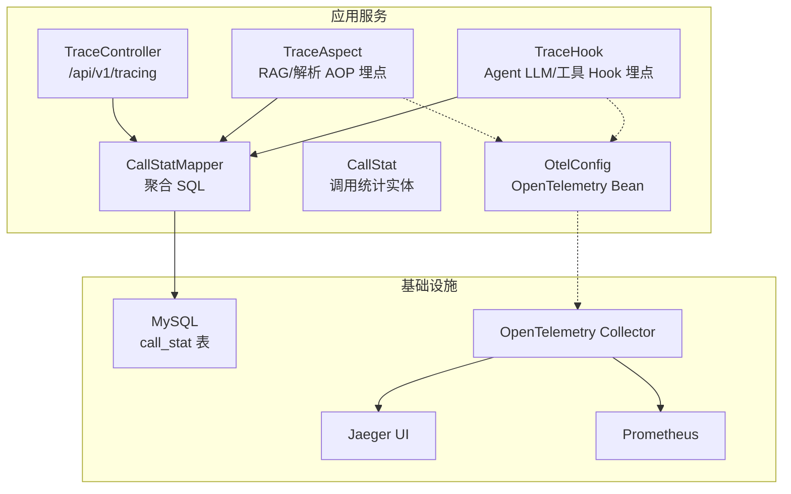
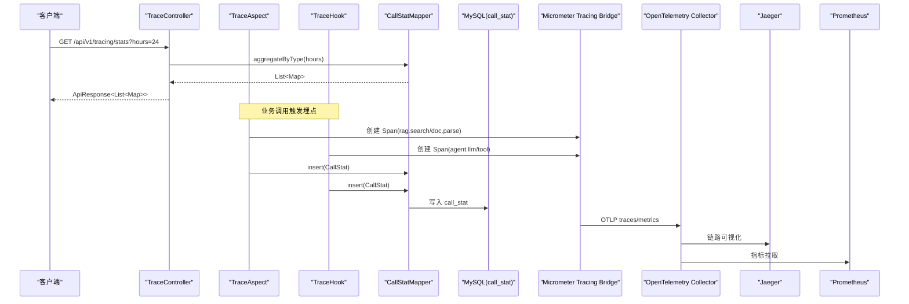
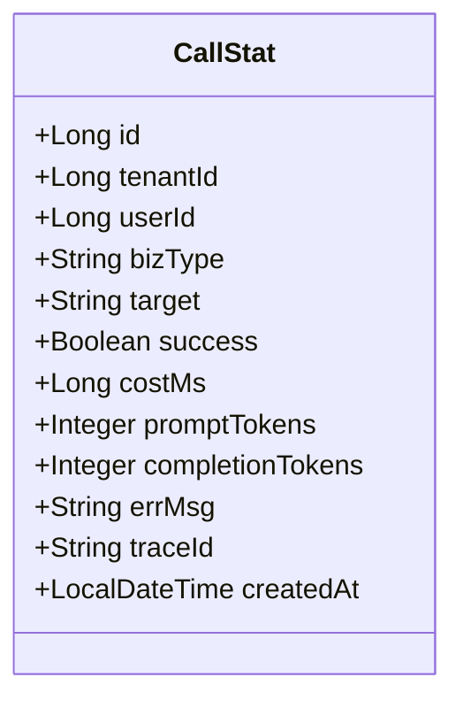
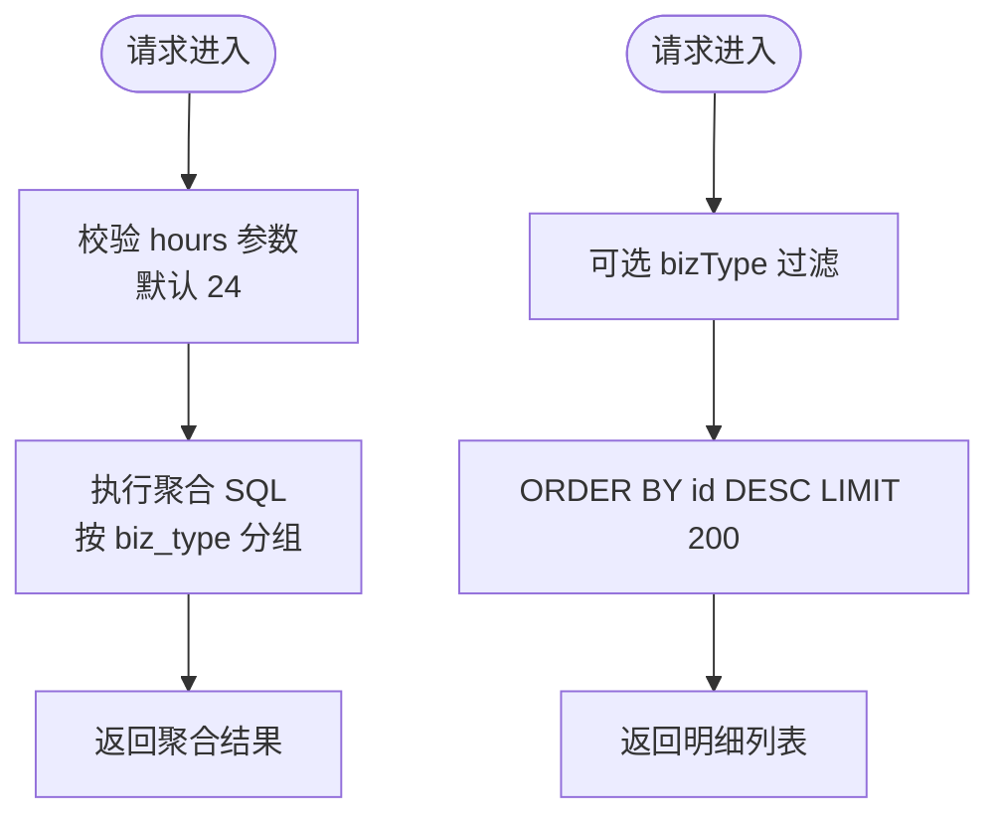
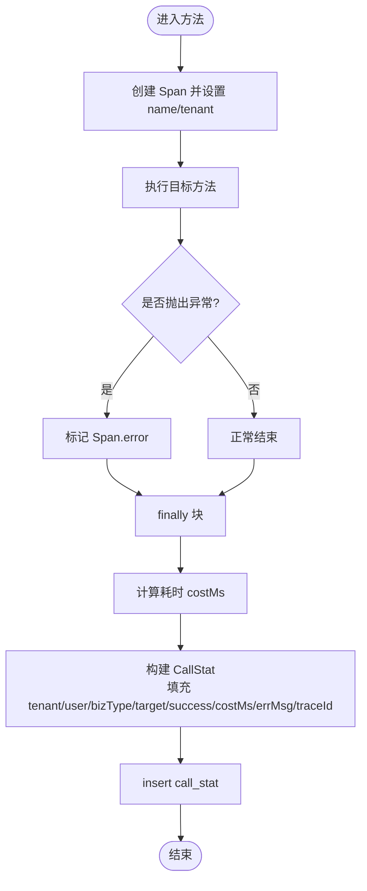
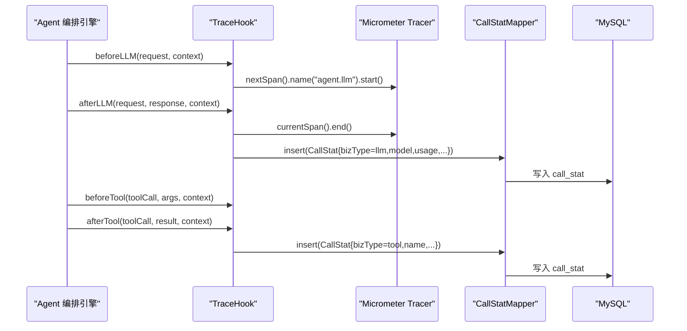
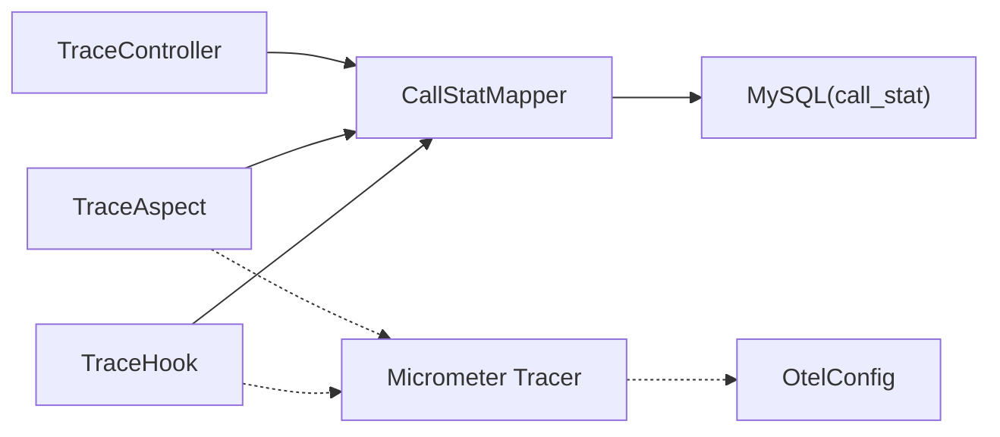

# 链路追踪接口

<cite>
**本文引用的文件**   
- [CallStat.java](file://src/main/java/com/agenthub/tracing/entity/CallStat.java)
- [TraceController.java](file://src/main/java/com/agenthub/tracing/controller/TraceController.java)
- [CallStatMapper.java](file://src/main/java/com/agenthub/tracing/mapper/CallStatMapper.java)
- [TraceAspect.java](file://src/main/java/com/agenthub/tracing/aspect/TraceAspect.java)
- [TraceHook.java](file://src/main/java/com/agenthub/tracing/hook/TraceHook.java)
- [OtelConfig.java](file://src/main/java/com/agenthub/tracing/config/OtelConfig.java)
- [application.yml](file://src/main/resources/application.yml)
- [init-mysql.sql](file://sql/init-mysql.sql)
- [otel-collector-config.yaml](file://otel/otel-collector-config.yaml)
- [docker-compose.yml](file://docker-compose.yml)
</cite>

## 目录
1. [简介](#简介)
2. [项目结构](#项目结构)
3. [核心组件](#核心组件)
4. [架构总览](#架构总览)
5. [详细组件分析](#详细组件分析)
6. [依赖关系分析](#依赖关系分析)
7. [性能与可观测性](#性能与可观测性)
8. [查询与分析示例](#查询与分析示例)
9. [监控告警配置](#监控告警配置)
10. [故障排查指南](#故障排查指南)
11. [结论](#结论)

## 简介
本文件面向链路追踪与调用统计能力，提供完整的 API 文档与实现说明。内容覆盖：
- CallStat 调用统计实体的数据结构定义
- 链路追踪数据的查询接口（按类型聚合、最近明细）
- 性能指标收集与上报机制（OpenTelemetry 集成、Micrometer Tracing Bridge、OTLP 导出）
- 分布式追踪工作原理与数据流转
- 慢查询分析、错误率统计、性能趋势图的分析思路
- 监控告警建议与性能优化建议

## 项目结构
链路追踪相关代码集中在 tracing 包下，包含实体、控制器、AOP 埋点、Hook 埋点、MyBatis Mapper 以及 OpenTelemetry 配置；SQL 脚本定义了 call_stat 表结构；应用配置通过 application.yml 启用 OTLP 导出；otel-collector-config.yaml 将链路导出到 Jaeger、指标导出到 Prometheus；docker-compose.yml 提供 Jaeger 等基础设施。

**图表来源**
- [TraceController.java:19-40](file://src/main/java/com/agenthub/tracing/controller/TraceController.java#L19-L40)
- [TraceAspect.java:14-106](file://src/main/java/com/agenthub/tracing/aspect/TraceAspect.java#L14-L106)
- [TraceHook.java:17-110](file://src/main/java/com/agenthub/tracing/hook/TraceHook.java#L17-L110)
- [CallStatMapper.java:14-29](file://src/main/java/com/agenthub/tracing/mapper/CallStatMapper.java#L14-L29)
- [CallStat.java:17-52](file://src/main/java/com/agenthub/tracing/entity/CallStat.java#L17-L52)
- [OtelConfig.java:21-41](file://src/main/java/com/agenthub/tracing/config/OtelConfig.java#L21-L41)
- [init-mysql.sql:139-155](file://sql/init-mysql.sql#L139-L155)
- [otel-collector-config.yaml:1-33](file://otel/otel-collector-config.yaml#L1-L33)
- [docker-compose.yml:117-126](file://docker-compose.yml#L117-L126)

**章节来源**
- [TraceController.java:19-40](file://src/main/java/com/agenthub/tracing/controller/TraceController.java#L19-L40)
- [CallStat.java:17-52](file://src/main/java/com/agenthub/tracing/entity/CallStat.java#L17-L52)
- [CallStatMapper.java:14-29](file://src/main/java/com/agenthub/tracing/mapper/CallStatMapper.java#L14-L29)
- [TraceAspect.java:14-106](file://src/main/java/com/agenthub/tracing/aspect/TraceAspect.java#L14-L106)
- [TraceHook.java:17-110](file://src/main/java/com/agenthub/tracing/hook/TraceHook.java#L17-L110)
- [OtelConfig.java:21-41](file://src/main/java/com/agenthub/tracing/config/OtelConfig.java#L21-L41)
- [application.yml:31-44](file://src/main/resources/application.yml#L31-L44)
- [init-mysql.sql:139-155](file://sql/init-mysql.sql#L139-L155)
- [otel-collector-config.yaml:1-33](file://otel/otel-collector-config.yaml#L1-L33)
- [docker-compose.yml:117-126](file://docker-compose.yml#L117-L126)

## 核心组件
- 调用统计实体 CallStat：记录租户、用户、业务类型、目标对象、成功与否、耗时、提示词与生成 token、错误信息、traceId、创建时间。
- 链路统计接口 TraceController：提供按类型聚合统计与最近调用明细查询。
- MyBatis Mapper CallStatMapper：提供按 biz_type 聚合的 SQL 查询。
- AOP 埋点 TraceAspect：对 RAG 检索与文档解析进行统一耗时统计，创建 Span 并落库。
- Agent Hook TraceHook：在 Agent 编排的关键节点记录 LLM 调用与工具调用的耗时、token 消耗、异常信息，并写入 call_stat。
- OpenTelemetry 配置 OtelConfig：暴露原生 Tracer/Meter，配合 Micrometer Tracing Bridge 自动上报链路和指标。

**章节来源**
- [CallStat.java:17-52](file://src/main/java/com/agenthub/tracing/entity/CallStat.java#L17-L52)
- [TraceController.java:19-40](file://src/main/java/com/agenthub/tracing/controller/TraceController.java#L19-L40)
- [CallStatMapper.java:14-29](file://src/main/java/com/agenthub/tracing/mapper/CallStatMapper.java#L14-L29)
- [TraceAspect.java:14-106](file://src/main/java/com/agenthub/tracing/aspect/TraceAspect.java#L14-L106)
- [TraceHook.java:17-110](file://src/main/java/com/agenthub/tracing/hook/TraceHook.java#L17-L110)
- [OtelConfig.java:21-41](file://src/main/java/com/agenthub/tracing/config/OtelConfig.java#L21-L41)

## 架构总览
链路追踪与调用统计的整体流程如下：
- 业务侧通过 TraceAspect 与 TraceHook 埋点，采集耗时、状态、token 使用等信息，并通过 Micrometer Tracing 创建 Span。
- 同时异步写 call_stat 表，用于后续聚合与明细查询。
- 应用通过 application.yml 配置 management.otlp.tracing/metrics，由 Micrometer Tracing Bridge 自动将链路和指标以 OTLP 协议发送到 OpenTelemetry Collector。
- Collector 将链路导出到 Jaeger，指标导出到 Prometheus。
- 前端或监控系统通过 /api/v1/tracing 接口获取聚合与明细数据。

**图表来源**
- [TraceController.java:26-39](file://src/main/java/com/agenthub/tracing/controller/TraceController.java#L26-L39)
- [CallStatMapper.java:16-28](file://src/main/java/com/agenthub/tracing/mapper/CallStatMapper.java#L16-L28)
- [TraceAspect.java:27-67](file://src/main/java/com/agenthub/tracing/aspect/TraceAspect.java#L27-L67)
- [TraceHook.java:37-73](file://src/main/java/com/agenthub/tracing/hook/TraceHook.java#L37-L73)
- [application.yml:31-44](file://src/main/resources/application.yml#L31-L44)
- [otel-collector-config.yaml:1-33](file://otel/otel-collector-config.yaml#L1-L33)
- [docker-compose.yml:117-126](file://docker-compose.yml#L117-L126)

## 详细组件分析

### 调用统计实体 CallStat
CallStat 是链路追踪的核心数据模型，字段含义如下：
- id：自增主键
- tenantId：租户 ID
- userId：用户 ID
- bizType：业务类型（llm/tool/rag/parse/agent）
- target：目标对象（模型名/工具名/查询词摘要）
- success：是否成功
- costMs：耗时（毫秒）
- promptTokens：提示词 token
- completionTokens：生成 token
- errMsg：错误信息
- traceId：链路 traceId（与 OTel 关联）
- createdAt：创建时间

该实体映射到数据库表 call_stat，建表语句包含索引 tenant_id、biz_type、created_at，便于按租户、类型和时间范围筛选。

**图表来源**
- [CallStat.java:17-52](file://src/main/java/com/agenthub/tracing/entity/CallStat.java#L17-L52)
- [init-mysql.sql:139-155](file://sql/init-mysql.sql#L139-L155)

**章节来源**
- [CallStat.java:17-52](file://src/main/java/com/agenthub/tracing/entity/CallStat.java#L17-L52)
- [init-mysql.sql:139-155](file://sql/init-mysql.sql#L139-L155)

### 链路统计接口 TraceController
提供两个主要接口：
- GET /api/v1/tracing/stats：按 biz_type 聚合统计，参数 hours 表示最近 N 小时（默认 24）。返回包含 total、avgCostMs、promptTokens、completionTokens、successCount 等字段的列表。
- GET /api/v1/tracing/calls：最近调用明细，最多返回 200 条，可选参数 bizType 过滤业务类型。

当前实现未支持按时间范围、服务名称、状态码等多维筛选，仅支持按 bizType 过滤与按 id 倒序限制数量。

**图表来源**
- [TraceController.java:26-39](file://src/main/java/com/agenthub/tracing/controller/TraceController.java#L26-L39)
- [CallStatMapper.java:16-28](file://src/main/java/com/agenthub/tracing/mapper/CallStatMapper.java#L16-L28)

**章节来源**
- [TraceController.java:26-39](file://src/main/java/com/agenthub/tracing/controller/TraceController.java#L26-L39)
- [CallStatMapper.java:16-28](file://src/main/java/com/agenthub/tracing/mapper/CallStatMapper.java#L16-L28)

### AOP 埋点 TraceAspect
TraceAspect 针对 RAG 检索与文档解析方法做统一埋点：
- 创建 Micrometer Span，设置 span.name、tenant.id、costMs 标签，并在异常时标记 error。
- 计算耗时，构造 CallStat 并写入 call_stat 表，同时携带 traceId。
- 当无租户上下文时忽略统计，避免无效数据写入。

**图表来源**
- [TraceAspect.java:27-67](file://src/main/java/com/agenthub/tracing/aspect/TraceAspect.java#L27-L67)
- [TraceAspect.java:82-105](file://src/main/java/com/agenthub/tracing/aspect/TraceAspect.java#L82-L105)

**章节来源**
- [TraceAspect.java:27-67](file://src/main/java/com/agenthub/tracing/aspect/TraceAspect.java#L27-L67)
- [TraceAspect.java:82-105](file://src/main/java/com/agenthub/tracing/aspect/TraceAspect.java#L82-L105)

### Agent Hook TraceHook
TraceHook 在 Agent 编排的关键节点记录 LLM 调用与工具调用：
- beforeLLM/afterLLM：记录模型名、耗时、token 用量，并写入 call_stat。
- beforeTool/afterTool：记录工具名、耗时，并写入 call_stat。
- onFinish：汇总整轮对话的工具调用次数。
- record：封装 CallStat 构建与插入逻辑，携带 traceId。

**图表来源**
- [TraceHook.java:37-73](file://src/main/java/com/agenthub/tracing/hook/TraceHook.java#L37-L73)
- [TraceHook.java:84-109](file://src/main/java/com/agenthub/tracing/hook/TraceHook.java#L84-L109)

**章节来源**
- [TraceHook.java:37-73](file://src/main/java/com/agenthub/tracing/hook/TraceHook.java#L37-L73)
- [TraceHook.java:84-109](file://src/main/java/com/agenthub/tracing/hook/TraceHook.java#L84-L109)

### OpenTelemetry 配置 OtelConfig
OtelConfig 暴露原生 OpenTelemetry、Tracer、Meter Bean，供需要细粒度 Span/指标的业务直接使用。实际链路和指标上报由 Spring Boot Actuator 的 Micrometer Tracing Bridge 自动完成，无需手工初始化 SDK。

**章节来源**
- [OtelConfig.java:21-41](file://src/main/java/com/agenthub/tracing/config/OtelConfig.java#L21-L41)

## 依赖关系分析
- TraceController 依赖 CallStatMapper 进行聚合与明细查询。
- TraceAspect 与 TraceHook 均依赖 Micrometer Tracer 创建 Span，并依赖 CallStatMapper 写入 call_stat。
- CallStatMapper 直接操作 MySQL 的 call_stat 表。
- OtelConfig 提供 OpenTelemetry 实例，被 TraceAspect 与 TraceHook 间接使用（通过 Micrometer Tracer）。

**图表来源**
- [TraceController.java:24-39](file://src/main/java/com/agenthub/tracing/controller/TraceController.java#L24-L39)
- [TraceAspect.java:24-25](file://src/main/java/com/agenthub/tracing/aspect/TraceAspect.java#L24-L25)
- [TraceHook.java:29-30](file://src/main/java/com/agenthub/tracing/hook/TraceHook.java#L29-L30)
- [CallStatMapper.java:14-29](file://src/main/java/com/agenthub/tracing/mapper/CallStatMapper.java#L14-L29)
- [OtelConfig.java:24-40](file://src/main/java/com/agenthub/tracing/config/OtelConfig.java#L24-L40)

**章节来源**
- [TraceController.java:24-39](file://src/main/java/com/agenthub/tracing/controller/TraceController.java#L24-L39)
- [TraceAspect.java:24-25](file://src/main/java/com/agenthub/tracing/aspect/TraceAspect.java#L24-L25)
- [TraceHook.java:29-30](file://src/main/java/com/agenthub/tracing/hook/TraceHook.java#L29-L30)
- [CallStatMapper.java:14-29](file://src/main/java/com/agenthub/tracing/mapper/CallStatMapper.java#L14-L29)
- [OtelConfig.java:24-40](file://src/main/java/com/agenthub/tracing/config/OtelConfig.java#L24-L40)

## 性能与可观测性
- 链路上报：application.yml 中 management.otlp.tracing.enabled=true，通过 micrometer-tracing-bridge-otel 将链路以 OTLP 协议发送到 OpenTelemetry Collector，最终导入 Jaeger 可视化。
- 指标上报：management.otlp.metrics.export.enabled=true，micrometer-registry-otlp 自动导出指标到 Collector，再由 exporter/prometheus 暴露给 Prometheus 拉取。
- Collector 配置：receivers/otlp 接收 gRPC/HTTP OTLP，processors/batch 批量处理，exporters/otlp/jaeger 导出链路，exporters/prometheus 导出指标。
- 性能优化建议：
  - 控制埋点粒度，避免过度细分导致 Span 过多。
  - 合理设置 batch 大小与超时（collector 配置 send_batch_size、timeout）。
  - 对高频调用路径采用采样策略，降低存储压力。
  - 对 call_stat 表建立合适索引（已包含 tenant_id、biz_type、created_at），并按时间分区归档历史数据。

**章节来源**
- [application.yml:31-44](file://src/main/resources/application.yml#L31-L44)
- [otel-collector-config.yaml:1-33](file://otel/otel-collector-config.yaml#L1-L33)
- [init-mysql.sql:139-155](file://sql/init-mysql.sql#L139-L155)

## 查询与分析示例

### 慢查询分析
- 使用 /api/v1/tracing/stats?hours=24 获取各业务类型的平均耗时 avgCostMs，识别高耗时类型。
- 使用 /api/v1/tracing/calls?bizType=rag 获取最近 200 条 rag 明细，结合 costMs 排序找出慢调用。
- 建议在业务层增加阈值告警，当 avgCostMs 超过阈值时触发告警。

### 错误率统计
- 使用 /api/v1/tracing/stats 返回的 successCount 与 total 计算错误率 = (total - successCount) / total。
- 使用 /api/v1/tracing/calls 过滤 bizType 并结合 errMsg 字段定位失败原因。
- 建议在 Prometheus 中基于 OTLP 导出的指标构建错误率面板，并配置告警规则。

### 性能趋势图
- 在 Grafana 中接入 Prometheus，展示 avgCostMs、total、successCount 的趋势图。
- 结合 Jaeger 查看具体 traceId 的链路详情，定位瓶颈环节。

注意：当前接口未提供按时间范围、服务名称、状态码的多维筛选，如需更精细分析，可在 TraceController 与 CallStatMapper 中扩展查询条件。

**章节来源**
- [TraceController.java:26-39](file://src/main/java/com/agenthub/tracing/controller/TraceController.java#L26-L39)
- [CallStatMapper.java:16-28](file://src/main/java/com/agenthub/tracing/mapper/CallStatMapper.java#L16-L28)

## 监控告警配置
- Prometheus 指标：通过 otel-collector-config.yaml 的 exporters/prometheus 暴露指标端点，Prometheus 定期拉取。
- Jaeger 链路：通过 otel-collector-config.yaml 的 exporters/otlp/jaeger 将链路导出到 Jaeger，UI 端口 16686。
- 告警建议：
  - 错误率告警：当 (total - successCount)/total > 阈值持续一段时间，触发告警。
  - 慢调用告警：当 avgCostMs > 阈值持续一段时间，触发告警。
  - 资源告警：结合系统指标（CPU、内存、连接池）与业务指标联动告警。

**章节来源**
- [otel-collector-config.yaml:1-33](file://otel/otel-collector-config.yaml#L1-L33)
- [docker-compose.yml:117-126](file://docker-compose.yml#L117-L126)

## 故障排查指南
- 埋点落库失败：TraceAspect 与 TraceHook 在 insert 失败时会记录 warn 日志，检查数据库连接与权限。
- 无租户上下文：TraceAspect 在无租户上下文时忽略统计，确保请求链路正确设置租户上下文。
- 链路未上报：检查 application.yml 的 management.otlp.tracing 配置是否正确，确认 Collector 与 Jaeger 运行状态。
- 指标未拉取：检查 otel-collector-config.yaml 的 exporters/prometheus 配置，确认 Prometheus 能访问指标端点。

**章节来源**
- [TraceAspect.java:102-105](file://src/main/java/com/agenthub/tracing/aspect/TraceAspect.java#L102-L105)
- [TraceAspect.java:82-90](file://src/main/java/com/agenthub/tracing/aspect/TraceAspect.java#L82-L90)
- [TraceHook.java:104-109](file://src/main/java/com/agenthub/tracing/hook/TraceHook.java#L104-L109)
- [application.yml:31-44](file://src/main/resources/application.yml#L31-L44)
- [otel-collector-config.yaml:1-33](file://otel/otel-collector-config.yaml#L1-L33)

## 结论
本项目实现了从业务埋点到链路可视化与指标拉取的完整链路追踪体系。CallStat 实体承载了调用统计的核心字段，TraceController 提供了基础的聚合与明细查询接口，TraceAspect 与 TraceHook 覆盖了 RAG/解析与 Agent LLM/工具的关键节点。OpenTelemetry 与 Micrometer Tracing Bridge 的配合使得链路和指标能够稳定上报至 Jaeger 与 Prometheus。未来可根据需求扩展多维筛选查询、采样策略与告警规则，进一步提升可观测性与运维效率。