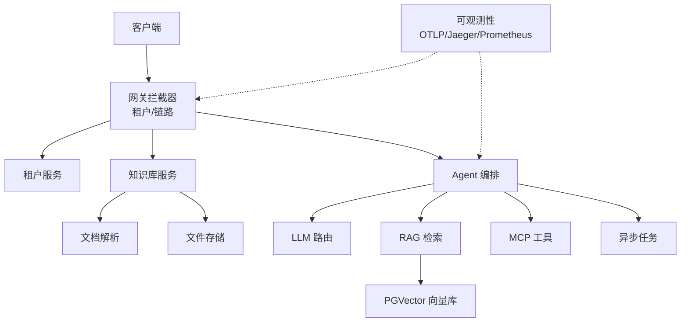
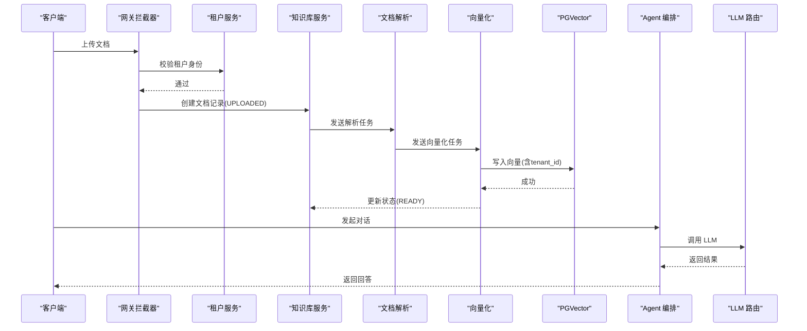
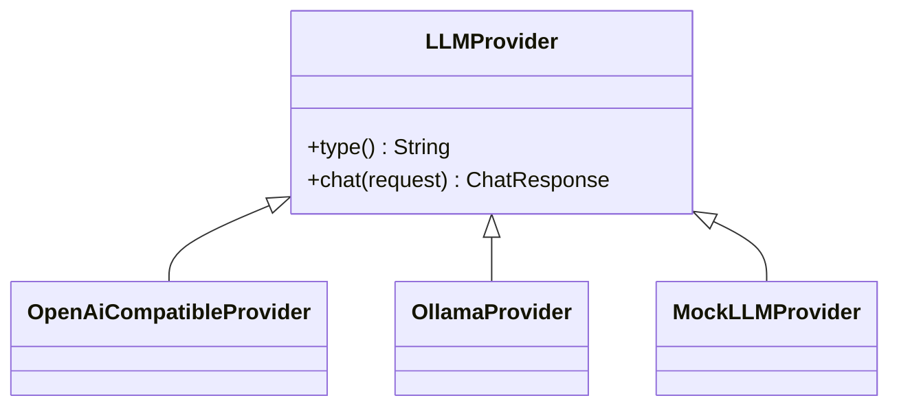
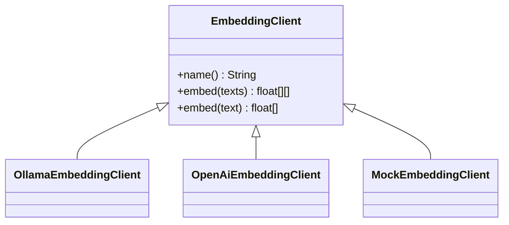
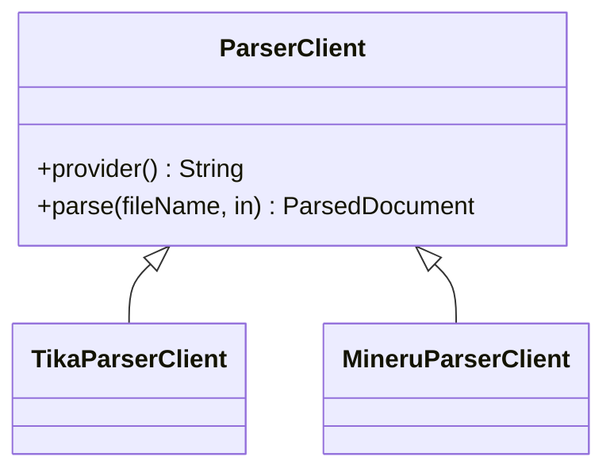
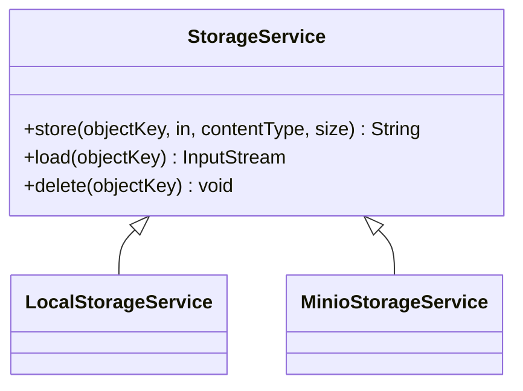
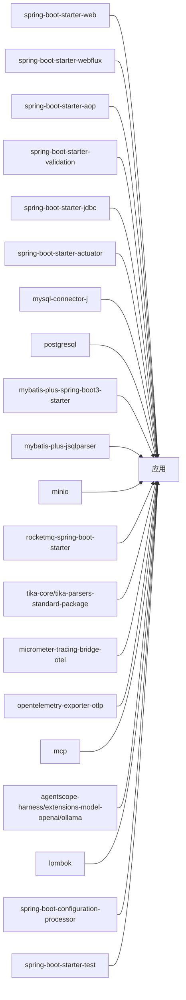

# 开发指南

<cite>
**本文引用的文件**   
- [README.md](file://README.md)
- [pom.xml](file://pom.xml)
- [application.yml](file://src/main/resources/application.yml)
- [AgenthubApplication.java](file://src/main/java/com/agenthub/AgenthubApplication.java)
- [WebMvcConfig.java](file://src/main/java/com/agenthub/gateway/config/WebMvcConfig.java)
- [TenantInterceptor.java](file://src/main/java/com/agenthub/gateway/interceptor/TenantInterceptor.java)
- [GlobalExceptionHandler.java](file://src/main/java/com/agenthub/common/exception/GlobalExceptionHandler.java)
- [BizException.java](file://src/main/java/com/agenthub/common/exception/BizException.java)
- [LLMProvider.java](file://src/main/java/com/agenthub/llm/provider/LLMProvider.java)
- [EmbeddingClient.java](file://src/main/java/com/agenthub/rag/embedding/EmbeddingClient.java)
- [ParserClient.java](file://src/main/java/com/agenthub/parser/ParserClient.java)
- [StorageService.java](file://src/main/java/com/agenthub/knowledge/storage/StorageService.java)
</cite>

## 目录
1. [引言](#引言)
2. [项目结构](#项目结构)
3. [核心组件](#核心组件)
4. [架构总览](#架构总览)
5. [详细组件分析](#详细组件分析)
6. [依赖分析](#依赖分析)
7. [性能考虑](#性能考虑)
8. [故障排查指南](#故障排查指南)
9. [结论](#结论)
10. [附录：二次开发与扩展清单](#附录二次开发与扩展清单)

## 引言
本指南面向希望基于 Java Agent Hub 进行二次开发与功能扩展的开发者，目标是帮助你快速搭建开发环境、理解系统架构与核心模块、遵循代码规范与最佳实践，并掌握如何扩展现有能力（自定义 LLM 提供商、嵌入模型、文档解析器、存储后端等），同时提供测试编写建议、提交与 PR 流程建议以及常用调试技巧。

本项目是一个企业级多租户 RAG + Harness Agent + MCP 工具平台，默认支持本地模式运行，无需外部 LLM 或消息队列即可跑通全链路；生产形态可平滑切换到真实 LLM、向量库、对象存储与 RocketMQ。

## 项目结构
仓库采用按领域分层组织的方式，主要包含以下层次与模块：
- 接入层 gateway：租户认证拦截器、链路追踪拦截器、异步线程配置
- 业务服务层 tenant / knowledge：租户权限、知识库与文档管理
- Agent 核心层 agent / rag / llm / mcp：对话编排、检索增强、模型路由、MCP 工具桥接
- 插件层 parser / task：文档解析、异步任务生产者/消费者
- 存储层 MySQL（业务）、PGVector（向量）、MinIO/本地（文件）
- 可观测 tracing：AOP 埋点、OpenTelemetry 导出、指标统计

图表来源
- [README.md:20-35](file://README.md#L20-L35)
- [application.yml:4-150](file://src/main/resources/application.yml#L4-L150)

章节来源
- [README.md:158-173](file://README.md#L158-L173)
- [application.yml:4-150](file://src/main/resources/application.yml#L4-L150)

## 核心组件
- 应用启动入口：启用异步、扫描配置属性，统一启动 Spring Boot 应用
- 接入层配置：注册租户认证与链路追踪拦截器，保证请求头透传与上下文隔离
- 全局异常处理：统一业务异常、参数校验异常、上传大小异常与未知异常响应
- 可扩展抽象接口：
  - LLM 提供商：LLMProvider
  - 向量化客户端：EmbeddingClient
  - 文档解析客户端：ParserClient
  - 文件存储服务：StorageService

章节来源
- [AgenthubApplication.java:14-21](file://src/main/java/com/agenthub/AgenthubApplication.java#L14-L21)
- [WebMvcConfig.java:10-31](file://src/main/java/com/agenthub/gateway/config/WebMvcConfig.java#L10-L31)
- [GlobalExceptionHandler.java:14-46](file://src/main/java/com/agenthub/common/exception/GlobalExceptionHandler.java#L14-L46)
- [LLMProvider.java:6-16](file://src/main/java/com/agenthub/llm/provider/LLMProvider.java#L6-L16)
- [EmbeddingClient.java:5-18](file://src/main/java/com/agenthub/rag/embedding/EmbeddingClient.java#L5-L18)
- [ParserClient.java:7-21](file://src/main/java/com/agenthub/parser/ParserClient.java#L7-L21)
- [StorageService.java:5-17](file://src/main/java/com/agenthub/knowledge/storage/StorageService.java#L5-L17)

## 架构总览
系统以“接入层 → 业务服务层 → Agent 核心层 → 插件层 → 存储层”的分层架构组织，关键设计包括：
- 严格租户隔离：MyBatis-Plus 租户插件自动追加 tenant_id，向量检索 SQL 显式携带 tenant_id，文件存储按租户目录物理隔离
- 异步流水线：文档上传后立即返回，后续解析、切分、向量化通过 MQ 或本地事件异步执行
- 双引擎：内置 ReAct 循环与 AgentScope 2.0 HarnessAgent 双引擎，工具经桥接适配

图表来源
- [README.md:89-108](file://README.md#L89-L108)
- [application.yml:60-150](file://src/main/resources/application.yml#L60-L150)

## 详细组件分析

### 开发环境搭建
- JDK 版本：Java 17
- Maven 构建：使用 spring-boot-maven-plugin 打包
- 依赖安装：
  - 数据库：MySQL（业务数据）、PostgreSQL + pgvector（向量）
  - 可选：RocketMQ、MinIO、OpenTelemetry Collector、Jaeger
- IDE 配置建议：
  - 安装 Lombok 插件
  - 设置编码 UTF-8
  - 开启注解处理器
  - 配置 Spring Boot DevTools（可选）
- 运行方式：
  - Docker Compose 一键启动全部依赖与应用
  - 本地仅启动数据库后直接运行 AgenthubApplication 或 mvn spring-boot:run

章节来源
- [pom.xml:20-39](file://pom.xml#L20-L39)
- [pom.xml:173-189](file://pom.xml#L173-L189)
- [README.md:37-60](file://README.md#L37-L60)
- [application.yml:4-19](file://src/main/resources/application.yml#L4-L19)

### 代码规范与最佳实践
- 命名约定
  - 包名小写，模块按领域划分（gateway、tenant、knowledge、agent、rag、llm、mcp、parser、task、tracing、common）
  - 类名大驼峰，方法名小驼峰，常量全大写+下划线
- 注释规范
  - 对外暴露的接口与公共类需添加 Javadoc，说明职责、参数与返回值
  - 复杂逻辑与方法内关键步骤添加行内注释
- 异常处理
  - 业务异常统一继承 BizException，携带 ErrorCode
  - 全局异常处理器 GlobalExceptionHandler 统一转换 API 响应
  - 参数校验异常、上传大小异常分别处理
- 日志记录
  - 使用 SLF4J + Logback（Spring Boot 默认）
  - 关键路径（鉴权失败、业务异常、未知异常）记录 warn/error 级别日志
- 配置管理
  - 使用 application.yml 集中配置，敏感信息通过环境变量注入
  - 各模块通过 @ConfigurationProperties 绑定配置项

章节来源
- [BizException.java:5-21](file://src/main/java/com/agenthub/common/exception/BizException.java#L5-L21)
- [GlobalExceptionHandler.java:14-46](file://src/main/java/com/agenthub/common/exception/GlobalExceptionHandler.java#L14-L46)
- [application.yml:4-150](file://src/main/resources/application.yml#L4-L150)

### 扩展现有功能

#### 自定义 LLM 提供商
- 实现 LLMProvider 接口，定义 type() 与 chat()
- 在配置中添加 provider 条目，并在 ModelRouter 中注册路由键
- 支持 OpenAI 兼容接口、Ollama、Mock 等多种实现

图表来源
- [LLMProvider.java:6-16](file://src/main/java/com/agenthub/llm/provider/LLMProvider.java#L6-L16)

章节来源
- [LLMProvider.java:6-16](file://src/main/java/com/agenthub/llm/provider/LLMProvider.java#L6-L16)
- [application.yml:98-126](file://src/main/resources/application.yml#L98-L126)

#### 自定义嵌入模型
- 实现 EmbeddingClient 接口，定义 name() 与 embed()
- 在 embedding.providers 中添加 provider 条目，并设置 default-model
- 注意维度 dimension 与模型输出一致

图表来源
- [EmbeddingClient.java:5-18](file://src/main/java/com/agenthub/rag/embedding/EmbeddingClient.java#L5-L18)

章节来源
- [EmbeddingClient.java:5-18](file://src/main/java/com/agenthub/rag/embedding/EmbeddingClient.java#L5-L18)
- [application.yml:126-141](file://src/main/resources/application.yml#L126-L141)

#### 自定义文档解析器
- 实现 ParserClient 接口，定义 provider() 与 parse()
- 在 agenthub.parser.provider 切换实现（如 tika/mineru）
- 解析结果为纯文本，供后续切分与向量化使用

图表来源
- [ParserClient.java:7-21](file://src/main/java/com/agenthub/parser/ParserClient.java#L7-L21)

章节来源
- [ParserClient.java:7-21](file://src/main/java/com/agenthub/parser/ParserClient.java#L7-L21)
- [application.yml:87-92](file://src/main/resources/application.yml#L87-L92)

#### 自定义存储后端
- 实现 StorageService 接口，定义 store/load/delete
- 在 agenthub.storage.type 切换实现（local/minio）
- 文件路径按租户隔离，便于多租户安全

图表来源
- [StorageService.java:5-17](file://src/main/java/com/agenthub/knowledge/storage/StorageService.java#L5-L17)

章节来源
- [StorageService.java:5-17](file://src/main/java/com/agenthub/knowledge/storage/StorageService.java#L5-L17)
- [application.yml:77-86](file://src/main/resources/application.yml#L77-L86)

### 单元测试与集成测试编写指南
- 单元测试
  - 使用 Spring Boot Test 与 Mockito 对 Service、Controller 进行单测
  - 对 LLMProvider、EmbeddingClient、ParserClient、StorageService 等抽象接口提供 Mock 实现
  - 验证异常分支与边界条件（参数校验失败、上传大小超限、网络超时）
- 集成测试
  - 使用 Testcontainers 启动 MySQL、PostgreSQL/pgvector、MinIO、RocketMQ（可选）
  - 使用 @SpringBootTest 加载完整上下文，验证端到端流程（上传→解析→向量化→检索→对话）
  - 针对租户隔离，构造不同租户上下文，验证数据隔离与权限控制
- 测试数据
  - 准备最小化测试数据集（示例文档、知识库、租户与用户）
  - 使用 H2 或内存数据库进行轻量级验证（若业务允许）

章节来源
- [pom.xml:165-170](file://pom.xml#L165-L170)
- [GlobalExceptionHandler.java:27-46](file://src/main/java/com/agenthub/common/exception/GlobalExceptionHandler.java#L27-L46)

### 代码提交规范与 Pull Request 流程
- 提交规范
  - 使用语义化提交信息（feat/fix/docs/style/refactor/test/chore）
  - 提交前执行格式化与编译检查
  - 新增功能需配套单元测试与文档更新
- PR 流程
  - 从 feature 分支发起 PR，关联 Issue
  - 至少一名 Reviewer 审核通过后合并
  - CI 检查通过后自动部署到测试环境

[本节为通用流程建议，不直接分析具体源码文件]

### 常用开发工具与调试技巧
- 调试
  - 使用 IDEA 远程调试或本地断点调试
  - 开启 Actuator 健康检查与指标端点（/actuator/health、/actuator/metrics、/actuator/prometheus）
  - 查看链路追踪（Jaeger）与调用统计（/api/v1/tracing/stats、/api/v1/tracing/calls）
- 日志
  - 调整 logging.level 输出更详细的日志
  - 关注租户拦截器与全局异常处理器的日志输出
- 配置
  - 通过环境变量覆盖 application.yml 中的敏感配置（数据库、API Key、MinIO、RocketMQ、OTLP）
  - 切换 MQ_TYPE、STORAGE_TYPE、PARSER_PROVIDER、AGENT_ENGINE 等开关

章节来源
- [application.yml:31-45](file://src/main/resources/application.yml#L31-L45)
- [application.yml:46-150](file://src/main/resources/application.yml#L46-L150)
- [README.md:138-156](file://README.md#L138-L156)

## 依赖分析
项目依赖关系如下：
- Web/AOP/Validation：Spring Boot Starter Web、WebFlux、AOP、Validation
- 存储：MySQL Connector、PostgreSQL Driver、MyBatis-Plus（含租户插件）
- 对象存储：MinIO
- 异步任务：RocketMQ Spring Boot Starter
- 文档解析：Apache Tika Core 与 Standard Package
- 可观测性：Micrometer Tracing Bridge OTLP、OpenTelemetry Exporter OTLP
- MCP：官方 Java SDK
- AgentScope：Harness 编排与模型扩展（OpenAI/Ollama）
- 工具：Lombok、Configuration Processor
- 测试：Spring Boot Starter Test

图表来源
- [pom.xml:41-170](file://pom.xml#L41-L170)

章节来源
- [pom.xml:41-170](file://pom.xml#L41-L170)

## 性能考虑
- 连接池：HikariCP 最大连接数与空闲连接数根据负载调优
- 向量检索：合理设置 vector-top-k、keyword-top-k、rrf-k，平衡召回与延迟
- 异步任务：本地模式适合开发体验，生产建议使用 RocketMQ 提升吞吐与可靠性
- 存储：MinIO 适合大规模文件，本地磁盘适合演示与小规模场景
- 模型调用：缓存热点结果，限制并发与重试次数，避免下游限流

[本节为通用性能建议，不直接分析具体源码文件]

## 故障排查指南
- 租户认证失败
  - 检查 X-Tenant-Id 与 X-Api-Key 是否匹配
  - 确认 SecurityProperties.enabled 与 skip-paths 配置
- 参数校验失败
  - 查看 MethodArgumentNotValidException 与 BindException 的处理逻辑
- 上传文件大小超限
  - 检查 MaxUploadSizeExceededException 的处理逻辑
- 未知异常
  - 查看 GlobalExceptionHandler 的未知异常处理与日志输出
- 链路追踪
  - 检查 OTLP 配置与 Collector/Jaeger 连通性
  - 查看 Span 是否携带 tenant.id 标签

章节来源
- [TenantInterceptor.java:31-75](file://src/main/java/com/agenthub/gateway/interceptor/TenantInterceptor.java#L31-L75)
- [GlobalExceptionHandler.java:21-46](file://src/main/java/com/agenthub/common/exception/GlobalExceptionHandler.java#L21-L46)
- [application.yml:31-45](file://src/main/resources/application.yml#L31-L45)

## 结论
Java Agent Hub 提供了完善的多租户 RAG + Harness Agent + MCP 工具平台基础能力，具备清晰的模块化设计与可扩展抽象接口。通过本文档的开发环境搭建、代码规范、扩展指南与调试技巧，你可以快速上手并进行二次开发，逐步替换为生产级依赖与实现。

[本节为总结性内容，不直接分析具体源码文件]

## 附录：二次开发与扩展清单
- 自定义 LLM 提供商：实现 LLMProvider，配置 providers 与 default-model
- 自定义嵌入模型：实现 EmbeddingClient，配置 embedding.providers 与 default-model
- 自定义文档解析器：实现 ParserClient，配置 agenthub.parser.provider
- 自定义存储后端：实现 StorageService，配置 agenthub.storage.type
- 测试：补充单元测试与集成测试，覆盖异常与边界条件
- 提交与 PR：遵循语义化提交与评审流程
- 调试：利用 Actuator、日志与链路追踪定位问题

章节来源
- [LLMProvider.java:6-16](file://src/main/java/com/agenthub/llm/provider/LLMProvider.java#L6-L16)
- [EmbeddingClient.java:5-18](file://src/main/java/com/agenthub/rag/embedding/EmbeddingClient.java#L5-L18)
- [ParserClient.java:7-21](file://src/main/java/com/agenthub/parser/ParserClient.java#L7-L21)
- [StorageService.java:5-17](file://src/main/java/com/agenthub/knowledge/storage/StorageService.java#L5-L17)
- [application.yml:77-150](file://src/main/resources/application.yml#L77-L150)