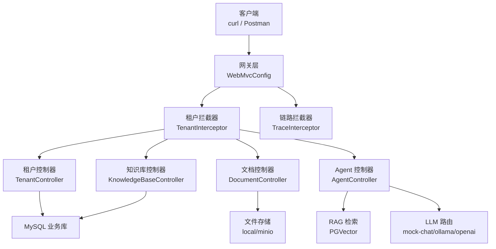
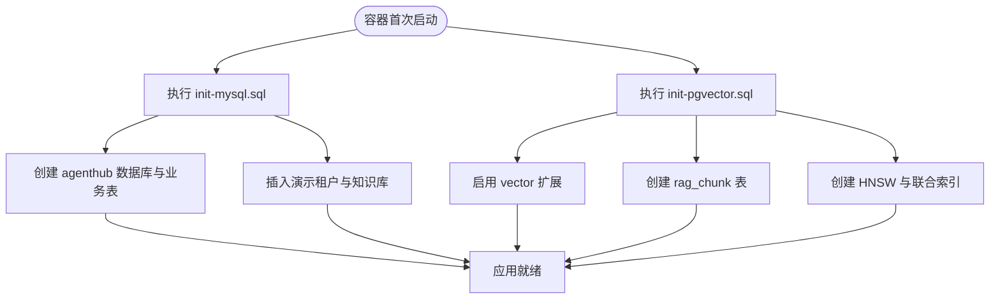
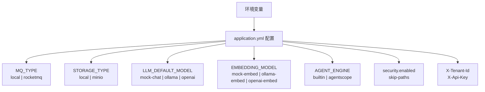
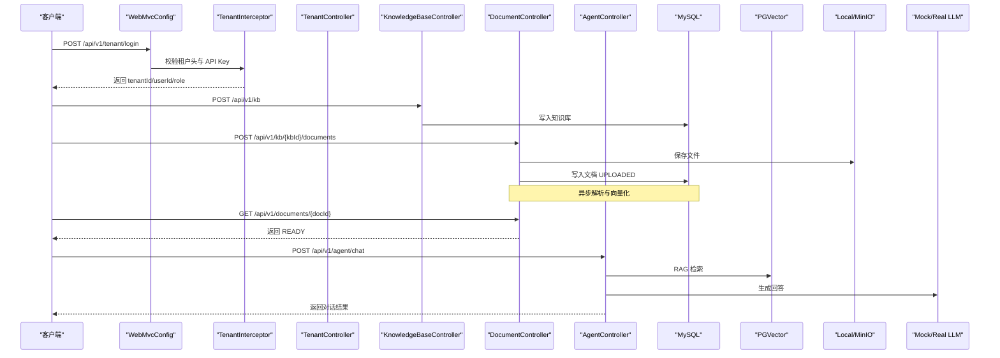
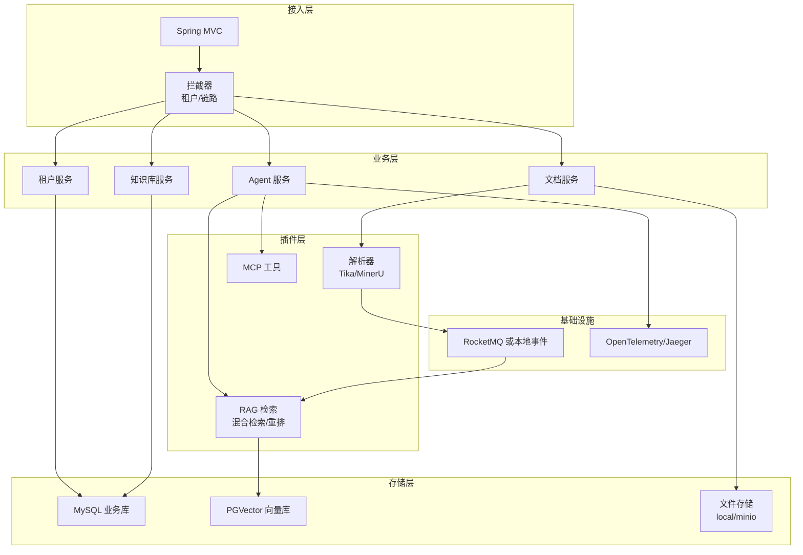

# 快速开始

<cite>
**本文引用的文件**   
- [README.md](file://README.md)
- [docker-compose.yml](file://docker-compose.yml)
- [Dockerfile](file://Dockerfile)
- [application.yml](file://src/main/resources/application.yml)
- [init-mysql.sql](file://sql/init-mysql.sql)
- [init-pgvector.sql](file://sql/init-pgvector.sql)
- [WebMvcConfig.java](file://src/main/java/com/agenthub/gateway/config/WebMvcConfig.java)
- [TenantInterceptor.java](file://src/main/java/com/agenthub/gateway/interceptor/TenantInterceptor.java)
- [TenantController.java](file://src/main/java/com/agenthub/tenant/controller/TenantController.java)
- [KnowledgeBaseController.java](file://src/main/java/com/agenthub/knowledge/controller/KnowledgeBaseController.java)
- [DocumentController.java](file://src/main/java/com/agenthub/knowledge/controller/DocumentController.java)
- [AgentController.java](file://src/main/java/com/agenthub/agent/controller/AgentController.java)
</cite>

## 目录
1. [简介](#简介)
2. [环境要求](#环境要求)
3. [项目结构概览](#项目结构概览)
4. [部署方式一：Docker Compose 一键启动](#部署方式一docker-compose-一键启动)
5. [部署方式二：IDE 本地运行](#部署方式二ide-本地运行)
6. [数据库初始化说明](#数据库初始化说明)
7. [默认配置与关键环境变量](#默认配置与关键环境变量)
8. [核心 API 调用示例](#核心-api-调用示例)
9. [端到端体验流程](#端到端体验流程)
10. [常见问题排查](#常见问题排查)
11. [架构与数据流总览](#架构与数据流总览)
12. [结论与建议](#结论与建议)

## 简介
Java Agent Hub 是一个面向 Java 后端开发者的企业级多租户 RAG + Harness Agent + MCP 工具平台。它通过一套代码串联「多租户隔离 → 文档解析 → 向量化 → 混合检索 → Agent 编排 → MCP 工具调用 → 全链路可观测」，并提供 Docker Compose 一键启动能力，默认使用本地异步、本地存储和 Mock 模型，无需外部 LLM 即可跑通完整链路。

本快速开始指南的目标是让你在几分钟内完成环境准备、服务启动，并通过一组最小 API 调用验证租户登录、知识库创建、文档上传、Agent 对话等核心能力。

**章节来源**
- [README.md:1-18](file://README.md#L1-L18)

## 环境要求
- **JDK**：Java 17（构建与应用运行）
- **Maven**：用于构建 Spring Boot 应用
- **Docker 与 Docker Compose**：用于一键拉起 MySQL、PostgreSQL + pgvector、RocketMQ、MinIO、Ollama、OpenTelemetry Collector、Jaeger 等依赖
- **MySQL 8**：业务主库，自动执行 `sql/init-mysql.sql`
- **PostgreSQL 16 + pgvector**：向量库，自动执行 `sql/init-pgvector.sql`
- **可选依赖**：RocketMQ 5、MinIO、Ollama、OpenTelemetry Collector、Jaeger、MinerU

这些依赖在 `docker-compose.yml` 中统一编排；默认模式仅强制要求 MySQL 与 PGVector，其余组件可按需启用。

**章节来源**
- [README.md:205-207](file://README.md#L205-L207)
- [docker-compose.yml:11-173](file://docker-compose.yml#L11-L173)
- [Dockerfile:5-25](file://Dockerfile#L5-L25)

## 项目结构概览
项目采用按领域划分的模块结构，核心入口为 Spring Boot 应用，对外暴露 `/api/v1/**` REST 接口，并通过拦截器实现租户认证与链路追踪。



**图表来源**
- [WebMvcConfig.java:10-31](file://src/main/java/com/agenthub/gateway/config/WebMvcConfig.java#L10-L31)
- [TenantInterceptor.java:18-49](file://src/main/java/com/agenthub/gateway/interceptor/TenantInterceptor.java#L18-L49)
- [TenantController.java:20-53](file://src/main/java/com/agenthub/tenant/controller/TenantController.java#L20-L53)
- [KnowledgeBaseController.java:19-43](file://src/main/java/com/agenthub/knowledge/controller/KnowledgeBaseController.java#L19-L43)
- [DocumentController.java:17-50](file://src/main/java/com/agenthub/knowledge/controller/DocumentController.java#L17-L50)
- [AgentController.java:14-28](file://src/main/java/com/agenthub/agent/controller/AgentController.java#L14-L28)

**章节来源**
- [README.md:158-173](file://README.md#L158-L173)

## 部署方式一：Docker Compose 一键启动
这是推荐方式，适合快速体验与演示。

### 步骤
1. **构建应用镜像**
   - 在项目根目录执行 Maven 打包并构建镜像：
     ```bash
     mvn clean package -DskipTests && docker build -t agenthub:1.0.0 .
     ```
2. **启动全部依赖与服务**
   - 使用 Docker Compose 拉起所有依赖与应用：
     ```bash
     docker compose up -d
     ```
3. **查看应用日志**
   - 观察应用是否成功启动：
     ```bash
     docker compose logs -f agenthub
     ```

### 说明
- `docker-compose.yml` 会启动 MySQL、PGVector、RocketMQ、MinIO、Ollama（可选）、OTel Collector、Jaeger 以及应用容器 `agenthub`。
- 应用默认以 `MQ_TYPE=local`、`STORAGE_TYPE=local`、`LLM_DEFAULT_MODEL=mock-chat`、`EMBEDDING_MODEL=mock-embed` 运行，无需外部 LLM 或 MQ。
- 应用端口映射到宿主机 `8080`。

**章节来源**
- [README.md:37-60](file://README.md#L37-L60)
- [docker-compose.yml:1-9](file://docker-compose.yml#L1-L9)
- [docker-compose.yml:136-173](file://docker-compose.yml#L136-L173)
- [Dockerfile:1-25](file://Dockerfile#L1-L25)

## 部署方式二：IDE 本地运行
适合开发者在本地调试业务逻辑，只启动必要数据库。

### 步骤
1. **只启动数据库**
   ```bash
   docker compose up -d mysql pgvector
   ```
2. **运行应用**
   - 方式 A：在 IDEA 中直接运行主类 `AgenthubApplication`
   - 方式 B：命令行运行
     ```bash
     mvn spring-boot:run
     ```

### 说明
- 本地模式下，应用连接本机 `localhost:3306` 的 MySQL 与 `localhost:5432` 的 PGVector。
- 默认仍使用 `MQ_TYPE=local`、`STORAGE_TYPE=local`、`mock-chat`、`mock-embed`，无需 RocketMQ、MinIO、Ollama。

**章节来源**
- [README.md:52-60](file://README.md#L52-L60)
- [application.yml:8-18](file://src/main/resources/application.yml#L8-L18)
- [application.yml:64-70](file://src/main/resources/application.yml#L64-L70)

## 数据库初始化说明
### MySQL 业务库
- 首次启动时，Docker Compose 会自动执行 `sql/init-mysql.sql`。
- 脚本会创建 `agenthub` 数据库及租户、用户、API Key、知识库、文档、会话、消息、Token 统计、调用统计、MCP Server 配置等表。
- 同时插入种子数据：
  - 租户编码 `demo`
  - 用户名 `admin`，密码 `admin123`
  - 演示用 API Key 前缀 `ahk_demo1234`
  - 默认知识库 `企业产品手册`

### PostgreSQL + pgvector 向量库
- 首次启动时，Docker Compose 会自动执行 `sql/init-pgvector.sql`。
- 脚本会启用 `vector` 扩展，创建 `rag_chunk` 表，包含 `tenant_id`、`kb_id`、`doc_id`、`content`、`embedding(vector(1024))` 等字段。
- 创建联合索引 `idx_rag_chunk_tenant_kb` 与 HNSW 向量索引 `idx_rag_chunk_embedding`，用于高效检索。



**图表来源**
- [docker-compose.yml:12-34](file://docker-compose.yml#L12-L34)
- [docker-compose.yml:36-54](file://docker-compose.yml#L36-L54)
- [init-mysql.sql:1-196](file://sql/init-mysql.sql#L1-L196)
- [init-pgvector.sql:1-32](file://sql/init-pgvector.sql#L1-L32)

**章节来源**
- [docker-compose.yml:12-54](file://docker-compose.yml#L12-L54)
- [init-mysql.sql:1-196](file://sql/init-mysql.sql#L1-L196)
- [init-pgvector.sql:1-32](file://sql/init-pgvector.sql#L1-L32)

## 默认配置与关键环境变量
### 服务器与数据源
- 应用端口：`8080`
- MySQL 数据源通过环境变量注入：`MYSQL_HOST`、`MYSQL_PORT`、`MYSQL_USER`、`MYSQL_PASSWORD`
- PGVector 数据源通过环境变量注入：`PG_HOST`、`PG_PORT`、`PG_USER`、`PG_PASSWORD`、`PG_DB`
- Jackson 时区设置为 `Asia/Shanghai`

### 异步任务与存储
- `MQ_TYPE=local`：使用进程内事件异步消费，无需 RocketMQ
- `STORAGE_TYPE=local`：使用本地磁盘存储文件，基础目录为 `./data/files`
- 若切换为 MinIO，需要设置 `MINIO_HOST`、`MINIO_ACCESS_KEY`、`MINIO_SECRET_KEY`

### LLM 与 Embedding
- `LLM_DEFAULT_MODEL=mock-chat`：使用内置 Mock 聊天模型
- `EMBEDDING_MODEL=mock-embed`：使用内置 Mock 向量化模型
- 支持 Ollama 与 OpenAI 兼容接口，可通过 `providers` 配置多个模型

### Agent 引擎
- `AGENT_ENGINE=builtin`：使用内置 ReAct 编排引擎
- 可切换为 `agentscope`，对接 AgentScope 2.0 HarnessAgent

### 安全与租户
- `agenthub.security.enabled=true`：开启租户认证
- `agenthub.security.skip-paths=/actuator/**, /error, /api/v1/tenant/login`：免认证路径
- 租户头：`X-Tenant-Id`
- API Key 头：`X-Api-Key`



**图表来源**
- [application.yml:1-19](file://src/main/resources/application.yml#L1-L19)
- [application.yml:46-97](file://src/main/resources/application.yml#L46-L97)
- [application.yml:98-149](file://src/main/resources/application.yml#L98-L149)
- [application.yml:151-155](file://src/main/resources/application.yml#L151-L155)

**章节来源**
- [application.yml:1-19](file://src/main/resources/application.yml#L1-L19)
- [application.yml:46-97](file://src/main/resources/application.yml#L46-L97)
- [application.yml:98-149](file://src/main/resources/application.yml#L98-L149)
- [docker-compose.yml:146-170](file://docker-compose.yml#L146-L170)

## 核心 API 调用示例
以下示例基于默认种子数据与本地模式，可直接在终端中使用 curl 验证。

### 1. 租户登录
- 接口：`POST /api/v1/tenant/login`
- 请求体包含租户编码、用户名、密码
- 返回租户 ID、用户 ID、用户名、显示名、角色

示例：
```bash
curl -X POST http://localhost:8080/api/v1/tenant/login \
  -H "Content-Type: application/json" \
  -d '{"tenantCode":"demo","username":"admin","password":"admin123"}'
```

成功后可从响应中获取 `tenantId`，后续请求携带 `X-Tenant-Id` 头。

**章节来源**
- [TenantController.java:36-46](file://src/main/java/com/agenthub/tenant/controller/TenantController.java#L36-L46)
- [README.md:62-71](file://README.md#L62-L71)

### 2. 创建知识库
- 接口：`POST /api/v1/kb`
- 请求体包含知识库名称与描述
- 默认已存在一个名为 `企业产品手册` 的知识库，ID 为 1

示例：
```bash
AUTH='X-Tenant-Id: 1'
curl -X POST http://localhost:8080/api/v1/kb \
  -H "$AUTH" -H "Content-Type: application/json" \
  -d '{"name":"产品文档","description":"内部产品文档库"}'
```

**章节来源**
- [KnowledgeBaseController.java:29-32](file://src/main/java/com/agenthub/knowledge/controller/KnowledgeBaseController.java#L29-L32)
- [init-mysql.sql:193-195](file://sql/init-mysql.sql#L193-L195)

### 3. 上传文档
- 接口：`POST /api/v1/kb/{kbId}/documents`
- 使用 `multipart/form-data`，字段名为 `file`
- 上传后立即返回文档记录，状态为 `UPLOADED`，随后异步进入解析与向量化流程

示例：
```bash
curl -X POST http://localhost:8080/api/v1/kb/1/documents \
  -H "$AUTH" -F "file=@./docs/demo.md"
```

查询文档状态：
```bash
curl http://localhost:8080/api/v1/documents/1 -H "$AUTH"
```

当状态变为 `READY` 时，表示文档已完成解析、分块、向量化并入库，可用于检索。

**章节来源**
- [DocumentController.java:27-43](file://src/main/java/com/agenthub/knowledge/controller/DocumentController.java#L27-L43)
- [README.md:78-82](file://README.md#L78-L82)

### 4. Agent 对话
- 接口：`POST /api/v1/agent/chat`
- 请求体包含知识库 ID 与用户问题
- Agent 会根据配置按需调用 RAG 检索、LLM 生成回答

示例：
```bash
curl -X POST http://localhost:8080/api/v1/agent/chat \
  -H "$AUTH" -H "Content-Type: application/json" \
  -d '{"kbId":1,"message":"产品的退款政策是什么？"}'
```

**章节来源**
- [AgentController.java:24-28](file://src/main/java/com/agenthub/agent/controller/AgentController.java#L24-L28)
- [README.md:83-87](file://README.md#L83-L87)

## 端到端体验流程
下面的序列图展示了从登录到对话的完整调用链，包括租户认证、知识库操作、文档处理与 Agent 对话。



**图表来源**
- [WebMvcConfig.java:23-31](file://src/main/java/com/agenthub/gateway/config/WebMvcConfig.java#L23-L31)
- [TenantInterceptor.java:31-49](file://src/main/java/com/agenthub/gateway/interceptor/TenantInterceptor.java#L31-L49)
- [TenantController.java:36-46](file://src/main/java/com/agenthub/tenant/controller/TenantController.java#L36-L46)
- [KnowledgeBaseController.java:29-32](file://src/main/java/com/agenthub/knowledge/controller/KnowledgeBaseController.java#L29-L32)
- [DocumentController.java:27-43](file://src/main/java/com/agenthub/knowledge/controller/DocumentController.java#L27-L43)
- [AgentController.java:24-28](file://src/main/java/com/agenthub/agent/controller/AgentController.java#L24-L28)

## 常见问题排查
### 无法连接 MySQL
- 检查 `MYSQL_HOST`、`MYSQL_PORT`、`MYSQL_USER`、`MYSQL_PASSWORD` 是否与 `docker-compose.yml` 一致
- 确认 MySQL 容器健康检查通过
- 若本地运行，确保本机 MySQL 已启动且允许远程访问

**章节来源**
- [docker-compose.yml:12-34](file://docker-compose.yml#L12-L34)
- [application.yml:8-18](file://src/main/resources/application.yml#L8-L18)

### 无法连接 PGVector
- 检查 `PG_HOST`、`PG_PORT`、`PG_USER`、`PG_PASSWORD`、`PG_DB`
- 确认 `sql/init-pgvector.sql` 已执行，`vector` 扩展已启用
- 若本地运行，确保本机 PostgreSQL 已启动

**章节来源**
- [docker-compose.yml:36-54](file://docker-compose.yml#L36-L54)
- [init-pgvector.sql:13-31](file://sql/init-pgvector.sql#L13-L31)
- [application.yml:64-70](file://src/main/resources/application.yml#L64-L70)

### 租户认证失败
- 确认请求头包含 `X-Tenant-Id`
- 若使用 API Key，需同时携带 `X-Api-Key`，且 Key 与租户匹配
- 检查 `agenthub.security.enabled` 是否为 `true`，以及白名单路径是否正确

**章节来源**
- [TenantInterceptor.java:31-49](file://src/main/java/com/agenthub/gateway/interceptor/TenantInterceptor.java#L31-L49)
- [application.yml:54-62](file://src/main/resources/application.yml#L54-L62)

### 文档状态长期不变化
- 默认 `MQ_TYPE=local`，解析与向量化由进程内事件驱动
- 检查应用日志是否有解析或向量化异常
- 若切换到 RocketMQ，需确保 NameServer 与 Broker 可用

**章节来源**
- [application.yml:92-97](file://src/main/resources/application.yml#L92-L97)
- [README.md:31-35](file://README.md#L31-L35)

### 文件存储不可用
- 默认 `STORAGE_TYPE=local`，文件保存在 `./data/files`
- 若切换到 MinIO，需确保 `MINIO_HOST`、`MINIO_ACCESS_KEY`、`MINIO_SECRET_KEY` 正确
- 检查 MinIO 容器是否启动并可访问控制台

**章节来源**
- [application.yml:77-86](file://src/main/resources/application.yml#L77-L86)
- [docker-compose.yml:74-91](file://docker-compose.yml#L74-L91)

### LLM 或 Embedding 不可用
- 默认使用 `mock-chat` 与 `mock-embed`，无需外部模型
- 若切换到 Ollama/OpenAI，需配置对应 base-url 与 api-key
- 检查 Ollama 容器是否启动，端口是否可达

**章节来源**
- [application.yml:98-140](file://src/main/resources/application.yml#L98-L140)
- [docker-compose.yml:93-102](file://docker-compose.yml#L93-L102)

## 架构与数据流总览
下图展示系统整体架构与核心组件关系，便于理解各模块职责与交互。



**图表来源**
- [README.md:20-35](file://README.md#L20-L35)
- [application.yml:46-149](file://src/main/resources/application.yml#L46-L149)
- [docker-compose.yml:56-173](file://docker-compose.yml#L56-L173)

## 结论与建议
- 对于快速体验与演示，推荐使用 Docker Compose 一键启动，默认配置即可跑通全链路。
- 对于本地开发，建议只启动 MySQL 与 PGVector，并在 IDE 中运行应用。
- 生产环境应逐步切换到真实依赖：RocketMQ、MinIO、Ollama/OpenAI、AgentScope 引擎等，并根据业务调整向量维度、TopK、RRF 等参数。
- 始终关注租户隔离与安全配置，确保 `X-Tenant-Id` 与 `X-Api-Key` 的正确使用。
- 利用 OpenTelemetry 与 Jaeger 进行全链路监控，结合调用统计接口定位性能瓶颈与异常。

**章节来源**
- [README.md:37-60](file://README.md#L37-L60)
- [README.md:144-156](file://README.md#L144-L156)
- [README.md:138-143](file://README.md#L138-L143)