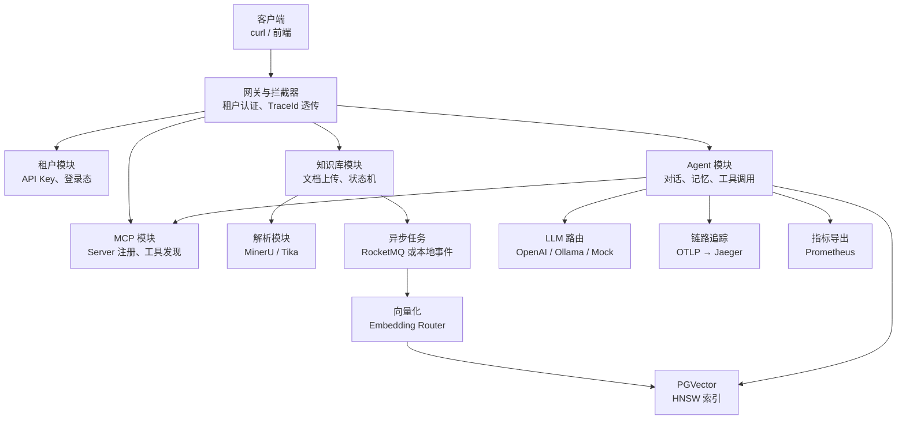
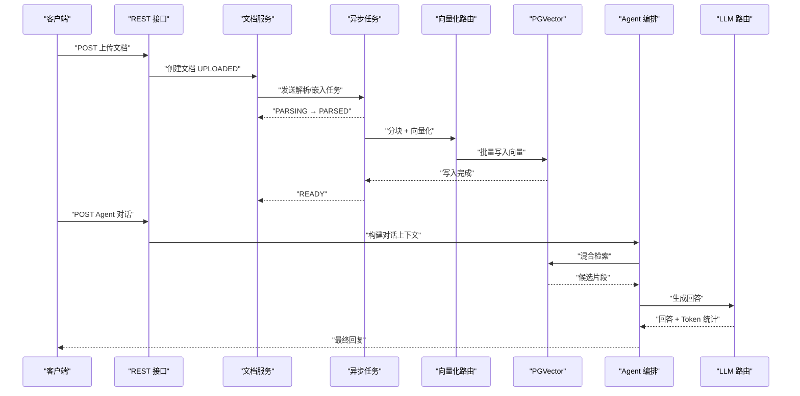
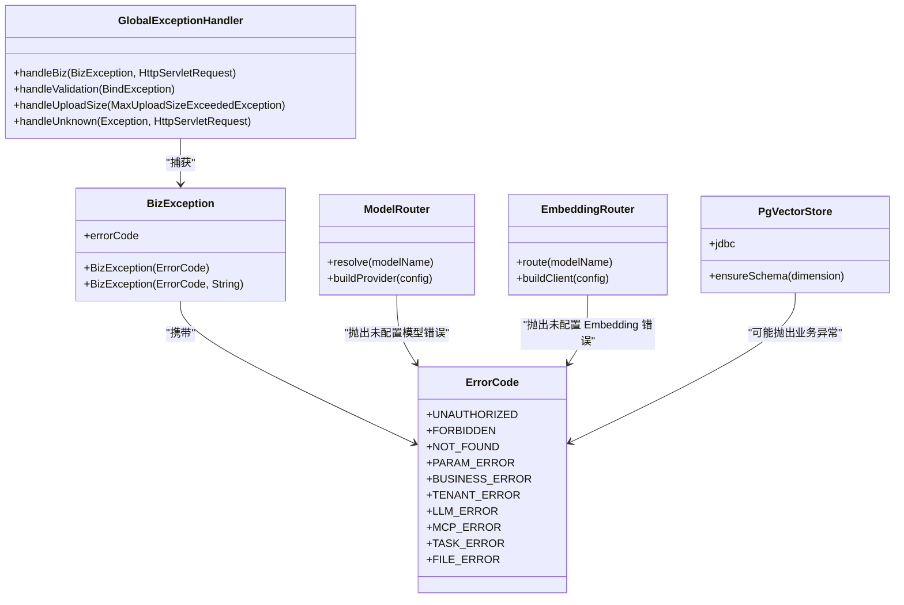

# 故障排查

<cite>
**本文引用的文件**   
- [README.md](file://README.md)
- [application.yml](file://src/main/resources/application.yml)
- [BizException.java](file://src/main/java/com/agenthub/common/exception/BizException.java)
- [GlobalExceptionHandler.java](file://src/main/java/com/agenthub/common/exception/GlobalExceptionHandler.java)
- [ErrorCode.java](file://src/main/java/com/agenthub/common/exception/ErrorCode.java)
- [AsyncConfig.java](file://src/main/java/com/agenthub/gateway/config/AsyncConfig.java)
- [LocalTaskConsumer.java](file://src/main/java/com/agenthub/task/consumer/LocalTaskConsumer.java)
- [DocumentTaskExecutor.java](file://src/main/java/com/agenthub/task/executor/DocumentTaskExecutor.java)
- [ModelRouter.java](file://src/main/java/com/agenthub/llm/router/ModelRouter.java)
- [LLMProperties.java](file://src/main/java/com/agenthub/llm/config/LLMProperties.java)
- [OllamaProvider.java](file://src/main/java/com/agenthub/llm/provider/OllamaProvider.java)
- [OpenAiEmbeddingClient.java](file://src/main/java/com/agenthub/rag/embedding/OpenAiEmbeddingClient.java)
- [OllamaEmbeddingClient.java](file://src/main/java/com/agenthub/rag/embedding/OllamaEmbeddingClient.java)
- [EmbeddingRouter.java](file://src/main/java/com/agenthub/rag/embedding/EmbeddingRouter.java)
- [PgVectorStore.java](file://src/main/java/com/agenthub/rag/store/PgVectorStore.java)
- [MybatisPlusConfig.java](file://src/main/java/com/agenthub/tenant/config/MybatisPlusConfig.java)
- [OtelConfig.java](file://src/main/java/com/agenthub/tracing/config/OtelConfig.java)
</cite>

## 目录
1. [引言](#引言)
2. [项目结构与定位范围](#项目结构与定位范围)
3. [核心故障分类与快速定位](#核心故障分类与快速定位)
4. [架构与数据流总览](#架构与数据流总览)
5. [详细组件故障排查](#详细组件故障排查)
6. [依赖关系与耦合分析](#依赖关系与耦合分析)
7. [性能诊断方法](#性能诊断方法)
8. [监控、链路追踪与告警](#监控链路追踪与告警)
9. [应急预案与回滚策略](#应急预案与回滚策略)
10. [结论](#结论)

## 引言
本手册面向运维人员与开发者，聚焦 Java Agent Hub 在生产与本地环境中的常见问题：启动失败、数据库连接异常、消息队列配置错误、LLM 调用失败、向量检索异常、异步任务卡死、租户隔离异常、链路追踪不可用等。文档基于仓库实际代码结构、配置与异常处理逻辑整理，提供可操作的日志查看路径、根因判断步骤、恢复手段与回滚建议。

## 项目结构与定位范围
Java Agent Hub 是一个多租户 RAG + Harness Agent + MCP 工具平台，默认使用 Docker Compose 一键拉起 MySQL、PGVector、RocketMQ、MinIO、OpenTelemetry Collector 与 Jaeger。应用通过 Spring Boot 暴露 REST API，内部包含知识库管理、文档解析、向量化、混合检索、Agent 编排、MCP 工具桥接、全链路埋点与指标导出。

**图表来源**
- [README.md:20-35](file://README.md#L20-L35)
- [application.yml:31-44](file://src/main/resources/application.yml#L31-L44)

**章节来源**
- [README.md:1-35](file://README.md#L1-L35)
- [application.yml:1-44](file://src/main/resources/application.yml#L1-L44)

## 核心故障分类与快速定位
| 故障类别 | 典型现象 | 优先检查项 | 常见根因 | 快速恢复 |
|---|---|---|---|---|
| 启动失败 | 进程无法启动、端口占用、Bean 初始化失败 | application.yml、环境变量、MySQL/PGVector/RocketMQ/MinIO 连通性 | 配置缺失、依赖未启动、端口冲突 | 修正配置并重启；必要时切换 local/Mock 模式 |
| 数据库连接失败 | 业务接口报 500、租户查询异常 | MySQL 连接串、用户名密码、HikariPool、MyBatis-Plus 租户插件 | 网络不通、账号权限不足、表缺少 tenant_id | 修复连接后重试；确认 init SQL 已执行 |
| 向量库连接失败 | 文档入库卡住、检索无结果 | PGVector JDBC URL、维度、pgvector 扩展、HNSW 索引 | pgvector 未安装、维度不匹配、索引未建 | 修正 dimension、重建索引或回退到 mock-embed |
| 消息队列异常 | 上传后立即返回但文档状态不推进 | MQ_TYPE、RocketMQ name-server、Topic、消费者线程池 | RocketMQ 未启动、name-server 错误、本地模式误配 | 改为 MQ_TYPE=local 验证，再切回 rocketmq |
| LLM 调用失败 | Agent 对话返回模型调用失败 | default-model、provider base-url、api-key、网络 | 模型路由键不存在、外部服务不可达、鉴权失败 | 切换到 mock-chat 验证，再逐步恢复真实模型 |
| 向量检索异常 | 检索结果为空或相关性差 | vector-top-k、keyword-top-k、rrf-k、dimension、tenant_id | 向量维度不一致、租户隔离条件缺失、索引损坏 | 校验 dimension、重跑 embed、检查租户上下文 |
| 异步任务卡死 | 文档长期处于 PARSING/EMBEDDING | taskExecutor 线程池、@Async、TenantContext 透传 | 线程池耗尽、租户上下文丢失、解析服务超时 | 扩容线程池、检查 MDC 与租户透传、降级解析器 |
| 链路追踪不可用 | Jaeger 无 Span、Prometheus 无指标 | OTLP endpoint、Collector、management endpoints | Collector 未启动、endpoint 错误、Actuator 未暴露 | 检查 docker-compose、访问 /actuator/prometheus |

**章节来源**
- [application.yml:7-19](file://src/main/resources/application.yml#L7-L19)
- [application.yml:46-97](file://src/main/resources/application.yml#L46-L97)
- [application.yml:98-149](file://src/main/resources/application.yml#L98-L149)
- [ErrorCode.java:11-26](file://src/main/java/com/agenthub/common/exception/ErrorCode.java#L11-L26)

## 架构与数据流总览
Java Agent Hub 的故障排查需要理解两条主数据流：

1. **文档入库流**：上传 → 落库 UPLOADED → MQ 或本地事件触发解析 → PARSED → 分块 → 向量化 → PGVector 写入 → READY。
2. **Agent 对话流**：用户请求 → 租户认证 → Agent 编排 → 按需调用 RAG 检索工具 → 混合检索（向量+关键字）→ 重排 → LLM 生成回答。

**图表来源**
- [README.md:89-108](file://README.md#L89-L108)
- [DocumentTaskExecutor.java:83-109](file://src/main/java/com/agenthub/task/executor/DocumentTaskExecutor.java#L83-L109)
- [EmbeddingRouter.java:27-45](file://src/main/java/com/agenthub/rag/embedding/EmbeddingRouter.java#L27-L45)
- [ModelRouter.java:86-108](file://src/main/java/com/agenthub/llm/router/ModelRouter.java#L86-L108)

**章节来源**
- [README.md:89-108](file://README.md#L89-L108)
- [DocumentTaskExecutor.java:83-109](file://src/main/java/com/agenthub/task/executor/DocumentTaskExecutor.java#L83-L109)

## 详细组件故障排查

### 启动失败排查
**现象**  
应用无法启动，控制台报错或容器反复重启。

**排查步骤**
1. 检查应用端口与依赖端口是否被占用。
2. 检查 application.yml 中 MySQL、PGVector、RocketMQ、MinIO、OTLP endpoint 是否可连通。
3. 若为本地开发，优先使用默认 local 模式：MQ_TYPE=local、STORAGE_TYPE=local、LLM_DEFAULT_MODEL=mock-chat、EMBEDDING_MODEL=mock-embed。
4. 若使用 Docker Compose，先单独验证依赖服务健康状态。
5. 若 Bean 初始化失败，关注 HikariDataSource、JdbcTemplate、WebClient、RocketMQ Producer 初始化阶段日志。

**关键配置位置**
- 服务器端口与 Jackson 时区：[application.yml:1-19](file://src/main/resources/application.yml#L1-L19)
- MyBatis-Plus 基础配置：[application.yml:21-30](file://src/main/resources/application.yml#L21-L30)
- OTLP 追踪与指标导出开关：[application.yml:31-44](file://src/main/resources/application.yml#L31-L44)
- RocketMQ 名称服务器与生产者超时：[application.yml:46-52](file://src/main/resources/application.yml#L46-L52)
- 平台业务配置入口：[application.yml:54-149](file://src/main/resources/application.yml#L54-L149)

**恢复建议**
- 先用最小依赖启动：只起 MySQL 和 PGVector，关闭 RocketMQ 与 MinIO，确认应用能启动。
- 将 MQ_TYPE 改为 local，STORAGE_TYPE 改为 local，LLM 与 Embedding 都使用 mock，逐步恢复真实依赖。
- 若仍失败，根据具体异常类定位：数据库连接异常看 Hikari 配置，HTTP 客户端异常看 base-url 与 api-key，RocketMQ 异常看 name-server。

**章节来源**
- [application.yml:1-52](file://src/main/resources/application.yml#L1-L52)
- [application.yml:54-149](file://src/main/resources/application.yml#L54-L149)

### 数据库连接问题排查
**现象**  
接口报 500，日志中出现数据库连接失败、连接池耗尽、SQL 执行异常。

**排查步骤**
1. 检查 MySQL 连接串、用户名、密码、时区、字符集。
2. 检查 HikariPool 参数：maximum-pool-size、minimum-idle、connection-timeout。
3. 确认 MyBatis-Plus 租户插件已启用，且业务表包含 tenant_id。
4. 检查 PGVector 独立数据源是否连通，dimension 是否与 embedding 模型输出一致。
5. 若向量检索失败，确认 pgvector 扩展与 HNSW 索引已创建。

**关键实现位置**
- MySQL 数据源与 Hikari 配置：[application.yml:7-19](file://src/main/resources/application.yml#L7-L19)
- MyBatis-Plus 租户插件说明与忽略表：[MybatisPlusConfig.java:16-28](file://src/main/java/com/agenthub/tenant/config/MybatisPlusConfig.java#L16-L28)
- PGVector 存储实现与连接池：[PgVectorStore.java:21-45](file://src/main/java/com/agenthub/rag/store/PgVectorStore.java#L21-L45)
- PGVector 数据源配置：[application.yml:63-70](file://src/main/resources/application.yml#L63-L70)

**恢复建议**
- 若 MySQL 不可用，临时切换到只读或降级接口，避免阻塞上传流程。
- 若 PGVector 不可用，可将 EMBEDDING_MODEL 切换为 mock-embed 进行验证，但生产应尽快恢复真实 embedding。
- 若连接池耗尽，适当提升 maximum-pool-size，同时排查慢查询与长事务。

**章节来源**
- [application.yml:7-19](file://src/main/resources/application.yml#L7-L19)
- [application.yml:63-70](file://src/main/resources/application.yml#L63-L70)
- [MybatisPlusConfig.java:16-28](file://src/main/java/com/agenthub/tenant/config/MybatisPlusConfig.java#L16-L28)
- [PgVectorStore.java:21-45](file://src/main/java/com/agenthub/rag/store/PgVectorStore.java#L21-L45)

### 消息队列配置错误排查
**现象**  
上传接口立即返回，但文档状态长期停留在 UPLOADED、PARSING 或 EMBEDDING。

**排查步骤**
1. 确认 agenthub.mq.type 是否为 local 或 rocketmq。
2. 若为 rocketmq，检查 ROCKETMQ_NAMESRV 是否正确，Producer group 与 Topic 是否存在。
3. 若为 local，检查 @EventListener 是否生效，taskExecutor 线程池是否耗尽。
4. 检查 LocalTaskConsumer 日志，确认任务事件是否被消费。
5. 检查 DocumentTaskExecutor 是否抛出解析文本为空、分块结果为空等异常。

**关键实现位置**
- MQ 类型与 Topic 配置：[application.yml:92-97](file://src/main/resources/application.yml#L92-L97)
- 本地任务消费者：[LocalTaskConsumer.java:12-32](file://src/main/java/com/agenthub/task/consumer/LocalTaskConsumer.java#L12-L32)
- 异步线程池与租户上下文透传：[AsyncConfig.java:14-32](file://src/main/java/com/agenthub/gateway/config/AsyncConfig.java#L14-L32)
- 文档任务执行器嵌入逻辑：[DocumentTaskExecutor.java:83-109](file://src/main/java/com/agenthub/task/executor/DocumentTaskExecutor.java#L83-L109)

**恢复建议**
- 先设置 MQ_TYPE=local，验证文档能否走到 READY。
- 若 local 正常而 rocketmq 异常，重点排查 RocketMQ 名称服务器、Topic、权限与网络。
- 若线程池堆积，增加 corePoolSize/maxPoolSize/queueCapacity，并检查解析服务与 embedding 服务是否超时。

**章节来源**
- [application.yml:92-97](file://src/main/resources/application.yml#L92-L97)
- [LocalTaskConsumer.java:12-32](file://src/main/java/com/agenthub/task/consumer/LocalTaskConsumer.java#L12-L32)
- [AsyncConfig.java:14-32](file://src/main/java/com/agenthub/gateway/config/AsyncConfig.java#L14-L32)
- [DocumentTaskExecutor.java:83-109](file://src/main/java/com/agenthub/task/executor/DocumentTaskExecutor.java#L83-L109)

### LLM 调用失败排查
**现象**  
Agent 对话返回“模型调用失败”，或特定模型路由键报错。

**排查步骤**
1. 检查 agenthub.llm.default-model 是否在 providers.models[].name 中存在。
2. 检查 provider 类型：openai、ollama、mock。
3. 检查 OpenAI 兼容接口的 base-url 与 api-key。
4. 检查 Ollama 的 base-url 是否可达，模型是否加载。
5. 若不确定外部服务是否正常，先切换到 mock-chat。

**关键实现位置**
- LLM 配置结构：[LLMProperties.java:9-42](file://src/main/java/com/agenthub/llm/config/LLMProperties.java#L9-L42)
- 模型路由与 Provider 构建：[ModelRouter.java:19-108](file://src/main/java/com/agenthub/llm/router/ModelRouter.java#L19-L108)
- Ollama Provider 调用与异常包装：[OllamaProvider.java:20-66](file://src/main/java/com/agenthub/llm/provider/OllamaProvider.java#L20-L66)

**恢复建议**
- 将 LLM_DEFAULT_MODEL 设置为 mock-chat，验证 Agent 对话链路是否完整。
- 若 mock 正常，逐步恢复 ollama 或 openai，记录具体 provider 的错误信息。
- 对外部 LLM 服务增加超时与重试策略，避免单次调用拖垮 Agent 对话。

**章节来源**
- [LLMProperties.java:9-42](file://src/main/java/com/agenthub/llm/config/LLMProperties.java#L9-L42)
- [ModelRouter.java:19-108](file://src/main/java/com/agenthub/llm/router/ModelRouter.java#L19-L108)
- [OllamaProvider.java:20-66](file://src/main/java/com/agenthub/llm/provider/OllamaProvider.java#L20-L66)

### 向量检索异常排查
**现象**  
RAG 检索结果为空、相关性低、或 PGVector 写入失败。

**排查步骤**
1. 检查 agenthub.vector.datasource.jdbc-url、username、password。
2. 检查 agenthub.vector.dimension 是否与 embedding 模型输出维度一致。
3. 检查 PGVector 是否已安装 pgvector 扩展，HNSW 索引是否创建。
4. 检查租户隔离：MyBatis-Plus 自动追加 tenant_id，PGVector 显式拼接 tenant_id。
5. 检查 EmbeddingRouter 路由键是否配置，embedding 服务是否可用。

**关键实现位置**
- PGVector 存储实现与连接池：[PgVectorStore.java:21-45](file://src/main/java/com/agenthub/rag/store/PgVectorStore.java#L21-L45)
- PGVector 数据源与 dimension 配置：[application.yml:63-70](file://src/main/resources/application.yml#L63-L70)
- MyBatis-Plus 租户插件说明：[MybatisPlusConfig.java:16-28](file://src/main/java/com/agenthub/tenant/config/MybatisPlusConfig.java#L16-L28)
- Embedding 路由与客户端构建：[EmbeddingRouter.java:14-45](file://src/main/java/com/agenthub/rag/embedding/EmbeddingRouter.java#L14-L45)
- OpenAI 兼容 Embedding 客户端异常处理：[OpenAiEmbeddingClient.java:39-54](file://src/main/java/com/agenthub/rag/embedding/OpenAiEmbeddingClient.java#L39-L54)
- Ollama Embedding 客户端：[OllamaEmbeddingClient.java:14-42](file://src/main/java/com/agenthub/rag/embedding/OllamaEmbeddingClient.java#L14-L42)

**恢复建议**
- 若 dimension 不匹配，重新运行文档嵌入流程，确保向量维度与 PGVector 建表维度一致。
- 若 embedding 服务不可用，临时切换 EMBEDDING_MODEL=mock-embed 验证检索链路。
- 若租户隔离异常，检查 TenantContext 是否在异步线程中正确透传。

**章节来源**
- [application.yml:63-70](file://src/main/resources/application.yml#L63-L70)
- [PgVectorStore.java:21-45](file://src/main/java/com/agenthub/rag/store/PgVectorStore.java#L21-L45)
- [MybatisPlusConfig.java:16-28](file://src/main/java/com/agenthub/tenant/config/MybatisPlusConfig.java#L16-L28)
- [EmbeddingRouter.java:14-45](file://src/main/java/com/agenthub/rag/embedding/EmbeddingRouter.java#L14-L45)
- [OpenAiEmbeddingClient.java:39-54](file://src/main/java/com/agenthub/rag/embedding/OpenAiEmbeddingClient.java#L39-L54)
- [OllamaEmbeddingClient.java:14-42](file://src/main/java/com/agenthub/rag/embedding/OllamaEmbeddingClient.java#L14-L42)

### 异步任务与租户上下文丢失排查
**现象**  
异步任务中租户隔离失效，日志中 traceId 或 tenantId 丢失。

**排查步骤**
1. 检查 AsyncConfig 中 taskExecutor 是否启用。
2. 检查 TenantTaskDecorator 是否复制 MDC 与 TenantContext。
3. 检查 @Async("taskExecutor") 是否正确使用自定义线程池。
4. 检查 LocalTaskConsumer 是否通过 @EventListener 接收任务事件。
5. 检查 DocumentTaskExecutor 中租户上下文是否随任务传递。

**关键实现位置**
- 异步线程池与租户上下文透传装饰器：[AsyncConfig.java:14-64](file://src/main/java/com/agenthub/gateway/config/AsyncConfig.java#L14-L64)
- 本地任务消费者：[LocalTaskConsumer.java:12-32](file://src/main/java/com/agenthub/task/consumer/LocalTaskConsumer.java#L12-L32)
- 文档任务执行器嵌入逻辑：[DocumentTaskExecutor.java:83-109](file://src/main/java/com/agenthub/task/executor/DocumentTaskExecutor.java#L83-L109)

**恢复建议**
- 若租户上下文丢失，优先确认 TenantTaskDecorator 是否生效，避免在自定义线程池中绕过 TaskDecorator。
- 若任务堆积，调整线程池参数并排查下游解析服务与 embedding 服务性能。
- 若仅 RocketMQ 场景异常，对比本地事件消费路径，确认 MQ 消费者是否也透传租户上下文。

**章节来源**
- [AsyncConfig.java:14-64](file://src/main/java/com/agenthub/gateway/config/AsyncConfig.java#L14-L64)
- [LocalTaskConsumer.java:12-32](file://src/main/java/com/agenthub/task/consumer/LocalTaskConsumer.java#L12-L32)
- [DocumentTaskExecutor.java:83-109](file://src/main/java/com/agenthub/task/executor/DocumentTaskExecutor.java#L83-L109)

### 全局异常与错误码解读
**现象**  
接口返回统一 ApiResponse，但业务语义不明确。

**排查步骤**
1. 查看返回 code 与 message，对照 ErrorCode 枚举。
2. 若为 BizException，通常由业务层主动抛出，日志级别为 warn。
3. 若为未知异常，GlobalExceptionHandler 会记录 error 日志并返回通用业务错误。
4. 若为参数校验失败，查看字段级错误信息。
5. 若为文件上传大小超限，直接提示 FILE_ERROR。

**关键实现位置**
- 业务异常封装：[BizException.java:5-22](file://src/main/java/com/agenthub/common/exception/BizException.java#L5-L22)
- 全局异常处理器：[GlobalExceptionHandler.java:14-47](file://src/main/java/com/agenthub/common/exception/GlobalExceptionHandler.java#L14-L47)
- 统一错误码定义：[ErrorCode.java:9-26](file://src/main/java/com/agenthub/common/exception/ErrorCode.java#L9-L26)

**恢复建议**
- 对 LLM_ERROR、MCP_ERROR、TASK_ERROR、FILE_ERROR 建立专项告警。
- 对 UNAUTHORIZED、FORBIDDEN、TENANT_ERROR 建立安全审计告警。
- 对 PARAM_ERROR 加强接口入参校验与前端提示。

**章节来源**
- [BizException.java:5-22](file://src/main/java/com/agenthub/common/exception/BizException.java#L5-L22)
- [GlobalExceptionHandler.java:14-47](file://src/main/java/com/agenthub/common/exception/GlobalExceptionHandler.java#L14-L47)
- [ErrorCode.java:9-26](file://src/main/java/com/agenthub/common/exception/ErrorCode.java#L9-L26)

## 依赖关系与耦合分析

**图表来源**
- [GlobalExceptionHandler.java:14-47](file://src/main/java/com/agenthub/common/exception/GlobalExceptionHandler.java#L14-L47)
- [BizException.java:5-22](file://src/main/java/com/agenthub/common/exception/BizException.java#L5-L22)
- [ErrorCode.java:9-26](file://src/main/java/com/agenthub/common/exception/ErrorCode.java#L9-L26)
- [ModelRouter.java:86-108](file://src/main/java/com/agenthub/llm/router/ModelRouter.java#L86-L108)
- [EmbeddingRouter.java:27-45](file://src/main/java/com/agenthub/rag/embedding/EmbeddingRouter.java#L27-L45)
- [PgVectorStore.java:21-45](file://src/main/java/com/agenthub/rag/store/PgVectorStore.java#L21-L45)

**章节来源**
- [GlobalExceptionHandler.java:14-47](file://src/main/java/com/agenthub/common/exception/GlobalExceptionHandler.java#L14-L47)
- [ErrorCode.java:9-26](file://src/main/java/com/agenthub/common/exception/ErrorCode.java#L9-L26)
- [ModelRouter.java:86-108](file://src/main/java/com/agenthub/llm/router/ModelRouter.java#L86-L108)
- [EmbeddingRouter.java:27-45](file://src/main/java/com/agenthub/rag/embedding/EmbeddingRouter.java#L27-L45)
- [PgVectorStore.java:21-45](file://src/main/java/com/agenthub/rag/store/PgVectorStore.java#L21-L45)

## 性能诊断方法
### 慢查询分析
- 开启 MyBatis-Plus 日志实现，观察 SQL 是否包含 tenant_id。
- 检查 PGVector 向量检索是否命中 HNSW 索引，避免全表扫描。
- 对 MySQL 慢查询日志进行分析，重点关注文档状态更新、知识库查询、会话查询。
- 对 PGVector 使用 EXPLAIN ANALYZE 分析向量检索语句。

**相关配置与实现**
- MyBatis-Plus 日志实现：[application.yml:21-30](file://src/main/resources/application.yml#L21-L30)
- PGVector 存储实现与索引说明：[PgVectorStore.java:21-45](file://src/main/java/com/agenthub/rag/store/PgVectorStore.java#L21-L45)

### 内存泄漏检测
- 使用 JVM 堆转储工具分析大对象，重点关注文档内容、parsedText、embedding 数组。
- 检查异步任务是否一次性加载超大文档或未释放临时集合。
- 检查 PGVector 批量写入是否合理分片，避免单次写入过大。

### CPU 使用率分析
- 使用 top、jstack、arthas 分析热点线程，重点关注解析、分块、embedding、LLM 调用。
- 若 CPU 高但 QPS 低，可能是解析服务或 embedding 服务成为瓶颈。
- 若 CPU 高且伴随大量 GC，检查文档切块策略与向量维度。

### 线程池与异步任务诊断
- 检查 taskExecutor 的 corePoolSize、maxPoolSize、queueCapacity。
- 观察线程名前缀 agenthub-task-，定位异步任务线程。
- 若任务堆积，优先排查下游解析服务与 embedding 服务响应时间。

**相关实现**
- 异步线程池配置：[AsyncConfig.java:22-32](file://src/main/java/com/agenthub/gateway/config/AsyncConfig.java#L22-L32)
- 本地任务消费者：[LocalTaskConsumer.java:25-31](file://src/main/java/com/agenthub/task/consumer/LocalTaskConsumer.java#L25-L31)

**章节来源**
- [application.yml:21-30](file://src/main/resources/application.yml#L21-L30)
- [PgVectorStore.java:21-45](file://src/main/java/com/agenthub/rag/store/PgVectorStore.java#L21-L45)
- [AsyncConfig.java:22-32](file://src/main/java/com/agenthub/gateway/config/AsyncConfig.java#L22-L32)
- [LocalTaskConsumer.java:25-31](file://src/main/java/com/agenthub/task/consumer/LocalTaskConsumer.java#L25-L31)

## 监控链路追踪与告警
### 链路追踪
- 应用通过 Micrometer Tracing 与 OpenTelemetry Bridge 上报 OTLP。
- Collector 转发到 Jaeger，Span 带 tenant.id 标签，可按租户过滤。
- 可通过 /api/v1/tracing/stats 与 /api/v1/tracing/calls 查看聚合与明细统计。

**相关配置**
- OTLP tracing 与 metrics 导出开关：[application.yml:31-44](file://src/main/resources/application.yml#L31-L44)
- OpenTelemetry 配置与原生 Tracer/Meter 暴露：[OtelConfig.java:10-41](file://src/main/java/com/agenthub/tracing/config/OtelConfig.java#L10-L41)
- README 中可观测性说明：[README.md:138-143](file://README.md#L138-L143)

### 指标监控
- Actuator 暴露 health、info、metrics、prometheus。
- Collector 暴露 Prometheus 端点，用于采集应用指标与 OTel 指标。
- 建议为 LLM_ERROR、MCP_ERROR、TASK_ERROR、BUSINESS_ERROR 建立错误率告警。
- 建议为 PGVector 写入耗时、Embedding 调用耗时、LLM 调用耗时建立延迟告警。

**相关配置**
- Actuator endpoints 暴露：[application.yml:31-36](file://src/main/resources/application.yml#L31-L36)
- 统一错误码与异常日志：[ErrorCode.java:9-26](file://src/main/java/com/agenthub/common/exception/ErrorCode.java#L9-L26)
- GlobalExceptionHandler 日志输出：[GlobalExceptionHandler.java:21-45](file://src/main/java/com/agenthub/common/exception/GlobalExceptionHandler.java#L21-L45)

**章节来源**
- [application.yml:31-44](file://src/main/resources/application.yml#L31-L44)
- [OtelConfig.java:10-41](file://src/main/java/com/agenthub/tracing/config/OtelConfig.java#L10-L41)
- [README.md:138-143](file://README.md#L138-L143)
- [ErrorCode.java:9-26](file://src/main/java/com/agenthub/common/exception/ErrorCode.java#L9-L26)
- [GlobalExceptionHandler.java:21-45](file://src/main/java/com/agenthub/common/exception/GlobalExceptionHandler.java#L21-L45)

## 应急预案与回滚策略
### 启动失败应急
- 若外部依赖不可用，立即切换至 local 模式与 mock 模型，保证基本对话能力。
- 若仅 PGVector 不可用，切换 EMBEDDING_MODEL=mock-embed，保留知识库查询能力。
- 若仅 RocketMQ 不可用，切换 MQ_TYPE=local，避免上传流程阻塞。

**依据配置**
- MQ 类型与 Topic：[application.yml:92-97](file://src/main/resources/application.yml#L92-L97)
- LLM 与 Embedding 默认模型：[application.yml:98-149](file://src/main/resources/application.yml#L98-L149)

### 数据库故障应急
- MySQL 不可用时，暂停写操作，优先保障只读查询与缓存。
- PGVector 不可用时，暂停新文档入库，清理积压任务，避免重复写入。
- 恢复后按文档 ID 幂等重跑解析与嵌入流程。

**依据实现**
- PGVector 存储实现：[PgVectorStore.java:21-45](file://src/main/java/com/agenthub/rag/store/PgVectorStore.java#L21-L45)
- 文档任务执行器嵌入逻辑：[DocumentTaskExecutor.java:83-109](file://src/main/java/com/agenthub/task/executor/DocumentTaskExecutor.java#L83-L109)

### LLM 与 Embedding 服务故障应急
- 外部 LLM 不可用时，切换 LLM_DEFAULT_MODEL=mock-chat。
- Embedding 服务不可用时，切换 EMBEDDING_MODEL=mock-embed。
- 对真实模型调用增加超时、重试与熔断策略，避免雪崩。

**依据实现**
- LLM 路由与 Provider 构建：[ModelRouter.java:86-108](file://src/main/java/com/agenthub/llm/router/ModelRouter.java#L86-L108)
- Embedding 路由与客户端构建：[EmbeddingRouter.java:27-45](file://src/main/java/com/agenthub/rag/embedding/EmbeddingRouter.java#L27-L45)
- Ollama Provider 异常包装：[OllamaProvider.java:53-66](file://src/main/java/com/agenthub/llm/provider/OllamaProvider.java#L53-L66)
- OpenAI Embedding 客户端异常包装：[OpenAiEmbeddingClient.java:40-54](file://src/main/java/com/agenthub/rag/embedding/OpenAiEmbeddingClient.java#L40-L54)

### 回滚策略
- 配置变更优先通过环境变量覆盖，避免直接修改 application.yml。
- 模型切换通过 LLM_DEFAULT_MODEL 与 EMBEDDING_MODEL 控制，无需重启即可验证。
- 若新版本引入新的解析器或 embedding 模型，先灰度一个租户验证，再全量发布。
- 若向量索引损坏，重建索引并重新运行嵌入任务，同时保留旧索引以便回滚。

**依据配置**
- 平台业务配置入口：[application.yml:54-149](file://src/main/resources/application.yml#L54-L149)
- README 中切换到真实依赖的配置示例：[README.md:144-156](file://README.md#L144-L156)

**章节来源**
- [application.yml:92-149](file://src/main/resources/application.yml#L92-L149)
- [PgVectorStore.java:21-45](file://src/main/java/com/agenthub/rag/store/PgVectorStore.java#L21-L45)
- [DocumentTaskExecutor.java:83-109](file://src/main/java/com/agenthub/task/executor/DocumentTaskExecutor.java#L83-L109)
- [ModelRouter.java:86-108](file://src/main/java/com/agenthub/llm/router/ModelRouter.java#L86-L108)
- [EmbeddingRouter.java:27-45](file://src/main/java/com/agenthub/rag/embedding/EmbeddingRouter.java#L27-L45)
- [OllamaProvider.java:53-66](file://src/main/java/com/agenthub/llm/provider/OllamaProvider.java#L53-L66)
- [OpenAiEmbeddingClient.java:40-54](file://src/main/java/com/agenthub/rag/embedding/OpenAiEmbeddingClient.java#L40-L54)
- [README.md:144-156](file://README.md#L144-L156)

## 结论
Java Agent Hub 的故障排查应以“配置—依赖—数据流—异常”为主线：先确认应用与依赖启动正常，再确认 MySQL、PGVector、RocketMQ、MinIO、OTLP 连通性，随后按文档入库流与 Agent 对话流定位具体组件。对于 LLM、Embedding、PGVector、MQ 等外部依赖，务必准备 mock/local 降级方案；对于租户隔离与异步任务，务必确保 TenantContext 与 MDC 透传；对于可观测性，务必打通 Jaeger 与 Prometheus，并为关键错误码建立告警。通过本手册的快速定位步骤、架构图示与恢复建议，可在最短时间内定位根因并恢复服务。