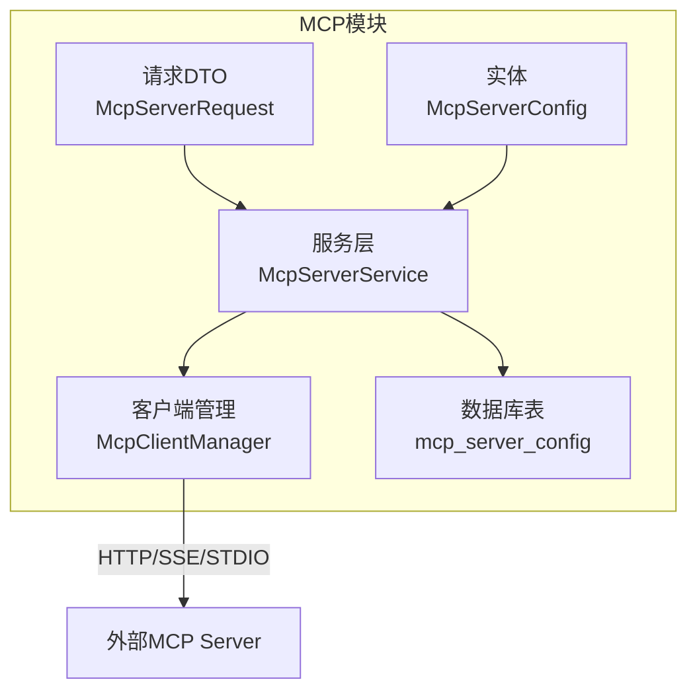
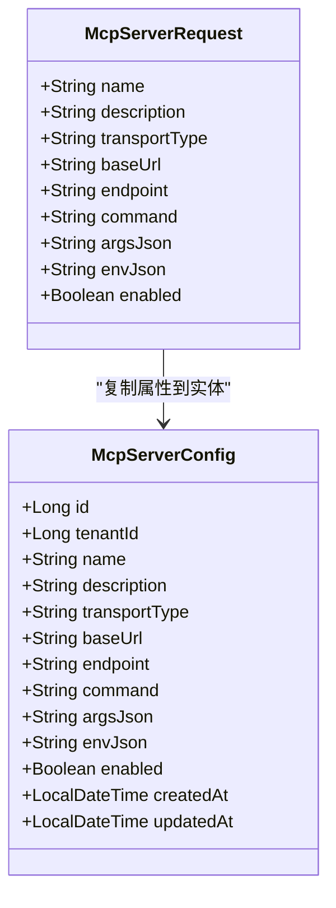
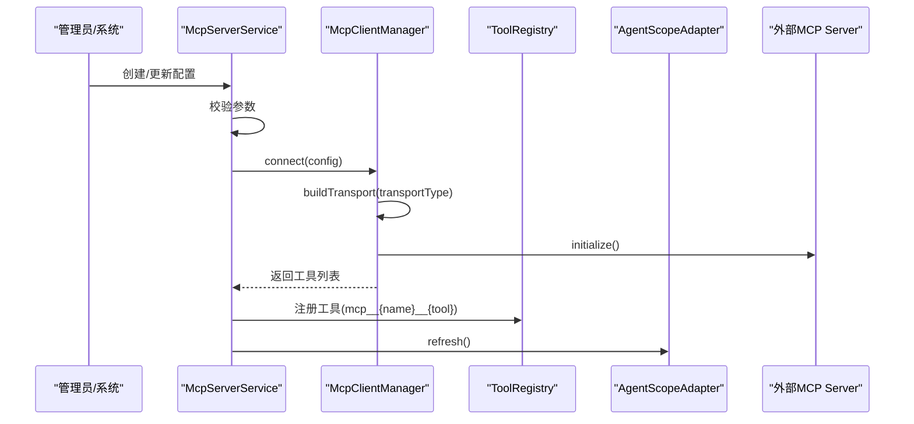
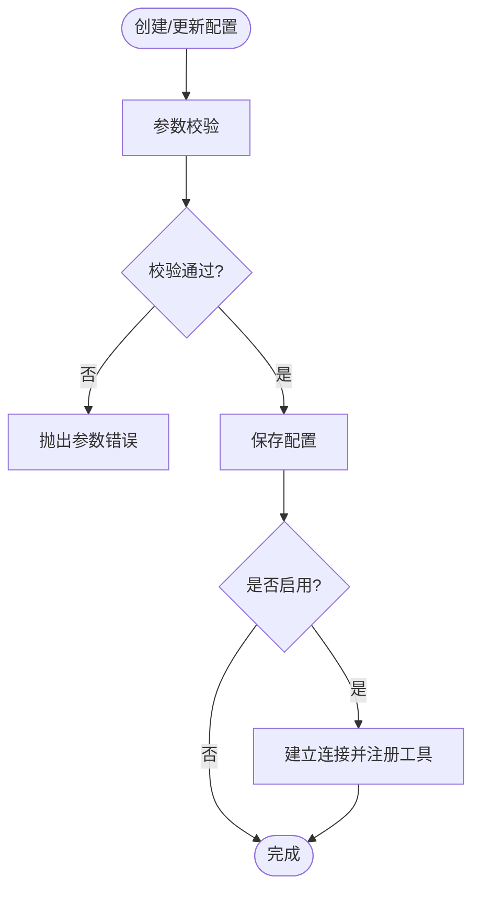
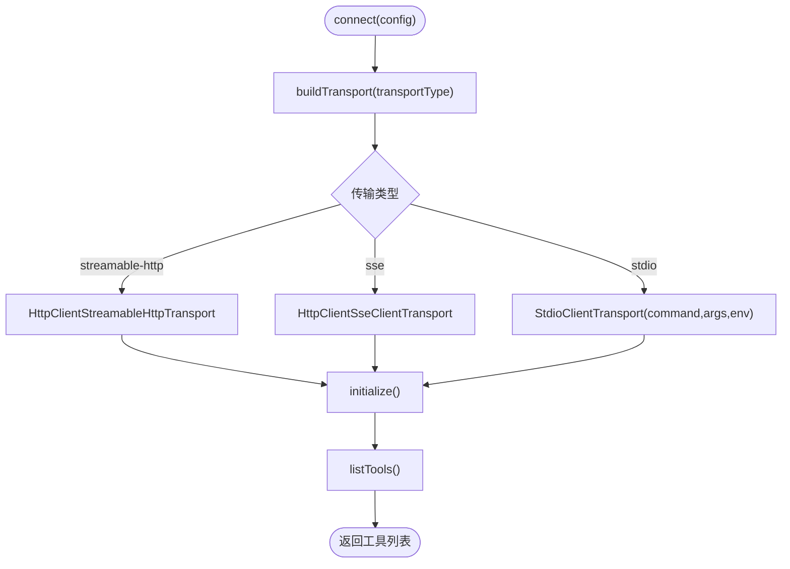
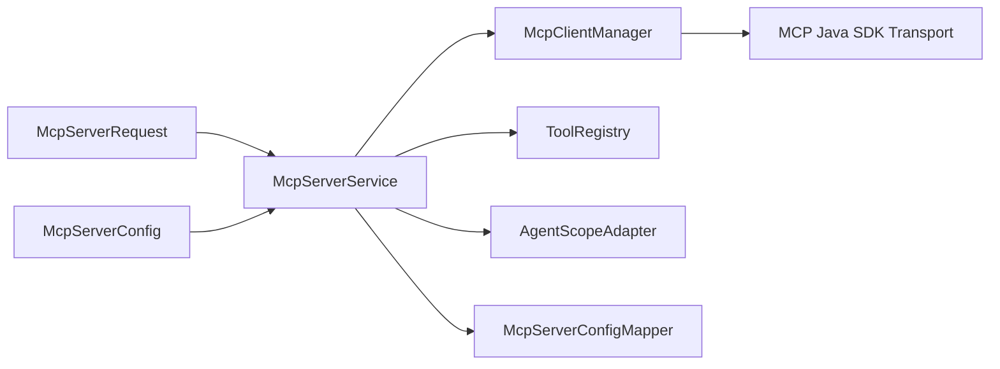

# MCP配置实体模型

<cite>
**本文引用的文件**   
- [McpServerConfig.java](file://src/main/java/com/agenthub/mcp/entity/McpServerConfig.java)
- [McpServerRequest.java](file://src/main/java/com/agenthub/mcp/dto/McpServerRequest.java)
- [McpServerService.java](file://src/main/java/com/agenthub/mcp/service/McpServerService.java)
- [McpClientManager.java](file://src/main/java/com/agenthub/mcp/client/McpClientManager.java)
- [init-mysql.sql](file://sql/init-mysql.sql)
</cite>

## 目录
1. [简介](#简介)
2. [项目结构定位](#项目结构定位)
3. [核心实体与请求模型](#核心实体与请求模型)
4. [架构总览](#架构总览)
5. [详细组件分析](#详细组件分析)
6. [依赖关系分析](#依赖关系分析)
7. [性能与连接特性](#性能与连接特性)
8. [安全与验证规则](#安全与验证规则)
9. [不同传输模式的配置示例](#不同传输模式的配置示例)
10. [连接测试与排错指南](#连接测试与排错指南)
11. [结论](#结论)

## 简介
本文围绕 MCP（Model Context Protocol）相关配置实体展开，重点说明 McpServerConfig 实体的字段定义、传输模式支持、连接生命周期管理，以及不同传输类型（stdio、sse、streamable-http）的配置差异。同时给出安全考虑、校验规则、配置示例和连接测试方法，帮助开发者快速理解并正确接入外部 MCP Server。

## 项目结构定位
MCP 相关代码位于 mcp 包下，包含客户端管理器、服务层、控制器、DTO、实体与数据库映射等。其中：
- 实体层：McpServerConfig 描述 MCP Server 的连接配置。
- 请求层：McpServerRequest 用于创建/更新配置的入参。
- 服务层：McpServerService 提供配置 CRUD、连接建立/断开、工具注册与懒连接。
- 客户端层：McpClientManager 负责按传输类型构建 Transport、握手、工具发现与调用。
- 数据层：mcp_server_config 表持久化配置，并通过唯一键保证租户内配置名唯一。

图表来源
- [McpServerConfig.java:10-52](file://src/main/java/com/agenthub/mcp/entity/McpServerConfig.java#L10-L52)
- [McpServerRequest.java:5-36](file://src/main/java/com/agenthub/mcp/dto/McpServerRequest.java#L5-L36)
- [McpServerService.java:23-157](file://src/main/java/com/agenthub/mcp/service/McpServerService.java#L23-L157)
- [McpClientManager.java:24-143](file://src/main/java/com/agenthub/mcp/client/McpClientManager.java#L24-L143)
- [init-mysql.sql:157-174](file://sql/init-mysql.sql#L157-L174)

章节来源
- [McpServerConfig.java:10-52](file://src/main/java/com/agenthub/mcp/entity/McpServerConfig.java#L10-L52)
- [McpServerRequest.java:5-36](file://src/main/java/com/agenthub/mcp/dto/McpServerRequest.java#L5-L36)
- [McpServerService.java:23-157](file://src/main/java/com/agenthub/mcp/service/McpServerService.java#L23-L157)
- [McpClientManager.java:24-143](file://src/main/java/com/agenthub/mcp/client/McpClientManager.java#L24-L143)
- [init-mysql.sql:157-174](file://sql/init-mysql.sql#L157-L174)

## 核心实体与请求模型
McpServerConfig 是 MCP Server 连接的持久化模型，承载租户隔离、传输类型、URL 端点、STDIO 启动命令与参数、环境变量、启用状态及时间戳等关键信息。McpServerRequest 作为 API 入参，与实体字段基本对应，便于创建/更新配置。

关键字段说明（按业务含义分组）：
- 标识与归属
  - id：主键自增
  - tenantId：租户ID，实现多租户隔离
  - name：配置名，作为工具名前缀，需租户内唯一
- 连接与传输
  - transportType：传输类型，支持 stdio、sse、streamable-http
  - baseUrl：SSE / Streamable HTTP 的服务地址
  - endpoint：Streamable HTTP 的端点路径，默认 /mcp
- STDIO 子进程
  - command：启动命令，如 npx、uvx、java -jar
  - argsJson：启动参数数组（JSON字符串）
  - envJson：环境变量对象（JSON字符串），可注入 API Key 等敏感信息
- 控制与审计
  - enabled：是否启用；应用启动时会对已启用的配置进行懒连接
  - createdAt / updatedAt：记录创建与更新时间

图表来源
- [McpServerConfig.java:10-52](file://src/main/java/com/agenthub/mcp/entity/McpServerConfig.java#L10-L52)
- [McpServerRequest.java:5-36](file://src/main/java/com/agenthub/mcp/dto/McpServerRequest.java#L5-L36)

章节来源
- [McpServerConfig.java:10-52](file://src/main/java/com/agenthub/mcp/entity/McpServerConfig.java#L10-L52)
- [McpServerRequest.java:5-36](file://src/main/java/com/agenthub/mcp/dto/McpServerRequest.java#L5-L36)

## 架构总览
MCP 配置与服务交互的整体流程如下：
- 通过服务层对配置进行创建、更新、删除与查询。
- 连接建立时，客户端管理器根据 transportType 选择对应的 Transport（Streamable HTTP、SSE、STDIO）。
- 握手成功后，拉取工具列表，并以 mcp__{server}__{tool} 命名注册到全局工具注册表。
- AgentScope 引擎通过刷新机制感知工具变化。

图表来源
- [McpServerService.java:40-84](file://src/main/java/com/agenthub/mcp/service/McpServerService.java#L40-L84)
- [McpClientManager.java:40-58](file://src/main/java/com/agenthub/mcp/client/McpClientManager.java#L40-L58)

章节来源
- [McpServerService.java:40-84](file://src/main/java/com/agenthub/mcp/service/McpServerService.java#L40-L84)
- [McpClientManager.java:40-58](file://src/main/java/com/agenthub/mcp/client/McpClientManager.java#L40-L58)

## 详细组件分析

### McpServerConfig 实体
- 作用：持久化 MCP Server 连接配置，支撑多租户隔离与工具前缀命名。
- 关键字段
  - transportType：决定连接方式（stdio/sse/streamable-http）。
  - baseUrl：远程传输必填项（sse/streamable-http）。
  - endpoint：仅 streamable-http 使用，默认 /mcp。
  - command/argsJson/envJson：仅 stdio 模式使用，用于拉起本地子进程。
  - enabled：控制是否在应用启动阶段进行懒连接。
- 约束
  - 数据库层面通过 (tenant_id, name) 唯一键保证同一租户内配置名唯一。

章节来源
- [McpServerConfig.java:10-52](file://src/main/java/com/agenthub/mcp/entity/McpServerConfig.java#L10-L52)
- [init-mysql.sql:157-174](file://sql/init-mysql.sql#L157-L174)

### McpServerService 服务层
- 职责
  - 配置CRUD：create/update/delete/list。
  - 连接管理：connect/disconnect，并在断开时注销该 Server 的全部工具。
  - 工具注册：将 MCP Server 暴露的工具以统一前缀注册到 ToolRegistry。
  - 懒连接：ensureConnectedForTenant 在租户上下文中确保已启用配置已连接。
- 校验逻辑
  - 名称非空。
  - 传输类型非空且为受支持值。
  - sse/streamable-http 必须提供 baseUrl。
  - stdio 必须提供 command。

图表来源
- [McpServerService.java:40-60](file://src/main/java/com/agenthub/mcp/service/McpServerService.java#L40-L60)
- [McpServerService.java:141-156](file://src/main/java/com/agenthub/mcp/service/McpServerService.java#L141-L156)

章节来源
- [McpServerService.java:40-156](file://src/main/java/com/agenthub/mcp/service/McpServerService.java#L40-L156)

### McpClientManager 客户端管理
- 职责
  - 按 transportType 构建 Transport：
    - streamable-http：HttpClientStreamableHttpTransport，endpoint 默认 /mcp。
    - sse：HttpClientSseClientTransport。
    - stdio：StdioClientTransport，解析 command/argsJson/envJson。
  - 连接生命周期：initialize、listTools、callTool、closeGracefully。
  - 工具调用：封装 CallToolResult，提取文本内容返回。
- 连接超时
  - 初始化请求超时设置为 30 秒。

图表来源
- [McpClientManager.java:40-58](file://src/main/java/com/agenthub/mcp/client/McpClientManager.java#L40-L58)
- [McpClientManager.java:116-143](file://src/main/java/com/agenthub/mcp/client/McpClientManager.java#L116-L143)

章节来源
- [McpClientManager.java:40-143](file://src/main/java/com/agenthub/mcp/client/McpClientManager.java#L40-L143)

## 依赖关系分析
- 实体与请求
  - McpServerRequest 复制到 McpServerConfig，减少重复字段定义。
- 服务与客户端
  - McpServerService 依赖 McpClientManager 完成连接与工具操作。
  - McpServerService 依赖 ToolRegistry 与 AgentScopeAdapter 完成工具注册与刷新。
- 客户端与SDK
  - McpClientManager 依赖官方 MCP Java SDK 2.0 的 Transport 实现（HTTP/SSE/STDIO）。
- 数据层
  - MyBatis-Plus 插件自动处理租户隔离；数据库表通过唯一键保证配置名唯一。

图表来源
- [McpServerService.java:23-38](file://src/main/java/com/agenthub/mcp/service/McpServerService.java#L23-L38)
- [McpClientManager.java:24-32](file://src/main/java/com/agenthub/mcp/client/McpClientManager.java#L24-L32)

章节来源
- [McpServerService.java:23-38](file://src/main/java/com/agenthub/mcp/service/McpServerService.java#L23-L38)
- [McpClientManager.java:24-32](file://src/main/java/com/agenthub/mcp/client/McpClientManager.java#L24-L32)

## 性能与连接特性
- 连接复用
  - 客户端管理器维护已连接客户端的并发 Map，避免重复连接。
- 超时控制
  - 初始化请求超时为 30 秒，防止长时间阻塞。
- 优雅关闭
  - 断开连接时尝试优雅关闭，捕获异常并记录日志，避免资源泄漏。
- 工具注册开销
  - 每次连接成功都会遍历工具列表并注册，建议在工具数量较多时关注注册耗时。

章节来源
- [McpClientManager.java:40-70](file://src/main/java/com/agenthub/mcp/client/McpClientManager.java#L40-L70)

## 安全与验证规则
- 参数校验
  - 名称不能为空。
  - 传输类型不能为空且必须为受支持值。
  - sse/streamable-http 必须提供 baseUrl。
  - stdio 必须提供 command。
- 敏感信息保护
  - envJson 可注入 API Key 等敏感环境变量，建议在生产环境使用密钥管理服务或加密存储。
- 租户隔离
  - 所有配置按租户隔离，数据库唯一键 (tenant_id, name) 防止同名冲突。
- 连接失败处理
  - 连接失败抛出业务异常，便于上层统一处理与告警。

章节来源
- [McpServerService.java:141-156](file://src/main/java/com/agenthub/mcp/service/McpServerService.java#L141-L156)
- [init-mysql.sql:157-174](file://sql/init-mysql.sql#L157-L174)

## 不同传输模式的配置示例
以下示例以 JSON 形式展示各传输类型的必要字段与可选字段。请根据实际部署替换占位值。

- stdio 模式
  - 必要字段
    - transportType: "stdio"
    - command: 启动命令，例如 "npx"、"uvx" 或 "java -jar"
  - 可选字段
    - argsJson: 启动参数数组，例如 ["run", "server"]
    - envJson: 环境变量对象，例如 {"API_KEY": "your-key"}
  - 注意
    - 无需 baseUrl 与 endpoint。

- sse 模式
  - 必要字段
    - transportType: "sse"
    - baseUrl: SSE 服务地址，例如 "https://mcp.example.com"
  - 可选字段
    - endpoint: 不用于 SSE，可忽略。
  - 注意
    - 服务端需支持 SSE 长连接。

- streamable-http 模式
  - 必要字段
    - transportType: "streamable-http"
    - baseUrl: HTTP 服务地址，例如 "https://mcp.example.com"
  - 可选字段
    - endpoint: 端点路径，默认 "/mcp"
  - 注意
    - 服务端需支持 Streamable HTTP 协议。

章节来源
- [McpServerRequest.java:5-36](file://src/main/java/com/agenthub/mcp/dto/McpServerRequest.java#L5-L36)
- [McpClientManager.java:116-143](file://src/main/java/com/agenthub/mcp/client/McpClientManager.java#L116-L143)

## 连接测试与排错指南
- 连接测试步骤
  - 创建配置：填写 transportType、baseUrl/command 等必要字段。
  - 建立连接：调用服务的 connect 接口，观察是否返回工具列表。
  - 列出工具：调用 listTools 接口，确认工具清单。
  - 调用工具：调用 callTool 接口，传入 toolName 与 arguments，检查返回文本。
- 常见问题排查
  - 未连接错误：若调用工具时报“未连接”，请先执行 connect。
  - 传输类型不支持：检查 transportType 是否为 stdio/sse/streamable-http。
  - baseUrl 缺失：sse/streamable-http 必须提供 baseUrl。
  - command 缺失：stdio 必须提供 command。
  - 连接超时：检查网络连通性与服务端可用性，默认初始化超时为 30 秒。
  - 工具注册失败：确认服务端工具清单正常返回，并检查 ToolRegistry 与 AgentScopeAdapter 刷新逻辑。

章节来源
- [McpServerService.java:75-109](file://src/main/java/com/agenthub/mcp/service/McpServerService.java#L75-L109)
- [McpClientManager.java:40-95](file://src/main/java/com/agenthub/mcp/client/McpClientManager.java#L40-L95)

## 结论
McpServerConfig 实体与配套服务、客户端共同构成了 MCP Server 的统一接入能力。通过标准化的传输类型与严格的参数校验，系统能够稳定地连接多种 MCP Server，并将工具以统一前缀注册到全局工具注册表，供 Agent 编排层直接使用。生产环境中应重点关注敏感环境变量保护、连接超时与重试策略，以及工具注册的监控与告警。