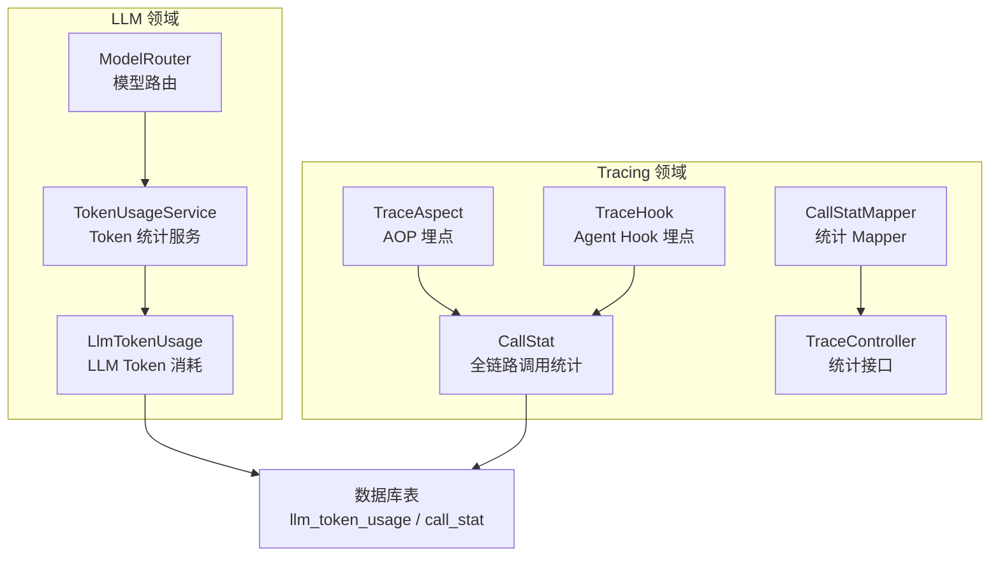
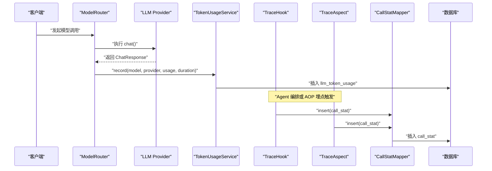
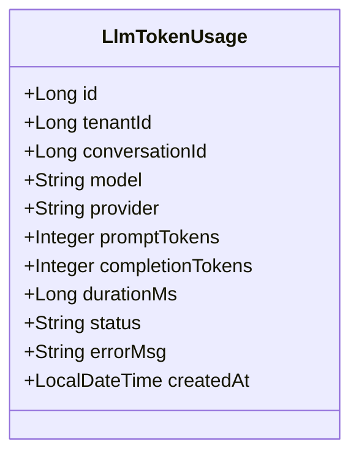
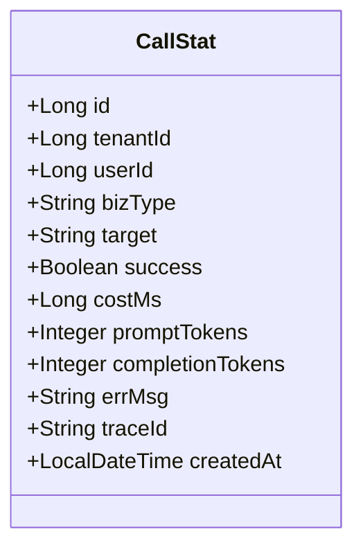
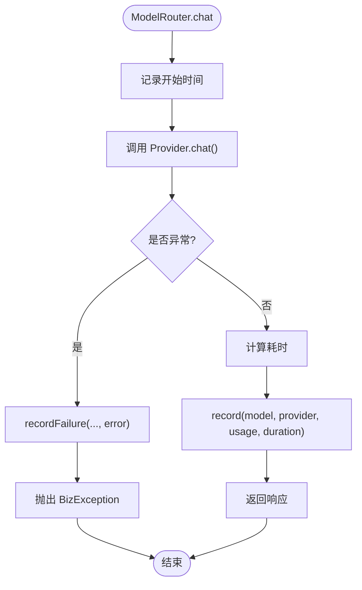
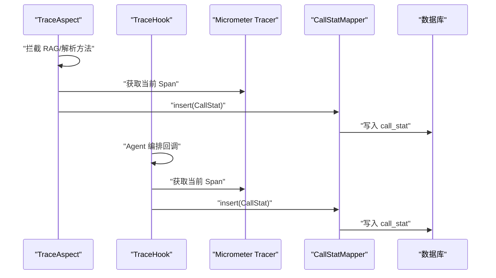
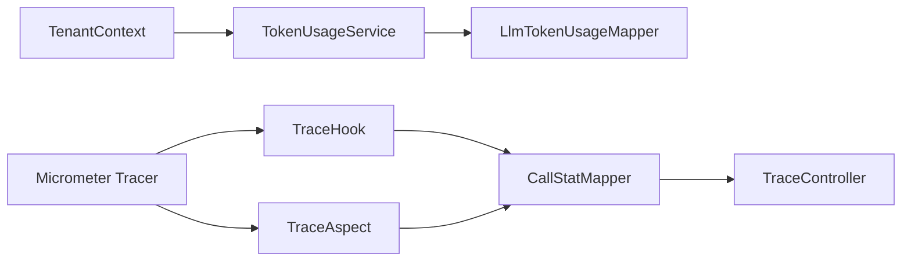

# 使用统计实体模型

<cite>
**本文引用的文件**   
- [LlmTokenUsage.java](file://src/main/java/com/agenthub/llm/entity/LlmTokenUsage.java)
- [TokenUsageService.java](file://src/main/java/com/agenthub/llm/service/TokenUsageService.java)
- [ModelRouter.java](file://src/main/java/com/agenthub/llm/router/ModelRouter.java)
- [CallStat.java](file://src/main/java/com/agenthub/tracing/entity/CallStat.java)
- [TraceAspect.java](file://src/main/java/com/agenthub/tracing/aspect/TraceAspect.java)
- [TraceHook.java](file://src/main/java/com/agenthub/tracing/hook/TraceHook.java)
- [CallStatMapper.java](file://src/main/java/com/agenthub/tracing/mapper/CallStatMapper.java)
- [TraceController.java](file://src/main/java/com/agenthub/tracing/controller/TraceController.java)
- [init-mysql.sql](file://sql/init-mysql.sql)
</cite>

## 目录
1. [引言](#引言)
2. [项目结构定位](#项目结构定位)
3. [核心实体与用途](#核心实体与用途)
4. [架构总览](#架构总览)
5. [详细组件分析](#详细组件分析)
6. [依赖关系分析](#依赖关系分析)
7. [性能与监控指标说明](#性能与监控指标说明)
8. [统计分析查询示例](#统计分析查询示例)
9. [性能监控最佳实践](#性能监控最佳实践)
10. [故障排查指南](#故障排查指南)
11. [结论](#结论)

## 引言
本文围绕“使用统计相关实体模型”展开，重点说明两个核心实体：
- LlmTokenUsage：LLM Token 消耗记录，用于用量统计与成本核算。
- CallStat：全链路调用统计，覆盖 LLM、工具、RAG、解析、Agent 等场景的耗时、成功率与 Trace 关联。

文档将解释字段定义、统计维度、业务类型分类、追踪 ID 关联机制，并给出可落地的统计分析查询示例与性能监控最佳实践。

## 项目结构定位
这两个实体分别位于不同领域模块：
- LlmTokenUsage 属于 LLM 领域，聚焦单次模型调用的 Token 与耗时统计。
- CallStat 属于 Tracing 领域，聚焦跨链路的统一埋点与聚合查询。

**图表来源**
- [LlmTokenUsage.java:10-44](file://src/main/java/com/agenthub/llm/entity/LlmTokenUsage.java#L10-L44)
- [TokenUsageService.java:13-40](file://src/main/java/com/agenthub/llm/service/TokenUsageService.java#L13-L40)
- [ModelRouter.java:57-72](file://src/main/java/com/agenthub/llm/router/ModelRouter.java#L57-L72)
- [CallStat.java:10-52](file://src/main/java/com/agenthub/tracing/entity/CallStat.java#L10-L52)
- [TraceAspect.java:82-106](file://src/main/java/com/agenthub/tracing/aspect/TraceAspect.java#L82-L106)
- [TraceHook.java:18-23](file://src/main/java/com/agenthub/tracing/hook/TraceHook.java#L18-L23)
- [CallStatMapper.java:11-29](file://src/main/java/com/agenthub/tracing/mapper/CallStatMapper.java#L11-L29)
- [TraceController.java:16-39](file://src/main/java/com/agenthub/tracing/controller/TraceController.java#L16-L39)

**章节来源**
- [LlmTokenUsage.java:10-44](file://src/main/java/com/agenthub/llm/entity/LlmTokenUsage.java#L10-L44)
- [CallStat.java:10-52](file://src/main/java/com/agenthub/tracing/entity/CallStat.java#L10-L52)

## 核心实体与用途
- LlmTokenUsage：每次 LLM 调用落一条记录，支撑按租户、会话、模型、Provider 的用量与成本统计。关键字段包括 promptTokens、completionTokens、durationMs、status、errorMsg。
- CallStat：全链路调用统计，支持按 bizType（llm/tool/rag/parse/agent）进行多维度分析，包含 costMs、promptTokens、completionTokens、success、traceId 等，便于与 OTel 链路追踪关联。

**章节来源**
- [LlmTokenUsage.java:10-44](file://src/main/java/com/agenthub/llm/entity/LlmTokenUsage.java#L10-L44)
- [CallStat.java:10-52](file://src/main/java/com/agenthub/tracing/entity/CallStat.java#L10-L52)

## 架构总览
下图展示从请求进入、模型路由、Token 统计到全链路埋点的整体流程，以及最终写入数据库表的时序关系。

**图表来源**
- [ModelRouter.java:57-72](file://src/main/java/com/agenthub/llm/router/ModelRouter.java#L57-L72)
- [TokenUsageService.java:25-40](file://src/main/java/com/agenthub/llm/service/TokenUsageService.java#L25-L40)
- [TraceHook.java:84-109](file://src/main/java/com/agenthub/tracing/hook/TraceHook.java#L84-L109)
- [TraceAspect.java:82-106](file://src/main/java/com/agenthub/tracing/aspect/TraceAspect.java#L82-L106)
- [CallStatMapper.java:11-29](file://src/main/java/com/agenthub/tracing/mapper/CallStatMapper.java#L11-L29)

## 详细组件分析

### LlmTokenUsage 实体分析
- 设计目标：每次模型调用落库，支撑用量统计与成本核算。
- 关键字段说明：
  - tenantId：租户隔离。
  - conversationId：会话维度（Agent 场景），REST 直接调用可为空。
  - model/provider：模型名与提供方类型（openai/ollama/mock）。
  - promptTokens/completionTokens：Token 消耗粒度。
  - durationMs：调用耗时（毫秒）。
  - status/errorMsg：成功状态与错误信息。
  - createdAt：创建时间。

**图表来源**
- [LlmTokenUsage.java:10-44](file://src/main/java/com/agenthub/llm/entity/LlmTokenUsage.java#L10-L44)

**章节来源**
- [LlmTokenUsage.java:10-44](file://src/main/java/com/agenthub/llm/entity/LlmTokenUsage.java#L10-L44)

### CallStat 实体分析
- 设计目标：全链路调用统计，覆盖 LLM、工具、RAG、解析、Agent 等场景。
- 关键字段说明：
  - tenantId/userId：租户与用户维度。
  - bizType：业务类型（llm/tool/rag/parse/agent）。
  - target：目标对象（模型名/工具名/知识库ID等）。
  - success/costMs：是否成功与耗时（毫秒）。
  - promptTokens/completionTokens：Token 消耗。
  - errMsg：错误信息。
  - traceId：OTel 链路追踪 ID。
  - createdAt：创建时间。

**图表来源**
- [CallStat.java:10-52](file://src/main/java/com/agenthub/tracing/entity/CallStat.java#L10-L52)

**章节来源**
- [CallStat.java:10-52](file://src/main/java/com/agenthub/tracing/entity/CallStat.java#L10-L52)

### TokenUsageService 与 ModelRouter 协作
- ModelRouter 在每次模型调用前后计算耗时，并在成功或失败时调用 TokenUsageService.record 或 recordFailure。
- TokenUsageService 负责构造 LlmTokenUsage 并写入数据库；落库失败仅告警不阻断主流程。

**图表来源**
- [ModelRouter.java:57-72](file://src/main/java/com/agenthub/llm/router/ModelRouter.java#L57-L72)
- [TokenUsageService.java:25-40](file://src/main/java/com/agenthub/llm/service/TokenUsageService.java#L25-L40)

**章节来源**
- [ModelRouter.java:57-72](file://src/main/java/com/agenthub/llm/router/ModelRouter.java#L57-L72)
- [TokenUsageService.java:13-40](file://src/main/java/com/agenthub/llm/service/TokenUsageService.java#L13-L40)

### TraceAspect 与 TraceHook 埋点逻辑
- TraceAspect：通过 AOP 对检索/解析链路进行埋点，自动提取当前 Span 的 traceId 并写入 call_stat。
- TraceHook：在 Agent 编排循环的关键节点记录 LLM 调用与工具调用，同时上报 OTel Span，并将关键事件异步写入 call_stat。

**图表来源**
- [TraceAspect.java:82-106](file://src/main/java/com/agenthub/tracing/aspect/TraceAspect.java#L82-L106)
- [TraceHook.java:84-109](file://src/main/java/com/agenthub/tracing/hook/TraceHook.java#L84-L109)

**章节来源**
- [TraceAspect.java:82-106](file://src/main/java/com/agenthub/tracing/aspect/TraceAspect.java#L82-L106)
- [TraceHook.java:18-23](file://src/main/java/com/agenthub/tracing/hook/TraceHook.java#L18-L23)
- [TraceHook.java:84-109](file://src/main/java/com/agenthub/tracing/hook/TraceHook.java#L84-L109)

## 依赖关系分析
- LlmTokenUsage 依赖 TenantContext 获取租户上下文，并通过 MyBatis-Plus Mapper 写入数据库。
- CallStat 依赖 Micrometer Tracer 获取 traceId，并通过 CallStatMapper 写入数据库。
- TraceController 暴露统计接口，提供按类型聚合与最近调用明细查询。

**图表来源**
- [TokenUsageService.java:13-40](file://src/main/java/com/agenthub/llm/service/TokenUsageService.java#L13-L40)
- [TraceHook.java:84-109](file://src/main/java/com/agenthub/tracing/hook/TraceHook.java#L84-L109)
- [TraceAspect.java:82-106](file://src/main/java/com/agenthub/tracing/aspect/TraceAspect.java#L82-L106)
- [CallStatMapper.java:11-29](file://src/main/java/com/agenthub/tracing/mapper/CallStatMapper.java#L11-L29)
- [TraceController.java:16-39](file://src/main/java/com/agenthub/tracing/controller/TraceController.java#L16-L39)

**章节来源**
- [TokenUsageService.java:13-40](file://src/main/java/com/agenthub/llm/service/TokenUsageService.java#L13-L40)
- [TraceHook.java:84-109](file://src/main/java/com/agenthub/tracing/hook/TraceHook.java#L84-L109)
- [TraceAspect.java:82-106](file://src/main/java/com/agenthub/tracing/aspect/TraceAspect.java#L82-L106)
- [CallStatMapper.java:11-29](file://src/main/java/com/agenthub/tracing/mapper/CallStatMapper.java#L11-L29)
- [TraceController.java:16-39](file://src/main/java/com/agenthub/tracing/controller/TraceController.java#L16-L39)

## 性能与监控指标说明
- Token 消耗粒度：
  - promptTokens：提示词 Token 数量。
  - completionTokens：生成 Token 数量。
  - total = promptTokens + completionTokens（参考 TokenUsage.total 语义）。
- 性能指标记录：
  - LlmTokenUsage.durationMs：单次 LLM 调用耗时（毫秒）。
  - CallStat.costMs：全链路调用耗时（毫秒），涵盖 LLM、工具、RAG、解析、Agent 等。
- 业务类型分类（bizType）：
  - llm：LLM 调用。
  - tool：工具调用。
  - rag：RAG 检索。
  - parse：文档解析。
  - agent：Agent 编排。
- 追踪 ID 关联机制：
  - CallStat.traceId 来自 Micrometer Tracer 的当前 Span，便于与 OTel 链路追踪系统关联。

**章节来源**
- [TokenUsage.java:13-21](file://src/main/java/com/agenthub/llm/model/TokenUsage.java#L13-L21)
- [LlmTokenUsage.java:31-36](file://src/main/java/com/agenthub/llm/entity/LlmTokenUsage.java#L31-L36)
- [CallStat.java:28-49](file://src/main/java/com/agenthub/tracing/entity/CallStat.java#L28-L49)
- [TraceHook.java:100-103](file://src/main/java/com/agenthub/tracing/hook/TraceHook.java#L100-L103)
- [TraceAspect.java:97-100](file://src/main/java/com/agenthub/tracing/aspect/TraceAspect.java#L97-L100)

## 统计分析查询示例
以下查询示例基于现有 Mapper 与控制器实现，可直接用于报表与监控看板。

- 按业务类型聚合统计（最近 N 小时）：
  - 接口：GET /api/v1/tracing/stats?hours=24
  - 聚合维度：biz_type、total、avgCostMs、promptTokens、completionTokens、successCount
  - 对应 SQL 逻辑：CallStatMapper.aggregateByType(hours)

- 最近调用明细（最多 200 条）：
  - 接口：GET /api/v1/tracing/calls?bizType=llm
  - 返回字段：id、tenantId、userId、bizType、target、success、costMs、promptTokens、completionTokens、errMsg、traceId、createdAt

- LLM Token 消耗统计（按租户/会话/模型/Provider）：
  - 可按 LlmTokenUsage 表字段进行聚合：SUM(prompt_tokens)、SUM(completion_tokens)、AVG(duration_ms)、COUNT(*)、GROUP BY model/provider/conversation_id/tenant_id。

**章节来源**
- [CallStatMapper.java:16-29](file://src/main/java/com/agenthub/tracing/mapper/CallStatMapper.java#L16-L29)
- [TraceController.java:26-39](file://src/main/java/com/agenthub/tracing/controller/TraceController.java#L26-L39)
- [init-mysql.sql:123-155](file://sql/init-mysql.sql#L123-L155)

## 性能监控最佳实践
- 埋点非阻塞原则：
  - TokenUsageService 与 TraceAspect/TraceHook 在落库失败时仅记录警告日志，不阻断主业务流程，确保监控数据不影响可用性。
- 租户隔离：
  - 所有统计记录均携带 tenantId，结合 MyBatis-Plus 租户插件自动过滤，避免数据串扰。
- Trace 关联：
  - 优先从当前 Span 提取 traceId，便于在 Jaeger/Tempo 中按租户、工具、模型进行链路检索。
- 指标口径一致性：
  - 统一使用 promptTokens/completionTokens 作为 Token 统计口径，避免不同 Provider 的差异导致口径不一致。
- 分页与限流：
  - 明细查询限制 LIMIT 200，防止大结果集拖慢接口。

**章节来源**
- [TokenUsageService.java:37-40](file://src/main/java/com/agenthub/llm/service/TokenUsageService.java#L37-L40)
- [TraceAspect.java:102-104](file://src/main/java/com/agenthub/tracing/aspect/TraceAspect.java#L102-L104)
- [TraceHook.java:104-109](file://src/main/java/com/agenthub/tracing/hook/TraceHook.java#L104-L109)
- [TraceController.java:32-39](file://src/main/java/com/agenthub/tracing/controller/TraceController.java#L32-L39)

## 故障排查指南
- Token 统计落库失败：
  - 现象：日志出现“token 统计落库失败”。
  - 处理：检查数据库连接与权限；确认 LlmTokenUsageMapper.insert 是否正常；该失败不影响主流程。
- 调用统计落库失败：
  - 现象：日志出现“调用统计落库失败”或“埋点统计落库失败”。
  - 处理：检查 CallStatMapper.insert 与数据库索引；确认 traceId 是否为空；该失败不影响主流程。
- 无租户上下文：
  - 现象：TraceAspect 在无租户上下文时忽略统计。
  - 处理：确保在消费消息或定时任务前设置 TenantContext；否则不会写入 call_stat。

**章节来源**
- [TokenUsageService.java:37-40](file://src/main/java/com/agenthub/llm/service/TokenUsageService.java#L37-L40)
- [TraceAspect.java:86-89](file://src/main/java/com/agenthub/tracing/aspect/TraceAspect.java#L86-L89)
- [TraceAspect.java:102-104](file://src/main/java/com/agenthub/tracing/aspect/TraceAspect.java#L102-L104)
- [TraceHook.java:104-109](file://src/main/java/com/agenthub/tracing/hook/TraceHook.java#L104-L109)

## 结论
- LlmTokenUsage 与 CallStat 共同构成系统的“用量+性能”双维统计体系：前者聚焦 LLM Token 与耗时，后者覆盖全链路业务类型与 Trace 关联。
- 通过 bizType 分类与 traceId 关联，可实现按租户、用户、模型、工具、知识库等多维度的精细化分析与问题定位。
- 建议在报表与监控看板中复用现有聚合接口与 Mapper 逻辑，并结合数据库索引优化高频查询。