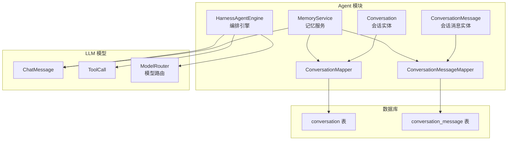
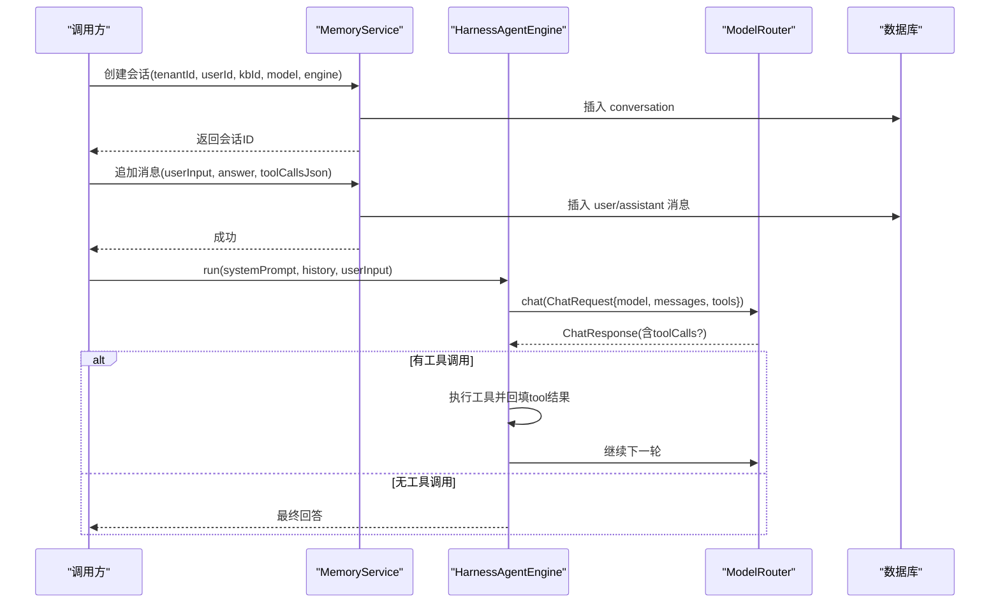
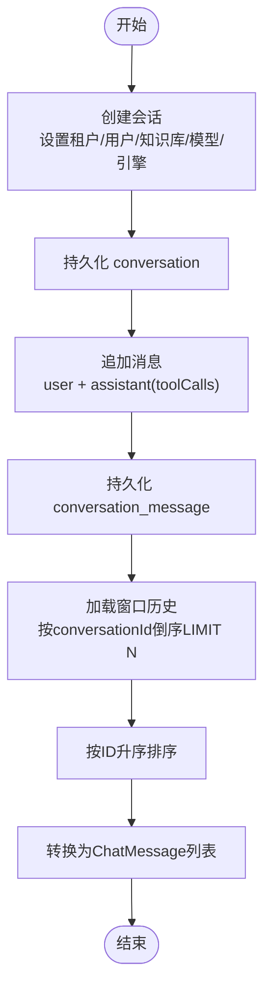
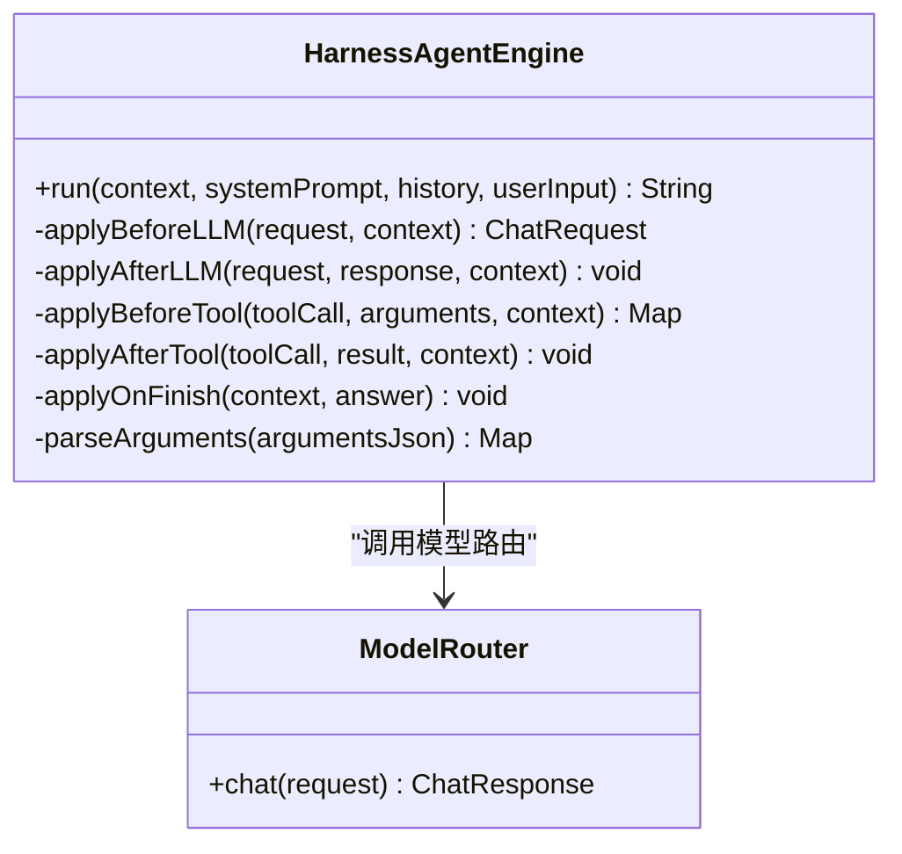
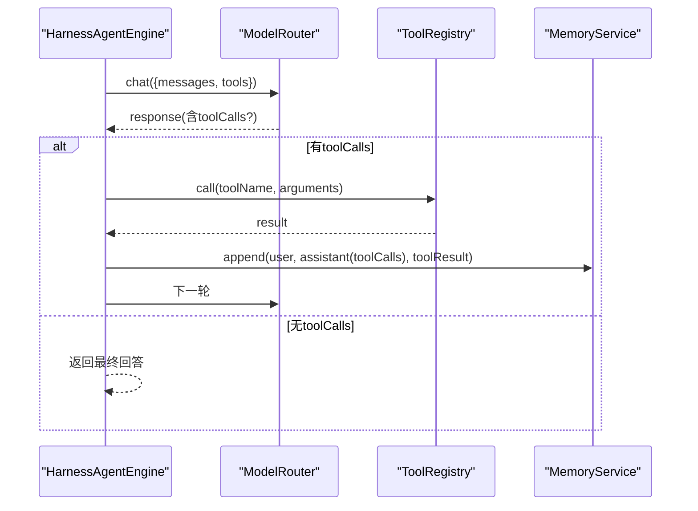
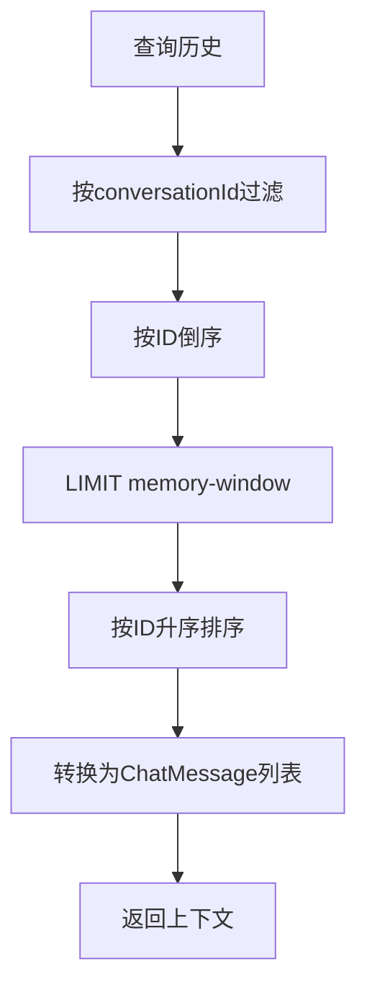
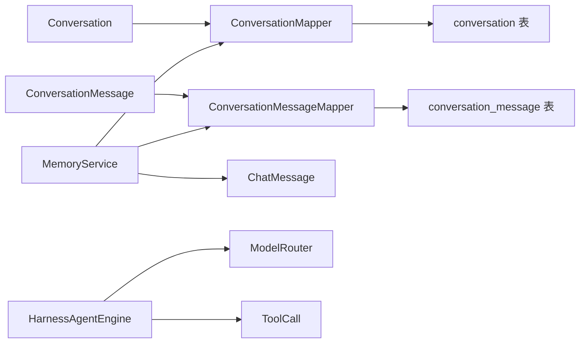

# 对话实体模型

<cite>
**本文引用的文件**   
- [Conversation.java](file://src/main/java/com/agenthub/agent/entity/Conversation.java)
- [ConversationMessage.java](file://src/main/java/com/agenthub/agent/entity/ConversationMessage.java)
- [ConversationMapper.java](file://src/main/java/com/agenthub/agent/mapper/ConversationMapper.java)
- [ConversationMessageMapper.java](file://src/main/java/com/agenthub/agent/mapper/ConversationMessageMapper.java)
- [MemoryService.java](file://src/main/java/com/agenthub/agent/memory/MemoryService.java)
- [HarnessAgentEngine.java](file://src/main/java/com/agenthub/agent/harness/HarnessAgentEngine.java)
- [ChatMessage.java](file://src/main/java/com/agenthub/llm/model/ChatMessage.java)
- [ToolCall.java](file://src/main/java/com/agenthub/llm/model/ToolCall.java)
- [ModelRouter.java](file://src/main/java/com/agenthub/llm/router/ModelRouter.java)
- [init-mysql.sql](file://sql/init-mysql.sql)
</cite>

## 目录
1. [引言](#引言)
2. [项目结构定位](#项目结构定位)
3. [核心实体定义](#核心实体定义)
4. [架构总览](#架构总览)
5. [详细组件分析](#详细组件分析)
6. [依赖关系分析](#依赖关系分析)
7. [性能与存储策略](#性能与存储策略)
8. [故障排查指南](#故障排查指南)
9. [结论](#结论)

## 引言
本文聚焦于“对话相关实体模型”，围绕 Conversation（会话）和 ConversationMessage（会话消息）两个核心实体，说明字段定义、消息类型、工具调用信息存储格式、引擎类型与模型路由机制、会话生命周期管理，以及对话历史查询模式与性能优化建议。文档面向具备基础 Java/Spring 知识的读者，同时尽量降低理解门槛。

## 项目结构定位
对话能力位于 agent 模块中，核心由以下部分组成：
- 实体层：Conversation、ConversationMessage
- 持久层：ConversationMapper、ConversationMessageMapper
- 记忆服务：MemoryService，负责会话创建、消息追加、窗口历史加载
- 编排引擎：HarnessAgentEngine，负责 ReAct 循环、工具调用、模型路由
- LLM 模型对象：ChatMessage、ToolCall，用于与外部大模型交互
- 数据库脚本：init-mysql.sql，定义 conversation 与 conversation_message 表结构

图表来源
- [Conversation.java:10-38](file://src/main/java/com/agenthub/agent/entity/Conversation.java#L10-L38)
- [ConversationMessage.java:10-33](file://src/main/java/com/agenthub/agent/entity/ConversationMessage.java#L10-L33)
- [MemoryService.java:25-100](file://src/main/java/com/agenthub/agent/memory/MemoryService.java#L25-L100)
- [HarnessAgentEngine.java:33-148](file://src/main/java/com/agenthub/agent/harness/HarnessAgentEngine.java#L33-L148)
- [ConversationMapper.java:7-12](file://src/main/java/com/agenthub/agent/mapper/ConversationMapper.java#L7-L12)
- [ConversationMessageMapper.java:7-12](file://src/main/java/com/agenthub/agent/mapper/ConversationMessageMapper.java#L7-L12)
- [init-mysql.sql:96-119](file://sql/init-mysql.sql#L96-L119)

章节来源
- [Conversation.java:10-38](file://src/main/java/com/agenthub/agent/entity/Conversation.java#L10-L38)
- [ConversationMessage.java:10-33](file://src/main/java/com/agenthub/agent/entity/ConversationMessage.java#L10-L33)
- [MemoryService.java:25-100](file://src/main/java/com/agenthub/agent/memory/MemoryService.java#L25-L100)
- [HarnessAgentEngine.java:33-148](file://src/main/java/com/agenthub/agent/harness/HarnessAgentEngine.java#L33-L148)
- [init-mysql.sql:96-119](file://sql/init-mysql.sql#L96-L119)

## 核心实体定义
本节从字段语义、数据类型、约束与索引角度，说明 Conversation 与 ConversationMessage 的完整定义。

### Conversation（会话）
- id：自增主键，标识会话
- tenantId：租户ID，用于多租户隔离
- userId：用户ID，可选，表示发起会话的用户
- kbId：绑定的知识库ID，可选，用于关联 RAG 知识源
- title：会话标题，便于展示
- engine：引擎类型，取值为 builtin 或 agentscope，决定使用内置 ReAct 引擎还是 AgentScope 引擎
- model：模型路由键，用于选择具体大模型实例
- createdAt/updatedAt：时间戳

对应数据库表 conversation，包含 tenant_id、user_id、kb_id、title、engine、model 等列，并建立 tenant_id 与 user_id 索引，便于按租户和用户维度检索。

章节来源
- [Conversation.java:10-38](file://src/main/java/com/agenthub/agent/entity/Conversation.java#L10-L38)
- [init-mysql.sql:96-108](file://sql/init-mysql.sql#L96-L108)

### ConversationMessage（会话消息）
- id：自增主键，标识消息
- conversationId：所属会话ID
- tenantId：租户ID，用于多租户隔离
- role：消息角色，取值为 user、assistant、tool
- content：消息内容，类型为长文本
- toolCalls：工具调用明细，JSON 字符串，仅 assistant 消息携带
- createdAt：创建时间

对应数据库表 conversation_message，包含 conversation_id、tenant_id、role、content、tool_calls 等列，并建立 conversation_id 索引，便于按会话查询消息序列。

章节来源
- [ConversationMessage.java:10-33](file://src/main/java/com/agenthub/agent/entity/ConversationMessage.java#L10-L33)
- [init-mysql.sql:110-119](file://sql/init-mysql.sql#L110-L119)

### 字段与类型速览
- 会话实体字段：id、tenantId、userId、kbId、title、engine、model、createdAt、updatedAt
- 消息实体字段：id、conversationId、tenantId、role、content、toolCalls、createdAt
- 角色枚举：user、assistant、tool
- 引擎枚举：builtin、agentscope
- 工具调用存储：JSON 字符串，解析为 ToolCall 列表

章节来源
- [Conversation.java:10-38](file://src/main/java/com/agenthub/agent/entity/Conversation.java#L10-L38)
- [ConversationMessage.java:10-33](file://src/main/java/com/agenthub/agent/entity/ConversationMessage.java#L10-L33)

## 架构总览
对话流程由 MemoryService 与 HarnessAgentEngine 协同完成：
- MemoryService 负责会话创建、消息追加、窗口历史加载
- HarnessAgentEngine 负责组装系统提示词与历史消息，调用 ModelRouter 进行模型路由，执行 ReAct 循环，处理工具调用，并通过 Hook 扩展点注入权限、审计等行为

图表来源
- [MemoryService.java:35-86](file://src/main/java/com/agenthub/agent/memory/MemoryService.java#L35-L86)
- [HarnessAgentEngine.java:52-106](file://src/main/java/com/agenthub/agent/harness/HarnessAgentEngine.java#L52-L106)
- [ModelRouter.java](file://src/main/java/com/agenthub/llm/router/ModelRouter.java)

章节来源
- [MemoryService.java:35-86](file://src/main/java/com/agenthub/agent/memory/MemoryService.java#L35-L86)
- [HarnessAgentEngine.java:52-106](file://src/main/java/com/agenthub/agent/harness/HarnessAgentEngine.java#L52-L106)

## 详细组件分析

### 会话生命周期管理
- 创建会话：MemoryService.createConversation 设置 tenantId、userId、kbId、model、engine、title，并持久化到 conversation 表
- 读取会话：MemoryService.requireConversation 通过 ID 获取会话，不存在时抛出业务异常
- 追加消息：MemoryService.append 写入 user 与 assistant 两条消息，assistant 消息附带 toolCalls JSON
- 加载历史：MemoryService.loadWindow 按 conversationId 倒序取最近 N 条消息，再按 ID 升序排序后转换为 ChatMessage 列表

图表来源
- [MemoryService.java:35-86](file://src/main/java/com/agenthub/agent/memory/MemoryService.java#L35-L86)

章节来源
- [MemoryService.java:35-86](file://src/main/java/com/agenthub/agent/memory/MemoryService.java#L35-L86)

### 引擎类型与模型路由机制
- 引擎类型：Conversation.engine 支持 builtin 与 agentscope
  - builtin：使用 HarnessAgentEngine 的内置 ReAct 实现
  - agentscope：预留扩展点，未来可对接 AgentScope 引擎
- 模型路由：HarnessAgentEngine 通过 ModelRouter.chat 发送请求，ModelRouter 根据上下文中的 model 路由键选择具体模型实现

图表来源
- [HarnessAgentEngine.java:33-148](file://src/main/java/com/agenthub/agent/harness/HarnessAgentEngine.java#L33-L148)
- [ModelRouter.java](file://src/main/java/com/agenthub/llm/router/ModelRouter.java)

章节来源
- [HarnessAgentEngine.java:33-148](file://src/main/java/com/agenthub/agent/harness/HarnessAgentEngine.java#L33-L148)

### 消息角色与工具调用信息
- 角色类型：
  - user：用户输入
  - assistant：模型回复，可能包含工具调用
  - tool：工具执行结果，作为中间消息参与后续推理
- 工具调用存储：
  - assistant 消息的 toolCalls 字段存储 JSON 字符串
  - MemoryService.toChatMessage 将 JSON 反序列化为 ToolCall 列表，若解析失败不影响主流程
  - HarnessAgentEngine 在 ReAct 循环中，当模型返回 toolCalls 时，逐个执行工具并将结果以 tool 角色消息追加到上下文

图表来源
- [HarnessAgentEngine.java:52-106](file://src/main/java/com/agenthub/agent/harness/HarnessAgentEngine.java#L52-L106)
- [MemoryService.java:57-100](file://src/main/java/com/agenthub/agent/memory/MemoryService.java#L57-L100)

章节来源
- [HarnessAgentEngine.java:52-106](file://src/main/java/com/agenthub/agent/harness/HarnessAgentEngine.java#L52-L106)
- [MemoryService.java:57-100](file://src/main/java/com/agenthub/agent/memory/MemoryService.java#L57-L100)

### 对话历史查询模式
- 窗口记忆：MemoryService.loadWindow 默认取最近 memory-window 条消息（配置项 agenthub.agent.memory-window），按 conversationId 过滤并按 ID 倒序 LIMIT，再升序排序后转为 ChatMessage 列表
- 用途：拼入 LLM 上下文，控制上下文长度，避免过长导致成本与延迟上升
- 可扩展：当前为简单窗口截断，生产环境可扩展为摘要压缩、长期记忆（如对接 AgentScope Memory）

图表来源
- [MemoryService.java:75-86](file://src/main/java/com/agenthub/agent/memory/MemoryService.java#L75-L86)

章节来源
- [MemoryService.java:75-86](file://src/main/java/com/agenthub/agent/memory/MemoryService.java#L75-L86)

## 依赖关系分析
- 实体与 Mapper：
  - Conversation ↔ ConversationMapper
  - ConversationMessage ↔ ConversationMessageMapper
- 服务与模型：
  - MemoryService 依赖 ConversationMapper、ConversationMessageMapper，输出 ChatMessage 列表
  - HarnessAgentEngine 依赖 ModelRouter、ToolRegistry，内部构造 ChatRequest/ChatResponse，并使用 ToolCall
- 数据库：
  - conversation 与 conversation_message 表由 init-mysql.sql 定义，包含必要索引

图表来源
- [ConversationMapper.java:7-12](file://src/main/java/com/agenthub/agent/mapper/ConversationMapper.java#L7-L12)
- [ConversationMessageMapper.java:7-12](file://src/main/java/com/agenthub/agent/mapper/ConversationMessageMapper.java#L7-L12)
- [MemoryService.java:25-100](file://src/main/java/com/agenthub/agent/memory/MemoryService.java#L25-L100)
- [HarnessAgentEngine.java:33-148](file://src/main/java/com/agenthub/agent/harness/HarnessAgentEngine.java#L33-L148)
- [init-mysql.sql:96-119](file://sql/init-mysql.sql#L96-L119)

章节来源
- [ConversationMapper.java:7-12](file://src/main/java/com/agenthub/agent/mapper/ConversationMapper.java#L7-L12)
- [ConversationMessageMapper.java:7-12](file://src/main/java/com/agenthub/agent/mapper/ConversationMessageMapper.java#L7-L12)
- [MemoryService.java:25-100](file://src/main/java/com/agenthub/agent/memory/MemoryService.java#L25-L100)
- [HarnessAgentEngine.java:33-148](file://src/main/java/com/agenthub/agent/harness/HarnessAgentEngine.java#L33-L148)
- [init-mysql.sql:96-119](file://sql/init-mysql.sql#L96-L119)

## 性能与存储策略
- 索引设计
  - conversation 表：tenant_id、user_id 索引，便于按租户与用户维度快速检索
  - conversation_message 表：conversation_id 索引，便于按会话拉取消息序列
- 窗口记忆
  - 通过 LIMIT memory-window 控制上下文大小，减少 LLM 输入长度与成本
  - 建议在高频场景下调整 memory-window 参数，平衡上下文完整性与响应延迟
- JSON 字段
  - toolCalls 使用 TEXT 存储 JSON 字符串，解析失败不影响主流程，提升鲁棒性
  - 建议在应用层对 JSON 结构做校验与版本兼容，避免下游解析异常
- 分页与排序
  - 当前 loadWindow 采用倒序 LIMIT 再升序排序，适合“最近N条”的场景
  - 若需要全量历史浏览，建议增加分页接口与基于 created_at 的分页索引
- 扩展建议
  - 短期记忆：保持窗口截断
  - 长期记忆：引入摘要压缩或向量化历史片段，结合 RAG 检索增强
  - 异步写入：在高并发场景下，可将消息写入改为异步队列，削峰填谷

章节来源
- [init-mysql.sql:96-119](file://sql/init-mysql.sql#L96-L119)
- [MemoryService.java:75-86](file://src/main/java/com/agenthub/agent/memory/MemoryService.java#L75-L86)

## 故障排查指南
- 会话不存在
  - 现象：requireConversation 抛出业务异常
  - 排查：检查 conversationId 是否有效、租户隔离是否正确
- 工具调用失败
  - 现象：HarnessAgentEngine 捕获异常并记录警告，返回错误结果
  - 排查：检查 ToolRegistry 注册的工具名称与参数结构；确认 toolCalls JSON 是否合法
- 工具调用解析失败
  - 现象：MemoryService.toChatMessage 解析 toolCalls 失败但不影响主流程
  - 排查：检查 assistant 消息的 toolCalls 字段是否为合法 JSON；必要时在应用层增加校验
- 超过最大迭代次数
  - 现象：HarnessAgentEngine 抛出业务异常，提示未收敛
  - 排查：检查工具逻辑是否能收敛；适当增大 max-iterations 或优化工具返回

章节来源
- [MemoryService.java:48-55](file://src/main/java/com/agenthub/agent/memory/MemoryService.java#L48-L55)
- [HarnessAgentEngine.java:91-106](file://src/main/java/com/agenthub/agent/harness/HarnessAgentEngine.java#L91-L106)
- [MemoryService.java:88-100](file://src/main/java/com/agenthub/agent/memory/MemoryService.java#L88-L100)

## 结论
Conversation 与 ConversationMessage 构成了 Agent 多轮对话的基础数据模型。通过 MemoryService 的窗口记忆与 HarnessAgentEngine 的 ReAct 编排，系统实现了灵活的引擎切换（builtin/agentscope）与模型路由（model 路由键）。消息角色（user/assistant/tool）与工具调用 JSON 存储使得工具链路与对话历史解耦，既保证主流程鲁棒性，又便于扩展。配合合理的索引设计与窗口策略，可在保证体验的同时控制成本与延迟。生产环境中可进一步引入摘要压缩、长期记忆与异步写入等优化手段。