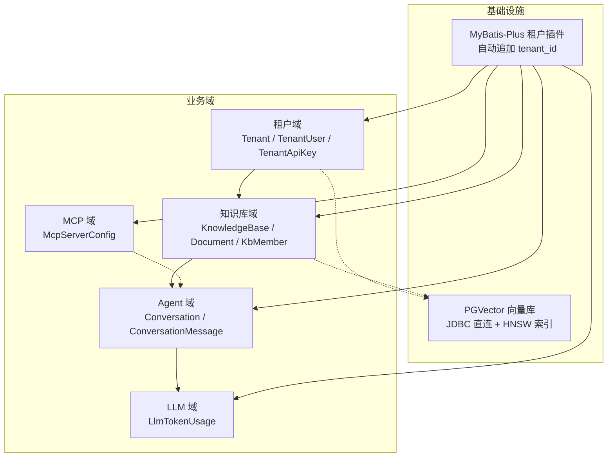
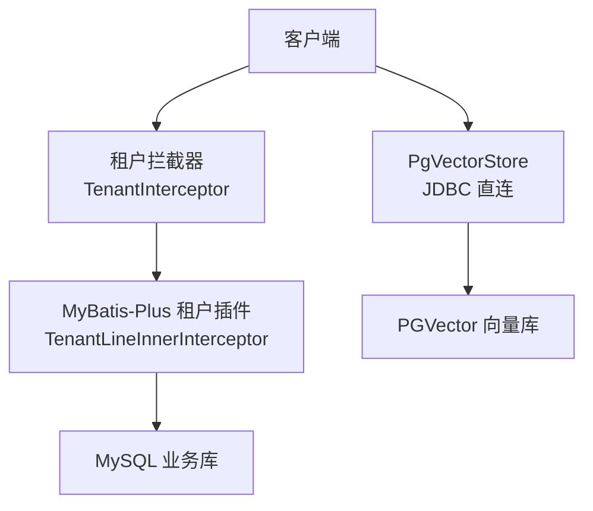
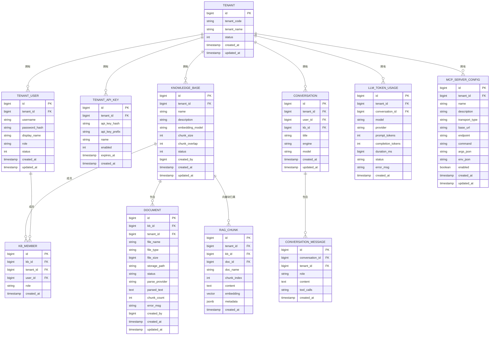
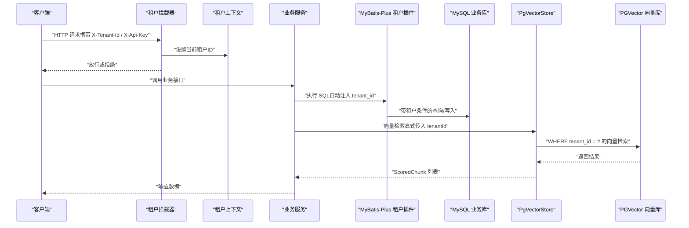
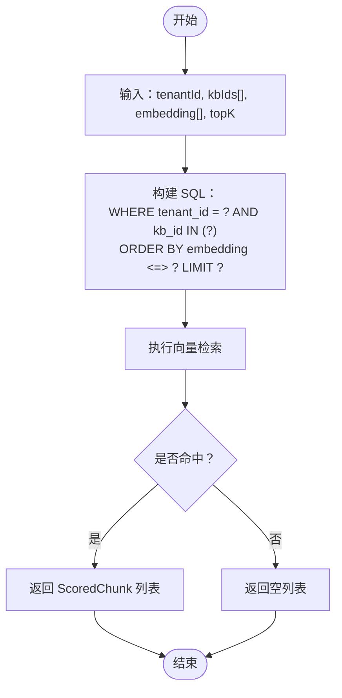
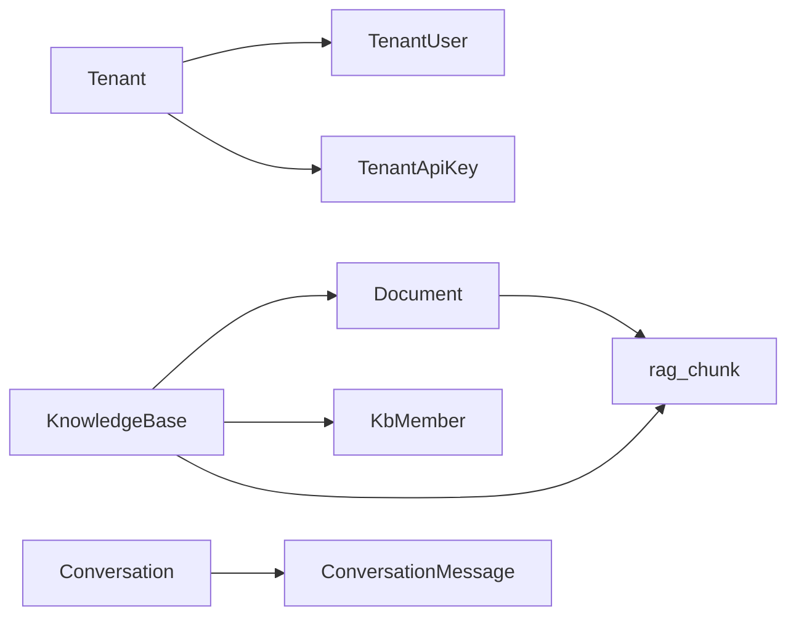
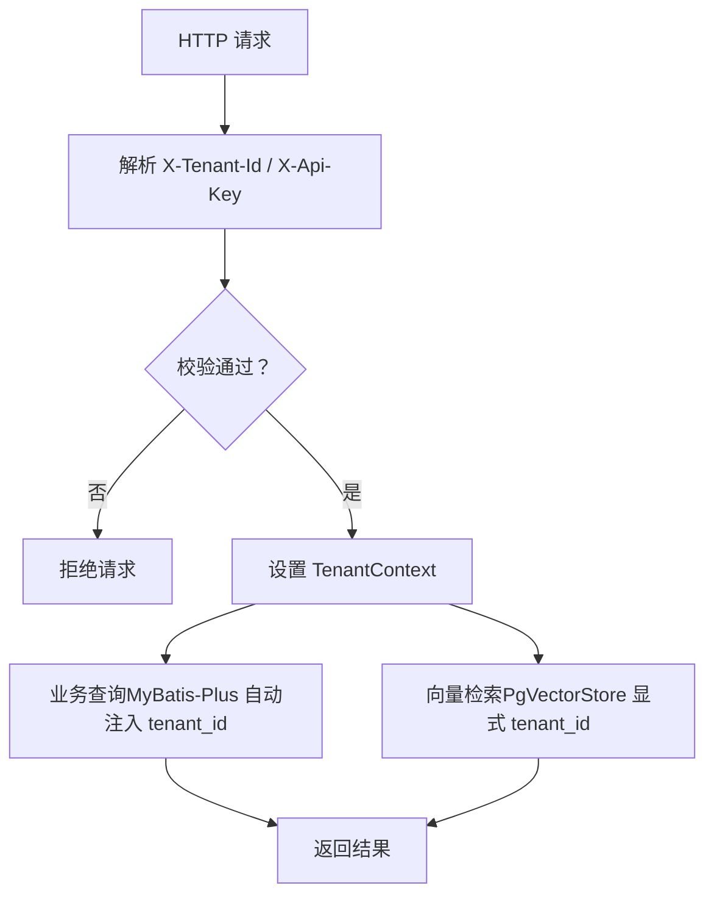

# 数据模型

<cite>
**本文引用的文件**   
- [init-pgvector.sql](file://sql/init-pgvector.sql)
- [Tenant.java](file://src/main/java/com/agenthub/tenant/entity/Tenant.java)
- [TenantUser.java](file://src/main/java/com/agenthub/tenant/entity/TenantUser.java)
- [TenantApiKey.java](file://src/main/java/com/agenthub/tenant/entity/TenantApiKey.java)
- [KnowledgeBase.java](file://src/main/java/com/agenthub/knowledge/entity/KnowledgeBase.java)
- [Document.java](file://src/main/java/com/agenthub/knowledge/entity/Document.java)
- [KbMember.java](file://src/main/java/com/agenthub/knowledge/entity/KbMember.java)
- [Conversation.java](file://src/main/java/com/agenthub/agent/entity/Conversation.java)
- [ConversationMessage.java](file://src/main/java/com/agenthub/agent/entity/ConversationMessage.java)
- [LlmTokenUsage.java](file://src/main/java/com/agenthub/llm/entity/LlmTokenUsage.java)
- [McpServerConfig.java](file://src/main/java/com/agenthub/mcp/entity/McpServerConfig.java)
- [MybatisPlusConfig.java](file://src/main/java/com/agenthub/tenant/config/MybatisPlusConfig.java)
- [TenantInterceptor.java](file://src/main/java/com/agenthub/gateway/interceptor/TenantInterceptor.java)
- [PgVectorStore.java](file://src/main/java/com/agenthub/rag/store/PgVectorStore.java)
</cite>

## 目录
1. [引言](#引言)
2. [项目结构](#项目结构)
3. [核心实体与字段定义](#核心实体与字段定义)
4. [架构总览](#架构总览)
5. [详细组件分析](#详细组件分析)
6. [依赖关系分析](#依赖关系分析)
7. [性能与索引设计](#性能与索引设计)
8. [多租户隔离机制](#多租户隔离机制)
9. [故障排查指南](#故障排查指南)
10. [结论](#结论)
11. [附录：样例数据](#附录样例数据)

## 引言
本数据模型文档面向系统的数据层设计与实现，覆盖租户、知识库、Agent 对话、LLM 用量统计、MCP 服务配置等核心实体，并说明数据库表结构、主外键关系、索引策略、约束条件以及多租户隔离方案。同时给出实体关系图与样例数据，帮助读者快速理解系统在 MySQL 业务库与 PGVector 向量库之间的数据组织方式。

## 项目结构
本项目采用按领域划分的模块结构，实体类集中在各业务域下的 entity 包中；与数据访问相关的 MyBatis Mapper 位于对应 mapper 包；PGVector 向量存储通过独立的 JDBC 直连实现，不经过 MyBatis-Plus 插件。

图表来源
- [MybatisPlusConfig.java:16-56](file://src/main/java/com/agenthub/tenant/config/MybatisPlusConfig.java#L16-L56)
- [PgVectorStore.java:21-66](file://src/main/java/com/agenthub/rag/store/PgVectorStore.java#L21-L66)

章节来源
- [MybatisPlusConfig.java:16-56](file://src/main/java/com/agenthub/tenant/config/MybatisPlusConfig.java#L16-L56)
- [PgVectorStore.java:21-66](file://src/main/java/com/agenthub/rag/store/PgVectorStore.java#L21-L66)

## 核心实体与字段定义
本节汇总所有实体的字段含义、类型与业务规则，并标注是否参与多租户隔离。

- 租户相关
  - 租户（Tenant）
    - id：自增主键
    - tenantCode：租户编码，唯一标识，用于登录与鉴权
    - tenantName：租户名称
    - status：状态，1 启用，0 停用
    - createdAt / updatedAt：创建与更新时间
    - 说明：该表不含 tenant_id 字段，已在租户插件忽略表中排除，避免被自动追加租户条件
  - 租户用户（TenantUser）
    - id：自增主键
    - tenantId：所属租户
    - username：用户名
    - passwordHash：密码哈希（示例使用 SHA-256，生产建议 BCrypt）
    - displayName：显示名
    - role：角色，OWNER / ADMIN / MEMBER
    - status：状态，1 启用，0 停用
    - createdAt / updatedAt：创建与更新时间
  - 租户 API Key（TenantApiKey）
    - id：自增主键
    - tenantId：所属租户
    - apiKeyHash：API Key 的 SHA-256 哈希
    - apiKeyPrefix：Key 前缀，便于展示与定位
    - name：Key 名称
    - enabled：是否启用
    - expiresAt：过期时间，null 表示永不过期
    - createdAt：创建时间

- 知识库相关
  - 知识库（KnowledgeBase）
    - id：自增主键
    - tenantId：所属租户
    - name：知识库名称
    - description：描述
    - embeddingModel：向量化模型路由键
    - chunkSize：分块大小（字符数）
    - chunkOverlap：分块重叠（字符数）
    - status：状态，1 启用，0 停用
    - createdBy：创建人
    - createdAt / updatedAt：创建与更新时间
  - 文档（Document）
    - id：自增主键
    - kbId：所属知识库
    - tenantId：所属租户
    - fileName：文件名
    - fileType：文件扩展名
    - fileSize：文件大小
    - storagePath：对象存储路径
    - status：流水线状态（UPLOADED / PARSING / PARSED / EMBEDDING / READY / FAILED）
    - parseProvider：解析引擎（tika / mineru）
    - parsedText：解析后的纯文本（分块前暂存）
    - chunkCount：生成的向量块数量
    - errorMsg：错误信息
    - createdBy：创建人
    - createdAt / updatedAt：创建与更新时间
  - 知识库成员（KbMember）
    - id：自增主键
    - kbId：知识库
    - tenantId：所属租户
    - userId：用户
    - role：角色，OWNER / EDITOR / VIEWER
    - createdAt：创建时间

- Agent 相关
  - 会话（Conversation）
    - id：自增主键
    - tenantId：所属租户
    - userId：用户
    - kbId：绑定的知识库（可空）
    - title：标题
    - engine：引擎（builtin / agentscope）
    - model：模型路由键
    - createdAt / updatedAt：创建与更新时间
  - 会话消息（ConversationMessage）
    - id：自增主键
    - conversationId：会话
    - tenantId：所属租户
    - role：角色（user / assistant / tool）
    - content：内容
    - toolCalls：工具调用明细（assistant 消息，JSON）
    - createdAt：创建时间

- LLM 相关
  - Token 用量（LlmTokenUsage）
    - id：自增主键
    - tenantId：所属租户
    - conversationId：会话 ID（REST 直接调用可为空）
    - model：引擎模型名
    - provider：provider 类型（openai / ollama / mock）
    - promptTokens：提示词 token 数
    - completionTokens：补全 token 数
    - durationMs：调用耗时（毫秒）
    - status：状态（SUCCESS / ERROR）
    - errorMsg：错误信息
    - createdAt：创建时间

- MCP 相关
  - MCP 服务器配置（McpServerConfig）
    - id：自增主键
    - tenantId：所属租户
    - name：配置名（唯一标识，工具名前缀）
    - description：描述
    - transportType：传输类型（stdio | sse | streamable-http）
    - baseUrl：SSE / Streamable HTTP 服务地址
    - endpoint：Streamable HTTP 的 endpoint（默认 /mcp）
    - command：STDIO 模式启动命令
    - argsJson：STDIO 模式启动参数（JSON 数组）
    - envJson：环境变量（JSON 对象，如 API Key）
    - enabled：是否启用
    - createdAt / updatedAt：创建与更新时间

章节来源
- [Tenant.java:10-33](file://src/main/java/com/agenthub/tenant/entity/Tenant.java#L10-L33)
- [TenantUser.java:10-38](file://src/main/java/com/agenthub/tenant/entity/TenantUser.java#L10-L38)
- [TenantApiKey.java:10-38](file://src/main/java/com/agenthub/tenant/entity/TenantApiKey.java#L10-L38)
- [KnowledgeBase.java:10-43](file://src/main/java/com/agenthub/knowledge/entity/KnowledgeBase.java#L10-L43)
- [Document.java:10-53](file://src/main/java/com/agenthub/knowledge/entity/Document.java#L10-L53)
- [KbMember.java:10-30](file://src/main/java/com/agenthub/knowledge/entity/KbMember.java#L10-L30)
- [Conversation.java:10-38](file://src/main/java/com/agenthub/agent/entity/Conversation.java#L10-L38)
- [ConversationMessage.java:10-33](file://src/main/java/com/agenthub/agent/entity/ConversationMessage.java#L10-L33)
- [LlmTokenUsage.java:10-44](file://src/main/java/com/agenthub/llm/entity/LlmTokenUsage.java#L10-L44)
- [McpServerConfig.java:10-52](file://src/main/java/com/agenthub/mcp/entity/McpServerConfig.java#L10-L52)

## 架构总览
系统采用双库架构：MySQL 作为业务库承载实体表，PGVector 作为向量库承载 rag_chunk 向量数据。MyBatis-Plus 租户插件对 MySQL 查询自动注入 tenant_id 过滤；PGVector 通过 PgVectorStore 显式拼接 tenant_id 条件，确保两条链路都强制租户隔离。

图表来源
- [TenantInterceptor.java:18-50](file://src/main/java/com/agenthub/gateway/interceptor/TenantInterceptor.java#L18-L50)
- [MybatisPlusConfig.java:16-56](file://src/main/java/com/agenthub/tenant/config/MybatisPlusConfig.java#L16-L56)
- [PgVectorStore.java:21-66](file://src/main/java/com/agenthub/rag/store/PgVectorStore.java#L21-L66)

## 详细组件分析

### 实体关系图（ER 图）

图表来源
- [Tenant.java:10-33](file://src/main/java/com/agenthub/tenant/entity/Tenant.java#L10-L33)
- [TenantUser.java:10-38](file://src/main/java/com/agenthub/tenant/entity/TenantUser.java#L10-L38)
- [TenantApiKey.java:10-38](file://src/main/java/com/agenthub/tenant/entity/TenantApiKey.java#L10-L38)
- [KnowledgeBase.java:10-43](file://src/main/java/com/agenthub/knowledge/entity/KnowledgeBase.java#L10-L43)
- [Document.java:10-53](file://src/main/java/com/agenthub/knowledge/entity/Document.java#L10-L53)
- [KbMember.java:10-30](file://src/main/java/com/agenthub/knowledge/entity/KbMember.java#L10-L30)
- [Conversation.java:10-38](file://src/main/java/com/agenthub/agent/entity/Conversation.java#L10-L38)
- [ConversationMessage.java:10-33](file://src/main/java/com/agenthub/agent/entity/ConversationMessage.java#L10-L33)
- [LlmTokenUsage.java:10-44](file://src/main/java/com/agenthub/llm/entity/LlmTokenUsage.java#L10-L44)
- [McpServerConfig.java:10-52](file://src/main/java/com/agenthub/mcp/entity/McpServerConfig.java#L10-L52)
- [init-pgvector.sql:15-31](file://sql/init-pgvector.sql#L15-L31)

### 多租户隔离流程（序列图）

图表来源
- [TenantInterceptor.java:31-50](file://src/main/java/com/agenthub/gateway/interceptor/TenantInterceptor.java#L31-L50)
- [MybatisPlusConfig.java:34-50](file://src/main/java/com/agenthub/tenant/config/MybatisPlusConfig.java#L34-L50)
- [PgVectorStore.java:90-107](file://src/main/java/com/agenthub/rag/store/PgVectorStore.java#L90-L107)

### 向量检索算法流程图

图表来源
- [PgVectorStore.java:90-107](file://src/main/java/com/agenthub/rag/store/PgVectorStore.java#L90-L107)

## 依赖关系分析
- 实体间依赖
  - KnowledgeBase 与 Document：一对多（一个知识库包含多个文档）
  - KnowledgeBase 与 KbMember：一对多（知识库成员）
  - Conversation 与 ConversationMessage：一对多（会话消息）
  - Tenant 与 TenantUser、TenantApiKey：一对多（租户用户与 API Key）
  - KnowledgeBase 与 rag_chunk：一对多（知识库向量块）
  - Document 与 rag_chunk：一对多（文档向量块）
- 跨库依赖
  - 业务逻辑通过 MyBatis-Plus 访问 MySQL 业务表
  - 向量检索通过 PgVectorStore 直连 PGVector，独立于 MyBatis-Plus

图表来源
- [KnowledgeBase.java:10-43](file://src/main/java/com/agenthub/knowledge/entity/KnowledgeBase.java#L10-L43)
- [Document.java:10-53](file://src/main/java/com/agenthub/knowledge/entity/Document.java#L10-L53)
- [KbMember.java:10-30](file://src/main/java/com/agenthub/knowledge/entity/KbMember.java#L10-L30)
- [Conversation.java:10-38](file://src/main/java/com/agenthub/agent/entity/Conversation.java#L10-L38)
- [ConversationMessage.java:10-33](file://src/main/java/com/agenthub/agent/entity/ConversationMessage.java#L10-L33)
- [init-pgvector.sql:15-31](file://sql/init-pgvector.sql#L15-L31)

## 性能与索引设计
- 业务库（MySQL）
  - 主键：所有实体表均使用自增主键 id
  - 索引：建议在常用查询列上建立索引，例如：
    - tenant_user(tenant_id, username)
    - document(kb_id, tenant_id, status)
    - conversation(tenant_id, user_id)
    - llm_token_usage(tenant_id, conversation_id)
    - mcp_server_config(tenant_id, name)
- 向量库（PGVector）
  - 表：rag_chunk
  - 联合索引：idx_rag_chunk_tenant_kb(tenant_id, kb_id)，用于前置过滤
  - 向量索引：idx_rag_chunk_embedding USING hnsw(embedding vector_cosine_ops)，用于余弦相似度检索
  - 维度：embedding(vector(1024))，需与 embedding 模型维度一致

章节来源
- [init-pgvector.sql:15-31](file://sql/init-pgvector.sql#L15-L31)
- [PgVectorStore.java:47-66](file://src/main/java/com/agenthub/rag/store/PgVectorStore.java#L47-L66)

## 多租户隔离机制
- 请求级租户识别
  - 拦截器从请求头解析 X-Tenant-Id 与 X-Api-Key，校验通过后写入 TenantContext
- 数据级租户隔离
  - MyBatis-Plus 租户插件在 SQL 执行前自动追加 tenant_id 条件
  - 忽略表：tenant 表不参与自动注入（无 tenant_id 字段）
- 向量库租户隔离
  - PgVectorStore 显式拼接 WHERE tenant_id = ?，与业务库形成双重保障

图表来源
- [TenantInterceptor.java:31-50](file://src/main/java/com/agenthub/gateway/interceptor/TenantInterceptor.java#L31-L50)
- [MybatisPlusConfig.java:34-50](file://src/main/java/com/agenthub/tenant/config/MybatisPlusConfig.java#L34-L50)
- [PgVectorStore.java:90-107](file://src/main/java/com/agenthub/rag/store/PgVectorStore.java#L90-L107)

章节来源
- [TenantInterceptor.java:18-50](file://src/main/java/com/agenthub/gateway/interceptor/TenantInterceptor.java#L18-L50)
- [MybatisPlusConfig.java:16-56](file://src/main/java/com/agenthub/tenant/config/MybatisPlusConfig.java#L16-L56)
- [PgVectorStore.java:21-66](file://src/main/java/com/agenthub/rag/store/PgVectorStore.java#L21-L66)

## 故障排查指南
- 未携带租户头导致拒绝
  - 现象：请求被拦截器拒绝，返回未授权
  - 排查：确认请求头包含 X-Tenant-Id 与 X-Api-Key，且 API Key 有效并与租户匹配
- 租户上下文残留
  - 现象：线程池复用导致后续请求误用上一请求的租户
  - 排查：确认拦截器 afterCompletion 已清理 TenantContext
- 向量检索未隔离
  - 现象：不同租户数据互相可见
  - 排查：确认 PgVectorStore 查询语句中包含 tenant_id 条件，且 PGVector 表存在 idx_rag_chunk_tenant_kb 索引

章节来源
- [TenantInterceptor.java:52-56](file://src/main/java/com/agenthub/gateway/interceptor/TenantInterceptor.java#L52-L56)
- [PgVectorStore.java:90-107](file://src/main/java/com/agenthub/rag/store/PgVectorStore.java#L90-L107)

## 结论
本数据模型以租户为顶层边界，贯穿业务库与向量库。通过 MyBatis-Plus 租户插件与 PgVectorStore 显式过滤，形成强一致的多租户隔离。实体关系清晰，索引设计兼顾检索性能与安全性。建议在业务库进一步补充常用查询索引，并在生产环境考虑启用 PGVector 的行级安全策略以实现更严格的数据隔离。

## 附录：样例数据
以下为最小化样例数据，用于演示实体关系与租户隔离效果。实际部署时请根据业务需求调整。

- 租户
  - tenant(id=1, tenant_code="demo", tenant_name="演示租户", status=1)
- 租户用户
  - tenant_user(id=1, tenant_id=1, username="admin", role="OWNER", status=1)
- 知识库
  - knowledge_base(id=1, tenant_id=1, name="产品手册", embedding_model="default", status=1)
- 文档
  - document(id=1, kb_id=1, tenant_id=1, file_name="手册.pdf", status="READY", chunk_count=10)
- 知识库成员
  - kb_member(id=1, kb_id=1, tenant_id=1, user_id=1, role="EDITOR")
- 会话
  - conversation(id=1, tenant_id=1, user_id=1, kb_id=1, title="产品咨询", engine="builtin", model="default")
- 会话消息
  - conversation_message(id=1, conversation_id=1, tenant_id=1, role="user", content="你好")
  - conversation_message(id=2, conversation_id=1, tenant_id=1, role="assistant", content="欢迎使用")
- LLM 用量
  - llm_token_usage(id=1, tenant_id=1, conversation_id=1, model="default", provider="mock", prompt_tokens=10, completion_tokens=20, duration_ms=120, status="SUCCESS")
- MCP 服务器配置
  - mcp_server_config(id=1, tenant_id=1, name="weather", transport_type="sse", base_url="http://weather-api", enabled=true)
- 向量块（PGVector）
  - rag_chunk(id=1, tenant_id=1, kb_id=1, doc_id=1, doc_name="手册.pdf", chunk_index=0, content="产品功能介绍...", embedding="[...]", metadata={"source":"pdf"})

[本节为概念性样例数据，不直接分析具体代码文件]