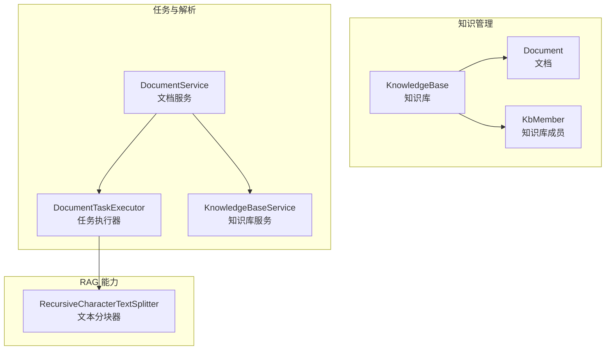
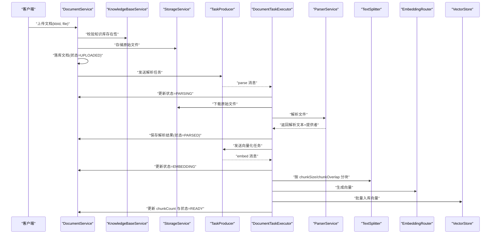
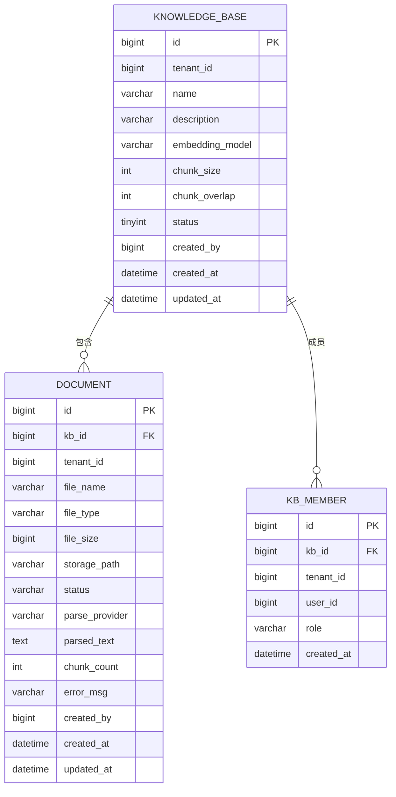
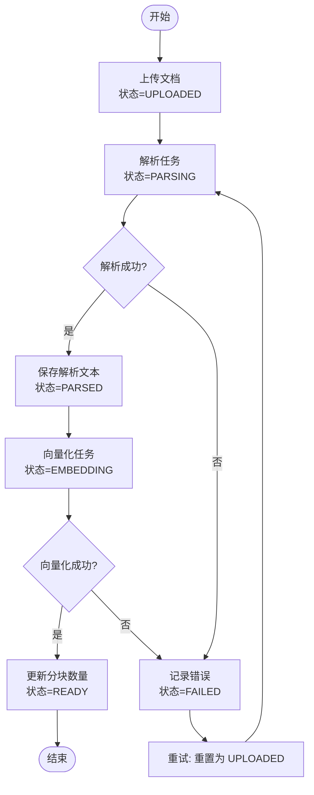
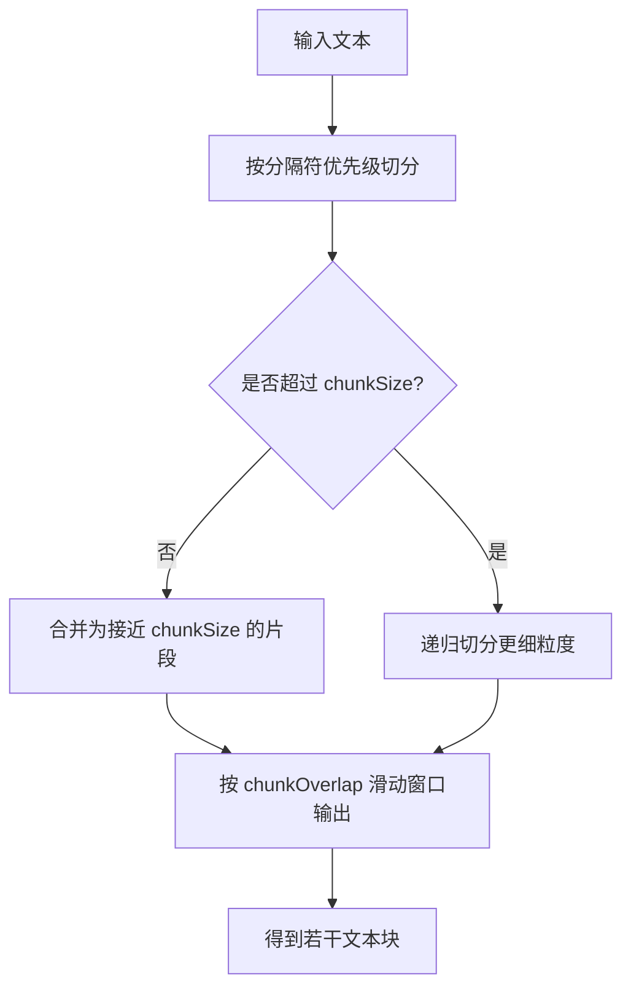
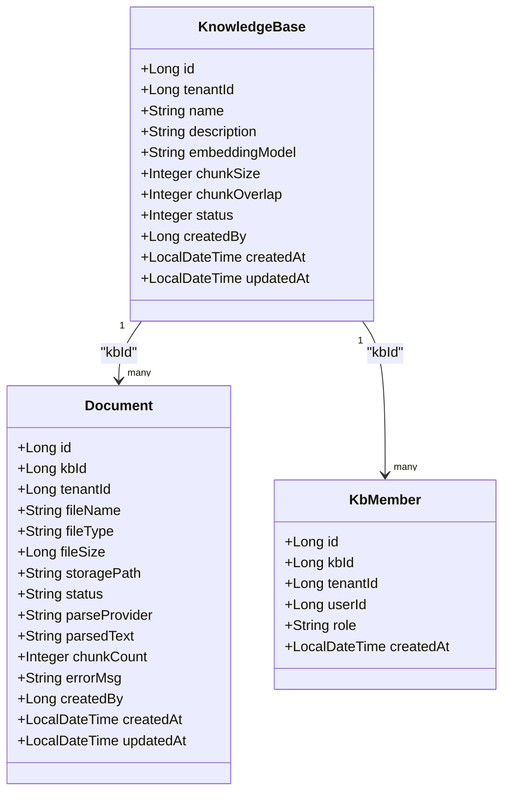
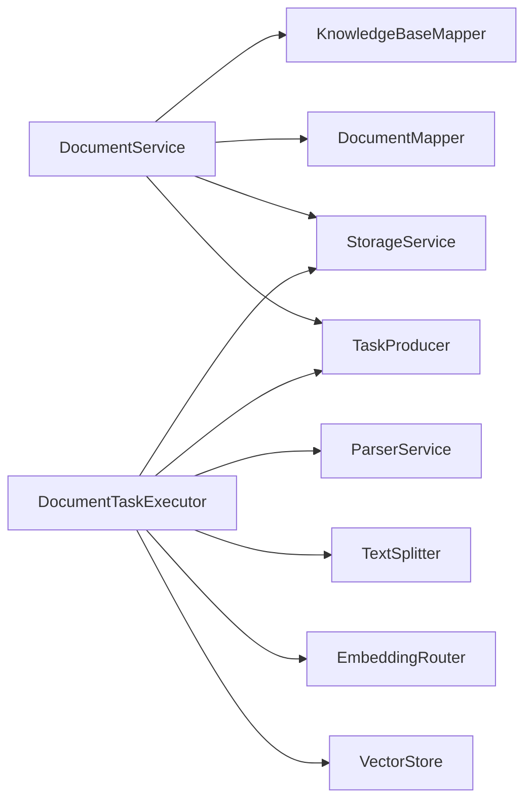

# 知识库实体模型

<cite>
**本文引用的文件**   
- [KnowledgeBase.java](file://src/main/java/com/agenthub/knowledge/entity/KnowledgeBase.java)
- [Document.java](file://src/main/java/com/agenthub/knowledge/entity/Document.java)
- [KbMember.java](file://src/main/java/com/agenthub/knowledge/entity/KbMember.java)
- [DocumentStatus.java](file://src/main/java/com/agenthub/knowledge/enums/DocumentStatus.java)
- [KnowledgeBaseService.java](file://src/main/java/com/agenthub/knowledge/service/KnowledgeBaseService.java)
- [DocumentService.java](file://src/main/java/com/agenthub/knowledge/service/DocumentService.java)
- [DocumentTaskExecutor.java](file://src/main/java/com/agenthub/task/executor/DocumentTaskExecutor.java)
- [RecursiveCharacterTextSplitter.java](file://src/main/java/com/agenthub/rag/splitter/RecursiveCharacterTextSplitter.java)
- [init-mysql.sql](file://sql/init-mysql.sql)
</cite>

## 目录
1. [引言](#引言)
2. [项目结构定位](#项目结构定位)
3. [核心实体定义](#核心实体定义)
4. [架构总览](#架构总览)
5. [详细组件分析](#详细组件分析)
6. [依赖关系分析](#依赖关系分析)
7. [性能与分块配置](#性能与分块配置)
8. [故障排查指南](#故障排查指南)
9. [结论](#结论)

## 引言
本文围绕知识库领域中的三个核心实体：知识库、文档、知识库成员，系统梳理字段含义、状态机流转、权限模型以及数据访问控制。重点说明文档处理流水线从上传到可检索的状态转换，以及分块大小与重叠参数对向量化质量与性能的影响。

## 项目结构定位
知识库相关代码集中在 knowledge 包下，包含控制器、服务、实体、枚举、存储抽象及任务执行链路；分块切分逻辑位于 rag.splitter 包；数据库表结构在 sql 初始化脚本中定义。

**图表来源**
- [KnowledgeBase.java:10-43](file://src/main/java/com/agenthub/knowledge/entity/KnowledgeBase.java#L10-L43)
- [Document.java:10-53](file://src/main/java/com/agenthub/knowledge/entity/Document.java#L10-L53)
- [KbMember.java:10-30](file://src/main/java/com/agenthub/knowledge/entity/KbMember.java#L10-L30)
- [DocumentTaskExecutor.java:25-35](file://src/main/java/com/agenthub/task/executor/DocumentTaskExecutor.java#L25-L35)
- [DocumentService.java:22-27](file://src/main/java/com/agenthub/knowledge/service/DocumentService.java#L22-L27)
- [KnowledgeBaseService.java:15-18](file://src/main/java/com/agenthub/knowledge/service/KnowledgeBaseService.java#L15-L18)
- [RecursiveCharacterTextSplitter.java:7-12](file://src/main/java/com/agenthub/rag/splitter/RecursiveCharacterTextSplitter.java#L7-L12)

**章节来源**
- [KnowledgeBase.java:10-43](file://src/main/java/com/agenthub/knowledge/entity/KnowledgeBase.java#L10-L43)
- [Document.java:10-53](file://src/main/java/com/agenthub/knowledge/entity/Document.java#L10-L53)
- [KbMember.java:10-30](file://src/main/java/com/agenthub/knowledge/entity/KbMember.java#L10-L30)
- [DocumentTaskExecutor.java:25-35](file://src/main/java/com/agenthub/task/executor/DocumentTaskExecutor.java#L25-L35)
- [DocumentService.java:22-27](file://src/main/java/com/agenthub/knowledge/service/DocumentService.java#L22-L27)
- [KnowledgeBaseService.java:15-18](file://src/main/java/com/agenthub/knowledge/service/KnowledgeBaseService.java#L15-L18)
- [RecursiveCharacterTextSplitter.java:7-12](file://src/main/java/com/agenthub/rag/splitter/RecursiveCharacterTextSplitter.java#L7-L12)

## 核心实体定义

### 知识库 KnowledgeBase
- 作用：租户下的向量数据集合边界，检索时以 kb_id 为过滤条件。
- 关键字段
  - id：主键
  - tenantId：租户标识
  - name：名称
  - description：描述
  - embeddingModel：向量化模型路由键
  - chunkSize：分块大小（字符数）
  - chunkOverlap：分块重叠（字符数）
  - status：启用状态（1 启用，0 停用）
  - createdBy/createdAt/updatedAt：审计字段

默认值与校验
- 创建知识库时，若未提供分块参数，将使用默认值：chunkSize=800，chunkOverlap=100。
- 新建知识库默认启用。

**章节来源**
- [KnowledgeBase.java:10-43](file://src/main/java/com/agenthub/knowledge/entity/KnowledgeBase.java#L10-L43)
- [KnowledgeBaseService.java:25-38](file://src/main/java/com/agenthub/knowledge/service/KnowledgeBaseService.java#L25-L38)
- [init-mysql.sql:49-62](file://sql/init-mysql.sql#L49-L62)

### 文档 Document
- 作用：一次上传对应一条记录，承载原始文件信息、解析结果、分块数量与处理状态。
- 关键字段
  - id：主键
  - kbId：所属知识库
  - tenantId：租户标识
  - fileName/fileType/fileSize：文件名、扩展名、大小
  - storagePath：对象存储路径（MinIO objectKey 或本地相对路径）
  - status：处理状态（UPLOADED/PARSING/PARSED/EMBEDDING/READY/FAILED）
  - parseProvider：解析引擎（tika/mineru）
  - parsedText：解析后的纯文本（分块前暂存）
  - chunkCount：生成的向量块数量
  - errorMsg：错误信息
  - createdBy/createdAt/updatedAt：审计字段

状态说明
- UPLOADED：已上传，等待解析
- PARSING：解析中
- PARSED：解析完成，等待向量化
- EMBEDDING：向量化入库中
- READY：全流程完成，可检索
- FAILED：处理失败（可通过重试恢复）

**章节来源**
- [Document.java:10-53](file://src/main/java/com/agenthub/knowledge/entity/Document.java#L10-L53)
- [DocumentStatus.java:3-25](file://src/main/java/com/agenthub/knowledge/enums/DocumentStatus.java#L3-L25)

### 知识库成员 KbMember
- 作用：租户内用户对知识库的访问权限。
- 关键字段
  - id：主键
  - kbId：知识库标识
  - tenantId：租户标识
  - userId：用户标识
  - role：角色（OWNER / EDITOR / VIEWER）
  - createdAt：加入时间

权限语义
- OWNER：拥有者，通常具备完全控制权
- EDITOR：编辑者，可修改知识库内容
- VIEWER：查看者，仅可读（注意：注释中为 VIEWER，但数据库默认值为 READER，见下文“权限模型与数据访问控制”）

**章节来源**
- [KbMember.java:10-30](file://src/main/java/com/agenthub/knowledge/entity/KbMember.java#L10-L30)
- [init-mysql.sql:64-72](file://sql/init-mysql.sql#L64-L72)

## 架构总览
知识库与文档通过 kb_id 关联；文档处理采用异步消息驱动的两阶段流水线：先解析后向量化。分块策略由知识库配置的 chunkSize 与 chunkOverlap 决定。

**图表来源**
- [DocumentService.java:41-76](file://src/main/java/com/agenthub/knowledge/service/DocumentService.java#L41-L76)
- [DocumentTaskExecutor.java:49-81](file://src/main/java/com/agenthub/task/executor/DocumentTaskExecutor.java#L49-L81)
- [RecursiveCharacterTextSplitter.java:21-30](file://src/main/java/com/agenthub/rag/splitter/RecursiveCharacterTextSplitter.java#L21-L30)

## 详细组件分析

### 实体关系图

**图表来源**
- [KnowledgeBase.java:10-43](file://src/main/java/com/agenthub/knowledge/entity/KnowledgeBase.java#L10-L43)
- [Document.java:10-53](file://src/main/java/com/agenthub/knowledge/entity/Document.java#L10-L53)
- [KbMember.java:10-30](file://src/main/java/com/agenthub/knowledge/entity/KbMember.java#L10-L30)
- [init-mysql.sql:49-72](file://sql/init-mysql.sql#L49-L72)

### 文档处理流程与状态转换
- 上传阶段
  - 校验知识库归属与类型白名单
  - 写入对象存储，落库文档并设置状态为 UPLOADED
  - 投递解析任务
- 解析阶段
  - 消费者拉取解析任务，更新状态为 PARSING
  - 下载原始文件，调用解析服务得到纯文本与解析提供者
  - 保存解析结果，更新状态为 PARSED
  - 投递向量化任务
- 向量化阶段
  - 消费者拉取向量化任务，更新状态为 EMBEDDING
  - 读取解析文本，按知识库配置的 chunkSize 与 chunkOverlap 进行分块
  - 调用嵌入模型生成向量，清理旧向量并批量入库
  - 更新 chunkCount 与状态为 READY
- 异常处理
  - 任一步骤异常均置 FAILED，并记录 errorMsg
  - 支持重试：将状态重置为 UPLOADED 并重新投递解析任务

**图表来源**
- [DocumentService.java:41-76](file://src/main/java/com/agenthub/knowledge/service/DocumentService.java#L41-L76)
- [DocumentTaskExecutor.java:64-81](file://src/main/java/com/agenthub/task/executor/DocumentTaskExecutor.java#L64-L81)
- [DocumentStatus.java:3-25](file://src/main/java/com/agenthub/knowledge/enums/DocumentStatus.java#L3-L25)

**章节来源**
- [DocumentService.java:41-131](file://src/main/java/com/agenthub/knowledge/service/DocumentService.java#L41-L131)
- [DocumentTaskExecutor.java:49-81](file://src/main/java/com/agenthub/task/executor/DocumentTaskExecutor.java#L49-L81)
- [DocumentStatus.java:3-25](file://src/main/java/com/agenthub/knowledge/enums/DocumentStatus.java#L3-L25)

### 分块配置参数：chunkSize 与 chunkOverlap
- chunkSize：每个文本块的字符上限，用于控制单条向量对应的上下文长度
- chunkOverlap：相邻块之间的重叠字符数，保证语义连续性，避免关键信息被截断
- 默认值：创建知识库时若未显式传入，则使用 chunkSize=800，chunkOverlap=100
- 切分算法
  - 递归字符切分器按分隔符优先级逐级切分（段落→换行→中文句号→空格→逐字符）
  - 超长片段继续递归切分；普通片段按 chunkSize 滑动窗口输出，优先在句子边界截断
  - 构造时校验 chunkOverlap < chunkSize，否则抛出非法参数异常

**图表来源**
- [RecursiveCharacterTextSplitter.java:21-30](file://src/main/java/com/agenthub/rag/splitter/RecursiveCharacterTextSplitter.java#L21-L30)
- [RecursiveCharacterTextSplitter.java:32-49](file://src/main/java/com/agenthub/rag/splitter/RecursiveCharacterTextSplitter.java#L32-L49)
- [RecursiveCharacterTextSplitter.java:51-99](file://src/main/java/com/agenthub/rag/splitter/RecursiveCharacterTextSplitter.java#L51-L99)
- [RecursiveCharacterTextSplitter.java:101-124](file://src/main/java/com/agenthub/rag/splitter/RecursiveCharacterTextSplitter.java#L101-L124)
- [KnowledgeBaseService.java:32-33](file://src/main/java/com/agenthub/knowledge/service/KnowledgeBaseService.java#L32-L33)

**章节来源**
- [RecursiveCharacterTextSplitter.java:7-124](file://src/main/java/com/agenthub/rag/splitter/RecursiveCharacterTextSplitter.java#L7-L124)
- [KnowledgeBaseService.java:25-38](file://src/main/java/com/agenthub/knowledge/service/KnowledgeBaseService.java#L25-L38)

### 知识库成员的权限模型与数据访问控制
- 权限维度
  - 租户隔离：所有实体均携带 tenantId，查询与写入需遵循租户上下文
  - 知识库级权限：通过 kb_member.role 控制用户在特定知识库内的操作权限
- 角色语义
  - OWNER：拥有者，通常具备完全控制权
  - EDITOR：编辑者，可修改知识库内容
  - VIEWER：查看者，仅可读
- 数据一致性提示
  - 实体类注释中角色为 OWNER/EDITOR/VIEWER
  - 数据库建表语句默认值为 READER
  - 建议统一角色命名（例如统一为 READER 或 VIEWER），并在业务层做兼容映射

**图表来源**
- [KnowledgeBase.java:10-43](file://src/main/java/com/agenthub/knowledge/entity/KnowledgeBase.java#L10-L43)
- [Document.java:10-53](file://src/main/java/com/agenthub/knowledge/entity/Document.java#L10-L53)
- [KbMember.java:10-30](file://src/main/java/com/agenthub/knowledge/entity/KbMember.java#L10-L30)

**章节来源**
- [KbMember.java:10-30](file://src/main/java/com/agenthub/knowledge/entity/KbMember.java#L10-L30)
- [init-mysql.sql:64-72](file://sql/init-mysql.sql#L64-L72)

## 依赖关系分析
- 服务层依赖
  - DocumentService 依赖 KnowledgeBaseService（校验知识库）、StorageService（文件存取）、TaskProducer（异步任务）
  - DocumentTaskExecutor 依赖 StorageService、ParserService、TextSplitter、EmbeddingRouter、VectorStore、TaskProducer
- 数据层依赖
  - MyBatis-Plus Mapper 负责实体与数据库表的映射
  - 租户隔离由 TenantContext 与插件共同保障

**图表来源**
- [DocumentService.java:36-40](file://src/main/java/com/agenthub/knowledge/service/DocumentService.java#L36-L40)
- [DocumentTaskExecutor.java:41-47](file://src/main/java/com/agenthub/task/executor/DocumentTaskExecutor.java#L41-L47)

**章节来源**
- [DocumentService.java:36-40](file://src/main/java/com/agenthub/knowledge/service/DocumentService.java#L36-L40)
- [DocumentTaskExecutor.java:41-47](file://src/main/java/com/agenthub/task/executor/DocumentTaskExecutor.java#L41-L47)

## 性能与分块配置
- chunkSize 越大，单条向量承载的上下文越多，但可能引入噪声；越小则碎片化严重，检索召回可能下降
- chunkOverlap 增大可提升跨块语义连贯性，但会增加向量数量与存储开销
- 推荐实践
  - 中文文档：优先保留中文标点作为句子边界，避免截断语义
  - 大文档：适当增大 chunkSize，同时保持合理的 overlap（如 10%~20%）
  - 监控指标：关注 chunkCount 增长趋势与向量入库耗时，必要时调整分块策略

[本节为通用指导，不直接分析具体文件]

## 故障排查指南
- 常见问题
  - 文件类型不支持：检查 ALLOWED_TYPES 白名单
  - 解析失败：查看 errorMsg，确认解析服务可用性与文件格式兼容性
  - 向量化失败：检查嵌入模型配置与向量库连接
- 重试机制
  - 对 FAILED 状态的文档，调用重试接口将状态重置为 UPLOADED 并重新投递解析任务
- 日志定位
  - 上传阶段：记录 docId、kbId、fileName
  - 解析阶段：记录 provider 与解析文本长度
  - 向量化阶段：记录 chunkCount 与最终状态

**章节来源**
- [DocumentService.java:41-76](file://src/main/java/com/agenthub/knowledge/service/DocumentService.java#L41-L76)
- [DocumentService.java:95-102](file://src/main/java/com/agenthub/knowledge/service/DocumentService.java#L95-L102)
- [DocumentTaskExecutor.java:64-81](file://src/main/java/com/agenthub/task/executor/DocumentTaskExecutor.java#L64-L81)

## 结论
知识库、文档与成员三实体构成了 RAG 能力的核心数据面：知识库定义数据边界与分块策略，文档承载处理生命周期，成员实现租户内权限隔离。文档处理通过异步消息驱动的两阶段流水线，确保上传即响应、解析与向量化解耦。合理配置 chunkSize 与 chunkOverlap，结合完善的错误重试与日志追踪，可显著提升检索质量与系统稳定性。