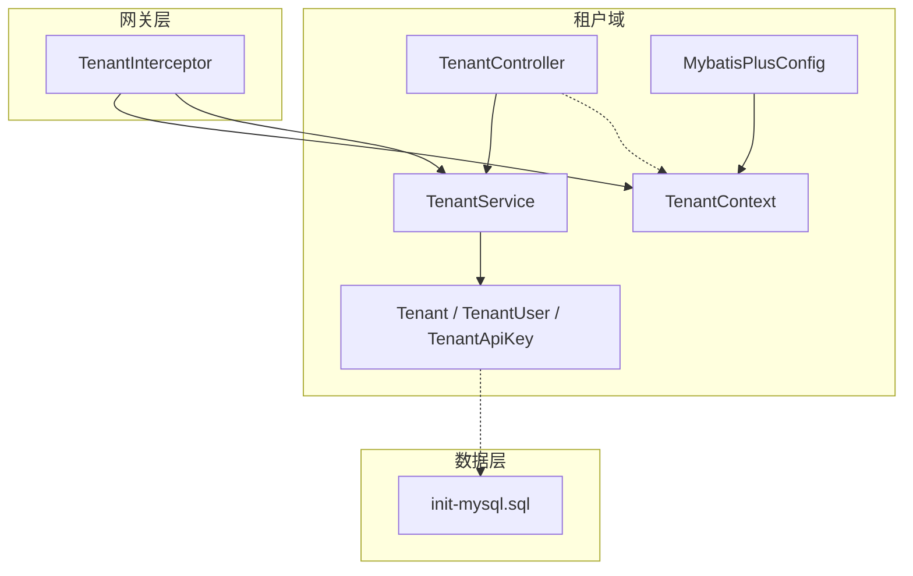
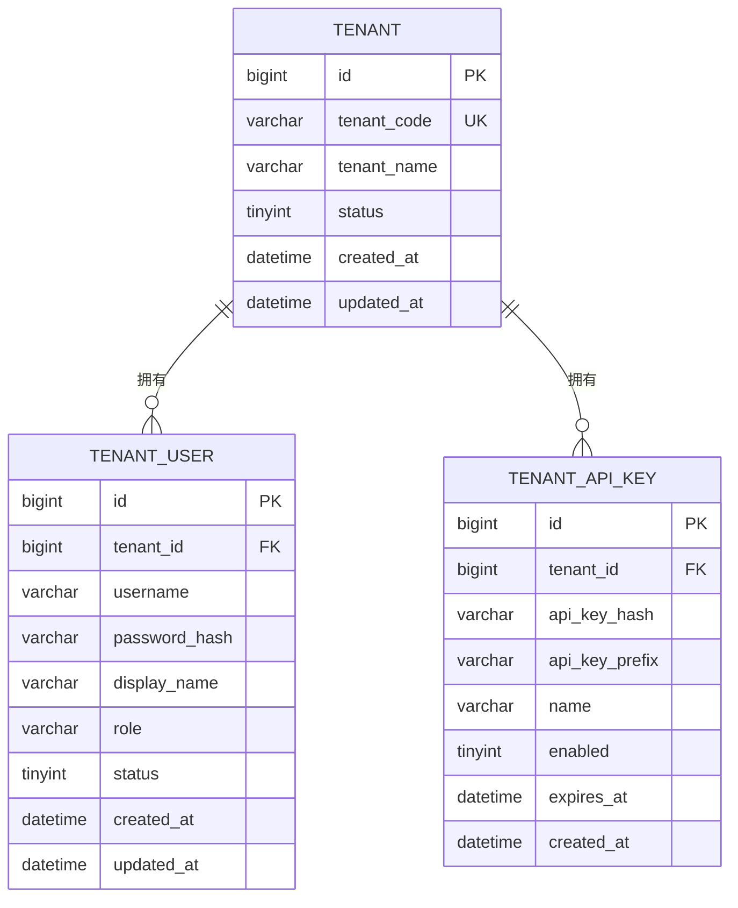
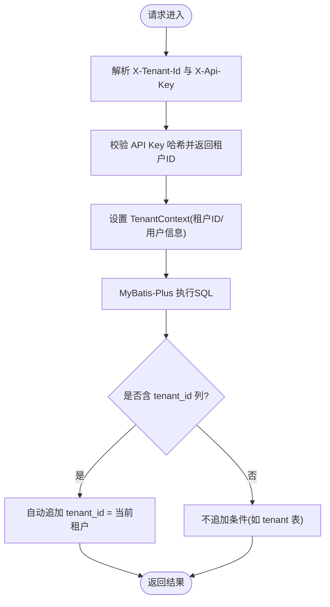
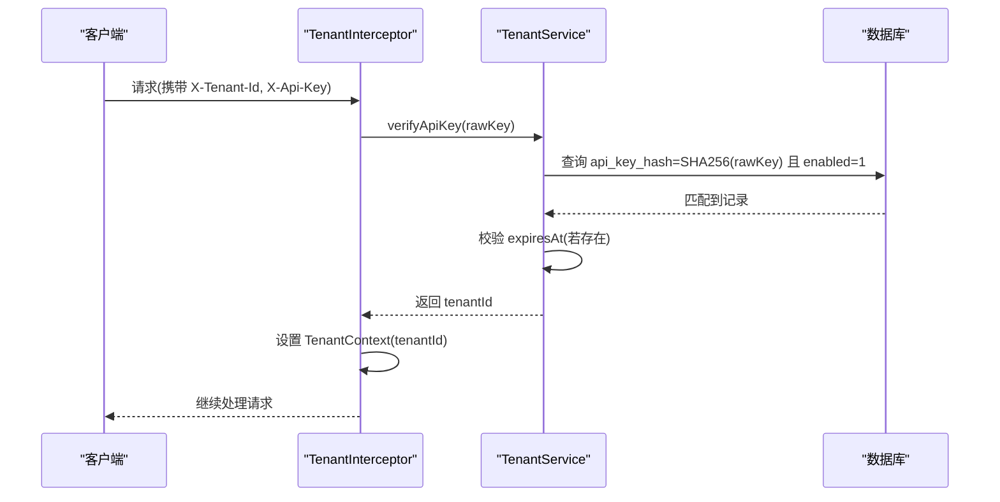
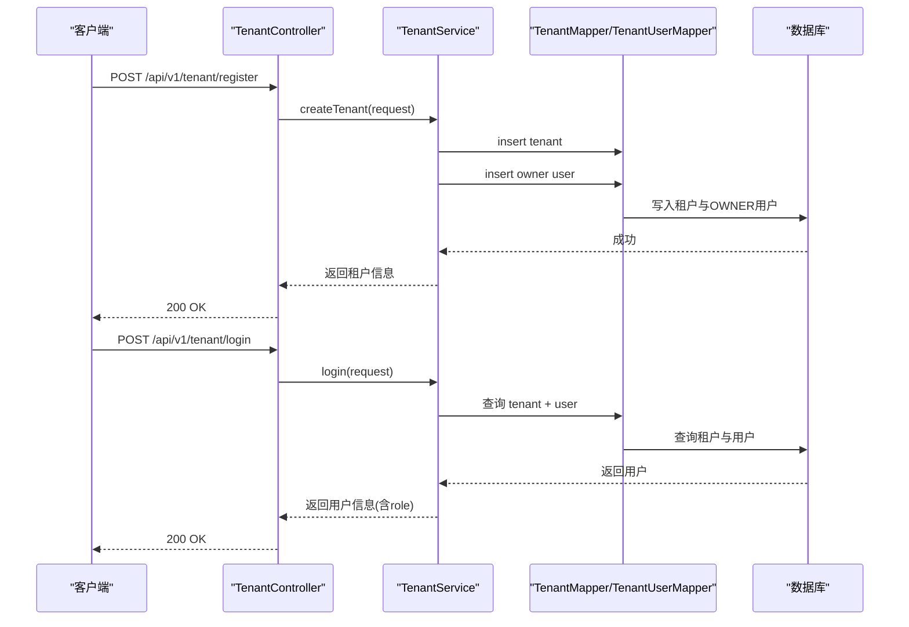
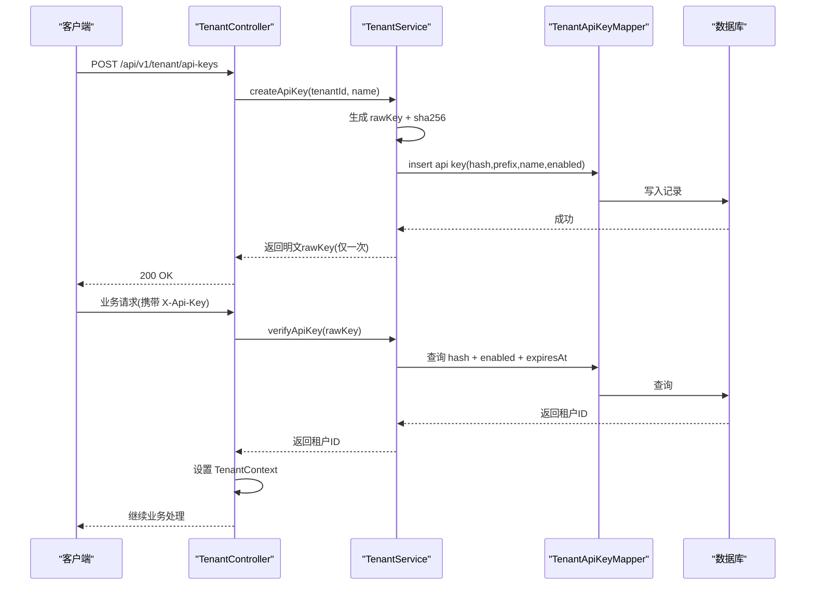
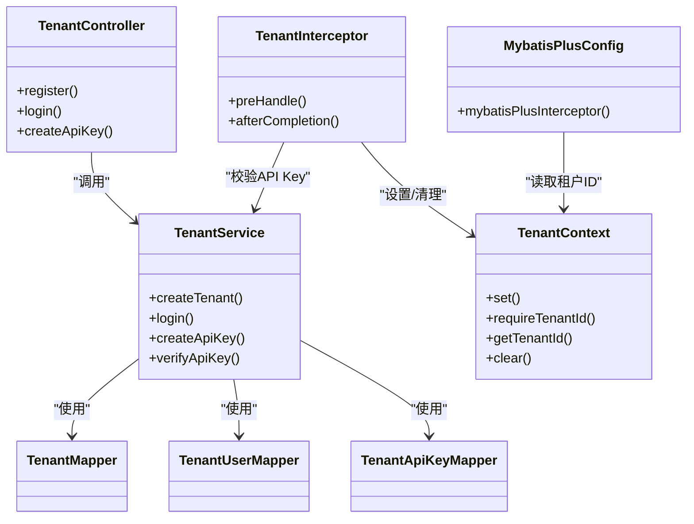

# 租户实体模型

<cite>
**本文引用的文件**   
- [Tenant.java](file://src/main/java/com/agenthub/tenant/entity/Tenant.java)
- [TenantUser.java](file://src/main/java/com/agenthub/tenant/entity/TenantUser.java)
- [TenantApiKey.java](file://src/main/java/com/agenthub/tenant/entity/TenantApiKey.java)
- [MybatisPlusConfig.java](file://src/main/java/com/agenthub/tenant/config/MybatisPlusConfig.java)
- [TenantContext.java](file://src/main/java/com/agenthub/tenant/context/TenantContext.java)
- [TenantInterceptor.java](file://src/main/java/com/agenthub/gateway/interceptor/TenantInterceptor.java)
- [TenantService.java](file://src/main/java/com/agenthub/tenant/service/TenantService.java)
- [TenantController.java](file://src/main/java/com/agenthub/tenant/controller/TenantController.java)
- [init-mysql.sql](file://sql/init-mysql.sql)
</cite>

## 目录
1. [引言](#引言)
2. [项目结构定位](#项目结构定位)
3. [核心实体定义](#核心实体定义)
4. [多租户数据隔离机制](#多租户数据隔离机制)
5. [用户角色与权限体系](#用户角色与权限体系)
6. [API Key 安全机制](#api-key-安全机制)
7. [架构总览与关键流程](#架构总览与关键流程)
8. [依赖关系分析](#依赖关系分析)
9. [性能与扩展建议](#性能与扩展建议)
10. [故障排查指南](#故障排查指南)
11. [结论](#结论)

## 引言
本文聚焦租户域的三个核心实体：租户、租户用户、租户 API Key，系统说明字段含义、业务规则、关系映射以及多租户数据隔离实现。同时解释基于 MyBatis-Plus 的租户插件机制、请求级租户上下文传递、API Key 签发与校验流程，并给出种子数据说明和样例数据组织方式，帮助读者快速理解并在生产环境中正确扩展。

## 项目结构定位
租户相关代码集中在 tenant 包下，包含配置、上下文、控制器、DTO、实体、Mapper 与服务；网关拦截器在 gateway.interceptor 中负责请求级认证与租户上下文设置；数据库初始化脚本在 sql 目录下提供建表与种子数据。

**图表来源**
- [TenantController.java:20-55](file://src/main/java/com/agenthub/tenant/controller/TenantController.java#L20-L55)
- [TenantService.java:26-129](file://src/main/java/com/agenthub/tenant/service/TenantService.java#L26-L129)
- [Tenant.java:10-34](file://src/main/java/com/agenthub/tenant/entity/Tenant.java#L10-L34)
- [TenantUser.java:10-39](file://src/main/java/com/agenthub/tenant/entity/TenantUser.java#L10-L39)
- [TenantApiKey.java:10-39](file://src/main/java/com/agenthub/tenant/entity/TenantApiKey.java#L10-L39)
- [MybatisPlusConfig.java:16-56](file://src/main/java/com/agenthub/tenant/config/MybatisPlusConfig.java#L16-L56)
- [TenantContext.java:6-59](file://src/main/java/com/agenthub/tenant/context/TenantContext.java#L6-L59)
- [TenantInterceptor.java:18-77](file://src/main/java/com/agenthub/gateway/interceptor/TenantInterceptor.java#L18-L77)
- [init-mysql.sql:10-45](file://sql/init-mysql.sql#L10-L45)

**章节来源**
- [TenantController.java:20-55](file://src/main/java/com/agenthub/tenant/controller/TenantController.java#L20-L55)
- [TenantService.java:26-129](file://src/main/java/com/agenthub/tenant/service/TenantService.java#L26-L129)
- [MybatisPlusConfig.java:16-56](file://src/main/java/com/agenthub/tenant/config/MybatisPlusConfig.java#L16-L56)
- [TenantContext.java:6-59](file://src/main/java/com/agenthub/tenant/context/TenantContext.java#L6-L59)
- [TenantInterceptor.java:18-77](file://src/main/java/com/agenthub/gateway/interceptor/TenantInterceptor.java#L18-L77)
- [init-mysql.sql:10-45](file://sql/init-mysql.sql#L10-L45)

## 核心实体定义

### 租户（Tenant）
- 作用：数据隔离的顶层边界，代表一个独立租户。
- 关键字段：
  - id：自增主键。
  - tenantCode：租户编码，唯一且用于登录识别。
  - tenantName：租户名称。
  - status：状态，1启用，0停用。
  - createdAt/updatedAt：审计时间。
- 特殊规则：
  - 本表不包含 tenant_id 字段，已在 MyBatis-Plus 租户插件 ignoreTable 中排除，避免自动追加租户条件。

**章节来源**
- [Tenant.java:10-34](file://src/main/java/com/agenthub/tenant/entity/Tenant.java#L10-L34)
- [MybatisPlusConfig.java:27-50](file://src/main/java/com/agenthub/tenant/config/MybatisPlusConfig.java#L27-L50)

### 租户用户（TenantUser）
- 作用：记录租户内的用户账号、密码哈希、显示名、角色与状态。
- 关键字段：
  - id：自增主键。
  - tenantId：所属租户。
  - username：用户名，与 tenantId 联合唯一。
  - passwordHash：密码哈希（演示使用 SHA-256）。
  - displayName：显示名。
  - role：角色，OWNER / ADMIN / MEMBER。
  - status：状态，1启用，0停用。
  - createdAt/updatedAt：审计时间。
- 索引：
  - 唯一键：(tenant_id, username)。
  - 普通索引：idx_user_tenant(tenant_id)。

**章节来源**
- [TenantUser.java:10-39](file://src/main/java/com/agenthub/tenant/entity/TenantUser.java#L10-L39)
- [init-mysql.sql:21-33](file://sql/init-mysql.sql#L21-L33)

### 租户 API Key（TenantApiKey）
- 作用：对外程序化访问凭证，服务端仅保存哈希值。
- 关键字段：
  - id：自增主键。
  - tenantId：所属租户。
  - apiKeyHash：API Key 的 SHA-256 哈希。
  - apiKeyPrefix：明文前缀，便于展示与快速定位。
  - name：Key 名称。
  - enabled：是否启用，1启用，0停用。
  - expiresAt：过期时间，null 表示永不过期。
  - createdAt：创建时间。
- 索引：
  - 普通索引：idx_apikey_hash(api_key_hash)。

**章节来源**
- [TenantApiKey.java:10-39](file://src/main/java/com/agenthub/tenant/entity/TenantApiKey.java#L10-L39)
- [init-mysql.sql:35-45](file://sql/init-mysql.sql#L35-L45)

### 实体关系图

**图表来源**
- [Tenant.java:10-34](file://src/main/java/com/agenthub/tenant/entity/Tenant.java#L10-L34)
- [TenantUser.java:10-39](file://src/main/java/com/agenthub/tenant/entity/TenantUser.java#L10-L39)
- [TenantApiKey.java:10-39](file://src/main/java/com/agenthub/tenant/entity/TenantApiKey.java#L10-L39)
- [init-mysql.sql:12-45](file://sql/init-mysql.sql#L12-L45)

## 多租户数据隔离机制
- 设计目标：所有业务查询默认按当前租户过滤，杜绝跨租户数据泄露。
- 实现要点：
  - 所有业务表均包含 tenant_id 字段，由 MyBatis-Plus 租户插件自动追加过滤条件。
  - tenant 表不含 tenant_id，已在忽略表中排除，避免被自动加条件。
  - 租户上下文通过 TenantContext 在请求生命周期内持有，网关拦截器解析请求头并写入上下文。
  - 向量检索走 PGVector（JDBC 直连），不经过该插件，需显式拼接 tenant_id 条件。

**图表来源**
- [TenantInterceptor.java:31-56](file://src/main/java/com/agenthub/gateway/interceptor/TenantInterceptor.java#L31-L56)
- [TenantContext.java:19-54](file://src/main/java/com/agenthub/tenant/context/TenantContext.java#L19-L54)
- [MybatisPlusConfig.java:30-55](file://src/main/java/com/agenthub/tenant/config/MybatisPlusConfig.java#L30-L55)

**章节来源**
- [MybatisPlusConfig.java:16-56](file://src/main/java/com/agenthub/tenant/config/MybatisPlusConfig.java#L16-L56)
- [TenantContext.java:6-59](file://src/main/java/com/agenthub/tenant/context/TenantContext.java#L6-L59)
- [TenantInterceptor.java:18-77](file://src/main/java/com/agenthub/gateway/interceptor/TenantInterceptor.java#L18-L77)
- [init-mysql.sql:4-5](file://sql/init-mysql.sql#L4-L5)

## 用户角色与权限体系
- 角色枚举：
  - OWNER：租户所有者，通常具备最高权限。
  - ADMIN：管理员，具备管理租户内资源的能力。
  - MEMBER：普通成员，基础访问权限。
- 存储位置：TenantUser.role。
- 业务约束：
  - 创建租户时默认生成 OWNER 用户。
  - 登录接口返回用户角色，供上层进行细粒度权限控制。
- 扩展建议：
  - 可在服务层或网关层根据角色进行路由或功能开关控制。
  - 结合知识库成员表 kb_member.role 实现更细粒度的资源级权限。

**章节来源**
- [TenantUser.java:29-30](file://src/main/java/com/agenthub/tenant/entity/TenantUser.java#L29-L30)
- [TenantService.java:41-60](file://src/main/java/com/agenthub/tenant/service/TenantService.java#L41-L60)
- [TenantController.java:36-46](file://src/main/java/com/agenthub/tenant/controller/TenantController.java#L36-L46)

## API Key 安全机制
- 生成策略：
  - 随机生成密钥前缀 ahk_ + Base64 随机串，作为明文返回一次。
  - 服务端仅保存 SHA-256 哈希，不存明文。
- 校验流程：
  - 客户端每次调用携带 X-Api-Key。
  - 服务端计算哈希并与库中比对，同时检查 enabled 与 expiresAt。
- 展示与定位：
  - 保存 apiKeyPrefix（明文前缀），便于 UI 展示与快速识别。
- 安全建议：
  - 生产环境建议使用更强哈希算法或 HMAC-SHA256，并结合密钥托管方案。
  - 对 API Key 访问频率、IP 白名单等做额外风控。

**图表来源**
- [TenantInterceptor.java:31-56](file://src/main/java/com/agenthub/gateway/interceptor/TenantInterceptor.java#L31-L56)
- [TenantService.java:80-109](file://src/main/java/com/agenthub/tenant/service/TenantService.java#L80-L109)

**章节来源**
- [TenantService.java:80-129](file://src/main/java/com/agenthub/tenant/service/TenantService.java#L80-L129)
- [TenantApiKey.java:20-39](file://src/main/java/com/agenthub/tenant/entity/TenantApiKey.java#L20-L39)

## 架构总览与关键流程

### 注册与登录流程

**图表来源**
- [TenantController.java:30-46](file://src/main/java/com/agenthub/tenant/controller/TenantController.java#L30-L46)
- [TenantService.java:41-78](file://src/main/java/com/agenthub/tenant/service/TenantService.java#L41-L78)

### API Key 签发与鉴权流程

**图表来源**
- [TenantController.java:48-53](file://src/main/java/com/agenthub/tenant/controller/TenantController.java#L48-L53)
- [TenantService.java:80-109](file://src/main/java/com/agenthub/tenant/service/TenantService.java#L80-L109)

## 依赖关系分析
- 控制器依赖服务：TenantController 调用 TenantService 完成注册、登录、API Key 签发。
- 服务依赖 Mapper：TenantService 通过 TenantMapper、TenantUserMapper、TenantApiKeyMapper 操作数据库。
- 网关拦截器依赖服务与上下文：TenantInterceptor 解析请求头，调用 TenantService.verifyApiKey，并将租户身份写入 TenantContext。
- 配置类依赖上下文：MybatisPlusConfig 从 TenantContext 获取当前租户ID，注入到租户插件。

**图表来源**
- [TenantController.java:20-55](file://src/main/java/com/agenthub/tenant/controller/TenantController.java#L20-L55)
- [TenantService.java:26-129](file://src/main/java/com/agenthub/tenant/service/TenantService.java#L26-L129)
- [TenantInterceptor.java:18-77](file://src/main/java/com/agenthub/gateway/interceptor/TenantInterceptor.java#L18-L77)
- [TenantContext.java:6-59](file://src/main/java/com/agenthub/tenant/context/TenantContext.java#L6-L59)
- [MybatisPlusConfig.java:16-56](file://src/main/java/com/agenthub/tenant/config/MybatisPlusConfig.java#L16-L56)

**章节来源**
- [TenantController.java:20-55](file://src/main/java/com/agenthub/tenant/controller/TenantController.java#L20-L55)
- [TenantService.java:26-129](file://src/main/java/com/agenthub/tenant/service/TenantService.java#L26-L129)
- [TenantInterceptor.java:18-77](file://src/main/java/com/agenthub/gateway/interceptor/TenantInterceptor.java#L18-L77)
- [TenantContext.java:6-59](file://src/main/java/com/agenthub/tenant/context/TenantContext.java#L6-L59)
- [MybatisPlusConfig.java:16-56](file://src/main/java/com/agenthub/tenant/config/MybatisPlusConfig.java#L16-L56)

## 性能与扩展建议
- 索引优化：
  - tenant_user 已建立 (tenant_id, username) 唯一索引与 tenant_id 索引，适合登录与按租户查询。
  - tenant_api_key 已建立 api_key_hash 索引，加速 API Key 校验。
- 分页与查询：
  - 分页插件与租户插件组合使用，确保分页结果也受租户隔离。
- 扩展点：
  - 可引入 RBAC 或 ABAC 模型，结合 kb_member.role 实现知识库级别权限。
  - 为 API Key 增加签名校验、速率限制与审计日志。

[本节为通用建议，不直接分析具体文件]

## 故障排查指南
- 常见问题：
  - 缺少 X-Tenant-Id：网关拦截器会拒绝请求并返回未授权错误。
  - API Key 无效或不匹配：校验失败，返回未授权错误。
  - 租户上下文缺失：业务层调用 requireTenantId 时会抛出业务异常。
- 排查步骤：
  - 确认请求头是否正确携带 X-Tenant-Id 与 X-Api-Key。
  - 检查 API Key 是否启用且未过期。
  - 确认 TenantContext 是否在拦截器中设置并在请求结束后清理。
  - 检查 MyBatis-Plus 租户插件是否生效（查看生成的 SQL 是否包含 tenant_id 条件）。

**章节来源**
- [TenantInterceptor.java:31-77](file://src/main/java/com/agenthub/gateway/interceptor/TenantInterceptor.java#L31-L77)
- [TenantContext.java:24-54](file://src/main/java/com/agenthub/tenant/context/TenantContext.java#L24-L54)
- [MybatisPlusConfig.java:30-55](file://src/main/java/com/agenthub/tenant/config/MybatisPlusConfig.java#L30-L55)

## 结论
本项目通过三个核心实体构建租户域：Tenant 作为隔离边界，TenantUser 承载用户与角色，TenantApiKey 提供程序化访问凭证。借助 MyBatis-Plus 租户插件与请求级上下文，实现了强一致的多租户数据隔离。API Key 采用哈希存储与过期控制，配合网关拦截器完成鉴权。建议在后续迭代中增强密码与密钥的安全强度，完善角色权限模型，并补充审计与风控能力。