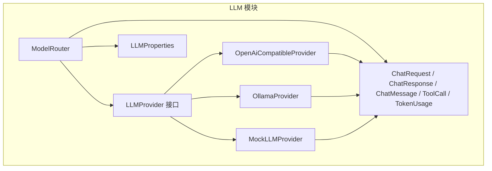
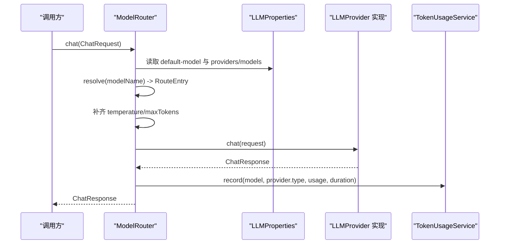
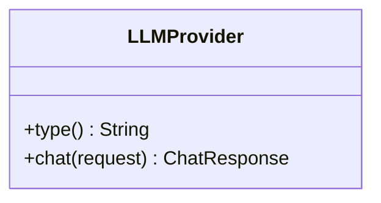
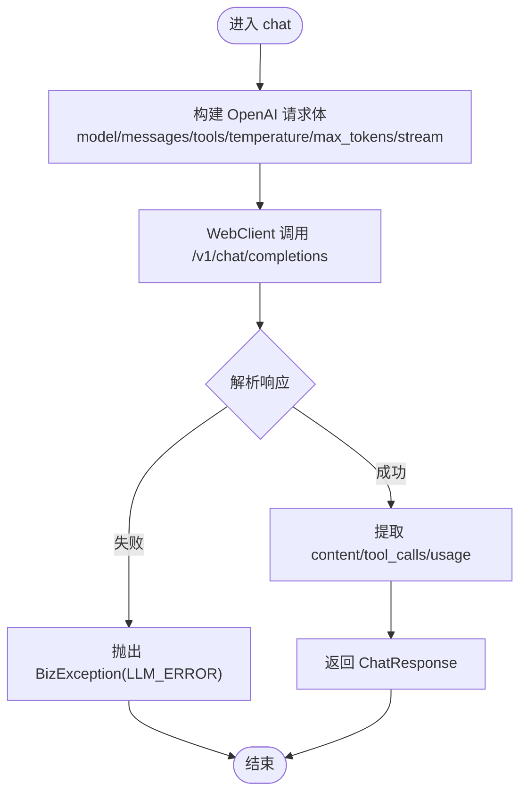
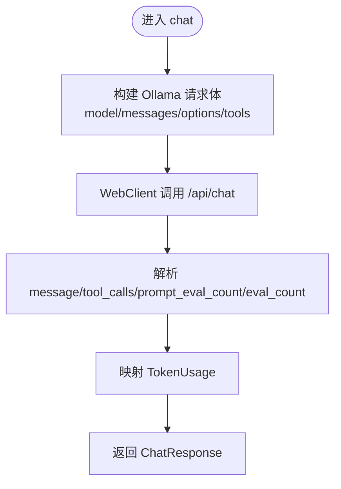
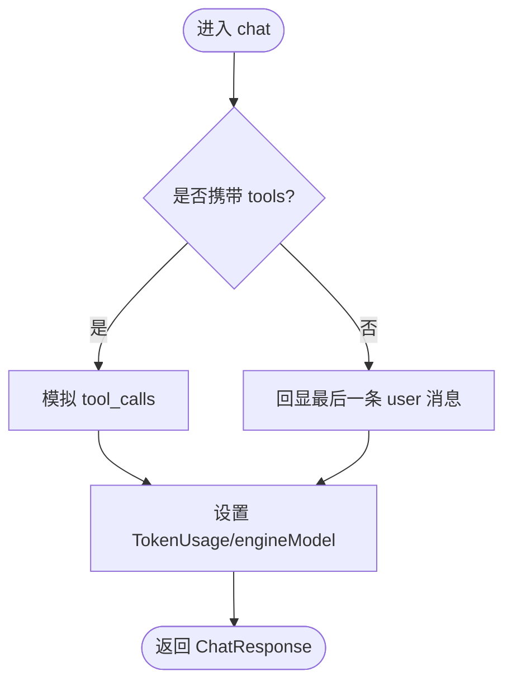
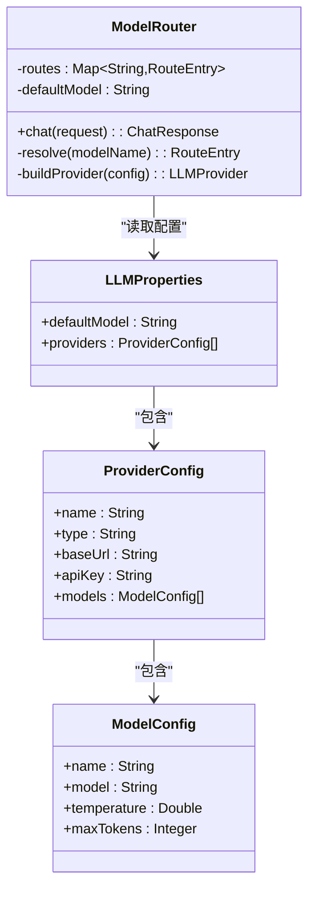
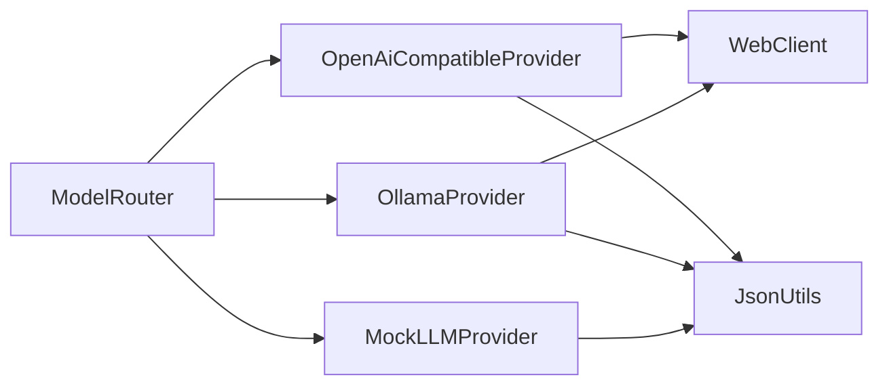
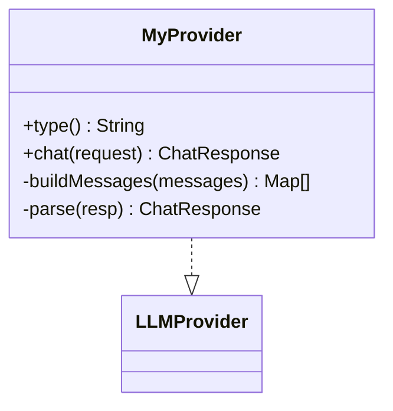
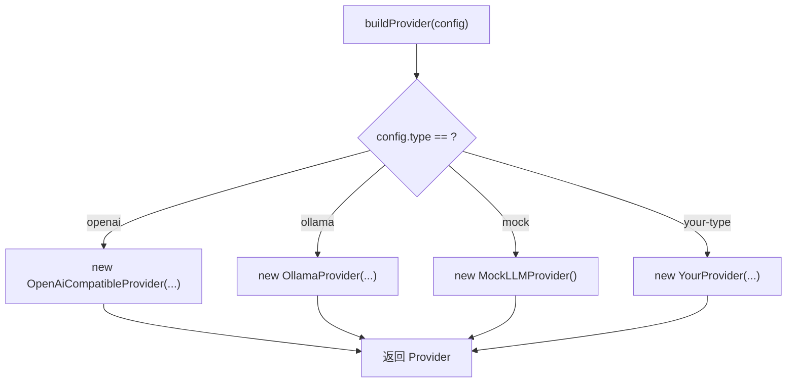

# LLM 提供商扩展

<cite>
**本文引用的文件 **
- [LLMProvider.java](file://src/main/java/com/agenthub/llm/provider/LLMProvider.java)
- [OpenAiCompatibleProvider.java](file://src/main/java/com/agenthub/llm/provider/OpenAiCompatibleProvider.java)
- [OllamaProvider.java](file://src/main/java/com/agenthub/llm/provider/OllamaProvider.java)
- [MockLLMProvider.java](file://src/main/java/com/agenthub/llm/provider/MockLLMProvider.java)
- [ModelRouter.java](file://src/main/java/com/agenthub/llm/router/ModelRouter.java)
- [LLMProperties.java](file://src/main/java/com/agenthub/llm/config/LLMProperties.java)
- [ChatRequest.java](file://src/main/java/com/agenthub/llm/model/ChatRequest.java)
- [ChatResponse.java](file://src/main/java/com/agenthub/llm/model/ChatResponse.java)
- [ChatMessage.java](file://src/main/java/com/agenthub/llm/model/ChatMessage.java)
- [TokenUsage.java](file://src/main/java/com/agenthub/llm/model/TokenUsage.java)
- [ToolCall.java](file://src/main/java/com/agenthub/llm/model/ToolCall.java)
- [application.yml](file://src/main/resources/application.yml)
</cite>

## 目录
1. [简介](#简介)
2. [项目结构](#项目结构)
3. [核心组件](#核心组件)
4. [架构总览](#架构总览)
5. [详细组件分析](#详细组件分析)
6. [依赖关系分析](#依赖关系分析)
7. [性能与可扩展性](#性能与可扩展性)
8. [自定义 LLM 提供商开发指南](#自定义-llm-提供商开发指南)
9. [故障排查与调试技巧](#故障排查与调试技巧)
10. [结论](#结论)

## 简介
本文面向需要在项目中接入或扩展新的 LLM 提供商的开发者，围绕 LLMProvider 接口的设计理念、现有实现模式、与 ModelRouter 的集成方式、配置注册流程、错误处理策略以及性能优化建议展开。文档同时提供完整的自定义 LLM 提供商开发步骤，包括请求构造、响应解析、工具调用（function calling）支持、流式处理扩展思路等。

## 项目结构
本项目在 llm 模块下采用“接口 + 多 Provider 实现 + 路由”的分层设计：
- provider 层定义统一抽象并实现具体厂商适配
- router 层负责按模型路由键选择 Provider 并统一统计
- config 层通过 Spring 配置属性集中管理 Provider 与模型映射
- model 层提供统一的请求、响应、消息、工具调用与 Token 统计数据结构

**图表来源**
- [LLMProvider.java:9-16](file://src/main/java/com/agenthub/llm/provider/LLMProvider.java#L9-L16)
- [OpenAiCompatibleProvider.java:25-68](file://src/main/java/com/agenthub/llm/provider/OpenAiCompatibleProvider.java#L25-L68)
- [OllamaProvider.java:25-66](file://src/main/java/com/agenthub/llm/provider/OllamaProvider.java#L25-L66)
- [MockLLMProvider.java:20-53](file://src/main/java/com/agenthub/llm/provider/MockLLMProvider.java#L20-L53)
- [ModelRouter.java:27-103](file://src/main/java/com/agenthub/llm/router/ModelRouter.java#L27-L103)
- [LLMProperties.java:12-41](file://src/main/java/com/agenthub/llm/config/LLMProperties.java#L12-L41)
- [ChatRequest.java:18-33](file://src/main/java/com/agenthub/llm/model/ChatRequest.java#L18-L33)
- [ChatResponse.java:17-30](file://src/main/java/com/agenthub/llm/model/ChatResponse.java#L17-L30)
- [ChatMessage.java:17-46](file://src/main/java/com/agenthub/llm/model/ChatMessage.java#L17-L46)
- [ToolCall.java:16-25](file://src/main/java/com/agenthub/llm/model/ToolCall.java#L16-L25)
- [TokenUsage.java:13-21](file://src/main/java/com/agenthub/llm/model/TokenUsage.java#L13-L21)

**章节来源**
- [LLMProvider.java:1-17](file://src/main/java/com/agenthub/llm/provider/LLMProvider.java#L1-L17)
- [ModelRouter.java:1-109](file://src/main/java/com/agenthub/llm/router/ModelRouter.java#L1-L109)
- [LLMProperties.java:1-43](file://src/main/java/com/agenthub/llm/config/LLMProperties.java#L1-L43)

## 核心组件
- LLMProvider：定义 provider 类型标识与对话入口 chat()，屏蔽底层差异。
- OpenAiCompatibleProvider：基于 OpenAI 兼容接口的 HTTP 客户端实现，支持 function calling 与 token 统计。
- OllamaProvider：对接 Ollama 原生 API，支持 tools 参数与本地模型。
- MockLLMProvider：无外部模型时的确定性返回，用于演示与测试。
- ModelRouter：按模型路由键选择 Provider，统一注入默认值、记录 Token 使用与耗时。
- LLMProperties：集中声明 providers 与 models 的配置映射。
- 数据模型：ChatRequest、ChatResponse、ChatMessage、ToolCall、TokenUsage 作为跨 Provider 的统一契约。

**章节来源**
- [LLMProvider.java:9-16](file://src/main/java/com/agenthub/llm/provider/LLMProvider.java#L9-L16)
- [OpenAiCompatibleProvider.java:25-129](file://src/main/java/com/agenthub/llm/provider/OpenAiCompatibleProvider.java#L25-L129)
- [OllamaProvider.java:25-115](file://src/main/java/com/agenthub/llm/provider/OllamaProvider.java#L25-L115)
- [MockLLMProvider.java:20-53](file://src/main/java/com/agenthub/llm/provider/MockLLMProvider.java#L20-L53)
- [ModelRouter.java:27-103](file://src/main/java/com/agenthub/llm/router/ModelRouter.java#L27-L103)
- [LLMProperties.java:12-41](file://src/main/java/com/agenthub/llm/config/LLMProperties.java#L12-L41)
- [ChatRequest.java:18-33](file://src/main/java/com/agenthub/llm/model/ChatRequest.java#L18-L33)
- [ChatResponse.java:17-30](file://src/main/java/com/agenthub/llm/model/ChatResponse.java#L17-L30)
- [ChatMessage.java:17-46](file://src/main/java/com/agenthub/llm/model/ChatMessage.java#L17-L46)
- [ToolCall.java:16-25](file://src/main/java/com/agenthub/llm/model/ToolCall.java#L16-L25)
- [TokenUsage.java:13-21](file://src/main/java/com/agenthub/llm/model/TokenUsage.java#L13-L21)

## 架构总览
下图展示从业务侧到具体 LLM 提供商的调用链路，以及 ModelRouter 如何完成路由、参数补齐与统计埋点。

**图表来源**
- [ModelRouter.java:34-73](file://src/main/java/com/agenthub/llm/router/ModelRouter.java#L34-L73)
- [LLMProperties.java:12-41](file://src/main/java/com/agenthub/llm/config/LLMProperties.java#L12-L41)

## 详细组件分析

### LLMProvider 接口设计
- type()：返回 Provider 的类型标识，用于路由构建与日志统计。
- chat(request)：接收统一结构的 ChatRequest，返回 ChatResponse。该接口屏蔽了不同厂商的差异，使上层只关注业务语义。

**图表来源**
- [LLMProvider.java:9-16](file://src/main/java/com/agenthub/llm/provider/LLMProvider.java#L9-L16)

**章节来源**
- [LLMProvider.java:1-17](file://src/main/java/com/agenthub/llm/provider/LLMProvider.java#L1-L17)

### OpenAiCompatibleProvider
- 目标：兼容所有遵循 OpenAI 格式的接口（如 vLLM、DeepSeek、OneAPI 等）。
- 关键点：
  - 使用 WebClient 发起 POST /v1/chat/completions 请求。
  - 将内部 ChatMessage 转换为 OpenAI 格式，包含 role/content/tool_calls/tool_call_id。
  - 解析响应中的 choices[0].message.content 与 tool_calls，并提取 usage 统计。
  - 异常统一包装为 BizException，便于上层捕获与统计。

**图表来源**
- [OpenAiCompatibleProvider.java:44-68](file://src/main/java/com/agenthub/llm/provider/OpenAiCompatibleProvider.java#L44-L68)
- [OpenAiCompatibleProvider.java:70-91](file://src/main/java/com/agenthub/llm/provider/OpenAiCompatibleProvider.java#L70-L91)
- [OpenAiCompatibleProvider.java:94-129](file://src/main/java/com/agenthub/llm/provider/OpenAiCompatibleProvider.java#L94-L129)

**章节来源**
- [OpenAiCompatibleProvider.java:20-131](file://src/main/java/com/agenthub/llm/provider/OpenAiCompatibleProvider.java#L20-L131)

### OllamaProvider
- 目标：对接 Ollama 原生 /api/chat 接口，原生支持 tools。
- 关键点：
  - 构建 messages 与 options.temperature；当存在 tools 时直接透传。
  - 解析 message.content 与 message.tool_calls，并将 prompt_eval_count/eval_count 映射为 TokenUsage。
  - 异常统一包装为 BizException。

**图表来源**
- [OllamaProvider.java:41-66](file://src/main/java/com/agenthub/llm/provider/OllamaProvider.java#L41-L66)
- [OllamaProvider.java:68-81](file://src/main/java/com/agenthub/llm/provider/OllamaProvider.java#L68-L81)
- [OllamaProvider.java:84-115](file://src/main/java/com/agenthub/llm/provider/OllamaProvider.java#L84-L115)

**章节来源**
- [OllamaProvider.java:20-117](file://src/main/java/com/agenthub/llm/provider/OllamaProvider.java#L20-L117)

### MockLLMProvider
- 目标：在无外部模型时提供确定性回答，便于演示与单测。
- 行为：
  - 若请求携带 tools，则模拟一次工具调用（取第一个工具名）。
  - 纯对话场景回显最后一条用户消息摘要。
  - 固定填充 TokenUsage 与 engineModel。

**图表来源**
- [MockLLMProvider.java:30-53](file://src/main/java/com/agenthub/llm/provider/MockLLMProvider.java#L30-L53)

**章节来源**
- [MockLLMProvider.java:13-55](file://src/main/java/com/agenthub/llm/provider/MockLLMProvider.java#L13-L55)

### ModelRouter 与 LLMProperties 集成
- ModelRouter：
  - 启动时根据 LLMProperties.providers 构建路由表，将每个模型的 name 映射到 (provider, modelConfig)。
  - chat() 中根据传入的 model 路由键解析出实际引擎模型名，补齐 temperature/maxTokens，再调用对应 Provider。
  - 统一记录 Token 消耗与耗时，失败路径也记录异常信息。
- LLMProperties：
  - 通过 agenthub.llm.* 前缀加载配置，支持多个 provider 与各自 models 列表。
  - default-model 指定默认路由键。

**图表来源**
- [ModelRouter.java:27-103](file://src/main/java/com/agenthub/llm/router/ModelRouter.java#L27-L103)
- [LLMProperties.java:12-41](file://src/main/java/com/agenthub/llm/config/LLMProperties.java#L12-L41)

**章节来源**
- [ModelRouter.java:1-109](file://src/main/java/com/agenthub/llm/router/ModelRouter.java#L1-L109)
- [LLMProperties.java:1-43](file://src/main/java/com/agenthub/llm/config/LLMProperties.java#L1-L43)

## 依赖关系分析
- 耦合度：
  - Provider 仅依赖统一的数据模型与通用异常/JSON 工具，耦合低、内聚高。
  - ModelRouter 对 Provider 的实现类有硬编码 switch 分支，新增 Provider 需修改此处。
- 外部依赖：
  - OpenAiCompatibleProvider 与 OllamaProvider 均依赖 WebClient 进行 HTTP 调用。
  - 所有 Provider 通过 BizException 与 ErrorCode 统一错误上报。

**图表来源**
- [ModelRouter.java:95-103](file://src/main/java/com/agenthub/llm/router/ModelRouter.java#L95-L103)
- [OpenAiCompatibleProvider.java:29-36](file://src/main/java/com/agenthub/llm/provider/OpenAiCompatibleProvider.java#L29-L36)
- [OllamaProvider.java:29-33](file://src/main/java/com/agenthub/llm/provider/OllamaProvider.java#L29-L33)

**章节来源**
- [ModelRouter.java:95-103](file://src/main/java/com/agenthub/llm/router/ModelRouter.java#L95-L103)
- [OpenAiCompatibleProvider.java:29-36](file://src/main/java/com/agenthub/llm/provider/OpenAiCompatibleProvider.java#L29-L36)
- [OllamaProvider.java:29-33](file://src/main/java/com/agenthub/llm/provider/OllamaProvider.java#L29-L33)

## 性能与可扩展性
- 连接复用：WebClient 实例在 Provider 构造时创建，避免重复初始化开销。
- 同步阻塞：当前 chat() 使用 block() 同步等待响应，适合简单场景；在高并发下可考虑异步响应式或线程池封装。
- 流式处理：当前 Provider 强制 stream=false，如需流式输出，可在 Provider 层引入 SSE/WebFlux 流式解析，并在 ModelRouter 暴露流式 API。
- 参数补齐：ModelRouter 会补齐 temperature/maxTokens，减少 Provider 侧判断逻辑。
- 统计埋点：每次调用均记录 Token 与耗时，便于监控与成本核算。

[本节为通用指导，不直接分析具体文件]

## 自定义 LLM 提供商开发指南

### 第一步：实现 LLMProvider 接口
- 实现 type()：返回唯一类型标识（例如 "my-provider"）。
- 实现 chat(request)：
  - 将 ChatRequest.messages 转换为目标厂商的消息格式。
  - 支持 tools/function calling：将 ToolCall 序列化为厂商要求的字段。
  - 解析响应：提取 content、tool_calls、usage，并填充 ChatResponse。
  - 异常处理：将网络异常、协议异常统一包装为 BizException(ErrorCode.LLM_ERROR)。

**图表来源**
- [LLMProvider.java:9-16](file://src/main/java/com/agenthub/llm/provider/LLMProvider.java#L9-L16)

**章节来源**
- [LLMProvider.java:1-17](file://src/main/java/com/agenthub/llm/provider/LLMProvider.java#L1-L17)

### 第二步：在 ModelRouter 中注册新 Provider
- 在 ModelRouter.buildProvider() 的 switch 中添加新类型分支，根据 LLMProperties.ProviderConfig 构造你的 Provider 实例。
- 确保 type() 返回值与配置中的 type 一致。

**图表来源**
- [ModelRouter.java:95-103](file://src/main/java/com/agenthub/llm/router/ModelRouter.java#L95-L103)

**章节来源**
- [ModelRouter.java:95-103](file://src/main/java/com/agenthub/llm/router/ModelRouter.java#L95-L103)

### 第三步：添加配置项
- 在 application.yml 的 agenthub.llm.providers 下新增一个 provider 条目：
  - name：任意标识
  - type：与你实现的 type() 一致
  - baseUrl/apiKey：按需填写
  - models[]：至少一个模型，name 为路由键，model 为引擎模型名，temperature/maxTokens 按需设置

示例配置片段位置参考：
- [application.yml:98-126](file://src/main/resources/application.yml#L98-L126)

**章节来源**
- [application.yml:98-126](file://src/main/resources/application.yml#L98-L126)

### 第四步：请求构造与响应解析最佳实践
- 消息构造：
  - 保持 role 语义一致（system/user/assistant/tool）。
  - assistant 消息携带 tool_calls，tool 消息携带 tool_call_id 与执行结果内容。
- 工具调用：
  - 输入 tools 使用 OpenAI 函数定义格式（name/description/parameters），由 Provider 转为厂商格式。
  - 解析 tool_calls 时注意 id/name/arguments 的字段映射。
- Token 统计：
  - 尽量从响应 usage 字段解析 prompt_tokens/completion_tokens，缺失时给默认值。
- 错误处理：
  - 网络超时、鉴权失败、非法响应结构均应抛出 BizException(LLM_ERROR)，以便 ModelRouter 记录失败统计。

**章节来源**
- [OpenAiCompatibleProvider.java:70-91](file://src/main/java/com/agenthub/llm/provider/OpenAiCompatibleProvider.java#L70-L91)
- [OpenAiCompatibleProvider.java:94-129](file://src/main/java/com/agenthub/llm/provider/OpenAiCompatibleProvider.java#L94-L129)
- [OllamaProvider.java:68-115](file://src/main/java/com/agenthub/llm/provider/OllamaProvider.java#L68-L115)

### 第五步：流式处理扩展思路
- 当前 Provider 使用非流式调用（stream=false）。如需流式：
  - 在 Provider 层使用 WebFlux 订阅 SSE 流，逐条解析 delta 内容。
  - 在 ModelRouter 暴露新的流式方法，将增量内容回调给调用方。
  - 在 TokenUsage 中累计增量 token 数，或在最终汇总时合并。

[本节为概念性扩展建议，不直接分析具体文件]

## 故障排查与调试技巧
- 未配置的模型路由键：
  - 现象：抛出 BizException(LLM_ERROR)，提示未配置的模型路由键。
  - 排查：检查 application.yml 中 agenthub.llm.default-model 与 providers[].models[].name 是否匹配。
- OpenAI 兼容接口调用失败：
  - 现象：BizException(LLM_ERROR)，提示“OpenAI 兼容接口调用失败”。
  - 排查：确认 base-url、api-key、网络连通性与鉴权头是否正确。
- Ollama 调用失败：
  - 现象：BizException(LLM_ERROR)，提示“Ollama 调用失败”。
  - 排查：确认 Ollama 服务地址、端口与模型名称是否正确。
- 响应结构异常：
  - 现象：缺少 choices/message 等关键字段导致解析失败。
  - 排查：打印原始响应，核对字段命名与嵌套结构是否与 Provider 解析逻辑一致。
- 工具调用为空或参数异常：
  - 现象：tool_calls 为空或 arguments 无法解析。
  - 排查：检查 tools 定义是否符合 OpenAI 函数定义格式，并确保 Assistant 返回的 tool_calls 字段完整。

**章节来源**
- [ModelRouter.java:86-93](file://src/main/java/com/agenthub/llm/router/ModelRouter.java#L86-L93)
- [OpenAiCompatibleProvider.java:55-68](file://src/main/java/com/agenthub/llm/provider/OpenAiCompatibleProvider.java#L55-L68)
- [OllamaProvider.java:53-66](file://src/main/java/com/agenthub/llm/provider/OllamaProvider.java#L53-L66)

## 结论
本项目通过 LLMProvider 接口实现了多 LLM 提供商的统一抽象，配合 ModelRouter 的路由与统计能力，使得业务侧无需关心底层差异即可切换模型与厂商。现有 OpenAiCompatibleProvider、OllamaProvider、MockLLMProvider 提供了良好的实现范式。扩展新的 Provider 只需实现接口、在 ModelRouter 注册、并在配置文件中声明路由键即可。建议在后续迭代中逐步引入流式处理、连接池与重试机制，以进一步提升性能与稳定性。