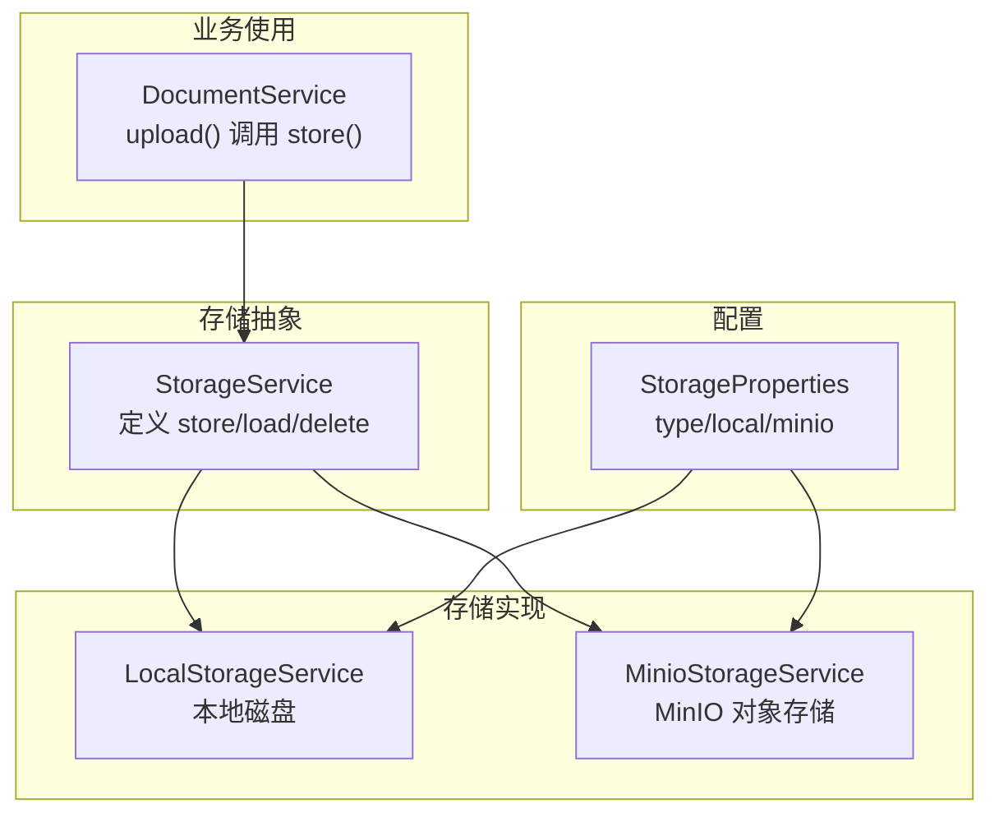
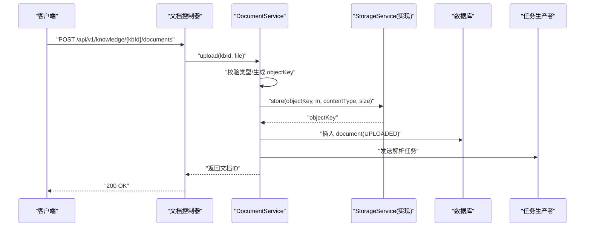
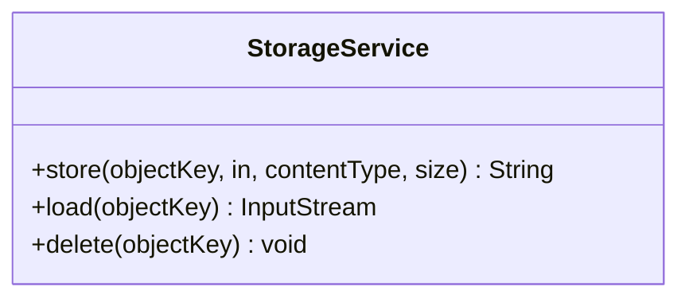
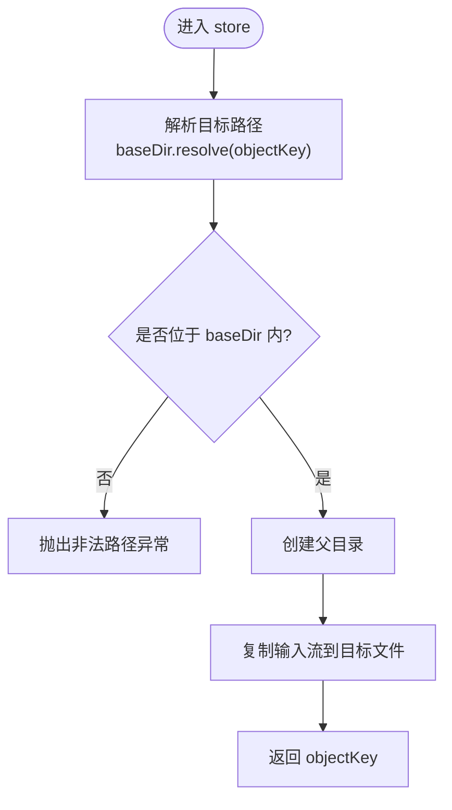
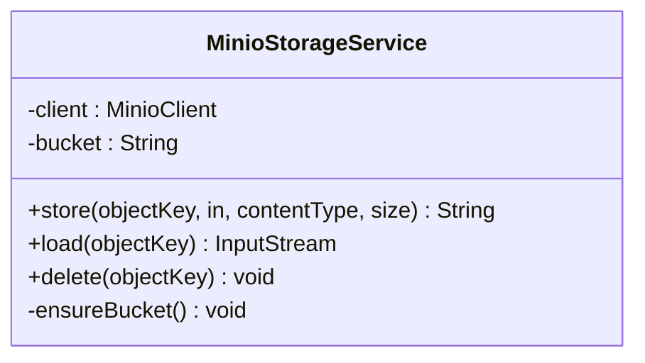
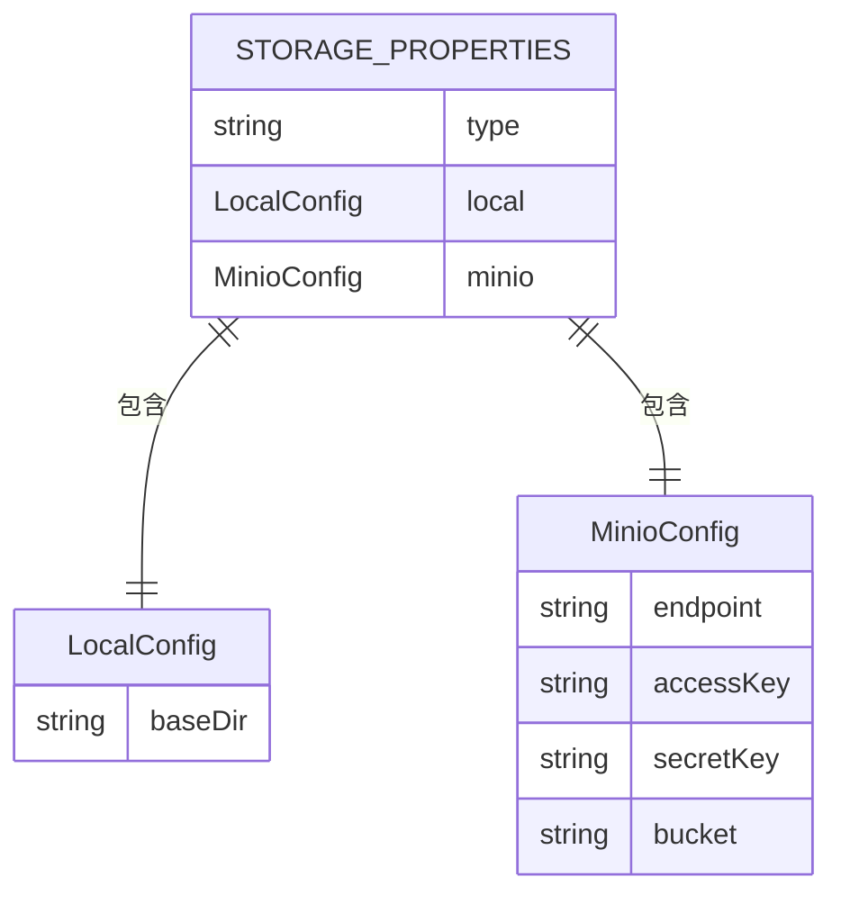
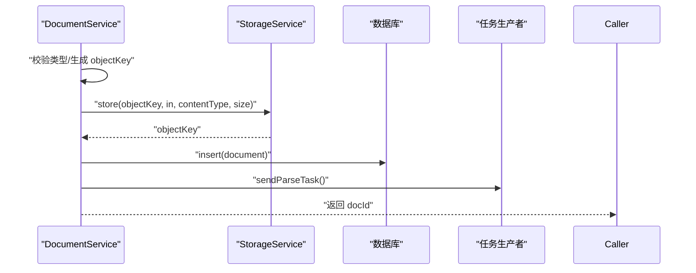
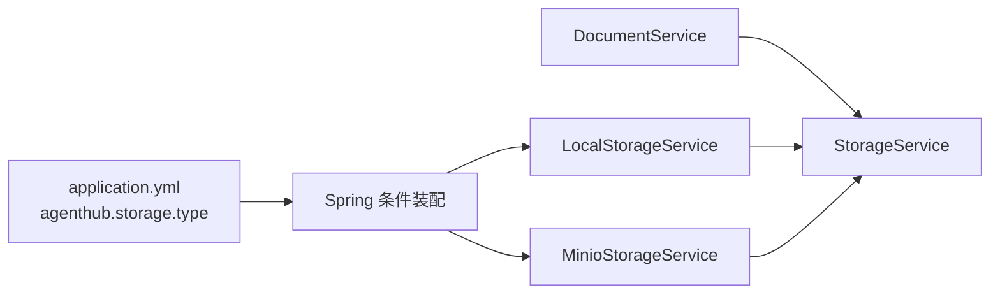
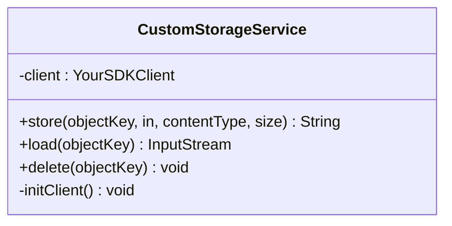
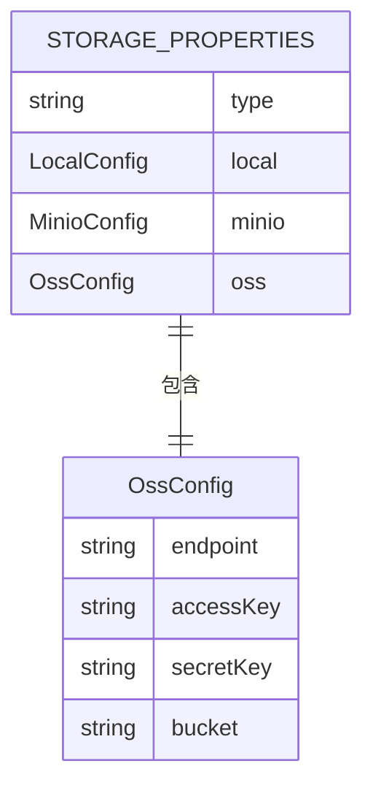

# 存储后端扩展

<cite>
**本文引用的文件**   
- [StorageService.java](file://src/main/java/com/agenthub/knowledge/storage/StorageService.java)
- [LocalStorageService.java](file://src/main/java/com/agenthub/knowledge/storage/LocalStorageService.java)
- [MinioStorageService.java](file://src/main/java/com/agenthub/knowledge/storage/MinioStorageService.java)
- [StorageProperties.java](file://src/main/java/com/agenthub/knowledge/storage/StorageProperties.java)
- [DocumentService.java](file://src/main/java/com/agenthub/knowledge/service/DocumentService.java)
- [application.yml](file://src/main/resources/application.yml)
</cite>

## 目录
1. [引言](#引言)
2. [项目结构](#项目结构)
3. [核心组件](#核心组件)
4. [架构总览](#架构总览)
5. [详细组件分析](#详细组件分析)
6. [依赖关系分析](#依赖关系分析)
7. [性能与可扩展性](#性能与可扩展性)
8. [安全与一致性](#安全与一致性)
9. [自定义存储后端开发指南](#自定义存储后端开发指南)
10. [故障排查](#故障排查)
11. [结论](#结论)

## 引言
本文件面向需要在现有知识文档系统中扩展新的存储后端的开发者。重点说明 StorageService 接口的设计模式与抽象层次，解释如何基于该接口实现文件上传、下载、删除等能力；分析现有 LocalStorageService 与 MinioStorageService 的技术特点与适用场景；提供连接管理、分块上传、断点续传、并发控制等高级能力的扩展建议；并说明与 StorageProperties 的配置集成和动态切换机制，以及存储性能优化、安全考虑和数据一致性保证的最佳实践。

## 项目结构
存储相关代码集中在 knowledge.storage 包中，采用“接口 + 多实现”的插件式结构：
- 接口层：StorageService 定义统一的文件存取契约。
- 实现层：LocalStorageService（本地磁盘）、MinioStorageService（对象存储）通过 Spring 条件装配按需启用。
- 配置层：StorageProperties 统一承载 local/minio 两类配置项。
- 使用层：DocumentService 在文档上传流程中调用 StorageService.store 完成原始文件落盘。

**图表来源**
- [StorageService.java:5-18](file://src/main/java/com/agenthub/knowledge/storage/StorageService.java#L5-L18)
- [LocalStorageService.java:13-65](file://src/main/java/com/agenthub/knowledge/storage/LocalStorageService.java#L13-L65)
- [MinioStorageService.java:14-82](file://src/main/java/com/agenthub/knowledge/storage/MinioStorageService.java#L14-L82)
- [StorageProperties.java:9-32](file://src/main/java/com/agenthub/knowledge/storage/StorageProperties.java#L9-L32)
- [DocumentService.java:41-76](file://src/main/java/com/agenthub/knowledge/service/DocumentService.java#L41-L76)

**章节来源**
- [StorageService.java:5-18](file://src/main/java/com/agenthub/knowledge/storage/StorageService.java#L5-L18)
- [LocalStorageService.java:13-65](file://src/main/java/com/agenthub/knowledge/storage/LocalStorageService.java#L13-L65)
- [MinioStorageService.java:14-82](file://src/main/java/com/agenthub/knowledge/storage/MinioStorageService.java#L14-L82)
- [StorageProperties.java:9-32](file://src/main/java/com/agenthub/knowledge/storage/StorageProperties.java#L9-L32)
- [DocumentService.java:41-76](file://src/main/java/com/agenthub/knowledge/service/DocumentService.java#L41-L76)

## 核心组件
- StorageService：定义最小可用 API，包括 store、load、delete。返回值为可再次读取的存储路径（objectKey），便于上层持久化与后续访问。
- LocalStorageService：基于 NIO Path 的文件系统操作，具备基础的安全校验（路径穿越防护）。
- MinioStorageService：基于 MinIO SDK 的对象存储客户端封装，自动确保 bucket 存在。
- StorageProperties：集中管理 storage.type、local.baseDir、minio.endpoint/accessKey/secretKey/bucket。
- DocumentService：在文档上传流程中调用 StorageService.store，将原始文件以 tenantId/kbId/docId.ext 形式落盘，随后异步解析与向量化。

**章节来源**
- [StorageService.java:5-18](file://src/main/java/com/agenthub/knowledge/storage/StorageService.java#L5-L18)
- [LocalStorageService.java:13-65](file://src/main/java/com/agenthub/knowledge/storage/LocalStorageService.java#L13-L65)
- [MinioStorageService.java:14-82](file://src/main/java/com/agenthub/knowledge/storage/MinioStorageService.java#L14-L82)
- [StorageProperties.java:9-32](file://src/main/java/com/agenthub/knowledge/storage/StorageProperties.java#L9-L32)
- [DocumentService.java:41-76](file://src/main/java/com/agenthub/knowledge/service/DocumentService.java#L41-L76)

## 架构总览
下图展示从 HTTP 请求到存储后端的完整调用链，突出 StorageService 的解耦作用。

**图表来源**
- [DocumentService.java:41-76](file://src/main/java/com/agenthub/knowledge/service/DocumentService.java#L41-L76)
- [StorageService.java:5-18](file://src/main/java/com/agenthub/knowledge/storage/StorageService.java#L5-L18)

## 详细组件分析

### StorageService 接口设计
- 职责边界：仅暴露最基础的“写-读-删”三件套，避免绑定具体存储协议细节。
- 参数语义：
  - objectKey：逻辑键名，由上层按租户/知识库维度组织，天然隔离。
  - InputStream：流式写入，减少内存占用。
  - contentType/size：用于设置内容类型与长度，利于下游处理与网络传输。
- 返回值：返回 objectKey，供上层持久化与后续读取。

**图表来源**
- [StorageService.java:5-18](file://src/main/java/com/agenthub/knowledge/storage/StorageService.java#L5-L18)

**章节来源**
- [StorageService.java:5-18](file://src/main/java/com/agenthub/knowledge/storage/StorageService.java#L5-L18)

### LocalStorageService 本地实现
- 技术要点：
  - 基于 java.nio.file.Path 进行文件系统操作。
  - 构造时根据 StorageProperties.local.baseDir 初始化根目录，并尝试创建目录。
  - store 前进行路径穿越防护，拒绝 baseDir 之外的目标路径。
  - load 直接返回文件输入流；delete 使用 deleteIfExists 忽略不存在错误。
- 适用场景：开发环境、单机部署、快速验证。
- 限制：不具备分布式共享、高可用与水平扩展能力。

**图表来源**
- [LocalStorageService.java:32-46](file://src/main/java/com/agenthub/knowledge/storage/LocalStorageService.java#L32-L46)

**章节来源**
- [LocalStorageService.java:13-65](file://src/main/java/com/agenthub/knowledge/storage/LocalStorageService.java#L13-L65)

### MinioStorageService 对象存储实现
- 技术要点：
  - 基于 MinIO SDK 构建 MinioClient，使用 endpoint/accessKey/secretKey 初始化。
  - 启动时 ensureBucket 检查并自动创建 bucket。
  - store 使用 PutObjectArgs 流式上传；load 使用 GetObjectArgs 返回流；delete 使用 RemoveObjectArgs。
- 适用场景：生产环境、多实例共享、横向扩展、高可靠存储。
- 优势：支持大文件、高吞吐、跨节点共享、易于备份与迁移。

**图表来源**
- [MinioStorageService.java:14-82](file://src/main/java/com/agenthub/knowledge/storage/MinioStorageService.java#L14-L82)

**章节来源**
- [MinioStorageService.java:14-82](file://src/main/java/com/agenthub/knowledge/storage/MinioStorageService.java#L14-L82)

### StorageProperties 配置模型
- 字段说明：
  - type：选择 local 或 minio。
  - local.baseDir：本地存储根目录。
  - minio.endpoint/accessKey/secretKey/bucket：MinIO 连接与桶信息。
- 默认值：type 默认为 local，便于开箱即用。

**图表来源**
- [StorageProperties.java:9-32](file://src/main/java/com/agenthub/knowledge/storage/StorageProperties.java#L9-L32)

**章节来源**
- [StorageProperties.java:9-32](file://src/main/java/com/agenthub/knowledge/storage/StorageProperties.java#L9-L32)

### DocumentService 中的存储使用
- 上传流程：
  - 校验文件类型。
  - 生成 objectKey（tenantId/kbId/docId.ext）。
  - 调用 StorageService.store 写入原始文件。
  - 插入文档记录（状态 UPLOADED）。
  - 提交异步解析任务。
- 列表/详情/重试/状态更新：围绕数据库状态机流转，不直接涉及存储实现。

**图表来源**
- [DocumentService.java:41-76](file://src/main/java/com/agenthub/knowledge/service/DocumentService.java#L41-L76)

**章节来源**
- [DocumentService.java:41-76](file://src/main/java/com/agenthub/knowledge/service/DocumentService.java#L41-L76)

## 依赖关系分析
- 耦合关系：
  - DocumentService 仅依赖 StorageService 接口，对具体实现无感知。
  - LocalStorageService 与 MinioStorageService 均依赖 StorageProperties 获取运行时配置。
- 装配方式：
  - 通过 @ConditionalOnProperty 根据 agenthub.storage.type 选择实现类。
  - application.yml 中 agenthub.storage.type 决定实际生效的实现。

**图表来源**
- [application.yml:77-86](file://src/main/resources/application.yml#L77-L86)
- [LocalStorageService.java:16-19](file://src/main/java/com/agenthub/knowledge/storage/LocalStorageService.java#L16-L19)
- [MinioStorageService.java:17-20](file://src/main/java/com/agenthub/knowledge/storage/MinioStorageService.java#L17-L20)
- [DocumentService.java:36-39](file://src/main/java/com/agenthub/knowledge/service/DocumentService.java#L36-L39)

**章节来源**
- [application.yml:77-86](file://src/main/resources/application.yml#L77-L86)
- [LocalStorageService.java:16-19](file://src/main/java/com/agenthub/knowledge/storage/LocalStorageService.java#L16-L19)
- [MinioStorageService.java:17-20](file://src/main/java/com/agenthub/knowledge/storage/MinioStorageService.java#L17-L20)
- [DocumentService.java:36-39](file://src/main/java/com/agenthub/knowledge/service/DocumentService.java#L36-L39)

## 性能与可扩展性
- 当前实现特征：
  - LocalStorageService：顺序写入本地磁盘，简单高效但受限于单机 IO。
  - MinioStorageService：基于 SDK 的流式上传，适合大文件与高吞吐场景。
- 可扩展方向：
  - 分块上传：针对超大文件，实现分片上传与合并，提升稳定性与吞吐。
  - 断点续传：记录已上传分片，失败后可恢复。
  - 并发控制：为不同租户/知识库设置并发上限，避免资源争用。
  - 缓存策略：热点文件可引入本地缓存或 CDN 加速读取。
  - 指标与追踪：埋点统计上传耗时、成功率、吞吐等关键指标。

[本节为通用指导，不涉及具体文件]

## 安全与一致性
- 安全：
  - LocalStorageService 已做路径穿越防护，拒绝 baseDir 之外的写入。
  - 建议对所有 objectKey 进行白名单校验（字符集、长度、层级深度）。
  - 敏感配置（accessKey/secretKey）应通过环境变量注入，避免硬编码。
- 一致性：
  - 当前 upload 先写存储再落库，若存储成功而落库失败，需补偿机制（如定时清理孤儿文件）。
  - 建议在事务边界外执行存储操作，避免长事务；通过消息队列或补偿任务保障最终一致性。
  - 删除操作幂等：delete 应容忍重复删除。

**章节来源**
- [LocalStorageService.java:32-46](file://src/main/java/com/agenthub/knowledge/storage/LocalStorageService.java#L32-L46)
- [DocumentService.java:41-76](file://src/main/java/com/agenthub/knowledge/service/DocumentService.java#L41-L76)

## 自定义存储后端开发指南
以下指南帮助你在不改动业务代码的前提下，新增一种存储后端（例如云厂商 OSS/S3 兼容服务）。

### 1. 定义实现类
- 新建类实现 StorageService 接口，遵循 store/load/delete 语义。
- 使用 @Service 标注，并通过 @ConditionalOnProperty 指定激活条件（例如 agenthub.storage.type=oss）。
- 在构造方法中初始化客户端连接（如 SDK Client），必要时在启动时校验连通性或预创建命名空间。

**图表来源**
- [StorageService.java:5-18](file://src/main/java/com/agenthub/knowledge/storage/StorageService.java#L5-L18)

### 2. 接入配置
- 在 StorageProperties 中添加对应子配置类（例如 OssConfig），并在主类中声明属性。
- 在 application.yml 中增加 oss.endpoint/accessKey/secretKey/bucket 等配置项。
- 保持 type 枚举中包含新实现标识（例如 oss）。

**图表来源**
- [StorageProperties.java:9-32](file://src/main/java/com/agenthub/knowledge/storage/StorageProperties.java#L9-L32)

### 3. 动态切换机制
- 通过修改 agenthub.storage.type 的值，Spring 会按条件装配对应的实现类。
- 重启应用即可切换到新后端，无需改动业务代码。

**章节来源**
- [application.yml:77-86](file://src/main/resources/application.yml#L77-L86)
- [LocalStorageService.java:16-19](file://src/main/java/com/agenthub/knowledge/storage/LocalStorageService.java#L16-L19)
- [MinioStorageService.java:17-20](file://src/main/java/com/agenthub/knowledge/storage/MinioStorageService.java#L17-L20)

### 4. 连接管理
- 客户端单例：将 SDK Client 作为类成员变量复用，避免频繁创建销毁。
- 超时与重试：合理设置连接超时、读写超时，并结合 SDK 的重试策略。
- 健康检查：启动时探测连接可用性，失败则快速失败并给出明确错误信息。

### 5. 分块上传与断点续传
- 分块上传：
  - 将大文件切分为固定大小的分片，逐个上传。
  - 记录每个分片的 etag 或分片号，以便合并。
- 断点续传：
  - 维护分片元数据（如数据库或对象标签），失败后从上次位置继续。
  - 合并完成后清理临时分片。
- 并发控制：
  - 使用线程池限制并发数，避免打满带宽或触发服务端限流。
  - 针对不同租户/知识库设置独立配额与优先级。

### 6. 并发与吞吐优化
- 流式处理：始终使用 InputStream 流式读写，避免一次性加载到大内存。
- 批量操作：对于列表/删除等场景，优先使用 SDK 提供的批量接口。
- 压缩与缓存：对文本类文件可考虑压缩传输；热点文件可加本地缓存。

### 7. 错误处理与日志
- 区分可重试与不可重试异常，记录关键上下文（objectKey、租户、知识库）。
- 删除操作容错：删除失败仅记录警告，不影响主流程。
- 监控告警：对失败率、延迟、吞吐等指标设置阈值告警。

### 8. 测试与验收
- 单元测试：覆盖 store/load/delete 正常与异常分支。
- 集成测试：对接真实或 Mock 的后端服务，验证端到端流程。
- 压测：模拟大文件与高并发场景，评估吞吐与稳定性。

[本节为通用指导，不涉及具体文件]

## 故障排查
- 无法创建本地目录：
  - 现象：启动时报无法创建本地存储目录。
  - 排查：检查 baseDir 权限与磁盘空间。
- 本地文件写入失败：
  - 现象：store 抛异常。
  - 排查：确认 objectKey 合法且未越权；检查磁盘 IO 与权限。
- MinIO 连接失败：
  - 现象：ensureBucket 或上传失败。
  - 排查：核对 endpoint/accessKey/secretKey/bucket；检查网络连通性与防火墙。
- 删除失败：
  - 现象：delete 记录警告日志。
  - 排查：确认 objectKey 正确；对象是否存在；权限是否足够。

**章节来源**
- [LocalStorageService.java:23-45](file://src/main/java/com/agenthub/knowledge/storage/LocalStorageService.java#L23-L45)
- [MinioStorageService.java:25-44](file://src/main/java/com/agenthub/knowledge/storage/MinioStorageService.java#L25-L44)
- [MinioStorageService.java:74-81](file://src/main/java/com/agenthub/knowledge/storage/MinioStorageService.java#L74-L81)

## 结论
StorageService 以极简接口屏蔽了底层存储差异，使业务层（如 DocumentService）无需关心具体实现。LocalStorageService 与 MinioStorageService 分别满足开发与生产环境的典型需求。通过 StorageProperties 与条件装配，系统实现了灵活的动态切换。在此基础上，可按本文指南扩展更多存储后端，并逐步完善分块上传、断点续传、并发控制、安全加固与一致性保障，以满足更高性能与可靠性要求。