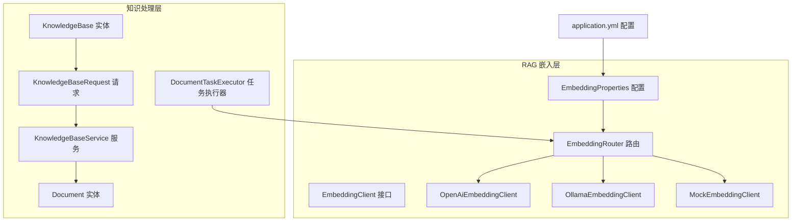
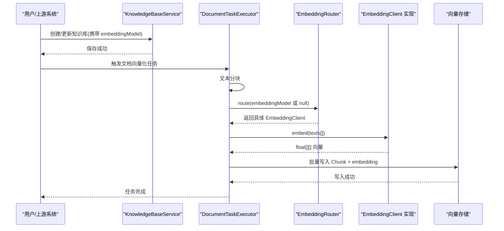
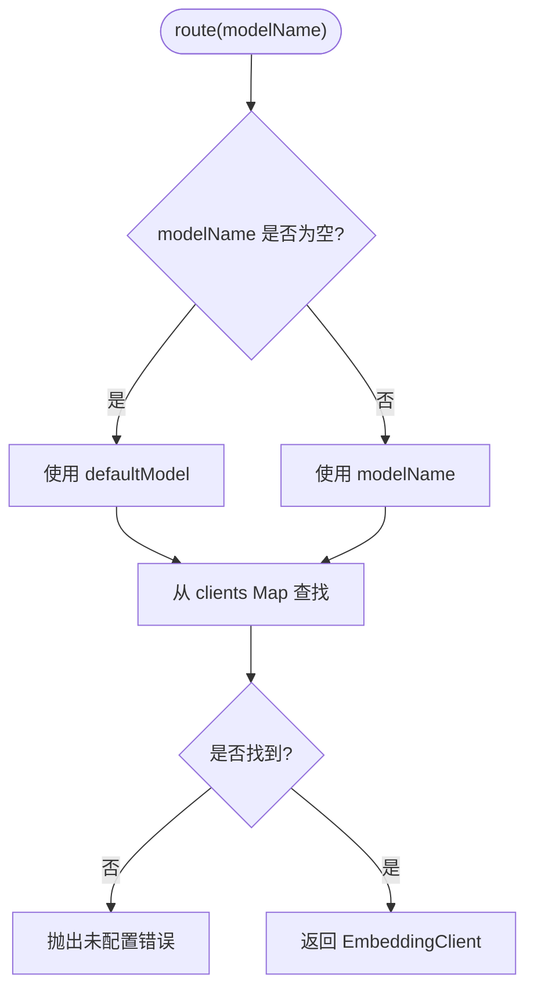
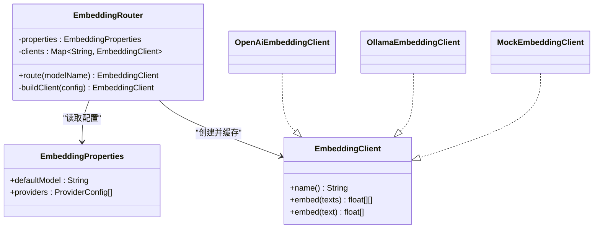

# 嵌入模型扩展

<cite>
**本文引用的文件**   
- [EmbeddingClient.java](file://src/main/java/com/agenthub/rag/embedding/EmbeddingClient.java)
- [EmbeddingRouter.java](file://src/main/java/com/agenthub/rag/embedding/EmbeddingRouter.java)
- [EmbeddingProperties.java](file://src/main/java/com/agenthub/rag/embedding/EmbeddingProperties.java)
- [OpenAiEmbeddingClient.java](file://src/main/java/com/agenthub/rag/embedding/OpenAiEmbeddingClient.java)
- [OllamaEmbeddingClient.java](file://src/main/java/com/agenthub/rag/embedding/OllamaEmbeddingClient.java)
- [MockEmbeddingClient.java](file://src/main/java/com/agenthub/rag/embedding/MockEmbeddingClient.java)
- [application.yml](file://src/main/resources/application.yml)
- [DocumentTaskExecutor.java](file://src/main/java/com/agenthub/task/executor/DocumentTaskExecutor.java)
- [KnowledgeBaseService.java](file://src/main/java/com/agenthub/knowledge/service/KnowledgeBaseService.java)
- [KnowledgeBaseRequest.java](file://src/main/java/com/agenthub/knowledge/dto/KnowledgeBaseRequest.java)
- [KnowledgeBase.java](file://src/main/java/com/agenthub/knowledge/entity/KnowledgeBase.java)
- [Document.java](file://src/main/java/com/agenthub/knowledge/entity/Document.java)
</cite>

## 目录
1. [引言](#引言)
2. [项目结构](#项目结构)
3. [核心组件](#核心组件)
4. [架构总览](#架构总览)
5. [详细组件分析](#详细组件分析)
6. [依赖关系分析](#依赖关系分析)
7. [性能与成本优化](#性能与成本优化)
8. [向量质量评估](#向量质量评估)
9. [故障排查指南](#故障排查指南)
10. [结论](#结论)
11. [附录：自定义嵌入模型开发示例](#附录自定义嵌入模型开发示例)

## 引言
本文面向需要扩展嵌入模型的开发者，系统说明 EmbeddingClient 接口的设计理念、向量生成机制、现有实现差异、路由与配置管理，以及如何扩展新的嵌入模型提供商。文档同时给出向量质量评估、性能调优与成本控制的最佳实践，并提供完整的自定义嵌入模型开发示例路径，帮助读者在生产环境中安全、稳定地接入新模型。

## 项目结构
嵌入相关代码集中在 RAG 模块的 embedding 子包中，配合任务执行器完成文档解析后的向量化入库流程；知识库实体与请求对象负责承载“按知识库维度选择不同嵌入模型”的能力。

图表来源
- [EmbeddingClient.java:1-20](file://src/main/java/com/agenthub/rag/embedding/EmbeddingClient.java#L1-L20)
- [EmbeddingRouter.java:1-46](file://src/main/java/com/agenthub/rag/embedding/EmbeddingRouter.java#L1-L46)
- [EmbeddingProperties.java:1-33](file://src/main/java/com/agenthub/rag/embedding/EmbeddingProperties.java#L1-L33)
- [OpenAiEmbeddingClient.java:1-79](file://src/main/java/com/agenthub/rag/embedding/OpenAiEmbeddingClient.java#L1-L79)
- [OllamaEmbeddingClient.java:1-74](file://src/main/java/com/agenthub/rag/embedding/OllamaEmbeddingClient.java#L1-L74)
- [MockEmbeddingClient.java:1-83](file://src/main/java/com/agenthub/rag/embedding/MockEmbeddingClient.java#L1-L83)
- [application.yml:126-141](file://src/main/resources/application.yml#L126-L141)
- [KnowledgeBase.java:1-43](file://src/main/java/com/agenthub/knowledge/entity/KnowledgeBase.java#L1-L43)
- [KnowledgeBaseRequest.java:1-25](file://src/main/java/com/agenthub/knowledge/dto/KnowledgeBaseRequest.java#L1-L25)
- [KnowledgeBaseService.java:25-38](file://src/main/java/com/agenthub/knowledge/service/KnowledgeBaseService.java#L25-L38)
- [Document.java:1-53](file://src/main/java/com/agenthub/knowledge/entity/Document.java#L1-L53)
- [DocumentTaskExecutor.java:83-122](file://src/main/java/com/agenthub/task/executor/DocumentTaskExecutor.java#L83-L122)

章节来源
- [EmbeddingClient.java:1-20](file://src/main/java/com/agenthub/rag/embedding/EmbeddingClient.java#L1-L20)
- [EmbeddingRouter.java:1-46](file://src/main/java/com/agenthub/rag/embedding/EmbeddingRouter.java#L1-L46)
- [EmbeddingProperties.java:1-33](file://src/main/java/com/agenthub/rag/embedding/EmbeddingProperties.java#L1-L33)
- [application.yml:126-141](file://src/main/resources/application.yml#L126-L141)
- [DocumentTaskExecutor.java:83-122](file://src/main/java/com/agenthub/task/executor/DocumentTaskExecutor.java#L83-L122)

## 核心组件
- EmbeddingClient：定义统一的嵌入能力抽象，包括 name() 标识、embed(List<String>) 批量向量化，以及默认的单条 embed(String) 实现。
- EmbeddingRouter：根据配置构建并缓存多个 EmbeddingClient 实例，提供按路由键（知识库 embeddingModel）选择客户端的能力。
- EmbeddingProperties：加载 agenthub.embedding 下的多 provider 配置，包含 defaultModel 与 providers 列表。
- OpenAiEmbeddingClient：调用 OpenAI 兼容 /v1/embeddings 接口，支持批量输入。
- OllamaEmbeddingClient：调用 Ollama /api/embed 接口，当前为逐条调用封装成批量返回。
- MockEmbeddingClient：基于内容哈希生成确定性向量，内置 L2 归一化，用于无外部服务时的全链路验证。

章节来源
- [EmbeddingClient.java:1-20](file://src/main/java/com/agenthub/rag/embedding/EmbeddingClient.java#L1-L20)
- [EmbeddingRouter.java:1-46](file://src/main/java/com/agenthub/rag/embedding/EmbeddingRouter.java#L1-L46)
- [EmbeddingProperties.java:1-33](file://src/main/java/com/agenthub/rag/embedding/EmbeddingProperties.java#L1-L33)
- [OpenAiEmbeddingClient.java:1-79](file://src/main/java/com/agenthub/rag/embedding/OpenAiEmbeddingClient.java#L1-L79)
- [OllamaEmbeddingClient.java:1-74](file://src/main/java/com/agenthub/rag/embedding/OllamaEmbeddingClient.java#L1-L74)
- [MockEmbeddingClient.java:1-83](file://src/main/java/com/agenthub/rag/embedding/MockEmbeddingClient.java#L1-L83)

## 架构总览
嵌入模型在系统中的使用贯穿“文档上传→解析→分块→向量化→入库→检索”的流水线。知识库可指定 embeddingModel 路由键，从而在不同知识库间隔离不同的嵌入模型。

图表来源
- [KnowledgeBaseService.java:25-38](file://src/main/java/com/agenthub/knowledge/service/KnowledgeBaseService.java#L25-L38)
- [DocumentTaskExecutor.java:83-122](file://src/main/java/com/agenthub/task/executor/DocumentTaskExecutor.java#L83-L122)
- [EmbeddingRouter.java:20-44](file://src/main/java/com/agenthub/rag/embedding/EmbeddingRouter.java#L20-L44)

## 详细组件分析

### EmbeddingClient 接口设计
- 设计理念
  - 统一抽象：屏蔽不同后端（OpenAI 兼容、Ollama、Mock）的差异，上层仅依赖接口。
  - 批量优先：以 List<float[]> 作为主要能力，单条方法通过默认实现委托批量。
  - 路由友好：name() 作为 provider 标识，便于路由与监控统计。
- 复杂度
  - 接口本身无计算开销，实际复杂度由实现决定。

章节来源
- [EmbeddingClient.java:1-20](file://src/main/java/com/agenthub/rag/embedding/EmbeddingClient.java#L1-L20)

### EmbeddingRouter 路由机制
- 功能要点
  - 启动时根据 EmbeddingProperties.providers 构建客户端 Map，key 为 client.name()。
  - route(modelName) 若为空则回退到 properties.defaultModel。
  - 未匹配时抛出业务异常，避免静默失败。
- 扩展点
  - 新增 provider 类型需在 buildClient 分支中添加构造逻辑。
  - 可通过扩展 ProviderConfig 增加更多字段（如 timeout、retry、dimension）。

图表来源
- [EmbeddingRouter.java:20-44](file://src/main/java/com/agenthub/rag/embedding/EmbeddingRouter.java#L20-L44)

章节来源
- [EmbeddingRouter.java:1-46](file://src/main/java/com/agenthub/rag/embedding/EmbeddingRouter.java#L1-L46)

### EmbeddingProperties 配置管理
- 配置项
  - defaultModel：全局默认路由键。
  - providers[]：每个 provider 包含 name、type、baseUrl、apiKey、model。
- 与知识库的关系
  - 知识库实体 KnowledgeBase.embeddingModel 指向 providers[].name，实现按库隔离。
- 配置文件
  - application.yml 中 agenthub.embedding.providers 定义了 ollama-embed、openai-embed、mock 三个示例。

章节来源
- [EmbeddingProperties.java:1-33](file://src/main/java/com/agenthub/rag/embedding/EmbeddingProperties.java#L1-L33)
- [application.yml:126-141](file://src/main/resources/application.yml#L126-L141)
- [KnowledgeBase.java:25-27](file://src/main/java/com/agenthub/knowledge/entity/KnowledgeBase.java#L25-L27)

### OpenAiEmbeddingClient 实现
- 技术要点
  - 使用 WebClient 调用 {baseUrl}/v1/embeddings，自动携带 Authorization Bearer。
  - 支持批量 input，响应 data[i].embedding 解析为 float[]。
  - 对非法响应结构进行校验并抛出业务异常。
- 适用场景
  - OpenAI、vLLM、OneAPI 等任何 OpenAI 兼容接口。

章节来源
- [OpenAiEmbeddingClient.java:1-79](file://src/main/java/com/agenthub/rag/embedding/OpenAiEmbeddingClient.java#L1-L79)

### OllamaEmbeddingClient 实现
- 技术要点
  - 调用 {baseUrl}/api/embed，当前实现为逐条调用后聚合为批量结果。
  - 响应结构 embeddings[0] 为向量数组，需做非空校验。
- 性能注意
  - 逐条调用存在额外网络往返，建议在后续版本支持批量接口（若服务端支持）。

章节来源
- [OllamaEmbeddingClient.java:1-74](file://src/main/java/com/agenthub/rag/embedding/OllamaEmbeddingClient.java#L1-L74)

### MockEmbeddingClient 实现
- 技术要点
  - 基于内容哈希映射到固定维度向量，保证同文本同向量。
  - 内置简单分词（中文逐字、英文按空格/标点），并进行 L2 归一化。
  - 适合无外部服务的全链路验证。
- 局限性
  - 语义表达能力弱于真实模型，仅用于演示和回归测试。

章节来源
- [MockEmbeddingClient.java:1-83](file://src/main/java/com/agenthub/rag/embedding/MockEmbeddingClient.java#L1-L83)

### 与任务流水线的集成
- 文档向量化任务
  - DocumentTaskExecutor.doEmbed 将解析后的文本分块，调用 embeddingRouter.route(null).embed(texts)，再将向量与元数据一起批量写入向量存储。
- 知识库维度控制
  - KnowledgeBaseService.create 保存 embeddingModel，供后续检索或重新向量化时使用。

章节来源
- [DocumentTaskExecutor.java:83-122](file://src/main/java/com/agenthub/task/executor/DocumentTaskExecutor.java#L83-L122)
- [KnowledgeBaseService.java:25-38](file://src/main/java/com/agenthub/knowledge/service/KnowledgeBaseService.java#L25-L38)

## 依赖关系分析
- 耦合关系
  - EmbeddingRouter 强依赖 EmbeddingProperties 与具体 EmbeddingClient 实现。
  - OpenAiEmbeddingClient 与 OllamaEmbeddingClient 依赖 WebClient 与 JsonUtils。
  - 任务执行器依赖 EmbeddingRouter 获取客户端，不感知具体实现。
- 潜在风险
  - 新增 provider 类型需同步修改路由构建逻辑，否则启动期即报错。
  - 各实现对外部服务的响应格式假设较强，需保持契约一致。

图表来源
- [EmbeddingClient.java:1-20](file://src/main/java/com/agenthub/rag/embedding/EmbeddingClient.java#L1-L20)
- [EmbeddingRouter.java:1-46](file://src/main/java/com/agenthub/rag/embedding/EmbeddingRouter.java#L1-L46)
- [EmbeddingProperties.java:1-33](file://src/main/java/com/agenthub/rag/embedding/EmbeddingProperties.java#L1-L33)
- [OpenAiEmbeddingClient.java:1-79](file://src/main/java/com/agenthub/rag/embedding/OpenAiEmbeddingClient.java#L1-L79)
- [OllamaEmbeddingClient.java:1-74](file://src/main/java/com/agenthub/rag/embedding/OllamaEmbeddingClient.java#L1-L74)
- [MockEmbeddingClient.java:1-83](file://src/main/java/com/agenthub/rag/embedding/MockEmbeddingClient.java#L1-L83)

## 性能与成本优化
- 批量优先
  - 优先使用 OpenAiEmbeddingClient 的批量接口，减少网络往返与序列化开销。
  - 对 OllamaEmbeddingClient 可在服务端支持批量时升级为批量调用。
- 连接复用与超时
  - 复用 WebClient 实例，合理设置连接池、超时与重试策略。
- 分块策略
  - 调整 chunkSize 与 chunkOverlap，平衡召回率与向量数量，降低存储与计算成本。
- 维度与存储
  - 确保 embedding 输出维度与 PgVector 建表维度一致，避免索引重建与查询退化。
- 成本分摊
  - 按知识库绑定不同 provider，低成本模型用于冷数据或预筛，高质量模型用于关键库。

章节来源
- [application.yml:64-76](file://src/main/resources/application.yml#L64-L76)
- [DocumentTaskExecutor.java:83-122](file://src/main/java/com/agenthub/task/executor/DocumentTaskExecutor.java#L83-L122)

## 向量质量评估
- 离线评估
  - 使用领域问答对或相似句对，计算余弦相似度分布，观察阈值效果。
  - 对比不同模型在 TopK 召回率、平均精度（MAP）、NDCG 等指标上的表现。
- 在线评估
  - 结合检索日志，统计点击率、转化率与人工标注准确率。
- 回归测试
  - 使用 MockEmbeddingClient 保障全链路回归，再切换真实模型进行 A/B 测试。

[本节为通用方法论，不直接分析具体文件]

## 故障排查指南
- 常见错误
  - 未配置的 Embedding 模型：检查 routing key 是否在 providers 中存在。
  - 响应格式异常：确认后端返回结构与实现解析逻辑一致。
  - 鉴权失败：检查 apiKey 与 baseUrl 是否正确。
- 定位建议
  - 查看任务执行日志中的“文档向量化失败”堆栈。
  - 核对 application.yml 中 embedding 配置与知识库 embeddingModel 的一致性。
  - 使用 MockEmbeddingClient 快速判断问题是否出在外部服务。

章节来源
- [EmbeddingRouter.java:27-34](file://src/main/java/com/agenthub/rag/embedding/EmbeddingRouter.java#L27-L34)
- [OpenAiEmbeddingClient.java:40-54](file://src/main/java/com/agenthub/rag/embedding/OpenAiEmbeddingClient.java#L40-L54)
- [OllamaEmbeddingClient.java:44-71](file://src/main/java/com/agenthub/rag/embedding/OllamaEmbeddingClient.java#L44-L71)
- [DocumentTaskExecutor.java:117-120](file://src/main/java/com/agenthub/task/executor/DocumentTaskExecutor.java#L117-L120)

## 结论
EmbeddingClient 提供了简洁而可扩展的嵌入抽象，配合 EmbeddingRouter 与 EmbeddingProperties 实现了灵活的多 provider 路由与配置管理。现有实现覆盖了主流 OpenAI 兼容接口与本地 Ollama，并通过 Mock 实现支撑无外部服务的全链路验证。生产环境建议优先使用批量接口、合理分块与按知识库隔离模型，并结合离线与在线评估持续优化向量质量与成本。

[本节为总结性内容，不直接分析具体文件]

## 附录：自定义嵌入模型开发示例
以下提供一个从零开始扩展新嵌入模型提供商的步骤与参考路径，涵盖 API 调用、向量规范化、错误重试等核心能力。

- 步骤概览
  1. 新建实现类，例如 MyCustomEmbeddingClient，实现 EmbeddingClient 接口。
  2. 在构造函数中初始化 WebClient 或 HTTP 客户端，设置 baseUrl、鉴权头、超时等。
  3. 实现 embed(List<String>)，优先走批量接口；若无批量接口，内部循环调用单条接口。
  4. 解析响应为 float[]，必要时进行 L2 归一化，确保与向量库度量一致。
  5. 添加错误处理与重试逻辑，区分可重试错误（如限流、临时网络错误）与不可重试错误（如参数错误、鉴权失败）。
  6. 在 EmbeddingRouter.buildClient 中新增分支，根据 type 构造你的实现。
  7. 在 application.yml 的 agenthub.embedding.providers 中添加新 provider 配置。
  8. 在知识库中设置 embeddingModel 为新路由键，验证端到端流程。

- 关键实现要点
  - API 调用：参考 OpenAiEmbeddingClient 的 WebClient 用法与请求体构造。
  - 向量规范化：参考 MockEmbeddingClient 的 L2 归一化逻辑，确保余弦相似度一致性。
  - 错误重试：建议使用带退避的重试策略，捕获特定异常码或状态码进行重试。
  - 维度配置：确保输出维度与 PgVector 建表 dimension 一致，必要时在 ProviderConfig 中暴露 dimension 字段。

- 参考路径
  - 接口定义：[EmbeddingClient.java:1-20](file://src/main/java/com/agenthub/rag/embedding/EmbeddingClient.java#L1-L20)
  - 路由扩展点：[EmbeddingRouter.java:37-44](file://src/main/java/com/agenthub/rag/embedding/EmbeddingRouter.java#L37-L44)
  - 配置结构：[EmbeddingProperties.java:21-31](file://src/main/java/com/agenthub/rag/embedding/EmbeddingProperties.java#L21-L31)
  - OpenAI 兼容调用示例：[OpenAiEmbeddingClient.java:25-54](file://src/main/java/com/agenthub/rag/embedding/OpenAiEmbeddingClient.java#L25-L54)
  - 向量归一化示例：[MockEmbeddingClient.java:39-58](file://src/main/java/com/agenthub/rag/embedding/MockEmbeddingClient.java#L39-L58)
  - 应用配置示例：[application.yml:126-141](file://src/main/resources/application.yml#L126-L141)

章节来源
- [EmbeddingClient.java:1-20](file://src/main/java/com/agenthub/rag/embedding/EmbeddingClient.java#L1-L20)
- [EmbeddingRouter.java:37-44](file://src/main/java/com/agenthub/rag/embedding/EmbeddingRouter.java#L37-L44)
- [EmbeddingProperties.java:21-31](file://src/main/java/com/agenthub/rag/embedding/EmbeddingProperties.java#L21-L31)
- [OpenAiEmbeddingClient.java:25-54](file://src/main/java/com/agenthub/rag/embedding/OpenAiEmbeddingClient.java#L25-L54)
- [MockEmbeddingClient.java:39-58](file://src/main/java/com/agenthub/rag/embedding/MockEmbeddingClient.java#L39-L58)
- [application.yml:126-141](file://src/main/resources/application.yml#L126-L141)