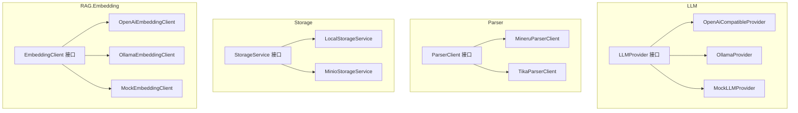
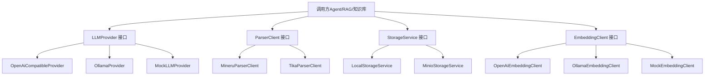
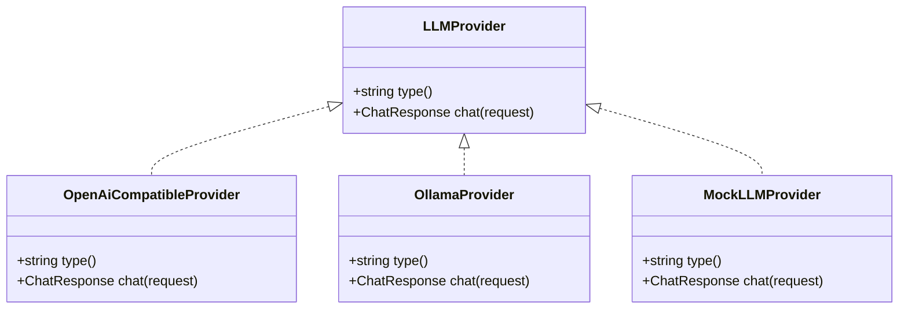
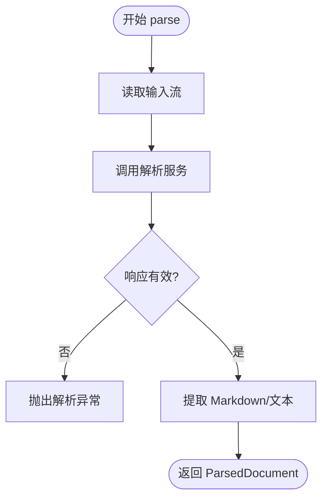
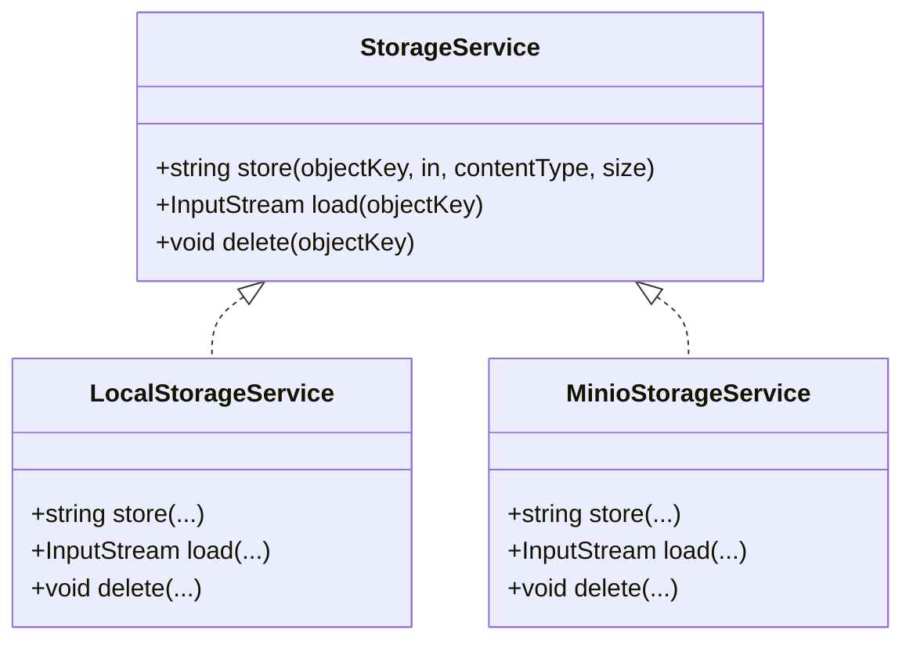
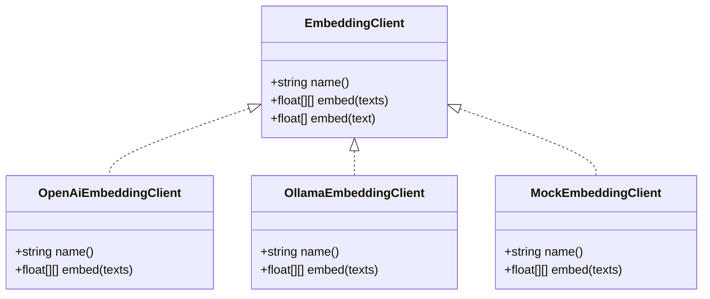
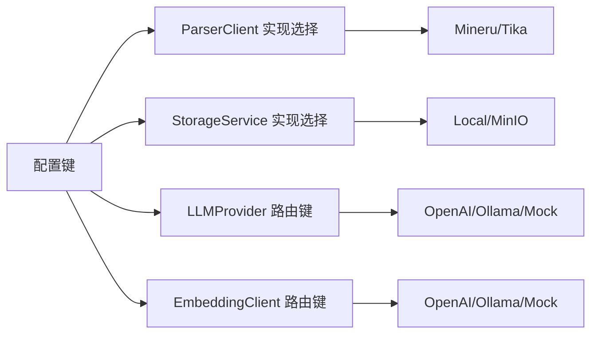

# 扩展点设计

<cite>
**本文引用的文件**   
- [LLMProvider.java](file://src/main/java/com/agenthub/llm/provider/LLMProvider.java)
- [OpenAiCompatibleProvider.java](file://src/main/java/com/agenthub/llm/provider/OpenAiCompatibleProvider.java)
- [OllamaProvider.java](file://src/main/java/com/agenthub/llm/provider/OllamaProvider.java)
- [MockLLMProvider.java](file://src/main/java/com/agenthub/llm/provider/MockLLMProvider.java)
- [ParserClient.java](file://src/main/java/com/agenthub/parser/ParserClient.java)
- [MineruParserClient.java](file://src/main/java/com/agenthub/parser/mineru/MineruParserClient.java)
- [TikaParserClient.java](file://src/main/java/com/agenthub/parser/tika/TikaParserClient.java)
- [StorageService.java](file://src/main/java/com/agenthub/knowledge/storage/StorageService.java)
- [LocalStorageService.java](file://src/main/java/com/agenthub/knowledge/storage/LocalStorageService.java)
- [MinioStorageService.java](file://src/main/java/com/agenthub/knowledge/storage/MinioStorageService.java)
- [EmbeddingClient.java](file://src/main/java/com/agenthub/rag/embedding/EmbeddingClient.java)
- [OpenAiEmbeddingClient.java](file://src/main/java/com/agenthub/rag/embedding/OpenAiEmbeddingClient.java)
- [OllamaEmbeddingClient.java](file://src/main/java/com/agenthub/rag/embedding/OllamaEmbeddingClient.java)
- [MockEmbeddingClient.java](file://src/main/java/com/agenthub/rag/embedding/MockEmbeddingClient.java)
- [README.md](file://README.md)
</cite>

## 目录
1. [引言](#引言)
2. [项目结构](#项目结构)
3. [核心扩展点总览](#核心扩展点总览)
4. [架构总览](#架构总览)
5. [详细组件分析](#详细组件分析)
6. [依赖关系分析](#依赖关系分析)
7. [性能与最佳实践](#性能与最佳实践)
8. [故障排查指南](#故障排查指南)
9. [结论](#结论)
10. [附录：自定义扩展开发指南](#附录自定义扩展开发指南)

## 引言
本设计文档聚焦系统的可扩展性架构与插件机制，围绕以下四个核心扩展点展开：
- LLMProvider：抽象大语言模型调用能力，支持新增任意兼容接口或本地模型。
- ParserClient：抽象文档解析能力，支持 MinerU、Tika 等引擎切换。
- StorageService：抽象文件存储能力，支持本地磁盘与 MinIO 对象存储。
- EmbeddingClient：抽象文本向量化能力，支持 OpenAI 兼容、Ollama 与 Mock 实现。

这些扩展点通过统一的 SPI（Service Provider Interface）定义，结合 Spring Boot 的条件装配与配置键，实现“零侵入”的运行时可插拔。

## 项目结构
系统采用按领域划分的模块化结构，扩展点分布在 llm、parser、knowledge.storage、rag.embedding 四个子域中，每个子域均遵循“接口 + 多实现 + 条件装配”的模式。

图表来源
- [LLMProvider.java:1-17](file://src/main/java/com/agenthub/llm/provider/LLMProvider.java#L1-L17)
- [OpenAiCompatibleProvider.java:1-131](file://src/main/java/com/agenthub/llm/provider/OpenAiCompatibleProvider.java#L1-L131)
- [OllamaProvider.java:1-117](file://src/main/java/com/agenthub/llm/provider/OllamaProvider.java#L1-L117)
- [MockLLMProvider.java:1-55](file://src/main/java/com/agenthub/llm/provider/MockLLMProvider.java#L1-L55)
- [ParserClient.java:1-23](file://src/main/java/com/agenthub/parser/ParserClient.java#L1-L23)
- [MineruParserClient.java:1-114](file://src/main/java/com/agenthub/parser/mineru/MineruParserClient.java#L1-L114)
- [TikaParserClient.java:1-36](file://src/main/java/com/agenthub/parser/tika/TikaParserClient.java#L1-L36)
- [StorageService.java:1-19](file://src/main/java/com/agenthub/knowledge/storage/StorageService.java#L1-L19)
- [LocalStorageService.java:1-66](file://src/main/java/com/agenthub/knowledge/storage/LocalStorageService.java#L1-L66)
- [MinioStorageService.java:1-83](file://src/main/java/com/agenthub/knowledge/storage/MinioStorageService.java#L1-L83)
- [EmbeddingClient.java:1-20](file://src/main/java/com/agenthub/rag/embedding/EmbeddingClient.java#L1-L20)
- [OpenAiEmbeddingClient.java:1-79](file://src/main/java/com/agenthub/rag/embedding/OpenAiEmbeddingClient.java#L1-L79)
- [OllamaEmbeddingClient.java:1-74](file://src/main/java/com/agenthub/rag/embedding/OllamaEmbeddingClient.java#L1-L74)
- [MockEmbeddingClient.java:1-83](file://src/main/java/com/agenthub/rag/embedding/MockEmbeddingClient.java#L1-L83)

章节来源
- [README.md:160-173](file://README.md#L160-L173)

## 核心扩展点总览
- LLMProvider
  - 职责：统一对外发起对话请求，屏蔽不同后端差异。
  - 关键方法：type()、chat(request)。
  - 典型实现：OpenAiCompatibleProvider、OllamaProvider、MockLLMProvider。
- ParserClient
  - 职责：将上传文档解析为纯文本（Markdown/纯文本）。
  - 关键方法：provider()、parse(fileName, in)。
  - 典型实现：MineruParserClient、TikaParserClient。
- StorageService
  - 职责：文件上传、读取、删除的统一抽象。
  - 关键方法：store(objectKey, in, contentType, size)、load(objectKey)、delete(objectKey)。
  - 典型实现：LocalStorageService、MinioStorageService。
- EmbeddingClient
  - 职责：批量文本向量化，返回 float[] 向量。
  - 关键方法：name()、embed(texts)，默认 embed(text) 单条封装。
  - 典型实现：OpenAiEmbeddingClient、OllamaEmbeddingClient、MockEmbeddingClient。

章节来源
- [LLMProvider.java:1-17](file://src/main/java/com/agenthub/llm/provider/LLMProvider.java#L1-L17)
- [ParserClient.java:1-23](file://src/main/java/com/agenthub/parser/ParserClient.java#L1-L23)
- [StorageService.java:1-19](file://src/main/java/com/agenthub/knowledge/storage/StorageService.java#L1-L19)
- [EmbeddingClient.java:1-20](file://src/main/java/com/agenthub/rag/embedding/EmbeddingClient.java#L1-L20)

## 架构总览
下图展示扩展点在系统中的位置与交互关系：业务层通过统一接口调用具体实现；Spring 根据配置选择对应实现；外部服务（如 Ollama、OpenAI 兼容接口、MinerU、MinIO）作为下游依赖。

图表来源
- [LLMProvider.java:1-17](file://src/main/java/com/agenthub/llm/provider/LLMProvider.java#L1-L17)
- [ParserClient.java:1-23](file://src/main/java/com/agenthub/parser/ParserClient.java#L1-L23)
- [StorageService.java:1-19](file://src/main/java/com/agenthub/knowledge/storage/StorageService.java#L1-L19)
- [EmbeddingClient.java:1-20](file://src/main/java/com/agenthub/rag/embedding/EmbeddingClient.java#L1-L20)

## 详细组件分析

### LLMProvider 扩展点
- 设计要点
  - 以 type() 标识提供商类型，便于路由与配置绑定。
  - chat(request) 统一承载 function calling 参数与响应。
- 实现差异
  - OpenAiCompatibleProvider：适配 OpenAI 格式 /v1/chat/completions，自动处理 tool_calls 与 usage。
  - OllamaProvider：适配 /api/chat，原生 tools 字段，token 统计映射 prompt_eval_count/eval_count。
  - MockLLMProvider：无外部依赖，确定性返回，用于演示与测试。
- 错误处理
  - 网络异常与 JSON 解析异常统一包装为业务异常，便于上层捕获与降级。

图表来源
- [LLMProvider.java:1-17](file://src/main/java/com/agenthub/llm/provider/LLMProvider.java#L1-L17)
- [OpenAiCompatibleProvider.java:1-131](file://src/main/java/com/agenthub/llm/provider/OpenAiCompatibleProvider.java#L1-L131)
- [OllamaProvider.java:1-117](file://src/main/java/com/agenthub/llm/provider/OllamaProvider.java#L1-L117)
- [MockLLMProvider.java:1-55](file://src/main/java/com/agenthub/llm/provider/MockLLMProvider.java#L1-L55)

章节来源
- [LLMProvider.java:1-17](file://src/main/java/com/agenthub/llm/provider/LLMProvider.java#L1-L17)
- [OpenAiCompatibleProvider.java:1-131](file://src/main/java/com/agenthub/llm/provider/OpenAiCompatibleProvider.java#L1-L131)
- [OllamaProvider.java:1-117](file://src/main/java/com/agenthub/llm/provider/OllamaProvider.java#L1-L117)
- [MockLLMProvider.java:1-55](file://src/main/java/com/agenthub/llm/provider/MockLLMProvider.java#L1-L55)

### ParserClient 扩展点
- 设计要点
  - provider() 标识解析引擎名称，配合 agenthub.parser.provider 进行条件装配。
  - parse(fileName, in) 接收输入流并返回结构化 ParsedDocument。
- 实现差异
  - MineruParserClient：HTTP 异步调用 MinerU WebAPI，超时控制，兼容 md_content/content_list 两种响应结构。
  - TikaParserClient：本地解析，无需外部服务，适合开发与降级场景。
- 错误处理
  - 网络异常、空响应、字段缺失均抛出明确异常，便于定位问题。

图表来源
- [MineruParserClient.java:47-73](file://src/main/java/com/agenthub/parser/mineru/MineruParserClient.java#L47-L73)
- [TikaParserClient.java:26-34](file://src/main/java/com/agenthub/parser/tika/TikaParserClient.java#L26-L34)

章节来源
- [ParserClient.java:1-23](file://src/main/java/com/agenthub/parser/ParserClient.java#L1-L23)
- [MineruParserClient.java:1-114](file://src/main/java/com/agenthub/parser/mineru/MineruParserClient.java#L1-L114)
- [TikaParserClient.java:1-36](file://src/main/java/com/agenthub/parser/tika/TikaParserClient.java#L1-L36)

### StorageService 扩展点
- 设计要点
  - store/load/delete 三件套，objectKey 作为唯一资源标识。
  - 通过 agenthub.storage.type 切换 local/minio。
- 实现差异
  - LocalStorageService：本地文件系统，包含路径穿越防护、目录自动创建。
  - MinioStorageService：对象存储，启动时确保 bucket 存在，支持流式上传。
- 安全与健壮性
  - 本地实现校验目标路径位于 baseDir 内，防止路径穿越。
  - MinIO 实现捕获底层异常并转换为统一异常。

图表来源
- [StorageService.java:1-19](file://src/main/java/com/agenthub/knowledge/storage/StorageService.java#L1-L19)
- [LocalStorageService.java:1-66](file://src/main/java/com/agenthub/knowledge/storage/LocalStorageService.java#L1-L66)
- [MinioStorageService.java:1-83](file://src/main/java/com/agenthub/knowledge/storage/MinioStorageService.java#L1-L83)

章节来源
- [StorageService.java:1-19](file://src/main/java/com/agenthub/knowledge/storage/StorageService.java#L1-L19)
- [LocalStorageService.java:1-66](file://src/main/java/com/agenthub/knowledge/storage/LocalStorageService.java#L1-L66)
- [MinioStorageService.java:1-83](file://src/main/java/com/agenthub/knowledge/storage/MinioStorageService.java#L1-L83)

### EmbeddingClient 扩展点
- 设计要点
  - name() 作为路由键，配合 providers[].name 进行实例选择。
  - embed(List<String>) 批量向量化，提供默认单条封装。
- 实现差异
  - OpenAiEmbeddingClient：/v1/embeddings，批量请求，严格校验 data/embedding 结构。
  - OllamaEmbeddingClient：/api/embed，逐条请求，适配 embeddings 数组结构。
  - MockEmbeddingClient：基于内容哈希生成确定性向量，维度可配，用于全链路演示。
- 错误处理
  - 统一包装为业务异常，携带清晰错误信息。

图表来源
- [EmbeddingClient.java:1-20](file://src/main/java/com/agenthub/rag/embedding/EmbeddingClient.java#L1-L20)
- [OpenAiEmbeddingClient.java:1-79](file://src/main/java/com/agenthub/rag/embedding/OpenAiEmbeddingClient.java#L1-L79)
- [OllamaEmbeddingClient.java:1-74](file://src/main/java/com/agenthub/rag/embedding/OllamaEmbeddingClient.java#L1-L74)
- [MockEmbeddingClient.java:1-83](file://src/main/java/com/agenthub/rag/embedding/MockEmbeddingClient.java#L1-L83)

章节来源
- [EmbeddingClient.java:1-20](file://src/main/java/com/agenthub/rag/embedding/EmbeddingClient.java#L1-L20)
- [OpenAiEmbeddingClient.java:1-79](file://src/main/java/com/agenthub/rag/embedding/OpenAiEmbeddingClient.java#L1-L79)
- [OllamaEmbeddingClient.java:1-74](file://src/main/java/com/agenthub/rag/embedding/OllamaEmbeddingClient.java#L1-L74)
- [MockEmbeddingClient.java:1-83](file://src/main/java/com/agenthub/rag/embedding/MockEmbeddingClient.java#L1-L83)

## 依赖关系分析
- 低耦合高内聚
  - 所有扩展点均以接口为中心，实现类仅依赖自身下游（WebClient、MinIO SDK、Tika 等），不直接耦合业务模块。
- 条件装配
  - 使用 @ConditionalOnProperty 根据配置键选择实现，避免运行时分支判断带来的复杂度。
- 配置键约定
  - agenthub.parser.provider：mineru | tika
  - agenthub.storage.type：local | minio
  - LLM/Embedding 路由键由 provider.name/type 决定，结合应用配置注入。

图表来源
- [MineruParserClient.java:31-32](file://src/main/java/com/agenthub/parser/mineru/MineruParserClient.java#L31-L32)
- [TikaParserClient.java:16-17](file://src/main/java/com/agenthub/parser/tika/TikaParserClient.java#L16-L17)
- [LocalStorageService.java:18-19](file://src/main/java/com/agenthub/knowledge/storage/LocalStorageService.java#L18-L19)
- [MinioStorageService.java:19-20](file://src/main/java/com/agenthub/knowledge/storage/MinioStorageService.java#L19-L20)

章节来源
- [MineruParserClient.java:1-114](file://src/main/java/com/agenthub/parser/mineru/MineruParserClient.java#L1-L114)
- [TikaParserClient.java:1-36](file://src/main/java/com/agenthub/parser/tika/TikaParserClient.java#L1-L36)
- [LocalStorageService.java:1-66](file://src/main/java/com/agenthub/knowledge/storage/LocalStorageService.java#L1-L66)
- [MinioStorageService.java:1-83](file://src/main/java/com/agenthub/knowledge/storage/MinioStorageService.java#L1-L83)

## 性能与最佳实践
- 网络 I/O
  - LLM/Embedding 客户端使用 WebClient 非阻塞 API，注意设置合理超时与重试策略。
  - MineruParserClient 对 HTTP 调用设置超时，避免长时间阻塞。
- 批处理
  - EmbeddingClient 优先使用批量接口（OpenAI 兼容）以减少往返次数；Ollama 当前逐条调用，可在后续优化为批量。
- 内存与流式
  - StorageService.store 在 MinIO 中使用流式上传，减少内存峰值；本地实现需保证目录权限与空间充足。
- 安全性
  - LocalStorageService 校验 objectKey 路径，防止路径穿越。
- 可观测性
  - 建议在各扩展点埋点记录耗时、失败率、Token 用量等指标，便于容量规划与问题定位。

[本节为通用指导，不直接分析具体文件]

## 故障排查指南
- LLM 调用失败
  - 检查 baseUrl、apiKey、网络连通性与鉴权头。
  - 关注 BizException 的错误码与消息，确认是否为上游接口格式不一致。
- 解析失败
  - MinerU：确认服务可用、端口可达、响应包含 md_content 或 content_list。
  - Tika：确认文件格式受支持，查看异常堆栈定位解析库问题。
- 存储异常
  - 本地：检查 baseDir 权限与磁盘空间，确认 objectKey 未越界。
  - MinIO：检查 endpoint、bucket、credentials 是否正确，确认 bucket 已创建。
- 向量化失败
  - OpenAI 兼容：校验 data/embedding 字段是否存在且为数值列表。
  - Ollama：校验 embeddings 数组结构与维度一致性。

章节来源
- [OpenAiCompatibleProvider.java:56-67](file://src/main/java/com/agenthub/llm/provider/OpenAiCompatibleProvider.java#L56-L67)
- [OllamaProvider.java:54-65](file://src/main/java/com/agenthub/llm/provider/OllamaProvider.java#L54-L65)
- [MineruParserClient.java:57-73](file://src/main/java/com/agenthub/parser/mineru/MineruParserClient.java#L57-L73)
- [TikaParserClient.java:27-34](file://src/main/java/com/agenthub/parser/tika/TikaParserClient.java#L27-L34)
- [LocalStorageService.java:33-45](file://src/main/java/com/agenthub/knowledge/storage/LocalStorageService.java#L33-L45)
- [MinioStorageService.java:48-59](file://src/main/java/com/agenthub/knowledge/storage/MinioStorageService.java#L48-L59)
- [OpenAiEmbeddingClient.java:40-54](file://src/main/java/com/agenthub/rag/embedding/OpenAiEmbeddingClient.java#L40-L54)
- [OllamaEmbeddingClient.java:45-72](file://src/main/java/com/agenthub/rag/embedding/OllamaEmbeddingClient.java#L45-L72)

## 结论
本项目通过清晰的 SPI 设计与条件装配机制，实现了 LLM、文档解析、存储、向量化四大领域的可扩展架构。各扩展点职责单一、边界清晰，既满足快速迭代与多供应商接入，又兼顾生产环境的稳定性与可观测性。建议在新增扩展时严格遵循接口契约、完善错误处理与监控埋点，并通过配置键实现平滑切换。

[本节为总结性内容，不直接分析具体文件]

## 附录：自定义扩展开发指南

### 新增 LLMProvider
- 步骤
  1. 实现 LLMProvider 接口，定义 type() 标识。
  2. 实现 chat(request)，封装下游 HTTP 调用与响应解析。
  3. 在应用配置中注册该 provider 的路由键，并在路由层按 key 选择实现。
- 参考实现
  - [OpenAiCompatibleProvider.java:1-131](file://src/main/java/com/agenthub/llm/provider/OpenAiCompatibleProvider.java#L1-L131)
  - [OllamaProvider.java:1-117](file://src/main/java/com/agenthub/llm/provider/OllamaProvider.java#L1-L117)
  - [MockLLMProvider.java:1-55](file://src/main/java/com/agenthub/llm/provider/MockLLMProvider.java#L1-L55)

### 新增 ParserClient
- 步骤
  1. 实现 ParserClient 接口，定义 provider() 名称。
  2. 实现 parse(fileName, in)，完成解析并返回 ParsedDocument。
  3. 添加 @ConditionalOnProperty(name = "agenthub.parser.provider", havingValue = "your-provider") 启用。
- 参考实现
  - [MineruParserClient.java:1-114](file://src/main/java/com/agenthub/parser/mineru/MineruParserClient.java#L1-L114)
  - [TikaParserClient.java:1-36](file://src/main/java/com/agenthub/parser/tika/TikaParserClient.java#L1-L36)

### 新增 StorageService
- 步骤
  1. 实现 StorageService 接口，完成 store/load/delete。
  2. 添加 @ConditionalOnProperty(name = "agenthub.storage.type", havingValue = "your-storage") 启用。
  3. 若为本地存储，务必实现路径穿越防护。
- 参考实现
  - [LocalStorageService.java:1-66](file://src/main/java/com/agenthub/knowledge/storage/LocalStorageService.java#L1-L66)
  - [MinioStorageService.java:1-83](file://src/main/java/com/agenthub/knowledge/storage/MinioStorageService.java#L1-L83)

### 新增 EmbeddingClient
- 步骤
  1. 实现 EmbeddingClient 接口，定义 name() 路由键。
  2. 实现 embed(List<String>)，优先使用批量接口。
  3. 在配置中声明 providers[].name 与模型参数，供路由选择。
- 参考实现
  - [OpenAiEmbeddingClient.java:1-79](file://src/main/java/com/agenthub/rag/embedding/OpenAiEmbeddingClient.java#L1-L79)
  - [OllamaEmbeddingClient.java:1-74](file://src/main/java/com/agenthub/rag/embedding/OllamaEmbeddingClient.java#L1-L74)
  - [MockEmbeddingClient.java:1-83](file://src/main/java/com/agenthub/rag/embedding/MockEmbeddingClient.java#L1-L83)

### 配置与注册
- 配置键
  - agenthub.parser.provider：mineru | tika
  - agenthub.storage.type：local | minio
  - LLM/Embedding 路由键由 provider.name/type 决定，结合应用配置注入。
- 参考说明
  - [README.md:144-156](file://README.md#L144-L156)

### 测试验证
- 单元测试
  - 针对 parse/embed/store 等方法构造边界用例（空输入、超大文件、非法路径、网络异常）。
- 集成测试
  - 使用 MockLLMProvider、MockEmbeddingClient 在无外部依赖环境下跑通全链路。
  - 使用 TikaParserClient 与 LocalStorageService 进行端到端验证。
- 回归检查
  - 切换不同 provider 后，确认路由正确、日志与指标正常。

[本节为通用指导，不直接分析具体文件]