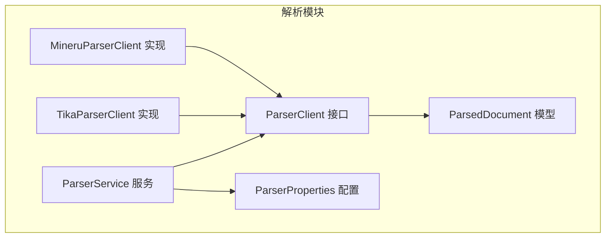
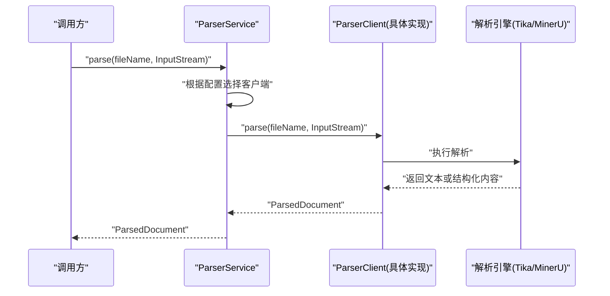
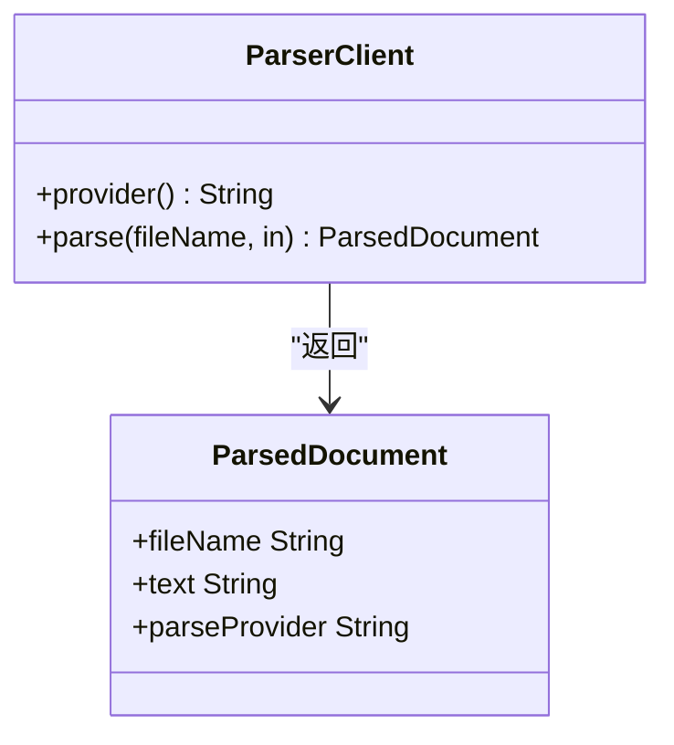
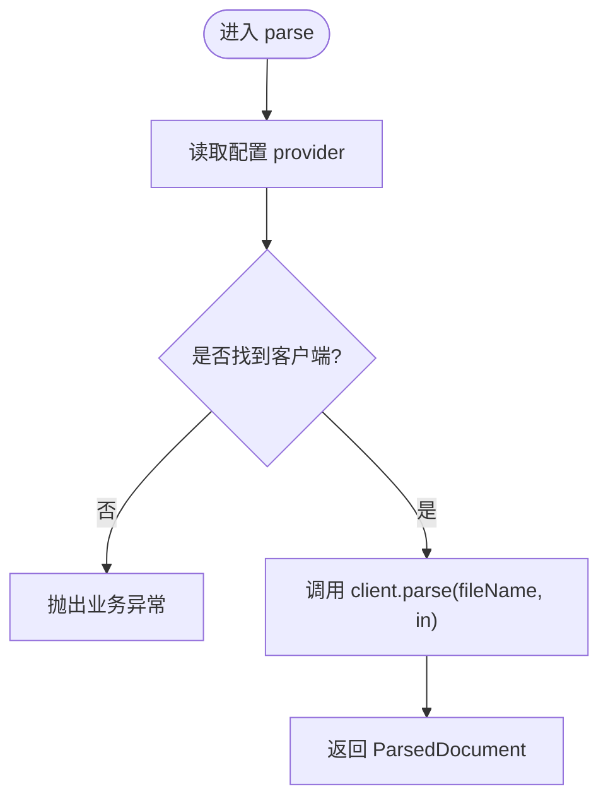
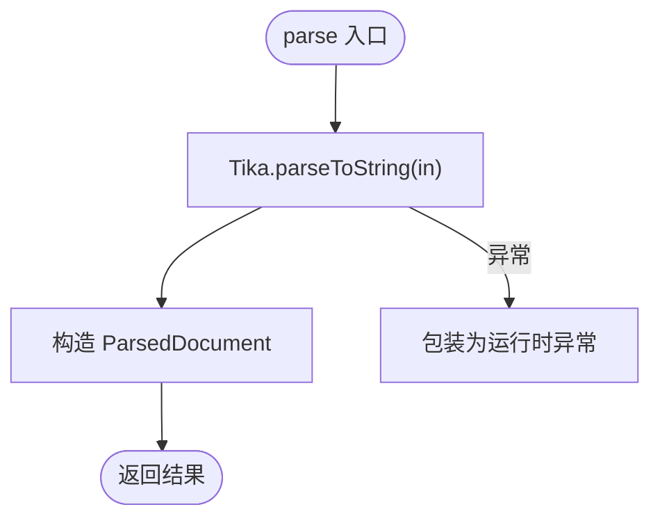
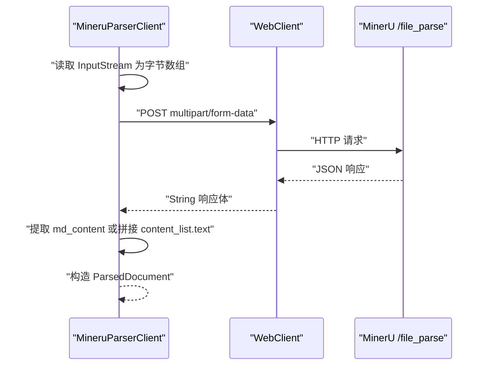
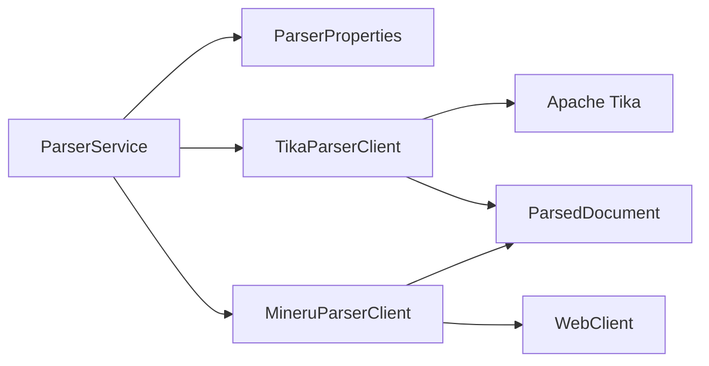

# 文档解析器扩展

<cite>
**本文引用的文件**   
- [ParserClient.java](file://src/main/java/com/agenthub/parser/ParserClient.java)
- [ParsedDocument.java](file://src/main/java/com/agenthub/parser/model/ParsedDocument.java)
- [ParserService.java](file://src/main/java/com/agenthub/parser/ParserService.java)
- [TikaParserClient.java](file://src/main/java/com/agenthub/parser/tika/TikaParserClient.java)
- [MineruParserClient.java](file://src/main/java/com/agenthub/parser/mineru/MineruParserClient.java)
- [ParserProperties.java](file://src/main/java/com/agenthub/parser/config/ParserProperties.java)
</cite>

## 目录
1. [引言](#引言)
2. [项目结构](#项目结构)
3. [核心组件](#核心组件)
4. [架构总览](#架构总览)
5. [详细组件分析](#详细组件分析)
6. [依赖关系分析](#依赖关系分析)
7. [性能与优化建议](#性能与优化建议)
8. [错误处理与重试机制](#错误处理与重试机制)
9. [自定义解析器开发指南](#自定义解析器开发指南)
10. [结论](#结论)

## 引言
本文档围绕“文档解析器扩展”展开，重点说明 ParserClient 接口的设计、ParsedDocument 数据模型，以及如何扩展新的文档解析器。现有实现包括基于 Apache Tika 的本地解析器和对接 MinerU WebAPI 的远程解析器。文档还涵盖与 ParserService 的集成方式、配置方法，以及性能优化、错误处理和重试机制的建议。

## 项目结构
解析模块位于 parser 包下，采用“接口 + 多实现 + 服务路由”的结构：
- 接口层：ParserClient 定义统一的解析契约。
- 数据模型：ParsedDocument 统一封装解析结果。
- 配置层：ParserProperties 提供解析引擎选择与 MinerU 地址等配置。
- 实现层：TikaParserClient（本地）、MineruParserClient（远程）。
- 服务层：ParserService 负责按配置选择具体解析器并对外暴露解析能力。

**图表来源**
- [ParserClient.java:1-23](file://src/main/java/com/agenthub/parser/ParserClient.java#L1-L23)
- [ParsedDocument.java:1-22](file://src/main/java/com/agenthub/parser/model/ParsedDocument.java#L1-L22)
- [ParserService.java:1-39](file://src/main/java/com/agenthub/parser/ParserService.java#L1-L39)
- [ParserProperties.java:1-24](file://src/main/java/com/agenthub/parser/config/ParserProperties.java#L1-L24)
- [TikaParserClient.java:1-36](file://src/main/java/com/agenthub/parser/tika/TikaParserClient.java#L1-L36)
- [MineruParserClient.java:1-114](file://src/main/java/com/agenthub/parser/mineru/MineruParserClient.java#L1-L114)

**章节来源**
- [ParserClient.java:1-23](file://src/main/java/com/agenthub/parser/ParserClient.java#L1-L23)
- [ParserService.java:1-39](file://src/main/java/com/agenthub/parser/ParserService.java#L1-L39)
- [ParserProperties.java:1-24](file://src/main/java/com/agenthub/parser/config/ParserProperties.java#L1-L24)

## 核心组件
- ParserClient：定义 provider() 和 parse(fileName, in) 两个方法，抽象不同解析引擎的能力。
- ParsedDocument：统一封装 fileName、text（Markdown 文本）和 parseProvider（实际使用的解析引擎）。
- ParserService：根据配置选择具体 ParserClient，对外提供 parse 方法。
- TikaParserClient：使用 Apache Tika 进行本地解析，适合开发与降级场景。
- MineruParserClient：通过 WebClient 调用 MinerU WebAPI，支持 OCR 与自动解析模式。
- ParserProperties：提供 agenthub.parser.provider 与 mineru.url 等配置项。

**章节来源**
- [ParserClient.java:1-23](file://src/main/java/com/agenthub/parser/ParserClient.java#L1-L23)
- [ParsedDocument.java:1-22](file://src/main/java/com/agenthub/parser/model/ParsedDocument.java#L1-L22)
- [ParserService.java:1-39](file://src/main/java/com/agenthub/parser/ParserService.java#L1-L39)
- [TikaParserClient.java:1-36](file://src/main/java/com/agenthub/parser/tika/TikaParserClient.java#L1-L36)
- [MineruParserClient.java:1-114](file://src/main/java/com/agenthub/parser/mineru/MineruParserClient.java#L1-L114)
- [ParserProperties.java:1-24](file://src/main/java/com/agenthub/parser/config/ParserProperties.java#L1-L24)

## 架构总览
解析流程由 ParserService 驱动，根据配置选择具体解析器；Tika 为本地解析，MinerU 为远程 HTTP 调用。两者均返回统一的 ParsedDocument。

**图表来源**
- [ParserService.java:30-37](file://src/main/java/com/agenthub/parser/ParserService.java#L30-L37)
- [TikaParserClient.java:27-34](file://src/main/java/com/agenthub/parser/tika/TikaParserClient.java#L27-L34)
- [MineruParserClient.java:48-73](file://src/main/java/com/agenthub/parser/mineru/MineruParserClient.java#L48-L73)

## 详细组件分析

### ParserClient 接口设计
- 职责：统一解析入口，屏蔽底层引擎差异。
- 关键方法：
  - provider(): 返回引擎标识，用于注册与路由。
  - parse(fileName, in): 接收文件名与输入流，返回统一模型 ParsedDocument。
- 设计要点：
  - 以 InputStream 作为输入，避免在接口层强绑定具体存储实现。
  - 以 fileName 辅助类型识别，便于上层策略选择。

**图表来源**
- [ParserClient.java:10-21](file://src/main/java/com/agenthub/parser/ParserClient.java#L10-L21)
- [ParsedDocument.java:11-21](file://src/main/java/com/agenthub/parser/model/ParsedDocument.java#L11-L21)

**章节来源**
- [ParserClient.java:1-23](file://src/main/java/com/agenthub/parser/ParserClient.java#L1-L23)
- [ParsedDocument.java:1-22](file://src/main/java/com/agenthub/parser/model/ParsedDocument.java#L1-L22)

### ParsedDocument 数据模型
- 字段：
  - fileName：原始文件名，用于溯源与日志。
  - text：解析出的纯文本（通常为 Markdown），供后续分块、检索使用。
  - parseProvider：实际使用的解析引擎名称，便于追踪与统计。
- 复杂度：O(1)，轻量不可变对象（配合 Lombok 生成访问器）。

**章节来源**
- [ParsedDocument.java:1-22](file://src/main/java/com/agenthub/parser/model/ParsedDocument.java#L1-L22)

### ParserService 服务与路由
- 功能：
  - 从 Spring 容器注入所有 ParserClient 实现，构建 provider -> client 映射。
  - 根据 ParserProperties.getProvider() 选择具体客户端。
  - 若未找到对应客户端，抛出业务异常。
- 注意：当前实现仅做简单查找，并未内置主引擎失败时自动回退到 Tika 的逻辑。

**图表来源**
- [ParserService.java:24-37](file://src/main/java/com/agenthub/parser/ParserService.java#L24-L37)

**章节来源**
- [ParserService.java:1-39](file://src/main/java/com/agenthub/parser/ParserService.java#L1-L39)

### TikaParserClient 本地解析实现
- 技术选型：Apache Tika，无需外部服务，支持 PDF/Word/PPT/HTML 等主流格式。
- 行为：
  - 将 InputStream 直接交给 Tika 解析为字符串。
  - 构造 ParsedDocument 并返回。
  - 捕获异常并包装为运行时异常。
- 适用场景：开发环境、MinerU 不可用时的降级方案。

**图表来源**
- [TikaParserClient.java:27-34](file://src/main/java/com/agenthub/parser/tika/TikaParserClient.java#L27-L34)

**章节来源**
- [TikaParserClient.java:1-36](file://src/main/java/com/agenthub/parser/tika/TikaParserClient.java#L1-L36)

### MineruParserClient 远程解析实现
- 技术选型：Spring WebClient 异步 HTTP 客户端，调用 MinerU WebAPI。
- 行为：
  - 将 InputStream 转为字节数组，构造 multipart/form-data 请求体。
  - 设置 is_ocr=true、paser_method=auto。
  - 超时控制：10 分钟。
  - 解析响应 JSON，优先取 md_content，否则拼接 content_list 中的 text。
  - 构造 ParsedDocument 并返回。
- 适用场景：需要高质量版面还原与 OCR 的生产环境。

**图表来源**
- [MineruParserClient.java:48-73](file://src/main/java/com/agenthub/parser/mineru/MineruParserClient.java#L48-L73)
- [MineruParserClient.java:80-103](file://src/main/java/com/agenthub/parser/mineru/MineruParserClient.java#L80-L103)

**章节来源**
- [MineruParserClient.java:1-114](file://src/main/java/com/agenthub/parser/mineru/MineruParserClient.java#L1-L114)

### 配置与启用
- 配置键：
  - agenthub.parser.provider：可选 tika 或 mineru，默认 tika。
  - agenthub.parser.mineru.url：MinerU WebAPI 地址，默认 http://localhost:30000。
- 条件装配：
  - TikaParserClient：当 provider=tika 或未配置时启用。
  - MineruParserClient：当 provider=mineru 时启用。

**章节来源**
- [ParserProperties.java:1-24](file://src/main/java/com/agenthub/parser/config/ParserProperties.java#L1-L24)
- [TikaParserClient.java:15-17](file://src/main/java/com/agenthub/parser/tika/TikaParserClient.java#L15-L17)
- [MineruParserClient.java:30-32](file://src/main/java/com/agenthub/parser/mineru/MineruParserClient.java#L30-L32)

## 依赖关系分析
- ParserService 依赖 ParserProperties 与所有 ParserClient 实现。
- TikaParserClient 依赖 Apache Tika 库。
- MineruParserClient 依赖 Spring WebClient 与 JsonUtils。
- 所有实现均返回 ParsedDocument，保证上层解耦。

**图表来源**
- [ParserService.java:21-28](file://src/main/java/com/agenthub/parser/ParserService.java#L21-L28)
- [TikaParserClient.java:5-7](file://src/main/java/com/agenthub/parser/tika/TikaParserClient.java#L5-L7)
- [MineruParserClient.java:9-14](file://src/main/java/com/agenthub/parser/mineru/MineruParserClient.java#L9-L14)
- [ParsedDocument.java:1-22](file://src/main/java/com/agenthub/parser/model/ParsedDocument.java#L1-L22)

**章节来源**
- [ParserService.java:1-39](file://src/main/java/com/agenthub/parser/ParserService.java#L1-L39)
- [TikaParserClient.java:1-36](file://src/main/java/com/agenthub/parser/tika/TikaParserClient.java#L1-L36)
- [MineruParserClient.java:1-114](file://src/main/java/com/agenthub/parser/mineru/MineruParserClient.java#L1-L114)

## 性能与优化建议
- 流式处理：
  - 对于大文件，尽量避免一次性读入内存（如 MineruParserClient 中 readAll 会占用堆内存）。可考虑分块上传或流式传输（需服务端支持）。
- 并发与超时：
  - 对远程调用设置合理的超时时间（已实现 10 分钟），并结合连接池与线程池限制并发度。
- 缓存与去重：
  - 对相同文件的解析结果进行缓存（如按文件哈希），减少重复解析开销。
- 资源管理：
  - 确保 InputStream 在使用后关闭，避免资源泄漏。
- 批处理：
  - 批量解析时可复用 WebClient 实例与 Tika 实例，减少创建开销。

[本节为通用指导，不直接分析具体文件]

## 错误处理与重试机制
- 现有实现：
  - TikaParserClient：捕获异常并包装为运行时异常。
  - MineruParserClient：对网络与解析异常进行包装，并对空响应进行校验。
  - ParserService：在未找到客户端时抛出业务异常。
- 改进建议：
  - 统一异常体系：定义解析相关业务异常类型，区分网络异常、解析失败、参数非法等。
  - 重试机制：对可重试的网络错误（如超时、5xx）进行有限次重试，结合指数退避。
  - 降级策略：在主引擎（如 MinerU）失败时，可尝试回退到 Tika（需在 ParserService 中增加降级逻辑）。
  - 监控与告警：记录解析耗时、失败率与错误码，便于问题定位。

**章节来源**
- [TikaParserClient.java:27-34](file://src/main/java/com/agenthub/parser/tika/TikaParserClient.java#L27-L34)
- [MineruParserClient.java:57-73](file://src/main/java/com/agenthub/parser/mineru/MineruParserClient.java#L57-L73)
- [ParserService.java:31-36](file://src/main/java/com/agenthub/parser/ParserService.java#L31-L36)

## 自定义解析器开发指南
- 步骤概览：
  1. 实现 ParserClient 接口，提供 provider() 与 parse(fileName, in)。
  2. 在 parse 中完成文件流处理、文本提取与结构化数据解析。
  3. 返回 ParsedDocument，确保 text 字段为 Markdown 文本。
  4. 添加 @Component 注解，并通过 @ConditionalOnProperty 控制启用条件。
  5. 在 application.yml 中配置 agenthub.parser.provider 为新引擎名。
- 文件流处理：
  - 优先使用流式 API，避免一次性加载大文件到内存。
  - 若必须转字节数组，请评估内存占用与 GC 压力。
- 文本提取：
  - 针对特定格式（如 Excel、PPTX、图片 OCR）选择合适的第三方库或服务。
  - 输出 Markdown 文本，保留标题、列表、表格等结构信息。
- 结构化数据解析：
  - 如需额外元数据（如作者、日期、页码），可在 ParsedDocument 扩展字段或在后续阶段补充。
- 与 ParserService 集成：
  - 新实现会被自动发现并注册到 Map<provider, ParserClient>。
  - 通过配置切换 provider 即可使用新解析器。
- 示例路径参考：
  - 接口定义：[ParserClient.java:10-21](file://src/main/java/com/agenthub/parser/ParserClient.java#L10-L21)
  - 模型定义：[ParsedDocument.java:11-21](file://src/main/java/com/agenthub/parser/model/ParsedDocument.java#L11-L21)
  - 本地实现参考：[TikaParserClient.java:21-34](file://src/main/java/com/agenthub/parser/tika/TikaParserClient.java#L21-L34)
  - 远程实现参考：[MineruParserClient.java:42-73](file://src/main/java/com/agenthub/parser/mineru/MineruParserClient.java#L42-L73)
  - 配置参考：[ParserProperties.java:13-22](file://src/main/java/com/agenthub/parser/config/ParserProperties.java#L13-L22)

**章节来源**
- [ParserClient.java:1-23](file://src/main/java/com/agenthub/parser/ParserClient.java#L1-L23)
- [ParsedDocument.java:1-22](file://src/main/java/com/agenthub/parser/model/ParsedDocument.java#L1-L22)
- [TikaParserClient.java:1-36](file://src/main/java/com/agenthub/parser/tika/TikaParserClient.java#L1-L36)
- [MineruParserClient.java:1-114](file://src/main/java/com/agenthub/parser/mineru/MineruParserClient.java#L1-L114)
- [ParserProperties.java:1-24](file://src/main/java/com/agenthub/parser/config/ParserProperties.java#L1-L24)

## 结论
本模块通过 ParserClient 接口与 ParsedDocument 模型实现了多解析引擎的统一接入，ParserService 负责按配置路由。Tika 与 MinerU 两种实现分别覆盖本地与远程场景。建议在后续版本中增强错误处理、重试与降级策略，并引入缓存与批处理能力以提升整体性能与稳定性。