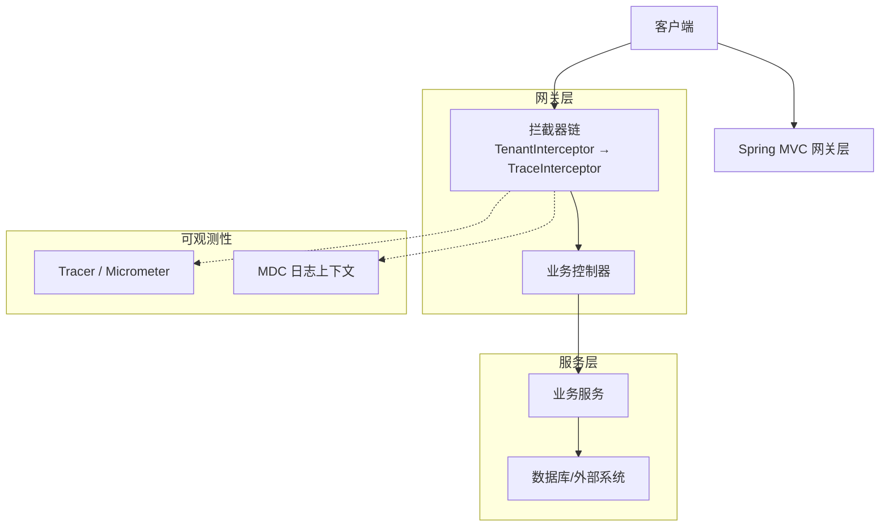
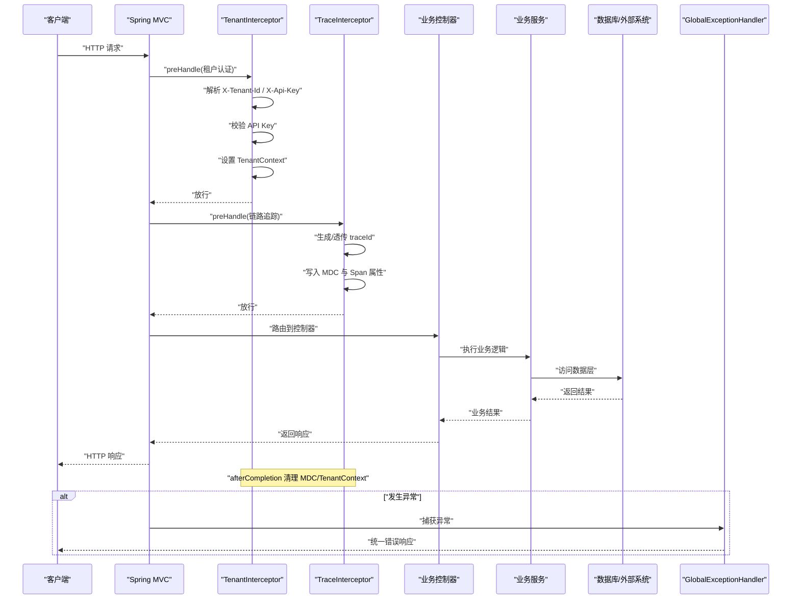
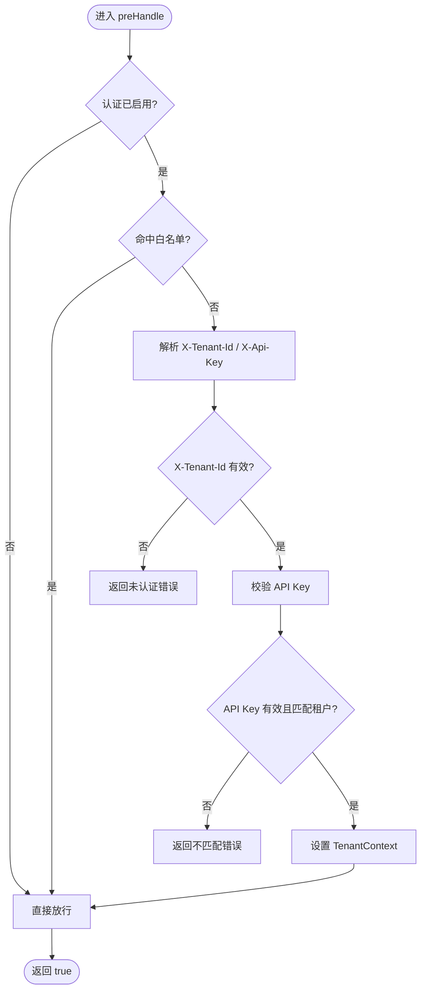
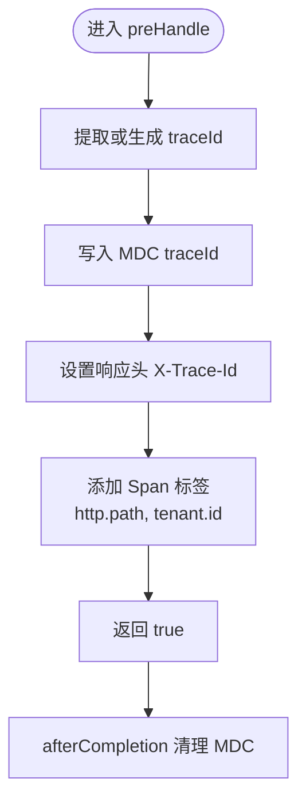
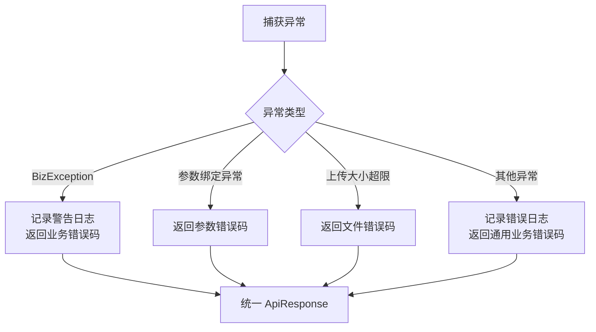
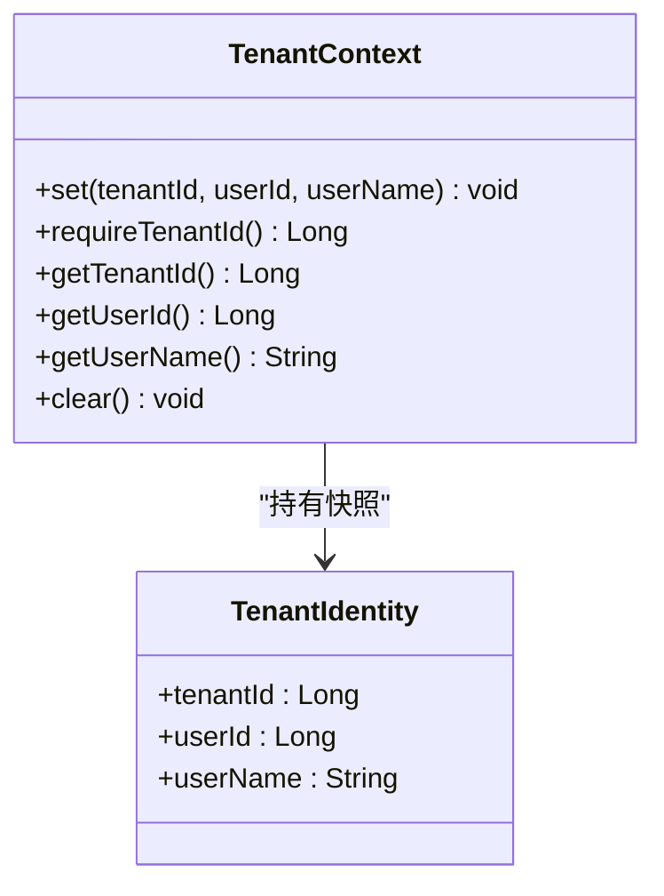
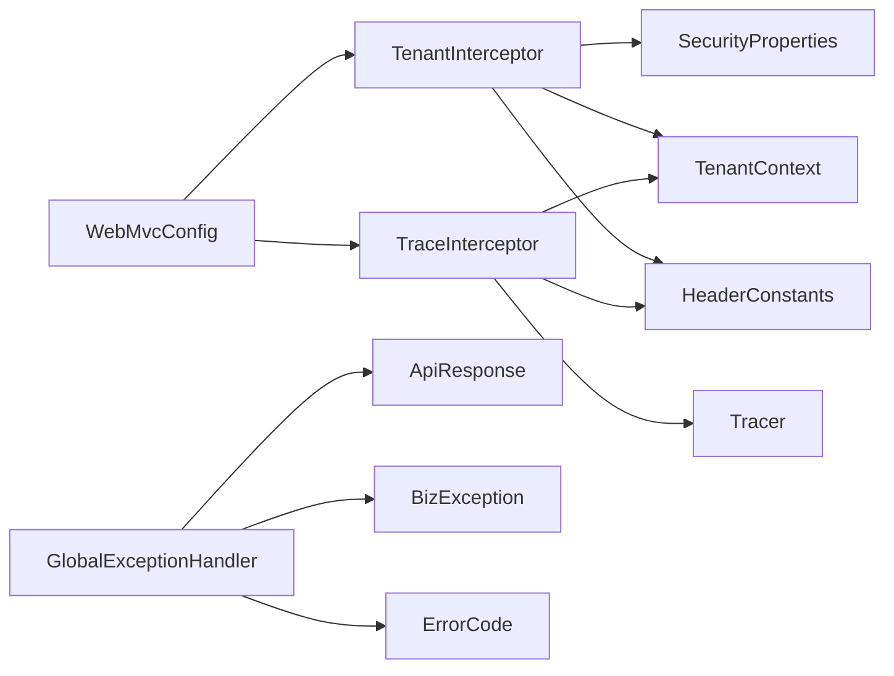

# HTTP请求处理流

<cite>
**本文引用的文件**   
- [TenantInterceptor.java](file://src/main/java/com/agenthub/gateway/interceptor/TenantInterceptor.java)
- [TraceInterceptor.java](file://src/main/java/com/agenthub/gateway/interceptor/TraceInterceptor.java)
- [WebMvcConfig.java](file://src/main/java/com/agenthub/gateway/config/WebMvcConfig.java)
- [SecurityProperties.java](file://src/main/java/com/agenthub/gateway/config/SecurityProperties.java)
- [TenantContext.java](file://src/main/java/com/agenthub/tenant/context/TenantContext.java)
- [HeaderConstants.java](file://src/main/java/com/agenthub/common/constant/HeaderConstants.java)
- [GlobalExceptionHandler.java](file://src/main/java/com/agenthub/common/exception/GlobalExceptionHandler.java)
- [ApiResponse.java](file://src/main/java/com/agenthub/common/api/ApiResponse.java)
- [BizException.java](file://src/main/java/com/agenthub/common/exception/BizException.java)
- [ErrorCode.java](file://src/main/java/com/agenthub/common/exception/ErrorCode.java)
</cite>

## 目录
1. [简介](#简介)
2. [项目结构](#项目结构)
3. [核心组件](#核心组件)
4. [架构总览](#架构总览)
5. [详细组件分析](#详细组件分析)
6. [依赖关系分析](#依赖关系分析)
7. [性能与可观测性](#性能与可观测性)
8. [故障排查指南](#故障排查指南)
9. [结论](#结论)

## 简介
本文面向HTTP网关到业务层的请求处理链路，聚焦以下关键流程：
- 请求进入网关后的拦截顺序与职责划分
- 租户认证：解析 X-Tenant-Id 与 X-Api-Key，校验API Key并设置租户上下文
- 链路追踪：生成 traceId、写入MDC、附加Span属性
- 全局异常处理：统一错误码与响应体
- 请求上下文在拦截器间的传递机制：TenantContext的设置与清理
- 请求流程图：展示数据在各组件间的流转，包含错误处理与性能监控点

## 项目结构
本项目的请求处理相关代码主要分布在以下包：
- gateway.interceptor：拦截器实现（租户认证、链路追踪）
- gateway.config：拦截器注册与安全配置
- tenant.context：租户上下文（ThreadLocal）
- common.exception：全局异常处理、业务异常与错误码
- common.api：统一响应体
- common.constant：通用常量（请求头名称）

图表来源
- [WebMvcConfig.java:23-30](file://src/main/java/com/agenthub/gateway/config/WebMvcConfig.java#L23-L30)
- [TenantInterceptor.java:31-56](file://src/main/java/com/agenthub/gateway/interceptor/TenantInterceptor.java#L31-L56)
- [TraceInterceptor.java:29-50](file://src/main/java/com/agenthub/gateway/interceptor/TraceInterceptor.java#L29-L50)

章节来源
- [WebMvcConfig.java:10-31](file://src/main/java/com/agenthub/gateway/config/WebMvcConfig.java#L10-L31)

## 核心组件
- TenantInterceptor：租户认证拦截器。负责解析请求头、校验API Key、设置租户上下文并在完成后清理。
- TraceInterceptor：链路追踪拦截器。负责生成或透传traceId、写入MDC、将租户ID作为Span属性上链。
- WebMvcConfig：拦截器注册与顺序控制。确保先执行租户认证，再执行链路追踪。
- SecurityProperties：安全开关与免认证路径白名单。
- TenantContext：基于ThreadLocal的租户上下文，提供设置、获取与清理能力。
- GlobalExceptionHandler：全局异常处理器，统一返回 ApiResponse。
- ApiResponse：统一响应结构。
- BizException：业务异常封装。
- ErrorCode：统一错误码枚举。
- HeaderConstants：通用请求头常量。

章节来源
- [TenantInterceptor.java:18-76](file://src/main/java/com/agenthub/gateway/interceptor/TenantInterceptor.java#L18-L76)
- [TraceInterceptor.java:16-60](file://src/main/java/com/agenthub/gateway/interceptor/TraceInterceptor.java#L16-L60)
- [WebMvcConfig.java:10-31](file://src/main/java/com/agenthub/gateway/config/WebMvcConfig.java#L10-L31)
- [SecurityProperties.java:8-20](file://src/main/java/com/agenthub/gateway/config/SecurityProperties.java#L8-L20)
- [TenantContext.java:6-59](file://src/main/java/com/agenthub/tenant/context/TenantContext.java#L6-L59)
- [GlobalExceptionHandler.java:14-47](file://src/main/java/com/agenthub/common/exception/GlobalExceptionHandler.java#L14-L47)
- [ApiResponse.java:8-37](file://src/main/java/com/agenthub/common/api/ApiResponse.java#L8-L37)
- [BizException.java:5-22](file://src/main/java/com/agenthub/common/exception/BizException.java#L5-L22)
- [ErrorCode.java:6-26](file://src/main/java/com/agenthub/common/exception/ErrorCode.java#L6-L26)
- [HeaderConstants.java:3-19](file://src/main/java/com/agenthub/common/constant/HeaderConstants.java#L3-L19)

## 架构总览
下图展示了从客户端请求进入网关到业务处理的完整时序，包括拦截器顺序、租户认证、链路追踪、异常处理等关键点。

图表来源
- [WebMvcConfig.java:23-30](file://src/main/java/com/agenthub/gateway/config/WebMvcConfig.java#L23-L30)
- [TenantInterceptor.java:31-56](file://src/main/java/com/agenthub/gateway/interceptor/TenantInterceptor.java#L31-L56)
- [TraceInterceptor.java:29-50](file://src/main/java/com/agenthub/gateway/interceptor/TraceInterceptor.java#L29-L50)
- [GlobalExceptionHandler.java:21-46](file://src/main/java/com/agenthub/common/exception/GlobalExceptionHandler.java#L21-L46)

## 详细组件分析

### 租户认证拦截器（TenantInterceptor）
职责与行为：
- 根据 SecurityProperties 判断是否启用认证以及是否命中白名单路径；若关闭或命中白名单则直接放行。
- 从请求头中读取 X-Tenant-Id 与 X-Api-Key，解析租户ID并进行API Key校验。
- 校验通过后，调用 TenantContext.set 设置当前租户身份（包含租户ID、用户ID、用户名），并对API Key进行脱敏后缓存。
- afterCompletion 中清理 TenantContext，防止线程池复用导致租户信息残留。
- 失败时直接返回统一的 ApiResponse 错误体，状态码来自 ErrorCode。

关键要点：
- 使用 AntPathMatcher 匹配 skipPaths，支持Ant风格路径。
- parseTenantId 对非法数字进行容错处理，避免抛出异常中断请求。
- reject 方法直接写回 JSON 响应，绕过后续拦截器与控制器。

图表来源
- [TenantInterceptor.java:31-75](file://src/main/java/com/agenthub/gateway/interceptor/TenantInterceptor.java#L31-L75)
- [SecurityProperties.java:11-20](file://src/main/java/com/agenthub/gateway/config/SecurityProperties.java#L11-L20)
- [HeaderConstants.java:8-15](file://src/main/java/com/agenthub/common/constant/HeaderConstants.java#L8-L15)

章节来源
- [TenantInterceptor.java:18-76](file://src/main/java/com/agenthub/gateway/interceptor/TenantInterceptor.java#L18-L76)
- [SecurityProperties.java:8-20](file://src/main/java/com/agenthub/gateway/config/SecurityProperties.java#L8-L20)
- [HeaderConstants.java:3-19](file://src/main/java/com/agenthub/common/constant/HeaderConstants.java#L3-L19)

### 链路追踪拦截器（TraceInterceptor）
职责与行为：
- 优先从当前 Span 提取 traceId，否则生成新的短ID。
- 将 traceId 写入 MDC，便于日志关联；同时将 traceId 写入响应头 X-Trace-Id。
- 将当前请求URI作为 Span 标签；若存在租户上下文，则将 tenant.id 作为 Span 标签上链，便于按租户过滤链路。
- afterCompletion 中移除 MDC 中的 traceId 与 tenantId，避免跨请求污染。

关键要点：
- 通过 io.micrometer.tracing.Tracer 与 Span 接口对接链路追踪后端（如 Jaeger/Tempo）。
- 透传上游 traceId，保证跨服务链路一致性。

图表来源
- [TraceInterceptor.java:29-59](file://src/main/java/com/agenthub/gateway/interceptor/TraceInterceptor.java#L29-L59)
- [HeaderConstants.java:14-15](file://src/main/java/com/agenthub/common/constant/HeaderConstants.java#L14-L15)

章节来源
- [TraceInterceptor.java:16-60](file://src/main/java/com/agenthub/gateway/interceptor/TraceInterceptor.java#L16-L60)
- [HeaderConstants.java:3-19](file://src/main/java/com/agenthub/common/constant/HeaderConstants.java#L3-L19)

### 全局异常处理器（GlobalExceptionHandler）
职责与行为：
- 捕获 BizException，记录警告日志并返回 ApiResponse.fail。
- 捕获参数绑定异常（MethodArgumentNotValidException、BindException），返回参数错误码与第一条字段错误信息。
- 捕获上传大小超限异常，返回文件错误码。
- 兜底捕获 Exception，记录错误日志并返回通用业务错误码。

关键要点：
- 所有异常最终都转换为 ApiResponse 结构，保持对外一致的错误格式。
- 使用 @RestControllerAdvice 集中处理控制器层抛出的异常。

图表来源
- [GlobalExceptionHandler.java:21-46](file://src/main/java/com/agenthub/common/exception/GlobalExceptionHandler.java#L21-L46)
- [ApiResponse.java:22-36](file://src/main/java/com/agenthub/common/api/ApiResponse.java#L22-L36)
- [ErrorCode.java:11-26](file://src/main/java/com/agenthub/common/exception/ErrorCode.java#L11-L26)

章节来源
- [GlobalExceptionHandler.java:14-47](file://src/main/java/com/agenthub/common/exception/GlobalExceptionHandler.java#L14-L47)
- [ApiResponse.java:8-37](file://src/main/java/com/agenthub/common/api/ApiResponse.java#L8-L37)
- [ErrorCode.java:6-26](file://src/main/java/com/agenthub/common/exception/ErrorCode.java#L6-L26)

### 请求上下文传递机制（TenantContext）
- 由 TenantInterceptor 在 preHandle 中设置 TenantContext，包含租户ID、用户ID、用户名。
- 业务层通过 TenantContext.getTenantId() 或 requireTenantId() 获取当前租户ID；后者在缺失时抛出 BizException。
- 在 afterCompletion 中清理 TenantContext，避免线程池复用导致的串号问题。
- 异步场景下，可通过 AsyncConfig 的 TaskDecorator 自动透传 ThreadLocal 值（文档注释已说明）。

图表来源
- [TenantContext.java:12-59](file://src/main/java/com/agenthub/tenant/context/TenantContext.java#L12-L59)

章节来源
- [TenantContext.java:6-59](file://src/main/java/com/agenthub/tenant/context/TenantContext.java#L6-L59)
- [TenantInterceptor.java:48-56](file://src/main/java/com/agenthub/gateway/interceptor/TenantInterceptor.java#L48-L56)

## 依赖关系分析
- WebMvcConfig 注入 TenantInterceptor 与 TraceInterceptor，并按顺序注册拦截器。
- TenantInterceptor 依赖 SecurityProperties 与 TenantService（用于API Key校验），并通过 TenantContext 设置上下文。
- TraceInterceptor 依赖 Tracer（Micrometer）与 TenantContext，用于Span属性与MDC管理。
- GlobalExceptionHandler 依赖 ApiResponse、BizException、ErrorCode，统一输出错误响应。
- HeaderConstants 为各组件提供统一的请求头常量。

图表来源
- [WebMvcConfig.java:20-30](file://src/main/java/com/agenthub/gateway/config/WebMvcConfig.java#L20-L30)
- [TenantInterceptor.java:27-49](file://src/main/java/com/agenthub/gateway/interceptor/TenantInterceptor.java#L27-L49)
- [TraceInterceptor.java:27-43](file://src/main/java/com/agenthub/gateway/interceptor/TraceInterceptor.java#L27-L43)
- [GlobalExceptionHandler.java:21-46](file://src/main/java/com/agenthub/common/exception/GlobalExceptionHandler.java#L21-L46)
- [HeaderConstants.java:8-15](file://src/main/java/com/agenthub/common/constant/HeaderConstants.java#L8-L15)

章节来源
- [WebMvcConfig.java:10-31](file://src/main/java/com/agenthub/gateway/config/WebMvcConfig.java#L10-L31)
- [TenantInterceptor.java:18-76](file://src/main/java/com/agenthub/gateway/interceptor/TenantInterceptor.java#L18-L76)
- [TraceInterceptor.java:16-60](file://src/main/java/com/agenthub/gateway/interceptor/TraceInterceptor.java#L16-L60)
- [GlobalExceptionHandler.java:14-47](file://src/main/java/com/agenthub/common/exception/GlobalExceptionHandler.java#L14-L47)
- [HeaderConstants.java:3-19](file://src/main/java/com/agenthub/common/constant/HeaderConstants.java#L3-L19)

## 性能与可观测性
- 拦截器开销：
  - TenantInterceptor 的API Key校验可能涉及远程或数据库查询，建议结合缓存或本地鉴权策略降低延迟。
  - TraceInterceptor 的Span属性设置与MDC操作开销较低，但应避免频繁字符串拼接。
- 可观测性：
  - 通过 Span 标签 http.path 与 tenant.id 可在链路系统中按租户维度过滤与分析。
  - MDC 中的 traceId 可用于日志聚合与关联。
- 性能监控点：
  - 建议在业务服务层增加耗时埋点，结合链路追踪上报端到端耗时。
  - 对API Key校验路径增加指标统计（成功率、延迟分布）。

[本节为通用指导，不涉及具体文件分析]

## 故障排查指南
常见问题与定位步骤：
- 未认证或API Key无效：
  - 检查请求头是否包含 X-Tenant-Id 与 X-Api-Key。
  - 确认 SecurityProperties.enabled 是否为true，skipPaths 是否误配。
  - 查看 TenantInterceptor.reject 返回的错误码与消息。
- 租户信息缺失：
  - 业务层调用 requireTenantId() 抛出 BizException(TENANT_ERROR)，检查是否在拦截器前被提前消费或未设置上下文。
- 链路追踪缺失：
  - 检查 TraceInterceptor 是否正确注册，Tracer 是否可用。
  - 查看响应头 X-Trace-Id 是否存在，MDC 中是否有 traceId。
- 参数校验失败：
  - 查看 GlobalExceptionHandler.handleValidation 返回的参数错误信息与字段名。
- 上传大小超限：
  - 检查 MaxUploadSizeExceededException 的处理分支与配置项。

章节来源
- [TenantInterceptor.java:31-75](file://src/main/java/com/agenthub/gateway/interceptor/TenantInterceptor.java#L31-L75)
- [GlobalExceptionHandler.java:21-46](file://src/main/java/com/agenthub/common/exception/GlobalExceptionHandler.java#L21-L46)
- [ErrorCode.java:11-26](file://src/main/java/com/agenthub/common/exception/ErrorCode.java#L11-L26)

## 结论
该HTTP请求处理流通过拦截器链实现了清晰的职责分离：
- TenantInterceptor 负责租户认证与上下文设置，保障多租户隔离。
- TraceInterceptor 负责链路追踪与日志关联，提升可观测性。
- GlobalExceptionHandler 统一异常处理，保证对外一致的响应格式。
- WebMvcConfig 明确拦截器顺序，确保认证在前、追踪在后。
- TenantContext 提供安全的ThreadLocal上下文管理，配合异步任务透传机制，避免上下文丢失或串号。

建议在生产环境中：
- 合理配置 SecurityProperties 的 enabled 与 skipPaths。
- 完善API Key校验的性能优化与缓存策略。
- 强化链路追踪与日志关联，便于问题定位与性能分析。

[本节为总结性内容，不涉及具体文件分析]