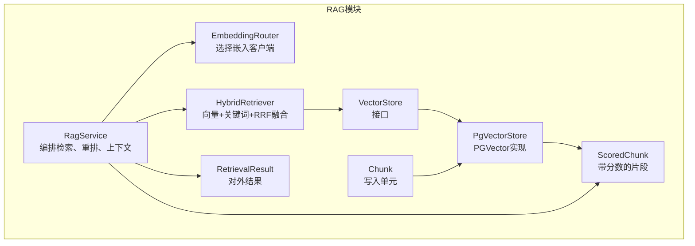
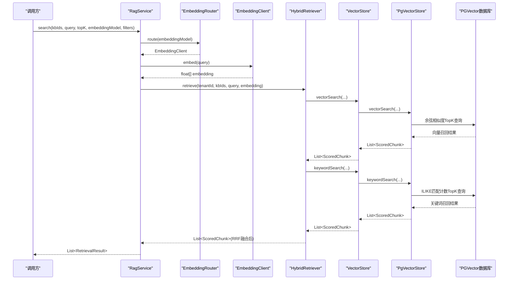
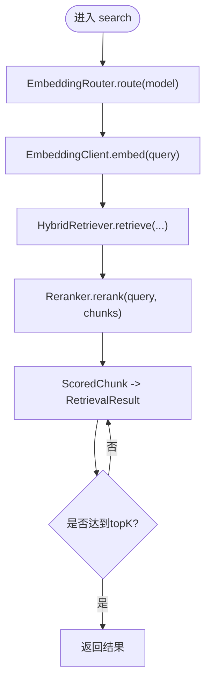
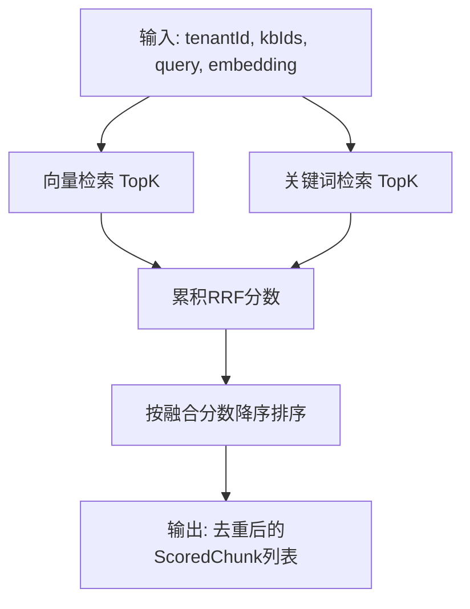
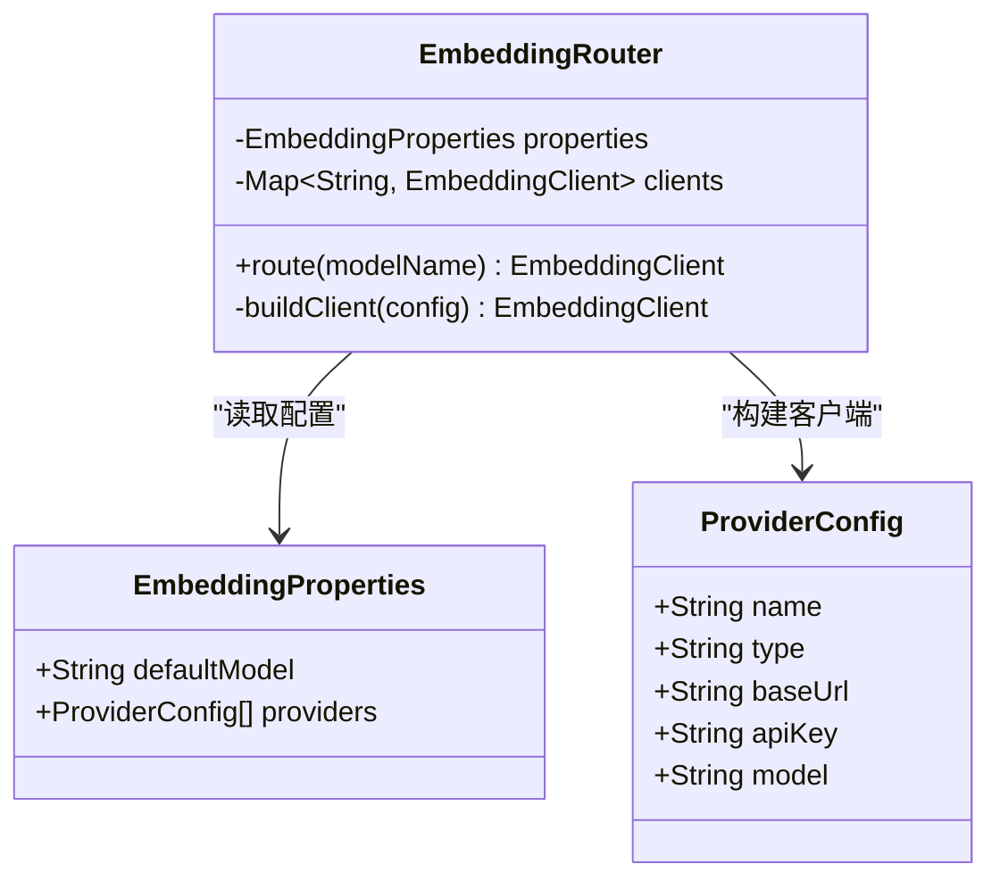
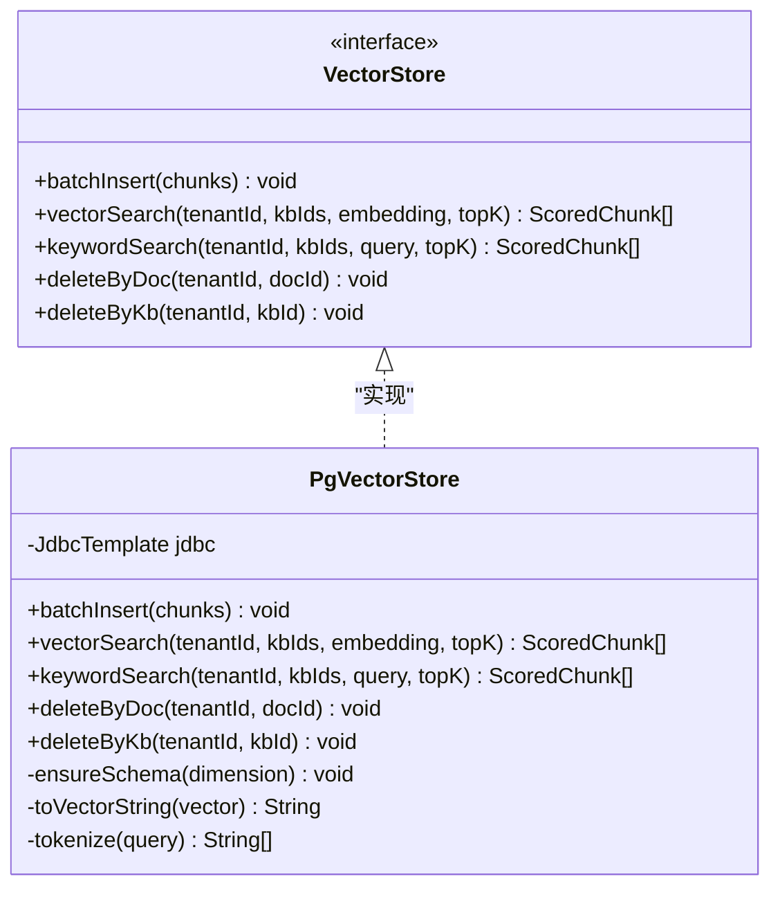
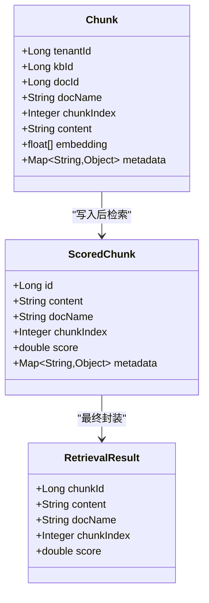
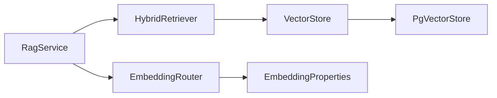

# RAG检索流程

<cite>
**本文引用的文件**   
- [RagService.java](file://src/main/java/com/agenthub/rag/service/RagService.java)
- [HybridRetriever.java](file://src/main/java/com/agenthub/rag/retrieve/HybridRetriever.java)
- [EmbeddingRouter.java](file://src/main/java/com/agenthub/rag/embedding/EmbeddingRouter.java)
- [PgVectorStore.java](file://src/main/java/com/agenthub/rag/store/PgVectorStore.java)
- [VectorStore.java](file://src/main/java/com/agenthub/rag/store/VectorStore.java)
- [EmbeddingProperties.java](file://src/main/java/com/agenthub/rag/embedding/EmbeddingProperties.java)
- [Chunk.java](file://src/main/java/com/agenthub/rag/model/Chunk.java)
- [ScoredChunk.java](file://src/main/java/com/agenthub/rag/model/ScoredChunk.java)
- [RetrievalResult.java](file://src/main/java/com/agenthub/rag/model/RetrievalResult.java)
- [application.yml](file://src/main/resources/application.yml)
</cite>

## 目录
1. [引言](#引言)
2. [项目结构](#项目结构)
3. [核心组件](#核心组件)
4. [架构总览](#架构总览)
5. [详细组件分析](#详细组件分析)
6. [依赖关系分析](#依赖关系分析)
7. [性能与优化](#性能与优化)
8. [故障排查指南](#故障排查指南)
9. [结论](#结论)

## 引言
本文面向使用本仓库实现检索增强生成（RAG）的开发者，系统梳理从用户查询到最终结果返回的完整检索链路。重点覆盖：
- 查询理解与向量化
- 向量检索与关键词检索
- 混合检索与RRF融合排序
- 重排与上下文拼装
- 嵌入模型路由选择
- PgVector存储结构与查询优化策略

## 项目结构
RAG相关代码集中在 `com.agenthub.rag` 包下，按职责分层组织：
- embedding：嵌入客户端与路由
- model：数据模型（Chunk、ScoredChunk、RetrievalResult）
- retrieve：混合检索器
- rerank：重排器
- service：RAG编排服务
- store：向量存储抽象与PGVector实现

图表来源
- [RagService.java:15-70](file://src/main/java/com/agenthub/rag/service/RagService.java#L15-L70)
- [HybridRetriever.java:14-78](file://src/main/java/com/agenthub/rag/retrieve/HybridRetriever.java#L14-L78)
- [EmbeddingRouter.java:11-45](file://src/main/java/com/agenthub/rag/embedding/EmbeddingRouter.java#L11-L45)
- [PgVectorStore.java:21-66](file://src/main/java/com/agenthub/rag/store/PgVectorStore.java#L21-L66)
- [VectorStore.java:8-28](file://src/main/java/com/agenthub/rag/store/VectorStore.java#L8-L28)
- [Chunk.java:11-43](file://src/main/java/com/agenthub/rag/model/Chunk.java#L11-L43)
- [ScoredChunk.java:9-32](file://src/main/java/com/agenthub/rag/model/ScoredChunk.java#L9-L32)
- [RetrievalResult.java:7-27](file://src/main/java/com/agenthub/rag/model/RetrievalResult.java#L7-L27)

章节来源
- [RagService.java:15-70](file://src/main/java/com/agenthub/rag/service/RagService.java#L15-L70)
- [HybridRetriever.java:14-78](file://src/main/java/com/agenthub/rag/retrieve/HybridRetriever.java#L14-L78)
- [EmbeddingRouter.java:11-45](file://src/main/java/com/agenthub/rag/embedding/EmbeddingRouter.java#L11-L45)
- [PgVectorStore.java:21-66](file://src/main/java/com/agenthub/rag/store/PgVectorStore.java#L21-L66)
- [VectorStore.java:8-28](file://src/main/java/com/agenthub/rag/store/VectorStore.java#L8-L28)
- [Chunk.java:11-43](file://src/main/java/com/agenthub/rag/model/Chunk.java#L11-L43)
- [ScoredChunk.java:9-32](file://src/main/java/com/agenthub/rag/model/ScoredChunk.java#L9-L32)
- [RetrievalResult.java:7-27](file://src/main/java/com/agenthub/rag/model/RetrievalResult.java#L7-L27)

## 核心组件
- RagService：RAG检索编排入口，负责调用嵌入路由、混合检索、重排，并将内部 ScoredChunk 转换为对外 RetrievalResult；还提供将结果拼装为LLM上下文的工具方法。
- HybridRetriever：实现“向量检索 + 关键词检索”的双路召回，并使用RRF（Reciprocal Rank Fusion）进行融合排序。
- EmbeddingRouter：根据配置和路由键选择具体 EmbeddingClient（OpenAI/Ollama/Mock）。
- VectorStore / PgVectorStore：向量存储抽象与PostgreSQL pgvector实现，提供批量写入、向量检索、关键字检索、删除等能力。
- 数据模型：Chunk（写入最小单元）、ScoredChunk（带分数片段）、RetrievalResult（对外返回结果）。

章节来源
- [RagService.java:15-70](file://src/main/java/com/agenthub/rag/service/RagService.java#L15-L70)
- [HybridRetriever.java:14-78](file://src/main/java/com/agenthub/rag/retrieve/HybridRetriever.java#L14-L78)
- [EmbeddingRouter.java:11-45](file://src/main/java/com/agenthub/rag/embedding/EmbeddingRouter.java#L11-L45)
- [VectorStore.java:8-28](file://src/main/java/com/agenthub/rag/store/VectorStore.java#L8-L28)
- [PgVectorStore.java:21-66](file://src/main/java/com/agenthub/rag/store/PgVectorStore.java#L21-L66)
- [Chunk.java:11-43](file://src/main/java/com/agenthub/rag/model/Chunk.java#L11-L43)
- [ScoredChunk.java:9-32](file://src/main/java/com/agenthub/rag/model/ScoredChunk.java#L9-L32)
- [RetrievalResult.java:7-27](file://src/main/java/com/agenthub/rag/model/RetrievalResult.java#L7-L27)

## 架构总览
下图展示一次典型RAG检索请求在系统中的流转路径：用户查询 → 嵌入路由 → 混合检索 → 重排 → 结果封装。

图表来源
- [RagService.java:39-53](file://src/main/java/com/agenthub/rag/service/RagService.java#L39-L53)
- [HybridRetriever.java:46-68](file://src/main/java/com/agenthub/rag/retrieve/HybridRetriever.java#L46-L68)
- [PgVectorStore.java:90-143](file://src/main/java/com/agenthub/rag/store/PgVectorStore.java#L90-L143)

## 详细组件分析

### 端到端检索流程（RagService）
RagService作为编排层，串联三个关键步骤：
1. 通过 EmbeddingRouter 获取对应 EmbeddingClient，对查询文本进行向量化。
2. 调用 HybridRetriever 执行混合检索，传入租户ID、知识库ID列表、原始查询与向量。
3. 调用 Reranker 对候选片段进行重排，最后将 ScoredChunk 转为 RetrievalResult 并限制数量。

此外，RagService还提供 buildContext 方法，将检索结果拼接为LLM上下文，便于Agent工具链使用。

图表来源
- [RagService.java:39-53](file://src/main/java/com/agenthub/rag/service/RagService.java#L39-L53)

章节来源
- [RagService.java:15-70](file://src/main/java/com/agenthub/rag/service/RagService.java#L15-L70)

### 混合检索与RRF融合（HybridRetriever）
HybridRetriever实现双路召回与融合：
- 第一路：向量检索，使用 VectorStore.vectorSearch，基于余弦相似度取TopK。
- 第二路：关键词检索，使用 VectorStore.keywordSearch，基于ILIKE命中计数打分。
- 融合：RRF算法 score = Σ 1/(k + rank)，其中k为配置项 rrf-k，rank为当前结果在该路的排名（从1开始）。两路结果按chunk id去重合并，并按融合分数降序排列。

图表来源
- [HybridRetriever.java:46-77](file://src/main/java/com/agenthub/rag/retrieve/HybridRetriever.java#L46-L77)

章节来源
- [HybridRetriever.java:14-78](file://src/main/java/com/agenthub/rag/retrieve/HybridRetriever.java#L14-L78)

### 嵌入模型路由（EmbeddingRouter）
EmbeddingRouter根据配置中的 providers 列表构建客户端映射，并通过 route(modelName) 选择具体客户端：
- 若 modelName 为空或空白，则使用默认模型 defaultModel。
- 支持类型：openai、ollama、mock。
- 未配置的模型会抛出业务异常，提示未配置Embedding模型。

图表来源
- [EmbeddingRouter.java:11-45](file://src/main/java/com/agenthub/rag/embedding/EmbeddingRouter.java#L11-L45)
- [EmbeddingProperties.java:9-32](file://src/main/java/com/agenthub/rag/embedding/EmbeddingProperties.java#L9-L32)

章节来源
- [EmbeddingRouter.java:11-45](file://src/main/java/com/agenthub/rag/embedding/EmbeddingRouter.java#L11-L45)
- [EmbeddingProperties.java:9-32](file://src/main/java/com/agenthub/rag/embedding/EmbeddingProperties.java#L9-L32)

### 向量存储与查询优化（PgVectorStore）
PgVectorStore基于JDBC直连PostgreSQL与pgvector扩展，提供：
- 建表与索引：幂等创建 rag_chunk 表，包含 HNSW 索引（vector_cosine_ops），以及 (tenant_id, kb_id) 复合索引用于快速过滤。
- 批量写入：batchInsert 将 Chunk 列表批量插入，embedding以PGVector字符串形式写入，metadata以JSONB存储。
- 向量检索：vectorSearch 使用 <=> 算子计算余弦距离，相似度=1-距离，结合 tenant_id 与 kb_id IN (...) 条件，ORDER BY 距离 LIMIT topK。
- 关键词检索：keywordSearch 对查询进行简单分词（英文字母数字连续串，中文长串切2-gram），用 ILIKE 多条件OR匹配，按命中次数打分 ORDER BY score DESC LIMIT topK。
- 删除：deleteByDoc、deleteByKb 支持按文档或知识库维度清理向量。

图表来源
- [VectorStore.java:8-28](file://src/main/java/com/agenthub/rag/store/VectorStore.java#L8-L28)
- [PgVectorStore.java:21-66](file://src/main/java/com/agenthub/rag/store/PgVectorStore.java#L21-L66)
- [PgVectorStore.java:90-143](file://src/main/java/com/agenthub/rag/store/PgVectorStore.java#L90-L143)

章节来源
- [PgVectorStore.java:21-66](file://src/main/java/com/agenthub/rag/store/PgVectorStore.java#L21-L66)
- [PgVectorStore.java:90-143](file://src/main/java/com/agenthub/rag/store/PgVectorStore.java#L90-L143)
- [PgVectorStore.java:193-222](file://src/main/java/com/agenthub/rag/store/PgVectorStore.java#L193-L222)

### 数据模型与转换
- Chunk：写入PG的最小单元，包含租户、知识库、文档、块序号、内容、向量与元数据。
- ScoredChunk：检索中间结果，携带id、content、docName、chunkIndex、score与metadata。
- RetrievalResult：对外返回结果，包含chunkId、content、docName、chunkIndex、score。

图表来源
- [Chunk.java:11-43](file://src/main/java/com/agenthub/rag/model/Chunk.java#L11-L43)
- [ScoredChunk.java:9-32](file://src/main/java/com/agenthub/rag/model/ScoredChunk.java#L9-L32)
- [RetrievalResult.java:7-27](file://src/main/java/com/agenthub/rag/model/RetrievalResult.java#L7-L27)

章节来源
- [Chunk.java:11-43](file://src/main/java/com/agenthub/rag/model/Chunk.java#L11-L43)
- [ScoredChunk.java:9-32](file://src/main/java/com/agenthub/rag/model/ScoredChunk.java#L9-L32)
- [RetrievalResult.java:7-27](file://src/main/java/com/agenthub/rag/model/RetrievalResult.java#L7-L27)

## 依赖关系分析
- RagService 依赖 EmbeddingRouter、HybridRetriever、Reranker。
- HybridRetriever 依赖 VectorStore（PgVectorStore实现）。
- EmbeddingRouter 依赖 EmbeddingProperties 与多个 EmbeddingClient（OpenAI/Ollama/Mock）。
- PgVectorStore 依赖 JdbcTemplate 与 HikariDataSource，直接操作PG数据库。

图表来源
- [RagService.java:22-28](file://src/main/java/com/agenthub/rag/service/RagService.java#L22-L28)
- [HybridRetriever.java:21-37](file://src/main/java/com/agenthub/rag/retrieve/HybridRetriever.java#L21-L37)
- [EmbeddingRouter.java:17-24](file://src/main/java/com/agenthub/rag/embedding/EmbeddingRouter.java#L17-L24)
- [PgVectorStore.java:34-45](file://src/main/java/com/agenthub/rag/store/PgVectorStore.java#L34-L45)

章节来源
- [RagService.java:22-28](file://src/main/java/com/agenthub/rag/service/RagService.java#L22-L28)
- [HybridRetriever.java:21-37](file://src/main/java/com/agenthub/rag/retrieve/HybridRetriever.java#L21-L37)
- [EmbeddingRouter.java:17-24](file://src/main/java/com/agenthub/rag/embedding/EmbeddingRouter.java#L17-L24)
- [PgVectorStore.java:34-45](file://src/main/java/com/agenthub/rag/store/PgVectorStore.java#L34-L45)

## 性能与优化
- 向量检索优化
  - 使用HNSW索引（vector_cosine_ops）加速余弦相似度搜索。
  - 通过 (tenant_id, kb_id) 复合索引缩小扫描范围，避免全表扫描。
  - 使用 <=> 算子与 ORDER BY 距离 LIMIT topK，减少不必要的数据传输。
- 关键词检索优化
  - 简单分词策略：英文按字母数字连续串切分，中文长串切2-gram提升命中率。
  - ILIKE多条件OR匹配，按命中次数打分，LIMIT topK控制返回规模。
- 混合检索优化
  - 可独立关闭混合模式（hybrid=false），仅走向量检索。
  - 可调参数：vector-top-k、keyword-top-k、rrf-k，平衡召回与融合效果。
- 连接池与资源
  - PgVectorStore使用独立Hikari连接池，避免与业务MySQL连接池竞争。
  - 建议根据QPS调整maximum-pool-size与超时参数。

章节来源
- [PgVectorStore.java:47-66](file://src/main/java/com/agenthub/rag/store/PgVectorStore.java#L47-L66)
- [PgVectorStore.java:90-143](file://src/main/java/com/agenthub/rag/store/PgVectorStore.java#L90-L143)
- [PgVectorStore.java:193-222](file://src/main/java/com/agenthub/rag/store/PgVectorStore.java#L193-L222)
- [HybridRetriever.java:27-37](file://src/main/java/com/agenthub/rag/retrieve/HybridRetriever.java#L27-L37)
- [application.yml:64-76](file://src/main/resources/application.yml#L64-L76)

## 故障排查指南
- 未配置的Embedding模型
  - 现象：调用EmbeddingRouter.route时抛出业务异常，提示未配置Embedding模型。
  - 排查：检查 application.yml 中 agenthub.embedding.providers 是否包含对应name，且defaultModel是否正确。
- PG向量库连接失败
  - 现象：PgVectorStore初始化或查询时报错。
  - 排查：确认PG_HOST、PG_PORT、PG_DB、PG_USER、PG_PASSWORD环境变量正确；确保pgvector扩展已启用。
- 检索结果为空
  - 向量检索为空：检查embedding维度是否与配置dimension一致；确认kbIds非空且存在数据。
  - 关键词检索为空：检查query分词结果是否为空；确认content字段是否包含目标词。
- RRF融合异常
  - 现象：融合后排序不符合预期。
  - 排查：调整rrf-k值；检查vector-top-k与keyword-top-k是否过小导致候选不足。

章节来源
- [EmbeddingRouter.java:27-34](file://src/main/java/com/agenthub/rag/embedding/EmbeddingRouter.java#L27-L34)
- [PgVectorStore.java:36-45](file://src/main/java/com/agenthub/rag/store/PgVectorStore.java#L36-L45)
- [PgVectorStore.java:90-143](file://src/main/java/com/agenthub/rag/store/PgVectorStore.java#L90-L143)
- [HybridRetriever.java:55-77](file://src/main/java/com/agenthub/rag/retrieve/HybridRetriever.java#L55-L77)
- [application.yml:64-76](file://src/main/resources/application.yml#L64-L76)

## 结论
本RAG检索流程通过RagService统一编排，EmbeddingRouter灵活选择嵌入模型，HybridRetriever实现语义与关键词双路召回并以RRF稳定融合，PgVectorStore依托PGVector与HNSW索引保障检索性能。整体设计清晰、可扩展性强，适合在生产环境中按需调优TopK、RRF参数与嵌入模型，以满足不同场景的召回质量与延迟要求。