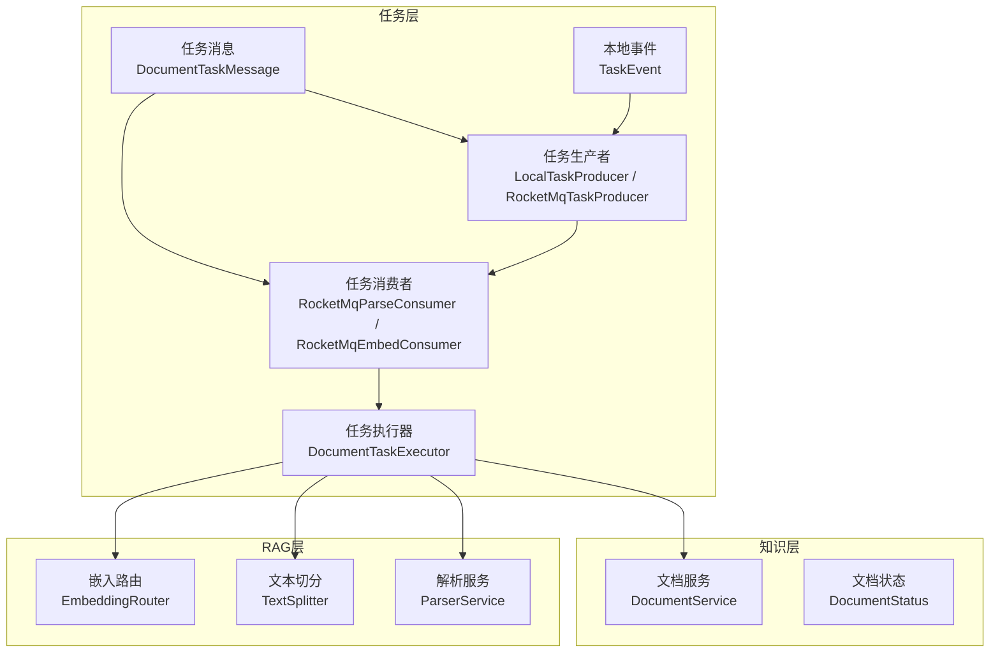
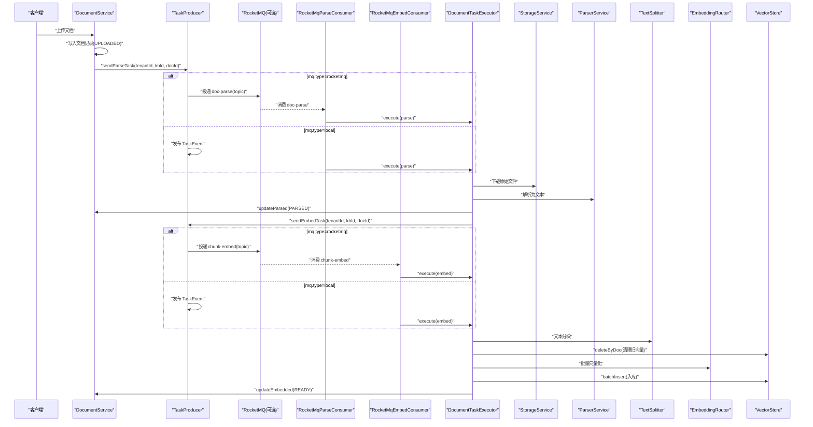
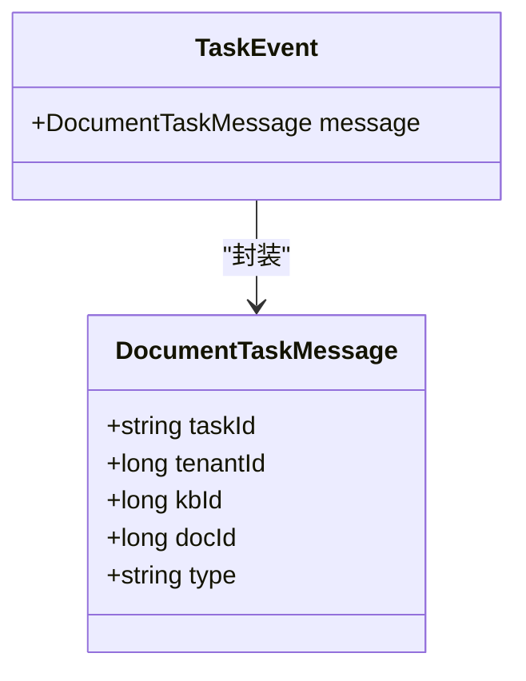
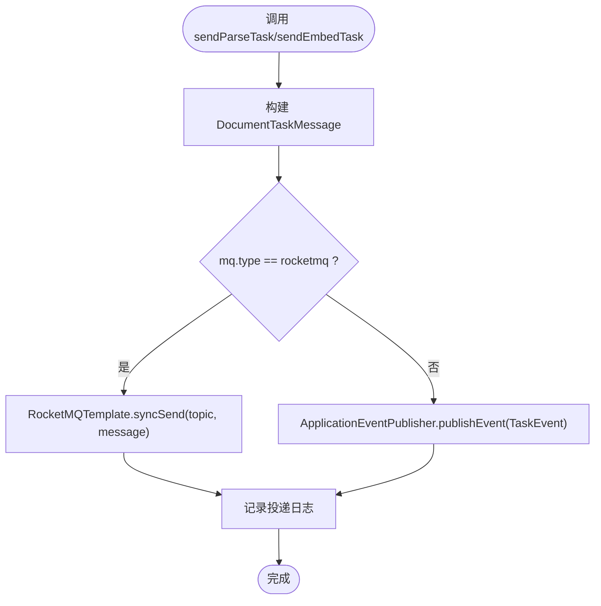
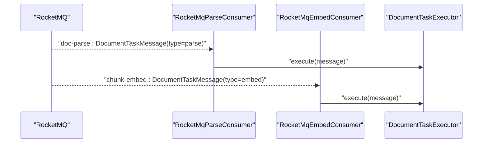
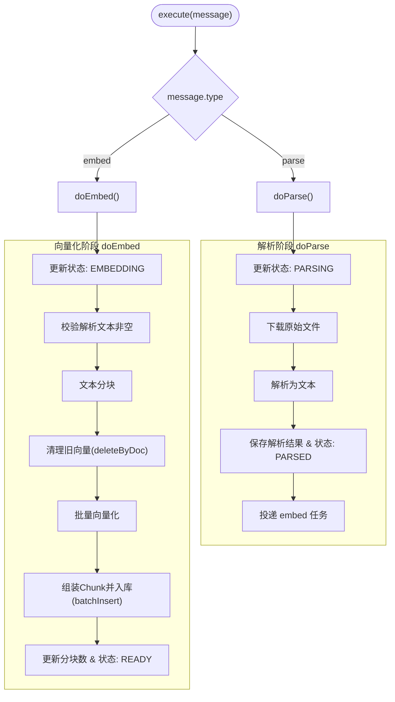
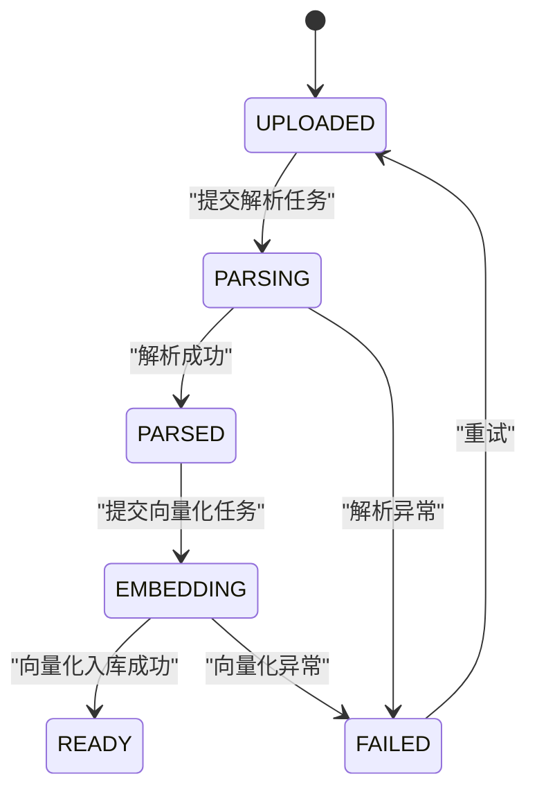
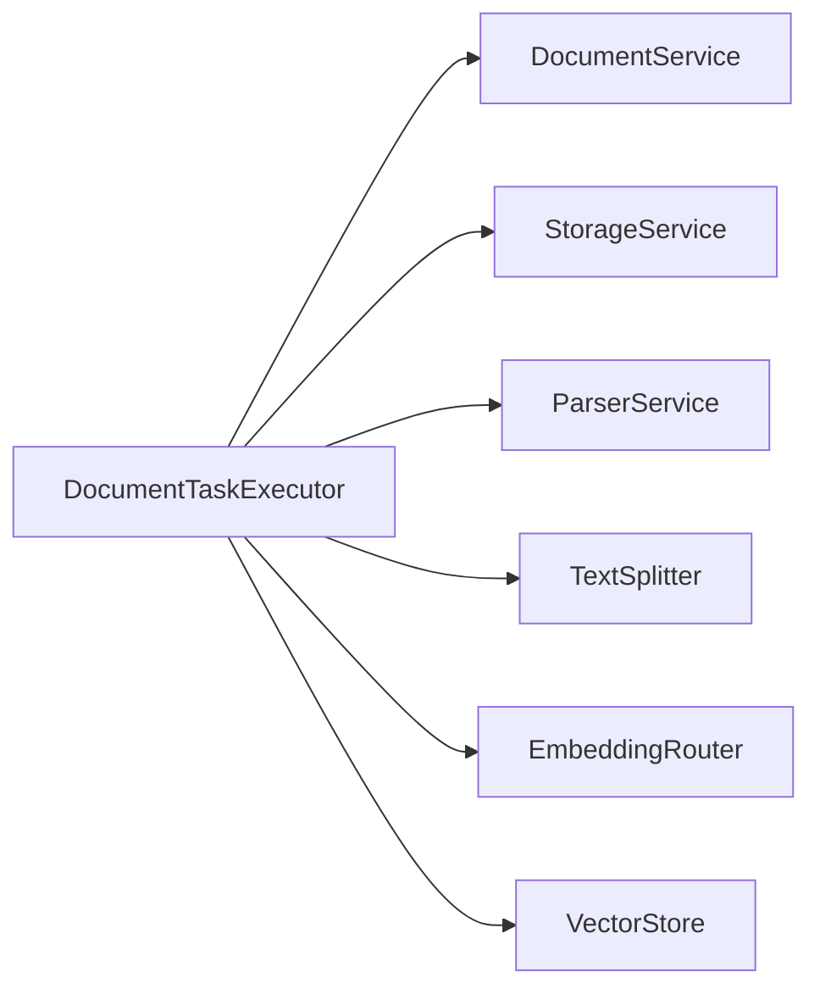

# 异步任务处理流

<cite>
**本文引用的文件**   
- [DocumentTaskExecutor.java](file://src/main/java/com/agenthub/task/executor/DocumentTaskExecutor.java)
- [RocketMqParseConsumer.java](file://src/main/java/com/agenthub/task/consumer/RocketMqParseConsumer.java)
- [RocketMqEmbedConsumer.java](file://src/main/java/com/agenthub/task/consumer/RocketMqEmbedConsumer.java)
- [LocalTaskProducer.java](file://src/main/java/com/agenthub/task/producer/LocalTaskProducer.java)
- [RocketMqTaskProducer.java](file://src/main/java/com/agenthub/task/producer/RocketMqTaskProducer.java)
- [DocumentTaskMessage.java](file://src/main/java/com/agenthub/task/model/DocumentTaskMessage.java)
- [TaskEvent.java](file://src/main/java/com/agenthub/task/event/TaskEvent.java)
- [DocumentStatus.java](file://src/main/java/com/agenthub/knowledge/enums/DocumentStatus.java)
- [DocumentService.java](file://src/main/java/com/agenthub/knowledge/service/DocumentService.java)
- [ParserService.java](file://src/main/java/com/agenthub/parser/ParserService.java)
- [TextSplitter.java](file://src/main/java/com/agenthub/rag/splitter/TextSplitter.java)
- [EmbeddingRouter.java](file://src/main/java/com/agenthub/rag/embedding/EmbeddingRouter.java)
</cite>

## 目录
1. [引言](#引言)
2. [项目结构](#项目结构)
3. [核心组件](#核心组件)
4. [架构总览](#架构总览)
5. [详细组件分析](#详细组件分析)
6. [依赖关系分析](#依赖关系分析)
7. [性能与扩展性](#性能与扩展性)
8. [故障排查指南](#故障排查指南)
9. [结论](#结论)

## 引言
本文档围绕“文档处理流水线”的异步任务处理流展开，覆盖从任务生产、消息队列传输、任务消费到状态管理的完整链路。重点说明：
- DocumentTaskExecutor 如何编排解析、分块、向量化、索引构建等子任务；
- RocketMqParseConsumer 与 RocketMqEmbedConsumer 如何分别处理解析与向量化两类任务；
- 任务状态机设计（UPLOADED → PARSING → PARSED → EMBEDDING → READY / FAILED）；
- 进度跟踪、失败重试、错误处理机制；
- 通过流程图展示各阶段的数据转换与消息流转。

## 项目结构
本仓库采用按领域划分的模块化结构，与异步任务处理相关的关键目录如下：
- task：任务模型、生产者、消费者、执行器与事件载体
- knowledge：文档实体、服务与状态枚举
- parser：文档解析服务与客户端路由
- rag：文本切分、向量检索与存储抽象

图表来源
- [LocalTaskProducer.java:1-38](file://src/main/java/com/agenthub/task/producer/LocalTaskProducer.java#L1-L38)
- [RocketMqTaskProducer.java:1-50](file://src/main/java/com/agenthub/task/producer/RocketMqTaskProducer.java#L1-L50)
- [RocketMqParseConsumer.java:1-34](file://src/main/java/com/agenthub/task/consumer/RocketMqParseConsumer.java#L1-L34)
- [RocketMqEmbedConsumer.java:1-33](file://src/main/java/com/agenthub/task/consumer/RocketMqEmbedConsumer.java#L1-L33)
- [DocumentTaskExecutor.java:1-123](file://src/main/java/com/agenthub/task/executor/DocumentTaskExecutor.java#L1-L123)
- [DocumentTaskMessage.java:1-31](file://src/main/java/com/agenthub/task/model/DocumentTaskMessage.java#L1-L31)
- [TaskEvent.java:1-16](file://src/main/java/com/agenthub/task/event/TaskEvent.java#L1-L16)
- [DocumentService.java:1-138](file://src/main/java/com/agenthub/knowledge/service/DocumentService.java#L1-L138)
- [DocumentStatus.java:1-26](file://src/main/java/com/agenthub/knowledge/enums/DocumentStatus.java#L1-L26)
- [ParserService.java:1-39](file://src/main/java/com/agenthub/parser/ParserService.java#L1-L39)
- [TextSplitter.java:1-13](file://src/main/java/com/agenthub/rag/splitter/TextSplitter.java#L1-L13)
- [EmbeddingRouter.java:1-46](file://src/main/java/com/agenthub/rag/embedding/EmbeddingRouter.java#L1-L46)

章节来源
- [DocumentTaskExecutor.java:1-123](file://src/main/java/com/agenthub/task/executor/DocumentTaskExecutor.java#L1-L123)
- [DocumentService.java:1-138](file://src/main/java/com/agenthub/knowledge/service/DocumentService.java#L1-L138)

## 核心组件
- 任务消息 DocumentTaskMessage：承载 taskId、tenantId、kbId、docId、type，作为 MQ 与本地事件的统一数据载体。
- 任务生产者 TaskProducer 接口实现：
  - LocalTaskProducer：在 mq.type=local 时通过 Spring ApplicationEventPublisher 发布 TaskEvent。
  - RocketMqTaskProducer：在 mq.type=rocketmq 时通过 RocketMQTemplate 同步发送消息，使用 taskId 作为 Key 保证幂等与顺序。
- 任务消费者：
  - RocketMqParseConsumer：监听 doc-parse Topic，调用 DocumentTaskExecutor.execute("parse")。
  - RocketMqEmbedConsumer：监听 chunk-embed Topic，调用 DocumentTaskExecutor.execute("embed")。
- 任务执行器 DocumentTaskExecutor：编排解析与向量化流程，维护租户上下文隔离，负责状态更新与异常处理。
- 文档服务 DocumentService：提供上传、重试、状态更新、解析结果保存、向量化结果保存等方法。
- 解析服务 ParserService：根据配置选择解析客户端并执行解析。
- 文本切分 TextSplitter：将长文本切分为多个片段。
- 嵌入路由 EmbeddingRouter：根据知识库或默认模型选择 EmbeddingClient 进行批量向量化。

章节来源
- [DocumentTaskMessage.java:1-31](file://src/main/java/com/agenthub/task/model/DocumentTaskMessage.java#L1-L31)
- [LocalTaskProducer.java:1-38](file://src/main/java/com/agenthub/task/producer/LocalTaskProducer.java#L1-L38)
- [RocketMqTaskProducer.java:1-50](file://src/main/java/com/agenthub/task/producer/RocketMqTaskProducer.java#L1-L50)
- [RocketMqParseConsumer.java:1-34](file://src/main/java/com/agenthub/task/consumer/RocketMqParseConsumer.java#L1-L34)
- [RocketMqEmbedConsumer.java:1-33](file://src/main/java/com/agenthub/task/consumer/RocketMqEmbedConsumer.java#L1-L33)
- [DocumentTaskExecutor.java:1-123](file://src/main/java/com/agenthub/task/executor/DocumentTaskExecutor.java#L1-L123)
- [DocumentService.java:1-138](file://src/main/java/com/agenthub/knowledge/service/DocumentService.java#L1-L138)
- [ParserService.java:1-39](file://src/main/java/com/agenthub/parser/ParserService.java#L1-L39)
- [TextSplitter.java:1-13](file://src/main/java/com/agenthub/rag/splitter/TextSplitter.java#L1-L13)
- [EmbeddingRouter.java:1-46](file://src/main/java/com/agenthub/rag/embedding/EmbeddingRouter.java#L1-L46)

## 架构总览
下图展示了从“上传文档”到“可检索”的端到端异步处理流程，包括消息类型、状态迁移与关键数据转换。

图表来源
- [DocumentService.java:42-76](file://src/main/java/com/agenthub/knowledge/service/DocumentService.java#L42-L76)
- [LocalTaskProducer.java:24-36](file://src/main/java/com/agenthub/task/producer/LocalTaskProducer.java#L24-L36)
- [RocketMqTaskProducer.java:32-48](file://src/main/java/com/agenthub/task/producer/RocketMqTaskProducer.java#L32-L48)
- [RocketMqParseConsumer.java:28-32](file://src/main/java/com/agenthub/task/consumer/RocketMqParseConsumer.java#L28-L32)
- [RocketMqEmbedConsumer.java:28-31](file://src/main/java/com/agenthub/task/consumer/RocketMqEmbedConsumer.java#L28-L31)
- [DocumentTaskExecutor.java:64-121](file://src/main/java/com/agenthub/task/executor/DocumentTaskExecutor.java#L64-L121)

## 详细组件分析

### 任务消息与事件模型
- DocumentTaskMessage：包含 taskId（幂等键）、tenantId（租户隔离）、kbId（知识库）、docId（文档）、type（parse/embed）。
- TaskEvent：本地模式下封装 DocumentTaskMessage，用于进程内事件分发。

图表来源
- [DocumentTaskMessage.java:1-31](file://src/main/java/com/agenthub/task/model/DocumentTaskMessage.java#L1-L31)
- [TaskEvent.java:1-16](file://src/main/java/com/agenthub/task/event/TaskEvent.java#L1-L16)

章节来源
- [DocumentTaskMessage.java:1-31](file://src/main/java/com/agenthub/task/model/DocumentTaskMessage.java#L1-L31)
- [TaskEvent.java:1-16](file://src/main/java/com/agenthub/task/event/TaskEvent.java#L1-L16)

### 任务生产者
- LocalTaskProducer：在 mq.type=local 时通过 ApplicationEventPublisher 发布 TaskEvent，实现无 MQ 环境下的全链路验证。
- RocketMqTaskProducer：在 mq.type=rocketmq 时通过 RocketMQTemplate 同步发送消息，使用 taskId 作为消息 Key，确保幂等与顺序消费。

图表来源
- [LocalTaskProducer.java:24-36](file://src/main/java/com/agenthub/task/producer/LocalTaskProducer.java#L24-L36)
- [RocketMqTaskProducer.java:32-48](file://src/main/java/com/agenthub/task/producer/RocketMqTaskProducer.java#L32-L48)

章节来源
- [LocalTaskProducer.java:1-38](file://src/main/java/com/agenthub/task/producer/LocalTaskProducer.java#L1-L38)
- [RocketMqTaskProducer.java:1-50](file://src/main/java/com/agenthub/task/producer/RocketMqTaskProducer.java#L1-L50)

### 任务消费者
- RocketMqParseConsumer：监听 doc-parse Topic，收到消息后调用 DocumentTaskExecutor.execute(message)。
- RocketMqEmbedConsumer：监听 chunk-embed Topic，收到消息后调用 DocumentTaskExecutor.execute(message)。

图表来源
- [RocketMqParseConsumer.java:22-32](file://src/main/java/com/agenthub/task/consumer/RocketMqParseConsumer.java#L22-L32)
- [RocketMqEmbedConsumer.java:21-31](file://src/main/java/com/agenthub/task/consumer/RocketMqEmbedConsumer.java#L21-L31)
- [DocumentTaskExecutor.java:49-62](file://src/main/java/com/agenthub/task/executor/DocumentTaskExecutor.java#L49-L62)

章节来源
- [RocketMqParseConsumer.java:1-34](file://src/main/java/com/agenthub/task/consumer/RocketMqParseConsumer.java#L1-L34)
- [RocketMqEmbedConsumer.java:1-33](file://src/main/java/com/agenthub/task/consumer/RocketMqEmbedConsumer.java#L1-L33)

### 任务执行器与流水线编排
DocumentTaskExecutor 是解析与向量化流水线的核心编排者：
- 解析阶段 doParse：
  - 设置状态为 PARSING；
  - 从 StorageService 下载原始文件；
  - 通过 ParserService 解析为文本；
  - 保存解析文本与解析引擎，状态更新为 PARSED；
  - 投递 embed 任务。
- 向量化阶段 doEmbed：
  - 设置状态为 EMBEDDING；
  - 校验已解析文本非空；
  - 使用 TextSplitter 分块；
  - 幂等清理旧向量（deleteByDoc）；
  - 通过 EmbeddingRouter 批量向量化；
  - 组装 Chunk 列表并批量入库；
  - 更新分块数量与状态为 READY。

图表来源
- [DocumentTaskExecutor.java:49-121](file://src/main/java/com/agenthub/task/executor/DocumentTaskExecutor.java#L49-L121)
- [DocumentService.java:104-131](file://src/main/java/com/agenthub/knowledge/service/DocumentService.java#L104-L131)
- [ParserService.java:31-37](file://src/main/java/com/agenthub/parser/ParserService.java#L31-L37)
- [TextSplitter.java:8-11](file://src/main/java/com/agenthub/rag/splitter/TextSplitter.java#L8-L11)
- [EmbeddingRouter.java:28-35](file://src/main/java/com/agenthub/rag/embedding/EmbeddingRouter.java#L28-L35)

章节来源
- [DocumentTaskExecutor.java:1-123](file://src/main/java/com/agenthub/task/executor/DocumentTaskExecutor.java#L1-L123)

### 任务状态管理
- 状态机定义：
  - UPLOADED：已上传，等待解析；
  - PARSING：解析中；
  - PARSED：解析完成，等待向量化；
  - EMBEDDING：向量化入库中；
  - READY：全流程完成，可检索；
  - FAILED：处理失败，可通过重试恢复。
- 状态更新入口：
  - DocumentService.updateStatus：通用状态更新；
  - DocumentService.updateParsed：保存解析结果并更新为 PARSED；
  - DocumentService.updateEmbedded：保存分块数量并更新为 READY。
- 重试机制：
  - DocumentService.retry：将文档状态重置为 UPLOADED 并清空错误信息，重新提交解析任务。

图表来源
- [DocumentStatus.java:11-25](file://src/main/java/com/agenthub/knowledge/enums/DocumentStatus.java#L11-L25)
- [DocumentService.java:95-131](file://src/main/java/com/agenthub/knowledge/service/DocumentService.java#L95-L131)

章节来源
- [DocumentStatus.java:1-26](file://src/main/java/com/agenthub/knowledge/enums/DocumentStatus.java#L1-26)
- [DocumentService.java:95-131](file://src/main/java/com/agenthub/knowledge/service/DocumentService.java#L95-L131)

## 依赖关系分析
- 低耦合高内聚：
  - 任务生产者与消费者通过接口与消息解耦，支持本地与 RocketMQ 两种模式切换；
  - 执行器依赖存储服务、解析服务、切分器、嵌入路由与向量存储，职责清晰。
- 外部依赖点：
  - StorageService：对象存储（本地或 MinIO）；
  - ParserService：解析引擎（MinerU/Tika）；
  - EmbeddingRouter：嵌入模型（OpenAI/Ollama/Mock）；
  - VectorStore：向量数据库（PgVector）。

图表来源
- [DocumentTaskExecutor.java:41-47](file://src/main/java/com/agenthub/task/executor/DocumentTaskExecutor.java#L41-L47)

章节来源
- [DocumentTaskExecutor.java:1-123](file://src/main/java/com/agenthub/task/executor/DocumentTaskExecutor.java#L1-L123)

## 性能与扩展性
- 并行与扩容：
  - 解析与向量化分离为独立 Topic，便于针对瓶颈环节独立扩容消费者实例；
  - 向量化阶段批量处理，减少外部调用次数。
- 幂等与一致性：
  - 每次向量化前清理旧向量，避免重复入库导致数据膨胀；
  - 使用 taskId 作为消息 Key，保障顺序与幂等。
- 租户隔离：
  - 通过 TenantContext 在消费线程恢复租户上下文，确保多租户数据隔离。

[本节为通用指导，不直接分析具体文件]

## 故障排查指南
- 常见问题定位：
  - 解析失败：检查 StorageService 下载是否成功、ParserService 配置是否正确、解析引擎是否可用；
  - 向量化失败：检查 TextSplitter 输出是否为空、EmbeddingRouter 模型配置是否有效、VectorStore 连接是否正常；
  - 状态未更新：确认 DocumentService 的状态更新方法被正确调用；
  - 重试无效：确认 retry 逻辑已将状态重置为 UPLOADED 且错误信息清空。
- 日志关键字：
  - “文档解析失败”、“文档向量化失败”、“任务已投递”、“收到解析任务”、“收到向量化任务”。

章节来源
- [DocumentTaskExecutor.java:77-80](file://src/main/java/com/agenthub/task/executor/DocumentTaskExecutor.java#L77-L80)
- [DocumentTaskExecutor.java:117-120](file://src/main/java/com/agenthub/task/executor/DocumentTaskExecutor.java#L117-L120)
- [RocketMqParseConsumer.java:28-32](file://src/main/java/com/agenthub/task/consumer/RocketMqParseConsumer.java#L28-L32)
- [RocketMqEmbedConsumer.java:28-31](file://src/main/java/com/agenthub/task/consumer/RocketMqEmbedConsumer.java#L28-L31)
- [RocketMqTaskProducer.java:42-48](file://src/main/java/com/agenthub/task/producer/RocketMqTaskProducer.java#L42-L48)

## 结论
该异步任务处理流通过明确的任务分层与状态机设计，实现了文档从上传到可检索的可靠流水线。解析与向量化解耦、消息驱动与租户隔离提升了系统的可扩展性与稳定性。在实际部署中，可根据负载情况对解析与向量化消费者进行独立扩缩容，并通过重试与幂等机制保障最终一致性。