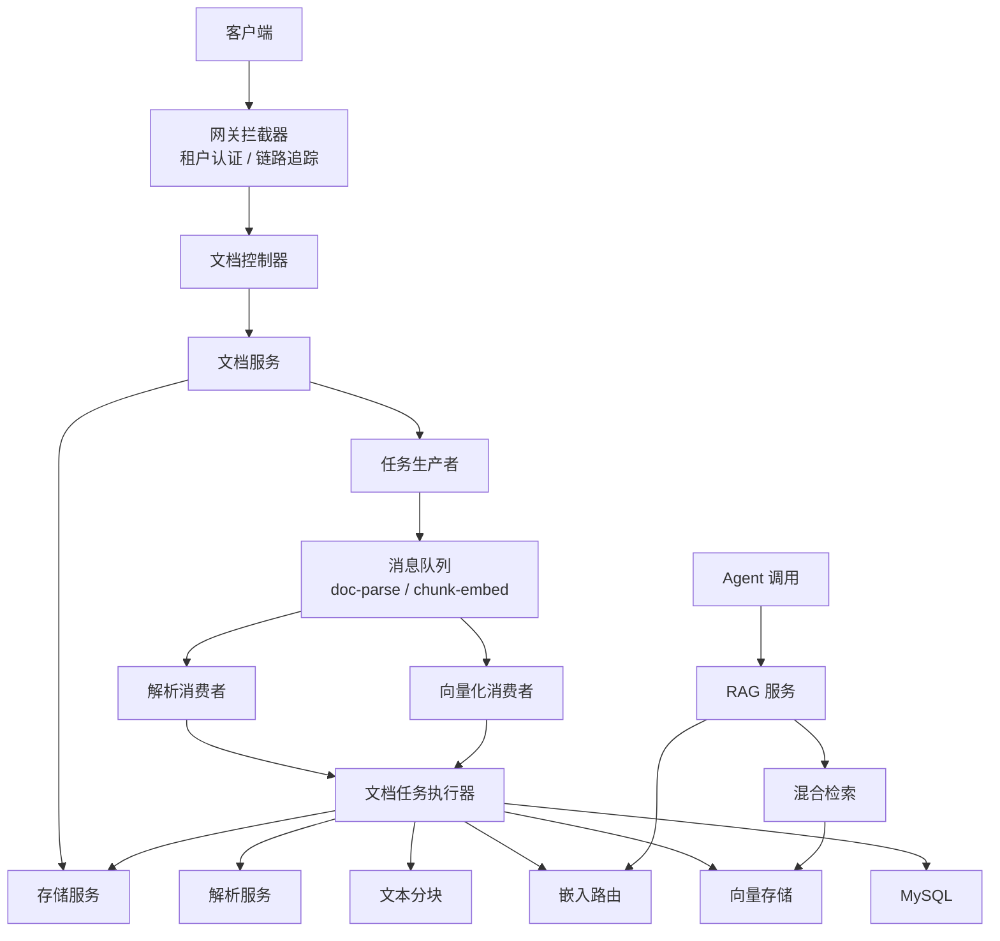
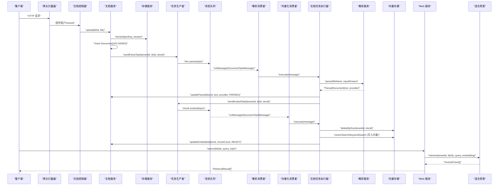
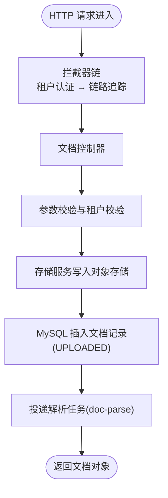
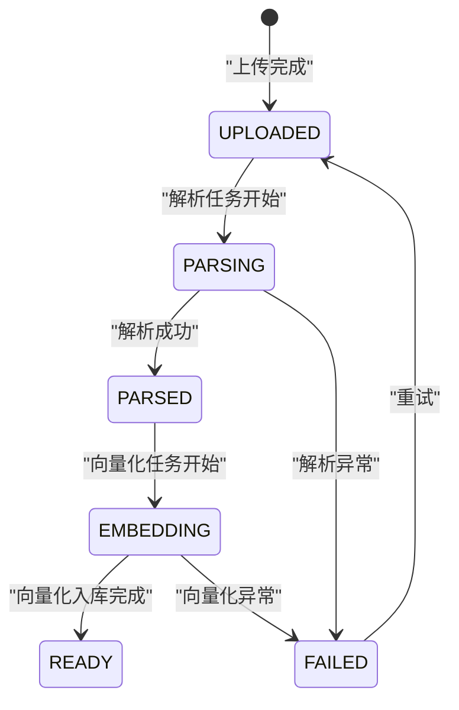
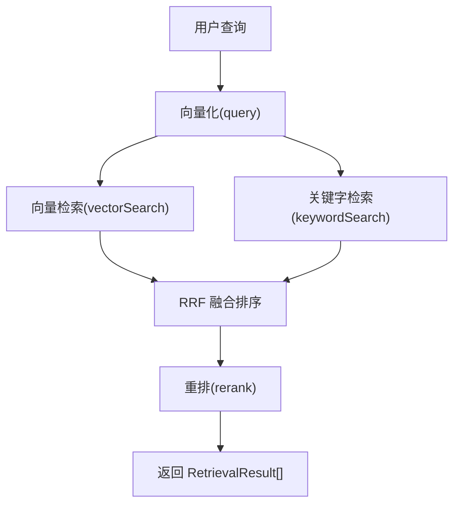
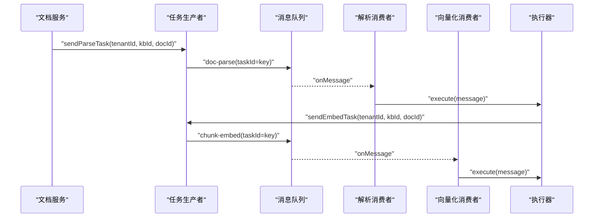
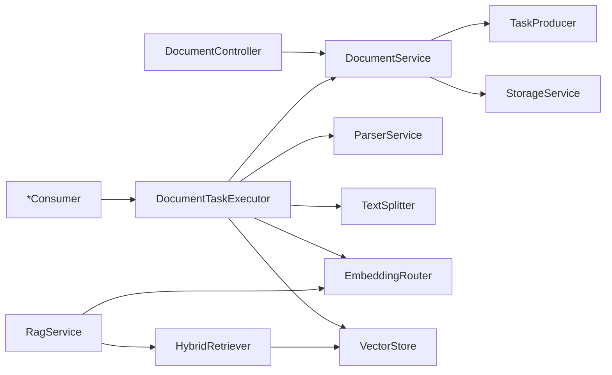

# 数据流设计

<cite>
**本文引用的文件**   
- [README.md](file://README.md)
- [application.yml](file://src/main/resources/application.yml)
- [WebMvcConfig.java](file://src/main/java/com/agenthub/gateway/config/WebMvcConfig.java)
- [TenantInterceptor.java](file://src/main/java/com/agenthub/gateway/interceptor/TenantInterceptor.java)
- [TraceInterceptor.java](file://src/main/java/com/agenthub/gateway/interceptor/TraceInterceptor.java)
- [DocumentController.java](file://src/main/java/com/agenthub/knowledge/controller/DocumentController.java)
- [DocumentService.java](file://src/main/java/com/agenthub/knowledge/service/DocumentService.java)
- [DocumentStatus.java](file://src/main/java/com/agenthub/knowledge/enums/DocumentStatus.java)
- [RocketMqTaskProducer.java](file://src/main/java/com/agenthub/task/producer/RocketMqTaskProducer.java)
- [RocketMqParseConsumer.java](file://src/main/java/com/agenthub/task/consumer/RocketMqParseConsumer.java)
- [RocketMqEmbedConsumer.java](file://src/main/java/com/agenthub/task/consumer/RocketMqEmbedConsumer.java)
- [DocumentTaskExecutor.java](file://src/main/java/com/agenthub/task/executor/DocumentTaskExecutor.java)
- [RagService.java](file://src/main/java/com/agenthub/rag/service/RagService.java)
- [HybridRetriever.java](file://src/main/java/com/agenthub/rag/retrieve/HybridRetriever.java)
</cite>

## 目录
1. [引言](#引言)
2. [项目结构](#项目结构)
3. [核心组件](#核心组件)
4. [架构总览](#架构总览)
5. [详细组件分析](#详细组件分析)
6. [依赖关系分析](#依赖关系分析)
7. [性能与容量规划](#性能与容量规划)
8. [故障排查指南](#故障排查指南)
9. [结论](#结论)
10. [附录：关键数据模型与配置](#附录关键数据模型与配置)

## 引言
本文面向“数据流设计”，聚焦以下目标：
- 描述 HTTP 请求从网关到业务层的完整链路，包括租户隔离、链路追踪与异常处理。
- 描述异步任务流水线：文档解析、文本分块、向量化、向量入库的状态流转与消息驱动机制。
- 描述 RAG 检索流程：查询理解（向量化）、混合检索（向量 + 关键字）、RRF 融合与重排。
- 说明事件驱动架构在异步任务中的应用，包括 RocketMQ 与本地降级模式的消息生产/消费、状态管理与幂等性。
- 给出关键业务流程的数据流图，并分析数据一致性保证与错误处理机制。

本仓库默认提供最小可运行形态：进程内异步（本地事件）+ 本地存储 + Mock 模型；生产形态可通过配置切换为 RocketMQ、MinIO、真实 LLM/Embedding 服务。

**章节来源**
- [README.md:20-35](file://README.md#L20-L35)
- [application.yml:46-98](file://src/main/resources/application.yml#L46-L98)

## 项目结构
系统按领域模块划分，核心数据流涉及以下包：
- gateway：接入层拦截器（租户认证、链路追踪）。
- knowledge：知识库与文档管理（上传、列表、状态查询、重试）。
- task：异步任务（生产者、消费者、执行器、消息模型）。
- rag：检索与重排（嵌入路由、混合检索、结果封装）。
- common：统一响应、异常、工具类。
- tenant：租户上下文与权限相关能力。

**图表来源**
- [WebMvcConfig.java:10-31](file://src/main/java/com/agenthub/gateway/config/WebMvcConfig.java#L10-L31)
- [DocumentController.java:17-51](file://src/main/java/com/agenthub/knowledge/controller/DocumentController.java#L17-L51)
- [DocumentService.java:22-76](file://src/main/java/com/agenthub/knowledge/service/DocumentService.java#L22-L76)
- [RocketMqTaskProducer.java:13-49](file://src/main/java/com/agenthub/task/producer/RocketMqTaskProducer.java#L13-L49)
- [RocketMqParseConsumer.java:12-33](file://src/main/java/com/agenthub/task/consumer/RocketMqParseConsumer.java#L12-L33)
- [RocketMqEmbedConsumer.java:12-32](file://src/main/java/com/agenthub/task/consumer/RocketMqEmbedConsumer.java#L12-L32)
- [DocumentTaskExecutor.java:25-109](file://src/main/java/com/agenthub/task/executor/DocumentTaskExecutor.java#L25-L109)
- [RagService.java:15-54](file://src/main/java/com/agenthub/rag/service/RagService.java#L15-L54)
- [HybridRetriever.java:14-78](file://src/main/java/com/agenthub/rag/retrieve/HybridRetriever.java#L14-L78)

**章节来源**
- [README.md:158-173](file://README.md#L158-L173)

## 核心组件
- 接入层拦截器
  - 租户拦截器：解析 X-Tenant-Id / X-Api-Key，校验 API Key，将租户信息写入线程上下文，供下游 MyBatis 租户插件与业务逻辑使用。
  - 链路拦截器：生成 traceId，写入 MDC 与响应头，并将 tenant.id 作为 Span 属性上链，便于 Jaeger/Tempo 过滤。
- 文档服务
  - 上传即返回：先落库文档记录（UPLOADED），再投递解析任务；后续解析/向量化由消费者异步完成。
  - 重试：支持对 FAILED 状态的文档重新提交解析任务。
- 异步任务
  - 生产者：根据类型投递 doc-parse 或 chunk-embed 主题，taskId 作为消息 Key 保障幂等与顺序。
  - 消费者：分别监听两个 Topic，委托给统一执行器。
  - 执行器：实现解析与向量化流水线，维护文档状态机，失败置 FAILED 并记录错误信息。
- RAG 检索
  - 服务编排：向量化 → 混合检索（RRF）→ 重排 → 结果封装。
  - 混合检索：向量检索 + 关键字检索，RRF 融合排序，去重合并。

**章节来源**
- [WebMvcConfig.java:10-31](file://src/main/java/com/agenthub/gateway/config/WebMvcConfig.java#L10-L31)
- [TenantInterceptor.java:18-29](file://src/main/java/com/agenthub/gateway/interceptor/TenantInterceptor.java#L18-L29)
- [TraceInterceptor.java:16-27](file://src/main/java/com/agenthub/gateway/interceptor/TraceInterceptor.java#L16-L27)
- [DocumentService.java:22-76](file://src/main/java/com/agenthub/knowledge/service/DocumentService.java#L22-L76)
- [RocketMqTaskProducer.java:13-49](file://src/main/java/com/agenthub/task/producer/RocketMqTaskProducer.java#L13-L49)
- [DocumentTaskExecutor.java:25-109](file://src/main/java/com/agenthub/task/executor/DocumentTaskExecutor.java#L25-L109)
- [RagService.java:15-54](file://src/main/java/com/agenthub/rag/service/RagService.java#L15-L54)
- [HybridRetriever.java:14-78](file://src/main/java/com/agenthub/rag/retrieve/HybridRetriever.java#L14-L78)

## 架构总览
下图展示从 HTTP 请求到异步任务再到 RAG 检索的整体数据流。

**图表来源**
- [DocumentController.java:27-50](file://src/main/java/com/agenthub/knowledge/controller/DocumentController.java#L27-L50)
- [DocumentService.java:42-76](file://src/main/java/com/agenthub/knowledge/service/DocumentService.java#L42-L76)
- [RocketMqTaskProducer.java:31-49](file://src/main/java/com/agenthub/task/producer/RocketMqTaskProducer.java#L31-L49)
- [RocketMqParseConsumer.java:28-32](file://src/main/java/com/agenthub/task/consumer/RocketMqParseConsumer.java#L28-L32)
- [RocketMqEmbedConsumer.java:27-31](file://src/main/java/com/agenthub/task/consumer/RocketMqEmbedConsumer.java#L27-L31)
- [DocumentTaskExecutor.java:50-109](file://src/main/java/com/agenthub/task/executor/DocumentTaskExecutor.java#L50-L109)
- [RagService.java:39-54](file://src/main/java/com/agenthub/rag/service/RagService.java#L39-L54)
- [HybridRetriever.java:46-78](file://src/main/java/com/agenthub/rag/retrieve/HybridRetriever.java#L46-L78)

## 详细组件分析

### HTTP 请求处理流程（网关到业务层）
- 拦截器顺序：先 TenantInterceptor 解析并校验租户身份，后 TraceInterceptor 注入 traceId 与 Span 属性。
- 控制器暴露文档上传、列表、详情、重试接口；上传接口立即返回文档对象，后续通过状态轮询。
- 业务层将原始文件存入对象存储（路径含租户ID），并在 MySQL 中插入文档记录（UPLOADED），随后投递解析任务。

**图表来源**
- [WebMvcConfig.java:23-31](file://src/main/java/com/agenthub/gateway/config/WebMvcConfig.java#L23-L31)
- [DocumentController.java:27-50](file://src/main/java/com/agenthub/knowledge/controller/DocumentController.java#L27-L50)
- [DocumentService.java:42-76](file://src/main/java/com/agenthub/knowledge/service/DocumentService.java#L42-L76)
- [RocketMqTaskProducer.java:31-49](file://src/main/java/com/agenthub/task/producer/RocketMqTaskProducer.java#L31-L49)

**章节来源**
- [WebMvcConfig.java:10-31](file://src/main/java/com/agenthub/gateway/config/WebMvcConfig.java#L10-L31)
- [TenantInterceptor.java:18-29](file://src/main/java/com/agenthub/gateway/interceptor/TenantInterceptor.java#L18-L29)
- [TraceInterceptor.java:16-27](file://src/main/java/com/agenthub/gateway/interceptor/TraceInterceptor.java#L16-L27)
- [DocumentController.java:17-51](file://src/main/java/com/agenthub/knowledge/controller/DocumentController.java#L17-L51)
- [DocumentService.java:42-76](file://src/main/java/com/agenthub/knowledge/service/DocumentService.java#L42-L76)

### 异步任务处理流程（解析 → 分块 → 向量化 → 索引构建）
- 状态机：UPLOADED → PARSING → PARSED → EMBEDDING → READY；任一阶段异常置 FAILED。
- 解析阶段：下载原始文件 → 调用解析服务（MinerU/Tika）→ 保存 parsed_text 与解析提供者 → 投递 embed 任务。
- 向量化阶段：读取 parsed_text → 文本分块 → 批量向量化 → 删除旧向量（幂等）→ 批量写入 PGVector → 更新 chunk_count 与状态为 READY。
- 消费者分离：doc-parse 与 chunk-embed 独立 Topic，便于按瓶颈扩容。

**图表来源**
- [DocumentStatus.java:4-25](file://src/main/java/com/agenthub/knowledge/enums/DocumentStatus.java#L4-L25)
- [DocumentTaskExecutor.java:50-109](file://src/main/java/com/agenthub/task/executor/DocumentTaskExecutor.java#L50-L109)

**章节来源**
- [DocumentStatus.java:4-25](file://src/main/java/com/agenthub/knowledge/enums/DocumentStatus.java#L4-L25)
- [DocumentTaskExecutor.java:50-109](file://src/main/java/com/agenthub/task/executor/DocumentTaskExecutor.java#L50-L109)
- [RocketMqParseConsumer.java:12-33](file://src/main/java/com/agenthub/task/consumer/RocketMqParseConsumer.java#L12-L33)
- [RocketMqEmbedConsumer.java:12-32](file://src/main/java/com/agenthub/task/consumer/RocketMqEmbedConsumer.java#L12-L32)
- [RocketMqTaskProducer.java:31-49](file://src/main/java/com/agenthub/task/producer/RocketMqTaskProducer.java#L31-L49)

### RAG 检索流程（查询理解、混合检索、结果融合）
- 查询理解：通过 EmbeddingRouter 将查询文本向量化。
- 混合检索：HybridRetriever 并行执行向量检索与关键字检索，采用 RRF 融合排序，并按 chunk id 去重合并。
- 重排：Reranker 对候选片段进行二次排序。
- 结果封装：转换为 RetrievalResult，包含片段内容、来源文档名、块序号与最终分数。

**图表来源**
- [RagService.java:39-54](file://src/main/java/com/agenthub/rag/service/RagService.java#L39-L54)
- [HybridRetriever.java:46-78](file://src/main/java/com/agenthub/rag/retrieve/HybridRetriever.java#L46-L78)

**章节来源**
- [RagService.java:15-54](file://src/main/java/com/agenthub/rag/service/RagService.java#L15-L54)
- [HybridRetriever.java:14-78](file://src/main/java/com/agenthub/rag/retrieve/HybridRetriever.java#L14-L78)

### 事件驱动架构与消息队列
- 生产者：RocketMqTaskProducer 根据任务类型选择 topic（doc-parse / chunk-embed），以 taskId 作为消息 Key 保证幂等与顺序。
- 消费者：RocketMqParseConsumer 与 RocketMqEmbedConsumer 分别监听对应 Topic，委托给 DocumentTaskExecutor。
- 本地降级：当 mq.type=local 时，使用 Spring 事件在进程内异步消费，无需外部 MQ。
- 状态管理：消费者在执行前恢复 TenantContext，确保下游 MyBatis 租户插件与向量 SQL 携带正确的 tenant_id。

**图表来源**
- [RocketMqTaskProducer.java:31-49](file://src/main/java/com/agenthub/task/producer/RocketMqTaskProducer.java#L31-L49)
- [RocketMqParseConsumer.java:28-32](file://src/main/java/com/agenthub/task/consumer/RocketMqParseConsumer.java#L28-L32)
- [RocketMqEmbedConsumer.java:27-31](file://src/main/java/com/agenthub/task/consumer/RocketMqEmbedConsumer.java#L27-L31)
- [DocumentTaskExecutor.java:50-62](file://src/main/java/com/agenthub/task/executor/DocumentTaskExecutor.java#L50-L62)

**章节来源**
- [RocketMqTaskProducer.java:13-49](file://src/main/java/com/agenthub/task/producer/RocketMqTaskProducer.java#L13-L49)
- [RocketMqParseConsumer.java:12-33](file://src/main/java/com/agenthub/task/consumer/RocketMqParseConsumer.java#L12-L33)
- [RocketMqEmbedConsumer.java:12-32](file://src/main/java/com/agenthub/task/consumer/RocketMqEmbedConsumer.java#L12-L32)
- [DocumentTaskExecutor.java:50-62](file://src/main/java/com/agenthub/task/executor/DocumentTaskExecutor.java#L50-L62)

## 依赖关系分析
- 组件耦合
  - 控制器仅依赖服务层，服务层依赖存储、任务生产者与租户上下文。
  - 任务执行器聚合了解析、分块、嵌入路由、向量存储与服务层状态更新。
  - RAG 服务编排嵌入路由、混合检索与重排，不直接访问存储。
- 外部依赖
  - RocketMQ：用于异步任务解耦与削峰填谷。
  - PGVector：向量检索与关键字检索的底层存储。
  - 对象存储：MinIO 或本地磁盘，路径含租户ID实现物理隔离。
- 潜在循环依赖
  - 当前设计中无循环依赖；任务执行器通过服务层更新状态，避免反向回调。

**图表来源**
- [DocumentController.java:17-51](file://src/main/java/com/agenthub/knowledge/controller/DocumentController.java#L17-L51)
- [DocumentService.java:22-76](file://src/main/java/com/agenthub/knowledge/service/DocumentService.java#L22-L76)
- [DocumentTaskExecutor.java:25-109](file://src/main/java/com/agenthub/task/executor/DocumentTaskExecutor.java#L25-L109)
- [RagService.java:15-54](file://src/main/java/com/agenthub/rag/service/RagService.java#L15-L54)
- [HybridRetriever.java:14-78](file://src/main/java/com/agenthub/rag/retrieve/HybridRetriever.java#L14-L78)

**章节来源**
- [DocumentController.java:17-51](file://src/main/java/com/agenthub/knowledge/controller/DocumentController.java#L17-L51)
- [DocumentService.java:22-76](file://src/main/java/com/agenthub/knowledge/service/DocumentService.java#L22-L76)
- [DocumentTaskExecutor.java:25-109](file://src/main/java/com/agenthub/task/executor/DocumentTaskExecutor.java#L25-L109)
- [RagService.java:15-54](file://src/main/java/com/agenthub/rag/service/RagService.java#L15-L54)
- [HybridRetriever.java:14-78](file://src/main/java/com/agenthub/rag/retrieve/HybridRetriever.java#L14-L78)

## 性能与容量规划
- 异步解耦
  - 解析与向量化拆分到不同 Topic，可按瓶颈独立扩容消费者实例。
  - 本地模式（mq.type=local）适合开发测试；生产建议使用 RocketMQ 提升吞吐与可靠性。
- 向量检索
  - 混合检索开启 hybrid=true 时，同时执行向量与关键字检索，RRF 融合开销较小但需关注 TopK 与 rrfK 参数。
  - vector-top-k 与 keyword-top-k 影响召回率与延迟，建议结合业务场景调优。
- 存储与 I/O
  - 对象存储路径含租户ID，天然物理隔离；大文件上传与解析可能成为瓶颈，建议启用分片与并发解析。
- 数据库连接池
  - HikariCP 最大连接数与超时时间需根据负载调整，避免解析/向量化高峰期连接耗尽。

[本节为通用指导，不直接分析具体文件]

## 故障排查指南
- 上传后立即返回但文档未就绪
  - 检查文档状态是否为 READY；若为 FAILED，查看 errorMsg 并通过重试接口重新提交解析任务。
- 解析失败
  - 确认解析服务（MinerU/Tika）可用性与网络连通；检查文件类型是否在允许列表中。
- 向量化失败
  - 检查 Embedding 模型配置与可用性；确认 PGVector 连接与维度配置一致。
- 检索结果为空或质量差
  - 调整 vector-top-k、keyword-top-k、rrfK 与 hybrid 开关；确认文档已处于 READY 状态且租户隔离正确。
- 租户隔离问题
  - 确认请求头 X-Tenant-Id 或 X-Api-Key 正确；检查 TenantContext 是否正确传递到异步线程。
- 链路追踪
  - 通过 traceId 在 Jaeger/Tempo 中定位各阶段耗时与异常；确认 Span 属性包含 tenant.id。

**章节来源**
- [DocumentService.java:95-131](file://src/main/java/com/agenthub/knowledge/service/DocumentService.java#L95-L131)
- [DocumentTaskExecutor.java:64-109](file://src/main/java/com/agenthub/task/executor/DocumentTaskExecutor.java#L64-L109)
- [application.yml:64-76](file://src/main/resources/application.yml#L64-L76)

## 结论
本系统通过网关拦截器实现租户隔离与链路追踪，文档上传采用“上传即返回 + 异步流水线”的设计，解析与向量化通过 RocketMQ 解耦，状态机清晰且具备重试能力。RAG 检索采用“向量化 → 混合检索（RRF）→ 重排”的流程，兼顾语义相关性与关键词精确匹配。整体数据流清晰、可扩展性强，适合企业级多租户场景下的知识库问答与 Agent 编排。

[本节为总结性内容，不直接分析具体文件]

## 附录：关键数据模型与配置
- 文档状态枚举
  - UPLOADED、PARSING、PARSED、EMBEDDING、READY、FAILED。
- 消息模型
  - DocumentTaskMessage：包含 taskId、tenantId、kbId、docId、type（parse/embed）。
- 检索结果
  - RetrievalResult：chunkId、content、docName、chunkIndex、score。
- 关键配置
  - MQ 类型与 Topic：agenthub.mq.type、agenthub.mq.topics.doc-parse、agenthub.mq.topics.chunk-embed。
  - RAG 参数：agenthub.rag.vector-top-k、agenthub.rag.keyword-top-k、agenthub.rag.rrf-k、agenthub.rag.hybrid。
  - 向量库维度：agenthub.vector.dimension。
  - 存储类型：agenthub.storage.type（local/minio）。

**章节来源**
- [DocumentStatus.java:4-25](file://src/main/java/com/agenthub/knowledge/enums/DocumentStatus.java#L4-L25)
- [application.yml:64-98](file://src/main/resources/application.yml#L64-L98)