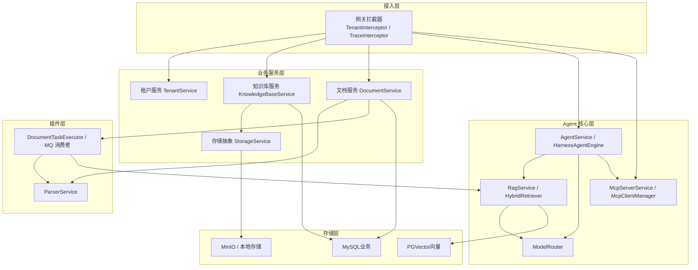
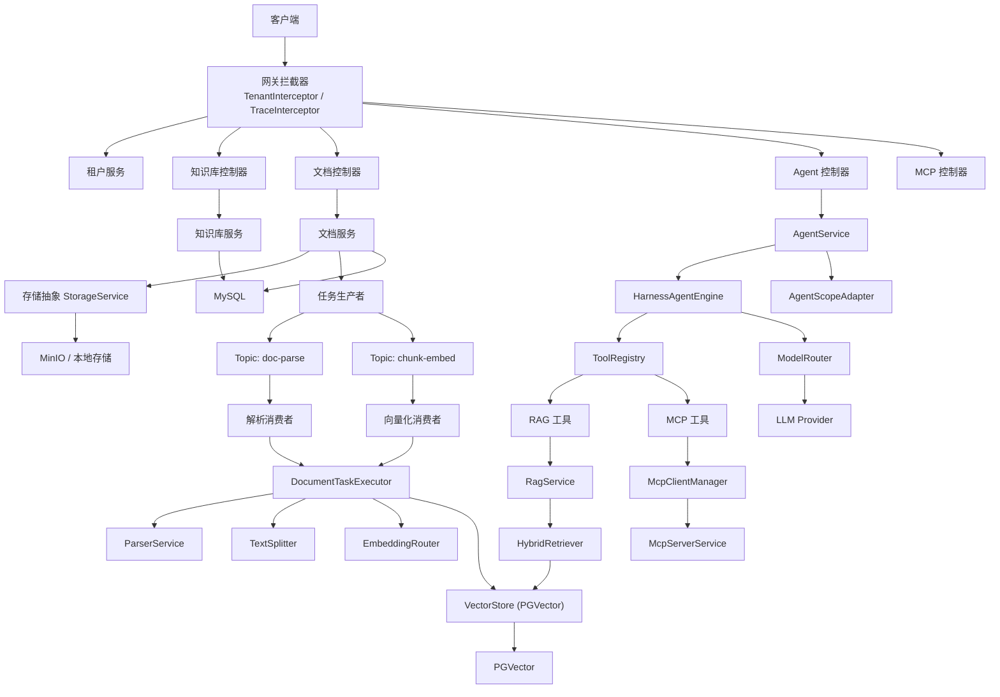
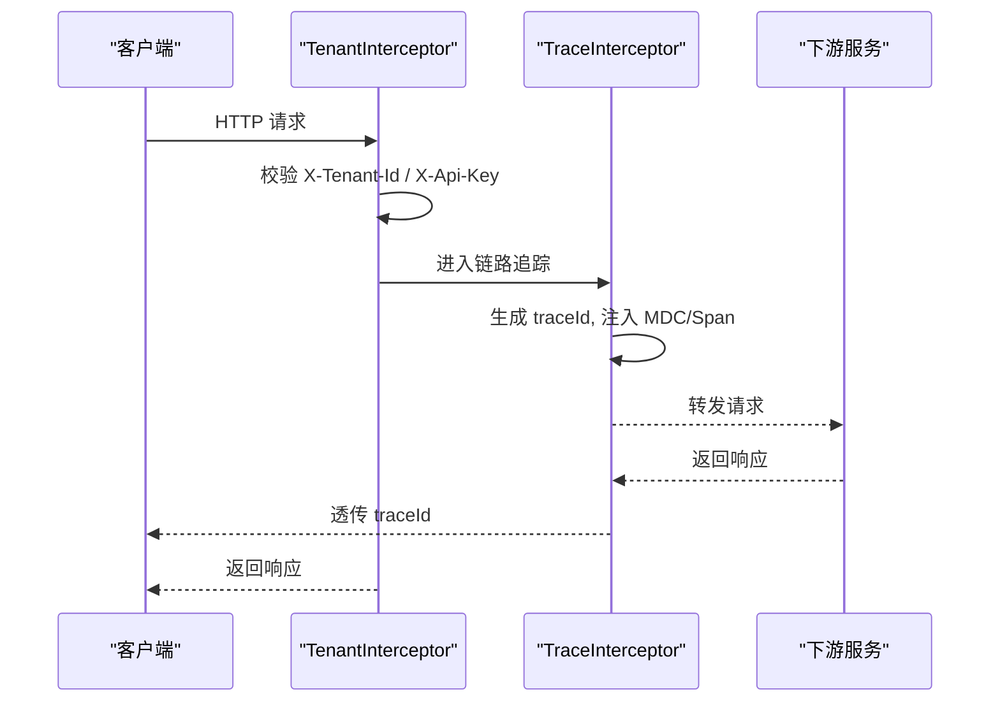
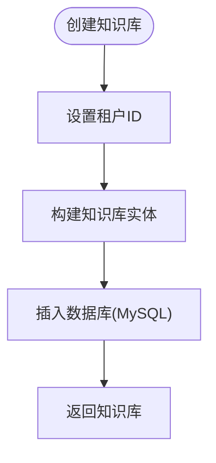
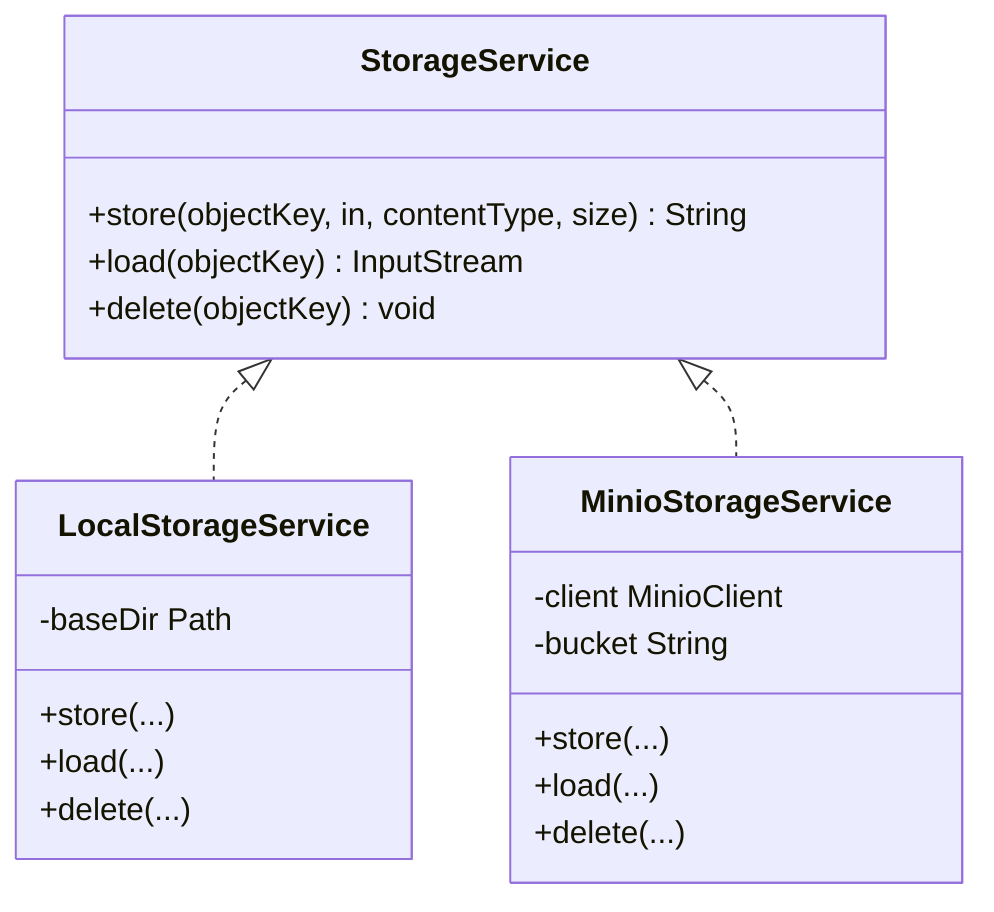
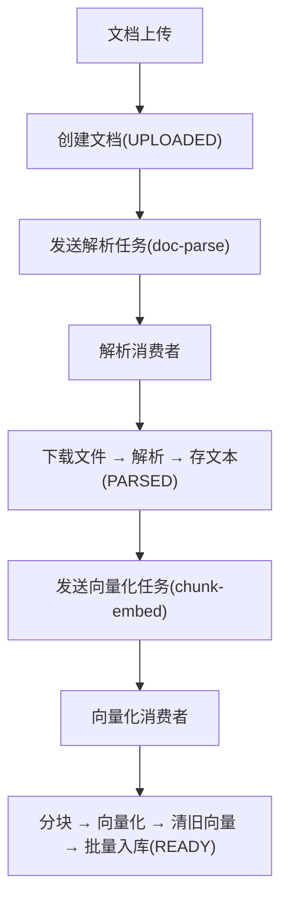
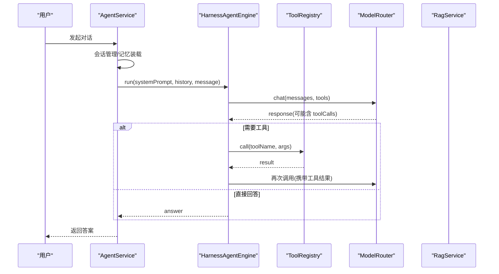
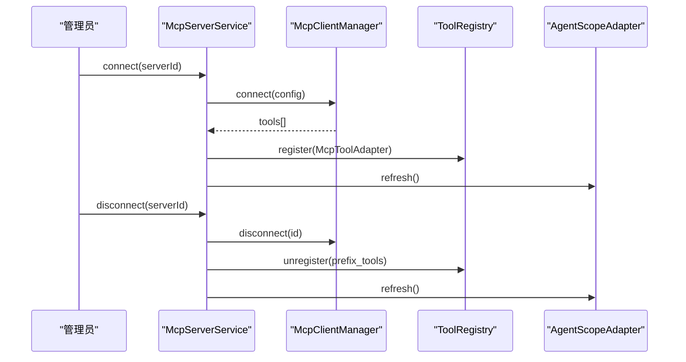
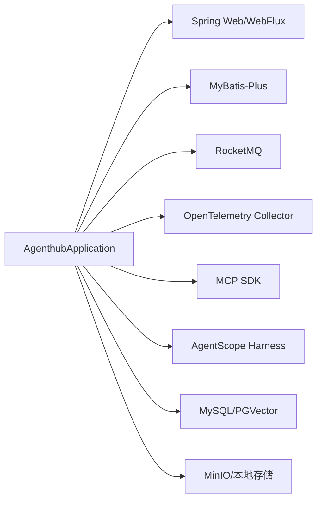

# 整体架构概览

<cite>
**本文引用的文件**   
- [README.md](file://README.md)
- [application.yml](file://src/main/resources/application.yml)
- [pom.xml](file://pom.xml)
- [AgenthubApplication.java](file://src/main/java/com/agenthub/AgenthubApplication.java)
- [TenantInterceptor.java](file://src/main/java/com/agenthub/gateway/interceptor/TenantInterceptor.java)
- [TraceInterceptor.java](file://src/main/java/com/agenthub/gateway/interceptor/TraceInterceptor.java)
- [TenantContext.java](file://src/main/java/com/agenthub/tenant/context/TenantContext.java)
- [KnowledgeBaseService.java](file://src/main/java/com/agenthub/knowledge/service/KnowledgeBaseService.java)
- [StorageService.java](file://src/main/java/com/agenthub/knowledge/storage/StorageService.java)
- [LocalStorageService.java](file://src/main/java/com/agenthub/knowledge/storage/LocalStorageService.java)
- [MinioStorageService.java](file://src/main/java/com/agenthub/knowledge/storage/MinioStorageService.java)
- [RocketMqParseConsumer.java](file://src/main/java/com/agenthub/task/consumer/RocketMqParseConsumer.java)
- [RocketMqEmbedConsumer.java](file://src/main/java/com/agenthub/task/consumer/RocketMqEmbedConsumer.java)
- [DocumentTaskExecutor.java](file://src/main/java/com/agenthub/task/executor/DocumentTaskExecutor.java)
- [ParserService.java](file://src/main/java/com/agenthub/parser/ParserService.java)
- [RagService.java](file://src/main/java/com/agenthub/rag/service/RagService.java)
- [HybridRetriever.java](file://src/main/java/com/agenthub/rag/retrieve/HybridRetriever.java)
- [ModelRouter.java](file://src/main/java/com/agenthub/llm/router/ModelRouter.java)
- [HarnessAgentEngine.java](file://src/main/java/com/agenthub/agent/harness/HarnessAgentEngine.java)
- [AgentService.java](file://src/main/java/com/agenthub/agent/service/AgentService.java)
- [McpServerService.java](file://src/main/java/com/agenthub/mcp/service/McpServerService.java)
- [McpClientManager.java](file://src/main/java/com/agenthub/mcp/client/McpClientManager.java)
</cite>

## 目录
1. [引言](#引言)
2. [项目结构](#项目结构)
3. [核心组件](#核心组件)
4. [架构总览](#架构总览)
5. [详细组件分析](#详细组件分析)
6. [依赖关系分析](#依赖关系分析)
7. [性能与可扩展性](#性能与可扩展性)
8. [故障排查指南](#故障排查指南)
9. [结论](#结论)

## 引言
本文件面向 Java Agent Hub 的整体架构，聚焦分层设计、职责边界与关键特性：严格租户隔离、异步流水线处理、双引擎编排（内置 ReAct 与 AgentScope Harness）、多模型路由、RAG 混合检索、MCP 工具接入以及全链路可观测。文档通过架构图、时序图与流程图展示组件交互和数据流向，帮助读者快速理解系统如何从“接入层”到“存储层”协同工作。

## 项目结构
Java Agent Hub 采用按领域与层次划分的模块组织方式：
- 接入层 gateway：负责请求路由、租户认证拦截、链路追踪透传。
- 业务服务层 tenant/knowledge：管理租户、知识库、文档生命周期。
- Agent 核心层 agent/rag/llm/mcp：提供智能体编排、RAG 检索、LLM 路由与 MCP 工具桥接。
- 插件层 parser/task：文档解析与异步任务生产者/消费者。
- 存储层 MySQL/PGVector/MinIO：业务数据、向量数据与对象存储。

图表来源
- [TenantInterceptor.java:18-76](file://src/main/java/com/agenthub/gateway/interceptor/TenantInterceptor.java#L18-L76)
- [TraceInterceptor.java:16-60](file://src/main/java/com/agenthub/gateway/interceptor/TraceInterceptor.java#L16-L60)
- [KnowledgeBaseService.java:15-60](file://src/main/java/com/agenthub/knowledge/service/KnowledgeBaseService.java#L15-L60)
- [StorageService.java:5-18](file://src/main/java/com/agenthub/knowledge/storage/StorageService.java#L5-L18)
- [DocumentTaskExecutor.java:25-122](file://src/main/java/com/agenthub/task/executor/DocumentTaskExecutor.java#L25-L122)
- [ParserService.java:15-38](file://src/main/java/com/agenthub/parser/ParserService.java#L15-L38)
- [RagService.java:15-70](file://src/main/java/com/agenthub/rag/service/RagService.java#L15-L70)
- [HybridRetriever.java:14-78](file://src/main/java/com/agenthub/rag/retrieve/HybridRetriever.java#L14-L78)
- [ModelRouter.java:19-108](file://src/main/java/com/agenthub/llm/router/ModelRouter.java#L19-L108)
- [HarnessAgentEngine.java:21-148](file://src/main/java/com/agenthub/agent/harness/HarnessAgentEngine.java#L21-L148)
- [AgentService.java:21-84](file://src/main/java/com/agenthub/agent/service/AgentService.java#L21-L84)
- [McpServerService.java:75-109](file://src/main/java/com/agenthub/mcp/service/McpServerService.java#L75-L109)
- [McpClientManager.java:24-35](file://src/main/java/com/agenthub/mcp/client/McpClientManager.java#L24-L35)

章节来源
- [README.md:20-36](file://README.md#L20-L36)
- [application.yml:1-155](file://src/main/resources/application.yml#L1-L155)
- [pom.xml:41-171](file://pom.xml#L41-L171)

## 核心组件
- 接入层
  - 租户认证拦截器：校验 X-Tenant-Id 与 X-Api-Key，写入 TenantContext，拒绝非法请求。
  - 链路追踪拦截器：生成 traceId，注入 MDC 与 Span 标签，支持按租户过滤。
- 业务服务层
  - 租户服务：API Key 校验、租户上下文建立。
  - 知识库服务：创建/查询/删除知识库，作为向量数据边界。
  - 存储服务：统一抽象 LocalStorageService 与 MinioStorageService，按配置切换。
- Agent 核心层
  - AgentService：对话入口，会话记忆、引擎分发（builtin/agentscope）。
  - HarnessAgentEngine：内置 ReAct 循环，工具调用与 Hook 机制。
  - RagService：向量化 → 混合检索（RRF）→ 重排 → 上下文拼装。
  - ModelRouter：多模型路由，统一 token 统计与埋点。
  - McpServerService/McpClientManager：MCP Server 连接、工具注册与调用。
- 插件层
  - ParserService：解析引擎路由（MinerU/Tika），失败降级。
  - DocumentTaskExecutor：解析与向量化流水线，幂等与重试。
  - RocketMQ 消费者：doc-parse 与 chunk-embed 两个 Topic 解耦。
- 存储层
  - MySQL：业务主库（租户/知识库/文档/会话/统计）。
  - PGVector：向量索引（HNSW），显式携带 tenant_id。
  - MinIO/本地：文件对象存储，按租户目录物理隔离。

章节来源
- [TenantInterceptor.java:18-76](file://src/main/java/com/agenthub/gateway/interceptor/TenantInterceptor.java#L18-L76)
- [TraceInterceptor.java:16-60](file://src/main/java/com/agenthub/gateway/interceptor/TraceInterceptor.java#L16-L60)
- [TenantContext.java:6-59](file://src/main/java/com/agenthub/tenant/context/TenantContext.java#L6-L59)
- [KnowledgeBaseService.java:15-60](file://src/main/java/com/agenthub/knowledge/service/KnowledgeBaseService.java#L15-L60)
- [StorageService.java:5-18](file://src/main/java/com/agenthub/knowledge/storage/StorageService.java#L5-L18)
- [LocalStorageService.java:13-65](file://src/main/java/com/agenthub/knowledge/storage/LocalStorageService.java#L13-L65)
- [MinioStorageService.java:14-82](file://src/main/java/com/agenthub/knowledge/storage/MinioStorageService.java#L14-L82)
- [AgentService.java:21-84](file://src/main/java/com/agenthub/agent/service/AgentService.java#L21-L84)
- [HarnessAgentEngine.java:21-148](file://src/main/java/com/agenthub/agent/harness/HarnessAgentEngine.java#L21-L148)
- [RagService.java:15-70](file://src/main/java/com/agenthub/rag/service/RagService.java#L15-L70)
- [HybridRetriever.java:14-78](file://src/main/java/com/agenthub/rag/retrieve/HybridRetriever.java#L14-L78)
- [ModelRouter.java:19-108](file://src/main/java/com/agenthub/llm/router/ModelRouter.java#L19-L108)
- [McpServerService.java:75-109](file://src/main/java/com/agenthub/mcp/service/McpServerService.java#L75-L109)
- [McpClientManager.java:24-35](file://src/main/java/com/agenthub/mcp/client/McpClientManager.java#L24-L35)
- [ParserService.java:15-38](file://src/main/java/com/agenthub/parser/ParserService.java#L15-L38)
- [DocumentTaskExecutor.java:25-122](file://src/main/java/com/agenthub/task/executor/DocumentTaskExecutor.java#L25-L122)
- [RocketMqParseConsumer.java:12-33](file://src/main/java/com/agenthub/task/consumer/RocketMqParseConsumer.java#L12-L33)
- [RocketMqEmbedConsumer.java:12-32](file://src/main/java/com/agenthub/task/consumer/RocketMqEmbedConsumer.java#L12-L32)

## 架构总览
系统遵循“接入层 → 业务服务层 → Agent 核心层 → 插件层 → 存储层”的分层架构，强调职责清晰、扩展灵活与可观测性强。

图表来源
- [TenantInterceptor.java:18-76](file://src/main/java/com/agenthub/gateway/interceptor/TenantInterceptor.java#L18-L76)
- [TraceInterceptor.java:16-60](file://src/main/java/com/agenthub/gateway/interceptor/TraceInterceptor.java#L16-L60)
- [KnowledgeBaseService.java:15-60](file://src/main/java/com/agenthub/knowledge/service/KnowledgeBaseService.java#L15-L60)
- [DocumentTaskExecutor.java:25-122](file://src/main/java/com/agenthub/task/executor/DocumentTaskExecutor.java#L25-L122)
- [ParserService.java:15-38](file://src/main/java/com/agenthub/parser/ParserService.java#L15-L38)
- [RagService.java:15-70](file://src/main/java/com/agenthub/rag/service/RagService.java#L15-L70)
- [HybridRetriever.java:14-78](file://src/main/java/com/agenthub/rag/retrieve/HybridRetriever.java#L14-L78)
- [ModelRouter.java:19-108](file://src/main/java/com/agenthub/llm/router/ModelRouter.java#L19-L108)
- [HarnessAgentEngine.java:21-148](file://src/main/java/com/agenthub/agent/harness/HarnessAgentEngine.java#L21-L148)
- [AgentService.java:21-84](file://src/main/java/com/agenthub/agent/service/AgentService.java#L21-L84)
- [McpServerService.java:75-109](file://src/main/java/com/agenthub/mcp/service/McpServerService.java#L75-L109)
- [McpClientManager.java:24-35](file://src/main/java/com/agenthub/mcp/client/McpClientManager.java#L24-L35)

## 详细组件分析

### 接入层：网关与拦截器
- 租户认证拦截器
  - 功能：解析 X-Tenant-Id 与 X-Api-Key，校验 API Key，设置 TenantContext，拒绝未授权请求。
  - 关键点：白名单路径跳过认证；请求结束后清理 ThreadLocal，防止线程复用串号。
- 链路追踪拦截器
  - 功能：生成 traceId，写入 MDC 与响应头，Span 附加 http.path 与 tenant.id 标签。
  - 关键点：优先透传上游 traceId，兜底生成短 ID。

图表来源
- [TenantInterceptor.java:18-76](file://src/main/java/com/agenthub/gateway/interceptor/TenantInterceptor.java#L18-L76)
- [TraceInterceptor.java:16-60](file://src/main/java/com/agenthub/gateway/interceptor/TraceInterceptor.java#L16-L60)

章节来源
- [TenantInterceptor.java:18-76](file://src/main/java/com/agenthub/gateway/interceptor/TenantInterceptor.java#L18-L76)
- [TraceInterceptor.java:16-60](file://src/main/java/com/agenthub/gateway/interceptor/TraceInterceptor.java#L16-L60)

### 业务服务层：租户与知识库
- 租户上下文
  - 基于 ThreadLocal 保存当前请求的租户身份；requireTenantId() 缺失时抛出业务异常，保证所有查询强制带租户。
- 知识库服务
  - 创建/查询/删除知识库，作为向量数据边界；MyBatis-Plus 租户插件自动追加 tenant_id。

图表来源
- [TenantContext.java:6-59](file://src/main/java/com/agenthub/tenant/context/TenantContext.java#L6-L59)
- [KnowledgeBaseService.java:25-37](file://src/main/java/com/agenthub/knowledge/service/KnowledgeBaseService.java#L25-L37)

章节来源
- [TenantContext.java:6-59](file://src/main/java/com/agenthub/tenant/context/TenantContext.java#L6-L59)
- [KnowledgeBaseService.java:15-60](file://src/main/java/com/agenthub/knowledge/service/KnowledgeBaseService.java#L15-L60)

### 存储层：文件与对象存储
- 存储抽象
  - StorageService 接口定义 store/load/delete；实现类 LocalStorageService 与 MinioStorageService 通过条件注解切换。
- 本地存储
  - 基础目录防护（路径穿越检查），读写异常封装为运行时异常。
- MinIO 存储
  - 自动确保 bucket 存在，上传/下载/删除操作封装异常。

图表来源
- [StorageService.java:5-18](file://src/main/java/com/agenthub/knowledge/storage/StorageService.java#L5-L18)
- [LocalStorageService.java:13-65](file://src/main/java/com/agenthub/knowledge/storage/LocalStorageService.java#L13-L65)
- [MinioStorageService.java:14-82](file://src/main/java/com/agenthub/knowledge/storage/MinioStorageService.java#L14-L82)

章节来源
- [StorageService.java:5-18](file://src/main/java/com/agenthub/knowledge/storage/StorageService.java#L5-L18)
- [LocalStorageService.java:13-65](file://src/main/java/com/agenthub/knowledge/storage/LocalStorageService.java#L13-L65)
- [MinioStorageService.java:14-82](file://src/main/java/com/agenthub/knowledge/storage/MinioStorageService.java#L14-L82)

### 插件层：文档解析与异步流水线
- 解析服务
  - ParserService 根据配置选择解析器（MinerU/Tika），失败时可降级。
- 异步任务执行器
  - DocumentTaskExecutor 实现 parse 与 embed 两阶段流水线：
    - parse：下载原始文件 → 解析 → 保存文本 → 投递 embed 任务。
    - embed：读取文本 → 分块 → 向量化 → 清旧向量 → 批量入库 → READY。
  - 幂等与失败处理：执行前清空旧向量；异常置 FAILED 并记录错误信息。
- MQ 消费者
  - RocketMqParseConsumer 消费 doc-parse Topic。
  - RocketMqEmbedConsumer 消费 chunk-embed Topic。

图表来源
- [ParserService.java:15-38](file://src/main/java/com/agenthub/parser/ParserService.java#L15-L38)
- [DocumentTaskExecutor.java:49-122](file://src/main/java/com/agenthub/task/executor/DocumentTaskExecutor.java#L49-L122)
- [RocketMqParseConsumer.java:12-33](file://src/main/java/com/agenthub/task/consumer/RocketMqParseConsumer.java#L12-L33)
- [RocketMqEmbedConsumer.java:12-32](file://src/main/java/com/agenthub/task/consumer/RocketMqEmbedConsumer.java#L12-L32)

章节来源
- [ParserService.java:15-38](file://src/main/java/com/agenthub/parser/ParserService.java#L15-L38)
- [DocumentTaskExecutor.java:25-122](file://src/main/java/com/agenthub/task/executor/DocumentTaskExecutor.java#L25-L122)
- [RocketMqParseConsumer.java:12-33](file://src/main/java/com/agenthub/task/consumer/RocketMqParseConsumer.java#L12-L33)
- [RocketMqEmbedConsumer.java:12-32](file://src/main/java/com/agenthub/task/consumer/RocketMqEmbedConsumer.java#L12-L32)

### Agent 核心层：编排、RAG 与 LLM 路由
- AgentService
  - 对话入口：懒连接 MCP Server，会话管理，窗口记忆装载，引擎分发（builtin/agentscope）。
- HarnessAgentEngine
  - 内置 ReAct 循环：组装消息 → 调 LLM → 有工具则执行并回填结果 → 继续，直到最终回答或超过最大迭代次数。
  - Hook 机制：beforeLLM/afterLLM/beforeTool/afterTool/onFinish，便于扩展与对齐 AgentScope。
- RagService
  - 检索流程：向量化 → 混合检索（RRF）→ 重排 → 上下文拼装（标注来源）。
- HybridRetriever
  - 向量检索 + 关键字检索，RRF 融合排序，按 kbIds 过滤。
- ModelRouter
  - 多模型路由：按路由键选择 provider 与模型，统一 token 统计与耗时埋点。

图表来源
- [AgentService.java:21-84](file://src/main/java/com/agenthub/agent/service/AgentService.java#L21-L84)
- [HarnessAgentEngine.java:52-106](file://src/main/java/com/agenthub/agent/harness/HarnessAgentEngine.java#L52-L106)
- [ModelRouter.java:45-73](file://src/main/java/com/agenthub/llm/router/ModelRouter.java#L45-L73)
- [RagService.java:39-54](file://src/main/java/com/agenthub/rag/service/RagService.java#L39-L54)

章节来源
- [AgentService.java:21-84](file://src/main/java/com/agenthub/agent/service/AgentService.java#L21-L84)
- [HarnessAgentEngine.java:21-148](file://src/main/java/com/agenthub/agent/harness/HarnessAgentEngine.java#L21-L148)
- [RagService.java:15-70](file://src/main/java/com/agenthub/rag/service/RagService.java#L15-L70)
- [HybridRetriever.java:14-78](file://src/main/java/com/agenthub/rag/retrieve/HybridRetriever.java#L14-L78)
- [ModelRouter.java:19-108](file://src/main/java/com/agenthub/llm/router/ModelRouter.java#L19-L108)

### MCP 工具接入
- McpServerService
  - connect/disconnect：建立连接并把 Server 工具注册进 Agent 工具注册表，断开时注销工具。
  - listTools/callTool：列出已连接工具或直接调用（调试用）。
- McpClientManager
  - 管理三种传输模式：streamable-http、sse、stdio；提供工具发现与调用能力。

图表来源
- [McpServerService.java:75-109](file://src/main/java/com/agenthub/mcp/service/McpServerService.java#L75-L109)
- [McpClientManager.java:24-35](file://src/main/java/com/agenthub/mcp/client/McpClientManager.java#L24-L35)

章节来源
- [McpServerService.java:75-109](file://src/main/java/com/agenthub/mcp/service/McpServerService.java#L75-L109)
- [McpClientManager.java:24-35](file://src/main/java/com/agenthub/mcp/client/McpClientManager.java#L24-L35)

## 依赖关系分析
- 应用启动与装配
  - AgenthubApplication 启用 @EnableAsync 与配置属性扫描，作为 Spring Boot 启动入口。
- 外部依赖
  - Spring Boot Web/WebFlux/AOP/Validation/JDBC/Actuator。
  - MyBatis-Plus（含租户插件与 JSqlParser）。
  - MySQL Connector/PostgreSQL Driver。
  - MinIO SDK。
  - RocketMQ Spring Boot Starter。
  - Apache Tika。
  - Micrometer Tracing + OpenTelemetry OTLP。
  - MCP Java SDK。
  - AgentScope Harness 与 OpenAI/Ollama 扩展。

图表来源
- [AgenthubApplication.java:8-22](file://src/main/java/com/agenthub/AgenthubApplication.java#L8-L22)
- [pom.xml:41-171](file://pom.xml#L41-L171)

章节来源
- [AgenthubApplication.java:8-22](file://src/main/java/com/agenthub/AgenthubApplication.java#L8-L22)
- [pom.xml:41-171](file://pom.xml#L41-L171)

## 性能与可扩展性
- 异步流水线
  - 上传接口立即返回，解析与向量化由 MQ 消费，失败可重试；解析与向量化独立 Topic，便于瓶颈扩容。
- 混合检索
  - 向量检索与关键字检索并行，RRF 融合提升召回质量；TopK 与 rrf-k 可通过配置调整。
- 多模型路由
  - 按路由键选择 provider，统一 token 统计与埋点；Mock 模型零依赖跑通全链路。
- 存储弹性
  - 文件存储可在 local/minio 间切换；PGVector 向量索引支持 HNSW 加速检索。

[本节为通用指导，不直接分析具体文件]

## 故障排查指南
- 租户认证失败
  - 现象：缺少 X-Tenant-Id 或 API Key 无效。
  - 排查：检查拦截器日志与 HeaderConstants；确认安全配置 skip-paths。
- 异步任务失败
  - 现象：文档状态停留在 PARSED/EMBEDDING/FAILED。
  - 排查：查看 MQ 消费者日志；确认解析与向量化依赖可用；检查幂等清理逻辑。
- 检索无结果
  - 现象：RAG 检索为空或分数低。
  - 排查：确认向量维度与 embedding 模型一致；检查 kbIds 过滤与 tenant_id 隔离。
- LLM 调用异常
  - 现象：ModelRouter 抛 BizException。
  - 排查：检查路由键是否配置；确认 provider base-url/api-key；查看 token 统计与耗时。

章节来源
- [TenantInterceptor.java:18-76](file://src/main/java/com/agenthub/gateway/interceptor/TenantInterceptor.java#L18-L76)
- [DocumentTaskExecutor.java:64-122](file://src/main/java/com/agenthub/task/executor/DocumentTaskExecutor.java#L64-L122)
- [HybridRetriever.java:46-78](file://src/main/java/com/agenthub/rag/retrieve/HybridRetriever.java#L46-L78)
- [ModelRouter.java:86-108](file://src/main/java/com/agenthub/llm/router/ModelRouter.java#L86-L108)

## 结论
Java Agent Hub 以分层架构为核心，将接入层、业务服务层、Agent 核心层、插件层与存储层清晰解耦，并通过严格租户隔离、异步流水线与双引擎编排等关键特性，构建了可扩展、可观测的企业级 LLM 平台。结合 RAG 混合检索与 MCP 工具接入，系统既能满足知识问答场景，又能灵活扩展外部工具能力，适配多种部署形态与生产需求。