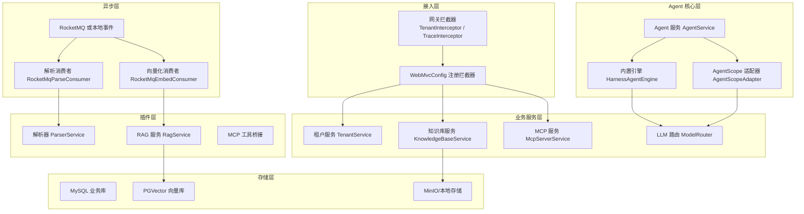
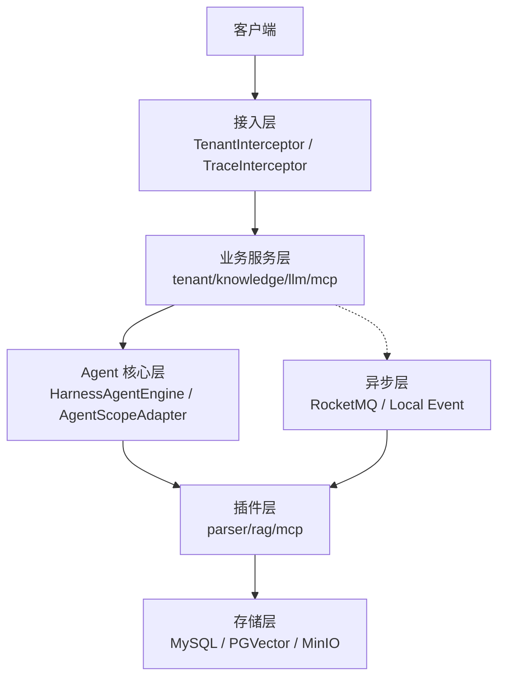
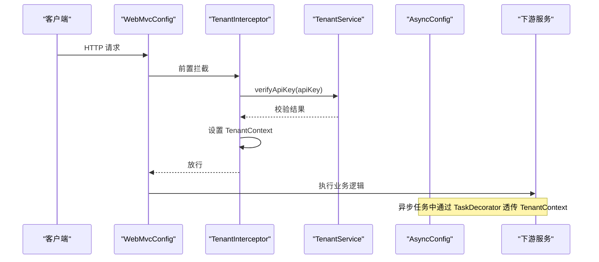
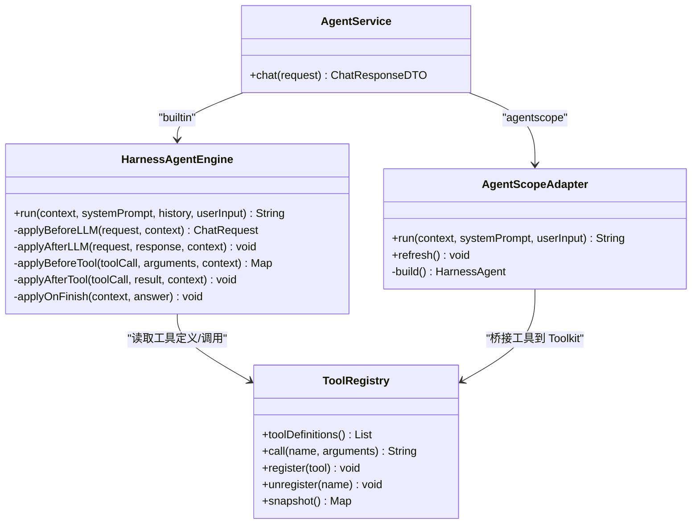
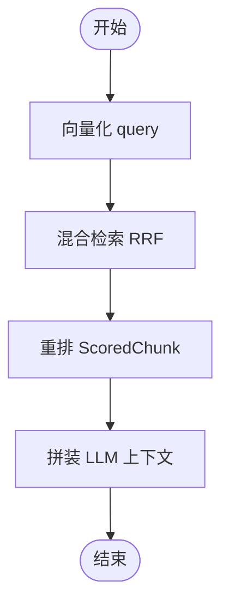
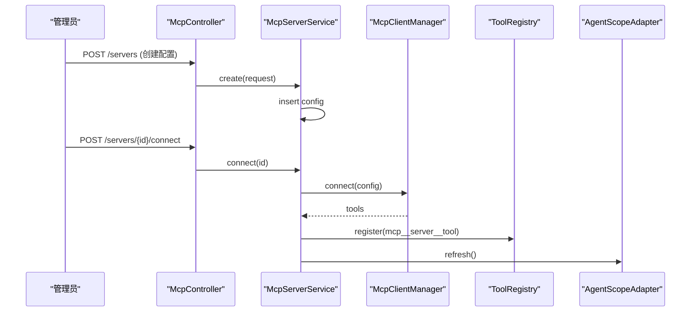
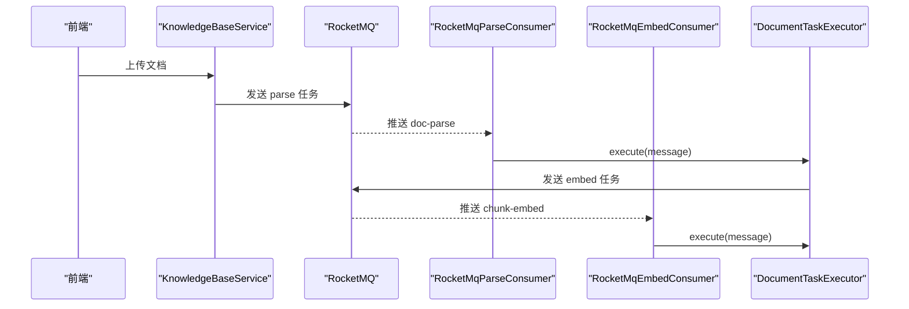
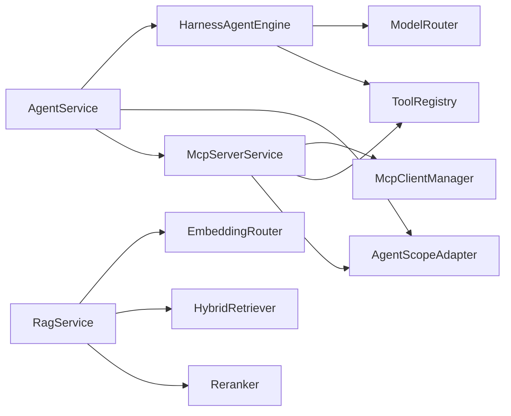

# 架构设计

<cite>
**本文引用的文件**   
- [AgenthubApplication.java](file://src/main/java/com/agenthub/AgenthubApplication.java)
- [application.yml](file://src/main/resources/application.yml)
- [README.md](file://README.md)
- [WebMvcConfig.java](file://src/main/java/com/agenthub/gateway/config/WebMvcConfig.java)
- [TenantInterceptor.java](file://src/main/java/com/agenthub/gateway/interceptor/TenantInterceptor.java)
- [AsyncConfig.java](file://src/main/java/com/agenthub/gateway/config/AsyncConfig.java)
- [TenantContext.java](file://src/main/java/com/agenthub/tenant/context/TenantContext.java)
- [KnowledgeBaseService.java](file://src/main/java/com/agenthub/knowledge/service/KnowledgeBaseService.java)
- [RagService.java](file://src/main/java/com/agenthub/rag/service/RagService.java)
- [RocketMqParseConsumer.java](file://src/main/java/com/agenthub/task/consumer/RocketMqParseConsumer.java)
- [RocketMqEmbedConsumer.java](file://src/main/java/com/agenthub/task/consumer/RocketMqEmbedConsumer.java)
- [HarnessAgentEngine.java](file://src/main/java/com/agenthub/agent/harness/HarnessAgentEngine.java)
- [AgentScopeAdapter.java](file://src/main/java/com/agenthub/agent/agentscope/AgentScopeAdapter.java)
- [AgentService.java](file://src/main/java/com/agenthub/agent/service/AgentService.java)
- [McpServerService.java](file://src/main/java/com/agenthub/mcp/service/McpServerService.java)
</cite>

## 目录
1. [引言](#引言)
2. [项目结构](#项目结构)
3. [核心组件](#核心组件)
4. [架构总览](#架构总览)
5. [详细组件分析](#详细组件分析)
6. [依赖关系分析](#依赖关系分析)
7. [性能与可扩展性](#性能与可扩展性)
8. [故障排查指南](#故障排查指南)
9. [结论](#结论)

## 引言
本架构设计文档面向 Java Agent Hub 平台，系统性阐述分层架构、关键设计模式与数据流。平台以“多租户 RAG + Harness Agent + MCP 工具”为核心能力，采用接入层（gateway）、业务服务层（tenant/knowledge/llm/mcp）、Agent 核心层（HarnessAgentEngine/AgentScopeAdapter）、插件层（parser/rag/mcp）与存储层（MySQL/PGVector/MinIO）的分层组织方式，并通过异步任务流水线与严格租户隔离机制保障企业级可用性与安全性。

## 项目结构
整体工程遵循 Spring Boot 模块化组织，按领域与职责划分包结构：
- 接入层 gateway：统一拦截器、安全校验、链路追踪、异步线程上下文透传。
- 业务服务层 tenant/knowledge/llm/mcp：租户认证与权限、知识库管理、模型路由、MCP Server 管理。
- Agent 核心层 agent：内置 ReAct 编排引擎与 AgentScope Harness 适配，记忆与会话管理。
- 插件层 parser/rag/mcp：文档解析、检索重排、MCP 工具桥接。
- 存储层 MySQL/PGVector/MinIO：业务主库、向量库、对象存储。
- 异步层 task：RocketMQ 或本地事件驱动的文档解析与向量化任务。

图表来源
- [WebMvcConfig.java:10-33](file://src/main/java/com/agenthub/gateway/config/WebMvcConfig.java#L10-L33)
- [TenantInterceptor.java:18-77](file://src/main/java/com/agenthub/gateway/interceptor/TenantInterceptor.java#L18-L77)
- [AgentService.java:28-85](file://src/main/java/com/agenthub/agent/service/AgentService.java#L28-L85)
- [RagService.java:15-71](file://src/main/java/com/agenthub/rag/service/RagService.java#L15-L71)
- [RocketMqParseConsumer.java:12-34](file://src/main/java/com/agenthub/task/consumer/RocketMqParseConsumer.java#L12-L34)
- [RocketMqEmbedConsumer.java:12-33](file://src/main/java/com/agenthub/task/consumer/RocketMqEmbedConsumer.java#L12-L33)

章节来源
- [AgenthubApplication.java:8-22](file://src/main/java/com/agenthub/AgenthubApplication.java#L8-L22)
- [application.yml:1-155](file://src/main/resources/application.yml#L1-L155)
- [README.md:20-36](file://README.md#L20-L36)

## 核心组件
- 接入层
  - WebMvcConfig：注册租户认证与链路追踪拦截器，顺序为 Tenant → Trace，保证后续 Span 携带 tenant.id。
  - TenantInterceptor：从请求头解析 X-Tenant-Id 与 X-Api-Key，调用 TenantService 校验 API Key，成功后写入 TenantContext，并在 afterCompletion 清理 ThreadLocal。
  - AsyncConfig：自定义 TaskDecorator，将主线程的 TenantContext 与 MDC 快照透传到异步线程，避免线程池复用导致串号。
- 业务服务层
  - TenantService：API Key 校验与登录态管理（由拦截器调用）。
  - KnowledgeBaseService：知识库 CRUD，创建时强制注入 tenantId，查询由 MyBatis-Plus 租户插件自动追加过滤条件。
  - LLM 路由：ModelRouter 根据配置选择 provider 与 model，支持 OpenAI/Ollama/Mock。
  - MCP 服务：McpServerService 提供连接管理、工具发现与注册，动态刷新 AgentScope 引擎的工具集。
- Agent 核心层
  - HarnessAgentEngine：内置 ReAct 循环，组装消息、调 LLM、执行工具并回填结果，通过 AgentHook 扩展生命周期。
  - AgentScopeAdapter：封装 AgentScope 2.0 HarnessAgent，懒加载单例，工具变更时重建 Agent。
  - AgentService：对话入口，负责会话管理、记忆装载、引擎分发（builtin vs agentscope），最终追加记忆。
- 插件层
  - ParserService：对接 MinerU/Tika 进行文档解析。
  - RagService：向量化、混合检索（RRF）、重排，输出结构化片段供 LLM 使用。
  - MCP 工具桥接：将远程 MCP 工具注册到 ToolRegistry，供双引擎调用。
- 存储层
  - MySQL：业务主库（租户/知识库/文档/会话/统计）。
  - PGVector：向量库（HNSW），显式携带 tenant_id 与 kb_id。
  - MinIO/本地：文件存储，按租户目录物理隔离。

章节来源
- [WebMvcConfig.java:10-33](file://src/main/java/com/agenthub/gateway/config/WebMvcConfig.java#L10-L33)
- [TenantInterceptor.java:18-77](file://src/main/java/com/agenthub/gateway/interceptor/TenantInterceptor.java#L18-L77)
- [AsyncConfig.java:14-64](file://src/main/java/com/agenthub/gateway/config/AsyncConfig.java#L14-L64)
- [KnowledgeBaseService.java:15-61](file://src/main/java/com/agenthub/knowledge/service/KnowledgeBaseService.java#L15-L61)
- [RagService.java:15-71](file://src/main/java/com/agenthub/rag/service/RagService.java#L15-L71)
- [HarnessAgentEngine.java:21-149](file://src/main/java/com/agenthub/agent/harness/HarnessAgentEngine.java#L21-L149)
- [AgentScopeAdapter.java:18-123](file://src/main/java/com/agenthub/agent/agentscope/AgentScopeAdapter.java#L18-L123)
- [AgentService.java:28-85](file://src/main/java/com/agenthub/agent/service/AgentService.java#L28-L85)
- [McpServerService.java:23-158](file://src/main/java/com/agenthub/mcp/service/McpServerService.java#L23-L158)

## 架构总览
系统采用分层架构与插件化设计，强调可观测性、可维护性与可扩展性。关键决策包括：
- 严格租户隔离：所有表带 tenant_id，MyBatis-Plus 租户插件自动过滤；向量检索 SQL 显式拼接 tenant_id；文件存储按租户目录隔离。
- 异步流水线：上传接口立即返回，解析/向量化通过 MQ 或本地事件异步处理，失败重试保证最终一致。
- 双引擎架构：builtin 内置 ReAct 零依赖；agentscope 对接 AgentScope 2.0 HarnessAgent，具备工程化中间件体系。
- 可观测性：Micrometer Tracing + OTLP 导出，Span 携带 tenant.id，便于按租户过滤与诊断。

图表来源
- [application.yml:31-44](file://src/main/resources/application.yml#L31-L44)
- [application.yml:46-98](file://src/main/resources/application.yml#L46-L98)
- [application.yml:98-150](file://src/main/resources/application.yml#L98-L150)

## 详细组件分析

### 接入层与租户隔离
- WebMvcConfig 注册拦截器顺序：Tenant → Trace，确保链路追踪 Span 包含租户信息。
- TenantInterceptor 在 preHandle 中校验 API Key，设置 TenantContext，afterCompletion 清理 ThreadLocal，防止线程复用串号。
- AsyncConfig 的 TaskDecorator 在主线程提交任务时快照 TenantContext 与 MDC，在异步线程恢复，保证 MQ 消费与 @Async 场景下的租户隔离与日志链路不丢失。
- TenantContext 提供 requireTenantId/getTenantId 等方法，缺失租户 ID 时抛出业务异常，强制下游查询携带租户。

图表来源
- [WebMvcConfig.java:23-31](file://src/main/java/com/agenthub/gateway/config/WebMvcConfig.java#L23-L31)
- [TenantInterceptor.java:31-56](file://src/main/java/com/agenthub/gateway/interceptor/TenantInterceptor.java#L31-L56)
- [AsyncConfig.java:34-62](file://src/main/java/com/agenthub/gateway/config/AsyncConfig.java#L34-L62)

章节来源
- [WebMvcConfig.java:10-33](file://src/main/java/com/agenthub/gateway/config/WebMvcConfig.java#L10-L33)
- [TenantInterceptor.java:18-77](file://src/main/java/com/agenthub/gateway/interceptor/TenantInterceptor.java#L18-L77)
- [AsyncConfig.java:14-64](file://src/main/java/com/agenthub/gateway/config/AsyncConfig.java#L14-L64)
- [TenantContext.java:6-60](file://src/main/java/com/agenthub/tenant/context/TenantContext.java#L6-L60)

### 业务服务层：知识库与租户边界
- KnowledgeBaseService 在创建知识库时强制注入 tenantId，查询列表由 MyBatis-Plus 租户插件自动追加 WHERE tenant_id = ?，删除时触发 PG 侧按 kb_id 清理向量数据。
- 知识库作为租户内向量数据的边界，检索时按 kbId 过滤，结合 tenantId 实现双重隔离。

章节来源
- [KnowledgeBaseService.java:15-61](file://src/main/java/com/agenthub/knowledge/service/KnowledgeBaseService.java#L15-L61)

### Agent 核心层：双引擎与编排
- AgentService 是对话入口，负责会话管理、记忆装载与引擎分发：
  - builtin：调用 HarnessAgentEngine 执行 ReAct 循环。
  - agentscope：调用 AgentScopeAdapter 执行 HarnessAgent。
- HarnessAgentEngine：
  - 组装消息（systemPrompt + history + userInput）。
  - 调 LLM，若返回 toolCalls，则逐个执行工具并回填结果，直到收敛或超过最大迭代次数。
  - 通过 AgentHook 在 LLM 调用前后、工具执行前后与完成时插入钩子。
- AgentScopeAdapter：
  - 懒加载 HarnessAgent 单例，首次构建时将 ToolRegistry 中的工具桥接为 AgentScope Toolkit。
  - 工具变更后 refresh() 重建 Agent，确保动态工具生效。

图表来源
- [AgentService.java:28-85](file://src/main/java/com/agenthub/agent/service/AgentService.java#L28-L85)
- [HarnessAgentEngine.java:21-149](file://src/main/java/com/agenthub/agent/harness/HarnessAgentEngine.java#L21-L149)
- [AgentScopeAdapter.java:18-123](file://src/main/java/com/agenthub/agent/agentscope/AgentScopeAdapter.java#L18-L123)

章节来源
- [AgentService.java:28-85](file://src/main/java/com/agenthub/agent/service/AgentService.java#L28-L85)
- [HarnessAgentEngine.java:21-149](file://src/main/java/com/agenthub/agent/harness/HarnessAgentEngine.java#L21-L149)
- [AgentScopeAdapter.java:18-123](file://src/main/java/com/agenthub/agent/agentscope/AgentScopeAdapter.java#L18-L123)

### 插件层：RAG 检索流程
- RagService 编排检索流程：
  - 通过 EmbeddingRouter 对 query 进行向量化。
  - HybridRetriever 执行混合检索（向量 + 关键字，RRF 融合）。
  - Reranker 对候选片段重排。
  - 输出 RetrievalResult 列表，供 LLM 上下文拼装。
- 检索过程强制携带 tenantId，确保跨租户数据隔离。

图表来源
- [RagService.java:30-69](file://src/main/java/com/agenthub/rag/service/RagService.java#L30-L69)

章节来源
- [RagService.java:15-71](file://src/main/java/com/agenthub/rag/service/RagService.java#L15-L71)

### 插件层：MCP 工具接入
- McpServerService 提供 MCP Server 配置的 CRUD、连接管理与工具注册：
  - connect：建立连接，发现工具并以 mcp__{server}__{tool} 命名注册进 ToolRegistry，同时刷新 AgentScope Adapter。
  - disconnect：断开连接并注销该 Server 的全部工具，刷新 AgentScope Adapter。
  - ensureConnectedForTenant：懒连接当前租户启用的 MCP Server，避免启动阶段无租户上下文时跨租户重连。
- 工具注册后，内置引擎可直接调用，AgentScope 引擎通过 Toolkit 桥接使用。

图表来源
- [McpServerService.java:75-97](file://src/main/java/com/agenthub/mcp/service/McpServerService.java#L75-L97)
- [AgentScopeAdapter.java:85-113](file://src/main/java/com/agenthub/agent/agentscope/AgentScopeAdapter.java#L85-L113)

章节来源
- [McpServerService.java:23-158](file://src/main/java/com/agenthub/mcp/service/McpServerService.java#L23-L158)

### 异步任务处理：文档解析与向量化
- 异步流水线：UPLOADED → PARSING → PARSED → EMBEDDING → READY。
- RocketMqParseConsumer 消费 doc-parse Topic，调用 DocumentTaskExecutor 执行解析流程。
- RocketMqEmbedConsumer 消费 chunk-embed Topic，执行分块、向量化与入库。
- 两种消费者均基于 ConditionalOnProperty 控制是否启用，local 模式下使用 Spring 事件降级。

图表来源
- [RocketMqParseConsumer.java:12-34](file://src/main/java/com/agenthub/task/consumer/RocketMqParseConsumer.java#L12-L34)
- [RocketMqEmbedConsumer.java:12-33](file://src/main/java/com/agenthub/task/consumer/RocketMqEmbedConsumer.java#L12-L33)

章节来源
- [RocketMqParseConsumer.java:12-34](file://src/main/java/com/agenthub/task/consumer/RocketMqParseConsumer.java#L12-L34)
- [RocketMqEmbedConsumer.java:12-33](file://src/main/java/com/agenthub/task/consumer/RocketMqEmbedConsumer.java#L12-L33)

## 依赖关系分析
- 组件耦合与内聚
  - 接入层与业务层解耦：通过拦截器统一鉴权与追踪，业务服务专注领域逻辑。
  - Agent 核心层与插件层解耦：通过 ToolRegistry 抽象工具定义与调用，内置引擎与 AgentScope 引擎共享工具集。
  - 存储层通过独立数据源与配置隔离：MySQL 业务库、PGVector 向量库、MinIO/本地存储。
- 直接依赖
  - AgentService 依赖 MemoryService、HarnessAgentEngine、AgentScopeAdapter、McpServerService。
  - HarnessAgentEngine 依赖 ModelRouter、ToolRegistry、AgentHook。
  - RagService 依赖 EmbeddingRouter、HybridRetriever、Reranker。
  - McpServerService 依赖 McpClientManager、ToolRegistry、AgentScopeAdapter。
- 外部依赖
  - LLM 提供商：OpenAI/Ollama/Mock。
  - 向量模型：Ollama/OpenAI/Mock。
  - 消息队列：RocketMQ（可选，local 降级）。
  - 对象存储：MinIO（可选，local 降级）。

图表来源
- [AgentService.java:28-85](file://src/main/java/com/agenthub/agent/service/AgentService.java#L28-L85)
- [HarnessAgentEngine.java:21-149](file://src/main/java/com/agenthub/agent/harness/HarnessAgentEngine.java#L21-L149)
- [RagService.java:15-71](file://src/main/java/com/agenthub/rag/service/RagService.java#L15-L71)
- [McpServerService.java:23-158](file://src/main/java/com/agenthub/mcp/service/McpServerService.java#L23-L158)

章节来源
- [application.yml:98-150](file://src/main/resources/application.yml#L98-L150)

## 性能与可扩展性
- 性能考虑
  - 连接池：MySQL HikariCP 最大连接数 20，最小空闲 5，连接超时 10s，避免资源耗尽。
  - 异步线程池：core=4、max=16、queue=200，避免阻塞主线程，提升吞吐。
  - 向量检索：PGVector HNSW 索引加速相似度搜索，RRF 融合提升召回质量。
  - LLM 路由：多 provider 配置，Mock 模型用于零依赖演示，生产切换真实模型。
- 可扩展性
  - 插件化：Parser、Embedding、Reranker、Retriever 均可替换实现。
  - 引擎切换：builtin vs agentscope 通过配置切换，互不影响。
  - 存储扩展：MinIO 替代本地存储，PGVector 独立部署，MySQL 读写分离。
  - 异步扩展：RocketMQ 支持水平扩容消费者，解析与向量化独立扩缩容。

[本节为通用指导，不直接分析具体文件]

## 故障排查指南
- 租户隔离问题
  - 现象：跨租户数据泄露或查询为空。
  - 排查：检查 TenantInterceptor 是否正确设置 TenantContext；确认 MyBatis-Plus 租户插件已启用；检查向量检索 SQL 是否显式携带 tenantId。
- 异步任务失败
  - 现象：文档未解析或未入库。
  - 排查：查看 RocketMQ 消费者日志；确认 Topic 与 consumerGroup 配置；检查幂等设计与重试队列。
- Agent 引擎异常
  - 现象：内置引擎超过最大迭代次数或 AgentScope 引擎执行超时。
  - 排查：调整 max-iterations；检查 ToolRegistry 工具定义；确认 LLM 响应格式与工具参数解析。
- MCP 工具不可用
  - 现象：Agent 无法调用 MCP 工具。
  - 排查：确认 McpServerService.connect 成功；检查 ToolRegistry 是否注册；确认 AgentScopeAdapter.refresh() 已执行。

章节来源
- [TenantInterceptor.java:31-56](file://src/main/java/com/agenthub/gateway/interceptor/TenantInterceptor.java#L31-L56)
- [RocketMqParseConsumer.java:28-32](file://src/main/java/com/agenthub/task/consumer/RocketMqParseConsumer.java#L28-L32)
- [RocketMqEmbedConsumer.java:28-32](file://src/main/java/com/agenthub/task/consumer/RocketMqEmbedConsumer.java#L28-L32)
- [HarnessAgentEngine.java:104-106](file://src/main/java/com/agenthub/agent/harness/HarnessAgentEngine.java#L104-L106)
- [AgentScopeAdapter.java:48-65](file://src/main/java/com/agenthub/agent/agentscope/AgentScopeAdapter.java#L48-L65)
- [McpServerService.java:75-97](file://src/main/java/com/agenthub/mcp/service/McpServerService.java#L75-L97)

## 结论
Java Agent Hub 通过分层架构与插件化设计，实现了多租户 RAG、Harness Agent 与 MCP 工具的有机整合。严格租户隔离、异步流水线与双引擎架构保障了系统的稳定性、可扩展性与可观测性。未来可在更多 LLM/Embedding 提供商、向量检索算法与存储后端上持续扩展，满足不同企业场景需求。