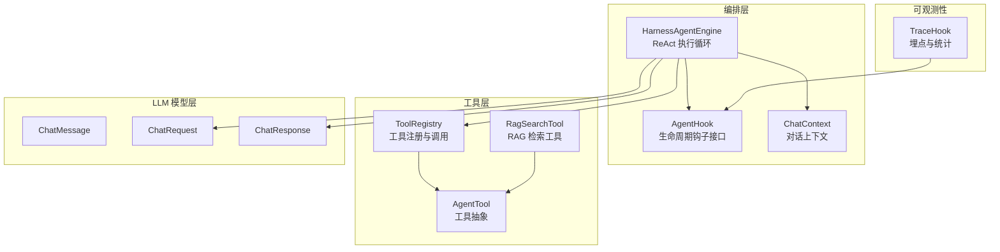
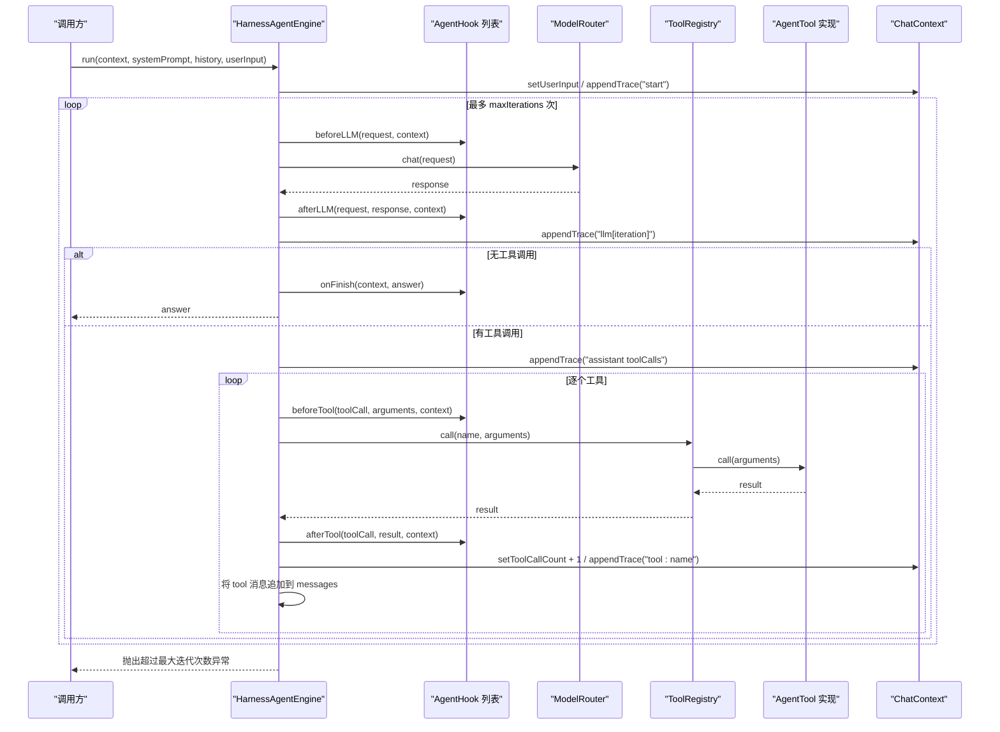
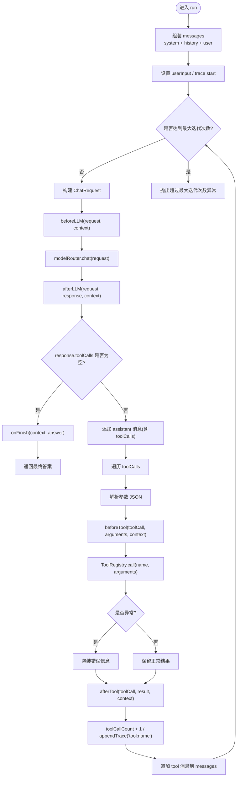
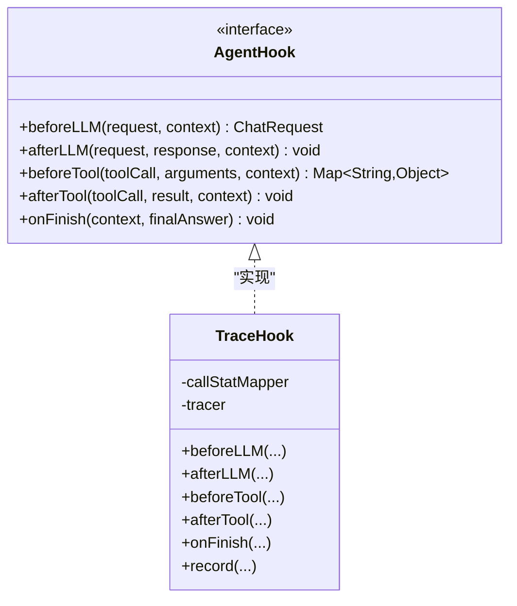
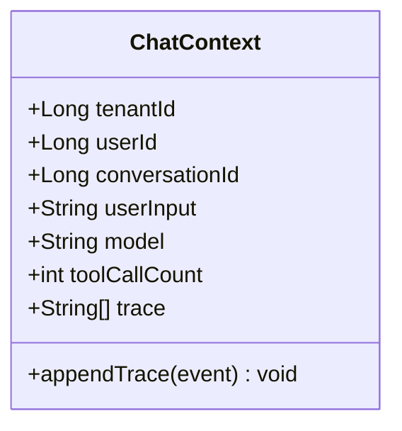
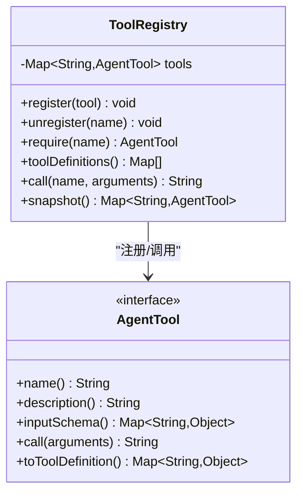
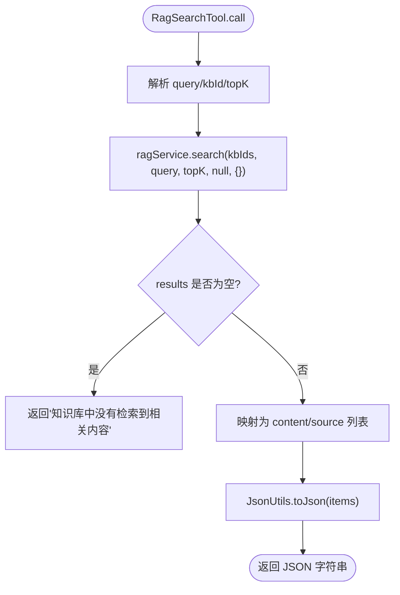
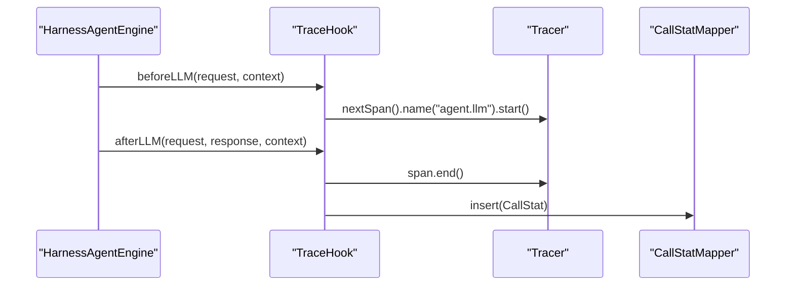
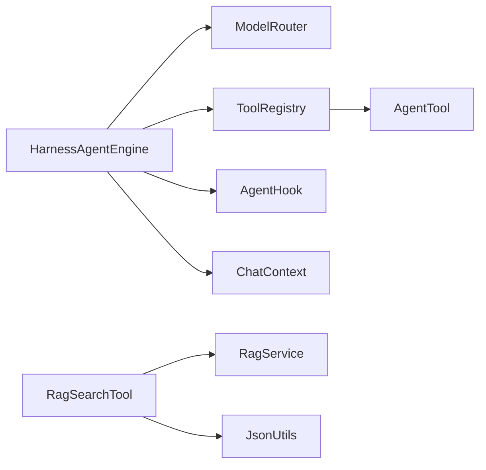

# Agent 编排引擎

<cite>
**本文引用的文件**   
- [HarnessAgentEngine.java](file://src/main/java/com/agenthub/agent/harness/HarnessAgentEngine.java)
- [AgentHook.java](file://src/main/java/com/agenthub/agent/harness/AgentHook.java)
- [ChatContext.java](file://src/main/java/com/agenthub/agent/harness/ChatContext.java)
- [ToolRegistry.java](file://src/main/java/com/agenthub/agent/tool/ToolRegistry.java)
- [AgentTool.java](file://src/main/java/com/agenthub/agent/tool/AgentTool.java)
- [RagSearchTool.java](file://src/main/java/com/agenthub/agent/tool/RagSearchTool.java)
- [TraceHook.java](file://src/main/java/com/agenthub/tracing/hook/TraceHook.java)
- [ChatMessage.java](file://src/main/java/com/agenthub/llm/model/ChatMessage.java)
- [ChatRequest.java](file://src/main/java/com/agenthub/llm/model/ChatRequest.java)
- [ChatResponse.java](file://src/main/java/com/agenthub/llm/model/ChatResponse.java)
</cite>

## 目录
1. [简介](#简介)
2. [项目结构](#项目结构)
3. [核心组件](#核心组件)
4. [架构总览](#架构总览)
5. [详细组件分析](#详细组件分析)
6. [依赖关系分析](#依赖关系分析)
7. [性能与可扩展性](#性能与可扩展性)
8. [故障排查指南](#故障排查指南)
9. [结论](#结论)

## 简介
本文件面向 HarnessAgentEngine 的 ReAct 模式实现，系统性说明执行循环、生命周期钩子、上下文管理、工具注册与调用机制，并给出扩展 Hook 与自定义工具的实践路径。文档以代码级事实为依据，辅以可视化图示，帮助读者快速理解并安全扩展该编排引擎。

## 项目结构
围绕 Agent 编排的核心代码集中在以下包：
- agent.harness：编排引擎、Hook 接口、对话上下文
- agent.tool：工具抽象、工具注册表、内置 RAG 检索工具
- llm.model：统一的消息、请求、响应模型
- tracing.hook：埋点 Hook 示例

图表来源
- [HarnessAgentEngine.java:21-31](file://src/main/java/com/agenthub/agent/harness/HarnessAgentEngine.java#L21-L31)
- [AgentHook.java:10-37](file://src/main/java/com/agenthub/agent/harness/AgentHook.java#L10-L37)
- [ChatContext.java:10-42](file://src/main/java/com/agenthub/agent/harness/ChatContext.java#L10-L42)
- [ToolRegistry.java:11-49](file://src/main/java/com/agenthub/agent/tool/ToolRegistry.java#L11-L49)
- [AgentTool.java:5-31](file://src/main/java/com/agenthub/agent/tool/AgentTool.java#L5-L31)
- [RagSearchTool.java:12-65](file://src/main/java/com/agenthub/agent/tool/RagSearchTool.java#L12-L65)
- [TraceHook.java:18-82](file://src/main/java/com/agenthub/tracing/hook/TraceHook.java#L18-L82)
- [ChatMessage.java:13-46](file://src/main/java/com/agenthub/llm/model/ChatMessage.java#L13-L46)
- [ChatRequest.java:14-33](file://src/main/java/com/agenthub/llm/model/ChatRequest.java#L14-L33)
- [ChatResponse.java:13-30](file://src/main/java/com/agenthub/llm/model/ChatResponse.java#L13-L30)

章节来源
- [HarnessAgentEngine.java:21-31](file://src/main/java/com/agenthub/agent/harness/HarnessAgentEngine.java#L21-L31)

## 核心组件
- HarnessAgentEngine：ReAct 执行循环主体，负责消息组装、LLM 调用、工具执行与结果回填，并在关键节点触发 Hook。
- AgentHook：定义 beforeLLM、afterLLM、beforeTool、afterTool、onFinish 五个生命周期钩子，用于注入权限校验、参数改写、埋点、审计等横切逻辑。
- ChatContext：单次对话的生命周期上下文，承载租户、用户、会话、模型路由键、工具调用计数、追踪轨迹等状态。
- ToolRegistry：工具注册中心，维护工具映射、提供工具定义（function calling）和工具调用入口。
- AgentTool：工具统一抽象，包含 name、description、inputSchema、call 等方法，支持转换为 OpenAI function calling 格式。
- RagSearchTool：内置 RAG 检索工具，演示如何基于业务服务实现工具。
- TraceHook：埋点 Hook 示例，记录 LLM 与工具调用的耗时、token 消耗，并写入统计表。

章节来源
- [HarnessAgentEngine.java:33-43](file://src/main/java/com/agenthub/agent/harness/HarnessAgentEngine.java#L33-L43)
- [AgentHook.java:14-37](file://src/main/java/com/agenthub/agent/harness/AgentHook.java#L14-L37)
- [ChatContext.java:16-42](file://src/main/java/com/agenthub/agent/harness/ChatContext.java#L16-L42)
- [ToolRegistry.java:17-53](file://src/main/java/com/agenthub/agent/tool/ToolRegistry.java#L17-L53)
- [AgentTool.java:9-31](file://src/main/java/com/agenthub/agent/tool/AgentTool.java#L9-L31)
- [RagSearchTool.java:18-65](file://src/main/java/com/agenthub/agent/tool/RagSearchTool.java#L18-L65)
- [TraceHook.java:24-82](file://src/main/java/com/agenthub/tracing/hook/TraceHook.java#L24-L82)

## 架构总览
下图展示一次 Agent 对话从输入到最终回答的完整流程，包括 ReAct 循环、Hook 插桩、工具执行与结果回填。

图表来源
- [HarnessAgentEngine.java:52-106](file://src/main/java/com/agenthub/agent/harness/HarnessAgentEngine.java#L52-L106)
- [AgentHook.java:16-36](file://src/main/java/com/agenthub/agent/harness/AgentHook.java#L16-L36)
- [ToolRegistry.java:41-49](file://src/main/java/com/agenthub/agent/tool/ToolRegistry.java#L41-L49)
- [AgentTool.java:20-31](file://src/main/java/com/agenthub/agent/tool/AgentTool.java#L20-L31)
- [ChatContext.java:27-41](file://src/main/java/com/agenthub/agent/harness/ChatContext.java#L27-L41)

## 详细组件分析

### HarnessAgentEngine：ReAct 执行循环
- 消息组装：在每次循环前，将系统提示词、历史消息与本次用户输入拼接为 messages，并更新 ChatContext 的用户输入与追踪事件。
- LLM 调用：构造 ChatRequest，通过 ModelRouter.chat 发起调用；在调用前后分别触发 beforeLLM 与 afterLLM 钩子。
- 工具判定：若响应中不存在工具调用列表，则视为最终回答，触发 onFinish 钩子并返回。
- 工具执行：对每个 ToolCall，解析参数、触发 beforeTool 钩子、调用 ToolRegistry.call，捕获异常后包装错误信息，触发 afterTool 钩子，并将工具结果作为 tool 角色消息追加到 messages，继续下一轮。
- 收敛控制：超过最大迭代次数时抛出业务异常，避免无限循环。

图表来源
- [HarnessAgentEngine.java:52-106](file://src/main/java/com/agenthub/agent/harness/HarnessAgentEngine.java#L52-L106)
- [HarnessAgentEngine.java:138-147](file://src/main/java/com/agenthub/agent/harness/HarnessAgentEngine.java#L138-L147)

章节来源
- [HarnessAgentEngine.java:52-106](file://src/main/java/com/agenthub/agent/harness/HarnessAgentEngine.java#L52-L106)
- [HarnessAgentEngine.java:108-147](file://src/main/java/com/agenthub/agent/harness/HarnessAgentEngine.java#L108-L147)

### AgentHook：生命周期钩子
- beforeLLM：在 LLM 调用前，允许改写 ChatRequest（如注入上下文、压缩记忆、动态调整 temperature）。
- afterLLM：在 LLM 调用后，可观测响应、记录埋点、统计 token 使用。
- beforeTool：在工具执行前，可拦截或改写参数（如权限校验、租户过滤、默认值填充）。
- afterTool：在工具执行后，可观测结果、记录日志、上报指标。
- onFinish：对话结束时统一收尾，如汇总统计、清理资源。

图表来源
- [AgentHook.java:14-37](file://src/main/java/com/agenthub/agent/harness/AgentHook.java#L14-L37)
- [TraceHook.java:27-82](file://src/main/java/com/agenthub/tracing/hook/TraceHook.java#L27-L82)

章节来源
- [AgentHook.java:14-37](file://src/main/java/com/agenthub/agent/harness/AgentHook.java#L14-L37)
- [TraceHook.java:27-82](file://src/main/java/com/agenthub/tracing/hook/TraceHook.java#L27-L82)

### ChatContext：上下文管理
- 字段职责：
  - tenantId、userId、conversationId：多租户与会话标识
  - userInput：本轮用户输入
  - model：模型路由键
  - toolCallCount：本轮累计工具调用次数
  - trace：执行轨迹列表，便于调试与观测
- 常用操作：appendTrace 追加事件；setter 方法更新状态。

图表来源
- [ChatContext.java:16-42](file://src/main/java/com/agenthub/agent/harness/ChatContext.java#L16-L42)

章节来源
- [ChatContext.java:16-42](file://src/main/java/com/agenthub/agent/harness/ChatContext.java#L16-L42)

### ToolRegistry：工具注册与调用
- 注册与注销：register 按名称注册工具，同名覆盖；unregister 移除工具。
- 查询与快照：require 按名获取工具，未注册抛业务异常；snapshot 返回不可变快照。
- 工具定义：toolDefinitions 将所有 AgentTool 转换为 OpenAI function calling 格式，供 LLM 选择工具。
- 工具调用：call 委托给具体 AgentTool 实现，返回文本结果。

图表来源
- [ToolRegistry.java:17-53](file://src/main/java/com/agenthub/agent/tool/ToolRegistry.java#L17-L53)
- [AgentTool.java:9-31](file://src/main/java/com/agenthub/agent/tool/AgentTool.java#L9-L31)

章节来源
- [ToolRegistry.java:17-53](file://src/main/java/com/agenthub/agent/tool/ToolRegistry.java#L17-L53)
- [AgentTool.java:9-31](file://src/main/java/com/agenthub/agent/tool/AgentTool.java#L9-L31)

### RagSearchTool：内置 RAG 检索工具示例
- 工具元数据：name 固定为 rag_search；description 描述使用场景与参数；inputSchema 定义 query、kbId、topK 的参数类型与必填项。
- 执行逻辑：解析参数，调用 RagService.search，将检索结果序列化为 JSON 字符串返回；若无结果返回友好提示。

图表来源
- [RagSearchTool.java:37-65](file://src/main/java/com/agenthub/agent/tool/RagSearchTool.java#L37-L65)

章节来源
- [RagSearchTool.java:26-65](file://src/main/java/com/agenthub/agent/tool/RagSearchTool.java#L26-L65)

### TraceHook：埋点与统计示例
- LLM 钩子：beforeLLM 记录开始时间并创建 Span；afterLLM 结束 Span、计算耗时、记录 usage 与 traceId。
- 工具钩子：beforeTool/afterTool 记录工具调用耗时。
- 结束钩子：onFinish 汇总工具调用次数并打标签。
- 落库：record 异步写入 call_stat 表，失败仅告警不中断主流程。

图表来源
- [TraceHook.java:37-59](file://src/main/java/com/agenthub/tracing/hook/TraceHook.java#L37-L59)
- [TraceHook.java:84-109](file://src/main/java/com/agenthub/tracing/hook/TraceHook.java#L84-L109)

章节来源
- [TraceHook.java:37-82](file://src/main/java/com/agenthub/tracing/hook/TraceHook.java#L37-L82)
- [TraceHook.java:84-109](file://src/main/java/com/agenthub/tracing/hook/TraceHook.java#L84-L109)

## 依赖关系分析
- HarnessAgentEngine 依赖：
  - ModelRouter：实际 LLM 调用
  - ToolRegistry：工具定义与执行
  - AgentHook：生命周期扩展点
  - ChatContext：上下文状态
- ToolRegistry 依赖：
  - AgentTool：工具抽象
  - BizException/ErrorCode：未注册工具的错误处理
- RagSearchTool 依赖：
  - RagService：RAG 检索能力
  - JsonUtils：序列化输出

图表来源
- [HarnessAgentEngine.java:38-40](file://src/main/java/com/agenthub/agent/harness/HarnessAgentEngine.java#L38-L40)
- [ToolRegistry.java:17-49](file://src/main/java/com/agenthub/agent/tool/ToolRegistry.java#L17-L49)
- [RagSearchTool.java:18-65](file://src/main/java/com/agenthub/agent/tool/RagSearchTool.java#L18-L65)

章节来源
- [HarnessAgentEngine.java:38-40](file://src/main/java/com/agenthub/agent/harness/HarnessAgentEngine.java#L38-L40)
- [ToolRegistry.java:17-49](file://src/main/java/com/agenthub/agent/tool/ToolRegistry.java#L17-L49)
- [RagSearchTool.java:18-65](file://src/main/java/com/agenthub/agent/tool/RagSearchTool.java#L18-L65)

## 性能与可扩展性
- 性能特性
  - ReAct 循环上限由配置项控制，避免无限迭代。
  - 工具参数解析采用容错策略，空或非法 JSON 返回空 Map，降低因 LLM 参数不规范导致的失败概率。
  - 工具异常被捕获并包装为友好错误信息，保证循环继续推进。
- 可扩展性设计
  - Hook 机制：通过 AgentHook 接口在关键节点插入横切逻辑，支持权限、审计、埋点、参数改写等。
  - 工具扩展：实现 AgentTool 接口并通过 ToolRegistry.register 注册即可暴露给 LLM。
  - 上下文扩展：ChatContext 可承载更多运行时状态，供 Hook 与工具共享。
- 优化建议
  - 在 beforeLLM 中实现消息压缩或记忆裁剪，减少 token 消耗。
  - 在 beforeTool 中进行参数校验与默认值填充，提升鲁棒性。
  - 在 afterTool/onFinish 中聚合指标，结合 TraceHook 进行全链路观测。

章节来源
- [HarnessAgentEngine.java:42-43](file://src/main/java/com/agenthub/agent/harness/HarnessAgentEngine.java#L42-L43)
- [HarnessAgentEngine.java:138-147](file://src/main/java/com/agenthub/agent/harness/HarnessAgentEngine.java#L138-L147)
- [HarnessAgentEngine.java:91-99](file://src/main/java/com/agenthub/agent/harness/HarnessAgentEngine.java#L91-L99)

## 故障排查指南
- 常见异常
  - 超过最大迭代次数：当 LLM 持续产生工具调用而未收敛时抛出业务异常，需检查系统提示词与工具定义是否引导模型正确收敛。
  - 未注册的工具：ToolRegistry.require 找不到工具时会抛出业务异常，需确认工具已正确注册且名称一致。
  - 工具调用失败：工具实现内部异常会被捕获并包装为错误信息，需查看工具实现与日志定位根因。
- 排查步骤
  - 查看 ChatContext.trace 中的事件顺序，确认是否在预期阶段发生异常。
  - 检查 TraceHook 记录的耗时与 token 使用情况，评估 LLM 与工具的性能瓶颈。
  - 校验 inputSchema 与实际参数是否匹配，必要时在 beforeTool 中做参数规范化。

章节来源
- [HarnessAgentEngine.java:105-106](file://src/main/java/com/agenthub/agent/harness/HarnessAgentEngine.java#L105-L106)
- [ToolRegistry.java:32-39](file://src/main/java/com/agenthub/agent/tool/ToolRegistry.java#L32-L39)
- [HarnessAgentEngine.java:91-99](file://src/main/java/com/agenthub/agent/harness/HarnessAgentEngine.java#L91-L99)

## 结论
HarnessAgentEngine 提供了清晰、可控的 ReAct 执行循环，配合 AgentHook 生命周期钩子与 ChatContext 上下文管理，实现了高内聚、低耦合的 Agent 编排能力。ToolRegistry 与 AgentTool 抽象使工具扩展简单直观，内置 RagSearchTool 展示了典型用法。通过 TraceHook 可实现全链路可观测性。整体设计具备良好的可扩展性与健壮性，适合在企业级场景中按需扩展 Hook 与工具，满足复杂业务需求。