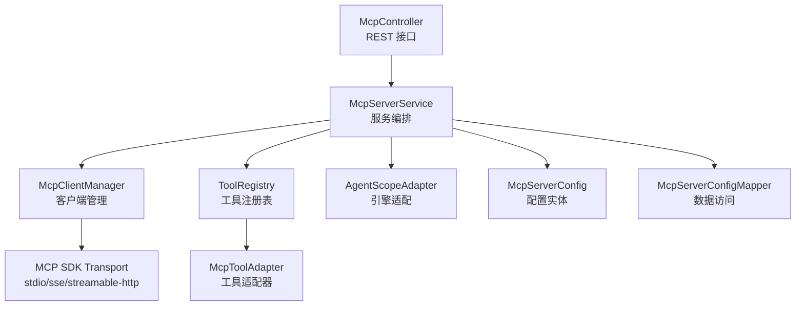
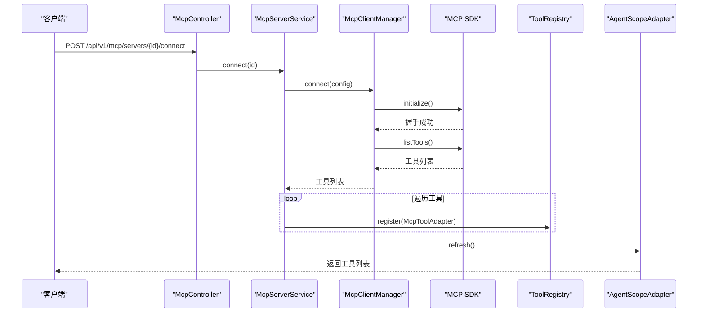
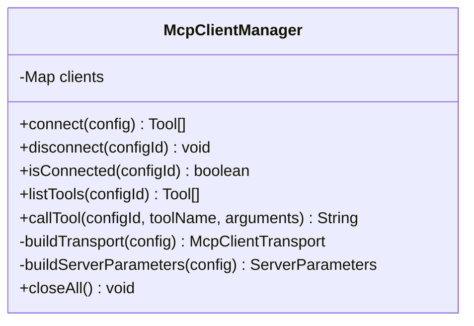
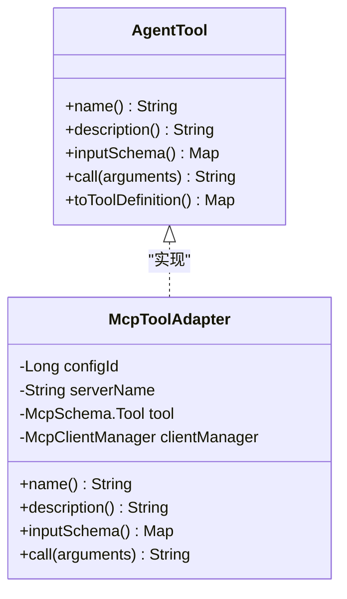
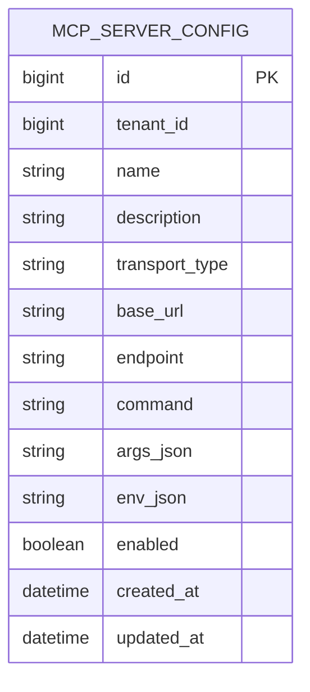
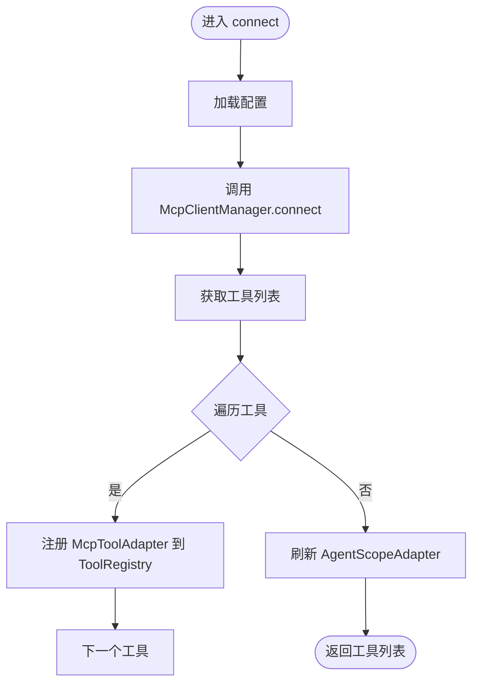
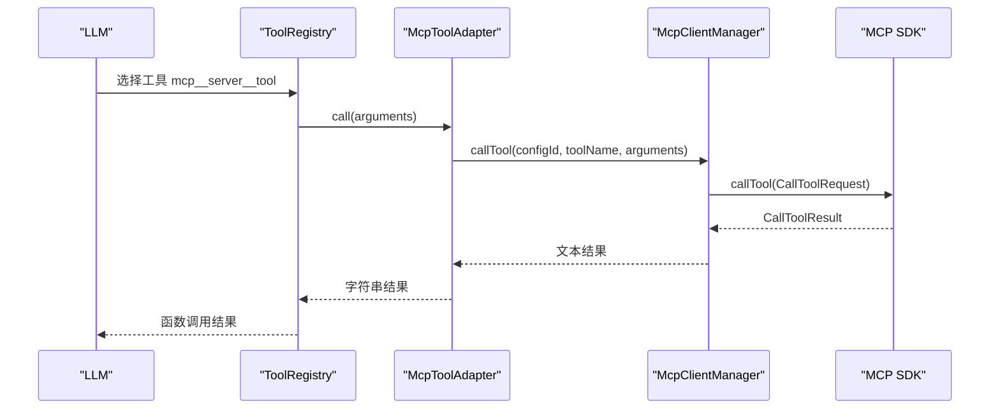
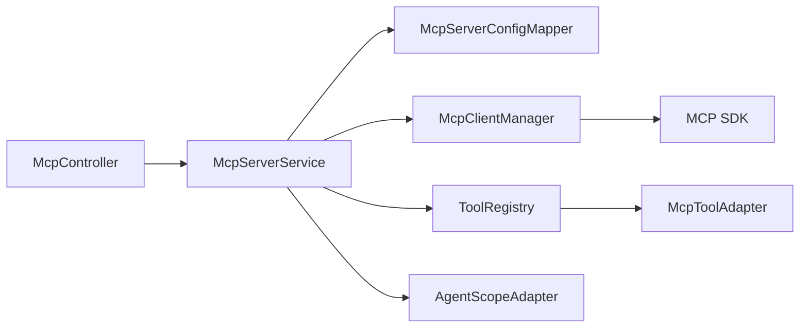
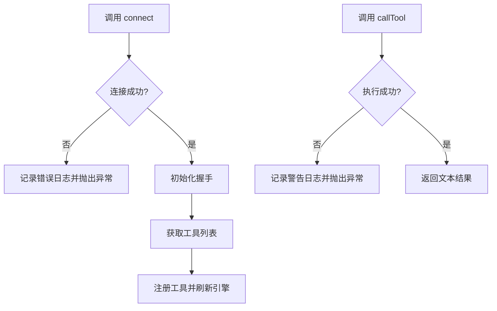

# MCP 客户端管理

<cite>
**本文引用的文件**   
- [McpClientManager.java](file://src/main/java/com/agenthub/mcp/client/McpClientManager.java)
- [McpToolAdapter.java](file://src/main/java/com/agenthub/mcp/client/McpToolAdapter.java)
- [McpServerConfig.java](file://src/main/java/com/agenthub/mcp/entity/McpServerConfig.java)
- [McpServerService.java](file://src/main/java/com/agenthub/mcp/service/McpServerService.java)
- [McpController.java](file://src/main/java/com/agenthub/mcp/controller/McpController.java)
- [McpServerRequest.java](file://src/main/java/com/agenthub/mcp/dto/McpServerRequest.java)
- [McpServerConfigMapper.java](file://src/main/java/com/agenthub/mcp/mapper/McpServerConfigMapper.java)
- [AgentTool.java](file://src/main/java/com/agenthub/agent/tool/AgentTool.java)
- [AgentScopeAdapter.java](file://src/main/java/com/agenthub/agent/agentscope/AgentScopeAdapter.java)
</cite>

## 目录
1. [简介](#简介)
2. [项目结构](#项目结构)
3. [核心组件](#核心组件)
4. [架构总览](#架构总览)
5. [详细组件分析](#详细组件分析)
6. [依赖关系分析](#依赖关系分析)
7. [性能与连接池优化](#性能与连接池优化)
8. [故障恢复与可观测性](#故障恢复与可观测性)
9. [配置示例与集成指南](#配置示例与集成指南)
10. [常见问题排查](#常见问题排查)
11. [结论](#结论)

## 简介
本文件面向 MCP（Model Context Protocol）客户端管理能力，重点说明以下方面：
- McpClientManager 的生命周期管理与连接管理机制
- McpToolAdapter 工具适配器的工作原理，以及 MCP 工具到内部 AgentTool 的转换机制
- McpServerConfig 服务器配置模型，涵盖传输类型、连接参数、认证信息、超时等
- McpServerService 的服务发现与管理逻辑，包括多传输模式支持（stdio、http/streamable-http、sse）
- 工具发现与调用流程，包括协议握手、方法调用、结果返回
- 连接池优化思路与故障恢复机制建议
- 不同 MCP 服务器的集成配置示例

## 项目结构
MCP 相关代码集中在 mcp 包下，并与 agent 层工具注册表、AgentScope 适配层协作。关键路径如下：
- client：MCP 客户端管理与工具适配器
- entity：MCP Server 配置实体
- service：MCP Server 服务编排（CRUD、连接、工具注册）
- controller：对外 REST API
- dto：请求 DTO
- mapper：数据库访问接口

图表来源
- [McpController.java:24-83](file://src/main/java/com/agenthub/mcp/controller/McpController.java#L24-L83)
- [McpServerService.java:30-109](file://src/main/java/com/agenthub/mcp/service/McpServerService.java#L30-L109)
- [McpClientManager.java:33-149](file://src/main/java/com/agenthub/mcp/client/McpClientManager.java#L33-L149)
- [McpToolAdapter.java:14-54](file://src/main/java/com/agenthub/mcp/client/McpToolAdapter.java#L14-L54)
- [McpServerConfig.java:14-52](file://src/main/java/com/agenthub/mcp/entity/McpServerConfig.java#L14-L52)
- [McpServerConfigMapper.java:1-11](file://src/main/java/com/agenthub/mcp/mapper/McpServerConfigMapper.java#L1-L11)
- [AgentScopeAdapter.java:67-97](file://src/main/java/com/agenthub/agent/agentscope/AgentScopeAdapter.java#L67-L97)

章节来源
- [McpController.java:24-83](file://src/main/java/com/agenthub/mcp/controller/McpController.java#L24-L83)
- [McpServerService.java:30-109](file://src/main/java/com/agenthub/mcp/service/McpServerService.java#L30-L109)
- [McpClientManager.java:33-149](file://src/main/java/com/agenthub/mcp/client/McpClientManager.java#L33-L149)

## 核心组件
- McpClientManager：负责按配置建立与 MCP Server 的连接、握手、工具发现、工具调用、连接生命周期管理，并支持三种传输模式。
- McpToolAdapter：将 MCP Server 暴露的工具包装为平台统一的 AgentTool，命名采用 mcp__{server}__{tool}，便于在工具注册表中隔离。
- McpServerConfig：持久化 MCP Server 连接配置，包含传输类型、地址、端点、命令、参数、环境变量、启用状态等。
- McpServerService：提供 MCP Server 配置的 CRUD、连接管理、工具注册/注销、租户懒连接等能力。
- McpController：对外暴露 MCP Server 管理的 REST API。
- AgentTool：统一工具抽象，MCP 工具通过适配器实现该接口以接入 LLM function calling。
- AgentScopeAdapter：AgentScope 引擎适配，工具变更后重建 HarnessAgent 使动态注册生效。

章节来源
- [McpClientManager.java:33-149](file://src/main/java/com/agenthub/mcp/client/McpClientManager.java#L33-L149)
- [McpToolAdapter.java:14-54](file://src/main/java/com/agenthub/mcp/client/McpToolAdapter.java#L14-L54)
- [McpServerConfig.java:14-52](file://src/main/java/com/agenthub/mcp/entity/McpServerConfig.java#L14-L52)
- [McpServerService.java:30-158](file://src/main/java/com/agenthub/mcp/service/McpServerService.java#L30-L158)
- [McpController.java:24-83](file://src/main/java/com/agenthub/mcp/controller/McpController.java#L24-L83)
- [AgentTool.java:1-32](file://src/main/java/com/agenthub/agent/tool/AgentTool.java#L1-L32)
- [AgentScopeAdapter.java:67-97](file://src/main/java/com/agenthub/agent/agentscope/AgentScopeAdapter.java#L67-L97)

## 架构总览
下图展示从 HTTP 请求到 MCP Server 工具调用的完整链路，包括工具发现、注册、调用与结果返回。

图表来源
- [McpController.java:56-60](file://src/main/java/com/agenthub/mcp/controller/McpController.java#L56-L60)
- [McpServerService.java:75-84](file://src/main/java/com/agenthub/mcp/service/McpServerService.java#L75-L84)
- [McpClientManager.java:40-58](file://src/main/java/com/agenthub/mcp/client/McpClientManager.java#L40-L58)
- [AgentScopeAdapter.java:88-97](file://src/main/java/com/agenthub/agent/agentscope/AgentScopeAdapter.java#L88-L97)

## 详细组件分析

### McpClientManager：生命周期与连接管理
职责要点：
- 维护已连接的 McpSyncClient 实例，key 为配置 ID
- 根据配置构建传输层（streamable-http、sse、stdio）
- 发起 initialize 握手，获取工具列表
- 提供 disconnect、isConnected、listTools、callTool 等方法
- 应用销毁时关闭所有连接

图表来源
- [McpClientManager.java:33-149](file://src/main/java/com/agenthub/mcp/client/McpClientManager.java#L33-L149)

章节来源
- [McpClientManager.java:33-149](file://src/main/java/com/agenthub/mcp/client/McpClientManager.java#L33-L149)

### McpToolAdapter：工具适配器与转换机制
职责要点：
- 实现 AgentTool 接口，将 MCP 工具包装为平台统一工具
- 命名规则：mcp__{serverName}__{toolName}，避免与内置工具冲突
- description 补充来源信息，inputSchema 兜底为空对象
- call 委托给 McpClientManager.callTool

图表来源
- [AgentTool.java:1-32](file://src/main/java/com/agenthub/agent/tool/AgentTool.java#L1-L32)
- [McpToolAdapter.java:14-54](file://src/main/java/com/agenthub/mcp/client/McpToolAdapter.java#L14-L54)

章节来源
- [McpToolAdapter.java:14-54](file://src/main/java/com/agenthub/mcp/client/McpToolAdapter.java#L14-L54)
- [AgentTool.java:1-32](file://src/main/java/com/agenthub/agent/tool/AgentTool.java#L1-L32)

### McpServerConfig：服务器配置模型
字段说明：
- id、tenantId、name、description：标识与描述
- transportType：传输类型（stdio | sse | streamable-http）
- baseUrl、endpoint：远程地址与端点
- command、argsJson、envJson：本地进程启动命令、参数与环境变量
- enabled：是否启用（用于懒连接）
- createdAt、updatedAt：时间戳

图表来源
- [McpServerConfig.java:14-52](file://src/main/java/com/agenthub/mcp/entity/McpServerConfig.java#L14-L52)

章节来源
- [McpServerConfig.java:14-52](file://src/main/java/com/agenthub/mcp/entity/McpServerConfig.java#L14-L52)

### McpServerService：服务发现与管理逻辑
职责要点：
- 配置 CRUD：create、update、delete、list
- 连接管理：connect、disconnect、ensureConnectedForTenant（租户懒连接）
- 工具注册：连接成功后遍历工具并注册到 ToolRegistry，同时刷新 AgentScope 引擎
- 直接调用：callTool 用于调试或演示

图表来源
- [McpServerService.java:75-84](file://src/main/java/com/agenthub/mcp/service/McpServerService.java#L75-L84)
- [McpClientManager.java:40-58](file://src/main/java/com/agenthub/mcp/client/McpClientManager.java#L40-L58)

章节来源
- [McpServerService.java:40-158](file://src/main/java/com/agenthub/mcp/service/McpServerService.java#L40-L158)

### McpController：REST API
提供的接口：
- 新增/更新/删除/查询 MCP Server 配置
- 连接/断开连接
- 列出工具
- 直接调用工具（调试用）

章节来源
- [McpController.java:24-83](file://src/main/java/com/agenthub/mcp/controller/McpController.java#L24-L83)

### 工具发现与调用流程
- 工具发现：connect 后调用 listTools，返回工具定义
- 工具注册：每个工具包装为 McpToolAdapter 并注册到 ToolRegistry
- 工具调用：LLM 通过 function calling 选择工具名，调用 ToolRegistry 中的 McpToolAdapter，最终由 McpClientManager.callTool 执行远端工具

图表来源
- [McpToolAdapter.java:50-53](file://src/main/java/com/agenthub/mcp/client/McpToolAdapter.java#L50-L53)
- [McpClientManager.java:82-95](file://src/main/java/com/agenthub/mcp/client/McpClientManager.java#L82-L95)

章节来源
- [McpToolAdapter.java:50-53](file://src/main/java/com/agenthub/mcp/client/McpToolAdapter.java#L50-L53)
- [McpClientManager.java:82-95](file://src/main/java/com/agenthub/mcp/client/McpClientManager.java#L82-L95)

## 依赖关系分析
- McpController 依赖 McpServerService
- McpServerService 依赖 McpServerConfigMapper、McpClientManager、ToolRegistry、AgentScopeAdapter
- McpClientManager 依赖 MCP SDK 的 Transport 与 Client
- McpToolAdapter 依赖 AgentTool 接口与 McpClientManager

图表来源
- [McpController.java:24-83](file://src/main/java/com/agenthub/mcp/controller/McpController.java#L24-L83)
- [McpServerService.java:30-109](file://src/main/java/com/agenthub/mcp/service/McpServerService.java#L30-L109)
- [McpClientManager.java:33-149](file://src/main/java/com/agenthub/mcp/client/McpClientManager.java#L33-L149)
- [McpToolAdapter.java:14-54](file://src/main/java/com/agenthub/mcp/client/McpToolAdapter.java#L14-L54)

章节来源
- [McpController.java:24-83](file://src/main/java/com/agenthub/mcp/controller/McpController.java#L24-L83)
- [McpServerService.java:30-109](file://src/main/java/com/agenthub/mcp/service/McpServerService.java#L30-L109)
- [McpClientManager.java:33-149](file://src/main/java/com/agenthub/mcp/client/McpClientManager.java#L33-L149)

## 性能与连接池优化
当前实现特点：
- 使用 ConcurrentHashMap 维护已连接的 McpSyncClient，key 为配置 ID
- 每次 connect 会先 disconnect 旧连接，再创建新连接
- 未实现显式连接池复用；同一配置多次 connect 会重建连接

优化建议：
- 引入连接池：对同一配置复用 McpSyncClient，减少握手与资源开销
- 增加健康检查与心跳：定期检测连接可用性，失败则自动重建
- 设置合理的超时与重试策略：针对网络抖动进行指数退避重试
- 限制并发：对同一配置的调用进行限流，防止下游过载
- 监控指标：记录连接数、调用延迟、错误率、重连次数

章节来源
- [McpClientManager.java:37-58](file://src/main/java/com/agenthub/mcp/client/McpClientManager.java#L37-L58)
- [McpClientManager.java:60-70](file://src/main/java/com/agenthub/mcp/client/McpClientManager.java#L60-L70)

## 故障恢复与可观测性
- 连接失败：connect 捕获异常并抛出业务异常，便于上层处理
- 工具调用失败：callTool 捕获异常并返回错误文本或抛出业务异常
- 优雅关闭：@PreDestroy 关闭所有连接，避免资源泄漏
- 日志记录：连接成功/失败、工具调用失败均有日志输出

图表来源
- [McpClientManager.java:40-58](file://src/main/java/com/agenthub/mcp/client/McpClientManager.java#L40-L58)
- [McpClientManager.java:82-95](file://src/main/java/com/agenthub/mcp/client/McpClientManager.java#L82-L95)
- [McpClientManager.java:145-149](file://src/main/java/com/agenthub/mcp/client/McpClientManager.java#L145-L149)

章节来源
- [McpClientManager.java:40-58](file://src/main/java/com/agenthub/mcp/client/McpClientManager.java#L40-L58)
- [McpClientManager.java:82-95](file://src/main/java/com/agenthub/mcp/client/McpClientManager.java#L82-L95)
- [McpClientManager.java:145-149](file://src/main/java/com/agenthub/mcp/client/McpClientManager.java#L145-L149)

## 配置示例与集成指南
以下为不同传输模式的配置要点（不展示具体 JSON 内容，仅说明字段含义）：

- Streamable HTTP
  - transportType: streamable-http
  - baseUrl: 服务端基础地址
  - endpoint: 默认 /mcp，可按需覆盖
  - 适用场景：主流远程 HTTP 模式

- SSE
  - transportType: sse
  - baseUrl: SSE 服务端地址
  - 适用场景：SSE 长连接模式

- STDIO
  - transportType: stdio
  - command: 启动命令（如 npx、uvx、java -jar）
  - argsJson: 启动参数数组（JSON 字符串）
  - envJson: 环境变量对象（JSON 字符串），可用于传递 API Key 等敏感信息
  - 适用场景：本地进程模式

注意事项：
- 非 stdio 模式必须配置 baseUrl
- stdio 模式必须配置 command
- 配置校验在服务层完成，非法配置会抛出参数错误

章节来源
- [McpServerRequest.java:1-37](file://src/main/java/com/agenthub/mcp/dto/McpServerRequest.java#L1-L37)
- [McpServerService.java:141-156](file://src/main/java/com/agenthub/mcp/service/McpServerService.java#L141-L156)
- [McpClientManager.java:116-143](file://src/main/java/com/agenthub/mcp/client/McpClientManager.java#L116-L143)

## 常见问题排查
- 连接失败
  - 检查 baseUrl/endpoint/command 是否正确
  - 查看连接日志与异常信息
  - 确认网络可达性与鉴权配置（envJson）

- 工具未注册
  - 确认 connect 成功且工具列表非空
  - 检查 ToolRegistry 快照中是否存在对应工具名
  - 确认 AgentScopeAdapter.refresh() 已执行

- 工具调用失败
  - 检查工具名称与参数是否符合 inputSchema
  - 查看工具调用日志与异常信息
  - 确认 McpClientManager 中 isConnected 为 true

章节来源
- [McpServerService.java:141-156](file://src/main/java/com/agenthub/mcp/service/McpServerService.java#L141-L156)
- [McpClientManager.java:82-95](file://src/main/java/com/agenthub/mcp/client/McpClientManager.java#L82-L95)

## 结论
本项目实现了基于 MCP 的客户端管理能力，通过 McpClientManager 管理连接生命周期与传输模式，借助 McpToolAdapter 将远端工具无缝接入平台工具注册表，并由 McpServerService 统一管理配置、连接与工具注册。当前实现简洁可靠，适合快速集成多种 MCP 服务器。后续可在连接池、健康检查、重试与监控等方面进一步增强稳定性与性能。