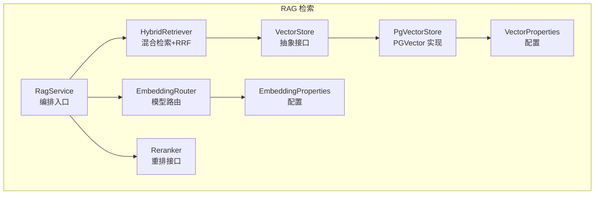
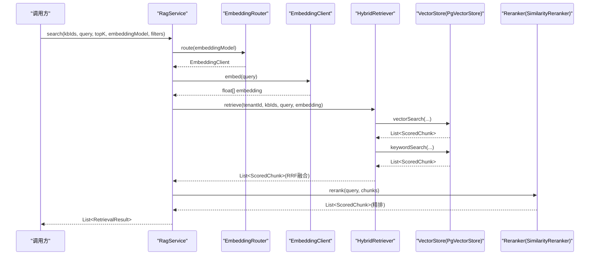
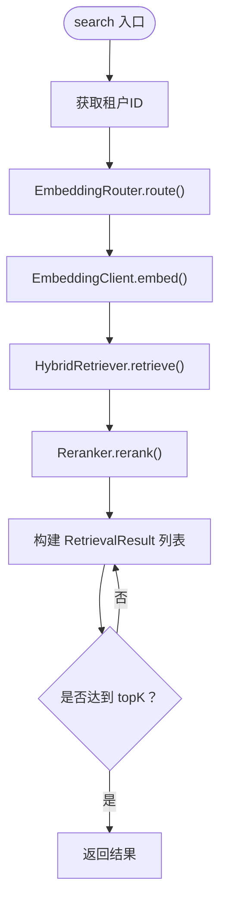
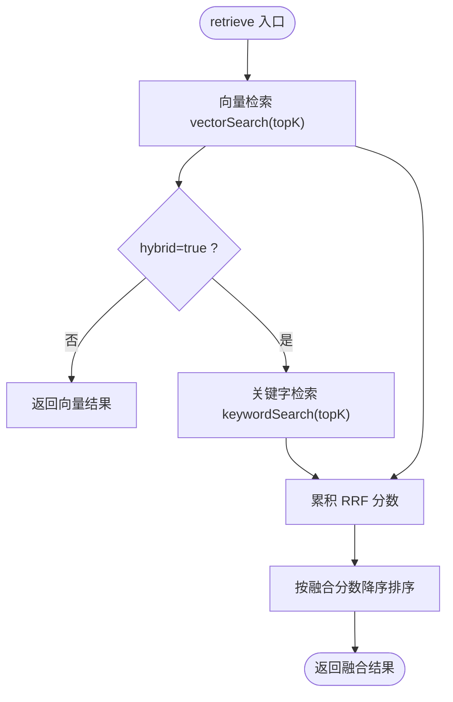
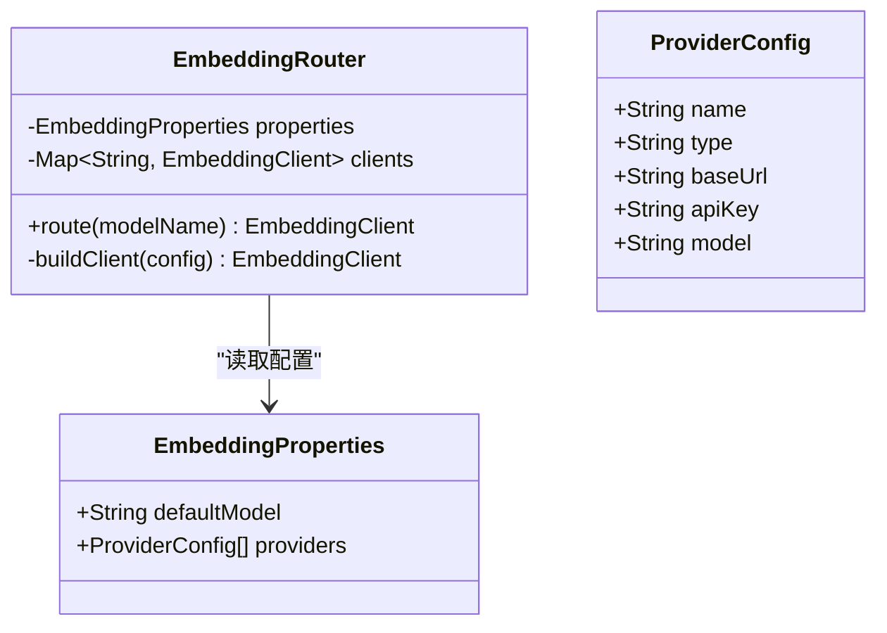
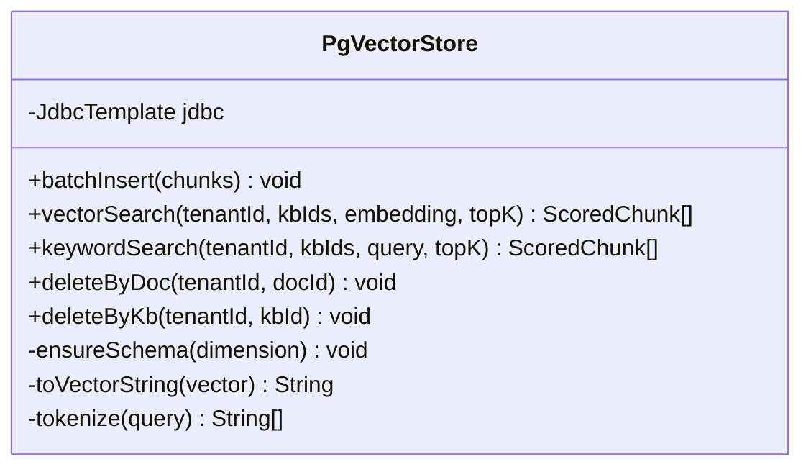
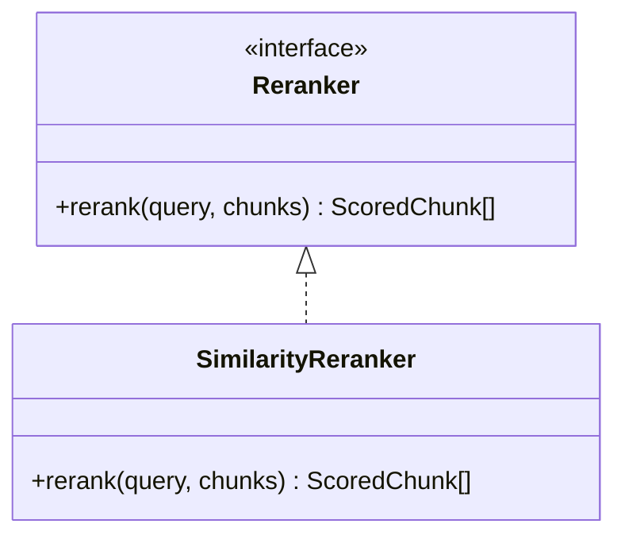
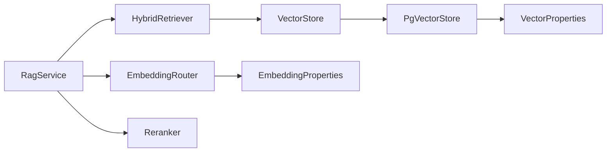

# RAG 检索服务

<cite>
**本文引用的文件**   
- [RagService.java](file://src/main/java/com/agenthub/rag/service/RagService.java)
- [HybridRetriever.java](file://src/main/java/com/agenthub/rag/retrieve/HybridRetriever.java)
- [EmbeddingRouter.java](file://src/main/java/com/agenthub/rag/embedding/EmbeddingRouter.java)
- [PgVectorStore.java](file://src/main/java/com/agenthub/rag/store/PgVectorStore.java)
- [Reranker.java](file://src/main/java/com/agenthub/rag/rerank/Reranker.java)
- [SimilarityReranker.java](file://src/main/java/com/agenthub/rag/rerank/SimilarityReranker.java)
- [RetrievalResult.java](file://src/main/java/com/agenthub/rag/model/RetrievalResult.java)
- [ScoredChunk.java](file://src/main/java/com/agenthub/rag/model/ScoredChunk.java)
- [EmbeddingProperties.java](file://src/main/java/com/agenthub/rag/embedding/EmbeddingProperties.java)
- [VectorProperties.java](file://src/main/java/com/agenthub/rag/store/VectorProperties.java)
- [application.yml](file://src/main/resources/application.yml)
- [init-pgvector.sql](file://sql/init-pgvector.sql)
</cite>

## 目录
1. [简介](#简介)
2. [项目结构](#项目结构)
3. [核心组件](#核心组件)
4. [架构总览](#架构总览)
5. [详细组件分析](#详细组件分析)
6. [依赖关系分析](#依赖关系分析)
7. [性能与可扩展性](#性能与可扩展性)
8. [配置示例与调优](#配置示例与调优)
9. [故障排查指南](#故障排查指南)
10. [结论](#结论)

## 简介
本文件面向 RAG 检索服务的实现与使用，重点围绕以下目标展开：
- RagService 作为编排器的职责边界与控制流。
- 混合检索算法：向量相似度搜索与关键词匹配的融合策略（RRF）。
- EmbeddingRouter 嵌入模型路由机制与多模型动态切换。
- PgVectorStore 向量存储实现：索引、相似度计算、批量操作等。
- 检索结果的排序与过滤机制：相关性评分、阈值控制等。
- 配置示例与性能优化建议。
- RAG 系统的可扩展性与缓存策略分析。

## 项目结构
RAG 相关代码位于 rag 包下，按 embedding、model、rerank、retrieve、service、store 分层组织，体现“检索流程编排 + 可插拔实现”的设计思路：
- service：RagService 作为编排入口。
- retrieve：HybridRetriever 负责混合检索与 RRF 融合。
- rerank：Reranker 接口与默认实现 SimilarityReranker。
- embedding：EmbeddingRouter 与 EmbeddingProperties 提供模型路由与配置。
- store：PgVectorStore 与 VectorProperties 提供 PGVector 向量存储能力。
- model：RetrievalResult、ScoredChunk 等数据模型。



图表来源
- [RagService.java:22-54](file://src/main/java/com/agenthub/rag/service/RagService.java#L22-L54)
- [HybridRetriever.java:21-69](file://src/main/java/com/agenthub/rag/retrieve/HybridRetriever.java#L21-L69)
- [EmbeddingRouter.java:14-44](file://src/main/java/com/agenthub/rag/embedding/EmbeddingRouter.java#L14-L44)
- [PgVectorStore.java:30-45](file://src/main/java/com/agenthub/rag/store/PgVectorStore.java#L30-L45)
- [VectorProperties.java:9-24](file://src/main/java/com/agenthub/rag/store/VectorProperties.java#L9-L24)
- [EmbeddingProperties.java:12-31](file://src/main/java/com/agenthub/rag/embedding/EmbeddingProperties.java#L12-L31)

章节来源
- [RagService.java:15-54](file://src/main/java/com/agenthub/rag/service/RagService.java#L15-L54)
- [HybridRetriever.java:14-69](file://src/main/java/com/agenthub/rag/retrieve/HybridRetriever.java#L14-L69)
- [EmbeddingRouter.java:11-44](file://src/main/java/com/agenthub/rag/embedding/EmbeddingRouter.java#L11-L44)
- [PgVectorStore.java:21-66](file://src/main/java/com/agenthub/rag/store/PgVectorStore.java#L21-L66)
- [VectorProperties.java:6-24](file://src/main/java/com/agenthub/rag/store/VectorProperties.java#L6-L24)
- [EmbeddingProperties.java:9-31](file://src/main/java/com/agenthub/rag/embedding/EmbeddingProperties.java#L9-L31)

## 核心组件
- RagService：编排向量化、混合检索、重排，并输出对外结果；同时提供上下文拼装方法供 LLM 调用。
- HybridRetriever：执行向量检索与关键字检索，并通过 RRF 融合两路结果。
- EmbeddingRouter：根据路由键选择具体 EmbeddingClient，支持 openai、ollama、mock 三种类型。
- PgVectorStore：基于 PostgreSQL + pgvector 的向量存储，提供 HNSW 索引、余弦相似度、批量写入、关键字匹配等。
- Reranker / SimilarityReranker：重排接口与默认实现（沿用 RRF 分数排序）。
- RetrievalResult / ScoredChunk：对外结果与内部带分片段对象。

章节来源
- [RagService.java:15-69](file://src/main/java/com/agenthub/rag/service/RagService.java#L15-L69)
- [HybridRetriever.java:14-79](file://src/main/java/com/agenthub/rag/retrieve/HybridRetriever.java#L14-L79)
- [EmbeddingRouter.java:11-44](file://src/main/java/com/agenthub/rag/embedding/EmbeddingRouter.java#L11-L44)
- [PgVectorStore.java:21-223](file://src/main/java/com/agenthub/rag/store/PgVectorStore.java#L21-L223)
- [Reranker.java:7-14](file://src/main/java/com/agenthub/rag/rerank/Reranker.java#L7-L14)
- [SimilarityReranker.java:8-23](file://src/main/java/com/agenthub/rag/rerank/SimilarityReranker.java#L8-L23)
- [RetrievalResult.java:7-27](file://src/main/java/com/agenthub/rag/model/RetrievalResult.java#L7-L27)
- [ScoredChunk.java:9-32](file://src/main/java/com/agenthub/rag/model/ScoredChunk.java#L9-L32)

## 架构总览
RAG 检索的整体流程如下：
- 上层调用 RagService.search，传入知识库 ID 列表、查询文本、返回条数、可选的 embedding 模型路由键与过滤条件。
- 通过 EmbeddingRouter 获取对应 EmbeddingClient 将查询文本转为向量。
- HybridRetriever 并行或顺序执行向量检索与关键字检索，并使用 RRF 融合排序。
- Reranker 对融合后的结果进行精排（默认直接按分数降序）。
- 最终封装为 RetrievalResult 返回给调用方；也可通过 buildContext 拼装成 LLM 上下文。



图表来源
- [RagService.java:39-54](file://src/main/java/com/agenthub/rag/service/RagService.java#L39-L54)
- [HybridRetriever.java:46-69](file://src/main/java/com/agenthub/rag/retrieve/HybridRetriever.java#L46-L69)
- [PgVectorStore.java:90-143](file://src/main/java/com/agenthub/rag/store/PgVectorStore.java#L90-L143)
- [SimilarityReranker.java:17-22](file://src/main/java/com/agenthub/rag/rerank/SimilarityReranker.java#L17-L22)

## 详细组件分析

### RagService：编排器
- 职责：
  - 从租户上下文获取 tenantId。
  - 通过 EmbeddingRouter 路由到指定 EmbeddingClient 完成向量化。
  - 调用 HybridRetriever 执行混合检索。
  - 调用 Reranker 进行重排。
  - 将 ScoredChunk 转换为 RetrievalResult 并按 topK 截断。
  - 提供 buildContext 将结果拼装为 LLM 上下文。
- 关键点：
  - 不直接实现检索逻辑，而是协调各组件。
  - 对外暴露统一的检索接口，屏蔽底层差异。



图表来源
- [RagService.java:39-54](file://src/main/java/com/agenthub/rag/service/RagService.java#L39-L54)

章节来源
- [RagService.java:15-69](file://src/main/java/com/agenthub/rag/service/RagService.java#L15-L69)

### HybridRetriever：混合检索与 RRF 融合
- 两路检索：
  - 向量检索：调用 VectorStore.vectorSearch，使用余弦相似度算子。
  - 关键字检索：调用 VectorStore.keywordSearch，按词命中计数打分。
- RRF 融合：
  - 公式：score = Σ 1/(k + rank)，其中 k 为 rrf-k，rank 为当前排名。
  - 按 chunk id 去重合并，统一用 score 表达融合后分数。
- 可配置项：
  - vector-top-k、keyword-top-k、rrf-k、hybrid（是否启用混合）。



图表来源
- [HybridRetriever.java:46-77](file://src/main/java/com/agenthub/rag/retrieve/HybridRetriever.java#L46-L77)

章节来源
- [HybridRetriever.java:14-79](file://src/main/java/com/agenthub/rag/retrieve/HybridRetriever.java#L14-L79)

### EmbeddingRouter：嵌入模型路由
- 功能：
  - 根据配置中的 providers 列表构建客户端映射。
  - route(modelName) 根据路由键选择具体 EmbeddingClient；为空时使用默认模型。
  - 支持 openai、ollama、mock 三种类型。
- 错误处理：
  - 未配置的模型会抛出业务异常，提示未配置的 Embedding 模型。



图表来源
- [EmbeddingRouter.java:14-44](file://src/main/java/com/agenthub/rag/embedding/EmbeddingRouter.java#L14-L44)
- [EmbeddingProperties.java:12-31](file://src/main/java/com/agenthub/rag/embedding/EmbeddingProperties.java#L12-L31)

章节来源
- [EmbeddingRouter.java:11-44](file://src/main/java/com/agenthub/rag/embedding/EmbeddingRouter.java#L11-L44)
- [EmbeddingProperties.java:9-31](file://src/main/java/com/agenthub/rag/embedding/EmbeddingProperties.java#L9-L31)

### PgVectorStore：向量存储实现
- 表结构与索引：
  - rag_chunk 表包含 tenant_id、kb_id、doc_id、doc_name、chunk_index、content、embedding(vector)、metadata(JSONB)、created_at。
  - 联合索引 idx_rag_chunk_tenant_kb 用于租户与知识库过滤。
  - HNSW 索引 idx_rag_chunk_embedding 使用 vector_cosine_ops 加速余弦相似度检索。
- 相似度计算：
  - 使用 <=> 算子计算余弦距离，相似度 = 1 - 距离。
- 批量写入：
  - batchInsert 使用 JDBC 批处理，将 Chunk 列表批量插入。
- 关键字检索：
  - tokenize 简单分词：英文按空白/标点切词，中文保留整体，超过 4 字符的中文字串拆分为 2-gram。
  - 每个词命中计 1 分，按总分排序。
- 删除操作：
  - deleteByDoc、deleteByKb 支持按文档或知识库维度清理。



图表来源
- [PgVectorStore.java:30-223](file://src/main/java/com/agenthub/rag/store/PgVectorStore.java#L30-L223)
- [init-pgvector.sql:13-31](file://sql/init-pgvector.sql#L13-L31)

章节来源
- [PgVectorStore.java:21-223](file://src/main/java/com/agenthub/rag/store/PgVectorStore.java#L21-L223)
- [init-pgvector.sql:1-32](file://sql/init-pgvector.sql#L1-L32)

### Reranker 与 SimilarityReranker：重排
- Reranker 接口定义 rerank(query, chunks) 方法。
- SimilarityReranker 默认实现：按 ScoredChunk.score 降序排序，即沿用 RRF 融合分。
- 扩展点：生产环境可替换为交叉编码模型（如 BGE-Reranker）以实现更精细的精排。



图表来源
- [Reranker.java:7-14](file://src/main/java/com/agenthub/rag/rerank/Reranker.java#L7-L14)
- [SimilarityReranker.java:8-23](file://src/main/java/com/agenthub/rag/rerank/SimilarityReranker.java#L8-L23)

章节来源
- [Reranker.java:7-14](file://src/main/java/com/agenthub/rag/rerank/Reranker.java#L7-L14)
- [SimilarityReranker.java:8-23](file://src/main/java/com/agenthub/rag/rerank/SimilarityReranker.java#L8-L23)

### 数据模型：RetrievalResult 与 ScoredChunk
- RetrievalResult：对外返回的检索结果，包含 chunkId、content、docName、chunkIndex、score。
- ScoredChunk：内部带分数的片段对象，包含 id、content、docName、chunkIndex、score、metadata。

章节来源
- [RetrievalResult.java:7-27](file://src/main/java/com/agenthub/rag/model/RetrievalResult.java#L7-L27)
- [ScoredChunk.java:9-32](file://src/main/java/com/agenthub/rag/model/ScoredChunk.java#L9-L32)

## 依赖关系分析
- RagService 依赖 EmbeddingRouter、HybridRetriever、Reranker。
- HybridRetriever 依赖 VectorStore（PgVectorStore 实现）。
- EmbeddingRouter 依赖 EmbeddingProperties。
- PgVectorStore 依赖 VectorProperties 与 JdbcTemplate。
- 所有组件均通过 Spring 装配，便于扩展与替换。



图表来源
- [RagService.java:22-28](file://src/main/java/com/agenthub/rag/service/RagService.java#L22-L28)
- [HybridRetriever.java:21-37](file://src/main/java/com/agenthub/rag/retrieve/HybridRetriever.java#L21-L37)
- [EmbeddingRouter.java:14-24](file://src/main/java/com/agenthub/rag/embedding/EmbeddingRouter.java#L14-L24)
- [PgVectorStore.java:30-45](file://src/main/java/com/agenthub/rag/store/PgVectorStore.java#L30-L45)

章节来源
- [RagService.java:22-28](file://src/main/java/com/agenthub/rag/service/RagService.java#L22-L28)
- [HybridRetriever.java:21-37](file://src/main/java/com/agenthub/rag/retrieve/HybridRetriever.java#L21-L37)
- [EmbeddingRouter.java:14-24](file://src/main/java/com/agenthub/rag/embedding/EmbeddingRouter.java#L14-L24)
- [PgVectorStore.java:30-45](file://src/main/java/com/agenthub/rag/store/PgVectorStore.java#L30-L45)

## 性能与可扩展性
- 性能特性：
  - 向量检索使用 HNSW 索引与余弦相似度算子，适合高维向量快速近似最近邻搜索。
  - 关键字检索采用简单分词与 ILIKE 模糊匹配，适用于小规模精确匹配场景。
  - RRF 融合不依赖绝对量纲，能稳定融合语义与关键词匹配。
- 可扩展性：
  - EmbeddingRouter 支持多种 EmbeddingClient 实现，可按需新增 provider 类型。
  - Reranker 接口允许替换为更复杂的精排模型。
  - VectorStore 抽象允许替换其他向量存储后端（如 Milvus、FAISS 等）。
- 缓存策略：
  - 当前实现未内置缓存层；可在 EmbeddingClient 或 HybridRetriever 层引入查询向量缓存与结果缓存以提升吞吐。
  - 建议在高频查询路径增加本地缓存（如 Caffeine）与分布式缓存（如 Redis），注意失效策略与一致性。

[本节为通用指导，不涉及具体文件分析]

## 配置示例与调优
- 向量库连接与维度：
  - agenthub.vector.datasource.jdbc-url、username、password。
  - agenthub.vector.dimension 需与 embedding 模型输出维度一致。
- RAG 检索参数：
  - agenthub.rag.vector-top-k：向量检索 TopK。
  - agenthub.rag.keyword-top-k：关键字检索 TopK。
  - agenthub.rag.rrf-k：RRF 融合参数 k。
  - agenthub.rag.hybrid：是否启用混合检索。
- Embedding 模型配置：
  - agenthub.embedding.default-model：默认模型路由键。
  - agenthub.embedding.providers：provider 列表，支持 openai、ollama、mock。

```yaml
agenthub:
  vector:
    datasource:
      jdbc-url: jdbc:postgresql://${PG_HOST:localhost}:${PG_PORT:5432}/${PG_DB:agenthub_vector}
      username: ${PG_USER:agenthub}
      password: ${PG_PASSWORD:agenthub123}
    dimension: 1024
  rag:
    vector-top-k: 5
    keyword-top-k: 5
    rrf-k: 60
    hybrid: true
  embedding:
    default-model: ${EMBEDDING_MODEL:mock-embed}
    providers:
      - name: ollama-embed
        type: ollama
        base-url: ${OLLAMA_BASE_URL:http://localhost:11434}
        model: bge-m3
      - name: openai-embed
        type: openai
        base-url: ${OPENAI_BASE_URL:https://api.openai.com}
        api-key: ${OPENAI_API_KEY:}
        model: text-embedding-3-small
      - name: mock
        type: mock
        model: mock-embed
```

章节来源
- [application.yml:64-76](file://src/main/resources/application.yml#L64-L76)
- [application.yml:126-140](file://src/main/resources/application.yml#L126-L140)
- [VectorProperties.java:9-24](file://src/main/java/com/agenthub/rag/store/VectorProperties.java#L9-L24)
- [EmbeddingProperties.java:12-31](file://src/main/java/com/agenthub/rag/embedding/EmbeddingProperties.java#L12-L31)

## 故障排查指南
- 未配置的 Embedding 模型：
  - 现象：调用 EmbeddingRouter.route 时抛出业务异常，提示未配置的模型。
  - 排查：检查 application.yml 中 agenthub.embedding.providers 是否包含对应路由键。
- 向量维度不一致：
  - 现象：写入或检索失败，可能与 pgvector 扩展或建表维度不匹配有关。
  - 排查：确保 agenthub.vector.dimension 与 embedding 模型输出维度一致，并确认 init-pgvector.sql 已执行。
- 检索结果为空：
  - 现象：vectorSearch 或 keywordSearch 返回空列表。
  - 排查：确认 tenant_id 与 kb_ids 是否正确；检查内容是否被正确分词与入库。
- 性能问题：
  - 现象：检索延迟高。
  - 排查：调整 vector-top-k、keyword-top-k、rrf-k；评估是否需要引入缓存或更换精排模型。

章节来源
- [EmbeddingRouter.java:27-34](file://src/main/java/com/agenthub/rag/embedding/EmbeddingRouter.java#L27-L34)
- [PgVectorStore.java:47-66](file://src/main/java/com/agenthub/rag/store/PgVectorStore.java#L47-L66)
- [init-pgvector.sql:13-31](file://sql/init-pgvector.sql#L13-L31)

## 结论
RAG 检索服务以 RagService 为核心编排器，结合 EmbeddingRouter、HybridRetriever、Reranker 与 PgVectorStore，实现了从向量化、混合检索、RRF 融合到精排的完整链路。系统具备良好的可扩展性，支持多嵌入模型与可插拔重排策略；通过合理配置与缓存策略，可在保证检索质量的同时提升性能。生产环境建议引入更强大的精排模型与缓存层，并结合数据库级安全策略（如 Row-Level-Security）强化租户隔离。