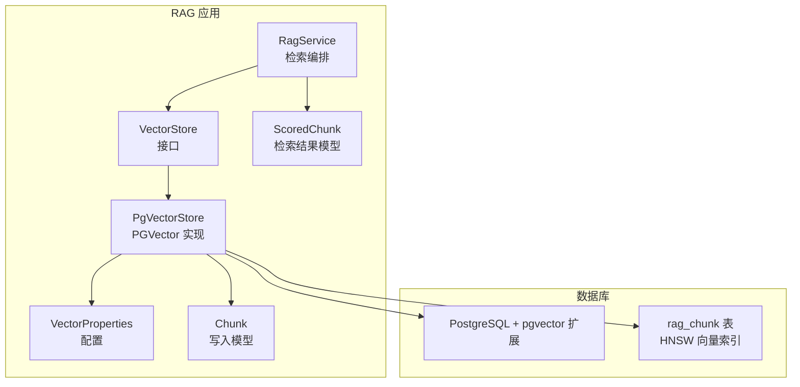
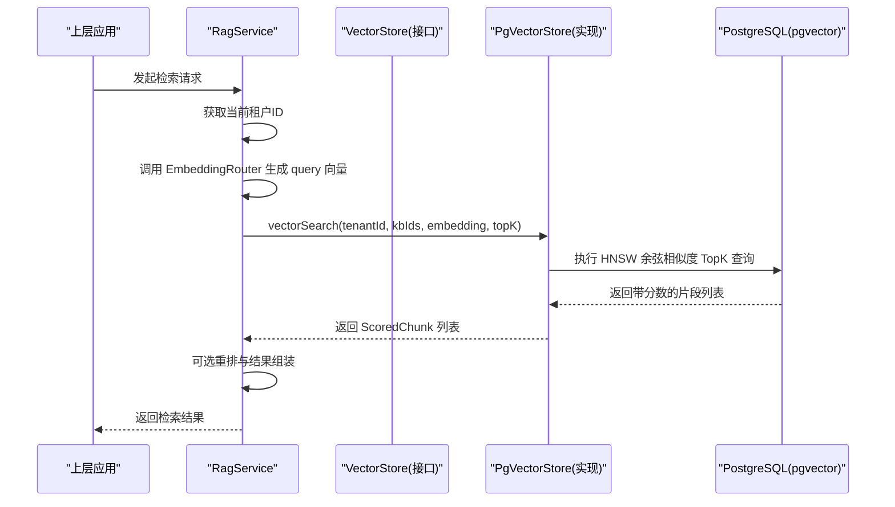
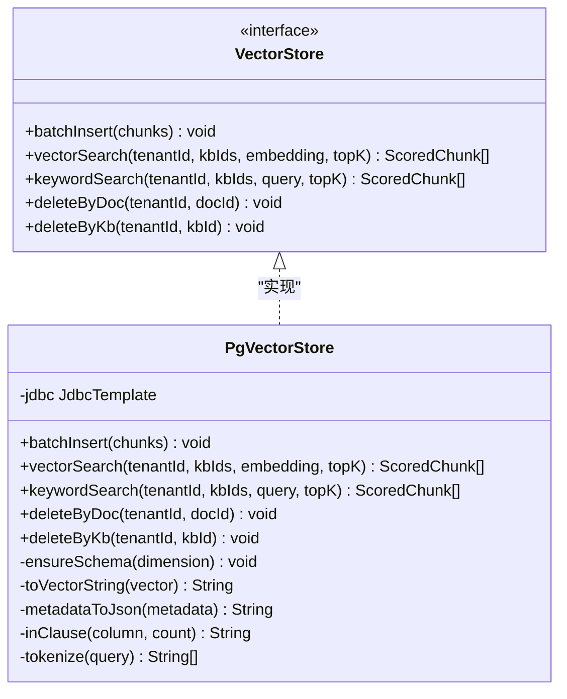
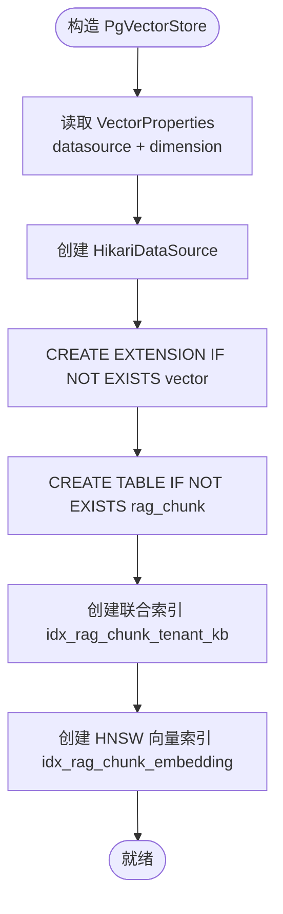
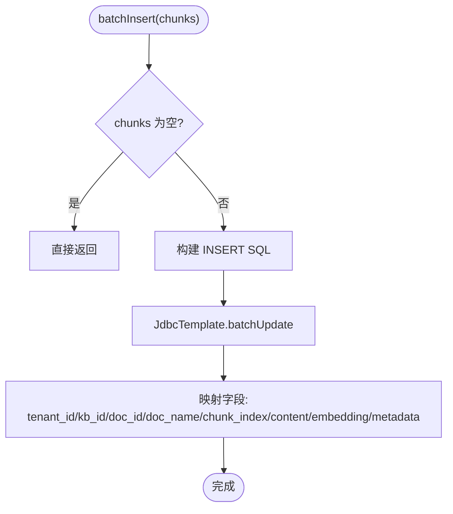
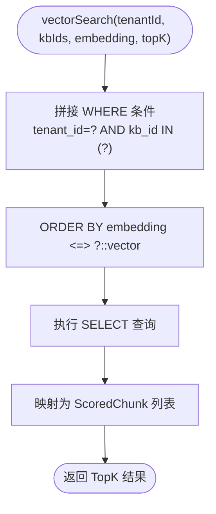
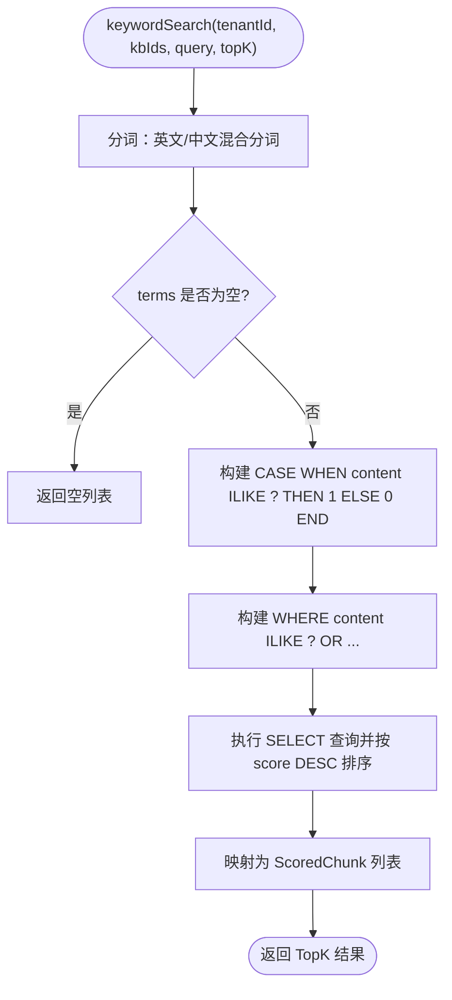
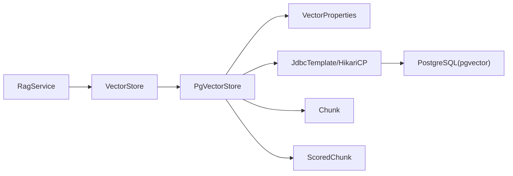

# 向量存储层

<cite>
**本文引用的文件**   
- [PgVectorStore.java](file://src/main/java/com/agenthub/rag/store/PgVectorStore.java)
- [VectorStore.java](file://src/main/java/com/agenthub/rag/store/VectorStore.java)
- [VectorProperties.java](file://src/main/java/com/agenthub/rag/store/VectorProperties.java)
- [init-pgvector.sql](file://sql/init-pgvector.sql)
- [RagService.java](file://src/main/java/com/agenthub/rag/service/RagService.java)
- [Chunk.java](file://src/main/java/com/agenthub/rag/model/Chunk.java)
- [ScoredChunk.java](file://src/main/java/com/agenthub/rag/model/ScoredChunk.java)
</cite>

## 目录
1. [引言](#引言)
2. [项目结构](#项目结构)
3. [核心组件](#核心组件)
4. [架构总览](#架构总览)
5. [详细组件分析](#详细组件分析)
6. [依赖关系分析](#依赖关系分析)
7. [性能与优化](#性能与优化)
8. [故障排查指南](#故障排查指南)
9. [结论](#结论)
10. [附录：数据模型与初始化脚本解读](#附录数据模型与初始化脚本解读)

## 引言
本章节面向“向量存储层”，重点说明基于 PostgreSQL PGVector 插件的 PgVectorStore 实现，包括索引创建、相似度查询、批量插入、删除策略等；同时阐述 VectorStore 接口的设计理念和扩展机制，解释 VectorProperties 配置项的作用，并给出向量数据的生命周期管理、表结构设计、SQL 初始化脚本解读以及性能瓶颈和优化方案。

## 项目结构
向量存储相关代码集中在 rag.store 包中，包含接口定义、PGVector 实现和配置类；SQL 初始化脚本位于 sql 目录；RAG 服务通过检索编排调用向量存储。

图表来源
- [RagService.java:22-54](file://src/main/java/com/agenthub/rag/service/RagService.java#L22-L54)
- [VectorStore.java:12-28](file://src/main/java/com/agenthub/rag/store/VectorStore.java#L12-L28)
- [PgVectorStore.java:30-45](file://src/main/java/com/agenthub/rag/store/PgVectorStore.java#L30-L45)
- [VectorProperties.java:9-23](file://src/main/java/com/agenthub/rag/store/VectorProperties.java#L9-L23)
- [init-pgvector.sql:13-31](file://sql/init-pgvector.sql#L13-L31)

章节来源
- [RagService.java:22-54](file://src/main/java/com/agenthub/rag/service/RagService.java#L22-L54)
- [VectorStore.java:12-28](file://src/main/java/com/agenthub/rag/store/VectorStore.java#L12-L28)
- [PgVectorStore.java:30-45](file://src/main/java/com/agenthub/rag/store/PgVectorStore.java#L30-L45)
- [VectorProperties.java:9-23](file://src/main/java/com/agenthub/rag/store/VectorProperties.java#L9-L23)
- [init-pgvector.sql:13-31](file://sql/init-pgvector.sql#L13-L31)

## 核心组件
- VectorStore：向量存储抽象接口，强制租户隔离（所有方法均要求 tenantId），定义批量写入、向量检索、关键字检索、按文档/知识库删除等操作。
- PgVectorStore：基于 JDBC + HikariCP + JdbcTemplate 直连 PostgreSQL，使用 pgvector 扩展进行向量存储与 HNSW 索引检索；提供幂等建表、批量插入、余弦相似度 TopK 检索、关键字检索、删除等能力。
- VectorProperties：Spring Boot 配置绑定，包含独立的数据源连接信息和向量维度 dimension。
- Chunk / ScoredChunk：写入与检索的数据载体。

章节来源
- [VectorStore.java:12-28](file://src/main/java/com/agenthub/rag/store/VectorStore.java#L12-L28)
- [PgVectorStore.java:30-153](file://src/main/java/com/agenthub/rag/store/PgVectorStore.java#L30-L153)
- [VectorProperties.java:9-23](file://src/main/java/com/agenthub/rag/store/VectorProperties.java#L9-L23)
- [Chunk.java:18-43](file://src/main/java/com/agenthub/rag/model/Chunk.java#L18-L43)
- [ScoredChunk.java:15-31](file://src/main/java/com/agenthub/rag/model/ScoredChunk.java#L15-L31)

## 架构总览
向量存储层采用“接口 + 实现”的分层设计：上层 RAG 服务通过 VectorStore 接口访问向量数据，具体实现由 PgVectorStore 提供，底层依赖 PostgreSQL 的 pgvector 扩展与 HNSW 索引。

图表来源
- [RagService.java:39-54](file://src/main/java/com/agenthub/rag/service/RagService.java#L39-L54)
- [PgVectorStore.java:90-107](file://src/main/java/com/agenthub/rag/store/PgVectorStore.java#L90-L107)
- [VectorStore.java:17-18](file://src/main/java/com/agenthub/rag/store/VectorStore.java#L17-L18)

## 详细组件分析

### VectorStore 接口设计与扩展机制
- 设计理念：
  - 统一抽象：屏蔽底层存储差异，便于未来扩展 Milvus、Elasticsearch 等。
  - 租户隔离：所有方法签名强制携带 tenantId，确保多租户数据在存储层不可绕过。
- 扩展机制：
  - 新增实现只需实现 VectorStore 接口，并在 Spring 容器中注册为 Bean。
  - 上层仅依赖接口，不影响现有调用方。

图表来源
- [VectorStore.java:12-28](file://src/main/java/com/agenthub/rag/store/VectorStore.java#L12-L28)
- [PgVectorStore.java:30-223](file://src/main/java/com/agenthub/rag/store/PgVectorStore.java#L30-L223)

章节来源
- [VectorStore.java:12-28](file://src/main/java/com/agenthub/rag/store/VectorStore.java#L12-L28)

### PgVectorStore 实现细节

#### 连接池与初始化
- 使用 HikariCP 作为连接池，JDBC URL、用户名、密码来自 VectorProperties。
- 构造时自动执行 ensureSchema，确保 pgvector 扩展存在、rag_chunk 表及索引存在（幂等）。

图表来源
- [PgVectorStore.java:36-45](file://src/main/java/com/agenthub/rag/store/PgVectorStore.java#L36-L45)
- [PgVectorStore.java:47-66](file://src/main/java/com/agenthub/rag/store/PgVectorStore.java#L47-L66)
- [VectorProperties.java:13-23](file://src/main/java/com/agenthub/rag/store/VectorProperties.java#L13-L23)

章节来源
- [PgVectorStore.java:36-66](file://src/main/java/com/agenthub/rag/store/PgVectorStore.java#L36-L66)
- [VectorProperties.java:13-23](file://src/main/java/com/agenthub/rag/store/VectorProperties.java#L13-L23)

#### 批量插入
- 使用 JdbcTemplate.batchUpdate 批量写入 rag_chunk。
- 将 float[] 转换为 PGVector 字符串格式 "[v1,v2,...]"，metadata 转为 JSONB。
- 字段包含 tenant_id、kb_id、doc_id、doc_name、chunk_index、content、embedding、metadata。

图表来源
- [PgVectorStore.java:69-87](file://src/main/java/com/agenthub/rag/store/PgVectorStore.java#L69-L87)
- [PgVectorStore.java:169-185](file://src/main/java/com/agenthub/rag/store/PgVectorStore.java#L169-L185)

章节来源
- [PgVectorStore.java:69-87](file://src/main/java/com/agenthub/rag/store/PgVectorStore.java#L69-L87)
- [PgVectorStore.java:169-185](file://src/main/java/com/agenthub/rag/store/PgVectorStore.java#L169-L185)

#### 向量相似度查询
- 使用 <=> 算子计算余弦距离，相似度 = 1 - 距离。
- 支持按 tenant_id 与 kb_ids 过滤，TopK 限制返回数量。
- 结果映射为 ScoredChunk，包含 id、content、doc_name、chunk_index、score、metadata。

图表来源
- [PgVectorStore.java:90-107](file://src/main/java/com/agenthub/rag/store/PgVectorStore.java#L90-L107)
- [PgVectorStore.java:157-167](file://src/main/java/com/agenthub/rag/store/PgVectorStore.java#L157-L167)

章节来源
- [PgVectorStore.java:90-107](file://src/main/java/com/agenthub/rag/store/PgVectorStore.java#L90-L107)
- [PgVectorStore.java:157-167](file://src/main/java/com/agenthub/rag/store/PgVectorStore.java#L157-L167)

#### 关键字检索
- 简单分词：英文按空白/标点切词，中文保留原词整体匹配，最多取 5 个词。
- 对每个 term 使用 ILIKE 匹配计数打分，按总分排序。
- 同样支持 tenant_id 与 kb_ids 过滤。

图表来源
- [PgVectorStore.java:110-143](file://src/main/java/com/agenthub/rag/store/PgVectorStore.java#L110-L143)
- [PgVectorStore.java:193-222](file://src/main/java/com/agenthub/rag/store/PgVectorStore.java#L193-L222)

章节来源
- [PgVectorStore.java:110-143](file://src/main/java/com/agenthub/rag/store/PgVectorStore.java#L110-L143)
- [PgVectorStore.java:193-222](file://src/main/java/com/agenthub/rag/store/PgVectorStore.java#L193-L222)

#### 删除操作
- deleteByDoc：按 tenant_id 与 doc_id 删除某文档的全部向量。
- deleteByKb：按 tenant_id 与 kb_id 删除某知识库的全部向量。

章节来源
- [PgVectorStore.java:145-153](file://src/main/java/com/agenthub/rag/store/PgVectorStore.java#L145-L153)

### VectorProperties 配置项说明
- agenthub.vector.datasource.jdbcUrl：PGVector 数据源 JDBC URL。
- agenthub.vector.datasource.username：数据库用户名。
- agenthub.vector.datasource.password：数据库密码。
- agenthub.vector.dimension：向量维度，用于建表与写入校验（默认 1024）。

注意：当前 PgVectorStore 内部未暴露连接池大小等高级参数，如需调优可考虑扩展 VectorProperties 或注入自定义 HikariConfig。

章节来源
- [VectorProperties.java:9-23](file://src/main/java/com/agenthub/rag/store/VectorProperties.java#L9-L23)

### 向量数据生命周期管理
- 持久化：
  - 通过 batchInsert 将 Chunk 写入 rag_chunk 表，embedding 以 PGVector 类型存储，metadata 以 JSONB 存储。
- 更新：
  - 当前未提供显式更新接口；可通过删除后重新插入的方式实现更新语义。
- 删除：
  - deleteByDoc：按文档维度清理。
  - deleteByKb：按知识库维度清理。
- 备份恢复：
  - 建议对 PostgreSQL 实例进行逻辑/物理备份；pg_dump/pg_restore 或云厂商备份方案均可。
  - 若启用 Row-Level-Security（RLS），需同步备份策略与权限策略。

章节来源
- [PgVectorStore.java:69-153](file://src/main/java/com/agenthub/rag/store/PgVectorStore.java#L69-L153)
- [init-pgvector.sql:13-31](file://sql/init-pgvector.sql#L13-L31)

## 依赖关系分析

图表来源
- [RagService.java:22-54](file://src/main/java/com/agenthub/rag/service/RagService.java#L22-L54)
- [VectorStore.java:12-28](file://src/main/java/com/agenthub/rag/store/VectorStore.java#L12-L28)
- [PgVectorStore.java:30-45](file://src/main/java/com/agenthub/rag/store/PgVectorStore.java#L30-L45)
- [VectorProperties.java:9-23](file://src/main/java/com/agenthub/rag/store/VectorProperties.java#L9-L23)
- [Chunk.java:18-43](file://src/main/java/com/agenthub/rag/model/Chunk.java#L18-L43)
- [ScoredChunk.java:15-31](file://src/main/java/com/agenthub/rag/model/ScoredChunk.java#L15-L31)

章节来源
- [RagService.java:22-54](file://src/main/java/com/agenthub/rag/service/RagService.java#L22-L54)
- [PgVectorStore.java:30-45](file://src/main/java/com/agenthub/rag/store/PgVectorStore.java#L30-L45)

## 性能与优化

### 索引类型选择
- 当前使用 HNSW 索引（vector_cosine_ops）配合 <=> 余弦距离算子，适合大规模高维向量的近似最近邻检索。
- 优点：检索速度快、召回率较高；缺点：索引构建与维护成本较高。

章节来源
- [PgVectorStore.java:27-28](file://src/main/java/com/agenthub/rag/store/PgVectorStore.java#L27-L28)
- [init-pgvector.sql:28-31](file://sql/init-pgvector.sql#L28-L31)

### 查询优化
- 过滤前置：WHERE tenant_id=? AND kb_id IN (...) 先做精确过滤，再走 HNSW 向量检索。
- TopK 控制：LIMIT topK 减少结果集传输与处理开销。
- 元数据 JSONB：避免额外关联表，提升查询效率。

章节来源
- [PgVectorStore.java:90-107](file://src/main/java/com/agenthub/rag/store/PgVectorStore.java#L90-L107)

### 写入优化
- 批量插入：使用 batchUpdate 降低网络往返与事务开销。
- 向量序列化：float[] 转 PGVector 字符串，避免多次转换。

章节来源
- [PgVectorStore.java:69-87](file://src/main/java/com/agenthub/rag/store/PgVectorStore.java#L69-L87)
- [PgVectorStore.java:169-179](file://src/main/java/com/agenthub/rag/store/PgVectorStore.java#L169-L179)

### 连接池与资源
- 当前 HikariCP 最大连接数固定为 10，可根据并发与延迟需求调整。
- 建议：根据 QPS、平均延迟与 PG 负载动态调优 maximumPoolSize、connectionTimeout 等参数。

章节来源
- [PgVectorStore.java:36-45](file://src/main/java/com/agenthub/rag/store/PgVectorStore.java#L36-L45)

### 分库分表策略
- 当前单表 rag_chunk，按 tenant_id、kb_id 建立联合索引进行过滤。
- 水平扩展建议：
  - 按 tenant_id 或 kb_id 进行分片（Sharding），结合 PG 分区表或外部分片中间件。
  - 分片键选择需兼顾查询热点与负载均衡。
- 垂直拆分：
  - 将 metadata 大字段拆分为独立表，按需加载以减少 IO。

[本节为通用优化建议，不直接分析具体文件]

## 故障排查指南

### 常见问题
- pgvector 扩展未启用：
  - 现象：建表或向量操作失败。
  - 排查：确认 CREATE EXTENSION IF NOT EXISTS vector 已执行。
- 向量维度不一致：
  - 现象：写入报错或检索异常。
  - 排查：检查 VectorProperties.dimension 与 embedding 模型输出维度是否一致。
- 连接池耗尽：
  - 现象：高并发下查询超时。
  - 排查：增加 HikariCP 最大连接数或优化查询语句。
- 租户隔离问题：
  - 现象：跨租户数据泄露或检索不到数据。
  - 排查：确认所有 SQL 均包含 tenant_id 条件；生产环境可启用 RLS 双保险。

章节来源
- [PgVectorStore.java:47-66](file://src/main/java/com/agenthub/rag/store/PgVectorStore.java#L47-L66)
- [init-pgvector.sql:13-31](file://sql/init-pgvector.sql#L13-L31)

## 结论
向量存储层通过 VectorStore 接口抽象与 PgVectorStore 实现，结合 PostgreSQL pgvector 扩展与 HNSW 索引，提供了高效的向量相似度检索能力。VectorProperties 提供独立数据源与维度配置，保障多租户隔离与可扩展性。在生产环境中，建议关注连接池调优、索引参数优化、分库分表策略以及备份恢复方案，以确保系统在高并发与大数据量场景下的稳定性与性能。

## 附录：数据模型与初始化脚本解读

### 数据模型
- rag_chunk：
  - id：主键自增。
  - tenant_id：租户 ID（强制隔离维度）。
  - kb_id：知识库 ID。
  - doc_id：文档 ID。
  - doc_name：来源文档名。
  - chunk_index：块序号。
  - content：块内容。
  - embedding：向量（维度与 embedding 模型一致）。
  - metadata：附加元数据（JSONB）。
  - created_at：创建时间。

章节来源
- [init-pgvector.sql:15-26](file://sql/init-pgvector.sql#L15-L26)

### 索引设计
- idx_rag_chunk_tenant_kb：联合索引，用于快速过滤 tenant_id 与 kb_id。
- idx_rag_chunk_embedding：HNSW 向量索引，使用 vector_cosine_ops，支持余弦相似度检索。

章节来源
- [init-pgvector.sql:28-31](file://sql/init-pgvector.sql#L28-L31)

### 初始化脚本要点
- 启用 pgvector 扩展。
- 幂等建表与索引，确保应用启动时可兜底初始化。
- 注释提示生产环境可启用 RLS 以实现行级安全。

章节来源
- [init-pgvector.sql:1-31](file://sql/init-pgvector.sql#L1-L31)