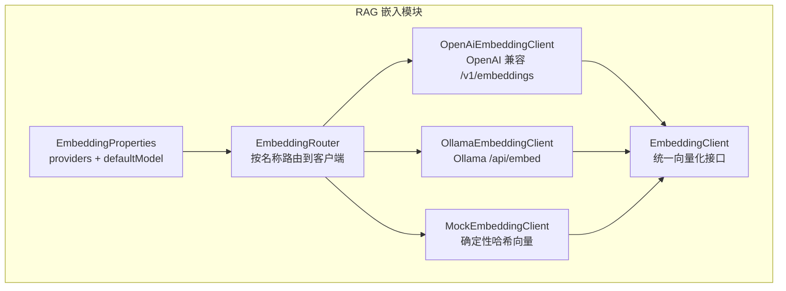
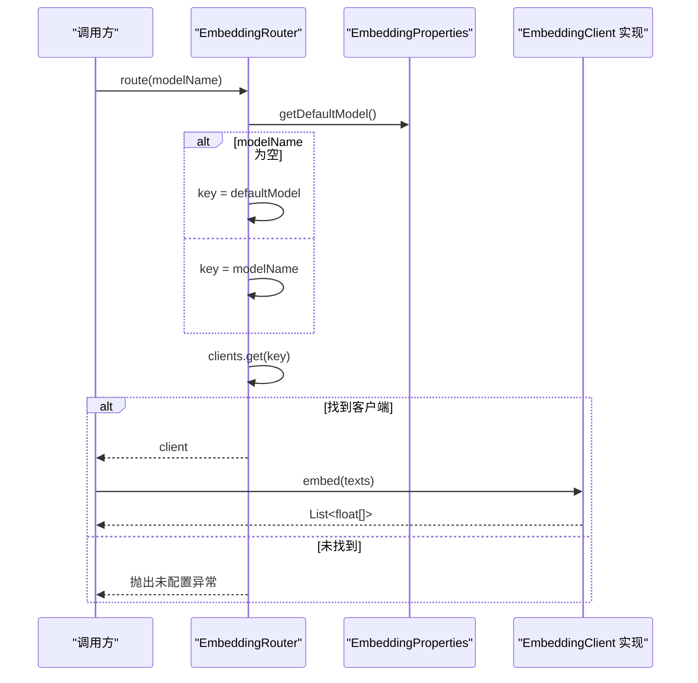
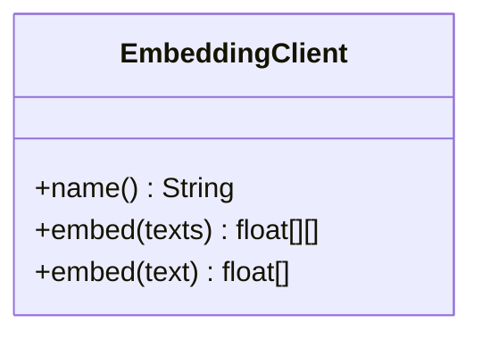
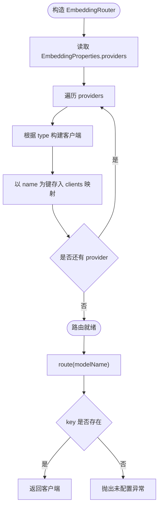
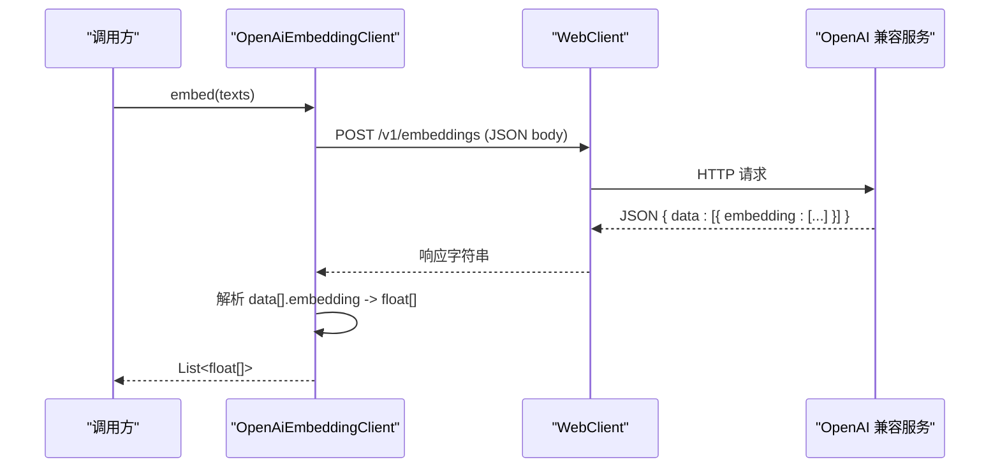
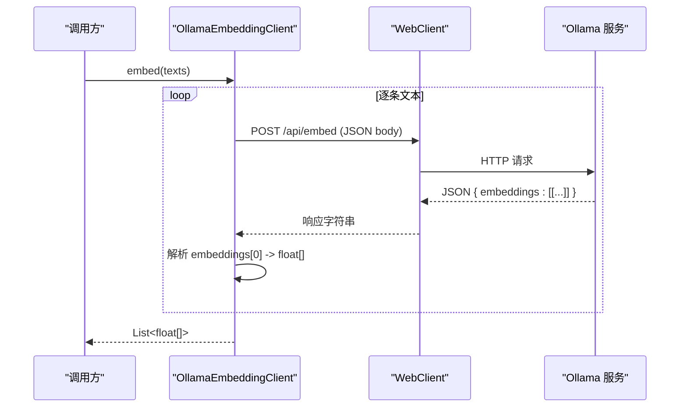
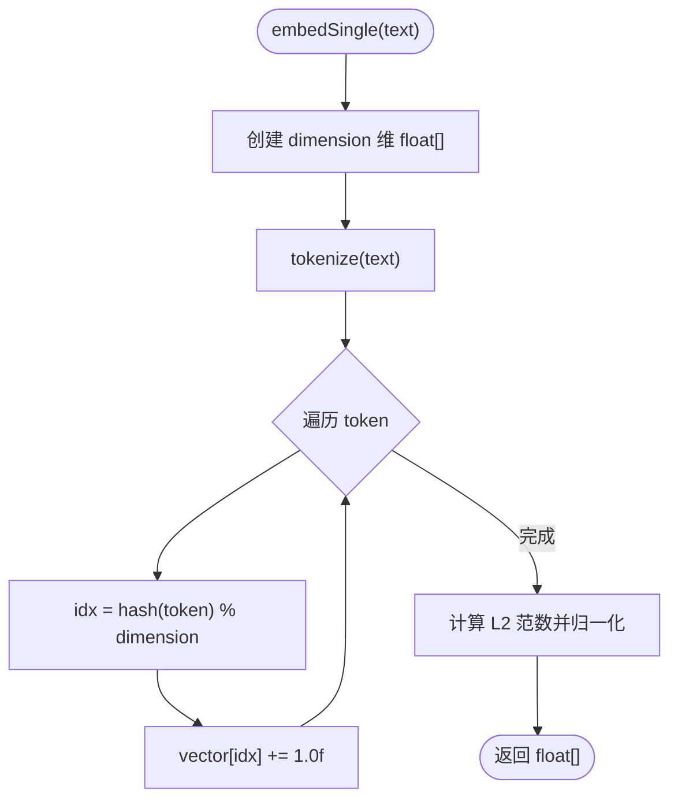
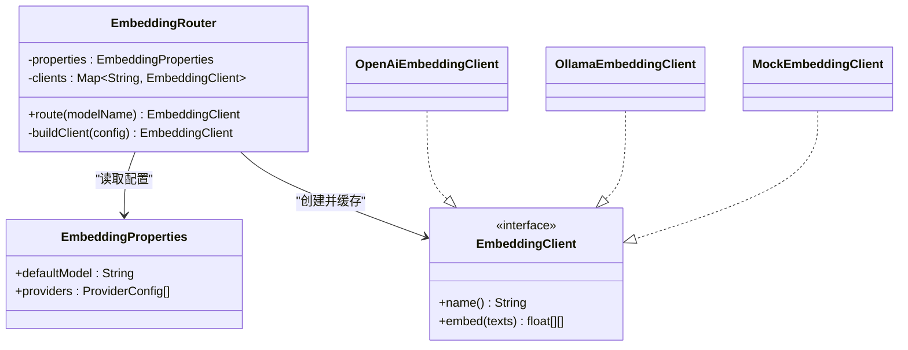
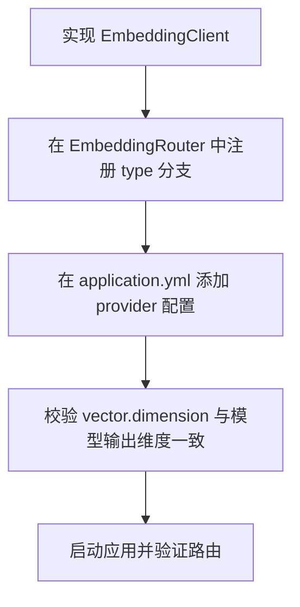

# 嵌入模型路由

<cite>
**本文引用的文件**   
- [EmbeddingRouter.java](file://src/main/java/com/agenthub/rag/embedding/EmbeddingRouter.java)
- [EmbeddingClient.java](file://src/main/java/com/agenthub/rag/embedding/EmbeddingClient.java)
- [OpenAiEmbeddingClient.java](file://src/main/java/com/agenthub/rag/embedding/OpenAiEmbeddingClient.java)
- [OllamaEmbeddingClient.java](file://src/main/java/com/agenthub/rag/embedding/OllamaEmbeddingClient.java)
- [MockEmbeddingClient.java](file://src/main/java/com/agenthub/rag/embedding/MockEmbeddingClient.java)
- [EmbeddingProperties.java](file://src/main/java/com/agenthub/rag/embedding/EmbeddingProperties.java)
- [application.yml](file://src/main/resources/application.yml)
</cite>

## 目录
1. [简介](#简介)
2. [项目结构](#项目结构)
3. [核心组件](#核心组件)
4. [架构总览](#架构总览)
5. [详细组件分析](#详细组件分析)
6. [依赖关系分析](#依赖关系分析)
7. [性能与优化](#性能与优化)
8. [配置与扩展指南](#配置与扩展指南)
9. [故障排查](#故障排查)
10. [结论](#结论)

## 简介
本文件系统性梳理“嵌入模型路由”的设计与实现，重点说明：
- EmbeddingRouter 的抽象设计与动态选择机制
- OpenAiEmbeddingClient、OllamaEmbeddingClient、MockEmbeddingClient 的实现差异与适用场景
- 嵌入向量生成流程、维度配置、批量处理优化
- 如何添加自定义嵌入模型客户端
- 不同嵌入模型的性能特点与选型建议（本地 vs 云端）

## 项目结构
嵌入模型路由相关代码集中在 RAG 模块的 embedding 子包中，采用“接口 + 多实现 + 配置驱动路由”的结构：
- 接口层：EmbeddingClient 定义统一的向量化能力
- 实现层：OpenAiEmbeddingClient、OllamaEmbeddingClient、MockEmbeddingClient
- 配置层：EmbeddingProperties 提供 providers 列表与默认模型键
- 路由层：EmbeddingRouter 根据知识库传入的模型名或默认值，动态选择具体客户端

**图表来源**
- [EmbeddingRouter.java:14-44](file://src/main/java/com/agenthub/rag/embedding/EmbeddingRouter.java#L14-L44)
- [EmbeddingClient.java:8-18](file://src/main/java/com/agenthub/rag/embedding/EmbeddingClient.java#L8-L18)
- [EmbeddingProperties.java:12-31](file://src/main/java/com/agenthub/rag/embedding/EmbeddingProperties.java#L12-L31)
- [OpenAiEmbeddingClient.java:18-32](file://src/main/java/com/agenthub/rag/embedding/OpenAiEmbeddingClient.java#L18-L32)
- [OllamaEmbeddingClient.java:17-28](file://src/main/java/com/agenthub/rag/embedding/OllamaEmbeddingClient.java#L17-L28)
- [MockEmbeddingClient.java:15-23](file://src/main/java/com/agenthub/rag/embedding/MockEmbeddingClient.java#L15-L23)

**章节来源**
- [EmbeddingRouter.java:14-44](file://src/main/java/com/agenthub/rag/embedding/EmbeddingRouter.java#L14-L44)
- [EmbeddingClient.java:8-18](file://src/main/java/com/agenthub/rag/embedding/EmbeddingClient.java#L8-L18)
- [EmbeddingProperties.java:12-31](file://src/main/java/com/agenthub/rag/embedding/EmbeddingProperties.java#L12-L31)

## 核心组件
- EmbeddingClient：定义 name() 与 embed(List<String>) 两个核心方法，并提供单文本 embed(String) 的默认实现。
- EmbeddingRouter：从配置中读取 providers，构建客户端映射表；route(modelName) 返回对应客户端，未命中则抛出业务异常。
- EmbeddingProperties：声明 defaultModel 与 providers 列表，每个 ProviderConfig 包含 name、type、baseUrl、apiKey、model。
- OpenAiEmbeddingClient：通过 WebClient 调用 {baseUrl}/v1/embeddings，支持 Bearer Token 鉴权，解析 data[].embedding 为 float[]。
- OllamaEmbeddingClient：通过 WebClient 调用 {baseUrl}/api/embed，对输入文本逐条请求，解析 embeddings[0] 为 float[]。
- MockEmbeddingClient：基于内容分词与哈希生成固定维度的向量，并进行 L2 归一化，用于无外部服务时的全链路验证。

**章节来源**
- [EmbeddingClient.java:8-18](file://src/main/java/com/agenthub/rag/embedding/EmbeddingClient.java#L8-L18)
- [EmbeddingRouter.java:14-44](file://src/main/java/com/agenthub/rag/embedding/EmbeddingRouter.java#L14-L44)
- [EmbeddingProperties.java:12-31](file://src/main/java/com/agenthub/rag/embedding/EmbeddingProperties.java#L12-L31)
- [OpenAiEmbeddingClient.java:18-77](file://src/main/java/com/agenthub/rag/embedding/OpenAiEmbeddingClient.java#L18-L77)
- [OllamaEmbeddingClient.java:17-72](file://src/main/java/com/agenthub/rag/embedding/OllamaEmbeddingClient.java#L17-L72)
- [MockEmbeddingClient.java:15-81](file://src/main/java/com/agenthub/rag/embedding/MockEmbeddingClient.java#L15-L81)

## 架构总览
EmbeddingRouter 作为装配点，将配置中的 provider 列表转换为 Map<name, EmbeddingClient>，并在运行时依据知识库传入的 embeddingModel 路由键选择具体实现。

**图表来源**
- [EmbeddingRouter.java:20-35](file://src/main/java/com/agenthub/rag/embedding/EmbeddingRouter.java#L20-L35)
- [EmbeddingProperties.java:16-19](file://src/main/java/com/agenthub/rag/embedding/EmbeddingProperties.java#L16-L19)

## 详细组件分析

### EmbeddingClient 接口设计
- name()：用于路由键匹配，需与配置 providers[].name 一致。
- embed(List<String>)：批量向量化，是性能关键路径。
- embed(String)：默认实现委托给批量接口，便于单文本调用。

**图表来源**
- [EmbeddingClient.java:8-18](file://src/main/java/com/agenthub/rag/embedding/EmbeddingClient.java#L8-L18)

**章节来源**
- [EmbeddingClient.java:8-18](file://src/main/java/com/agenthub/rag/embedding/EmbeddingClient.java#L8-L18)

### EmbeddingRouter 路由逻辑
- 构造期：遍历 properties.providers，按 type 分支创建具体客户端实例，并以 name 为键建立映射。
- 运行期：若传入 modelName 为空或空白，回退到 defaultModel；未命中则抛出业务异常。
- 扩展性：新增客户端只需在 buildClient 中增加分支并实现 EmbeddingClient。

**图表来源**
- [EmbeddingRouter.java:20-44](file://src/main/java/com/agenthub/rag/embedding/EmbeddingRouter.java#L20-L44)

**章节来源**
- [EmbeddingRouter.java:20-44](file://src/main/java/com/agenthub/rag/embedding/EmbeddingRouter.java#L20-L44)

### OpenAiEmbeddingClient 实现要点
- 协议：POST {baseUrl}/v1/embeddings，Content-Type application/json。
- 鉴权：默认头 Authorization: Bearer {apiKey}。
- 请求体：{ model, input: [text...] }。
- 响应解析：data[i].embedding -> float[]。
- 错误处理：网络或解析异常统一包装为业务异常。

**图表来源**
- [OpenAiEmbeddingClient.java:25-54](file://src/main/java/com/agenthub/rag/embedding/OpenAiEmbeddingClient.java#L25-L54)
- [OpenAiEmbeddingClient.java:56-77](file://src/main/java/com/agenthub/rag/embedding/OpenAiEmbeddingClient.java#L56-L77)

**章节来源**
- [OpenAiEmbeddingClient.java:18-77](file://src/main/java/com/agenthub/rag/embedding/OpenAiEmbeddingClient.java#L18-L77)

### OllamaEmbeddingClient 实现要点
- 协议：POST {baseUrl}/api/embed，Content-Type application/json。
- 请求体：{ model, input: text }（单文本）。
- 批处理策略：对 texts 逐个调用，聚合结果返回。
- 响应解析：embeddings[0] -> float[]。
- 错误处理：网络或解析异常统一包装为业务异常。

**图表来源**
- [OllamaEmbeddingClient.java:24-42](file://src/main/java/com/agenthub/rag/embedding/OllamaEmbeddingClient.java#L24-L42)
- [OllamaEmbeddingClient.java:44-72](file://src/main/java/com/agenthub/rag/embedding/OllamaEmbeddingClient.java#L44-L72)

**章节来源**
- [OllamaEmbeddingClient.java:17-72](file://src/main/java/com/agenthub/rag/embedding/OllamaEmbeddingClient.java#L17-L72)

### MockEmbeddingClient 实现要点
- 目的：无需外部服务即可跑通上传→解析→切块→入库→检索的全链路。
- 向量生成：简单分词（中文逐字、英文按空格/标点），哈希映射到指定维度，累加计数后做 L2 归一化。
- 可配置维度：构造时传入 dimension，需与 PGVector 建表维度一致。
- 适用场景：开发调试、端到端集成测试、快速演示。

**图表来源**
- [MockEmbeddingClient.java:39-57](file://src/main/java/com/agenthub/rag/embedding/MockEmbeddingClient.java#L39-L57)
- [MockEmbeddingClient.java:60-81](file://src/main/java/com/agenthub/rag/embedding/MockEmbeddingClient.java#L60-L81)

**章节来源**
- [MockEmbeddingClient.java:15-81](file://src/main/java/com/agenthub/rag/embedding/MockEmbeddingClient.java#L15-L81)

## 依赖关系分析
- EmbeddingRouter 依赖 EmbeddingProperties 获取 providers 与 defaultModel。
- 各 EmbeddingClient 实现均依赖 WebClient 进行 HTTP 调用（OpenAI/Ollama），Mock 实现无外部依赖。
- 所有客户端实现都遵循 EmbeddingClient 接口契约，保证路由透明。

**图表来源**
- [EmbeddingRouter.java:14-44](file://src/main/java/com/agenthub/rag/embedding/EmbeddingRouter.java#L14-L44)
- [EmbeddingProperties.java:12-31](file://src/main/java/com/agenthub/rag/embedding/EmbeddingProperties.java#L12-L31)
- [EmbeddingClient.java:8-18](file://src/main/java/com/agenthub/rag/embedding/EmbeddingClient.java#L8-L18)

**章节来源**
- [EmbeddingRouter.java:14-44](file://src/main/java/com/agenthub/rag/embedding/EmbeddingRouter.java#L14-L44)
- [EmbeddingProperties.java:12-31](file://src/main/java/com/agenthub/rag/embedding/EmbeddingProperties.java#L12-L31)
- [EmbeddingClient.java:8-18](file://src/main/java/com/agenthub/rag/embedding/EmbeddingClient.java#L8-L18)

## 性能与优化
- 批量处理
  - OpenAiEmbeddingClient：原生支持批量 input，一次请求返回多个 embedding，吞吐高、延迟低。
  - OllamaEmbeddingClient：当前实现为逐条请求，存在 N 次网络往返，适合小规模或单机环境；如需提升吞吐，可在上层对 texts 分批并发或合并请求（需服务端支持批量）。
  - MockEmbeddingClient：纯 CPU 计算，无网络开销，适合端到端验证。
- 维度一致性
  - PGVector 建表维度需与 embedding 输出维度一致；application.yml 中 vector.dimension 与 mock-embed 维度保持一致（示例均为 1024）。
- 连接与超时
  - WebClient 可进一步配置连接池、超时、重试等参数以提升稳定性与吞吐。
- 错误与降级
  - 统一使用业务异常封装网络或解析错误，便于上层重试或降级策略。

**章节来源**
- [OpenAiEmbeddingClient.java:40-54](file://src/main/java/com/agenthub/rag/embedding/OpenAiEmbeddingClient.java#L40-L54)
- [OllamaEmbeddingClient.java:36-42](file://src/main/java/com/agenthub/rag/embedding/OllamaEmbeddingClient.java#L36-L42)
- [application.yml:64-70](file://src/main/resources/application.yml#L64-L70)

## 配置与扩展指南

### 配置文件结构
- agenthub.embedding.default-model：默认路由键，当知识库未指定 embeddingModel 时使用。
- agenthub.embedding.providers：provider 列表，每个元素包含 name、type、baseUrl、apiKey、model。
- 示例已包含 ollama-embed、openai-embed、mock 三类 provider。

**章节来源**
- [application.yml:126-140](file://src/main/resources/application.yml#L126-L140)
- [EmbeddingProperties.java:12-31](file://src/main/java/com/agenthub/rag/embedding/EmbeddingProperties.java#L12-L31)

### 添加自定义嵌入模型客户端步骤
1. 实现 EmbeddingClient 接口，提供 name() 与 embed(List<String>)。
2. 在 EmbeddingRouter.buildClient 中新增 switch 分支，根据新的 type 创建你的客户端实例。
3. 在 application.yml 中添加新的 provider 条目，确保 name 与实现类 name() 一致。
4. 如需要，调整 vector.dimension 以匹配新模型的输出维度。

**图表来源**
- [EmbeddingRouter.java:37-44](file://src/main/java/com/agenthub/rag/embedding/EmbeddingRouter.java#L37-L44)
- [EmbeddingClient.java:8-18](file://src/main/java/com/agenthub/rag/embedding/EmbeddingClient.java#L8-L18)
- [application.yml:126-140](file://src/main/resources/application.yml#L126-L140)

### 配置示例（概念性说明）
- 新增一个名为 custom-embed 的 provider：
  - name: custom-embed
  - type: custom
  - baseUrl: http://your-custom-service:port
  - apiKey: your-key（可选）
  - model: your-model-name
- 在 EmbeddingRouter.buildClient 中增加 case "custom" -> new CustomEmbeddingClient(...)。
- 将 agenthub.embedding.default-model 指向 custom-embed 或在知识库中引用该路由键。

**章节来源**
- [EmbeddingRouter.java:37-44](file://src/main/java/com/agenthub/rag/embedding/EmbeddingRouter.java#L37-L44)
- [application.yml:126-140](file://src/main/resources/application.yml#L126-L140)

## 故障排查
- 未配置的 Embedding 模型
  - 现象：调用 route(modelName) 抛出未配置异常。
  - 原因：modelName 未在 providers 中配置，或未设置 defaultModel。
  - 处理：检查 application.yml 中 embedding.providers 与 defaultModel 是否正确。
- 响应格式异常
  - 现象：OpenAI/Ollama 客户端解析失败，抛出响应格式异常。
  - 原因：服务端返回结构与预期不一致（缺少 data/embeddings 字段）。
  - 处理：核对服务端 API 文档，确认返回结构；必要时在服务端适配或客户端增强容错。
- 维度不匹配
  - 现象：向量入库或检索报错。
  - 原因：PGVector 建表维度与 embedding 输出维度不一致。
  - 处理：对齐 vector.dimension 与模型输出维度（例如 mock-embed 默认 1024）。

**章节来源**
- [EmbeddingRouter.java:27-35](file://src/main/java/com/agenthub/rag/embedding/EmbeddingRouter.java#L27-L35)
- [OpenAiEmbeddingClient.java:56-77](file://src/main/java/com/agenthub/rag/embedding/OpenAiEmbeddingClient.java#L56-L77)
- [OllamaEmbeddingClient.java:44-72](file://src/main/java/com/agenthub/rag/embedding/OllamaEmbeddingClient.java#L44-L72)
- [application.yml:64-70](file://src/main/resources/application.yml#L64-L70)

## 结论
- EmbeddingRouter 通过配置驱动的 provider 列表实现了嵌入模型的动态选择与切换，具备良好的可扩展性。
- OpenAiEmbeddingClient 支持批量请求，适合高吞吐场景；OllamaEmbeddingClient 当前逐条请求，适合本地轻量场景；MockEmbeddingClient 用于无外部服务的端到端验证。
- 生产环境应关注维度一致性、连接与超时配置、错误处理与降级策略，并根据业务需求选择合适的嵌入模型与服务部署方式。