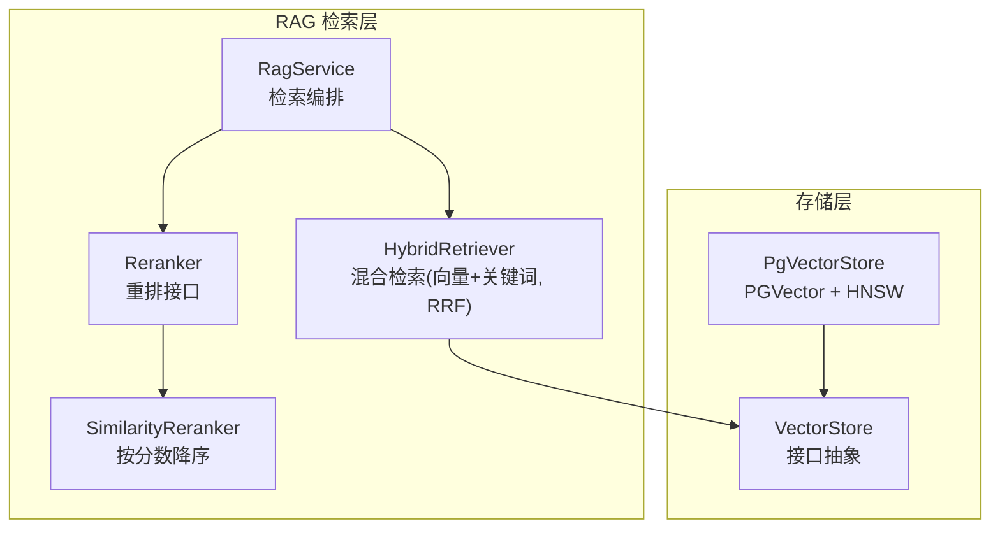
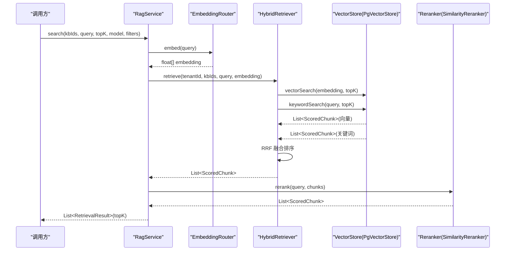
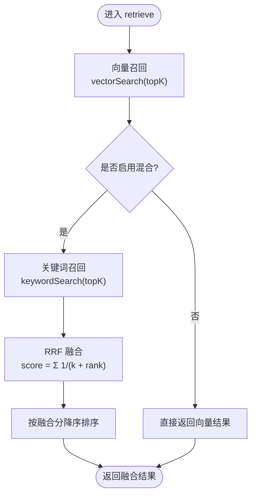
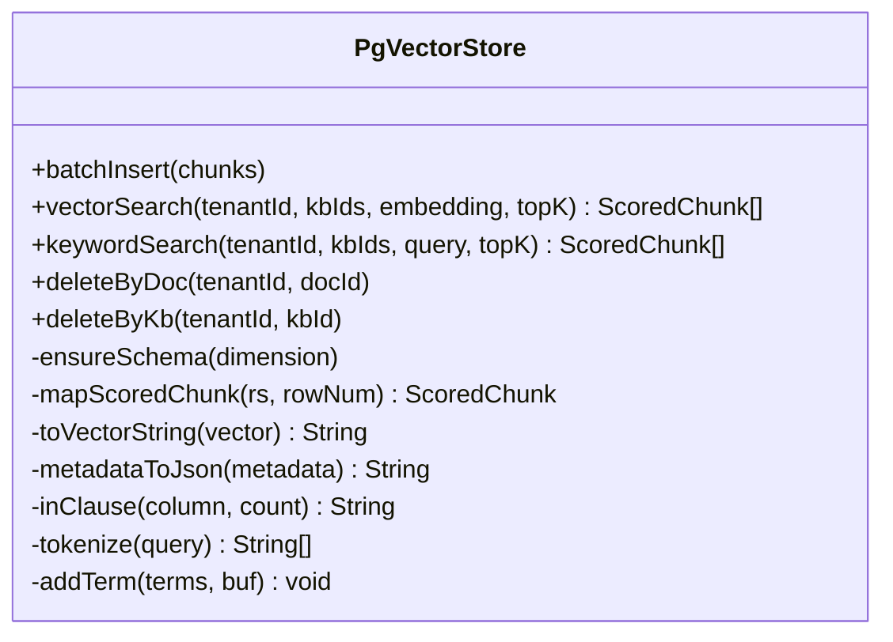
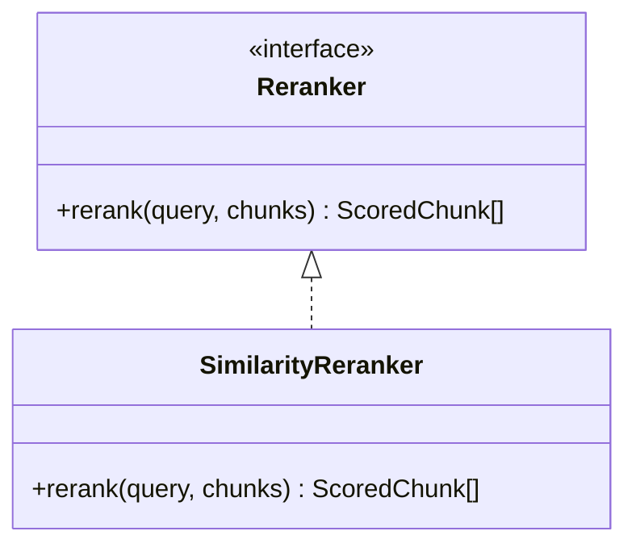
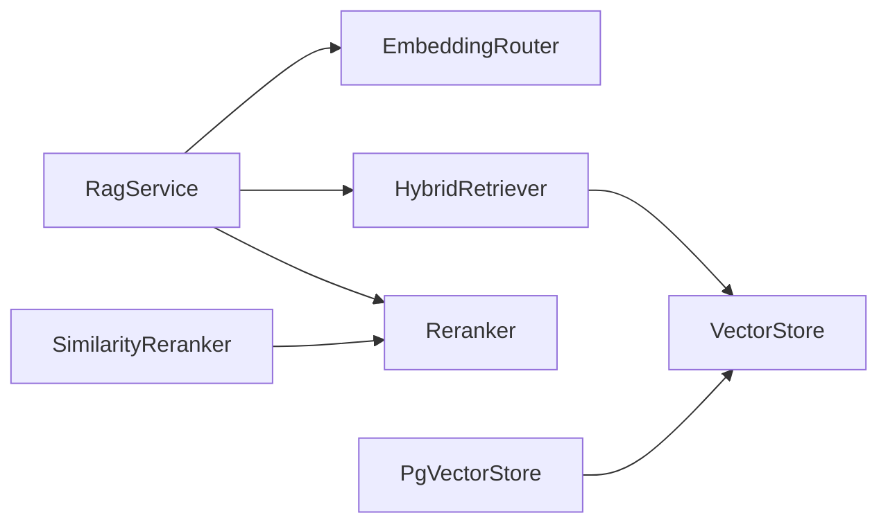

# 混合检索引擎

<cite>
**本文引用的文件**   
- [HybridRetriever.java](file://src/main/java/com/agenthub/rag/retrieve/HybridRetriever.java)
- [ScoredChunk.java](file://src/main/java/com/agenthub/rag/model/ScoredChunk.java)
- [Reranker.java](file://src/main/java/com/agenthub/rag/rerank/Reranker.java)
- [SimilarityReranker.java](file://src/main/java/com/agenthub/rag/rerank/SimilarityReranker.java)
- [PgVectorStore.java](file://src/main/java/com/agenthub/rag/store/PgVectorStore.java)
- [RagService.java](file://src/main/java/com/agenthub/rag/service/RagService.java)
</cite>

## 目录
1. [简介](#简介)
2. [项目结构](#项目结构)
3. [核心组件](#核心组件)
4. [架构总览](#架构总览)
5. [详细组件分析](#详细组件分析)
6. [依赖关系分析](#依赖关系分析)
7. [性能与优化](#性能与优化)
8. [准确率评估与调优](#准确率评估与调优)
9. [故障排查指南](#故障排查指南)
10. [结论](#结论)

## 简介
本文件面向“混合检索引擎”的实现与使用，重点说明：
- HybridRetriever 如何实现向量相似度搜索与关键词匹配的融合（RRF 算法）。
- ScoredChunk 的评分机制与相关性计算逻辑。
- Reranker 重排器的作用与 SimilarityReranker 的实现原理。
- 混合检索的参数调优策略（topK、阈值过滤、排序等）。
- 性能优化建议（索引、缓存、并发）。
- 检索准确率评估方法与调优技巧。

## 项目结构
混合检索相关代码位于 rag 子模块中，关键路径如下：
- 检索编排：retrieve/HybridRetriever.java
- 数据模型：model/ScoredChunk.java
- 重排接口与实现：rerank/Reranker.java、rerank/SimilarityReranker.java
- 向量存储与 SQL：store/PgVectorStore.java
- 服务编排入口：service/RagService.java

图表来源
- [RagService.java:39-54](file://src/main/java/com/agenthub/rag/service/RagService.java#L39-L54)
- [HybridRetriever.java:46-68](file://src/main/java/com/agenthub/rag/retrieve/HybridRetriever.java#L46-L68)
- [PgVectorStore.java:90-143](file://src/main/java/com/agenthub/rag/store/PgVectorStore.java#L90-L143)
- [Reranker.java:10-14](file://src/main/java/com/agenthub/rag/rerank/Reranker.java#L10-L14)
- [SimilarityReranker.java:17-22](file://src/main/java/com/agenthub/rag/rerank/SimilarityReranker.java#L17-L22)

章节来源
- [RagService.java:15-54](file://src/main/java/com/agenthub/rag/service/RagService.java#L15-L54)
- [HybridRetriever.java:14-68](file://src/main/java/com/agenthub/rag/retrieve/HybridRetriever.java#L14-L68)
- [PgVectorStore.java:21-66](file://src/main/java/com/agenthub/rag/store/PgVectorStore.java#L21-L66)

## 核心组件
- HybridRetriever：负责两路召回（向量、关键词）与 RRF 融合排序。
- PgVectorStore：基于 PostgreSQL + pgvector 的向量检索与关键字检索实现。
- Reranker/SimilarityReranker：对混合结果进行精排，默认按分数降序。
- ScoredChunk：统一承载片段内容与跨来源的分数。
- RagService：对外暴露检索流程编排（向量化 → 混合检索 → 重排 → 截断 topK）。

章节来源
- [HybridRetriever.java:14-77](file://src/main/java/com/agenthub/rag/retrieve/HybridRetriever.java#L14-L77)
- [PgVectorStore.java:90-143](file://src/main/java/com/agenthub/rag/store/PgVectorStore.java#L90-L143)
- [Reranker.java:10-14](file://src/main/java/com/agenthub/rag/rerank/Reranker.java#L10-L14)
- [SimilarityReranker.java:17-22](file://src/main/java/com/agenthub/rag/rerank/SimilarityReranker.java#L17-L22)
- [ScoredChunk.java:9-32](file://src/main/java/com/agenthub/rag/model/ScoredChunk.java#L9-L32)
- [RagService.java:39-54](file://src/main/java/com/agenthub/rag/service/RagService.java#L39-L54)

## 架构总览
整体检索链路如下：
1. 调用方通过 RagService.search 发起检索。
2. 使用 EmbeddingRouter 将查询文本转为向量。
3. HybridRetriever 并行执行向量检索与关键词检索。
4. 使用 RRF 对两路结果进行融合排序。
5. Reranker 对融合结果做精排（默认按分数降序）。
6. 最终返回 topK 个 RetrievalResult。

图表来源
- [RagService.java:39-54](file://src/main/java/com/agenthub/rag/service/RagService.java#L39-L54)
- [HybridRetriever.java:46-68](file://src/main/java/com/agenthub/rag/retrieve/HybridRetriever.java#L46-L68)
- [PgVectorStore.java:90-143](file://src/main/java/com/agenthub/rag/store/PgVectorStore.java#L90-L143)
- [SimilarityReranker.java:17-22](file://src/main/java/com/agenthub/rag/rerank/SimilarityReranker.java#L17-L22)

## 详细组件分析

### HybridRetriever：混合检索与 RRF 融合
- 两路召回：
  - 向量检索：调用 VectorStore.vectorSearch，返回余弦相似度得分。
  - 关键词检索：调用 VectorStore.keywordSearch，返回词命中计数得分。
- RRF 融合：
  - 对每路结果的排名 i（从 0 开始），累加 1/(k + i + 1)。
  - k 为配置项 rrfK，用于控制排名衰减速度。
  - 以 chunk id 去重合并，得到最终融合分。
- 排序输出：
  - 按融合分降序排列，并回填到 ScoredChunk.score。

图表来源
- [HybridRetriever.java:46-77](file://src/main/java/com/agenthub/rag/retrieve/HybridRetriever.java#L46-L77)

章节来源
- [HybridRetriever.java:14-77](file://src/main/java/com/agenthub/rag/retrieve/HybridRetriever.java#L14-L77)

### PgVectorStore：向量与关键词检索实现
- 向量检索：
  - 使用 pgvector 的 <=> 算子计算余弦距离，相似度 = 1 - 距离。
  - 通过 HNSW 索引加速近似最近邻搜索。
- 关键词检索：
  - 简单分词：英文按字母数字切词，中文长串拆分为 2-gram。
  - ILIKE 模糊匹配，每个词命中计 1 分，按总分排序。
- 租户隔离：
  - 所有查询强制携带 tenant_id 条件，确保多租户安全。

图表来源
- [PgVectorStore.java:32-223](file://src/main/java/com/agenthub/rag/store/PgVectorStore.java#L32-L223)

章节来源
- [PgVectorStore.java:21-66](file://src/main/java/com/agenthub/rag/store/PgVectorStore.java#L21-L66)
- [PgVectorStore.java:90-143](file://src/main/java/com/agenthub/rag/store/PgVectorStore.java#L90-L143)
- [PgVectorStore.java:193-222](file://src/main/java/com/agenthub/rag/store/PgVectorStore.java#L193-L222)

### Reranker 与 SimilarityReranker：重排器
- Reranker 接口定义统一的 rerank(query, chunks) 方法。
- SimilarityReranker 默认实现：按 ScoredChunk.score 降序排序。
- 扩展点：可替换为交叉编码模型（如 BGE-Reranker）以提升精排质量。

图表来源
- [Reranker.java:10-14](file://src/main/java/com/agenthub/rag/rerank/Reranker.java#L10-L14)
- [SimilarityReranker.java:17-22](file://src/main/java/com/agenthub/rag/rerank/SimilarityReranker.java#L17-L22)

章节来源
- [Reranker.java:10-14](file://src/main/java/com/agenthub/rag/rerank/Reranker.java#L10-L14)
- [SimilarityReranker.java:8-22](file://src/main/java/com/agenthub/rag/rerank/SimilarityReranker.java#L8-L22)

### ScoredChunk：评分与相关性表达
- 字段含义：
  - id：片段主键。
  - content/docName/chunkIndex：片段内容与来源信息。
  - score：不同来源含义不同，仅用于排序/融合；在混合检索后统一为 RRF 融合分。
  - metadata：扩展元数据。
- 设计要点：
  - 用单一 score 字段承载多种打分来源，便于后续融合与排序。

章节来源
- [ScoredChunk.java:9-32](file://src/main/java/com/agenthub/rag/model/ScoredChunk.java#L9-L32)

## 依赖关系分析
- RagService 依赖 EmbeddingRouter、HybridRetriever、Reranker。
- HybridRetriever 依赖 VectorStore（PgVectorStore 实现）。
- PgVectorStore 依赖 JdbcTemplate 与 HikariDataSource，直连 PGVector。
- SimilarityReranker 实现 Reranker 接口，无外部依赖。

图表来源
- [RagService.java:26-28](file://src/main/java/com/agenthub/rag/service/RagService.java#L26-L28)
- [HybridRetriever.java:25-37](file://src/main/java/com/agenthub/rag/retrieve/HybridRetriever.java#L25-L37)
- [PgVectorStore.java:34-45](file://src/main/java/com/agenthub/rag/store/PgVectorStore.java#L34-L45)
- [SimilarityReranker.java:14-22](file://src/main/java/com/agenthub/rag/rerank/SimilarityReranker.java#L14-L22)

章节来源
- [RagService.java:26-54](file://src/main/java/com/agenthub/rag/service/RagService.java#L26-L54)
- [HybridRetriever.java:25-68](file://src/main/java/com/agenthub/rag/retrieve/HybridRetriever.java#L25-L68)
- [PgVectorStore.java:34-45](file://src/main/java/com/agenthub/rag/store/PgVectorStore.java#L34-L45)

## 性能与优化

### 索引优化
- HNSW 索引：
  - 已创建 embedding 列的 HNSW 索引（cosine 操作符），显著提升向量检索性能。
- 复合索引：
  - (tenant_id, kb_id) 复合索引用于快速过滤知识库范围。
- 建议：
  - 根据数据规模调整 HNSW 参数（m、ef_construction、ef_search），平衡召回率与延迟。
  - 定期重建或优化索引，避免碎片化影响查询性能。

章节来源
- [PgVectorStore.java:47-66](file://src/main/java/com/agenthub/rag/store/PgVectorStore.java#L47-L66)

### 缓存策略
- 查询向量缓存：
  - 对相同 query 的 embedding 结果进行本地缓存，减少重复向量化开销。
- 检索结果缓存：
  - 对高频查询（query + kbIds + filters）的结果进行短期缓存，降低数据库压力。
- 注意：
  - 缓存需考虑租户隔离与过期策略，避免脏读。

[本节为通用建议，不直接分析具体文件]

### 并发处理
- 双路召回并行：
  - 可将向量检索与关键词检索改为异步并行，缩短端到端延迟。
- 连接池：
  - PgVectorStore 使用独立 Hikari 连接池，建议根据 QPS 调整最大连接数。
- 批处理写入：
  - 入库使用 batchUpdate，提升批量插入吞吐。

章节来源
- [PgVectorStore.java:69-87](file://src/main/java/com/agenthub/rag/store/PgVectorStore.java#L69-L87)

### 查询优化
- 限制 topK：
  - 合理设置 vectorTopK 与 keywordTopK，避免过大导致 RRF 融合开销增加。
- 分词优化：
  - 当前分词较简单，可引入专业分词器（如 IK Analyzer）提升中文召回质量。
- 过滤前置：
  - 在应用层先做粗过滤（如文档类型、时间范围），再进入向量/关键词检索。

章节来源
- [PgVectorStore.java:110-143](file://src/main/java/com/agenthub/rag/store/PgVectorStore.java#L110-L143)
- [PgVectorStore.java:193-222](file://src/main/java/com/agenthub/rag/store/PgVectorStore.java#L193-L222)

## 准确率评估与调优

### 评估指标
- 常用指标：
  - Recall@K、Precision@K、MRR、NDCG@K。
- 数据集构建：
  - 标注查询-相关片段对，形成 ground truth。
- 离线评测：
  - 固定测试集，对比不同参数组合下的指标变化。

[本节为通用方法论，不直接分析具体文件]

### 参数调优策略
- topK 设置：
  - vectorTopK、keywordTopK：增大可提升召回但增加计算成本；建议从小值起步，逐步上调。
  - 最终 topK：由 RagService 截断，决定最终返回条数。
- RRF 参数：
  - rrfK：控制排名衰减速度；较小值更看重头部排名，较大值更平滑。
- 阈值过滤：
  - 可在 RRF 融合后对 score 设置阈值，剔除低相关片段。
- 重排策略：
  - 默认 SimilarityReranker 仅按分数排序；可替换为交叉编码模型提升精排质量。

章节来源
- [HybridRetriever.java:27-37](file://src/main/java/com/agenthub/rag/retrieve/HybridRetriever.java#L27-L37)
- [HybridRetriever.java:55-68](file://src/main/java/com/agenthub/rag/retrieve/HybridRetriever.java#L55-L68)
- [RagService.java:39-54](file://src/main/java/com/agenthub/rag/service/RagService.java#L39-L54)
- [SimilarityReranker.java:17-22](file://src/main/java/com/agenthub/rag/rerank/SimilarityReranker.java#L17-L22)

### 调优技巧
- 分阶段调参：
  - 先调向量检索 topK，再调关键词检索 topK，最后调 rrfK。
- A/B 实验：
  - 线上灰度不同参数版本，观察业务指标（如采纳率、满意度）。
- 错误分析：
  - 针对低相关结果进行根因分析（分词、索引、模型维度等）。

[本节为通用实践，不直接分析具体文件]

## 故障排查指南
- 向量检索为空：
  - 检查 embedding 维度是否与表结构一致。
  - 确认 HNSW 索引是否存在且有效。
- 关键词检索为空：
  - 检查分词逻辑是否切出有效 term。
  - 确认 ILIKE 匹配条件是否正确拼接。
- 租户隔离问题：
  - 确认所有查询均包含 tenant_id 条件。
- 性能退化：
  - 检查连接池大小、HNSW 参数、数据量增长导致的索引失效。

章节来源
- [PgVectorStore.java:47-66](file://src/main/java/com/agenthub/rag/store/PgVectorStore.java#L47-L66)
- [PgVectorStore.java:90-143](file://src/main/java/com/agenthub/rag/store/PgVectorStore.java#L90-L143)
- [PgVectorStore.java:193-222](file://src/main/java/com/agenthub/rag/store/PgVectorStore.java#L193-L222)

## 结论
本混合检索引擎通过向量相似度与关键词匹配的双路召回，结合 RRF 融合与可选的精排重排，兼顾语义相关性与精确匹配能力。通过合理的参数调优、索引优化与缓存策略，可在保证准确率的同时提升系统性能。生产环境建议逐步引入专业分词器与交叉编码重排模型，进一步提升检索质量。