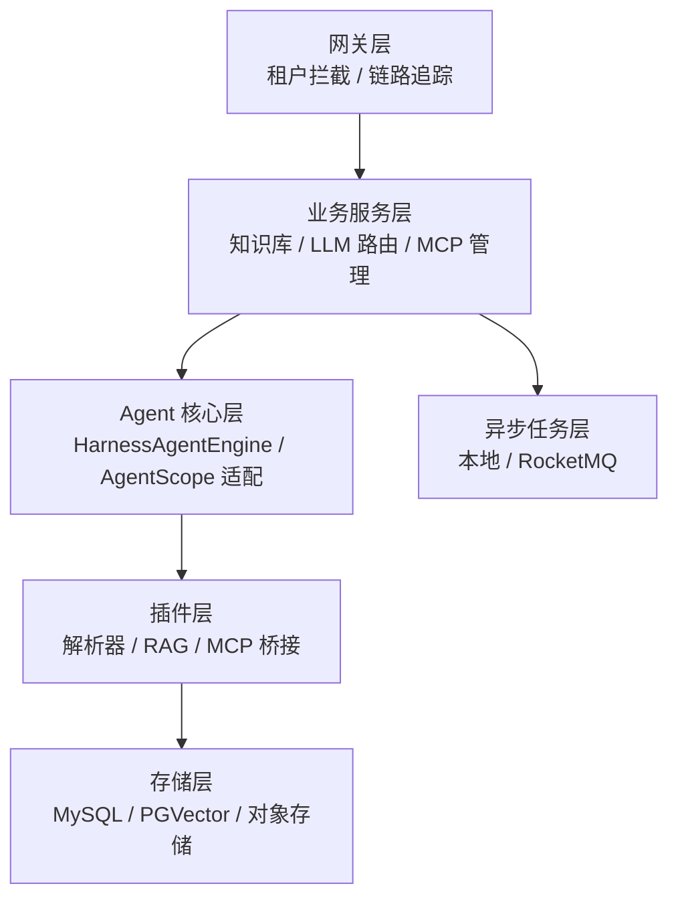
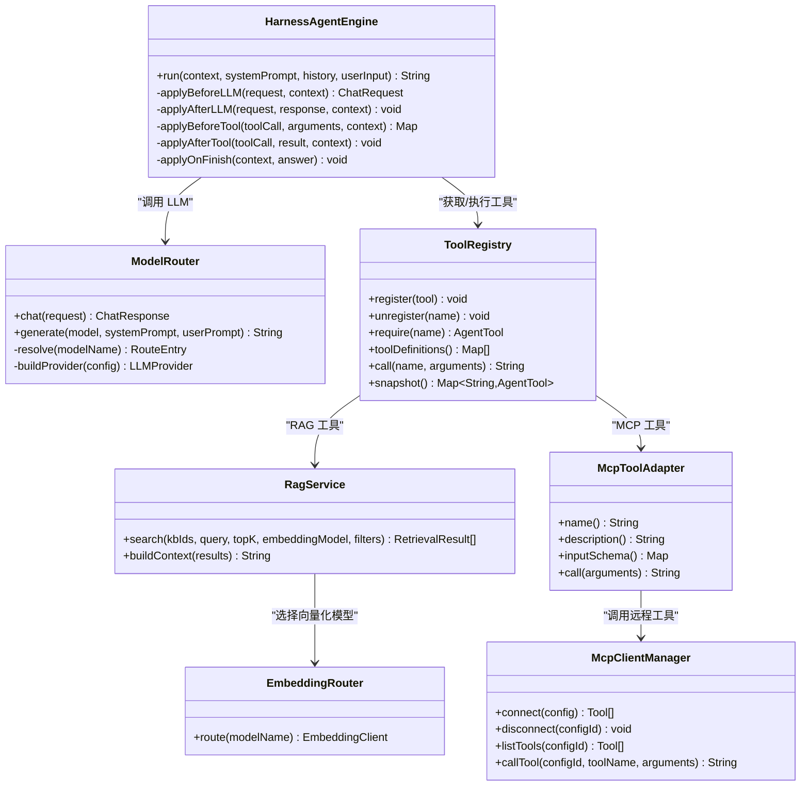
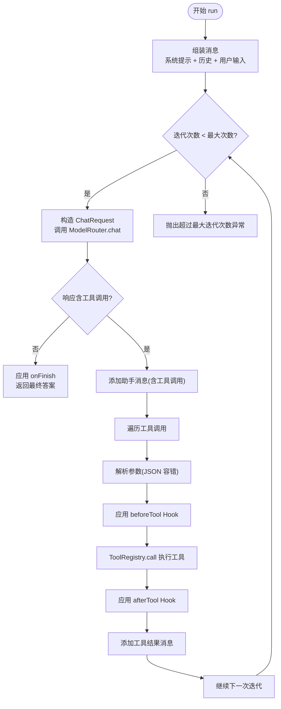
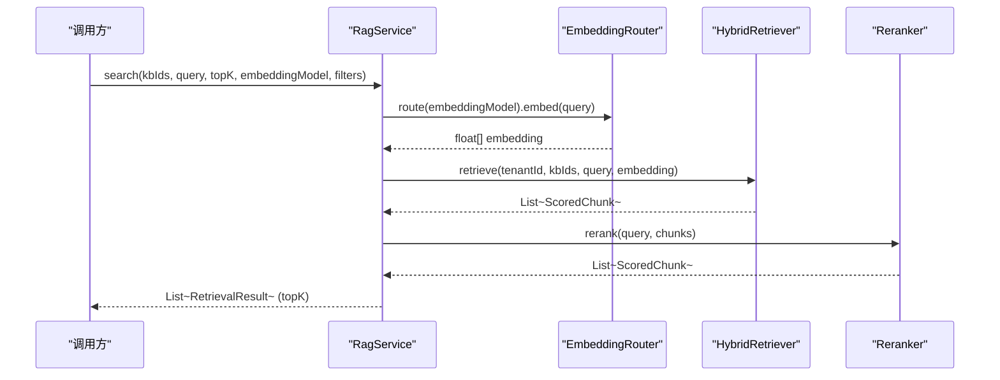
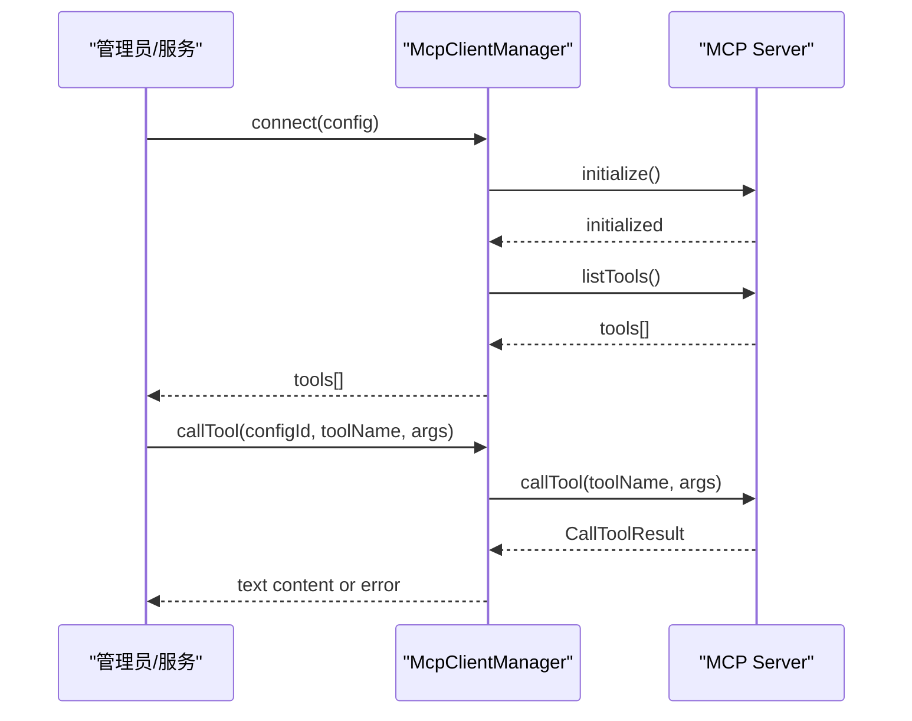
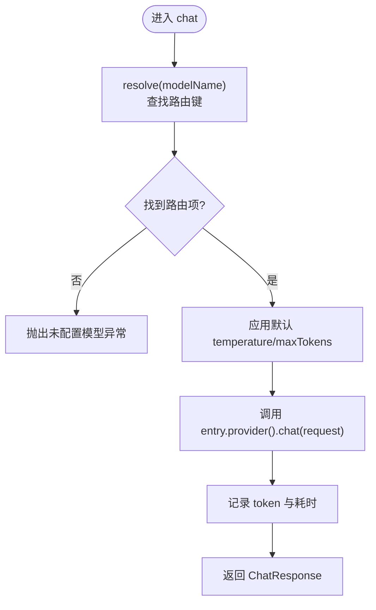
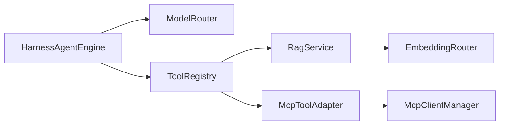

# 核心组件设计

<cite>
**本文引用的文件**   
- [HarnessAgentEngine.java](file://src/main/java/com/agenthub/agent/harness/HarnessAgentEngine.java)
- [AgentHook.java](file://src/main/java/com/agenthub/agent/harness/AgentHook.java)
- [ChatContext.java](file://src/main/java/com/agenthub/agent/harness/ChatContext.java)
- [ToolRegistry.java](file://src/main/java/com/agenthub/agent/tool/ToolRegistry.java)
- [RagService.java](file://src/main/java/com/agenthub/rag/service/RagService.java)
- [EmbeddingRouter.java](file://src/main/java/com/agenthub/rag/embedding/EmbeddingRouter.java)
- [McpClientManager.java](file://src/main/java/com/agenthub/mcp/client/McpClientManager.java)
- [McpToolAdapter.java](file://src/main/java/com/agenthub/mcp/client/McpToolAdapter.java)
- [ModelRouter.java](file://src/main/java/com/agenthub/llm/router/ModelRouter.java)
- [README.md](file://README.md)
</cite>

## 目录
1. [引言](#引言)
2. [项目结构](#项目结构)
3. [核心组件](#核心组件)
4. [架构总览](#架构总览)
5. [详细组件分析](#详细组件分析)
6. [依赖关系分析](#依赖关系分析)
7. [性能与可扩展性](#性能与可扩展性)
8. [可测试性设计](#可测试性设计)
9. [故障排查指南](#故障排查指南)
10. [结论](#结论)

## 引言
本设计文档聚焦于系统中的四个关键组件：HarnessAgentEngine（ReAct 模式编排引擎）、RagService（RAG 检索服务）、McpClientManager（MCP 客户端管理器）与 ModelRouter（模型路由器）。文档从职责边界、数据流、扩展点、错误处理与可观测性等维度展开，并通过类图、时序图和流程图说明组件协作方式。同时给出工具注册机制、模型选择策略与上下文传递的设计要点，帮助读者快速理解并扩展系统能力。

## 项目结构
项目采用按领域划分的分层结构：网关层负责租户认证与链路追踪；业务服务层组织知识库、LLM 路由、MCP 管理等；Agent 核心层提供内置 ReAct 编排与 AgentScope 适配；插件层包含解析器、RAG、MCP 桥接；存储层对接 MySQL、PGVector 与对象存储；异步任务层通过本地或 RocketMQ 驱动解析与向量化流水线。

图表来源
- [README.md:20-35](file://README.md#L20-L35)
- [README.md:158-173](file://README.md#L158-L173)

章节来源
- [README.md:20-35](file://README.md#L20-L35)
- [README.md:158-173](file://README.md#L158-L173)

## 核心组件
- HarnessAgentEngine：实现 ReAct 循环的编排引擎，负责消息组装、LLM 调用、工具执行与 Hook 生命周期扩展。
- RagService：RAG 检索服务的编排入口，串联 Embedding 路由、混合检索与重排，输出结构化片段与上下文文本。
- McpClientManager：MCP 客户端管理器，负责连接远程 MCP Server、发现工具、调用工具并封装为统一工具接口。
- ModelRouter：模型路由器，根据配置将请求路由到具体 LLM Provider，统一记录 token 消耗与耗时。

章节来源
- [HarnessAgentEngine.java:21-31](file://src/main/java/com/agenthub/agent/harness/HarnessAgentEngine.java#L21-L31)
- [RagService.java:15-21](file://src/main/java/com/agenthub/rag/service/RagService.java#L15-L21)
- [McpClientManager.java:24-32](file://src/main/java/com/agenthub/mcp/client/McpClientManager.java#L24-L32)
- [ModelRouter.java:19-24](file://src/main/java/com/agenthub/llm/router/ModelRouter.java#L19-L24)

## 架构总览
下图展示关键组件之间的交互关系：Agent 编排引擎通过模型路由器调用 LLM；当需要知识增强时，通过工具注册表调用 RAG 工具；当需要外部能力时，通过 MCP 适配器调用远程工具；所有工具定义由 ToolRegistry 统一管理。

图表来源
- [HarnessAgentEngine.java:36-106](file://src/main/java/com/agenthub/agent/harness/HarnessAgentEngine.java#L36-L106)
- [ModelRouter.java:27-73](file://src/main/java/com/agenthub/llm/router/ModelRouter.java#L27-L73)
- [ToolRegistry.java:18-53](file://src/main/java/com/agenthub/agent/tool/ToolRegistry.java#L18-L53)
- [RagService.java:24-54](file://src/main/java/com/agenthub/rag/service/RagService.java#L24-L54)
- [EmbeddingRouter.java:15-35](file://src/main/java/com/agenthub/rag/embedding/EmbeddingRouter.java#L15-L35)
- [McpClientManager.java:35-95](file://src/main/java/com/agenthub/mcp/client/McpClientManager.java#L35-L95)
- [McpToolAdapter.java:14-53](file://src/main/java/com/agenthub/mcp/client/McpToolAdapter.java#L14-L53)

## 详细组件分析

### HarnessAgentEngine（ReAct 编排引擎）
职责与流程
- 组装系统提示词、历史消息与用户输入，构建对话上下文。
- 在最大迭代次数内循环：调用 LLM → 判断是否工具调用 → 若否返回最终答案 → 若是逐个执行工具并将结果回填消息 → 继续下一轮。
- 通过 AgentHook 在 LLM 调用前后、工具调用前后以及对话结束时插入扩展逻辑，支持权限校验、参数改写、埋点与审计。
- 使用 ChatContext 贯穿一次调用的完整生命周期，记录租户、用户、会话、模型路由键、工具调用计数与执行轨迹。

关键设计点
- ReAct 循环收敛条件：无工具调用即收敛；超过最大迭代次数抛出业务异常。
- 工具参数解析：对 JSON 参数进行容错解析，失败时回退为空参数。
- Hook 编排：beforeLLM/afterLLM/beforeTool/afterTool/onFinish 形成标准生命周期钩子，便于接入可观测性与安全控制。

图表来源
- [HarnessAgentEngine.java:52-106](file://src/main/java/com/agenthub/agent/harness/HarnessAgentEngine.java#L52-L106)
- [HarnessAgentEngine.java:108-147](file://src/main/java/com/agenthub/agent/harness/HarnessAgentEngine.java#L108-L147)

章节来源
- [HarnessAgentEngine.java:21-31](file://src/main/java/com/agenthub/agent/harness/HarnessAgentEngine.java#L21-L31)
- [HarnessAgentEngine.java:52-106](file://src/main/java/com/agenthub/agent/harness/HarnessAgentEngine.java#L52-L106)
- [HarnessAgentEngine.java:108-147](file://src/main/java/com/agenthub/agent/harness/HarnessAgentEngine.java#L108-L147)
- [AgentHook.java:10-37](file://src/main/java/com/agenthub/agent/harness/AgentHook.java#L10-L37)
- [ChatContext.java:10-42](file://src/main/java/com/agenthub/agent/harness/ChatContext.java#L10-L42)

### RagService（RAG 检索服务）
职责与流程
- 作为 RAG 的核心编排入口，对外暴露 search 与 buildContext 两个方法。
- search：按租户隔离，先通过 EmbeddingRouter 选择向量化模型生成查询向量，再交由 HybridRetriever 做混合检索（RRF），最后经 Reranker 重排，截断 topK 后转换为 RetrievalResult。
- buildContext：将检索结果拼装为带来源标注的上下文文本，供 LLM 生成回答。

关键设计点
- 租户隔离：通过 TenantContext.requireTenantId() 确保检索范围限定在当前租户。
- 可插拔向量化：EmbeddingRouter 支持多 provider（OpenAI/Ollama/Mock），默认模型可配置。
- 结果包装：统一输出 RetrievalResult，便于上层工具或 API 复用。

图表来源
- [RagService.java:39-54](file://src/main/java/com/agenthub/rag/service/RagService.java#L39-L54)
- [EmbeddingRouter.java:27-35](file://src/main/java/com/agenthub/rag/embedding/EmbeddingRouter.java#L27-L35)

章节来源
- [RagService.java:15-21](file://src/main/java/com/agenthub/rag/service/RagService.java#L15-L21)
- [RagService.java:39-54](file://src/main/java/com/agenthub/rag/service/RagService.java#L39-L54)
- [RagService.java:59-69](file://src/main/java/com/agenthub/rag/service/RagService.java#L59-L69)
- [EmbeddingRouter.java:15-35](file://src/main/java/com/agenthub/rag/embedding/EmbeddingRouter.java#L15-L35)

### McpClientManager（MCP 客户端管理器）
职责与流程
- 管理多个 MCP Server 的连接生命周期：建立连接、握手、列出工具、调用工具、断开连接。
- 支持三种传输模式：streamable-http、sse、stdio，分别对应远程 HTTP、SSE 长连接与本地进程模式。
- 将远程工具封装为平台统一的 AgentTool（通过 McpToolAdapter），注册进 ToolRegistry 后可被 LLM function calling 直接调用。

关键设计点
- 连接池：ConcurrentHashMap 维护已连接的 McpSyncClient，key 为配置 ID。
- 健壮性：连接失败、工具调用失败均抛出 BizException，并提供日志与优雅关闭。
- STDIO 启动参数：从配置中解析命令、参数与环境变量，动态拉起子进程。

图表来源
- [McpClientManager.java:41-58](file://src/main/java/com/agenthub/mcp/client/McpClientManager.java#L41-L58)
- [McpClientManager.java:83-95](file://src/main/java/com/agenthub/mcp/client/McpClientManager.java#L83-L95)
- [McpClientManager.java:117-143](file://src/main/java/com/agenthub/mcp/client/McpClientManager.java#L117-L143)

章节来源
- [McpClientManager.java:24-32](file://src/main/java/com/agenthub/mcp/client/McpClientManager.java#L24-L32)
- [McpClientManager.java:41-58](file://src/main/java/com/agenthub/mcp/client/McpClientManager.java#L41-L58)
- [McpClientManager.java:83-95](file://src/main/java/com/agenthub/mcp/client/McpClientManager.java#L83-L95)
- [McpClientManager.java:117-143](file://src/main/java/com/agenthub/mcp/client/McpClientManager.java#L117-L143)
- [McpToolAdapter.java:14-53](file://src/main/java/com/agenthub/mcp/client/McpToolAdapter.java#L14-L53)

### ModelRouter（模型路由器）
职责与流程
- 根据配置加载 Provider 与模型映射，将请求中的“路由键”替换为底层引擎模型名。
- 统一记录 token 消耗与耗时，失败路径也记录统计信息。
- 提供 chat 与 generate 两种调用方式，简化纯文本生成场景。

关键设计点
- 路由表：routes 以路由键为 key，保存 provider 与模型配置。
- 默认模型：未指定路由键时使用默认模型。
- Provider 构建：根据类型创建 OpenAI 兼容、Ollama 或 Mock 提供者。

图表来源
- [ModelRouter.java:45-73](file://src/main/java/com/agenthub/llm/router/ModelRouter.java#L45-L73)
- [ModelRouter.java:86-103](file://src/main/java/com/agenthub/llm/router/ModelRouter.java#L86-L103)

章节来源
- [ModelRouter.java:19-24](file://src/main/java/com/agenthub/llm/router/ModelRouter.java#L19-L24)
- [ModelRouter.java:45-73](file://src/main/java/com/agenthub/llm/router/ModelRouter.java#L45-L73)
- [ModelRouter.java:86-103](file://src/main/java/com/agenthub/llm/router/ModelRouter.java#L86-L103)

## 依赖关系分析
- HarnessAgentEngine 依赖 ModelRouter 与 ToolRegistry，并通过 AgentHook 注入扩展逻辑。
- ToolRegistry 聚合内置工具（如 RAG 工具）与 MCP 工具（通过 McpToolAdapter）。
- RagService 依赖 EmbeddingRouter 与检索/重排组件，受租户上下文约束。
- McpClientManager 独立管理 MCP 连接，被 McpToolAdapter 委托调用。
- ModelRouter 依赖 TokenUsageService 与 LLMProperties，屏蔽底层 Provider 差异。

图表来源
- [HarnessAgentEngine.java:36-106](file://src/main/java/com/agenthub/agent/harness/HarnessAgentEngine.java#L36-L106)
- [ToolRegistry.java:18-53](file://src/main/java/com/agenthub/agent/tool/ToolRegistry.java#L18-L53)
- [RagService.java:24-54](file://src/main/java/com/agenthub/rag/service/RagService.java#L24-L54)
- [McpToolAdapter.java:14-53](file://src/main/java/com/agenthub/mcp/client/McpToolAdapter.java#L14-L53)
- [McpClientManager.java:35-95](file://src/main/java/com/agenthub/mcp/client/McpClientManager.java#L35-L95)
- [EmbeddingRouter.java:15-35](file://src/main/java/com/agenthub/rag/embedding/EmbeddingRouter.java#L15-L35)

章节来源
- [HarnessAgentEngine.java:36-106](file://src/main/java/com/agenthub/agent/harness/HarnessAgentEngine.java#L36-L106)
- [ToolRegistry.java:18-53](file://src/main/java/com/agenthub/agent/tool/ToolRegistry.java#L18-L53)
- [RagService.java:24-54](file://src/main/java/com/agenthub/rag/service/RagService.java#L24-L54)
- [McpToolAdapter.java:14-53](file://src/main/java/com/agenthub/mcp/client/McpToolAdapter.java#L14-L53)
- [McpClientManager.java:35-95](file://src/main/java/com/agenthub/mcp/client/McpClientManager.java#L35-L95)
- [EmbeddingRouter.java:15-35](file://src/main/java/com/agenthub/rag/embedding/EmbeddingRouter.java#L15-L35)

## 性能与可扩展性
- 性能特性
  - ReAct 循环通过最大迭代次数限制避免无限调用，降低资源占用风险。
  - ModelRouter 每次调用记录 token 与耗时，便于监控与容量规划。
  - RAG 检索顺序化执行：向量化 → 混合检索 → 重排，可通过调整 topK 与重排策略平衡精度与延迟。
  - MCP 连接复用：ConcurrentHashMap 缓存已连接客户端，减少握手开销。
- 可扩展性
  - Hook 机制：AgentHook 提供标准生命周期扩展点，便于接入权限、审计、压缩记忆等中间件。
  - 工具注册：ToolRegistry 支持动态注册/注销工具，新增工具无需修改编排引擎。
  - 模型路由：ModelRouter 支持多 Provider 与多模型，新增模型仅需配置。
  - 向量化路由：EmbeddingRouter 支持多 Embedding Client，新增向量化后端只需扩展配置。
  - MCP 传输：McpClientManager 支持多种传输模式，新增传输类型只需扩展构建逻辑。

[本节为通用指导，不直接分析具体文件]

## 可测试性设计
- HarnessAgentEngine
  - 可通过注入 Mock 的 ModelRouter 与 ToolRegistry 验证 ReAct 循环分支（有/无工具调用、超迭代次数）。
  - 通过自定义 AgentHook 验证生命周期钩子是否按序触发。
- RagService
  - 可 Mock EmbeddingRouter、HybridRetriever、Reranker，验证检索与重排流程及 topK 截断。
- McpClientManager
  - 可 Mock McpSyncClient 行为，验证连接、工具列表与调用成功/失败路径。
- ModelRouter
  - 可注入不同 Provider 与 TokenUsageService，验证路由选择、默认值填充与统计记录。

[本节为通用指导，不直接分析具体文件]

## 故障排查指南
- 超过最大迭代次数
  - 现象：抛出业务异常，提示超过最大迭代次数仍未收敛。
  - 排查：检查工具定义是否正确、工具执行是否稳定返回有效结果，必要时增大 maxIterations 或优化 Prompt。
  - 参考位置：[HarnessAgentEngine.java:105-106](file://src/main/java/com/agenthub/agent/harness/HarnessAgentEngine.java#L105-L106)
- 未注册的工具
  - 现象：调用 ToolRegistry.require 抛出业务异常。
  - 排查：确认工具是否已 register，名称是否一致。
  - 参考位置：[ToolRegistry.java:33-39](file://src/main/java/com/agenthub/agent/tool/ToolRegistry.java#L33-L39)
- 未配置的模型路由键
  - 现象：ModelRouter.resolve 抛出业务异常。
  - 排查：检查配置中的路由键与 defaultModel 设置。
  - 参考位置：[ModelRouter.java:86-93](file://src/main/java/com/agenthub/llm/router/ModelRouter.java#L86-L93)
- MCP 连接失败或未连接
  - 现象：BizException 提示连接失败或未连接。
  - 排查：检查传输类型、baseUrl/endpoint、STDIO 命令与参数；确认已 connect 且未 disconnect。
  - 参考位置：[McpClientManager.java:54-57](file://src/main/java/com/agenthub/mcp/client/McpClientManager.java#L54-L57), [McpClientManager.java:108-114](file://src/main/java/com/agenthub/mcp/client/McpClientManager.java#L108-L114)

章节来源
- [HarnessAgentEngine.java:105-106](file://src/main/java/com/agenthub/agent/harness/HarnessAgentEngine.java#L105-L106)
- [ToolRegistry.java:33-39](file://src/main/java/com/agenthub/agent/tool/ToolRegistry.java#L33-L39)
- [ModelRouter.java:86-93](file://src/main/java/com/agenthub/llm/router/ModelRouter.java#L86-L93)
- [McpClientManager.java:54-57](file://src/main/java/com/agenthub/mcp/client/McpClientManager.java#L54-L57)
- [McpClientManager.java:108-114](file://src/main/java/com/agenthub/mcp/client/McpClientManager.java#L108-L114)

## 结论
HarnessAgentEngine、RagService、McpClientManager 与 ModelRouter 共同构成了系统的核心能力：ReAct 编排、知识增强检索、远程工具集成与多模型路由。通过 Hook、工具注册与路由配置，系统在保持简洁的同时具备良好的可扩展性与可观测性。建议在扩展新工具、新模型与新传输模式时，优先遵循现有抽象与约定，以确保整体架构的一致性与稳定性。

[本节为总结性内容，不直接分析具体文件]