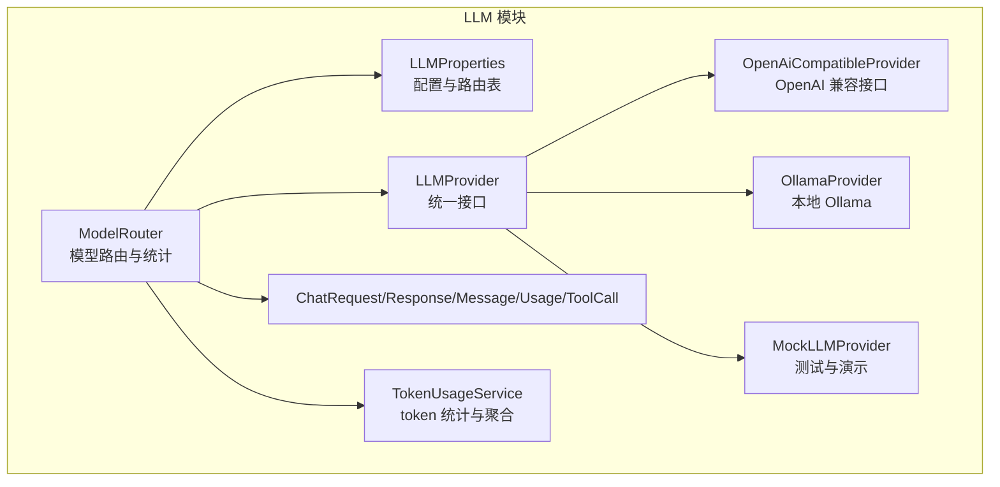
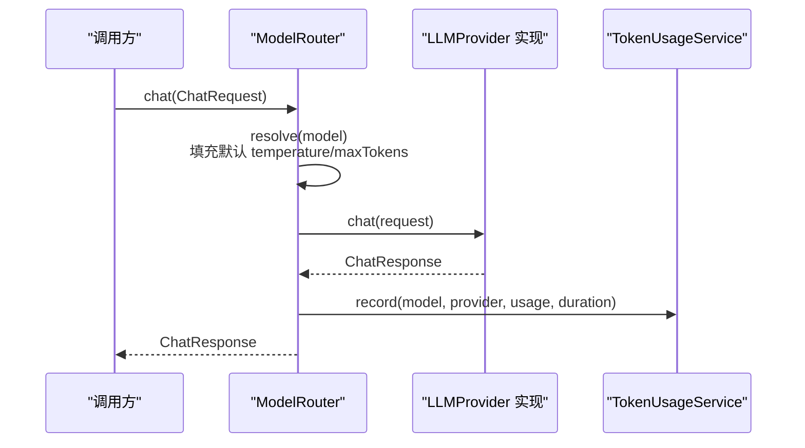
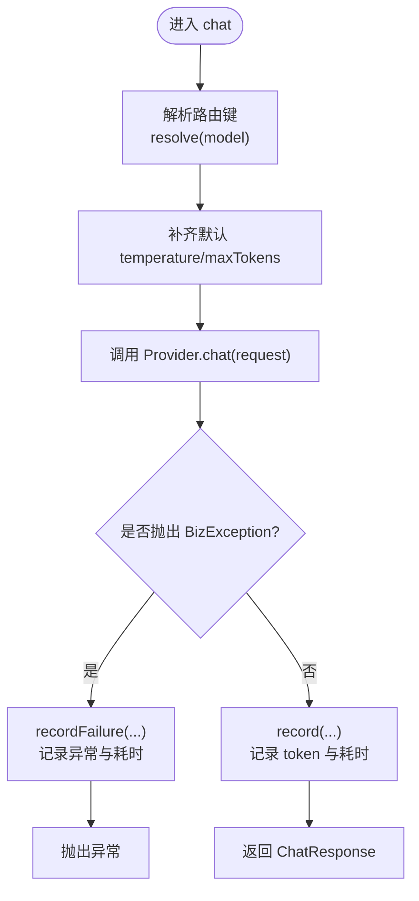
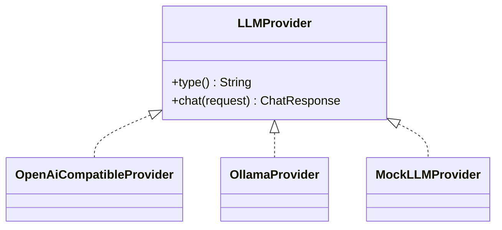
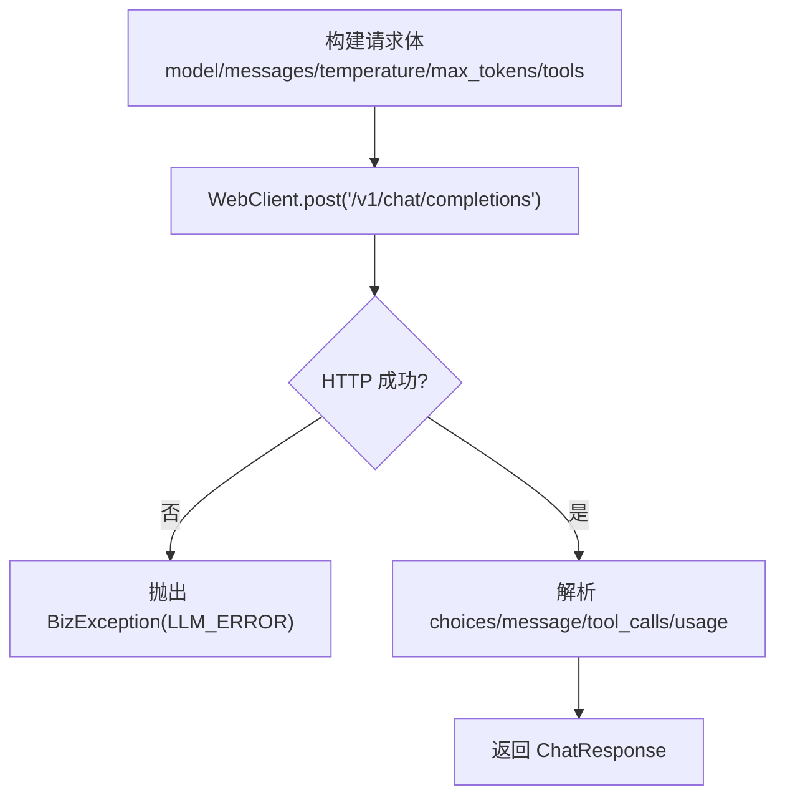
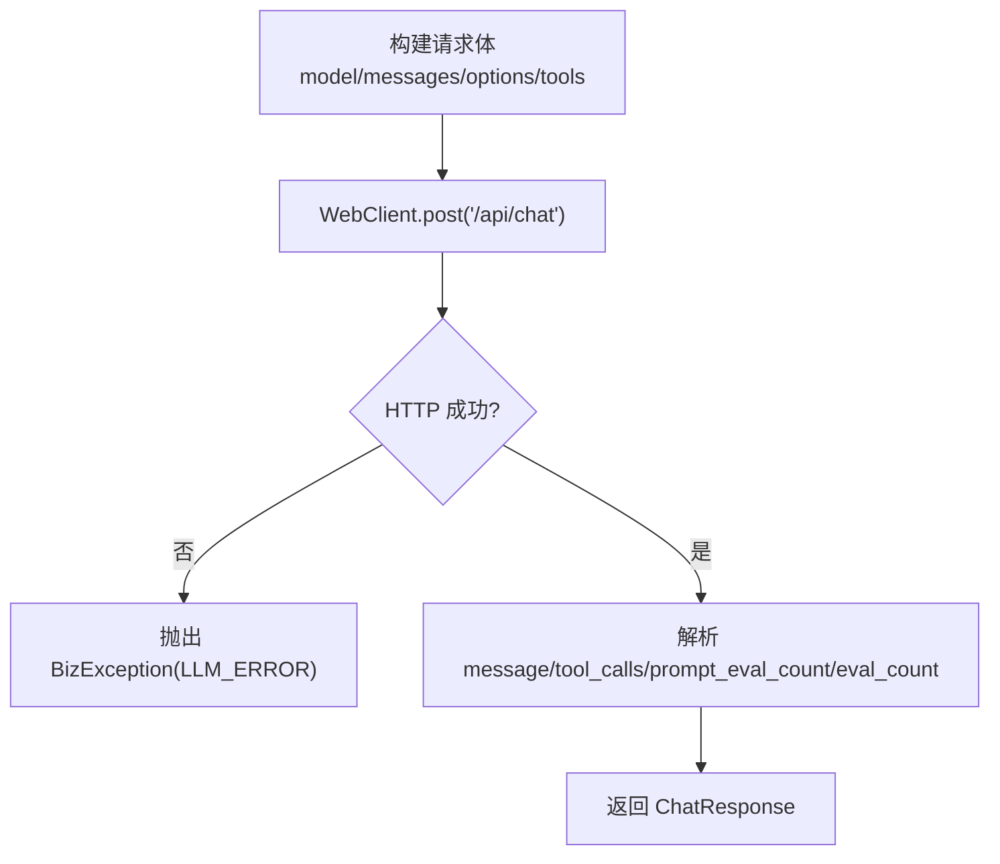
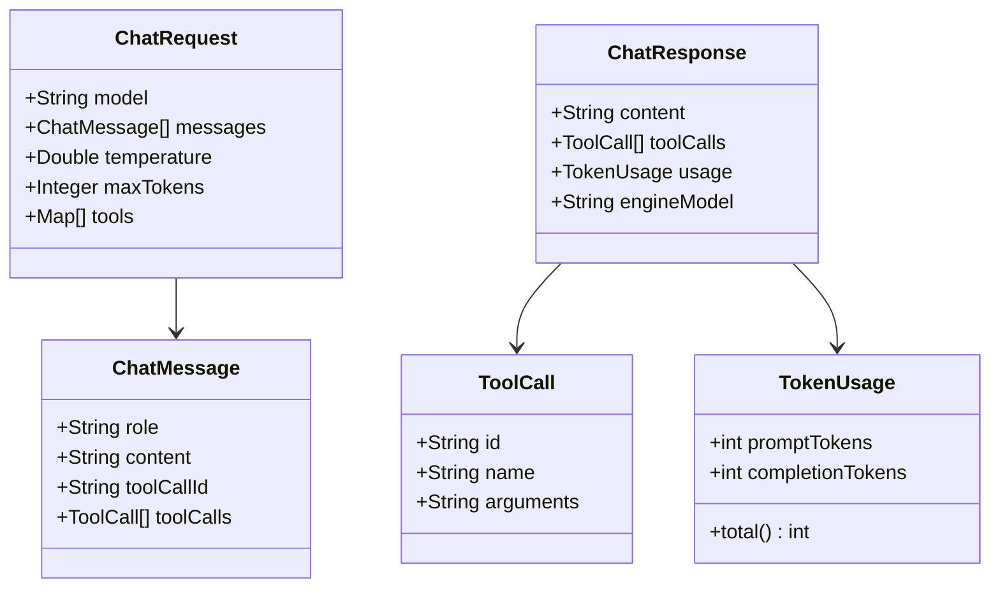
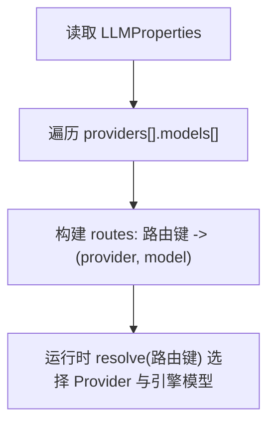
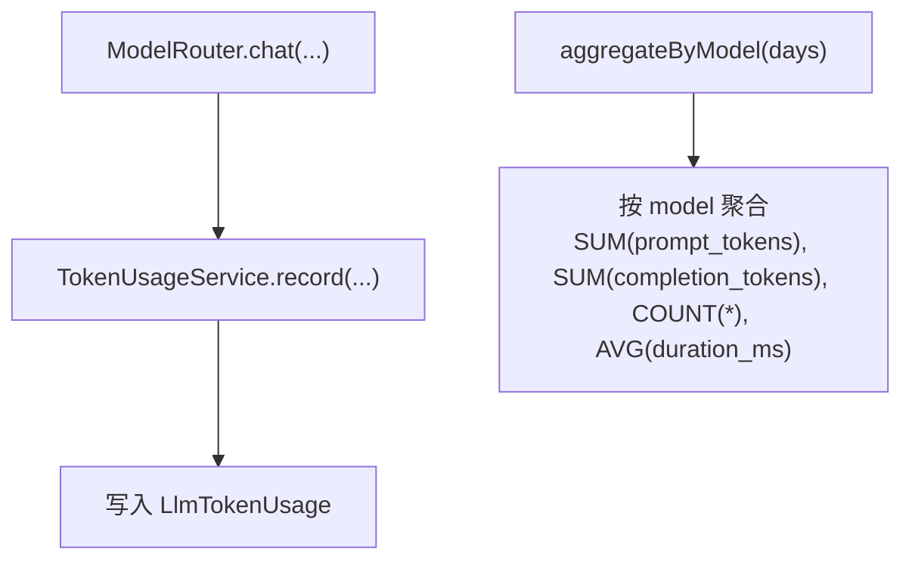
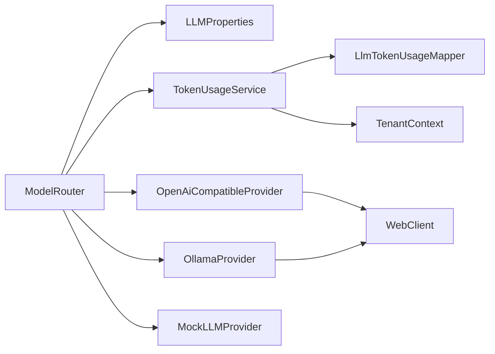

# 模型路由器

<cite>
**本文引用的文件**   
- [ModelRouter.java](file://src/main/java/com/agenthub/llm/router/ModelRouter.java)
- [LLMProperties.java](file://src/main/java/com/agenthub/llm/config/LLMProperties.java)
- [LLMProvider.java](file://src/main/java/com/agenthub/llm/provider/LLMProvider.java)
- [OpenAiCompatibleProvider.java](file://src/main/java/com/agenthub/llm/provider/OpenAiCompatibleProvider.java)
- [OllamaProvider.java](file://src/main/java/com/agenthub/llm/provider/OllamaProvider.java)
- [MockLLMProvider.java](file://src/main/java/com/agenthub/llm/provider/MockLLMProvider.java)
- [ChatRequest.java](file://src/main/java/com/agenthub/llm/model/ChatRequest.java)
- [ChatResponse.java](file://src/main/java/com/agenthub/llm/model/ChatResponse.java)
- [ChatMessage.java](file://src/main/java/com/agenthub/llm/model/ChatMessage.java)
- [TokenUsage.java](file://src/main/java/com/agenthub/llm/model/TokenUsage.java)
- [ToolCall.java](file://src/main/java/com/agenthub/llm/model/ToolCall.java)
- [TokenUsageService.java](file://src/main/java/com/agenthub/llm/service/TokenUsageService.java)
</cite>

## 目录
1. [引言](#引言)
2. [项目结构](#项目结构)
3. [核心组件](#核心组件)
4. [架构总览](#架构总览)
5. [详细组件分析](#详细组件分析)
6. [依赖关系分析](#依赖关系分析)
7. [性能与扩展性考虑](#性能与扩展性考虑)
8. [故障排查指南](#故障排查指南)
9. [结论](#结论)
10. [附录：扩展自定义 LLM 提供商](#附录扩展自定义-llm-提供商)

## 引言
本文件聚焦于“模型路由器”的设计与实现，围绕 ModelRouter 的模型选择策略、统一消息格式、工具调用支持、不同 LLM 提供商的差异、配置驱动的路由规则、统计埋点与错误处理进行系统化说明。文档同时给出架构图、类图、时序图和流程图，帮助读者从高层到代码层全面理解系统。

## 项目结构
本项目在 llm 模块下实现了统一的 LLM 抽象与多提供商适配：
- 路由层：ModelRouter 负责按“路由键”选择具体 Provider 与引擎模型，并统一记录 token 使用与耗时。
- 抽象层：LLMProvider 定义统一接口，屏蔽 OpenAI 兼容接口、Ollama、Mock 等差异。
- 数据模型：ChatRequest/ChatResponse/ChatMessage/TokenUsage/ToolCall 构成平台内部统一的消息与统计结构。
- 配置层：LLMProperties 提供多 provider 与模型注册表，支持默认模型与参数覆盖。
- 统计服务：TokenUsageService 将每次调用的 token 消耗、耗时、状态落库，并提供聚合查询。

**图表来源**
- [ModelRouter.java:19-108](file://src/main/java/com/agenthub/llm/router/ModelRouter.java#L19-L108)
- [LLMProperties.java:9-42](file://src/main/java/com/agenthub/llm/config/LLMProperties.java#L9-L42)
- [LLMProvider.java:6-16](file://src/main/java/com/agenthub/llm/provider/LLMProvider.java#L6-L16)
- [OpenAiCompatibleProvider.java:20-68](file://src/main/java/com/agenthub/llm/provider/OpenAiCompatibleProvider.java#L20-L68)
- [OllamaProvider.java:20-66](file://src/main/java/com/agenthub/llm/provider/OllamaProvider.java#L20-L66)
- [MockLLMProvider.java:13-53](file://src/main/java/com/agenthub/llm/provider/MockLLMProvider.java#L13-L53)
- [TokenUsageService.java:13-68](file://src/main/java/com/agenthub/llm/service/TokenUsageService.java#L13-L68)

**章节来源**
- [ModelRouter.java:19-108](file://src/main/java/com/agenthub/llm/router/ModelRouter.java#L19-L108)
- [LLMProperties.java:9-42](file://src/main/java/com/agenthub/llm/config/LLMProperties.java#L9-L42)

## 核心组件
- ModelRouter：根据请求中的“模型路由键”解析到具体 Provider 与引擎模型，填充默认温度与最大 token，发起对话，统一记录 token 与耗时，失败时记录异常信息。
- LLMProvider：抽象出 type() 与 chat(request)，所有提供商必须实现该接口。
- OpenAiCompatibleProvider：通过 WebClient 调用 /v1/chat/completions，构造 OpenAI 兼容的请求体，解析 choices/message/tool_calls/usage。
- OllamaProvider：通过 WebClient 调用 /api/chat，构造 Ollama 的请求体，解析 message/tool_calls/prompt_eval_count/eval_count。
- MockLLMProvider：无外部依赖的确定性响应，用于演示与单测；当存在 tools 时模拟一次工具调用。
- TokenUsageService：封装 token 统计落库与聚合查询，失败不阻断主流程。

**章节来源**
- [ModelRouter.java:29-108](file://src/main/java/com/agenthub/llm/router/ModelRouter.java#L29-L108)
- [LLMProvider.java:6-16](file://src/main/java/com/agenthub/llm/provider/LLMProvider.java#L6-L16)
- [OpenAiCompatibleProvider.java:20-129](file://src/main/java/com/agenthub/llm/provider/OpenAiCompatibleProvider.java#L20-L129)
- [OllamaProvider.java:20-115](file://src/main/java/com/agenthub/llm/provider/OllamaProvider.java#L20-L115)
- [MockLLMProvider.java:13-53](file://src/main/java/com/agenthub/llm/provider/MockLLMProvider.java#L13-L53)
- [TokenUsageService.java:13-68](file://src/main/java/com/agenthub/llm/service/TokenUsageService.java#L13-L68)

## 架构总览
下图展示了一次完整的聊天调用路径：业务方通过 ModelRouter 发起请求，路由到具体 Provider，Provider 调用远端或本地模型，返回统一 ChatResponse，并由 TokenUsageService 记录统计。

**图表来源**
- [ModelRouter.java:45-73](file://src/main/java/com/agenthub/llm/router/ModelRouter.java#L45-L73)
- [TokenUsageService.java:25-40](file://src/main/java/com/agenthub/llm/service/TokenUsageService.java#L25-L40)

## 详细组件分析

### ModelRouter：模型选择与负载均衡
- 路由键解析：若请求未指定 model，则使用默认模型；否则查找 routes 映射。
- 参数补齐：若未设置 temperature 或 maxTokens，则使用对应 ModelConfig 的默认值。
- 统计埋点：成功时记录 token 与耗时；失败时记录异常信息与耗时。
- Provider 构建：根据 ProviderConfig.type 创建具体实现（openai/ollama/mock）。

**图表来源**
- [ModelRouter.java:45-73](file://src/main/java/com/agenthub/llm/router/ModelRouter.java#L45-L73)
- [ModelRouter.java:86-93](file://src/main/java/com/agenthub/llm/router/ModelRouter.java#L86-L93)
- [ModelRouter.java:95-103](file://src/main/java/com/agenthub/llm/router/ModelRouter.java#L95-L103)

**章节来源**
- [ModelRouter.java:29-108](file://src/main/java/com/agenthub/llm/router/ModelRouter.java#L29-L108)

### LLMProvider 接口抽象
- 类型标识：type() 返回提供商类型字符串，便于统计与日志区分。
- 统一对话：chat(ChatRequest) 接收统一请求对象，返回统一响应对象。
- 工具调用：通过 ChatRequest.tools 传递工具定义，Provider 需将其转换为各自 API 格式。

**图表来源**
- [LLMProvider.java:6-16](file://src/main/java/com/agenthub/llm/provider/LLMProvider.java#L6-L16)
- [OpenAiCompatibleProvider.java:20-41](file://src/main/java/com/agenthub/llm/provider/OpenAiCompatibleProvider.java#L20-L41)
- [OllamaProvider.java:20-38](file://src/main/java/com/agenthub/llm/provider/OllamaProvider.java#L20-L38)
- [MockLLMProvider.java:13-27](file://src/main/java/com/agenthub/llm/provider/MockLLMProvider.java#L13-L27)

**章节来源**
- [LLMProvider.java:6-16](file://src/main/java/com/agenthub/llm/provider/LLMProvider.java#L6-L16)

### OpenAiCompatibleProvider：OpenAI 兼容接口
- 请求构造：POST /v1/chat/completions，携带 model、messages、temperature、max_tokens、stream=false，可选 tools。
- 消息转换：将 ChatMessage 转为 OpenAI 格式；assistant 消息可携带 tool_calls；tool 消息携带 tool_call_id。
- 响应解析：从 choices[0].message 提取 content 与 tool_calls；从 usage 提取 prompt_tokens/completion_tokens。
- 错误处理：网络或解析异常包装为 BizException(LLM_ERROR)。

**图表来源**
- [OpenAiCompatibleProvider.java:44-68](file://src/main/java/com/agenthub/llm/provider/OpenAiCompatibleProvider.java#L44-L68)
- [OpenAiCompatibleProvider.java:70-91](file://src/main/java/com/agenthub/llm/provider/OpenAiCompatibleProvider.java#L70-L91)
- [OpenAiCompatibleProvider.java:94-129](file://src/main/java/com/agenthub/llm/provider/OpenAiCompatibleProvider.java#L94-L129)

**章节来源**
- [OpenAiCompatibleProvider.java:20-129](file://src/main/java/com/agenthub/llm/provider/OpenAiCompatibleProvider.java#L20-L129)

### OllamaProvider：本地 Ollama 模型
- 请求构造：POST /api/chat，携带 model、messages、stream=false，options.temperature，可选 tools。
- 消息转换：将 ChatMessage 转为 Ollama 格式；assistant 消息可携带 tool_calls（function.name/arguments）。
- 响应解析：从 message.content 获取内容；从 message.tool_calls 解析工具调用；从 prompt_eval_count/eval_count 统计 token。
- 错误处理：网络或解析异常包装为 BizException(LLM_ERROR)。

**图表来源**
- [OllamaProvider.java:41-66](file://src/main/java/com/agenthub/llm/provider/OllamaProvider.java#L41-L66)
- [OllamaProvider.java:68-81](file://src/main/java/com/agenthub/llm/provider/OllamaProvider.java#L68-L81)
- [OllamaProvider.java:83-115](file://src/main/java/com/agenthub/llm/provider/OllamaProvider.java#L83-L115)

**章节来源**
- [OllamaProvider.java:20-115](file://src/main/java/com/agenthub/llm/provider/OllamaProvider.java#L20-L115)

### MockLLMProvider：测试与演示
- 行为：
  - 若请求包含 tools，则模拟一次工具调用（取第一个工具名，参数为空对象），content 为空。
  - 纯对话场景，回显最后一条 user 消息摘要，并提示当前为演示模式。
- 用途：无需外部模型即可验证路由、统计与上层逻辑。

**章节来源**
- [MockLLMProvider.java:13-53](file://src/main/java/com/agenthub/llm/provider/MockLLMProvider.java#L13-L53)

### 统一消息与工具调用模型
- ChatRequest：包含 model（路由键）、messages、temperature、maxTokens、tools（OpenAI function calling 格式）。
- ChatResponse：包含 content、toolCalls、usage、engineModel。
- ChatMessage：role 支持 system/user/assistant/tool；tool 消息含 toolCallId；assistant 消息含 toolCalls。
- ToolCall：id、name、arguments(JSON 字符串)。
- TokenUsage：promptTokens、completionTokens，提供 total() 方法。

**图表来源**
- [ChatRequest.java:11-33](file://src/main/java/com/agenthub/llm/model/ChatRequest.java#L11-L33)
- [ChatResponse.java:10-30](file://src/main/java/com/agenthub/llm/model/ChatResponse.java#L10-L30)
- [ChatMessage.java:10-46](file://src/main/java/com/agenthub/llm/model/ChatMessage.java#L10-L46)
- [ToolCall.java:10-25](file://src/main/java/com/agenthub/llm/model/ToolCall.java#L10-L25)
- [TokenUsage.java:7-21](file://src/main/java/com/agenthub/llm/model/TokenUsage.java#L7-L21)

**章节来源**
- [ChatRequest.java:11-33](file://src/main/java/com/agenthub/llm/model/ChatRequest.java#L11-L33)
- [ChatResponse.java:10-30](file://src/main/java/com/agenthub/llm/model/ChatResponse.java#L10-L30)
- [ChatMessage.java:10-46](file://src/main/java/com/agenthub/llm/model/ChatMessage.java#L10-L46)
- [ToolCall.java:10-25](file://src/main/java/com/agenthub/llm/model/ToolCall.java#L10-L25)
- [TokenUsage.java:7-21](file://src/main/java/com/agenthub/llm/model/TokenUsage.java#L7-L21)

### 配置驱动的路由规则
- 默认模型：LLMProperties.defaultModel 作为缺省路由键。
- Provider 列表：providers[] 中每个 ProviderConfig 声明 name/type/baseUrl/apiKey 与 models[]。
- 模型配置：每个 ModelConfig 定义 name（路由键）、model（引擎模型名）、temperature、maxTokens。
- 路由表构建：ModelRouter 构造函数遍历 providers 与 models，建立“路由键 → (provider, model)”映射。

**图表来源**
- [LLMProperties.java:9-42](file://src/main/java/com/agenthub/llm/config/LLMProperties.java#L9-L42)
- [ModelRouter.java:34-43](file://src/main/java/com/agenthub/llm/router/ModelRouter.java#L34-L43)
- [ModelRouter.java:86-93](file://src/main/java/com/agenthub/llm/router/ModelRouter.java#L86-L93)

**章节来源**
- [LLMProperties.java:9-42](file://src/main/java/com/agenthub/llm/config/LLMProperties.java#L9-L42)
- [ModelRouter.java:34-43](file://src/main/java/com/agenthub/llm/router/ModelRouter.java#L34-L43)

### 熔断降级与错误重试
- 熔断与降级：当前实现未内置熔断器或自动降级逻辑；Provider 调用失败会抛出 BizException(LLM_ERROR)，由上层决定重试或降级。
- 错误记录：ModelRouter 捕获 BizException 后调用 TokenUsageService.recordFailure，记录异常信息与耗时，不影响统计可用性。
- 统计容错：TokenUsageService 落库失败仅告警，不阻断主流程。

建议：
- 可在 ModelRouter 或 Provider 层引入断路器（如 Resilience4j）与重试策略（指数退避、抖动）。
- 对高频失败 Provider 实施快速失败与切换备用 Provider。

**章节来源**
- [ModelRouter.java:57-73](file://src/main/java/com/agenthub/llm/router/ModelRouter.java#L57-L73)
- [TokenUsageService.java:25-58](file://src/main/java/com/agenthub/llm/service/TokenUsageService.java#L25-L58)

### 性能监控与计费统计
- 统计字段：model、provider、promptTokens、completionTokens、durationMs、status、errorMsg。
- 聚合查询：aggregateByModel(days) 按模型聚合近 N 天的调用次数、平均耗时与 token 总量。
- 租户隔离：记录 tenantId，便于多租户计费与成本分摊。

**图表来源**
- [TokenUsageService.java:25-40](file://src/main/java/com/agenthub/llm/service/TokenUsageService.java#L25-L40)
- [TokenUsageService.java:60-68](file://src/main/java/com/agenthub/llm/service/TokenUsageService.java#L60-L68)

**章节来源**
- [TokenUsageService.java:13-68](file://src/main/java/com/agenthub/llm/service/TokenUsageService.java#L13-L68)

## 依赖关系分析
- ModelRouter 依赖 LLMProperties 构建路由表，依赖 TokenUsageService 进行统计。
- 各 Provider 依赖 WebClient 与 JsonUtils 完成 HTTP 调用与 JSON 序列化/反序列化。
- 统计服务依赖 MyBatis Plus Mapper 与 TenantContext 完成持久化与租户上下文。

**图表来源**
- [ModelRouter.java:34-43](file://src/main/java/com/agenthub/llm/router/ModelRouter.java#L34-L43)
- [OpenAiCompatibleProvider.java:31-36](file://src/main/java/com/agenthub/llm/provider/OpenAiCompatibleProvider.java#L31-L36)
- [OllamaProvider.java:31-33](file://src/main/java/com/agenthub/llm/provider/OllamaProvider.java#L31-L33)
- [TokenUsageService.java:23-24](file://src/main/java/com/agenthub/llm/service/TokenUsageService.java#L23-L24)

**章节来源**
- [ModelRouter.java:34-43](file://src/main/java/com/agenthub/llm/router/ModelRouter.java#L34-L43)
- [OpenAiCompatibleProvider.java:31-36](file://src/main/java/com/agenthub/llm/provider/OpenAiCompatibleProvider.java#L31-L36)
- [OllamaProvider.java:31-33](file://src/main/java/com/agenthub/llm/provider/OllamaProvider.java#L31-L33)
- [TokenUsageService.java:23-24](file://src/main/java/com/agenthub/llm/service/TokenUsageService.java#L23-L24)

## 性能与扩展性考虑
- 并发与异步：Provider 使用 WebClient 非阻塞 I/O，适合高并发场景；但当前 chat 调用采用 block() 同步等待，建议在更高层使用响应式编排或线程池优化。
- 连接池与超时：建议为 WebClient 配置连接池、读写超时与重试策略，避免下游延迟放大。
- 缓存与批处理：对频繁重复的工具定义或系统提示可进行缓存；批量请求可降低往返开销。
- 可扩展性：新增 Provider 只需实现 LLMProvider 并在 LLMProperties.providers 中注册，无需修改路由逻辑。

[本节为通用指导，不涉及具体文件分析]

## 故障排查指南
- 常见错误：
  - “未配置的模型路由键”：检查请求中的 model 是否在 LLMProperties.providers[].models[].name 中存在。
  - “OpenAI 兼容接口调用失败”：检查 baseUrl、apiKey、网络连通性与接口返回结构。
  - “Ollama 调用失败”：检查 Ollama 服务地址与端口，确认 /api/chat 可用。
  - “OpenAI 响应缺少 choices”：上游返回不符合预期，检查服务端版本与返回格式。
  - “Ollama 响应缺少 message 字段”：上游返回不符合预期，检查服务端版本与返回格式。
- 统计问题：
  - 若统计缺失，检查 TokenUsageService 落库是否报错；即使失败也不影响主流程，需关注日志告警。
- 定位建议：
  - 查看 ModelRouter 的调试日志，确认最终使用的 engineModel、duration 与 tokens。
  - 使用 aggregateByModel 聚合结果评估模型调用分布与平均耗时。

**章节来源**
- [ModelRouter.java:86-93](file://src/main/java/com/agenthub/llm/router/ModelRouter.java#L86-L93)
- [OpenAiCompatibleProvider.java:64-67](file://src/main/java/com/agenthub/llm/provider/OpenAiCompatibleProvider.java#L64-L67)
- [OpenAiCompatibleProvider.java:94-99](file://src/main/java/com/agenthub/llm/provider/OpenAiCompatibleProvider.java#L94-L99)
- [OllamaProvider.java:62-65](file://src/main/java/com/agenthub/llm/provider/OllamaProvider.java#L62-L65)
- [OllamaProvider.java:83-89](file://src/main/java/com/agenthub/llm/provider/OllamaProvider.java#L83-L89)
- [TokenUsageService.java:37-39](file://src/main/java/com/agenthub/llm/service/TokenUsageService.java#L37-L39)

## 结论
ModelRouter 以“路由键”为核心，屏蔽了不同 LLM 提供商的差异，提供了统一的对话接口与工具调用能力。配合 LLMProperties 的配置驱动机制，系统具备灵活的多模型接入能力。TokenUsageService 提供可靠的统计与聚合查询，支撑计费与性能分析。未来可在 Provider 层引入熔断、重试与流式响应增强鲁棒性与实时性。

[本节为总结性内容，不涉及具体文件分析]

## 附录：扩展自定义 LLM 提供商
步骤概览：
1. 实现 LLMProvider 接口：
   - 实现 type() 返回唯一类型标识。
   - 实现 chat(request)，将 ChatRequest 转换为目标 API 的请求体，解析响应为 ChatResponse。
2. 在 LLMProperties.providers 中添加新 Provider 配置：
   - 设置 name、type、baseUrl、apiKey（如有）。
   - 添加 models[]，定义路由键 name 与引擎模型 model，以及 temperature、maxTokens。
3. 重启应用，确保 ModelRouter 能构建新的 Provider 实例并注册路由。

注意事项：
- 工具调用：确保正确解析与生成 tool_calls，保持与 ChatMessage/ToolCall 一致。
- 错误处理：将网络或解析异常包装为 BizException(LLM_ERROR)，以便统一统计与上报。
- 统计字段：尽量返回准确的 promptTokens/completionTokens，便于计费与分析。

**章节来源**
- [LLMProvider.java:6-16](file://src/main/java/com/agenthub/llm/provider/LLMProvider.java#L6-L16)
- [LLMProperties.java:21-41](file://src/main/java/com/agenthub/llm/config/LLMProperties.java#L21-L41)
- [ModelRouter.java:95-103](file://src/main/java/com/agenthub/llm/router/ModelRouter.java#L95-L103)