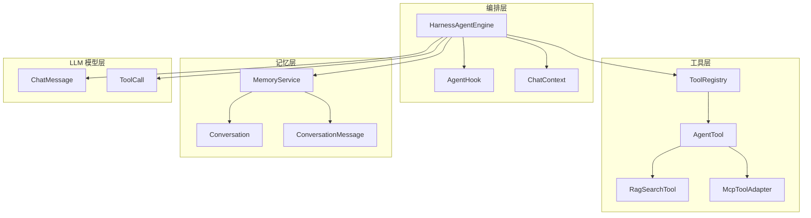
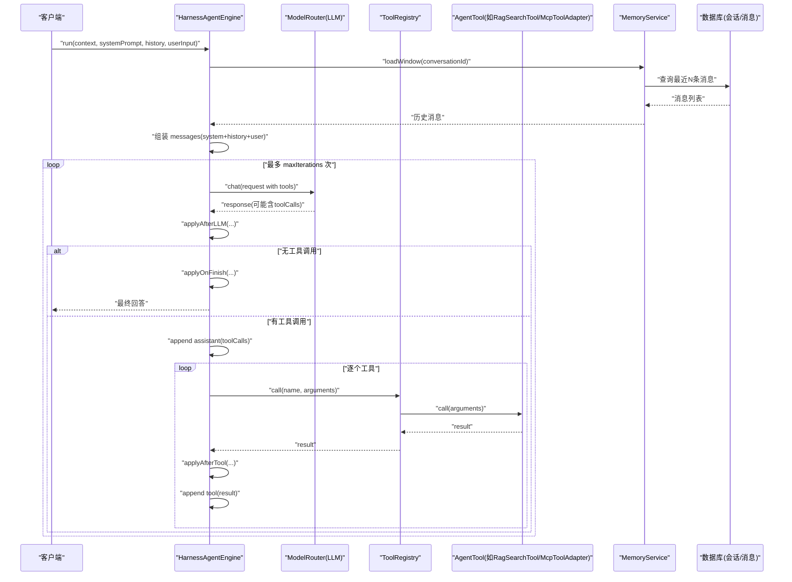
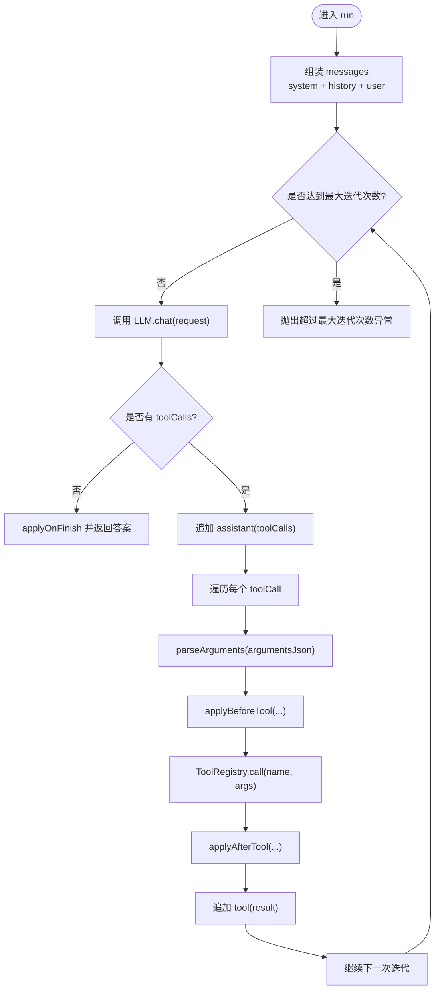
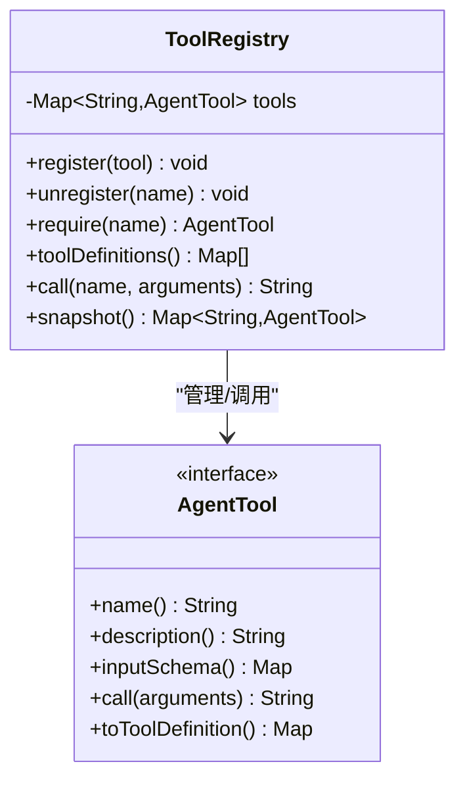
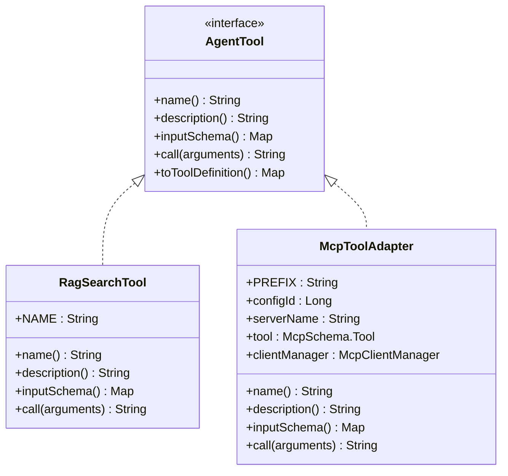
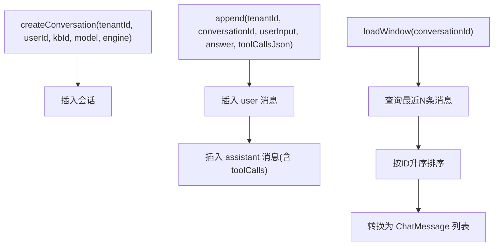
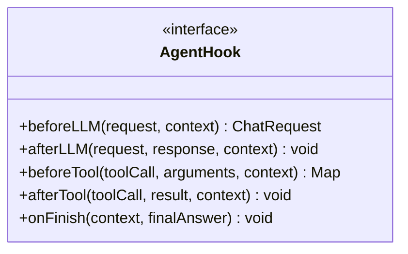
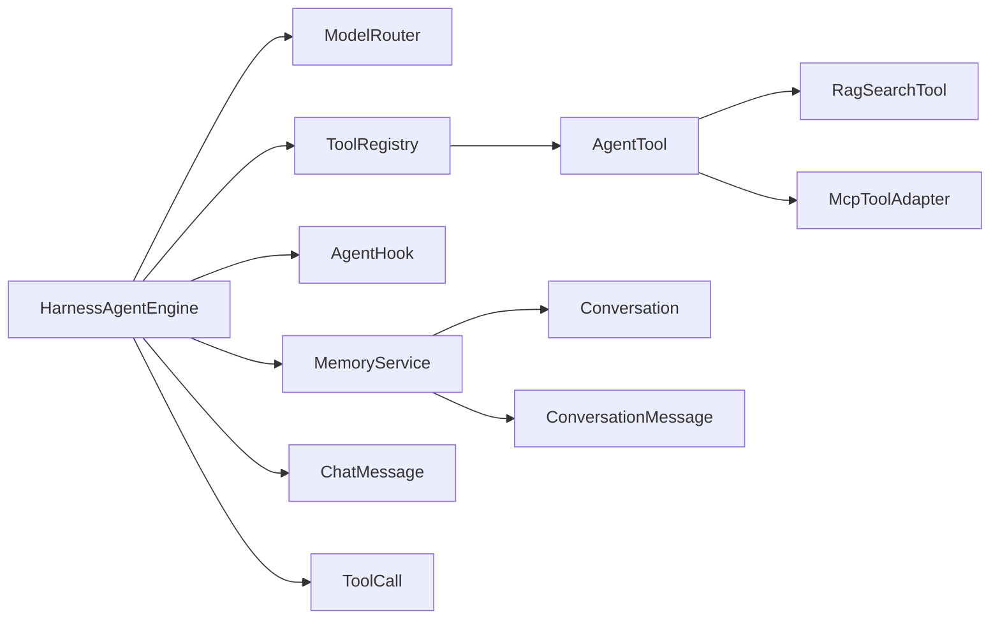

# Agent 编排引擎

<cite>
**本文引用的文件**   
- [HarnessAgentEngine.java](file://src/main/java/com/agenthub/agent/harness/HarnessAgentEngine.java)
- [ToolRegistry.java](file://src/main/java/com/agenthub/agent/tool/ToolRegistry.java)
- [AgentTool.java](file://src/main/java/com/agenthub/agent/tool/AgentTool.java)
- [RagSearchTool.java](file://src/main/java/com/agenthub/agent/tool/RagSearchTool.java)
- [McpToolAdapter.java](file://src/main/java/com/agenthub/mcp/client/McpToolAdapter.java)
- [MemoryService.java](file://src/main/java/com/agenthub/agent/memory/MemoryService.java)
- [Conversation.java](file://src/main/java/com/agenthub/agent/entity/Conversation.java)
- [ConversationMessage.java](file://src/main/java/com/agenthub/agent/entity/ConversationMessage.java)
- [ChatContext.java](file://src/main/java/com/agenthub/agent/harness/ChatContext.java)
- [AgentHook.java](file://src/main/java/com/agenthub/agent/harness/AgentHook.java)
- [ChatMessage.java](file://src/main/java/com/agenthub/llm/model/ChatMessage.java)
- [ToolCall.java](file://src/main/java/com/agenthub/llm/model/ToolCall.java)
</cite>

## 目录
1. [引言](#引言)
2. [项目结构](#项目结构)
3. [核心组件](#核心组件)
4. [架构总览](#架构总览)
5. [详细组件分析](#详细组件分析)
6. [依赖关系分析](#依赖关系分析)
7. [性能与扩展性](#性能与扩展性)
8. [故障排查指南](#故障排查指南)
9. [结论](#结论)
10. [附录：示例与最佳实践](#附录示例与最佳实践)

## 引言
本文件面向“Agent 编排引擎”的技术文档，重点解释 ReAct（Reasoning and Acting）推理-行动循环的实现原理，并围绕以下核心能力展开：
- HarnessAgentEngine：内置 ReAct 编排引擎，负责对话上下文组装、LLM 调用、工具发现与执行、生命周期钩子编排。
- ToolRegistry：工具注册与发现中心，统一暴露给 LLM 的 function calling。
- MemoryService：对话记忆服务，提供会话创建、消息持久化与窗口记忆读取。
- AgentHook：生命周期扩展点，支持在关键节点注入权限校验、参数改写、观测埋点等逻辑。
- ChatContext：单次对话上下文，贯穿一次 Agent 调用的完整生命周期。

该引擎将“工具调用”与“多轮对话记忆”解耦：工具由 LLM 通过 function calling 触发，记忆由 MemoryService 维护并在每轮前拼入上下文。

## 项目结构
Agent 编排相关代码主要位于 agent 包下，并与 llm、mcp、rag 等模块协作：
- harness：编排引擎与生命周期钩子、对话上下文。
- tool：工具抽象、内置 RAG 检索工具、工具注册表。
- memory：对话记忆服务与实体映射。
- entity：会话与会话消息持久化模型。
- llm.model：对话消息与工具调用数据结构。
- mcp.client：MCP 远程工具适配器，桥接 MCP Server 的工具到平台 AgentTool。

图表来源
- [HarnessAgentEngine.java:21-106](file://src/main/java/com/agenthub/agent/harness/HarnessAgentEngine.java#L21-L106)
- [ToolRegistry.java:11-53](file://src/main/java/com/agenthub/agent/tool/ToolRegistry.java#L11-L53)
- [AgentTool.java:5-31](file://src/main/java/com/agenthub/agent/tool/AgentTool.java#L5-L31)
- [RagSearchTool.java:12-65](file://src/main/java/com/agenthub/agent/tool/RagSearchTool.java#L12-L65)
- [McpToolAdapter.java:8-53](file://src/main/java/com/agenthub/mcp/client/McpToolAdapter.java#L8-L53)
- [MemoryService.java:19-100](file://src/main/java/com/agenthub/agent/memory/MemoryService.java#L19-L100)
- [Conversation.java:10-38](file://src/main/java/com/agenthub/agent/entity/Conversation.java#L10-L38)
- [ConversationMessage.java:10-33](file://src/main/java/com/agenthub/agent/entity/ConversationMessage.java#L10-L33)
- [ChatMessage.java:10-46](file://src/main/java/com/agenthub/llm/model/ChatMessage.java#L10-L46)
- [ToolCall.java:10-25](file://src/main/java/com/agenthub/llm/model/ToolCall.java#L10-L25)

章节来源
- [HarnessAgentEngine.java:21-106](file://src/main/java/com/agenthub/agent/harness/HarnessAgentEngine.java#L21-L106)
- [ToolRegistry.java:11-53](file://src/main/java/com/agenthub/agent/tool/ToolRegistry.java#L11-L53)
- [MemoryService.java:19-100](file://src/main/java/com/agenthub/agent/memory/MemoryService.java#L19-L100)

## 核心组件
- HarnessAgentEngine：实现 ReAct 循环，负责消息组装、LLM 调用、工具执行、钩子编排与迭代控制。
- ToolRegistry：内存级工具注册表，提供注册、注销、定义导出与工具调用。
- AgentTool：工具统一抽象，定义 name、description、inputSchema、call 与 toToolDefinition。
- RagSearchTool：内置 RAG 检索工具，封装知识库检索结果供 LLM 整理回答。
- McpToolAdapter：MCP 远程工具适配器，将远端工具包装为 AgentTool 并注册到 ToolRegistry。
- MemoryService：会话与消息持久化，提供最近 N 条消息窗口读取。
- Conversation / ConversationMessage：会话与会话消息实体。
- ChatContext：单次对话上下文，包含租户、用户、会话、模型、工具调用计数与执行轨迹。
- AgentHook：生命周期扩展点接口，支持 beforeLLM、afterLLM、beforeTool、afterTool、onFinish。
- ChatMessage / ToolCall：LLM 交互的消息与工具调用数据结构。

章节来源
- [HarnessAgentEngine.java:21-106](file://src/main/java/com/agenthub/agent/harness/HarnessAgentEngine.java#L21-L106)
- [ToolRegistry.java:11-53](file://src/main/java/com/agenthub/agent/tool/ToolRegistry.java#L11-L53)
- [AgentTool.java:5-31](file://src/main/java/com/agenthub/agent/tool/AgentTool.java#L5-L31)
- [RagSearchTool.java:12-65](file://src/main/java/com/agenthub/agent/tool/RagSearchTool.java#L12-L65)
- [McpToolAdapter.java:8-53](file://src/main/java/com/agenthub/mcp/client/McpToolAdapter.java#L8-L53)
- [MemoryService.java:19-100](file://src/main/java/com/agenthub/agent/memory/MemoryService.java#L19-L100)
- [Conversation.java:10-38](file://src/main/java/com/agenthub/agent/entity/Conversation.java#L10-L38)
- [ConversationMessage.java:10-33](file://src/main/java/com/agenthub/agent/entity/ConversationMessage.java#L10-L33)
- [ChatContext.java:10-42](file://src/main/java/com/agenthub/agent/harness/ChatContext.java#L10-L42)
- [AgentHook.java:10-37](file://src/main/java/com/agenthub/agent/harness/AgentHook.java#L10-L37)
- [ChatMessage.java:10-46](file://src/main/java/com/agenthub/llm/model/ChatMessage.java#L10-L46)
- [ToolCall.java:10-25](file://src/main/java/com/agenthub/llm/model/ToolCall.java#L10-L25)

## 架构总览
下图展示了一次 Agent 对话从入口到最终回答的端到端流程，包括 ReAct 循环、工具调用与记忆读写。

图表来源
- [HarnessAgentEngine.java:52-106](file://src/main/java/com/agenthub/agent/harness/HarnessAgentEngine.java#L52-L106)
- [ToolRegistry.java:41-49](file://src/main/java/com/agenthub/agent/tool/ToolRegistry.java#L41-L49)
- [MemoryService.java:75-86](file://src/main/java/com/agenthub/agent/memory/MemoryService.java#L75-L86)

## 详细组件分析

### HarnessAgentEngine：ReAct 编排引擎
- 职责
  - 组装系统提示词、历史消息与当前输入。
  - 构建 ChatRequest，携带工具定义（来自 ToolRegistry）。
  - 调用 LLM，解析响应中的工具调用。
  - 执行工具并回填 tool 消息，继续下一轮。
  - 在关键节点调用 AgentHook 进行扩展。
  - 超过最大迭代次数抛出业务异常。
- 关键行为
  - run：主循环，控制迭代次数与消息流。
  - applyBeforeLLM/applyAfterLLM：LLM 前后钩子。
  - applyBeforeTool/applyAfterTool：工具前后钩子。
  - applyOnFinish：对话结束收尾。
  - parseArguments：安全解析工具参数 JSON。
- 错误处理
  - 工具调用失败时捕获异常并记录日志，返回错误文本。
  - 超过最大迭代次数抛出 BizException。

图表来源
- [HarnessAgentEngine.java:52-106](file://src/main/java/com/agenthub/agent/harness/HarnessAgentEngine.java#L52-L106)
- [HarnessAgentEngine.java:108-147](file://src/main/java/com/agenthub/agent/harness/HarnessAgentEngine.java#L108-L147)

章节来源
- [HarnessAgentEngine.java:21-147](file://src/main/java/com/agenthub/agent/harness/HarnessAgentEngine.java#L21-L147)

### ToolRegistry：工具注册与发现
- 职责
  - 以内存 Map 存储 AgentTool 实例。
  - 提供 register/unregister/require/call 等方法。
  - 导出 toolDefinitions 供 LLM function calling 使用。
  - 提供 snapshot 用于调试或监控。
- 关键点
  - 同名覆盖策略便于动态替换工具。
  - require 未找到工具时抛出业务异常。
  - call 委托给具体 AgentTool 实现。

图表来源
- [ToolRegistry.java:11-53](file://src/main/java/com/agenthub/agent/tool/ToolRegistry.java#L11-L53)
- [AgentTool.java:5-31](file://src/main/java/com/agenthub/agent/tool/AgentTool.java#L5-L31)

章节来源
- [ToolRegistry.java:11-53](file://src/main/java/com/agenthub/agent/tool/ToolRegistry.java#L11-L53)

### AgentTool 与具体工具实现
- AgentTool：统一抽象，定义工具元数据与执行接口。
- RagSearchTool：内置 RAG 检索工具，封装知识库检索结果。
- McpToolAdapter：MCP 远程工具适配器，命名规则为 mcp__{server}__{tool}。

图表来源
- [AgentTool.java:5-31](file://src/main/java/com/agenthub/agent/tool/AgentTool.java#L5-L31)
- [RagSearchTool.java:12-65](file://src/main/java/com/agenthub/agent/tool/RagSearchTool.java#L12-L65)
- [McpToolAdapter.java:8-53](file://src/main/java/com/agenthub/mcp/client/McpToolAdapter.java#L8-L53)

章节来源
- [AgentTool.java:5-31](file://src/main/java/com/agenthub/agent/tool/AgentTool.java#L5-L31)
- [RagSearchTool.java:12-65](file://src/main/java/com/agenthub/agent/tool/RagSearchTool.java#L12-L65)
- [McpToolAdapter.java:8-53](file://src/main/java/com/agenthub/mcp/client/McpToolAdapter.java#L8-L53)

### MemoryService：对话记忆实现
- 职责
  - 创建会话（Conversation），记录租户、用户、知识库、模型与引擎信息。
  - 保存一轮对话的用户消息与助手回复，以及工具调用明细。
  - 读取最近 N 条消息作为短期记忆窗口。
- 短期记忆策略
  - 基于 conversationId 按时间倒序取最近 memoryWindow 条消息，再按 ID 升序排序后转换为 ChatMessage。
- 长期记忆扩展点
  - 当前实现为窗口截断；可扩展为摘要压缩、向量检索等长期记忆策略。

图表来源
- [MemoryService.java:35-86](file://src/main/java/com/agenthub/agent/memory/MemoryService.java#L35-L86)
- [Conversation.java:10-38](file://src/main/java/com/agenthub/agent/entity/Conversation.java#L10-L38)
- [ConversationMessage.java:10-33](file://src/main/java/com/agenthub/agent/entity/ConversationMessage.java#L10-L33)

章节来源
- [MemoryService.java:19-100](file://src/main/java/com/agenthub/agent/memory/MemoryService.java#L19-L100)
- [Conversation.java:10-38](file://src/main/java/com/agenthub/agent/entity/Conversation.java#L10-L38)
- [ConversationMessage.java:10-33](file://src/main/java/com/agenthub/agent/entity/ConversationMessage.java#L10-L33)

### AgentHook：生命周期扩展点
- 钩子方法
  - beforeLLM：可改写请求（注入上下文、压缩记忆）。
  - afterLLM：可观测响应、记录埋点。
  - beforeTool：可拦截、改写参数（权限校验、租户过滤）。
  - afterTool：可观测结果。
  - onFinish：对话结束统一收尾。
- 使用方式
  - 实现 AgentHook 接口并通过 Spring 容器注入，HarnessAgentEngine 会依次调用所有钩子。

图表来源
- [AgentHook.java:10-37](file://src/main/java/com/agenthub/agent/harness/AgentHook.java#L10-L37)

章节来源
- [AgentHook.java:10-37](file://src/main/java/com/agenthub/agent/harness/AgentHook.java#L10-L37)

### ChatContext：对话上下文
- 字段
  - tenantId、userId、conversationId：租户、用户与会话标识。
  - userInput：本轮用户输入。
  - model：模型路由键。
  - toolCallCount：本轮累计工具调用次数。
  - trace：执行轨迹，用于观测与调试。
- 用途
  - 贯穿一次 Agent 调用的整个生命周期，供 Hook 与引擎内部状态追踪使用。

章节来源
- [ChatContext.java:10-42](file://src/main/java/com/agenthub/agent/harness/ChatContext.java#L10-L42)

## 依赖关系分析
- HarnessAgentEngine 依赖 ModelRouter（LLM 路由）、ToolRegistry（工具注册表）、AgentHook（生命周期钩子）。
- ToolRegistry 依赖 AgentTool 接口及其实现（RagSearchTool、McpToolAdapter）。
- MemoryService 依赖 ConversationMapper、ConversationMessageMapper 与实体 Conversation、ConversationMessage。
- 数据模型 ChatMessage、ToolCall 被 HarnessAgentEngine 与 MemoryService 共同使用。

图表来源
- [HarnessAgentEngine.java:38-40](file://src/main/java/com/agenthub/agent/harness/HarnessAgentEngine.java#L38-L40)
- [ToolRegistry.java:20-49](file://src/main/java/com/agenthub/agent/tool/ToolRegistry.java#L20-L49)
- [MemoryService.java:29-33](file://src/main/java/com/agenthub/agent/memory/MemoryService.java#L29-L33)
- [Conversation.java:10-38](file://src/main/java/com/agenthub/agent/entity/Conversation.java#L10-L38)
- [ConversationMessage.java:10-33](file://src/main/java/com/agenthub/agent/entity/ConversationMessage.java#L10-L33)
- [ChatMessage.java:10-46](file://src/main/java/com/agenthub/llm/model/ChatMessage.java#L10-L46)
- [ToolCall.java:10-25](file://src/main/java/com/agenthub/llm/model/ToolCall.java#L10-L25)

章节来源
- [HarnessAgentEngine.java:38-40](file://src/main/java/com/agenthub/agent/harness/HarnessAgentEngine.java#L38-L40)
- [ToolRegistry.java:20-49](file://src/main/java/com/agenthub/agent/tool/ToolRegistry.java#L20-L49)
- [MemoryService.java:29-33](file://src/main/java/com/agenthub/agent/memory/MemoryService.java#L29-L33)

## 性能与扩展性
- ReAct 循环的性能影响
  - 每次迭代都会调用 LLM，需关注 token 消耗与延迟。可通过 Hook 在 beforeLLM 中压缩记忆或裁剪历史以降低开销。
  - 工具调用次数越多，往返次数越多，建议限制 maxIterations 与工具数量。
- 工具注册与发现
  - ToolRegistry 使用 ConcurrentHashMap，线程安全且查找 O(1)。
  - toolDefinitions 生成工具定义列表，建议在启动阶段完成注册，避免运行时频繁重建。
- 记忆窗口
  - 默认 memoryWindow=10，可根据业务调整。窗口越大，上下文越长，成本越高。
  - 可扩展为摘要压缩或向量检索，减少长对话的上下文长度。
- 钩子扩展
  - 通过 AgentHook 注入权限校验、审计日志、指标上报等横切逻辑，不影响核心流程。

[本节为通用指导，不直接分析具体文件]

## 故障排查指南
- 工具未注册
  - 现象：调用工具时报“未注册的工具”。
  - 排查：确认 ToolRegistry.register 是否已执行，检查工具名是否一致。
  - 参考：[ToolRegistry.require:32-39](file://src/main/java/com/agenthub/agent/tool/ToolRegistry.java#L32-L39)
- 工具调用失败
  - 现象：工具执行抛异常，引擎记录警告并返回错误文本。
  - 排查：检查工具实现 call 方法的参数解析与业务逻辑。
  - 参考：[HarnessAgentEngine.run 工具调用分支:86-103](file://src/main/java/com/agenthub/agent/harness/HarnessAgentEngine.java#L86-L103)
- 超过最大迭代次数
  - 现象：抛出“Agent 超过最大迭代次数仍未收敛”。
  - 排查：减少工具复杂度或优化系统提示词，确保 LLM 能更快收敛。
  - 参考：[HarnessAgentEngine.run 结尾:104-106](file://src/main/java/com/agenthub/agent/harness/HarnessAgentEngine.java#L104-L106)
- 记忆窗口过小导致上下文丢失
  - 现象：长对话中早期信息缺失。
  - 排查：增大 memoryWindow 或在 Hook 中实现摘要压缩。
  - 参考：[MemoryService.loadWindow:75-86](file://src/main/java/com/agenthub/agent/memory/MemoryService.java#L75-L86)

章节来源
- [ToolRegistry.java:32-39](file://src/main/java/com/agenthub/agent/tool/ToolRegistry.java#L32-L39)
- [HarnessAgentEngine.java:86-106](file://src/main/java/com/agenthub/agent/harness/HarnessAgentEngine.java#L86-L106)
- [MemoryService.java:75-86](file://src/main/java/com/agenthub/agent/memory/MemoryService.java#L75-L86)

## 结论
HarnessAgentEngine 提供了简洁而强大的 ReAct 编排能力，结合 ToolRegistry 的工具管理与 MemoryService 的记忆机制，形成完整的 Agent 运行闭环。AgentHook 的生命周期扩展点使系统在权限、审计、观测等方面具备高度可插拔性。通过合理配置 memoryWindow、maxIterations 与工具集合，可在成本与效果之间取得平衡。

[本节为总结性内容，不直接分析具体文件]

## 附录：示例与最佳实践

### 如何创建自定义工具
- 步骤
  - 实现 AgentTool 接口，定义 name、description、inputSchema 与 call。
  - 将工具实例注册到 ToolRegistry（例如通过 Spring 组件自动装配或显式调用 register）。
  - 在系统提示词中引导 LLM 何时使用该工具。
- 参考实现
  - [AgentTool 接口:5-31](file://src/main/java/com/agenthub/agent/tool/AgentTool.java#L5-L31)
  - [RagSearchTool 实现:12-65](file://src/main/java/com/agenthub/agent/tool/RagSearchTool.java#L12-L65)
  - [ToolRegistry.register:22-25](file://src/main/java/com/agenthub/agent/tool/ToolRegistry.java#L22-L25)

章节来源
- [AgentTool.java:5-31](file://src/main/java/com/agenthub/agent/tool/AgentTool.java#L5-L31)
- [RagSearchTool.java:12-65](file://src/main/java/com/agenthub/agent/tool/RagSearchTool.java#L12-L65)
- [ToolRegistry.java:22-25](file://src/main/java/com/agenthub/agent/tool/ToolRegistry.java#L22-L25)

### 如何配置 Agent 行为
- 关键配置项
  - agenthub.agent.max-iterations：最大迭代次数，默认 5。
  - agenthub.agent.memory-window：记忆窗口大小，默认 10。
- 行为说明
  - max-iterations 控制 ReAct 循环上限，防止无限工具调用。
  - memory-window 控制短期记忆长度，影响上下文长度与成本。
- 参考
  - [HarnessAgentEngine.maxIterations:42-43](file://src/main/java/com/agenthub/agent/harness/HarnessAgentEngine.java#L42-L43)
  - [MemoryService.memoryWindow:32-33](file://src/main/java/com/agenthub/agent/memory/MemoryService.java#L32-L33)

章节来源
- [HarnessAgentEngine.java:42-43](file://src/main/java/com/agenthub/agent/harness/HarnessAgentEngine.java#L42-L43)
- [MemoryService.java:32-33](file://src/main/java/com/agenthub/agent/memory/MemoryService.java#L32-L33)

### 如何处理对话状态
- 会话创建
  - 使用 MemoryService.createConversation 创建会话，绑定租户、用户、知识库、模型与引擎。
- 消息写入
  - 使用 MemoryService.append 写入用户消息与助手回复，可选记录工具调用明细。
- 历史加载
  - 使用 MemoryService.loadWindow 获取最近 N 条消息，作为短期记忆拼入上下文。
- 参考
  - [MemoryService.createConversation:35-46](file://src/main/java/com/agenthub/agent/memory/MemoryService.java#L35-L46)
  - [MemoryService.append:57-73](file://src/main/java/com/agenthub/agent/memory/MemoryService.java#L57-L73)
  - [MemoryService.loadWindow:75-86](file://src/main/java/com/agenthub/agent/memory/MemoryService.java#L75-L86)

章节来源
- [MemoryService.java:35-86](file://src/main/java/com/agenthub/agent/memory/MemoryService.java#L35-L86)

### AgentHook 生命周期扩展点使用示例
- 典型用法
  - beforeLLM：注入租户上下文、压缩历史消息。
  - beforeTool：校验权限、改写参数（如过滤敏感字段）。
  - afterLLM/afterTool：记录指标、审计日志。
  - onFinish：汇总统计、清理资源。
- 参考
  - [AgentHook 接口:10-37](file://src/main/java/com/agenthub/agent/harness/AgentHook.java#L10-L37)
  - [HarnessAgentEngine 钩子编排:108-134](file://src/main/java/com/agenthub/agent/harness/HarnessAgentEngine.java#L108-L134)

章节来源
- [AgentHook.java:10-37](file://src/main/java/com/agenthub/agent/harness/AgentHook.java#L10-L37)
- [HarnessAgentEngine.java:108-134](file://src/main/java/com/agenthub/agent/harness/HarnessAgentEngine.java#L108-L134)