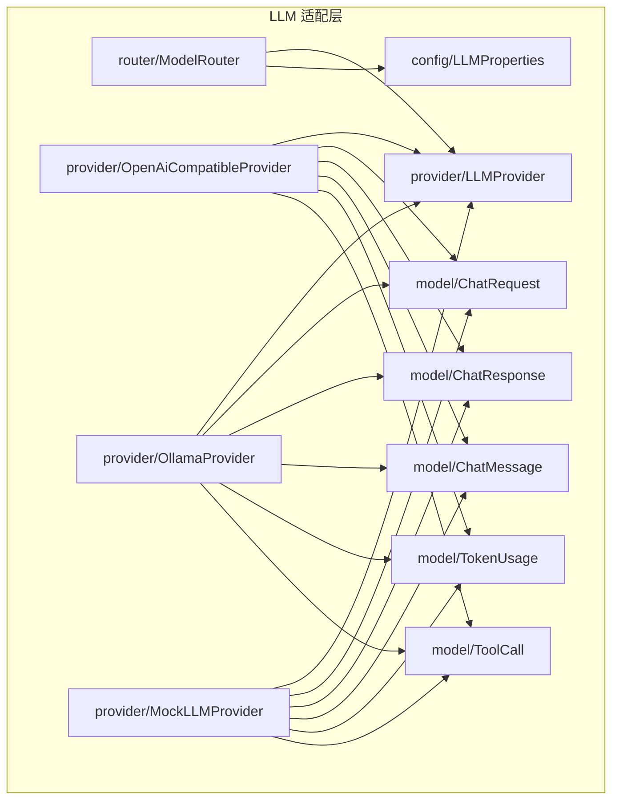
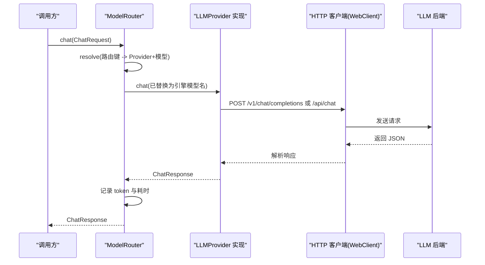
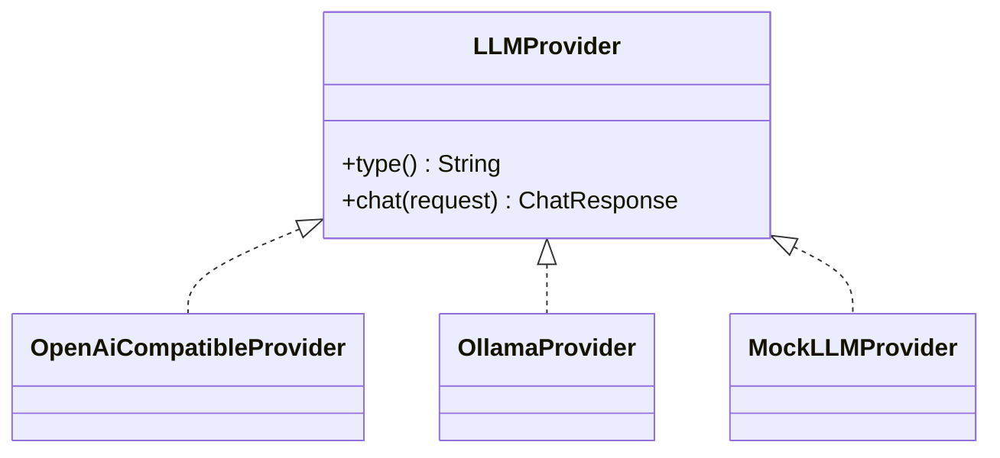
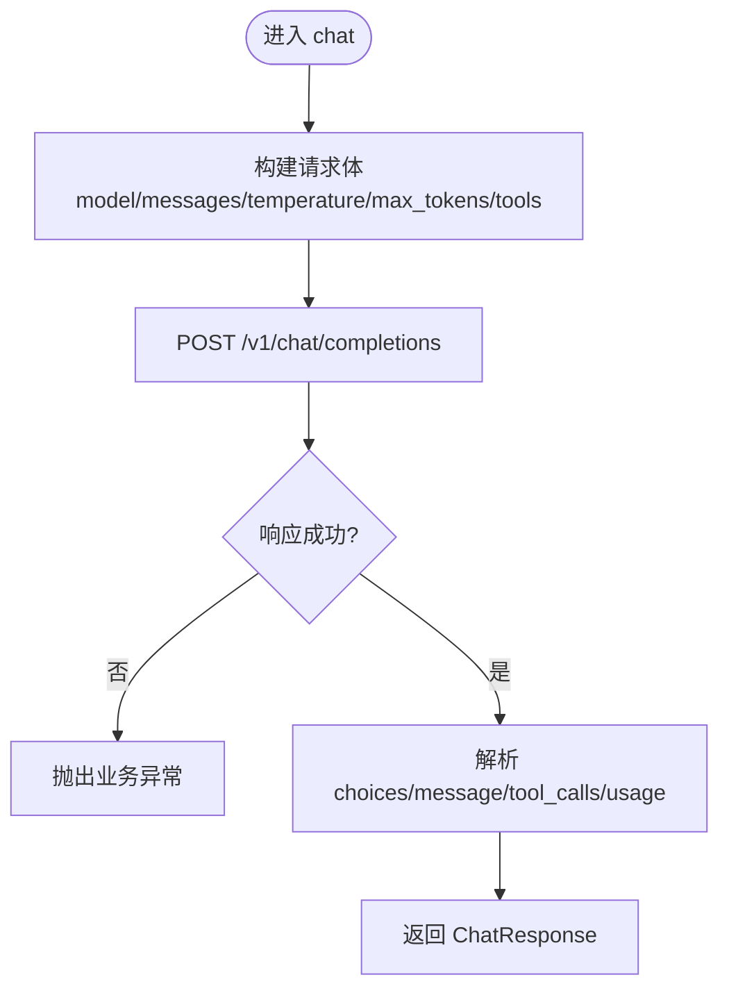
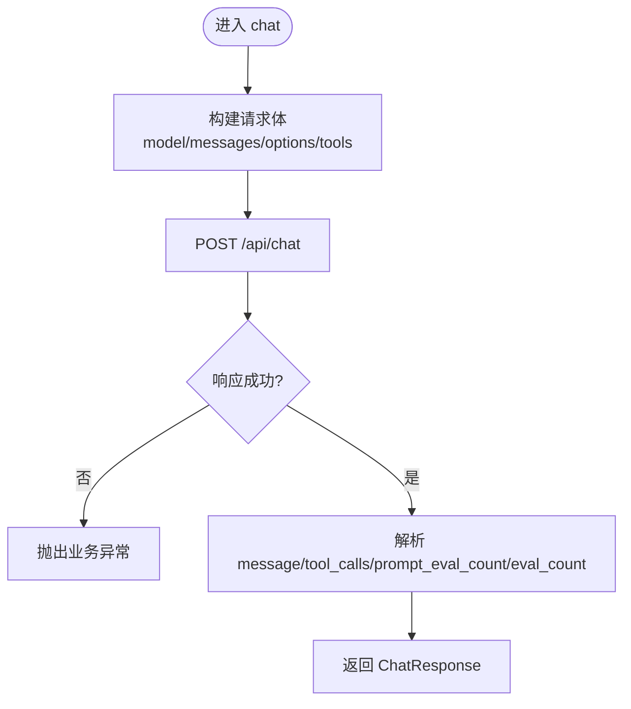
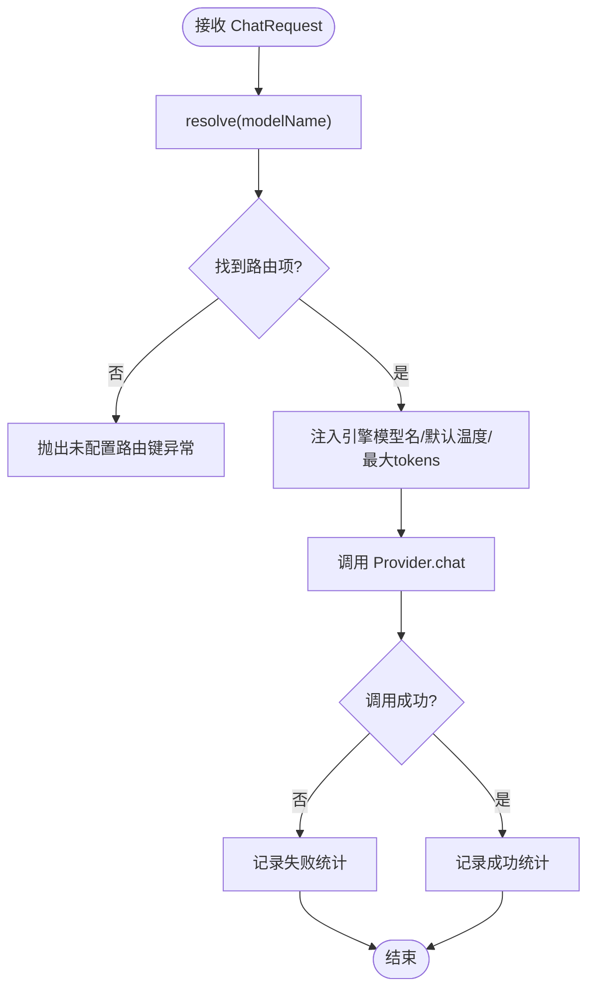
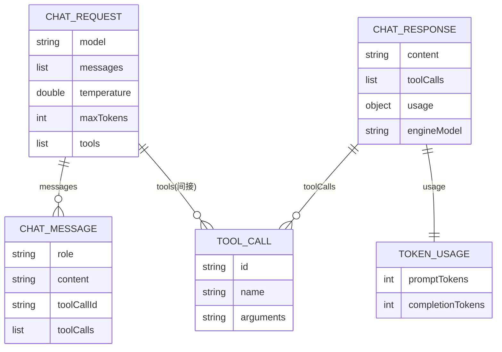
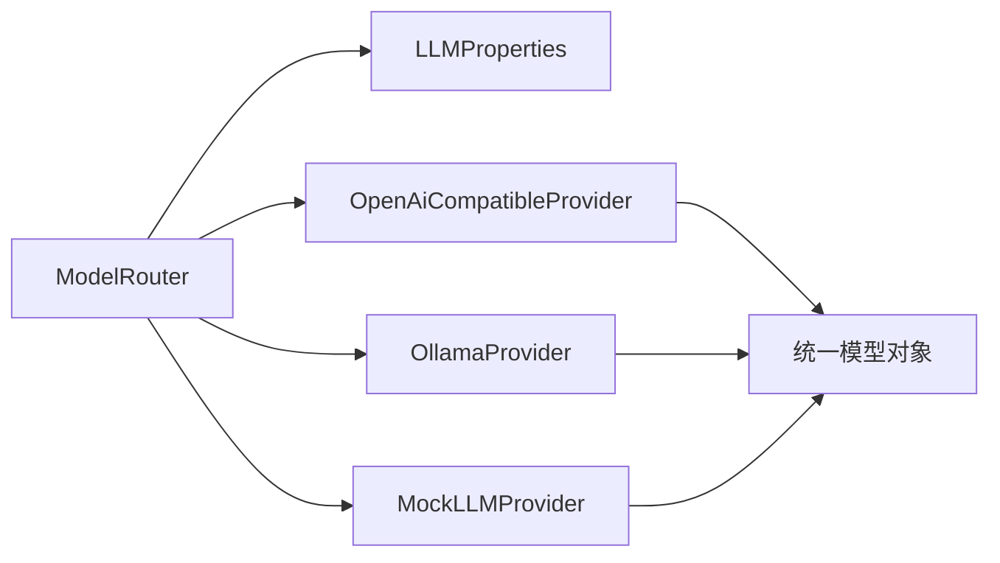

# LLM 提供商适配层

<cite>
**本文引用的文件**   
- [LLMProvider.java](file://src/main/java/com/agenthub/llm/provider/LLMProvider.java)
- [OpenAiCompatibleProvider.java](file://src/main/java/com/agenthub/llm/provider/OpenAiCompatibleProvider.java)
- [OllamaProvider.java](file://src/main/java/com/agenthub/llm/provider/OllamaProvider.java)
- [MockLLMProvider.java](file://src/main/java/com/agenthub/llm/provider/MockLLMProvider.java)
- [ModelRouter.java](file://src/main/java/com/agenthub/llm/router/ModelRouter.java)
- [ChatRequest.java](file://src/main/java/com/agenthub/llm/model/ChatRequest.java)
- [ChatResponse.java](file://src/main/java/com/agenthub/llm/model/ChatResponse.java)
- [ChatMessage.java](file://src/main/java/com/agenthub/llm/model/ChatMessage.java)
- [TokenUsage.java](file://src/main/java/com/agenthub/llm/model/TokenUsage.java)
- [ToolCall.java](file://src/main/java/com/agenthub/llm/model/ToolCall.java)
- [LLMProperties.java](file://src/main/java/com/agenthub/llm/config/LLMProperties.java)
- [application.yml](file://src/main/resources/application.yml)
</cite>

## 目录
1. [引言](#引言)
2. [项目结构](#项目结构)
3. [核心组件](#核心组件)
4. [架构总览](#架构总览)
5. [详细组件分析](#详细组件分析)
6. [依赖关系分析](#依赖关系分析)
7. [性能与可观测性](#性能与可观测性)
8. [故障排查指南](#故障排查指南)
9. [结论](#结论)
10. [附录：配置与扩展指南](#附录配置与扩展指南)

## 引言
本文件面向 LLM 提供商适配层，目标是解释统一接口设计理念、扩展机制，以及 Provider 实现规范。文档覆盖以下要点：
- 统一抽象 LLMProvider 的设计与契约
- OpenAI 兼容 Provider 的 API 调用、参数映射与响应解析
- Ollama Provider 的本地模型支持与工具调用处理
- MockLLMProvider 的测试与演示行为
- ModelRouter 的路由策略、默认模型与统计埋点
- ChatRequest、ChatResponse、ChatMessage、TokenUsage、ToolCall 等数据模型说明
- 自定义 Provider 的实现步骤与配置方法

## 项目结构
LLM 适配层位于 llm 包下，采用“接口 + 多实现 + 路由”的分层组织方式：
- provider：定义 LLMProvider 接口及具体实现（OpenAI 兼容、Ollama、Mock）
- model：统一的请求、响应、消息、工具调用与 Token 统计模型
- router：按路由键选择 Provider 并注入默认参数、记录统计
- config：通过 Spring Boot 配置类加载 providers 与 models 注册表

图表来源
- [LLMProvider.java:9-16](file://src/main/java/com/agenthub/llm/provider/LLMProvider.java#L9-L16)
- [OpenAiCompatibleProvider.java:25-68](file://src/main/java/com/agenthub/llm/provider/OpenAiCompatibleProvider.java#L25-L68)
- [OllamaProvider.java:25-66](file://src/main/java/com/agenthub/llm/provider/OllamaProvider.java#L25-L66)
- [MockLLMProvider.java:20-53](file://src/main/java/com/agenthub/llm/provider/MockLLMProvider.java#L20-L53)
- [ModelRouter.java:27-43](file://src/main/java/com/agenthub/llm/router/ModelRouter.java#L27-L43)
- [LLMProperties.java:14-41](file://src/main/java/com/agenthub/llm/config/LLMProperties.java#L14-L41)
- [ChatRequest.java:18-33](file://src/main/java/com/agenthub/llm/model/ChatRequest.java#L18-L33)
- [ChatResponse.java:17-30](file://src/main/java/com/agenthub/llm/model/ChatResponse.java#L17-L30)
- [ChatMessage.java:17-46](file://src/main/java/com/agenthub/llm/model/ChatMessage.java#L17-L46)
- [TokenUsage.java:13-21](file://src/main/java/com/agenthub/llm/model/TokenUsage.java#L13-L21)
- [ToolCall.java:16-25](file://src/main/java/com/agenthub/llm/model/ToolCall.java#L16-L25)

章节来源
- [LLMProvider.java:9-16](file://src/main/java/com/agenthub/llm/provider/LLMProvider.java#L9-L16)
- [ModelRouter.java:27-43](file://src/main/java/com/agenthub/llm/router/ModelRouter.java#L27-L43)
- [LLMProperties.java:14-41](file://src/main/java/com/agenthub/llm/config/LLMProperties.java#L14-L41)

## 核心组件
- LLMProvider：统一抽象，暴露 type() 与 chat(request)，屏蔽不同后端差异。
- OpenAiCompatibleProvider：基于 WebClient 调用 {baseUrl}/v1/chat/completions，支持 function calling 与 token 统计。
- OllamaProvider：基于 WebClient 调用 {baseUrl}/api/chat，原生 tools 参数，返回 message.tool_calls 与 prompt_eval_count/eval_count。
- MockLLMProvider：无外部依赖的确定性响应，用于演示与单测；当存在 tools 时模拟一次工具调用。
- ModelRouter：根据配置构建路由表，将业务侧“路由键”映射到具体 Provider 与引擎模型名，并注入默认 temperature/maxTokens，同时记录 token 使用与耗时。

章节来源
- [LLMProvider.java:9-16](file://src/main/java/com/agenthub/llm/provider/LLMProvider.java#L9-L16)
- [OpenAiCompatibleProvider.java:25-68](file://src/main/java/com/agenthub/llm/provider/OpenAiCompatibleProvider.java#L25-L68)
- [OllamaProvider.java:25-66](file://src/main/java/com/agenthub/llm/provider/OllamaProvider.java#L25-L66)
- [MockLLMProvider.java:20-53](file://src/main/java/com/agenthub/llm/provider/MockLLMProvider.java#L20-L53)
- [ModelRouter.java:45-73](file://src/main/java/com/agenthub/llm/router/ModelRouter.java#L45-L73)

## 架构总览
下图展示从业务调用到 Provider 的完整流程：ModelRouter 负责路由与统计，具体 Provider 负责协议转换与网络调用。

图表来源
- [ModelRouter.java:45-73](file://src/main/java/com/agenthub/llm/router/ModelRouter.java#L45-L73)
- [OpenAiCompatibleProvider.java:44-68](file://src/main/java/com/agenthub/llm/provider/OpenAiCompatibleProvider.java#L44-L68)
- [OllamaProvider.java:41-66](file://src/main/java/com/agenthub/llm/provider/OllamaProvider.java#L41-L66)

## 详细组件分析

### LLMProvider 接口与实现规范
- 职责
  - 提供统一的对话入口 chat(ChatRequest)，返回 ChatResponse。
  - 提供 type() 标识自身类型，便于路由与统计。
- 实现规范
  - 必须保持对 ChatRequest/ChatResponse 的统一语义：content 为最终文本，toolCalls 为函数调用列表，usage 为 token 统计，engineModel 为实际引擎模型名。
  - 若需要鉴权，应在构造时注入 baseUrl/apiKey 等凭据。
  - 异常应转换为业务异常，携带错误码以便上层统一处理。

图表来源
- [LLMProvider.java:9-16](file://src/main/java/com/agenthub/llm/provider/LLMProvider.java#L9-L16)
- [OpenAiCompatibleProvider.java:25-68](file://src/main/java/com/agenthub/llm/provider/OpenAiCompatibleProvider.java#L25-L68)
- [OllamaProvider.java:25-66](file://src/main/java/com/agenthub/llm/provider/OllamaProvider.java#L25-L66)
- [MockLLMProvider.java:20-53](file://src/main/java/com/agenthub/llm/provider/MockLLMProvider.java#L20-L53)

章节来源
- [LLMProvider.java:9-16](file://src/main/java/com/agenthub/llm/provider/LLMProvider.java#L9-L16)

### OpenAiCompatibleProvider：OpenAI 兼容实现
- 目标
  - 对接所有遵循 OpenAI 格式的接口（如 vLLM、DeepSeek、OneAPI 等）。
- 关键行为
  - 构造时设置 baseUrl 与 Authorization Bearer。
  - 调用 /v1/chat/completions，body 包含 model、messages、temperature、max_tokens、stream=false，可选 tools。
  - 将内部 ChatMessage 序列化为 OpenAI 格式，支持 assistant.tool_calls 回填与 tool 角色消息。
  - 解析 response：choices[0].message.content、message.tool_calls、usage.prompt_tokens/completion_tokens。
- 参数映射
  - ChatRequest.temperature → body.temperature（默认 0.3）
  - ChatRequest.maxTokens → body.max_tokens（默认 2048）
  - ChatRequest.tools → body.tools（可选）
- 响应处理
  - 若无 choices 抛出业务异常。
  - 解析 tool_calls 为 ToolCall 列表。
  - 填充 usage 与 engineModel。

图表来源
- [OpenAiCompatibleProvider.java:44-68](file://src/main/java/com/agenthub/llm/provider/OpenAiCompatibleProvider.java#L44-L68)
- [OpenAiCompatibleProvider.java:70-91](file://src/main/java/com/agenthub/llm/provider/OpenAiCompatibleProvider.java#L70-L91)
- [OpenAiCompatibleProvider.java:94-129](file://src/main/java/com/agenthub/llm/provider/OpenAiCompatibleProvider.java#L94-L129)

章节来源
- [OpenAiCompatibleProvider.java:25-68](file://src/main/java/com/agenthub/llm/provider/OpenAiCompatibleProvider.java#L25-L68)
- [OpenAiCompatibleProvider.java:70-91](file://src/main/java/com/agenthub/llm/provider/OpenAiCompatibleProvider.java#L70-L91)
- [OpenAiCompatibleProvider.java:94-129](file://src/main/java/com/agenthub/llm/provider/OpenAiCompatibleProvider.java#L94-L129)

### OllamaProvider：本地模型支持
- 目标
  - 对接 Ollama 本地推理服务，支持 tools 与 token 统计。
- 关键行为
  - 构造时设置 baseUrl。
  - 调用 /api/chat，body 包含 model、messages、stream=false，可选 options.temperature 与 tools。
  - 将内部 ChatMessage 序列化为 Ollama 格式，assistant.tool_calls 中 function.name/arguments。
  - 解析 response：message.content、message.tool_calls、prompt_eval_count/eval_count。
- 参数映射
  - ChatRequest.temperature → options.temperature（可选）
  - ChatRequest.tools → tools（可选）
- 响应处理
  - 若无 message 字段抛出业务异常。
  - 解析 tool_calls 为 ToolCall 列表（id 由 Provider 生成）。
  - 填充 usage 与 engineModel。

图表来源
- [OllamaProvider.java:41-66](file://src/main/java/com/agenthub/llm/provider/OllamaProvider.java#L41-L66)
- [OllamaProvider.java:68-81](file://src/main/java/com/agenthub/llm/provider/OllamaProvider.java#L68-L81)
- [OllamaProvider.java:84-111](file://src/main/java/com/agenthub/llm/provider/OllamaProvider.java#L84-L111)

章节来源
- [OllamaProvider.java:25-66](file://src/main/java/com/agenthub/llm/provider/OllamaProvider.java#L25-L66)
- [OllamaProvider.java:68-81](file://src/main/java/com/agenthub/llm/provider/OllamaProvider.java#L68-L81)
- [OllamaProvider.java:84-111](file://src/main/java/com/agenthub/llm/provider/OllamaProvider.java#L84-L111)

### MockLLMProvider：测试与演示
- 行为
  - 若请求包含 tools，则模拟一次工具调用（取第一个工具），返回空 content 与 ToolCall。
  - 否则返回固定提示语，指示当前为演示模式。
  - 始终返回固定的 TokenUsage 与 engineModel。
- 用途
  - 无需外部模型即可跑通全链路，适合演示与单元测试。

章节来源
- [MockLLMProvider.java:20-53](file://src/main/java/com/agenthub/llm/provider/MockLLMProvider.java#L20-L53)

### ModelRouter：模型路由与统计
- 路由策略
  - 启动时读取 LLMProperties.providers，为每个 Provider 下的每个 ModelConfig 建立“路由键 → (Provider, 模型配置)”的映射。
  - 若请求未指定 model，则使用 defaultModel。
  - 将路由键替换为引擎模型名，并注入默认 temperature/maxTokens（若请求未设置）。
- 统计与埋点
  - 每次调用记录 token 消耗与耗时；失败时也记录失败统计（token=0，附带错误信息）。
- 扩展点
  - 新增 Provider 只需在 buildProvider 分支中添加类型判断与构造逻辑。
  - 负载均衡、故障转移、性能监控可在更高层封装（例如在 Router 前加重试/熔断/权重选择器）。

图表来源
- [ModelRouter.java:45-73](file://src/main/java/com/agenthub/llm/router/ModelRouter.java#L45-L73)
- [ModelRouter.java:86-93](file://src/main/java/com/agenthub/llm/router/ModelRouter.java#L86-L93)
- [ModelRouter.java:95-103](file://src/main/java/com/agenthub/llm/router/ModelRouter.java#L95-L103)

章节来源
- [ModelRouter.java:27-43](file://src/main/java/com/agenthub/llm/router/ModelRouter.java#L27-L43)
- [ModelRouter.java:45-73](file://src/main/java/com/agenthub/llm/router/ModelRouter.java#L45-L73)
- [ModelRouter.java:86-103](file://src/main/java/com/agenthub/llm/router/ModelRouter.java#L86-L103)

### 数据模型说明
- ChatRequest
  - model：路由键（providers[].models[].name），由 Router 替换为引擎模型名。
  - messages：对话历史，支持 system/user/assistant/tool 角色。
  - temperature：采样温度（可选）。
  - maxTokens：最大生成长度（可选）。
  - tools：function calling 的工具定义（OpenAI 格式）。
- ChatResponse
  - content：最终文本（无工具调用时）。
  - toolCalls：工具调用列表（ReAct 循环据此执行工具）。
  - usage：token 统计（promptTokens/completionTokens）。
  - engineModel：实际使用的引擎模型名。
- ChatMessage
  - role：system/user/assistant/tool。
  - content：消息内容。
  - toolCallId：tool 角色的工具调用 ID。
  - toolCalls：assistant 的消息中的工具调用结果。
- TokenUsage
  - promptTokens：输入 token 数。
  - completionTokens：输出 token 数。
  - total()：合计 token 数。
- ToolCall
  - id：工具调用 ID。
  - name：工具名。
  - arguments：JSON 字符串形式的参数。

图表来源
- [ChatRequest.java:18-33](file://src/main/java/com/agenthub/llm/model/ChatRequest.java#L18-L33)
- [ChatResponse.java:17-30](file://src/main/java/com/agenthub/llm/model/ChatResponse.java#L17-L30)
- [ChatMessage.java:17-46](file://src/main/java/com/agenthub/llm/model/ChatMessage.java#L17-L46)
- [TokenUsage.java:13-21](file://src/main/java/com/agenthub/llm/model/TokenUsage.java#L13-L21)
- [ToolCall.java:16-25](file://src/main/java/com/agenthub/llm/model/ToolCall.java#L16-L25)

章节来源
- [ChatRequest.java:18-33](file://src/main/java/com/agenthub/llm/model/ChatRequest.java#L18-L33)
- [ChatResponse.java:17-30](file://src/main/java/com/agenthub/llm/model/ChatResponse.java#L17-L30)
- [ChatMessage.java:17-46](file://src/main/java/com/agenthub/llm/model/ChatMessage.java#L17-L46)
- [TokenUsage.java:13-21](file://src/main/java/com/agenthub/llm/model/TokenUsage.java#L13-L21)
- [ToolCall.java:16-25](file://src/main/java/com/agenthub/llm/model/ToolCall.java#L16-L25)

## 依赖关系分析
- ModelRouter 依赖 LLMProperties 以加载 providers 与 models，并在构造期完成路由表初始化。
- 各 Provider 依赖 WebClient 进行 HTTP 调用，依赖 JsonUtils 进行序列化/反序列化。
- 所有 Provider 均依赖统一模型对象（ChatRequest/ChatResponse/ChatMessage/TokenUsage/ToolCall）。

图表来源
- [ModelRouter.java:27-43](file://src/main/java/com/agenthub/llm/router/ModelRouter.java#L27-L43)
- [LLMProperties.java:14-41](file://src/main/java/com/agenthub/llm/config/LLMProperties.java#L14-L41)
- [OpenAiCompatibleProvider.java:25-68](file://src/main/java/com/agenthub/llm/provider/OpenAiCompatibleProvider.java#L25-L68)
- [OllamaProvider.java:25-66](file://src/main/java/com/agenthub/llm/provider/OllamaProvider.java#L25-L66)
- [MockLLMProvider.java:20-53](file://src/main/java/com/agenthub/llm/provider/MockLLMProvider.java#L20-L53)

章节来源
- [ModelRouter.java:27-43](file://src/main/java/com/agenthub/llm/router/ModelRouter.java#L27-L43)
- [LLMProperties.java:14-41](file://src/main/java/com/agenthub/llm/config/LLMProperties.java#L14-L41)

## 性能与可观测性
- 性能
  - 路由阶段仅做 Map 查找与参数注入，时间复杂度 O(1)。
  - Provider 调用为同步阻塞式 WebFlux 调用（block），适合简单场景；高并发场景建议引入异步编排与连接池优化。
- 可观测性
  - ModelRouter 对每次调用记录 token 使用与耗时，供统计接口与 OTel 指标使用。
  - 失败路径同样记录失败统计，便于定位问题。

章节来源
- [ModelRouter.java:57-72](file://src/main/java/com/agenthub/llm/router/ModelRouter.java#L57-L72)

## 故障排查指南
- 常见错误
  - 未配置的路由键：检查 application.yml 中 agenthub.llm.default-model 与 providers.models[].name 是否一致。
  - OpenAI 兼容接口缺少 choices：检查后端返回是否符合 OpenAI 格式。
  - Ollama 响应缺少 message：检查 Ollama 版本与接口返回结构。
- 排查建议
  - 开启 debug 日志观察路由解析与 Provider 调用过程。
  - 使用 MockLLMProvider 快速验证业务链路是否正确。
  - 核对环境变量 OPENAI_BASE_URL、OPENAI_API_KEY、OLLAMA_BASE_URL 是否正确注入。

章节来源
- [ModelRouter.java:86-93](file://src/main/java/com/agenthub/llm/router/ModelRouter.java#L86-L93)
- [OpenAiCompatibleProvider.java:94-99](file://src/main/java/com/agenthub/llm/provider/OpenAiCompatibleProvider.java#L94-L99)
- [OllamaProvider.java:84-89](file://src/main/java/com/agenthub/llm/provider/OllamaProvider.java#L84-L89)

## 结论
本适配层通过 LLMProvider 统一抽象，屏蔽了不同 LLM 后端的差异；ModelRouter 提供了灵活的路由与统计能力；OpenAiCompatibleProvider 与 OllamaProvider 分别覆盖了云端兼容接口与本地模型场景；MockLLMProvider 降低了联调门槛。整体设计简洁可扩展，便于后续接入更多 Provider 与高级调度策略。

## 附录：配置与扩展指南

### 配置示例（application.yml）
- 默认模型与 providers 注册
  - agenthub.llm.default-model：默认路由键
  - agenthub.llm.providers：Provider 列表，包含 openai、ollama、mock
  - 每个 Provider 下 models[]：声明路由键 name 与引擎模型 model，并可设置 temperature/maxTokens

章节来源
- [application.yml:98-126](file://src/main/resources/application.yml#L98-L126)
- [LLMProperties.java:14-41](file://src/main/java/com/agenthub/llm/config/LLMProperties.java#L14-L41)

### 自定义 Provider 实现步骤
- 新建类实现 LLMProvider，实现 type() 与 chat(request)。
- 在 ModelRouter.buildProvider 中添加新类型的分支，返回你的 Provider 实例。
- 在 application.yml 中新增一个 Provider 条目，并在 models[] 中声明路由键与引擎模型名。
- 如需鉴权，建议在构造时注入 baseUrl/apiKey 等凭据。

章节来源
- [LLMProvider.java:9-16](file://src/main/java/com/agenthub/llm/provider/LLMProvider.java#L9-L16)
- [ModelRouter.java:95-103](file://src/main/java/com/agenthub/llm/router/ModelRouter.java#L95-L103)
- [LLMProperties.java:21-31](file://src/main/java/com/agenthub/llm/config/LLMProperties.java#L21-L31)