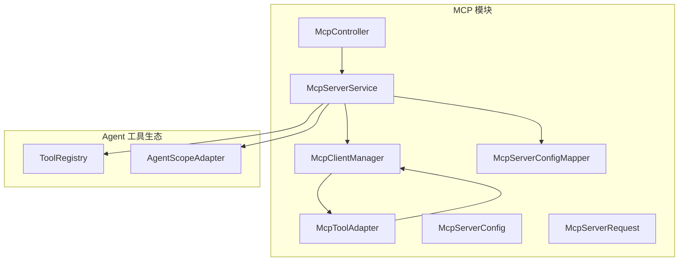
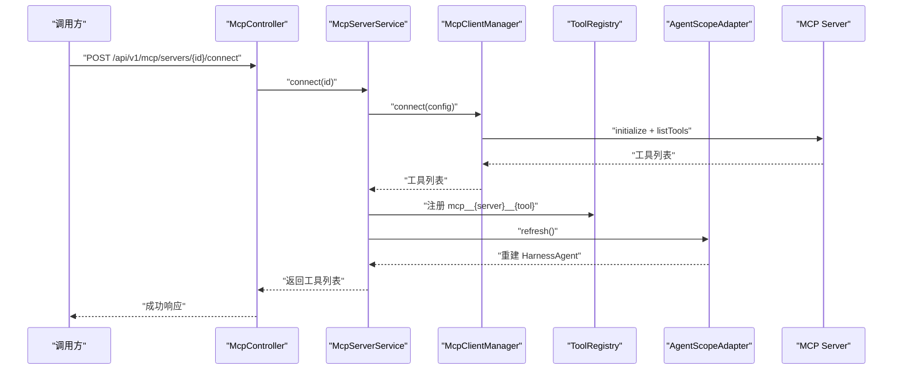
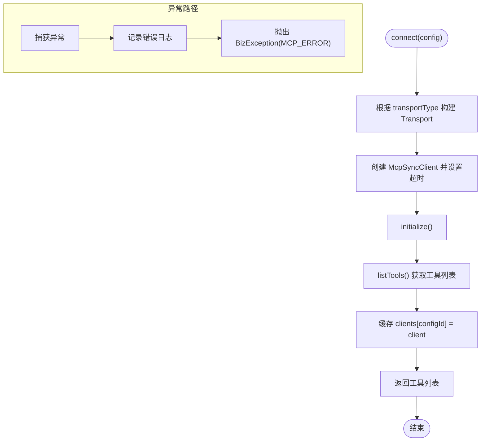
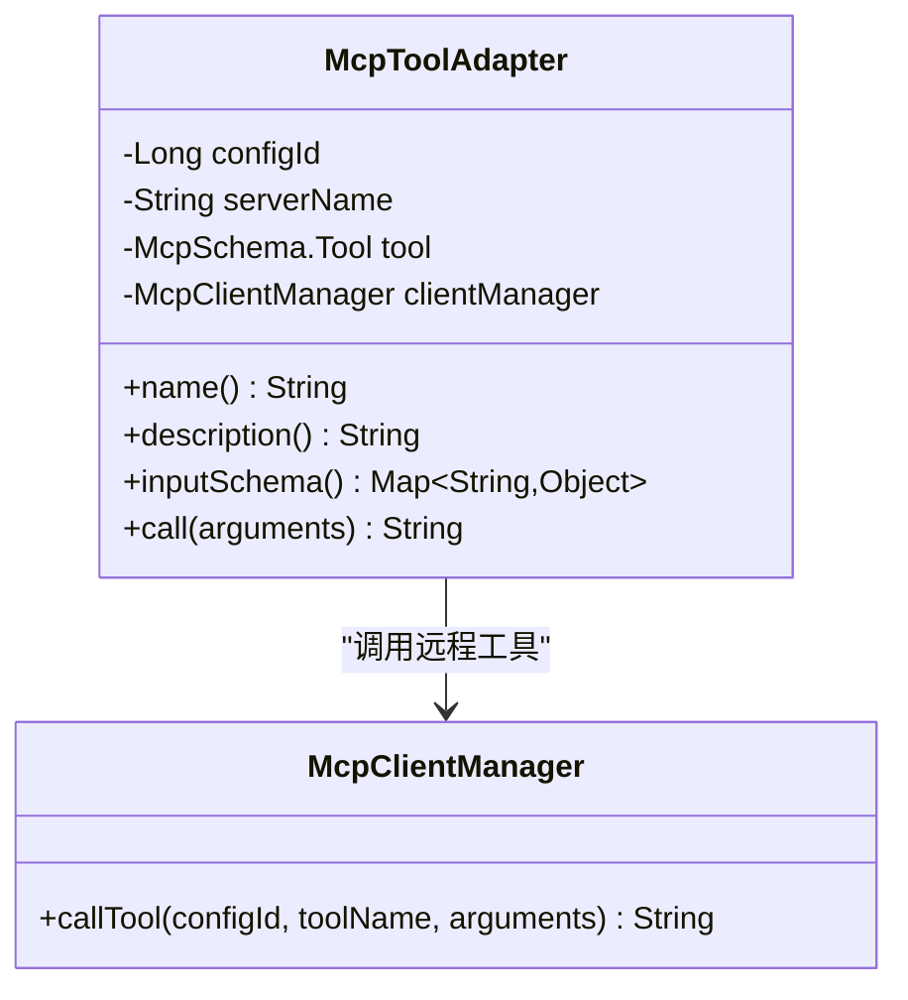
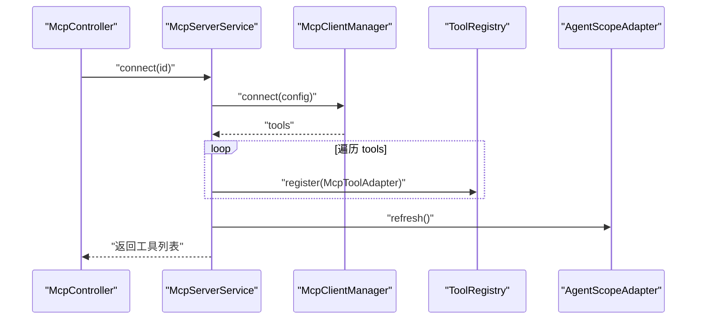
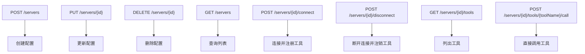
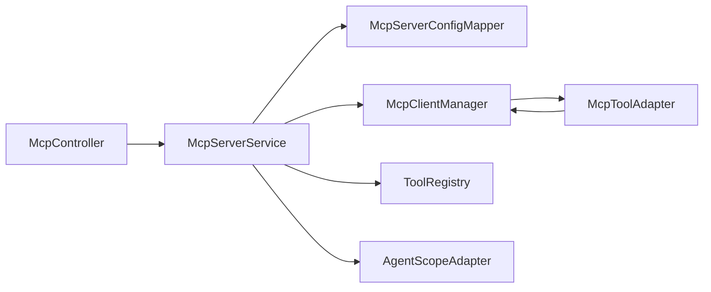

# MCP 协议支持

<cite>
**本文引用的文件**   
- [McpClientManager.java](file://src/main/java/com/agenthub/mcp/client/McpClientManager.java)
- [McpToolAdapter.java](file://src/main/java/com/agenthub/mcp/client/McpToolAdapter.java)
- [McpServerService.java](file://src/main/java/com/agenthub/mcp/service/McpServerService.java)
- [McpController.java](file://src/main/java/com/agenthub/mcp/controller/McpController.java)
- [McpServerConfig.java](file://src/main/java/com/agenthub/mcp/entity/McpServerConfig.java)
- [McpServerRequest.java](file://src/main/java/com/agenthub/mcp/dto/McpServerRequest.java)
- [McpServerConfigMapper.java](file://src/main/java/com/agenthub/mcp/mapper/McpServerConfigMapper.java)
- [ToolRegistry.java](file://src/main/java/com/agenthub/agent/tool/ToolRegistry.java)
- [AgentScopeAdapter.java](file://src/main/java/com/agenthub/agent/agentscope/AgentScopeAdapter.java)
- [BizException.java](file://src/main/java/com/agenthub/common/exception/BizException.java)
- [ErrorCode.java](file://src/main/java/com/agenthub/common/exception/ErrorCode.java)
</cite>

## 目录
1. [简介](#简介)
2. [项目结构](#项目结构)
3. [核心组件](#核心组件)
4. [架构总览](#架构总览)
5. [详细组件分析](#详细组件分析)
6. [依赖关系分析](#依赖关系分析)
7. [性能与可靠性考虑](#性能与可靠性考虑)
8. [故障排查指南](#故障排查指南)
9. [结论](#结论)
10. [附录：API 参考与配置说明](#附录api-参考与配置说明)

## 简介
本章节面向希望在本系统中接入并管理外部 MCP（Model Context Protocol）服务器的开发者。文档从协议标准化意义、系统内集成方式入手，重点解析以下能力：
- McpClientManager：客户端连接管理、传输模式选择、工具发现与调用。
- McpToolAdapter：将 MCP Server 暴露的工具适配为平台统一的 AgentTool，完成命名隔离、参数映射与结果转换。
- McpServerService：服务端管理逻辑，包括配置 CRUD、连接状态管理、错误处理与工具注册。
- McpController：REST API 接口设计，用于配置管理与调试调用。
- McpServerConfig：配置项与连接参数说明。
同时提供实际集成示例与调试方法，帮助快速落地。

## 项目结构
MCP 相关代码位于 mcp 包下，按职责分层组织：
- client：客户端连接与工具适配器。
- service：服务层编排配置、连接与工具注册。
- controller：对外 REST 接口。
- entity/dto：配置实体与请求 DTO。
- mapper：数据库访问接口。

图表来源
- [McpController.java:24-83](file://src/main/java/com/agenthub/mcp/controller/McpController.java#L24-L83)
- [McpServerService.java:30-158](file://src/main/java/com/agenthub/mcp/service/McpServerService.java#L30-L158)
- [McpClientManager.java:33-149](file://src/main/java/com/agenthub/mcp/client/McpClientManager.java#L33-L149)
- [McpToolAdapter.java:14-54](file://src/main/java/com/agenthub/mcp/client/McpToolAdapter.java#L14-L54)
- [McpServerConfig.java:14-52](file://src/main/java/com/agenthub/mcp/entity/McpServerConfig.java#L14-L52)
- [McpServerRequest.java:8-36](file://src/main/java/com/agenthub/mcp/dto/McpServerRequest.java#L8-L36)
- [McpServerConfigMapper.java:9-10](file://src/main/java/com/agenthub/mcp/mapper/McpServerConfigMapper.java#L9-L10)
- [ToolRegistry.java:17-54](file://src/main/java/com/agenthub/agent/tool/ToolRegistry.java#L17-L54)
- [AgentScopeAdapter.java:30-123](file://src/main/java/com/agenthub/agent/agentscope/AgentScopeAdapter.java#L30-L123)

章节来源
- [McpController.java:24-83](file://src/main/java/com/agenthub/mcp/controller/McpController.java#L24-L83)
- [McpServerService.java:30-158](file://src/main/java/com/agenthub/mcp/service/McpServerService.java#L30-L158)
- [McpClientManager.java:33-149](file://src/main/java/com/agenthub/mcp/client/McpClientManager.java#L33-L149)
- [McpToolAdapter.java:14-54](file://src/main/java/com/agenthub/mcp/client/McpToolAdapter.java#L14-L54)
- [McpServerConfig.java:14-52](file://src/main/java/com/agenthub/mcp/entity/McpServerConfig.java#L14-L52)
- [McpServerRequest.java:8-36](file://src/main/java/com/agenthub/mcp/dto/McpServerRequest.java#L8-L36)
- [McpServerConfigMapper.java:9-10](file://src/main/java/com/agenthub/mcp/mapper/McpServerConfigMapper.java#L9-L10)
- [ToolRegistry.java:17-54](file://src/main/java/com/agenthub/agent/tool/ToolRegistry.java#L17-L54)
- [AgentScopeAdapter.java:30-123](file://src/main/java/com/agenthub/agent/agentscope/AgentScopeAdapter.java#L30-L123)

## 核心组件
- McpClientManager：负责与 MCP Server 建立连接、列出工具、调用工具，并按传输类型构建底层 Transport。
- McpToolAdapter：把 MCP 的 Tool 包装成平台 AgentTool，统一命名空间与描述，透传参数并返回文本结果。
- McpServerService：封装配置 CRUD、连接生命周期、工具注册/注销、租户懒连接等。
- McpController：对外暴露配置管理、连接控制、工具列表与直接调用的 REST API。
- McpServerConfig / McpServerRequest：配置实体与请求 DTO，承载传输类型、地址、命令与环境变量等。
- ToolRegistry / AgentScopeAdapter：工具注册表与 AgentScope 引擎桥接，使 MCP 工具可被 LLM function calling 使用。

章节来源
- [McpClientManager.java:33-149](file://src/main/java/com/agenthub/mcp/client/McpClientManager.java#L33-L149)
- [McpToolAdapter.java:14-54](file://src/main/java/com/agenthub/mcp/client/McpToolAdapter.java#L14-L54)
- [McpServerService.java:30-158](file://src/main/java/com/agenthub/mcp/service/McpServerService.java#L30-L158)
- [McpController.java:24-83](file://src/main/java/com/agenthub/mcp/controller/McpController.java#L24-L83)
- [McpServerConfig.java:14-52](file://src/main/java/com/agenthub/mcp/entity/McpServerConfig.java#L14-L52)
- [McpServerRequest.java:8-36](file://src/main/java/com/agenthub/mcp/dto/McpServerRequest.java#L8-L36)
- [ToolRegistry.java:17-54](file://src/main/java/com/agenthub/agent/tool/ToolRegistry.java#L17-L54)
- [AgentScopeAdapter.java:30-123](file://src/main/java/com/agenthub/agent/agentscope/AgentScopeAdapter.java#L30-L123)

## 架构总览
下图展示 MCP 在系统中的整体交互：控制器接收请求，服务层协调配置、连接与工具注册；客户端管理器负责与 MCP Server 通信；工具适配器将远程工具纳入平台工具体系；AgentScope 引擎通过 Toolkit 消费这些工具。

图表来源
- [McpController.java:56-60](file://src/main/java/com/agenthub/mcp/controller/McpController.java#L56-L60)
- [McpServerService.java:75-84](file://src/main/java/com/agenthub/mcp/service/McpServerService.java#L75-L84)
- [McpClientManager.java:40-58](file://src/main/java/com/agenthub/mcp/client/McpClientManager.java#L40-L58)
- [ToolRegistry.java:22-25](file://src/main/java/com/agenthub/agent/tool/ToolRegistry.java#L22-L25)
- [AgentScopeAdapter.java:88-97](file://src/main/java/com/agenthub/agent/agentscope/AgentScopeAdapter.java#L88-L97)

## 详细组件分析

### McpClientManager：客户端连接管理
职责与要点：
- 维护已连接的 McpSyncClient 实例，以配置 ID 为键。
- 支持三种传输模式：streamable-http、sse、stdio。
- 连接流程：构建 Transport → 初始化 → 拉取工具列表 → 缓存客户端。
- 工具调用：构造 CallToolRequest，提取 TextContent 拼接为字符串返回。
- 资源清理：优雅关闭连接，应用销毁时关闭全部连接。

图表来源
- [McpClientManager.java:40-58](file://src/main/java/com/agenthub/mcp/client/McpClientManager.java#L40-L58)
- [McpClientManager.java:116-127](file://src/main/java/com/agenthub/mcp/client/McpClientManager.java#L116-L127)
- [McpClientManager.java:145-148](file://src/main/java/com/agenthub/mcp/client/McpClientManager.java#L145-L148)

关键实现点：
- 传输构建：依据 transportType 分支选择 HttpClientStreamableHttpTransport、HttpClientSseClientTransport 或 StdioClientTransport。
- STDIO 模式：解析 argsJson 与 envJson，构建 ServerParameters。
- 工具调用：对 CallToolResult 进行 error 判断，仅提取 text 类型内容。

章节来源
- [McpClientManager.java:33-149](file://src/main/java/com/agenthub/mcp/client/McpClientManager.java#L33-L149)

### McpToolAdapter：工具适配器
职责与要点：
- 将 MCP 的 Tool 包装为 AgentTool，命名规则为 mcp__{serverName}__{toolName}，避免与内置工具冲突。
- 描述信息补充来源服务器名。
- inputSchema 为空时返回空对象 schema，保证 LLM function calling 可用。
- call 方法委托给 McpClientManager.callTool。

图表来源
- [McpToolAdapter.java:14-54](file://src/main/java/com/agenthub/mcp/client/McpToolAdapter.java#L14-L54)
- [McpClientManager.java:82-95](file://src/main/java/com/agenthub/mcp/client/McpClientManager.java#L82-L95)

章节来源
- [McpToolAdapter.java:14-54](file://src/main/java/com/agenthub/mcp/client/McpToolAdapter.java#L14-L54)
- [McpClientManager.java:82-95](file://src/main/java/com/agenthub/mcp/client/McpClientManager.java#L82-L95)

### McpServerService：服务端管理逻辑
职责与要点：
- 配置 CRUD：create/update/delete/list，更新前断开旧连接，删除时释放连接并注销工具。
- 连接管理：connect/disconnect，连接成功后将工具注册到 ToolRegistry，并刷新 AgentScopeAdapter。
- 工具发现：listTools 直接复用客户端管理器。
- 直接调用：callTool 用于调试与演示。
- 租户懒连接：ensureConnectedForTenant 遍历启用配置，跳过已连接项，失败仅记录日志。

图表来源
- [McpServerService.java:75-84](file://src/main/java/com/agenthub/mcp/service/McpServerService.java#L75-L84)
- [McpServerService.java:86-97](file://src/main/java/com/agenthub/mcp/service/McpServerService.java#L86-L97)
- [McpServerService.java:117-131](file://src/main/java/com/agenthub/mcp/service/McpServerService.java#L117-L131)

章节来源
- [McpServerService.java:30-158](file://src/main/java/com/agenthub/mcp/service/McpServerService.java#L30-L158)

### McpController：REST API 接口设计
接口清单：
- POST /api/v1/mcp/servers：新增配置。
- PUT /api/v1/mcp/servers/{id}：更新配置。
- DELETE /api/v1/mcp/servers/{id}：删除配置。
- GET /api/v1/mcp/servers：配置列表。
- POST /api/v1/mcp/servers/{id}/connect：建立连接并注册工具。
- POST /api/v1/mcp/servers/{id}/disconnect：断开连接并注销工具。
- GET /api/v1/mcp/servers/{id}/tools：列出已连接 Server 的工具。
- POST /api/v1/mcp/servers/{id}/tools/{toolName}/call：直接调用工具（调试）。

图表来源
- [McpController.java:31-82](file://src/main/java/com/agenthub/mcp/controller/McpController.java#L31-L82)

章节来源
- [McpController.java:24-83](file://src/main/java/com/agenthub/mcp/controller/McpController.java#L24-L83)

### McpServerConfig：配置选项与连接参数
字段说明：
- id：主键。
- tenantId：租户标识。
- name：配置名，作为工具名前缀。
- description：描述。
- transportType：传输类型，支持 stdio、sse、streamable-http。
- baseUrl：SSE/Streamable HTTP 的服务地址。
- endpoint：Streamable HTTP 的端点，默认 /mcp。
- command：STDIO 模式的启动命令。
- argsJson：STDIO 模式的启动参数（JSON 数组字符串）。
- envJson：环境变量（JSON 对象字符串）。
- enabled：是否启用。
- createdAt/updatedAt：时间戳。

章节来源
- [McpServerConfig.java:14-52](file://src/main/java/com/agenthub/mcp/entity/McpServerConfig.java#L14-L52)

## 依赖关系分析
- McpController 依赖 McpServerService。
- McpServerService 依赖 McpServerConfigMapper、McpClientManager、ToolRegistry、AgentScopeAdapter。
- McpClientManager 依赖官方 MCP SDK 的客户端与传输实现。
- McpToolAdapter 依赖 McpClientManager 与 McpSchema.Tool。
- ToolRegistry 与 AgentScopeAdapter 共同构成工具注册与引擎桥接。

图表来源
- [McpController.java:24-83](file://src/main/java/com/agenthub/mcp/controller/McpController.java#L24-L83)
- [McpServerService.java:30-158](file://src/main/java/com/agenthub/mcp/service/McpServerService.java#L30-L158)
- [McpClientManager.java:33-149](file://src/main/java/com/agenthub/mcp/client/McpClientManager.java#L33-L149)
- [McpToolAdapter.java:14-54](file://src/main/java/com/agenthub/mcp/client/McpToolAdapter.java#L14-L54)
- [McpServerConfigMapper.java:9-10](file://src/main/java/com/agenthub/mcp/mapper/McpServerConfigMapper.java#L9-L10)
- [ToolRegistry.java:17-54](file://src/main/java/com/agenthub/agent/tool/ToolRegistry.java#L17-L54)
- [AgentScopeAdapter.java:30-123](file://src/main/java/com/agenthub/agent/agentscope/AgentScopeAdapter.java#L30-L123)

章节来源
- [McpController.java:24-83](file://src/main/java/com/agenthub/mcp/controller/McpController.java#L24-L83)
- [McpServerService.java:30-158](file://src/main/java/com/agenthub/mcp/service/McpServerService.java#L30-L158)
- [McpClientManager.java:33-149](file://src/main/java/com/agenthub/mcp/client/McpClientManager.java#L33-L149)
- [McpToolAdapter.java:14-54](file://src/main/java/com/agenthub/mcp/client/McpToolAdapter.java#L14-L54)
- [McpServerConfigMapper.java:9-10](file://src/main/java/com/agenthub/mcp/mapper/McpServerConfigMapper.java#L9-L10)
- [ToolRegistry.java:17-54](file://src/main/java/com/agenthub/agent/tool/ToolRegistry.java#L17-L54)
- [AgentScopeAdapter.java:30-123](file://src/main/java/com/agenthub/agent/agentscope/AgentScopeAdapter.java#L30-L123)

## 性能与可靠性考虑
- 连接池管理：当前实现以配置 ID 为键缓存单个 McpSyncClient，未实现多连接池化；如需高并发场景，可在 McpClientManager 中引入连接池与空闲回收策略。
- 心跳检测：当前未实现显式心跳；建议在连接建立后定时发送轻量探测请求，或在传输层启用健康检查。
- 故障恢复：连接失败会抛出业务异常；建议增加重试机制与退避策略，并在连接断开后自动重连。
- 超时与限流：客户端初始化设置了请求超时；可在调用链路上增加熔断与限流保护。
- 资源清理：应用销毁时关闭所有连接，避免资源泄漏。

[本节为通用指导，不直接分析具体文件]

## 故障排查指南
常见问题与定位思路：
- 连接失败：
  - 检查 transportType 与 baseUrl/command 是否正确。
  - 查看日志中的“MCP Server 连接失败”与 BizException 消息。
- 工具调用失败：
  - 确认工具名称与参数是否符合 MCP Server 定义。
  - 检查 CallToolResult 是否为 error，并查看返回文本。
- 工具未注册：
  - 确认 connect 接口已调用且成功。
  - 检查 ToolRegistry 快照中是否存在 mcp__{server}__{tool} 命名工具。
- AgentScope 引擎无新工具：
  - 确认 McpServerService.connect 后调用了 AgentScopeAdapter.refresh。
  - 观察 HarnessAgent 重建日志与工具数量。

章节来源
- [McpClientManager.java:40-58](file://src/main/java/com/agenthub/mcp/client/McpClientManager.java#L40-L58)
- [McpClientManager.java:82-95](file://src/main/java/com/agenthub/mcp/client/McpClientManager.java#L82-L95)
- [McpServerService.java:75-84](file://src/main/java/com/agenthub/mcp/service/McpServerService.java#L75-L84)
- [BizException.java:8-22](file://src/main/java/com/agenthub/common/exception/BizException.java#L8-L22)
- [ErrorCode.java:11-26](file://src/main/java/com/agenthub/common/exception/ErrorCode.java#L11-L26)

## 结论
本项目通过 McpClientManager、McpToolAdapter、McpServerService 与 McpController 的组合，实现了 MCP 协议的标准化接入与管理。连接管理支持多种传输模式，工具发现与注册无缝对接平台工具体系，AgentScope 引擎可直接消费这些工具。结合配置持久化与 REST API，系统提供了完整的 MCP 集成方案与调试能力。

[本节为总结性内容，不直接分析具体文件]

## 附录：API 参考与配置说明

### REST API 定义
- 新增配置
  - 方法：POST
  - 路径：/api/v1/mcp/servers
  - 请求体：McpServerRequest
  - 响应：ApiResponse<McpServerConfig>
- 更新配置
  - 方法：PUT
  - 路径：/api/v1/mcp/servers/{id}
  - 请求体：McpServerRequest
  - 响应：ApiResponse<McpServerConfig>
- 删除配置
  - 方法：DELETE
  - 路径：/api/v1/mcp/servers/{id}
  - 响应：ApiResponse<Void>
- 配置列表
  - 方法：GET
  - 路径：/api/v1/mcp/servers
  - 响应：ApiResponse<List<McpServerConfig>>
- 建立连接
  - 方法：POST
  - 路径：/api/v1/mcp/servers/{id}/connect
  - 响应：ApiResponse<List<McpSchema.Tool>>
- 断开连接
  - 方法：POST
  - 路径：/api/v1/mcp/servers/{id}/disconnect
  - 响应：ApiResponse<Void>
- 列出工具
  - 方法：GET
  - 路径：/api/v1/mcp/servers/{id}/tools
  - 响应：ApiResponse<List<McpSchema.Tool>>
- 直接调用工具
  - 方法：POST
  - 路径：/api/v1/mcp/servers/{id}/tools/{toolName}/call
  - 请求体：Map<String, Object>（可选）
  - 响应：ApiResponse<String>

章节来源
- [McpController.java:31-82](file://src/main/java/com/agenthub/mcp/controller/McpController.java#L31-L82)
- [McpServerRequest.java:8-36](file://src/main/java/com/agenthub/mcp/dto/McpServerRequest.java#L8-L36)

### 配置项说明
- transportType：
  - streamable-http：远程 HTTP 模式，需配置 baseUrl 与 endpoint。
  - sse：SSE 长连接模式，需配置 baseUrl。
  - stdio：本地进程模式，需配置 command、argsJson、envJson。
- baseUrl：SSE/Streamable HTTP 服务地址。
- endpoint：Streamable HTTP 端点，默认 /mcp。
- command：STDIO 启动命令，如 npx、uvx、java -jar。
- argsJson：启动参数 JSON 数组字符串。
- envJson：环境变量 JSON 对象字符串。
- enabled：是否启用，启用后会在租户懒连接阶段尝试建立连接。

章节来源
- [McpServerConfig.java:23-47](file://src/main/java/com/agenthub/mcp/entity/McpServerConfig.java#L23-L47)
- [McpServerRequest.java:11-35](file://src/main/java/com/agenthub/mcp/dto/McpServerRequest.java#L11-L35)

### 实际集成示例与调试方法
- 步骤概览：
  - 新增配置：调用新增接口，填写 transportType、baseUrl/command 等。
  - 建立连接：调用 connect 接口，返回工具列表。
  - 列出工具：调用 tools 接口，验证工具是否已注册。
  - 直接调用：调用 call 接口，传入工具名与参数，验证执行结果。
  - 断开连接：调用 disconnect 接口，验证工具是否被注销。
- 调试建议：
  - 观察日志中的连接与工具注册信息。
  - 若工具未出现在 AgentScope 引擎中，确认 refresh 已被调用。
  - 对于 STDIO 模式，检查命令与参数是否能拉起子进程。

章节来源
- [McpServerService.java:75-84](file://src/main/java/com/agenthub/mcp/service/McpServerService.java#L75-L84)
- [McpServerService.java:86-97](file://src/main/java/com/agenthub/mcp/service/McpServerService.java#L86-L97)
- [McpClientManager.java:40-58](file://src/main/java/com/agenthub/mcp/client/McpClientManager.java#L40-L58)
- [McpClientManager.java:116-143](file://src/main/java/com/agenthub/mcp/client/McpClientManager.java#L116-L143)