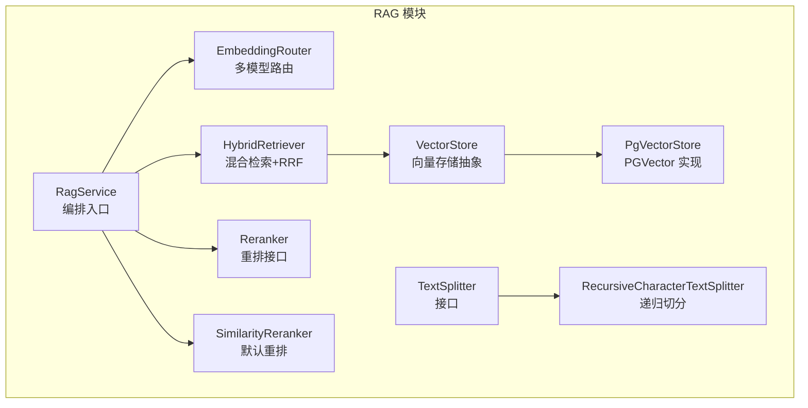
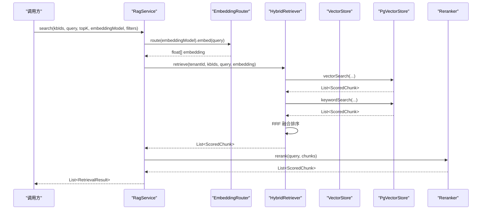
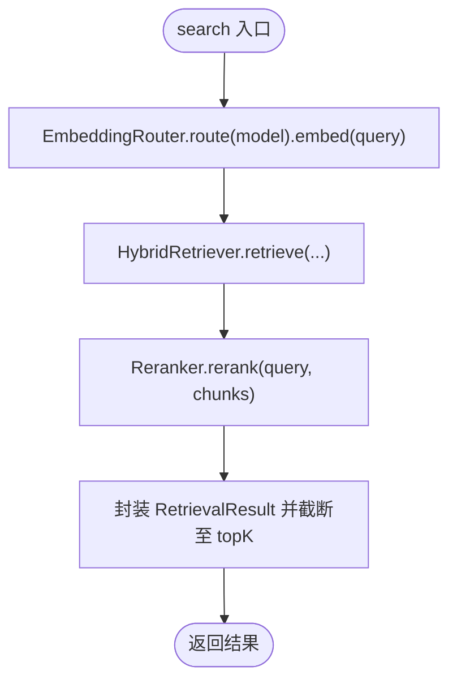
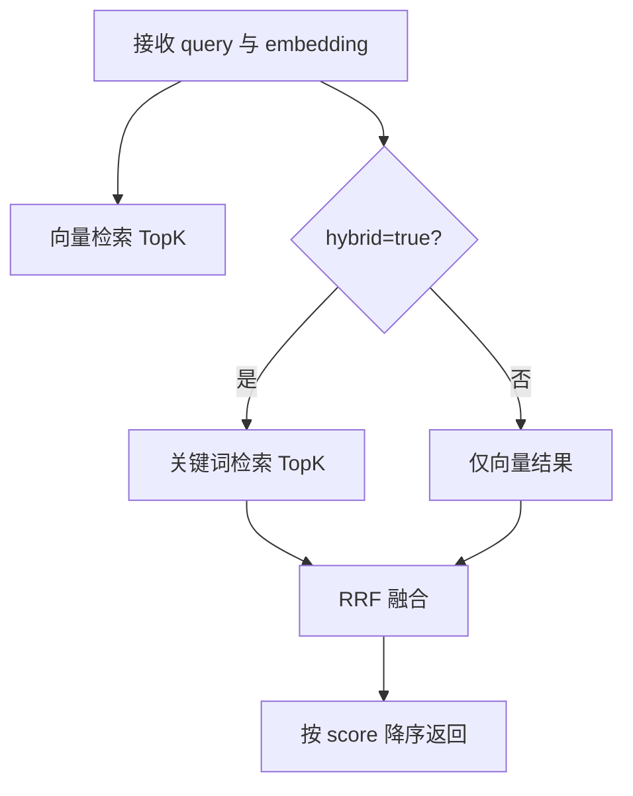
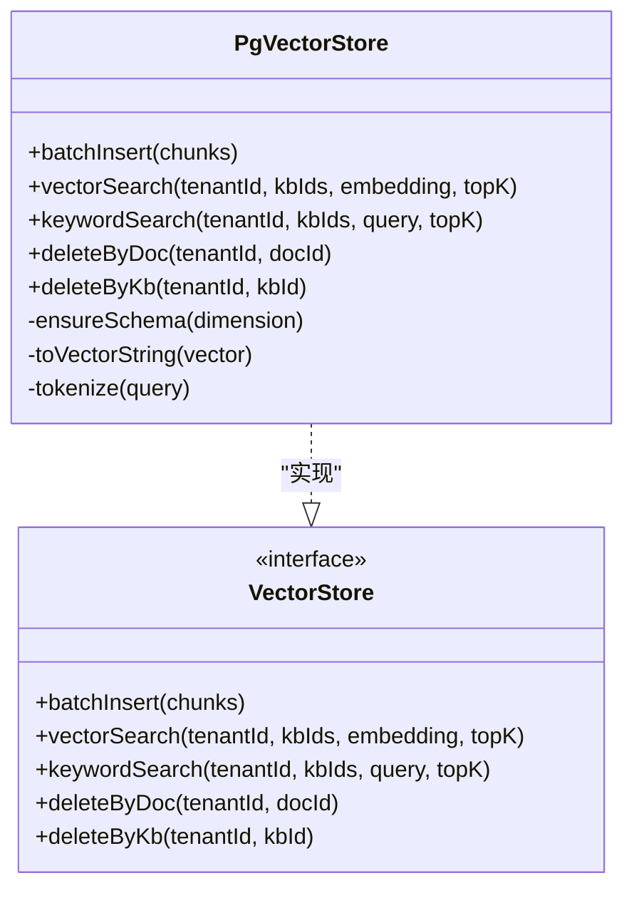
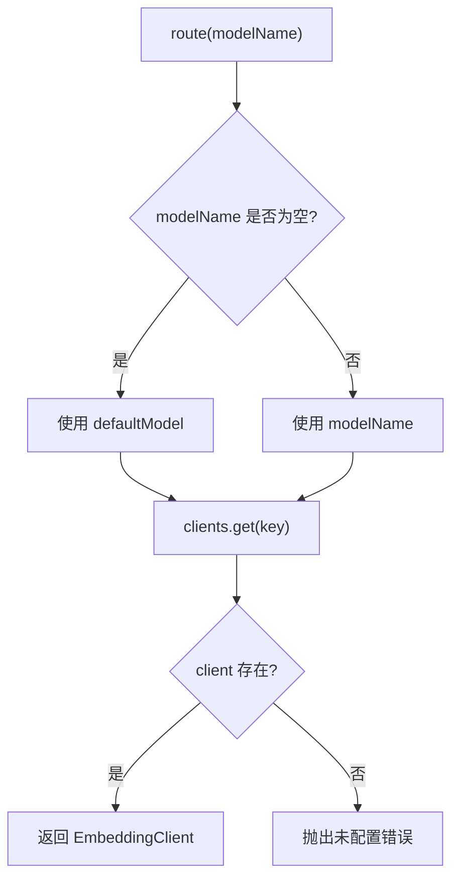
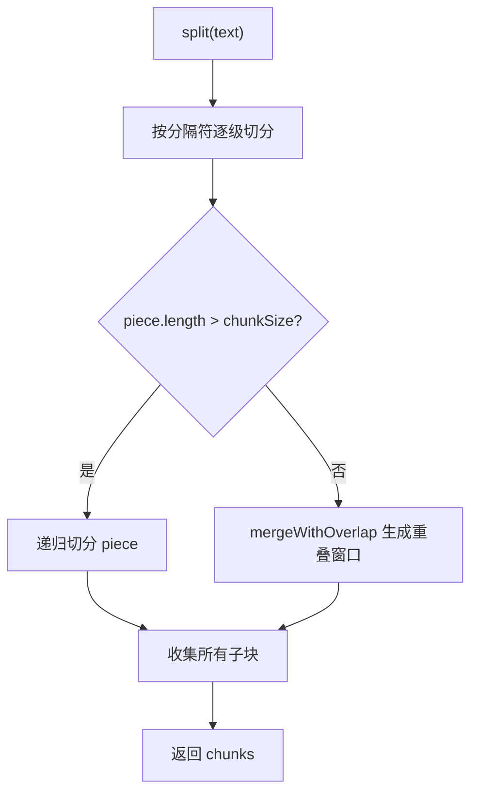
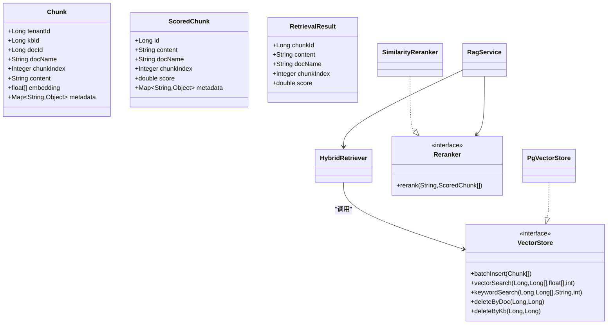
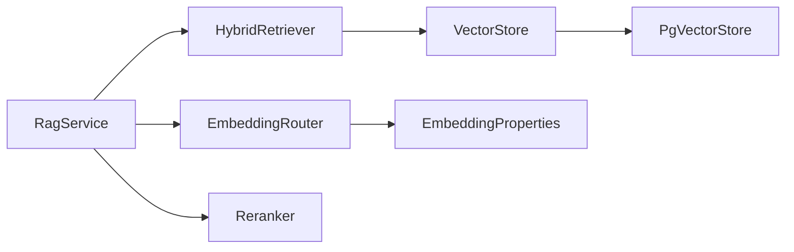

# RAG 检索增强系统

<cite>
**本文引用的文件**   
- [RagService.java](file://src/main/java/com/agenthub/rag/service/RagService.java)
- [HybridRetriever.java](file://src/main/java/com/agenthub/rag/retrieve/HybridRetriever.java)
- [PgVectorStore.java](file://src/main/java/com/agenthub/rag/store/PgVectorStore.java)
- [EmbeddingRouter.java](file://src/main/java/com/agenthub/rag/embedding/EmbeddingRouter.java)
- [TextSplitter.java](file://src/main/java/com/agenthub/rag/splitter/TextSplitter.java)
- [RecursiveCharacterTextSplitter.java](file://src/main/java/com/agenthub/rag/splitter/RecursiveCharacterTextSplitter.java)
- [Chunk.java](file://src/main/java/com/agenthub/rag/model/Chunk.java)
- [RetrievalResult.java](file://src/main/java/com/agenthub/rag/model/RetrievalResult.java)
- [ScoredChunk.java](file://src/main/java/com/agenthub/rag/model/ScoredChunk.java)
- [Reranker.java](file://src/main/java/com/agenthub/rag/rerank/Reranker.java)
- [SimilarityReranker.java](file://src/main/java/com/agenthub/rag/rerank/SimilarityReranker.java)
- [VectorStore.java](file://src/main/java/com/agenthub/rag/store/VectorStore.java)
- [EmbeddingProperties.java](file://src/main/java/com/agenthub/rag/embedding/EmbeddingProperties.java)
- [VectorProperties.java](file://src/main/java/com/agenthub/rag/store/VectorProperties.java)
- [application.yml](file://src/main/resources/application.yml)
- [init-pgvector.sql](file://sql/init-pgvector.sql)
</cite>

## 目录
1. [简介](#简介)
2. [项目结构](#项目结构)
3. [核心组件](#核心组件)
4. [架构总览](#架构总览)
5. [详细组件分析](#详细组件分析)
6. [依赖关系分析](#依赖关系分析)
7. [性能与优化](#性能与优化)
8. [故障排查指南](#故障排查指南)
9. [结论](#结论)
10. [附录：配置与使用示例](#附录配置与使用示例)

## 简介
本系统实现了一个面向多租户的 RAG（检索增强生成）检索增强管线，涵盖文档预处理、文本分块、向量化、混合检索（向量 + 关键词）、RRF 融合排序与重排。系统通过 PgVector 存储向量片段，支持多种 Embedding 模型路由，并提供可扩展的重排接口。整体设计强调租户隔离、可观测性与可插拔能力。

## 项目结构
RAG 相关代码集中在 rag 包下，按职责分层组织：
- embedding：嵌入客户端与路由
- model：数据模型（Chunk、ScoredChunk、RetrievalResult）
- splitter：文本切分器
- retrieve：混合检索器
- rerank：重排器
- store：向量存储抽象与 PGVector 实现
- service：RAG 编排服务

图表来源
- [RagService.java:22-54](file://src/main/java/com/agenthub/rag/service/RagService.java#L22-L54)
- [HybridRetriever.java:21-69](file://src/main/java/com/agenthub/rag/retrieve/HybridRetriever.java#L21-L69)
- [PgVectorStore.java:30-107](file://src/main/java/com/agenthub/rag/store/PgVectorStore.java#L30-L107)
- [EmbeddingRouter.java:14-44](file://src/main/java/com/agenthub/rag/embedding/EmbeddingRouter.java#L14-L44)
- [TextSplitter.java:8-12](file://src/main/java/com/agenthub/rag/splitter/TextSplitter.java#L8-L12)
- [RecursiveCharacterTextSplitter.java:13-49](file://src/main/java/com/agenthub/rag/splitter/RecursiveCharacterTextSplitter.java#L13-L49)
- [Reranker.java:10-14](file://src/main/java/com/agenthub/rag/rerank/Reranker.java#L10-L14)
- [SimilarityReranker.java:14-23](file://src/main/java/com/agenthub/rag/rerank/SimilarityReranker.java#L14-L23)

章节来源
- [RagService.java:22-54](file://src/main/java/com/agenthub/rag/service/RagService.java#L22-L54)
- [HybridRetriever.java:21-69](file://src/main/java/com/agenthub/rag/retrieve/HybridRetriever.java#L21-L69)
- [PgVectorStore.java:30-107](file://src/main/java/com/agenthub/rag/store/PgVectorStore.java#L30-L107)
- [EmbeddingRouter.java:14-44](file://src/main/java/com/agenthub/rag/embedding/EmbeddingRouter.java#L14-L44)
- [TextSplitter.java:8-12](file://src/main/java/com/agenthub/rag/splitter/TextSplitter.java#L8-L12)
- [RecursiveCharacterTextSplitter.java:13-49](file://src/main/java/com/agenthub/rag/splitter/RecursiveCharacterTextSplitter.java#L13-L49)
- [Reranker.java:10-14](file://src/main/java/com/agenthub/rag/rerank/Reranker.java#L10-L14)
- [SimilarityReranker.java:14-23](file://src/main/java/com/agenthub/rag/rerank/SimilarityReranker.java#L14-L23)

## 核心组件
- RagService：RAG 检索编排入口，负责“向量化 → 混合检索 → 重排 → 结果封装”的完整流水线，并支持将结果拼装为 LLM 上下文。
- HybridRetriever：混合检索器，执行向量检索与关键词检索，并通过 RRF（倒数排名融合）进行稳定融合排序。
- PgVectorStore：基于 PostgreSQL + pgvector 的向量存储实现，提供建表、索引、批量写入、向量检索、关键字检索与删除能力。
- EmbeddingRouter：多 Embedding 模型路由，根据配置动态选择 OpenAI/Ollama/Mock 等客户端。
- TextSplitter / RecursiveCharacterTextSplitter：文本切分接口与递归字符切分实现，保证语义连贯与重叠窗口。
- Reranker / SimilarityReranker：重排抽象与默认相似度重排实现。
- VectorStore：向量存储抽象，强制 tenantId 参数以保障租户隔离。

章节来源
- [RagService.java:22-54](file://src/main/java/com/agenthub/rag/service/RagService.java#L22-L54)
- [HybridRetriever.java:21-69](file://src/main/java/com/agenthub/rag/retrieve/HybridRetriever.java#L21-L69)
- [PgVectorStore.java:30-107](file://src/main/java/com/agenthub/rag/store/PgVectorStore.java#L30-L107)
- [EmbeddingRouter.java:14-44](file://src/main/java/com/agenthub/rag/embedding/EmbeddingRouter.java#L14-L44)
- [TextSplitter.java:8-12](file://src/main/java/com/agenthub/rag/splitter/TextSplitter.java#L8-L12)
- [RecursiveCharacterTextSplitter.java:13-49](file://src/main/java/com/agenthub/rag/splitter/RecursiveCharacterTextSplitter.java#L13-L49)
- [Reranker.java:10-14](file://src/main/java/com/agenthub/rag/rerank/Reranker.java#L10-L14)
- [SimilarityReranker.java:14-23](file://src/main/java/com/agenthub/rag/rerank/SimilarityReranker.java#L14-L23)
- [VectorStore.java:12-28](file://src/main/java/com/agenthub/rag/store/VectorStore.java#L12-L28)

## 架构总览
RAG 检索流程从上层调用进入 RagService，依次完成查询向量化、混合检索、RRF 融合与重排，最终返回对外结果或构建 LLM 上下文。

图表来源
- [RagService.java:39-54](file://src/main/java/com/agenthub/rag/service/RagService.java#L39-L54)
- [HybridRetriever.java:46-69](file://src/main/java/com/agenthub/rag/retrieve/HybridRetriever.java#L46-L69)
- [PgVectorStore.java:90-143](file://src/main/java/com/agenthub/rag/store/PgVectorStore.java#L90-L143)
- [SimilarityReranker.java:17-23](file://src/main/java/com/agenthub/rag/rerank/SimilarityReranker.java#L17-L23)

## 详细组件分析

### RagService 编排逻辑
- 输入：知识库 ID 列表、查询文本、TopK、Embedding 模型路由键、过滤条件。
- 处理：
  - 通过 EmbeddingRouter 获取对应 Embedding 客户端并对查询进行向量化。
  - 调用 HybridRetriever 执行混合检索。
  - 调用 Reranker 对候选片段进行重排。
  - 将 ScoredChunk 转换为 RetrievalResult，限制返回数量。
- 输出：
  - search：返回检索结果列表。
  - buildContext：将检索结果拼接为带来源标注的 LLM 上下文字符串。

图表来源
- [RagService.java:39-54](file://src/main/java/com/agenthub/rag/service/RagService.java#L39-L54)

章节来源
- [RagService.java:22-54](file://src/main/java/com/agenthub/rag/service/RagService.java#L22-L54)

### HybridRetriever 混合检索算法
- 两路召回：
  - 向量检索：余弦相似度 TopK。
  - 关键词检索：ILIKE 匹配计数打分 TopK。
- RRF 融合：score = Σ 1/(k + rank)，不依赖绝对量纲，融合后按 chunk id 去重合并并按分数降序排列。
- 可配置项：vector-top-k、keyword-top-k、rrf-k、hybrid（是否启用混合）。

图表来源
- [HybridRetriever.java:27-37](file://src/main/java/com/agenthub/rag/retrieve/HybridRetriever.java#L27-L37)
- [HybridRetriever.java:46-77](file://src/main/java/com/agenthub/rag/retrieve/HybridRetriever.java#L46-L77)

章节来源
- [HybridRetriever.java:21-77](file://src/main/java/com/agenthub/rag/retrieve/HybridRetriever.java#L21-L77)

### PgVectorStore 向量存储实现
- 数据库与连接：独立 Hikari 连接池直连 PostgreSQL，确保与业务 MySQL 解耦。
- 建表与索引：
  - 幂等创建 rag_chunk 表，包含 tenant_id/kb_id/doc_id/doc_name/chunk_index/content/embedding/metadata/created_at。
  - 建立 (tenant_id, kb_id) 联合索引与 HNSW 向量索引（余弦算子）。
- 写入：batchInsert 批量写入 Chunk，embedding 转为 PGVector 字符串，metadata 转 JSONB。
- 检索：
  - vectorSearch：使用 <=> 余弦距离计算相似度，按 1 - distance 排序。
  - keywordSearch：简单分词（英文字母数字、中文连续串），对长中文串做 2-gram 提升命中率，按 ILIKE 命中计数打分。
- 删除：deleteByDoc、deleteByKb 支持按文档或知识库清理。

图表来源
- [PgVectorStore.java:30-107](file://src/main/java/com/agenthub/rag/store/PgVectorStore.java#L30-L107)
- [VectorStore.java:12-28](file://src/main/java/com/agenthub/rag/store/VectorStore.java#L12-L28)

章节来源
- [PgVectorStore.java:30-223](file://src/main/java/com/agenthub/rag/store/PgVectorStore.java#L30-L223)
- [VectorStore.java:12-28](file://src/main/java/com/agenthub/rag/store/VectorStore.java#L12-L28)
- [init-pgvector.sql:13-31](file://sql/init-pgvector.sql#L13-L31)

### EmbeddingRouter 多嵌入模型支持
- 配置驱动：读取 EmbeddingProperties.providers，按 name 构建客户端映射。
- 路由策略：若传入 modelName 为空或空白，则回退到 defaultModel；否则按 key 查找客户端。
- 客户端类型：openai、ollama、mock，未知类型抛出异常。

图表来源
- [EmbeddingRouter.java:20-44](file://src/main/java/com/agenthub/rag/embedding/EmbeddingRouter.java#L20-L44)
- [EmbeddingProperties.java:12-31](file://src/main/java/com/agenthub/rag/embedding/EmbeddingProperties.java#L12-L31)

章节来源
- [EmbeddingRouter.java:14-44](file://src/main/java/com/agenthub/rag/embedding/EmbeddingRouter.java#L14-L44)
- [EmbeddingProperties.java:12-31](file://src/main/java/com/agenthub/rag/embedding/EmbeddingProperties.java#L12-L31)

### TextSplitter 文本分块策略与 Chunk 模型
- 接口 TextSplitter：定义 split(text) 方法。
- 递归字符切分 RecursiveCharacterTextSplitter：
  - 分隔符优先级：段落 → 换行 → 中文句号/标点 → 空格 → 逐字符。
  - 控制 chunkSize 与 chunkOverlap，优先在句子边界截断，避免语义断裂。
  - 超长片段递归降级切分，普通片段按滑动窗口输出。
- Chunk 模型：包含租户、知识库、文档、内容、向量、元数据等字段，作为 PGVector 的最小检索单元。

图表来源
- [RecursiveCharacterTextSplitter.java:32-49](file://src/main/java/com/agenthub/rag/splitter/RecursiveCharacterTextSplitter.java#L32-L49)
- [RecursiveCharacterTextSplitter.java:101-123](file://src/main/java/com/agenthub/rag/splitter/RecursiveCharacterTextSplitter.java#L101-L123)
- [TextSplitter.java:8-12](file://src/main/java/com/agenthub/rag/splitter/TextSplitter.java#L8-L12)
- [Chunk.java:18-43](file://src/main/java/com/agenthub/rag/model/Chunk.java#L18-L43)

章节来源
- [TextSplitter.java:8-12](file://src/main/java/com/agenthub/rag/splitter/TextSplitter.java#L8-L12)
- [RecursiveCharacterTextSplitter.java:13-125](file://src/main/java/com/agenthub/rag/splitter/RecursiveCharacterTextSplitter.java#L13-L125)
- [Chunk.java:18-43](file://src/main/java/com/agenthub/rag/model/Chunk.java#L18-L43)

### 数据模型与关系

图表来源
- [Chunk.java:18-43](file://src/main/java/com/agenthub/rag/model/Chunk.java#L18-L43)
- [ScoredChunk.java:12-32](file://src/main/java/com/agenthub/rag/model/ScoredChunk.java#L12-L32)
- [RetrievalResult.java:10-27](file://src/main/java/com/agenthub/rag/model/RetrievalResult.java#L10-L27)
- [VectorStore.java:12-28](file://src/main/java/com/agenthub/rag/store/VectorStore.java#L12-L28)
- [HybridRetriever.java:21-69](file://src/main/java/com/agenthub/rag/retrieve/HybridRetriever.java#L21-L69)
- [Reranker.java:10-14](file://src/main/java/com/agenthub/rag/rerank/Reranker.java#L10-L14)
- [SimilarityReranker.java:14-23](file://src/main/java/com/agenthub/rag/rerank/SimilarityReranker.java#L14-L23)
- [PgVectorStore.java:30-107](file://src/main/java/com/agenthub/rag/store/PgVectorStore.java#L30-L107)

## 依赖关系分析
- RagService 依赖 EmbeddingRouter、HybridRetriever、Reranker。
- HybridRetriever 依赖 VectorStore（PgVectorStore 实现）。
- PgVectorStore 依赖 JdbcTemplate 与 HikariDataSource，直接操作 PostgreSQL + pgvector。
- EmbeddingRouter 依赖 EmbeddingProperties 与具体 EmbeddingClient 实现。
- TextSplitter 与 RecursiveCharacterTextSplitter 为纯文本处理组件，无外部依赖。

图表来源
- [RagService.java:22-54](file://src/main/java/com/agenthub/rag/service/RagService.java#L22-L54)
- [HybridRetriever.java:21-69](file://src/main/java/com/agenthub/rag/retrieve/HybridRetriever.java#L21-L69)
- [PgVectorStore.java:30-107](file://src/main/java/com/agenthub/rag/store/PgVectorStore.java#L30-L107)
- [EmbeddingRouter.java:14-44](file://src/main/java/com/agenthub/rag/embedding/EmbeddingRouter.java#L14-L44)
- [EmbeddingProperties.java:12-31](file://src/main/java/com/agenthub/rag/embedding/EmbeddingProperties.java#L12-L31)

章节来源
- [RagService.java:22-54](file://src/main/java/com/agenthub/rag/service/RagService.java#L22-L54)
- [HybridRetriever.java:21-69](file://src/main/java/com/agenthub/rag/retrieve/HybridRetriever.java#L21-L69)
- [PgVectorStore.java:30-107](file://src/main/java/com/agenthub/rag/store/PgVectorStore.java#L30-L107)
- [EmbeddingRouter.java:14-44](file://src/main/java/com/agenthub/rag/embedding/EmbeddingRouter.java#L14-L44)
- [EmbeddingProperties.java:12-31](file://src/main/java/com/agenthub/rag/embedding/EmbeddingProperties.java#L12-L31)

## 性能与优化
- 向量检索性能：
  - 使用 HNSW 索引与余弦算子，显著提升高维向量相似度检索效率。
  - 建议合理设置 rrf-k 与 TopK，平衡召回与延迟。
- 关键词检索优化：
  - 简单分词 + ILIKE 命中计数，适合快速近似匹配；生产环境可替换为专业分词或倒排索引。
- 批处理写入：
  - batchInsert 使用 JDBC 批更新，减少往返开销。
- 连接池与维度一致性：
  - PgVectorStore 独立 Hikari 连接池，避免与业务库争用。
  - dimension 需与 Embedding 模型输出一致，建表时已校验。

[本节为通用性能讨论，不直接分析具体文件]

## 故障排查指南
- 未配置的 Embedding 模型：
  - 现象：路由时抛出未配置错误。
  - 排查：检查 EmbeddingProperties.providers 与 defaultModel 配置是否正确。
- 向量维度不一致：
  - 现象：建表或写入失败。
  - 排查：确认 application.yml 中 agenthub.vector.dimension 与 Embedding 模型输出维度一致。
- 检索结果为空：
  - 现象：vectorSearch/keywordSearch 返回空列表。
  - 排查：确认 tenantId、kbIds 过滤条件、chunk 数据是否存在，以及 hybrid 开关与 TopK 配置。
- 性能问题：
  - 现象：检索延迟升高。
  - 排查：检查 HNSW 索引是否创建成功，调整 vector-top-k、keyword-top-k、rrf-k，评估关键词分词策略。

章节来源
- [EmbeddingRouter.java:27-34](file://src/main/java/com/agenthub/rag/embedding/EmbeddingRouter.java#L27-L34)
- [PgVectorStore.java:47-66](file://src/main/java/com/agenthub/rag/store/PgVectorStore.java#L47-L66)
- [application.yml:64-76](file://src/main/resources/application.yml#L64-L76)

## 结论
本 RAG 系统以清晰的模块化设计实现了从文本切分到混合检索再到重排的完整链路，借助 PgVector 与 pgvector 扩展提供高性能向量检索，并通过 EmbeddingRouter 支持多模型接入。RRF 融合在不依赖绝对量纲的前提下有效融合语义与关键词信号，提升了检索稳定性与召回质量。系统具备良好的可扩展性与可观测性，便于在生产环境中持续优化与演进。

[本节为总结性内容，不直接分析具体文件]

## 附录：配置与使用示例

### 关键配置项说明
- 向量库连接与维度：
  - agenthub.vector.datasource.jdbc-url / username / password
  - agenthub.vector.dimension
- RAG 检索参数：
  - agenthub.rag.vector-top-k
  - agenthub.rag.keyword-top-k
  - agenthub.rag.rrf-k
  - agenthub.rag.hybrid
- Embedding 模型路由：
  - agenthub.embedding.default-model
  - agenthub.embedding.providers[].name/type/baseUrl/apiKey/model

章节来源
- [application.yml:64-76](file://src/main/resources/application.yml#L64-L76)
- [application.yml:126-140](file://src/main/resources/application.yml#L126-L140)
- [VectorProperties.java:9-24](file://src/main/java/com/agenthub/rag/store/VectorProperties.java#L9-L24)
- [EmbeddingProperties.java:12-31](file://src/main/java/com/agenthub/rag/embedding/EmbeddingProperties.java#L12-L31)

### 使用场景演示
- 直接检索：
  - 调用 RagService.search(kbIds, query, topK, embeddingModel, filters)，返回 RetrievalResult 列表。
- 构建 LLM 上下文：
  - 调用 RagService.buildContext(results)，得到带来源标注的上下文文本，供 LLM 消费。
- 混合检索开关：
  - 设置 agenthub.rag.hybrid=false 时，仅使用向量检索；true 时启用关键词检索与 RRF 融合。

章节来源
- [RagService.java:39-69](file://src/main/java/com/agenthub/rag/service/RagService.java#L39-L69)
- [HybridRetriever.java:27-37](file://src/main/java/com/agenthub/rag/retrieve/HybridRetriever.java#L27-L37)