# 多租户管理系统

<cite>
**本文引用的文件**   
- [TenantService.java](file://src/main/java/com/agenthub/tenant/service/TenantService.java)
- [TenantContext.java](file://src/main/java/com/agenthub/tenant/context/TenantContext.java)
- [TenantApiKey.java](file://src/main/java/com/agenthub/tenant/entity/TenantApiKey.java)
- [TenantInterceptor.java](file://src/main/java/com/agenthub/gateway/interceptor/TenantInterceptor.java)
- [TenantController.java](file://src/main/java/com/agenthub/tenant/controller/TenantController.java)
- [Tenant.java](file://src/main/java/com/agenthub/tenant/entity/Tenant.java)
- [TenantUser.java](file://src/main/java/com/agenthub/tenant/entity/TenantUser.java)
- [SecurityProperties.java](file://src/main/java/com/agenthub/gateway/config/SecurityProperties.java)
- [application.yml](file://src/main/resources/application.yml)
- [init-mysql.sql](file://sql/init-mysql.sql)
</cite>

## 目录
1. [简介](#简介)
2. [项目结构](#项目结构)
3. [核心组件](#核心组件)
4. [架构总览](#架构总览)
5. [详细组件分析](#详细组件分析)
6. [依赖关系分析](#依赖关系分析)
7. [性能与扩展性](#性能与扩展性)
8. [故障排查指南](#故障排查指南)
9. [结论](#结论)
10. [附录：配置与安全最佳实践](#附录配置与安全最佳实践)

## 简介
本系统实现了一个面向多租户的 SaaS 能力，围绕“租户隔离、身份认证、API Key 鉴权、请求拦截与上下文透传”构建。核心设计包括：
- 多租户数据隔离：业务表统一包含 tenant_id，由 MyBatis-Plus 租户插件自动追加过滤条件；租户元数据表不加入自动过滤。
- 租户上下文：基于 ThreadLocal 保存当前请求的租户身份，并在异步线程中透传。
- API Key 机制：服务端仅存储哈希值，支持过期控制与启用状态校验。
- 请求拦截：在网关层完成租户识别、API Key 校验，并将租户信息写入上下文供下游使用。
- 管理接口：提供租户注册、登录、API Key 签发等管理能力。

## 项目结构
多租户相关代码集中在以下包：
- tenant：租户领域模型、服务、控制器、上下文与映射器
- gateway.interceptor：请求拦截器，负责认证与上下文设置
- gateway.config：安全开关与白名单路径配置
- resources.application.yml：平台级配置，包含安全开关、免认证路径、租户请求头名称等
- sql.init-mysql.sql：数据库初始化脚本，定义租户域及种子数据

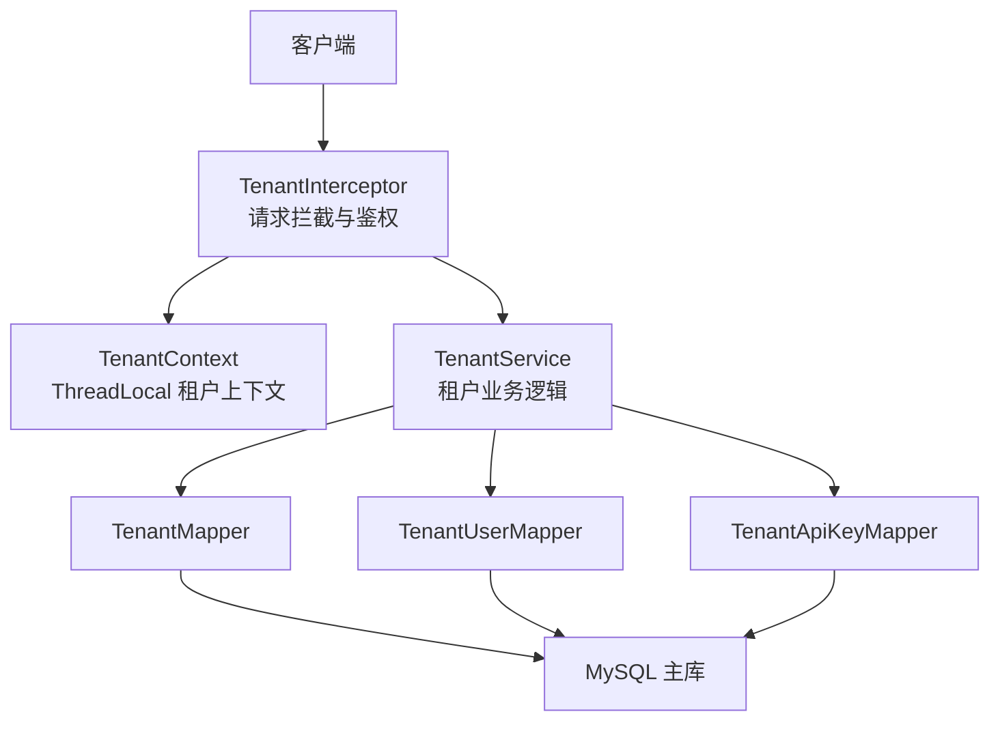

**图表来源**
- [TenantInterceptor.java:18-76](file://src/main/java/com/agenthub/gateway/interceptor/TenantInterceptor.java#L18-L76)
- [TenantService.java:32-128](file://src/main/java/com/agenthub/tenant/service/TenantService.java#L32-L128)
- [TenantContext.java:6-59](file://src/main/java/com/agenthub/tenant/context/TenantContext.java#L6-L59)

**章节来源**
- [TenantInterceptor.java:18-76](file://src/main/java/com/agenthub/gateway/interceptor/TenantInterceptor.java#L18-L76)
- [TenantService.java:32-128](file://src/main/java/com/agenthub/tenant/service/TenantService.java#L32-L128)
- [TenantContext.java:6-59](file://src/main/java/com/agenthub/tenant/context/TenantContext.java#L6-L59)
- [application.yml:54-62](file://src/main/resources/application.yml#L54-L62)

## 核心组件
- TenantService：租户创建、用户登录、API Key 签发与校验的核心业务逻辑。
- TenantContext：线程安全的租户上下文，封装当前请求的租户ID、用户ID与用户名。
- TenantApiKey：API Key 实体，服务端仅存储哈希值，支持启用状态与过期时间。
- TenantInterceptor：请求拦截器，解析请求头、校验 API Key、设置上下文并拒绝非法请求。
- TenantController：租户管理 REST 接口，提供注册、登录、API Key 签发。
- SecurityProperties：安全开关与免认证路径的配置类。
- application.yml：安全开关、免认证路径、租户请求头名称等配置。
- init-mysql.sql：租户域建表与种子数据（演示租户、管理员账号、默认 API Key）。

**章节来源**
- [TenantService.java:26-128](file://src/main/java/com/agenthub/tenant/service/TenantService.java#L26-L128)
- [TenantContext.java:6-59](file://src/main/java/com/agenthub/tenant/context/TenantContext.java#L6-L59)
- [TenantApiKey.java:10-38](file://src/main/java/com/agenthub/tenant/entity/TenantApiKey.java#L10-L38)
- [TenantInterceptor.java:18-76](file://src/main/java/com/agenthub/gateway/interceptor/TenantInterceptor.java#L18-L76)
- [TenantController.java:20-54](file://src/main/java/com/agenthub/tenant/controller/TenantController.java#L20-L54)
- [SecurityProperties.java:8-20](file://src/main/java/com/agenthub/gateway/config/SecurityProperties.java#L8-L20)
- [application.yml:54-62](file://src/main/resources/application.yml#L54-L62)
- [init-mysql.sql:10-45](file://sql/init-mysql.sql#L10-L45)

## 架构总览
下图展示从客户端到数据库的多租户请求处理流程，以及关键组件之间的交互关系。

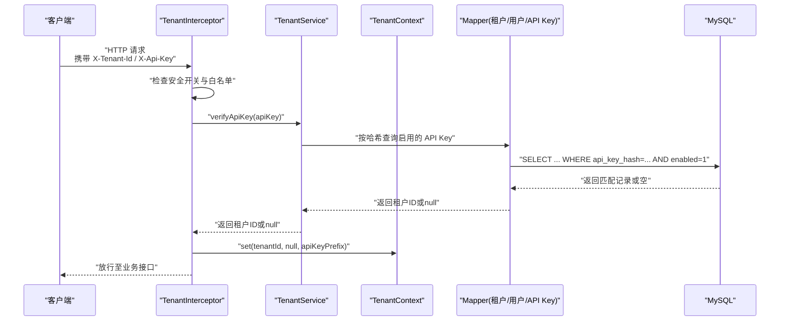

**图表来源**
- [TenantInterceptor.java:31-56](file://src/main/java/com/agenthub/gateway/interceptor/TenantInterceptor.java#L31-L56)
- [TenantService.java:94-109](file://src/main/java/com/agenthub/tenant/service/TenantService.java#L94-L109)
- [TenantContext.java:19-37](file://src/main/java/com/agenthub/tenant/context/TenantContext.java#L19-L37)

## 详细组件分析

### TenantService：租户注册、认证、权限与资源管理
职责概述：
- 租户注册：创建租户与 OWNER 用户，密码以哈希形式存储。
- 用户登录：根据租户编码、用户名与密码进行校验，返回用户信息。
- API Key 签发：生成明文 Key 一次返回，服务端仅存哈希；支持启用状态与过期时间。
- API Key 校验：通过哈希匹配与启用/过期状态判断，返回租户ID。

关键流程说明：
- 创建租户时同时创建 OWNER 用户，确保每个租户至少有一个高权限账户。
- 登录流程先校验租户是否存在且启用，再校验用户是否存在且启用，最后比对密码哈希。
- API Key 生成采用随机字节 + Base64 前缀，便于识别；校验时比较哈希值并检查过期时间。

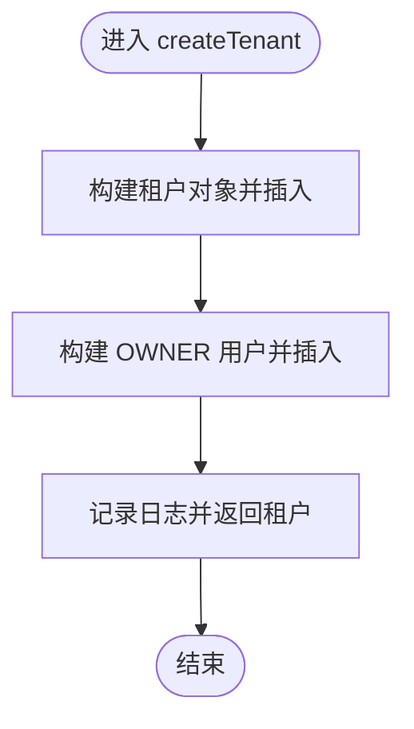

**图表来源**
- [TenantService.java:41-60](file://src/main/java/com/agenthub/tenant/service/TenantService.java#L41-L60)

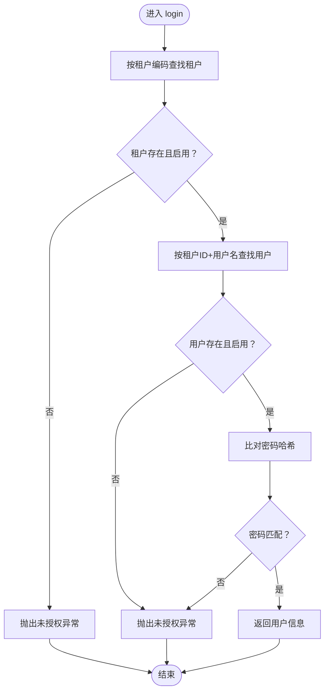

**图表来源**
- [TenantService.java:62-78](file://src/main/java/com/agenthub/tenant/service/TenantService.java#L62-L78)

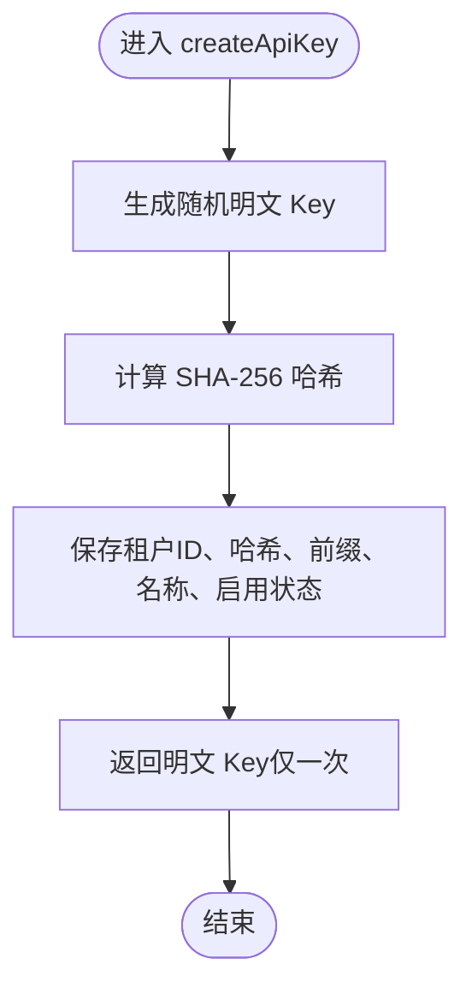

**图表来源**
- [TenantService.java:80-92](file://src/main/java/com/agenthub/tenant/service/TenantService.java#L80-L92)

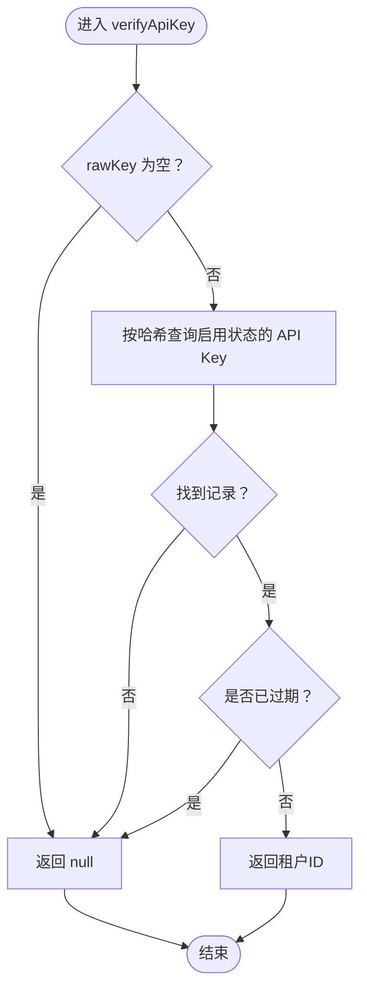

**图表来源**
- [TenantService.java:94-109](file://src/main/java/com/agenthub/tenant/service/TenantService.java#L94-L109)

**章节来源**
- [TenantService.java:26-128](file://src/main/java/com/agenthub/tenant/service/TenantService.java#L26-L128)

### TenantContext：租户上下文与线程安全传递
职责概述：
- 使用 ThreadLocal 保存当前请求的租户身份快照（租户ID、用户ID、用户名）。
- 提供 requireTenantId 强制获取租户ID，缺失时抛出业务异常，保证所有查询强制带租户。
- 提供 getTenantId/getUserId/getUserName 可选获取方法，适用于登录接口或消费者手动设置场景。
- 提供 clear 清理方法，防止线程池复用导致租户串号。

线程安全要点：
- 每次请求进入时设置上下文，请求结束后清理，避免跨请求污染。
- 异步线程需通过 TaskDecorator 透传上下文（文档中注释说明由 AsyncConfig 的 TaskDecorator 自动透传）。

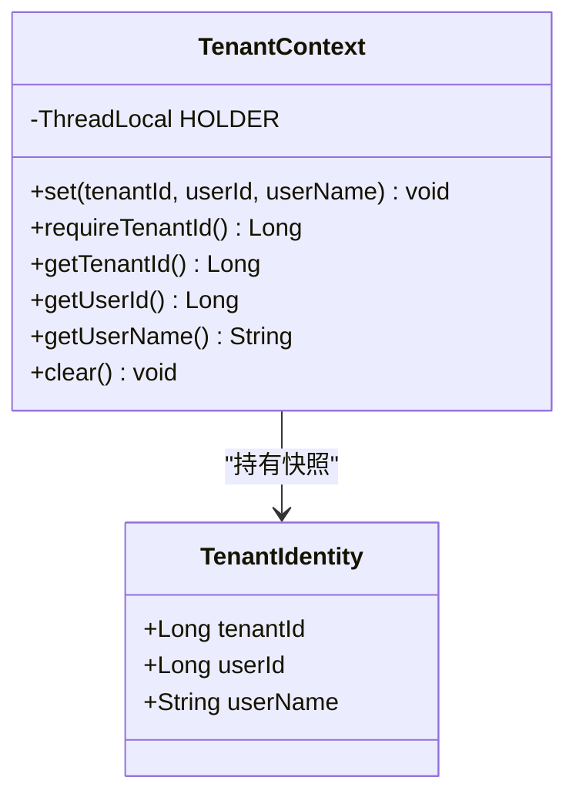

**图表来源**
- [TenantContext.java:6-59](file://src/main/java/com/agenthub/tenant/context/TenantContext.java#L6-L59)

**章节来源**
- [TenantContext.java:6-59](file://src/main/java/com/agenthub/tenant/context/TenantContext.java#L6-L59)

### TenantApiKey：API Key 实体与存储策略
职责概述：
- 存储租户ID、API Key 哈希、前缀、名称、启用状态、过期时间与创建时间。
- 服务端仅保存哈希值，明文仅在签发时返回一次。
- 支持启用状态与过期时间控制，用于鉴权与生命周期管理。

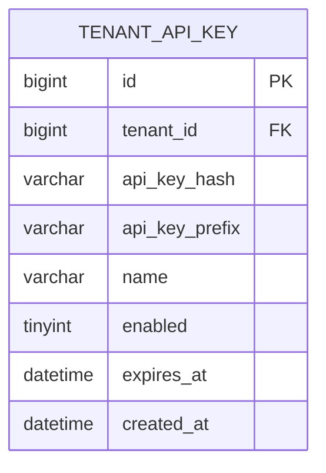

**图表来源**
- [TenantApiKey.java:10-38](file://src/main/java/com/agenthub/tenant/entity/TenantApiKey.java#L10-L38)
- [init-mysql.sql:35-45](file://sql/init-mysql.sql#L35-L45)

**章节来源**
- [TenantApiKey.java:10-38](file://src/main/java/com/agenthub/tenant/entity/TenantApiKey.java#L10-L38)
- [init-mysql.sql:35-45](file://sql/init-mysql.sql#L35-L45)

### TenantInterceptor：请求过滤、租户识别与数据隔离
职责概述：
- 解析请求头 X-Tenant-Id 与 X-Api-Key。
- 若安全开关关闭或命中白名单路径，直接放行。
- 调用 TenantService.verifyApiKey 校验 API Key，并与租户ID比对。
- 通过后设置 TenantContext，为下游 MyBatis 租户插件提供隔离依据。
- 在 afterCompletion 中清理上下文，防止线程池复用导致串号。

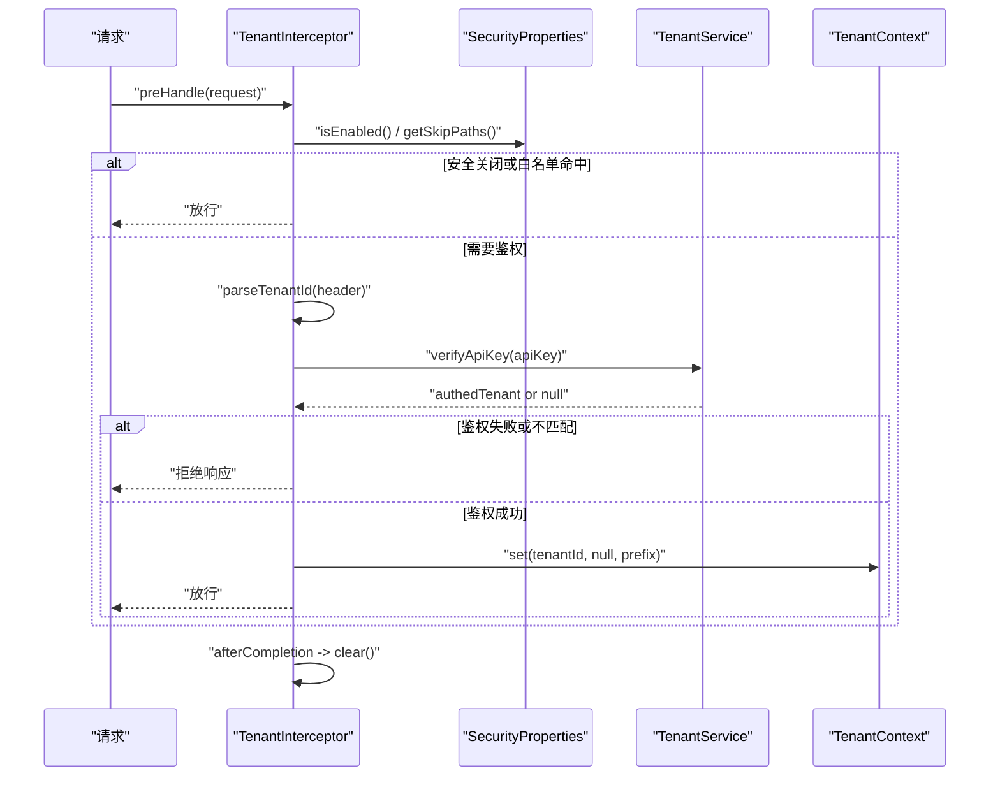

**图表来源**
- [TenantInterceptor.java:31-56](file://src/main/java/com/agenthub/gateway/interceptor/TenantInterceptor.java#L31-L56)
- [TenantService.java:94-109](file://src/main/java/com/agenthub/tenant/service/TenantService.java#L94-L109)
- [SecurityProperties.java:11-20](file://src/main/java/com/agenthub/gateway/config/SecurityProperties.java#L11-L20)

**章节来源**
- [TenantInterceptor.java:18-76](file://src/main/java/com/agenthub/gateway/interceptor/TenantInterceptor.java#L18-L76)
- [SecurityProperties.java:11-20](file://src/main/java/com/agenthub/gateway/config/SecurityProperties.java#L11-L20)

### TenantController：管理接口说明
接口清单：
- POST /api/v1/tenant/register：租户注册，创建租户与 OWNER 用户。
- POST /api/v1/tenant/login：账号密码登录，返回租户ID、用户ID、用户名、显示名与角色。
- POST /api/v1/tenant/api-keys：为当前租户签发 API Key，明文仅返回一次。

注意事项：
- 注册接口在生产环境应增加邀请码或审批流程。
- 登录接口被配置为免认证路径，便于首次接入。
- API Key 签发接口依赖 TenantContext.requireTenantId，必须在鉴权后调用。

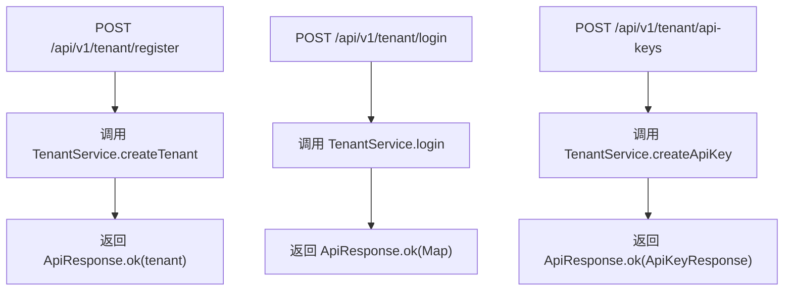

**图表来源**
- [TenantController.java:30-53](file://src/main/java/com/agenthub/tenant/controller/TenantController.java#L30-L53)
- [TenantService.java:41-92](file://src/main/java/com/agenthub/tenant/service/TenantService.java#L41-L92)

**章节来源**
- [TenantController.java:20-54](file://src/main/java/com/agenthub/tenant/controller/TenantController.java#L20-L54)

## 依赖关系分析
- TenantInterceptor 依赖 SecurityProperties 与 TenantService，负责鉴权与上下文设置。
- TenantService 依赖三个 Mapper：TenantMapper、TenantUserMapper、TenantApiKeyMapper，分别访问租户、用户与 API Key 表。
- TenantContext 独立于其他组件，仅提供线程本地上下文存取。
- application.yml 中的 agenthub.security 与 agenthub.tenant.header/api-key-header 控制拦截行为与请求头名称。
- init-mysql.sql 定义了租户域表结构与种子数据，确保演示环境可快速运行。

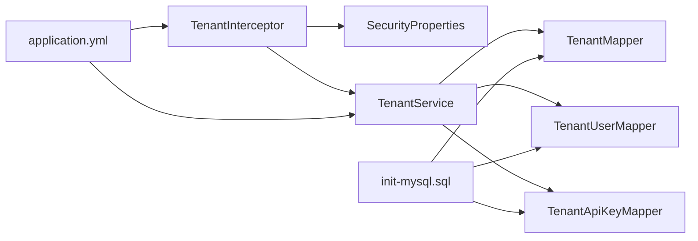

**图表来源**
- [TenantInterceptor.java:22-29](file://src/main/java/com/agenthub/gateway/interceptor/TenantInterceptor.java#L22-L29)
- [TenantService.java:37-39](file://src/main/java/com/agenthub/tenant/service/TenantService.java#L37-L39)
- [application.yml:54-62](file://src/main/resources/application.yml#L54-L62)
- [init-mysql.sql:10-45](file://sql/init-mysql.sql#L10-L45)

**章节来源**
- [TenantInterceptor.java:22-29](file://src/main/java/com/agenthub/gateway/interceptor/TenantInterceptor.java#L22-L29)
- [TenantService.java:37-39](file://src/main/java/com/agenthub/tenant/service/TenantService.java#L37-L39)
- [application.yml:54-62](file://src/main/resources/application.yml#L54-L62)
- [init-mysql.sql:10-45](file://sql/init-mysql.sql#L10-L45)

## 性能与扩展性
- API Key 校验走哈希匹配与索引列，建议保持 api_key_hash 索引有效以提升查询性能。
- 租户上下文使用 ThreadLocal，开销低但需注意清理，避免线程池复用导致串号。
- 可扩展点：
  - 将密码哈希算法升级为 BCrypt/Argon2，提升安全性。
  - API Key 改用 HMAC-SHA256 或密钥库托管，增强抗泄露能力。
  - 引入细粒度权限模型（如 RBAC），结合 TenantUser.role 与知识库成员角色实现更精细控制。
  - 对异步任务增加上下文透传（TaskDecorator），确保 MQ 消费者也能正确隔离数据。

[本节为通用指导，无需具体文件引用]

## 故障排查指南
常见问题与建议：
- 缺少 X-Tenant-Id 或 X-Api-Key：检查客户端请求头是否正确传递，确认安全开关未误关闭。
- API Key 无效或与租户不匹配：核对 API Key 是否与租户ID一致，检查是否启用与是否过期。
- 租户上下文缺失：确认拦截器是否在 preHandle 中设置上下文，并在 afterCompletion 中清理。
- 登录接口无法访问：确认 /api/v1/tenant/login 已在安全白名单中。
- 数据越界或串号：检查异步线程是否透传上下文，并确保清理逻辑生效。

**章节来源**
- [TenantInterceptor.java:31-56](file://src/main/java/com/agenthub/gateway/interceptor/TenantInterceptor.java#L31-L56)
- [TenantService.java:62-109](file://src/main/java/com/agenthub/tenant/service/TenantService.java#L62-L109)
- [application.yml:54-62](file://src/main/resources/application.yml#L54-L62)

## 结论
该多租户管理系统通过清晰的职责划分与严格的鉴权流程，实现了租户隔离、身份认证与 API Key 管理。TenantService 提供核心业务能力，TenantContext 保障线程安全的上下文传递，TenantInterceptor 完成请求级鉴权与隔离，TenantController 暴露管理接口。配合 application.yml 与 init-mysql.sql，系统可在演示环境中快速运行，并为生产环境的安全与扩展预留了空间。

[本节为总结，无需具体文件引用]

## 附录：配置与安全最佳实践

### 租户配置示例（application.yml）
- 安全开关与白名单：
  - agenthub.security.enabled：是否开启租户认证
  - agenthub.security.skip-paths：免认证路径列表（Ant 风格）
- 租户请求头：
  - agenthub.tenant.header：租户ID请求头名称（默认 X-Tenant-Id）
  - agenthub.tenant.api-key-header：API Key 请求头名称（默认 X-Api-Key）

**章节来源**
- [application.yml:54-62](file://src/main/resources/application.yml#L54-L62)
- [SecurityProperties.java:11-20](file://src/main/java/com/agenthub/gateway/config/SecurityProperties.java#L11-L20)

### API Key 管理流程
- 签发：调用 /api/v1/tenant/api-keys，返回明文 Key 一次，服务端仅存哈希。
- 校验：客户端在后续请求中携带 X-Tenant-Id 与 X-Api-Key，拦截器调用 TenantService.verifyApiKey 校验。
- 生命周期：可通过启用状态与过期时间控制 Key 的有效性。

**章节来源**
- [TenantController.java:48-53](file://src/main/java/com/agenthub/tenant/controller/TenantController.java#L48-L53)
- [TenantService.java:80-109](file://src/main/java/com/agenthub/tenant/service/TenantService.java#L80-L109)
- [TenantApiKey.java:10-38](file://src/main/java/com/agenthub/tenant/entity/TenantApiKey.java#L10-L38)

### 常见安全最佳实践
- 密码存储：生产环境使用 BCrypt/Argon2，避免使用 SHA-256 明文对比。
- API Key 安全：使用 HMAC-SHA256 或密钥库托管，限制 Key 的作用域与有效期。
- 最小权限原则：结合角色与资源权限模型，限制租户内操作范围。
- 审计与监控：记录鉴权失败、Key 签发与过期事件，结合链路追踪定位问题。
- 上下文安全：确保异步线程透传上下文，并在请求结束时清理，防止串号。

**章节来源**
- [TenantService.java:26-31](file://src/main/java/com/agenthub/tenant/service/TenantService.java#L26-L31)
- [TenantContext.java:51-54](file://src/main/java/com/agenthub/tenant/context/TenantContext.java#L51-L54)