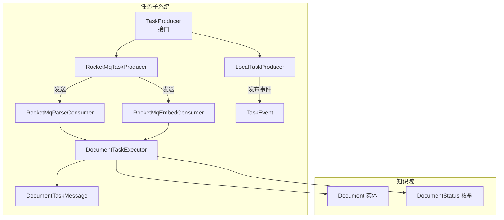
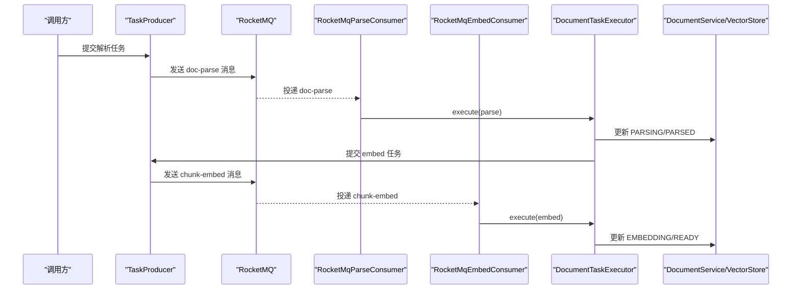
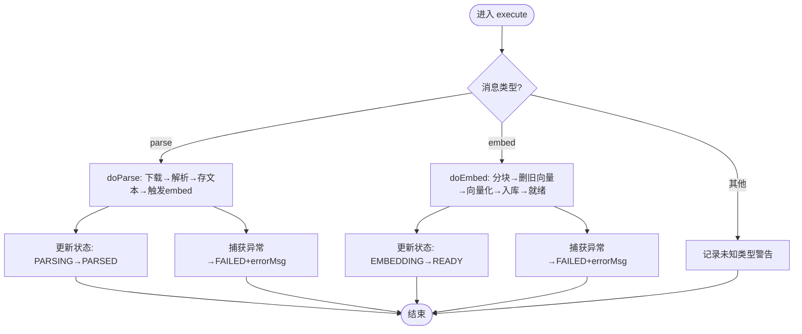
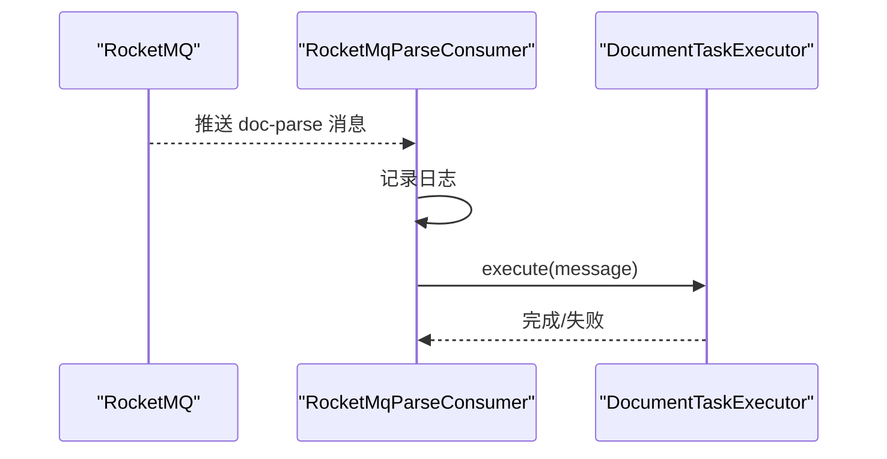
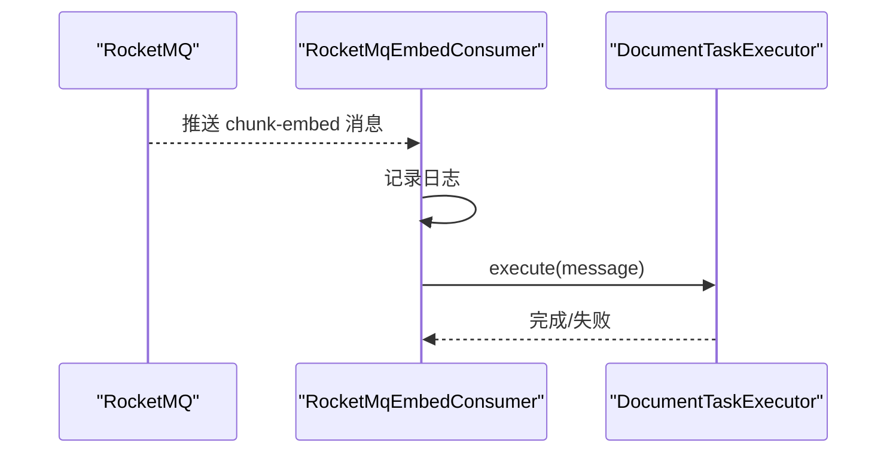
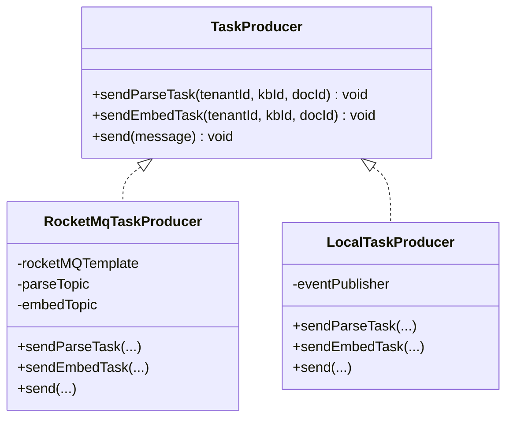
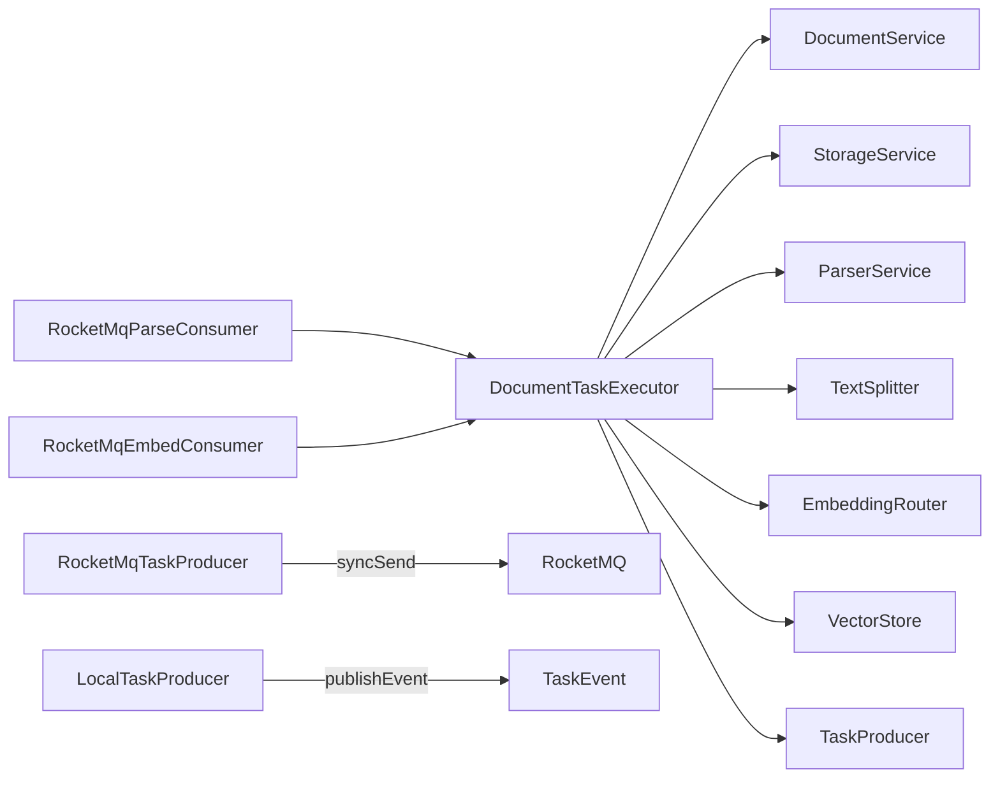

# 异步任务系统

<cite>
**本文引用的文件**   
- [DocumentTaskExecutor.java](file://src/main/java/com/agenthub/task/executor/DocumentTaskExecutor.java)
- [RocketMqParseConsumer.java](file://src/main/java/com/agenthub/task/consumer/RocketMqParseConsumer.java)
- [RocketMqEmbedConsumer.java](file://src/main/java/com/agenthub/task/consumer/RocketMqEmbedConsumer.java)
- [TaskProducer.java](file://src/main/java/com/agenthub/task/producer/TaskProducer.java)
- [RocketMqTaskProducer.java](file://src/main/java/com/agenthub/task/producer/RocketMqTaskProducer.java)
- [LocalTaskProducer.java](file://src/main/java/com/agenthub/task/producer/LocalTaskProducer.java)
- [DocumentTaskMessage.java](file://src/main/java/com/agenthub/task/model/DocumentTaskMessage.java)
- [TaskEvent.java](file://src/main/java/com/agenthub/task/event/TaskEvent.java)
- [Document.java](file://src/main/java/com/agenthub/knowledge/entity/Document.java)
- [DocumentStatus.java](file://src/main/java/com/agenthub/knowledge/enums/DocumentStatus.java)
- [application.yml](file://src/main/resources/application.yml)
</cite>

## 目录
1. [简介](#简介)
2. [项目结构](#项目结构)
3. [核心组件](#核心组件)
4. [架构总览](#架构总览)
5. [详细组件分析](#详细组件分析)
6. [依赖关系分析](#依赖关系分析)
7. [性能与可靠性调优](#性能与可靠性调优)
8. [故障排查指南](#故障排查指南)
9. [结论](#结论)
10. [附录：配置示例](#附录配置示例)

## 简介
本异步任务系统围绕“文档上传 → 解析 → 分块向量化 → 入库检索”的流水线展开，采用基于消息队列的异步处理架构。通过统一的任务生产者接口、可插拔的消息实现（RocketMQ 或本地事件）、以及统一的执行器，将解析与向量化两个阶段解耦，便于独立扩容、重试与监控。

关键设计要点：
- 以 RocketMQ 为默认消息中间件，支持按 Topic 拆分解析与向量化任务，提升吞吐与隔离性。
- 使用 DocumentTaskExecutor 作为统一执行入口，封装幂等清理、状态机推进与错误记录。
- 通过 TaskProducer 抽象出 MQ 与本地事件两种投递方式，降低业务耦合。
- 使用 DocumentTaskMessage 承载租户、知识库、文档维度信息，消费者据此恢复租户上下文。
- 使用 TaskEvent 在本地模式下替代 MQ 消息，保证无外部依赖时全链路可跑通。

## 项目结构
异步任务相关代码集中在 task 包下，并与 knowledge、parser、rag 等模块协作：
- consumer：RocketMQ 消费者，监听 doc-parse 与 chunk-embed 主题。
- executor：DocumentTaskExecutor，负责解析与向量化主流程。
- producer：TaskProducer 接口及其 RocketMQ/Local 实现。
- model：DocumentTaskMessage，跨进程/进程内统一消息模型。
- event：TaskEvent，本地事件载体。

**图表来源**
- [TaskProducer.java:1-19](file://src/main/java/com/agenthub/task/producer/TaskProducer.java#L1-L19)
- [RocketMqTaskProducer.java:1-50](file://src/main/java/com/agenthub/task/producer/RocketMqTaskProducer.java#L1-L50)
- [LocalTaskProducer.java:1-38](file://src/main/java/com/agenthub/task/producer/LocalTaskProducer.java#L1-L38)
- [RocketMqParseConsumer.java:1-34](file://src/main/java/com/agenthub/task/consumer/RocketMqParseConsumer.java#L1-L34)
- [RocketMqEmbedConsumer.java:1-33](file://src/main/java/com/agenthub/task/consumer/RocketMqEmbedConsumer.java#L1-L33)
- [DocumentTaskExecutor.java:1-123](file://src/main/java/com/agenthub/task/executor/DocumentTaskExecutor.java#L1-L123)
- [DocumentTaskMessage.java:1-31](file://src/main/java/com/agenthub/task/model/DocumentTaskMessage.java#L1-L31)
- [TaskEvent.java:1-16](file://src/main/java/com/agenthub/task/event/TaskEvent.java#L1-L16)
- [Document.java:1-54](file://src/main/java/com/agenthub/knowledge/entity/Document.java#L1-L54)
- [DocumentStatus.java:1-26](file://src/main/java/com/agenthub/knowledge/enums/DocumentStatus.java#L1-L26)

**章节来源**
- [DocumentTaskExecutor.java:25-35](file://src/main/java/com/agenthub/task/executor/DocumentTaskExecutor.java#L25-L35)
- [RocketMqParseConsumer.java:12-17](file://src/main/java/com/agenthub/task/consumer/RocketMqParseConsumer.java#L12-L17)
- [RocketMqEmbedConsumer.java:12-16](file://src/main/java/com/agenthub/task/consumer/RocketMqEmbedConsumer.java#L12-L16)
- [TaskProducer.java:5-8](file://src/main/java/com/agenthub/task/producer/TaskProducer.java#L5-L8)
- [DocumentTaskMessage.java:7-10](file://src/main/java/com/agenthub/task/model/DocumentTaskMessage.java#L7-L10)
- [TaskEvent.java:7-9](file://src/main/java/com/agenthub/task/event/TaskEvent.java#L7-L9)

## 核心组件
- DocumentTaskExecutor：统一执行器，按消息类型分发到解析或向量化流程；维护租户上下文、更新文档状态、触发下一阶段任务。
- RocketMqParseConsumer / RocketMqEmbedConsumer：RocketMQ 消费者，分别监听解析与向量化主题，调用执行器处理。
- TaskProducer 接口：定义 sendParseTask、sendEmbedTask、send 三个方法，屏蔽底层实现差异。
- RocketMqTaskProducer：基于 RocketMQTemplate 同步发送消息，使用 taskId 作为 Key 保障幂等与顺序。
- LocalTaskProducer：基于 Spring ApplicationEventPublisher 发布 TaskEvent，用于本地模式。
- DocumentTaskMessage：统一消息体，包含 taskId、tenantId、kbId、docId、type。
- TaskEvent：本地事件包装类，承载 DocumentTaskMessage。
- Document 与 DocumentStatus：文档实体与状态机，贯穿整个异步流水线。

**章节来源**
- [DocumentTaskExecutor.java:39-62](file://src/main/java/com/agenthub/task/executor/DocumentTaskExecutor.java#L39-L62)
- [RocketMqParseConsumer.java:21-32](file://src/main/java/com/agenthub/task/consumer/RocketMqParseConsumer.java#L21-L32)
- [RocketMqEmbedConsumer.java:20-31](file://src/main/java/com/agenthub/task/consumer/RocketMqEmbedConsumer.java#L20-L31)
- [TaskProducer.java:8-18](file://src/main/java/com/agenthub/task/producer/TaskProducer.java#L8-L18)
- [RocketMqTaskProducer.java:20-48](file://src/main/java/com/agenthub/task/producer/RocketMqTaskProducer.java#L20-L48)
- [LocalTaskProducer.java:16-36](file://src/main/java/com/agenthub/task/producer/LocalTaskProducer.java#L16-L36)
- [DocumentTaskMessage.java:14-30](file://src/main/java/com/agenthub/task/model/DocumentTaskMessage.java#L14-L30)
- [TaskEvent.java:12-15](file://src/main/java/com/agenthub/task/event/TaskEvent.java#L12-L15)
- [Document.java:10-53](file://src/main/java/com/agenthub/knowledge/entity/Document.java#L10-L53)
- [DocumentStatus.java:4-25](file://src/main/java/com/agenthub/knowledge/enums/DocumentStatus.java#L4-L25)

## 架构总览
下图展示从任务生产到消费执行的端到端流程，包括 RocketMQ 与本地事件两条路径。

**图表来源**
- [RocketMqTaskProducer.java:31-48](file://src/main/java/com/agenthub/task/producer/RocketMqTaskProducer.java#L31-L48)
- [RocketMqParseConsumer.java:28-32](file://src/main/java/com/agenthub/task/consumer/RocketMqParseConsumer.java#L28-L32)
- [RocketMqEmbedConsumer.java:27-31](file://src/main/java/com/agenthub/task/consumer/RocketMqEmbedConsumer.java#L27-L31)
- [DocumentTaskExecutor.java:49-121](file://src/main/java/com/agenthub/task/executor/DocumentTaskExecutor.java#L49-L121)

## 详细组件分析

### DocumentTaskExecutor：任务执行器逻辑
职责：
- 根据消息类型分发到 doParse 或 doEmbed。
- 在租户上下文中执行，避免多租户数据串扰。
- 解析流程：下载原始文件 → 解析 → 保存文本与引擎 → 触发 embed 任务。
- 向量化流程：分块 → 幂等删除旧向量 → 批量向量化 → 批量入库 → 更新 READY。
- 异常处理：任何异常置 FAILED 并记录 errorMsg，支持重新提交任务重试。

**图表来源**
- [DocumentTaskExecutor.java:49-121](file://src/main/java/com/agenthub/task/executor/DocumentTaskExecutor.java#L49-L121)

关键点：
- 幂等性：向量化前删除该文档旧向量，避免重复执行导致数据膨胀。
- 租户隔离：TenantContext.set/clear 确保多租户数据隔离。
- 状态机推进：严格遵循 UPLOADED→PARSING→PARSED→EMBEDDING→READY，异常统一落 FAILED。

**章节来源**
- [DocumentTaskExecutor.java:49-81](file://src/main/java/com/agenthub/task/executor/DocumentTaskExecutor.java#L49-L81)
- [DocumentTaskExecutor.java:83-121](file://src/main/java/com/agenthub/task/executor/DocumentTaskExecutor.java#L83-L121)
- [DocumentStatus.java:4-25](file://src/main/java/com/agenthub/knowledge/enums/DocumentStatus.java#L4-L25)

### RocketMqParseConsumer：解析消息消费者
职责：
- 监听 doc-parse 主题，接收解析任务。
- 日志记录任务 ID 与文档 ID。
- 委托 DocumentTaskExecutor.execute 执行具体逻辑。
- 条件装配：仅在 agenthub.mq.type=rocketmq 时生效。

**图表来源**
- [RocketMqParseConsumer.java:21-32](file://src/main/java/com/agenthub/task/consumer/RocketMqParseConsumer.java#L21-L32)
- [DocumentTaskExecutor.java:49-81](file://src/main/java/com/agenthub/task/executor/DocumentTaskExecutor.java#L49-L81)

**章节来源**
- [RocketMqParseConsumer.java:12-17](file://src/main/java/com/agenthub/task/consumer/RocketMqParseConsumer.java#L12-L17)
- [RocketMqParseConsumer.java:21-32](file://src/main/java/com/agenthub/task/consumer/RocketMqParseConsumer.java#L21-L32)

### RocketMqEmbedConsumer：向量化消息消费者
职责：
- 监听 chunk-embed 主题，接收向量化任务。
- 与解析消费者分离，便于向量化瓶颈时独立扩容。
- 委托 DocumentTaskExecutor.execute 执行具体逻辑。
- 条件装配：仅在 agenthub.mq.type=rocketmq 时生效。

**图表来源**
- [RocketMqEmbedConsumer.java:20-31](file://src/main/java/com/agenthub/task/consumer/RocketMqEmbedConsumer.java#L20-L31)
- [DocumentTaskExecutor.java:83-121](file://src/main/java/com/agenthub/task/executor/DocumentTaskExecutor.java#L83-L121)

**章节来源**
- [RocketMqEmbedConsumer.java:12-16](file://src/main/java/com/agenthub/task/consumer/RocketMqEmbedConsumer.java#L12-L16)
- [RocketMqEmbedConsumer.java:20-31](file://src/main/java/com/agenthub/task/consumer/RocketMqEmbedConsumer.java#L20-L31)

### TaskProducer：任务生产者接口与实现
接口定义：
- sendParseTask：提交解析任务。
- sendEmbedTask：提交分块向量化任务。
- send：直接发送 DocumentTaskMessage。

RocketMqTaskProducer：
- 使用 RocketMQTemplate.syncSend 同步发送，超时时间 5 秒。
- 使用 taskId 作为消息 Key，保障幂等与顺序消费。
- 根据 message.type 选择 topic：doc-parse 或 chunk-embed。

LocalTaskProducer：
- 使用 ApplicationEventPublisher.publishEvent 发布 TaskEvent。
- 在 mq.type=local 或缺省情况下启用，便于无 MQ 环境运行。

**图表来源**
- [TaskProducer.java:8-18](file://src/main/java/com/agenthub/task/producer/TaskProducer.java#L8-L18)
- [RocketMqTaskProducer.java:20-48](file://src/main/java/com/agenthub/task/producer/RocketMqTaskProducer.java#L20-L48)
- [LocalTaskProducer.java:16-36](file://src/main/java/com/agenthub/task/producer/LocalTaskProducer.java#L16-L36)

**章节来源**
- [TaskProducer.java:5-18](file://src/main/java/com/agenthub/task/producer/TaskProducer.java#L5-L18)
- [RocketMqTaskProducer.java:13-48](file://src/main/java/com/agenthub/task/producer/RocketMqTaskProducer.java#L13-L48)
- [LocalTaskProducer.java:12-36](file://src/main/java/com/agenthub/task/producer/LocalTaskProducer.java#L12-L36)

### DocumentTaskMessage：任务消息模型
字段说明：
- taskId：任务唯一 ID，用作幂等键与消息 Key。
- tenantId：租户 ID，消费者据此恢复租户上下文。
- kbId：知识库 ID，用于向量库元数据与检索范围。
- docId：文档 ID，关联文档实体与存储路径。
- type：任务类型，parse 或 embed。

用途：
- MQ 传输与本地事件共用同一模型，简化序列化与反序列化。
- 消费者通过 tenantId 设置 TenantContext，保证多租户隔离。

**章节来源**
- [DocumentTaskMessage.java:7-30](file://src/main/java/com/agenthub/task/model/DocumentTaskMessage.java#L7-L30)

### TaskEvent：事件驱动机制
作用：
- 在本地模式下替代 RocketMQ 消息，作为进程内事件载体。
- 包装 DocumentTaskMessage，配合 Spring 事件机制进行异步处理。

**章节来源**
- [TaskEvent.java:7-15](file://src/main/java/com/agenthub/task/event/TaskEvent.java#L7-L15)

## 依赖关系分析
- 执行器依赖：
  - DocumentService：读取/更新文档状态与文本。
  - StorageService：加载原始文件流。
  - ParserService：解析文档内容。
  - TextSplitter：文本分块。
  - EmbeddingRouter：路由到具体 embedding 实现。
  - VectorStore：向量删除与批量插入。
  - TaskProducer：触发下一阶段任务。
- 消费者依赖：
  - RocketMqParseConsumer/RocketMqEmbedConsumer：仅依赖 DocumentTaskExecutor。
- 生产者依赖：
  - RocketMqTaskProducer：依赖 RocketMQTemplate 与配置项。
  - LocalTaskProducer：依赖 ApplicationEventPublisher。

**图表来源**
- [DocumentTaskExecutor.java:39-47](file://src/main/java/com/agenthub/task/executor/DocumentTaskExecutor.java#L39-L47)
- [RocketMqTaskProducer.java:20-48](file://src/main/java/com/agenthub/task/producer/RocketMqTaskProducer.java#L20-L48)
- [LocalTaskProducer.java:16-36](file://src/main/java/com/agenthub/task/producer/LocalTaskProducer.java#L16-L36)

**章节来源**
- [DocumentTaskExecutor.java:39-47](file://src/main/java/com/agenthub/task/executor/DocumentTaskExecutor.java#L39-L47)
- [RocketMqTaskProducer.java:20-48](file://src/main/java/com/agenthub/task/producer/RocketMqTaskProducer.java#L20-L48)
- [LocalTaskProducer.java:16-36](file://src/main/java/com/agenthub/task/producer/LocalTaskProducer.java#L16-L36)

## 性能与可靠性调优
- 消息可靠性：
  - 使用 syncSend 同步发送，超时 5 秒，结合 RocketMQ 重试与 DLQ，保证最终一致。
  - 使用 taskId 作为消息 Key，保障同文档任务的顺序与幂等。
- 消费者扩展：
  - 解析与向量化分属不同 Topic，可按瓶颈独立扩容消费者实例。
- 执行器优化：
  - 向量化前删除旧向量，避免重复执行导致的数据膨胀与查询性能下降。
  - 批量向量化与批量入库减少网络与 IO 次数。
- 租户隔离：
  - 每个消费线程设置 TenantContext，避免跨租户数据污染。
- 可观测性：
  - 关键节点记录日志，便于定位解析失败、分块为空、向量化失败等问题。

[本节为通用指导，不直接分析具体文件]

## 故障排查指南
常见问题与定位思路：
- 解析失败：
  - 检查 storagePath 是否有效、ParserService 是否正常。
  - 查看日志中“文档解析失败”及 errorMsg，确认下游服务可用性。
- 向量化失败：
  - 检查 parsedText 是否为空；若为空，需先完成解析。
  - 检查 embedding 模型配置与连接；确认 VectorStore 连接正常。
- 任务未消费：
  - 确认 agenthub.mq.type 配置与 Topic 名称匹配。
  - 检查 RocketMQ 消费者组与订阅关系是否正确。
- 重复执行导致数据不一致：
  - 确认幂等清理逻辑已执行（删除旧向量）。
  - 校验 taskId 是否唯一且作为消息 Key。

**章节来源**
- [DocumentTaskExecutor.java:64-81](file://src/main/java/com/agenthub/task/executor/DocumentTaskExecutor.java#L64-L81)
- [DocumentTaskExecutor.java:83-121](file://src/main/java/com/agenthub/task/executor/DocumentTaskExecutor.java#L83-L121)
- [RocketMqParseConsumer.java:28-32](file://src/main/java/com/agenthub/task/consumer/RocketMqParseConsumer.java#L28-L32)
- [RocketMqEmbedConsumer.java:27-31](file://src/main/java/com/agenthub/task/consumer/RocketMqEmbedConsumer.java#L27-L31)

## 结论
本异步任务系统通过消息队列将文档解析与向量化解耦，借助统一执行器与生产者抽象，实现了高内聚、低耦合的可扩展架构。RocketMQ 提供可靠的消息传递与重试能力，本地事件模式则降低了部署门槛。状态机与幂等清理保证了数据一致性，日志与可观测性为问题定位提供了支撑。

[本节为总结性内容，不直接分析具体文件]

## 附录：配置示例
以下为 application.yml 中与异步任务相关的配置片段，供参考：

- RocketMQ 基础配置：
  - name-server、producer.group、send-message-timeout。
- 平台业务配置：
  - agenthub.mq.type：rocketmq 或 local。
  - agenthub.mq.topics.doc-parse、agenthub.mq.topics.chunk-embed。
- 其他相关配置：
  - agenthub.storage.type、agenthub.parser.provider、agenthub.embedding.providers 等。

**章节来源**
- [application.yml:46-97](file://src/main/resources/application.yml#L46-L97)