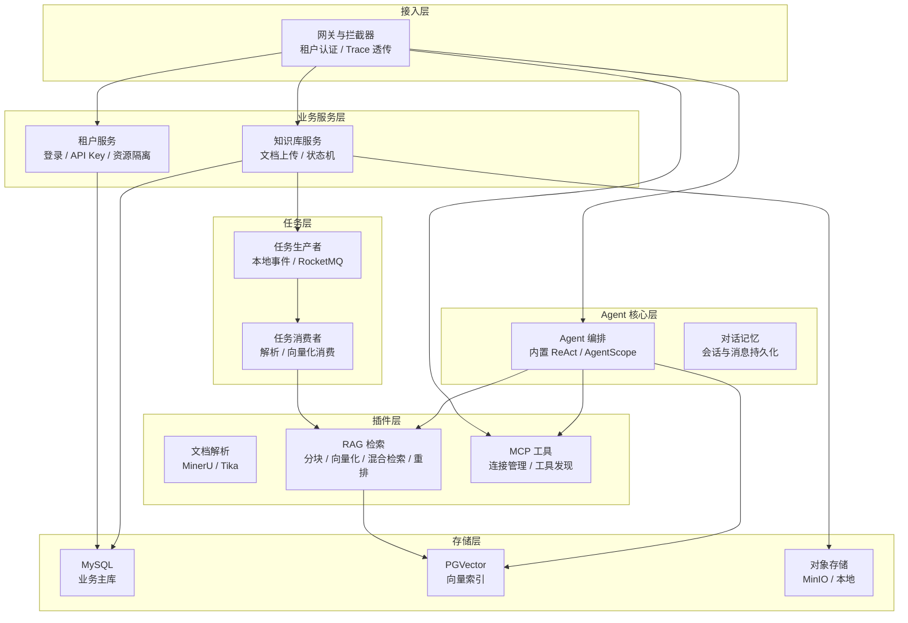
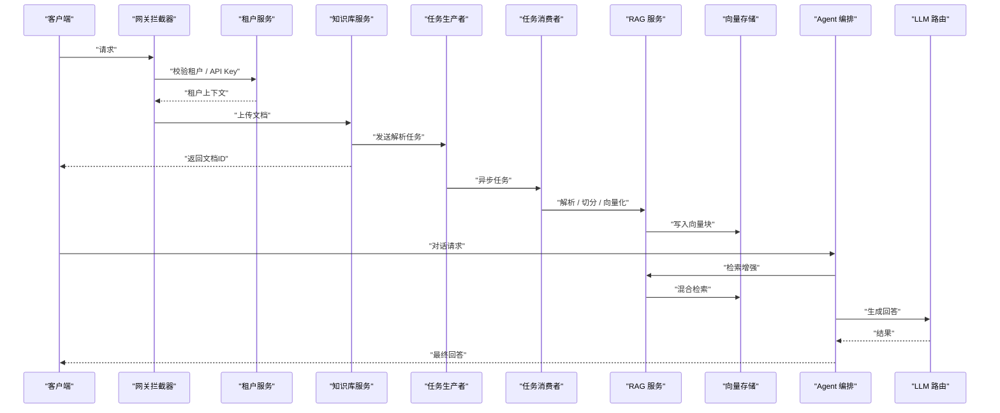
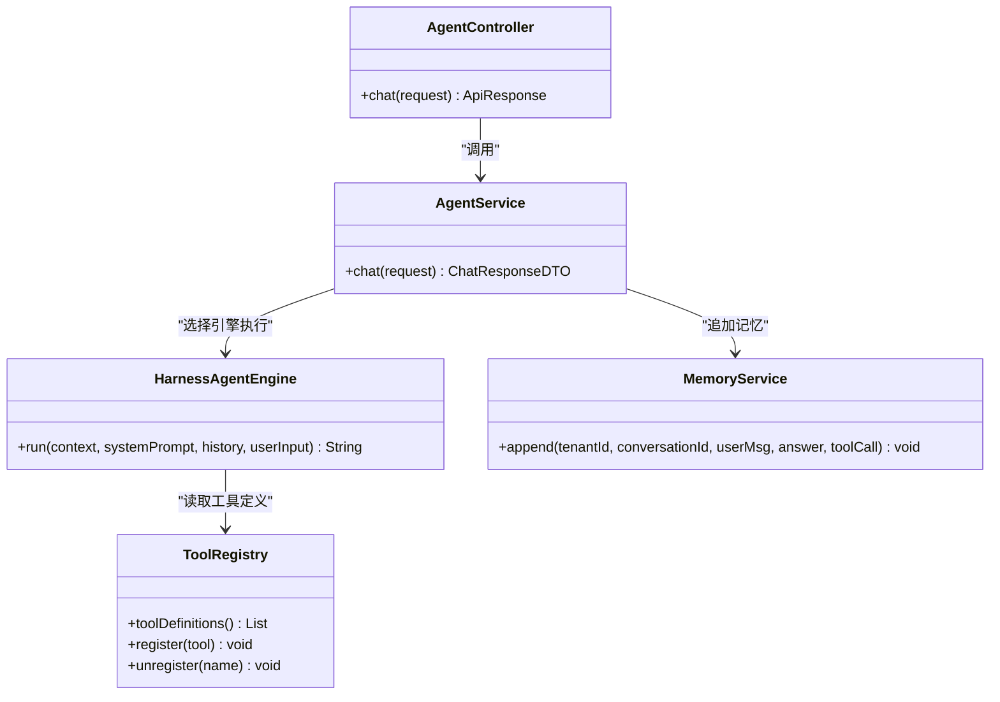
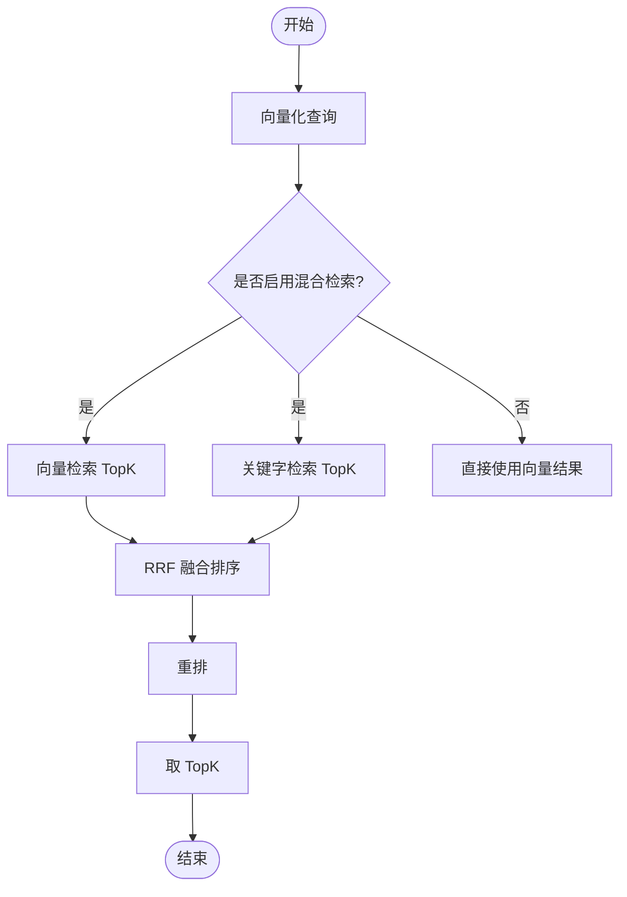
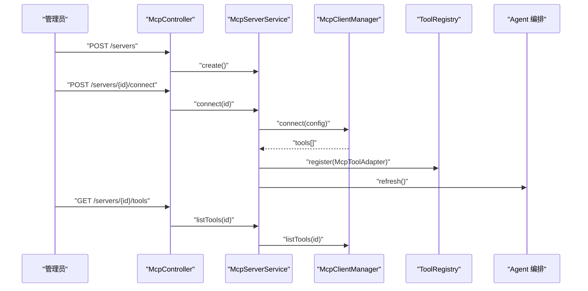
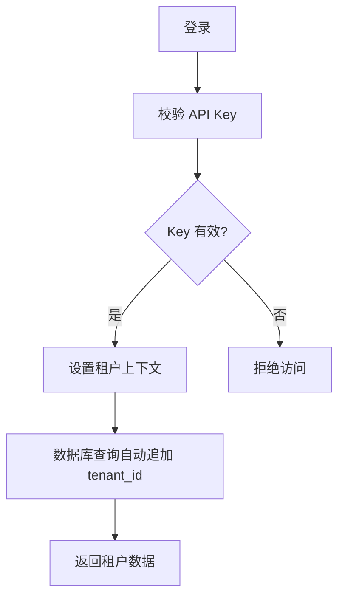
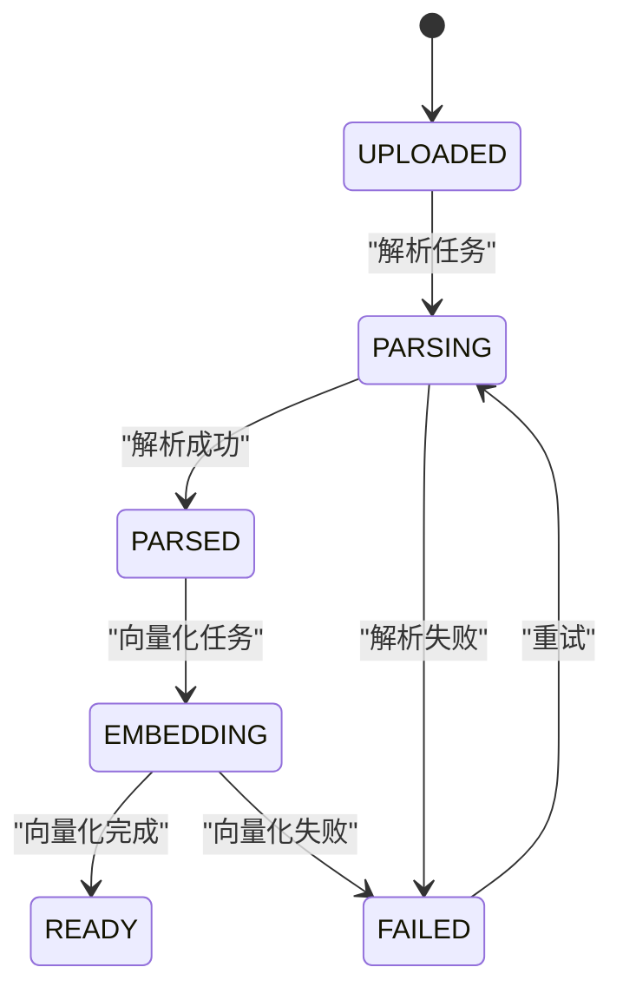
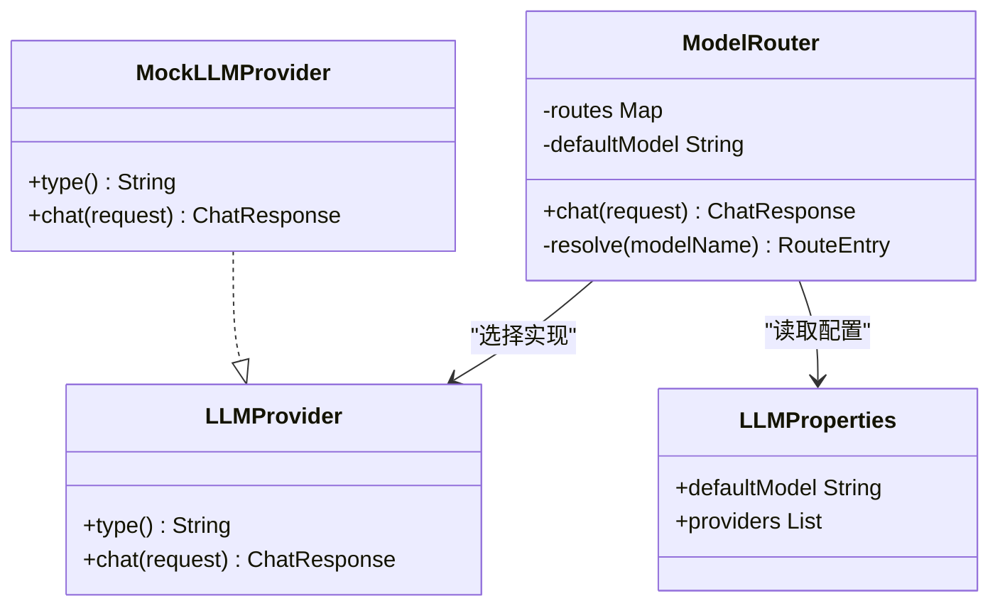
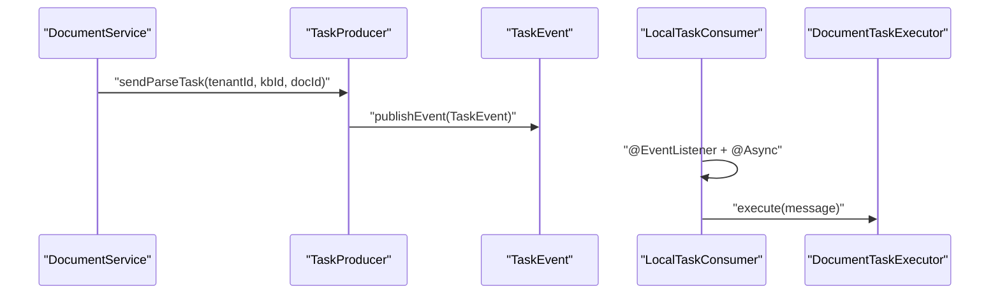
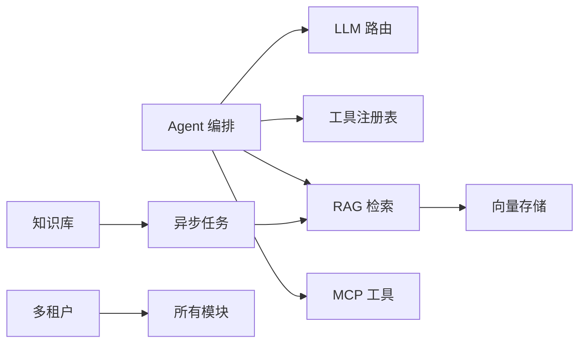

# 核心模块

<cite>
**本文引用的文件**   
- [AgenthubApplication.java](file://src/main/java/com/agenthub/AgenthubApplication.java)
- [README.md](file://README.md)
- [application.yml](file://src/main/resources/application.yml)
- [AgentController.java](file://src/main/java/com/agenthub/agent/controller/AgentController.java)
- [AgentService.java](file://src/main/java/com/agenthub/agent/service/AgentService.java)
- [HarnessAgentEngine.java](file://src/main/java/com/agenthub/agent/harness/HarnessAgentEngine.java)
- [HybridRetriever.java](file://src/main/java/com/agenthub/rag/retrieve/HybridRetriever.java)
- [RagService.java](file://src/main/java/com/agenthub/rag/service/RagService.java)
- [VectorStore.java](file://src/main/java/com/agenthub/rag/store/VectorStore.java)
- [PgVectorStore.java](file://src/main/java/com/agenthub/rag/store/PgVectorStore.java)
- [McpClientManager.java](file://src/main/java/com/agenthub/mcp/client/McpClientManager.java)
- [McpController.java](file://src/main/java/com/agenthub/mcp/controller/McpController.java)
- [McpServerService.java](file://src/main/java/com/agenthub/mcp/service/McpServerService.java)
- [McpToolAdapter.java](file://src/main/java/com/agenthub/mcp/client/McpToolAdapter.java)
- [McpServerConfig.java](file://src/main/java/com/agenthub/mcp/entity/McpServerConfig.java)
- [TenantController.java](file://src/main/java/com/agenthub/tenant/controller/TenantController.java)
- [TenantService.java](file://src/main/java/com/agenthub/tenant/service/TenantService.java)
- [TenantApiKey.java](file://src/main/java/com/agenthub/tenant/entity/TenantApiKey.java)
- [Document.java](file://src/main/java/com/agenthub/knowledge/entity/Document.java)
- [DocumentService.java](file://src/main/java/com/agenthub/knowledge/service/DocumentService.java)
- [DocumentStatus.java](file://src/main/java/com/agenthub/knowledge/enums/DocumentStatus.java)
- [ModelRouter.java](file://src/main/java/com/agenthub/llm/router/ModelRouter.java)
- [LLMProperties.java](file://src/main/java/com/agenthub/llm/config/LLMProperties.java)
- [MockLLMProvider.java](file://src/main/java/com/agenthub/llm/provider/MockLLMProvider.java)
- [LLMProvider.java](file://src/main/java/com/agenthub/llm/provider/LLMProvider.java)
- [LocalTaskProducer.java](file://src/main/java/com/agenthub/task/producer/LocalTaskProducer.java)
- [RocketMqTaskProducer.java](file://src/main/java/com/agenthub/task/producer/RocketMqTaskProducer.java)
- [TaskProducer.java](file://src/main/java/com/agenthub/task/producer/TaskProducer.java)
- [LocalTaskConsumer.java](file://src/main/java/com/agenthub/task/consumer/LocalTaskConsumer.java)
- [TaskEvent.java](file://src/main/java/com/agenthub/task/event/TaskEvent.java)
- [DocumentTaskMessage.java](file://src/main/java/com/agenthub/task/model/DocumentTaskMessage.java)
- [AsyncConfig.java](file://src/main/java/com/agenthub/gateway/config/AsyncConfig.java)
</cite>

## 目录
1. [引言](#引言)
2. [项目结构](#项目结构)
3. [核心组件总览](#核心组件总览)
4. [架构总览](#架构总览)
5. [详细模块分析](#详细模块分析)
6. [依赖关系分析](#依赖关系分析)
7. [性能与可观测性](#性能与可观测性)
8. [故障排查指南](#故障排查指南)
9. [结论](#结论)

## 引言
Java Agent Hub 是一个面向企业级场景的多租户 RAG + Harness Agent + MCP 工具平台。它把“多租户数据隔离、文档解析、向量化、混合检索、Agent 编排、MCP 工具调用、全链路可观测”串联成一条完整的企业 LLM 应用流水线。默认提供本地模式：进程内异步、本地存储、内置 Mock 模型，无需外部 LLM 和消息队列即可跑通全链路；生产形态可通过配置切换到 RocketMQ、MinIO、真实 LLM 与向量库。

本章节聚焦整体定位与运行方式，不直接分析具体代码文件。

## 项目结构
项目采用分层与按领域划分的组织方式：接入层负责网关拦截与跨切面能力，业务服务层承载租户与知识库管理，Agent 核心层实现对话编排与记忆，插件层包含文档解析、RAG 检索、MCP 工具桥接，任务层提供异步生产者消费者，存储层对接 MySQL、PGVector 与对象存储。

图表来源
- [AgenthubApplication.java:8-16](file://src/main/java/com/agenthub/AgenthubApplication.java#L8-L16)
- [README.md:20-35](file://README.md#L20-L35)
- [application.yml:4-149](file://src/main/resources/application.yml#L4-L149)

章节来源
- [AgenthubApplication.java:8-16](file://src/main/java/com/agenthub/AgenthubApplication.java#L8-L16)
- [README.md:20-35](file://README.md#L20-L35)
- [application.yml:4-149](file://src/main/resources/application.yml#L4-L149)

## 核心组件总览
- Agent 编排引擎：支持内置 ReAct 循环与 AgentScope HarnessAgent 双引擎，统一通过对话接口暴露，内部维护工具注册表与对话记忆。
- RAG 检索增强：文档先解析、切分、向量化入库，查询时走 Embedding → 混合检索（向量 + 关键字）→ RRF 融合 → 重排。
- MCP 协议支持：客户端连接管理、三种传输模式、工具自动发现并注册为 Agent 工具。
- 多租户管理：租户创建、用户登录、API Key 签发与校验，结合 MyBatis-Plus 租户插件与 ThreadLocal 上下文实现数据隔离。
- 知识库管理：文档上传即返回，异步解析与向量化，状态机驱动流程，元数据与向量块关联。
- LLM 提供商适配：统一 Provider 接口，ModelRouter 按路由键选择 provider 与模型，支持 OpenAI 兼容、Ollama、Mock。
- 异步任务系统：TaskProducer 抽象本地事件与 RocketMQ 两种实现，DocumentTaskMessage 携带 tenantId 保证异步线程租户上下文。

章节来源
- [AgentController.java:14-28](file://src/main/java/com/agenthub/agent/controller/AgentController.java#L14-L28)
- [AgentService.java:69-84](file://src/main/java/com/agenthub/agent/service/AgentService.java#L69-L84)
- [HybridRetriever.java:14-78](file://src/main/java/com/agenthub/rag/retrieve/HybridRetriever.java#L14-L78)
- [RagService.java:26-54](file://src/main/java/com/agenthub/rag/service/RagService.java#L26-L54)
- [McpClientManager.java:24-58](file://src/main/java/com/agenthub/mcp/client/McpClientManager.java#L24-L58)
- [TenantService.java:41-128](file://src/main/java/com/agenthub/tenant/service/TenantService.java#L41-L128)
- [DocumentService.java:22-76](file://src/main/java/com/agenthub/knowledge/service/DocumentService.java#L22-L76)
- [ModelRouter.java:19-108](file://src/main/java/com/agenthub/llm/router/ModelRouter.java#L19-L108)
- [TaskProducer.java:5-18](file://src/main/java/com/agenthub/task/producer/TaskProducer.java#L5-L18)

## 架构总览
平台以 Spring Boot 启动，启用异步注解与配置扫描。对外暴露 REST 接口，由网关拦截器完成租户认证与链路追踪；业务服务层协调 Agent、RAG、MCP、租户与知识库；任务层解耦解析与向量化；存储层通过独立数据源管理向量索引。

图表来源
- [AgentController.java:24-28](file://src/main/java/com/agenthub/agent/controller/AgentController.java#L24-L28)
- [DocumentService.java:42-76](file://src/main/java/com/agenthub/knowledge/service/DocumentService.java#L42-L76)
- [RagService.java:39-54](file://src/main/java/com/agenthub/rag/service/RagService.java#L39-L54)
- [ModelRouter.java:45-85](file://src/main/java/com/agenthub/llm/router/ModelRouter.java#L45-L85)

## 详细模块分析

### Agent 编排引擎（ReAct 模式实现、工具注册与调用、对话记忆管理）
职责
- 提供统一的对话入口，支持内置 ReAct 循环与 AgentScope HarnessAgent 双引擎。
- 在每次循环中组装系统提示词、历史消息与本次输入，调用 LLM，若存在工具调用则执行工具并回填结果，直到得到最终回答或达到最大迭代次数。
- 将对话历史追加到记忆服务，支持多轮对话与窗口记忆。

核心类
- 控制器：AgentController
- 服务：AgentService
- 引擎：HarnessAgentEngine
- 记忆：MemoryService（由 AgentService 使用）
- 工具注册：ToolRegistry（由引擎与 MCP 适配器共同使用）

配置选项
- agenthub.agent.engine：builtin 或 agentscope
- agenthub.agent.max-iterations：最大迭代次数
- agenthub.agent.memory-window：记忆窗口大小
- agenthub.agent.agentscope.default-model：AgentScope 引擎默认模型 URI

使用示例
- 首次对话不传 conversationId，后续传入同一 ID 实现多轮记忆。
- 内置引擎会优先尝试工具调用，若无工具定义则直接生成文本。

图表来源
- [AgentController.java:14-28](file://src/main/java/com/agenthub/agent/controller/AgentController.java#L14-L28)
- [AgentService.java:69-84](file://src/main/java/com/agenthub/agent/service/AgentService.java#L69-L84)
- [HarnessAgentEngine.java:21-67](file://src/main/java/com/agenthub/agent/harness/HarnessAgentEngine.java#L21-L67)

章节来源
- [AgentController.java:14-28](file://src/main/java/com/agenthub/agent/controller/AgentController.java#L14-L28)
- [AgentService.java:69-84](file://src/main/java/com/agenthub/agent/service/AgentService.java#L69-L84)
- [HarnessAgentEngine.java:21-67](file://src/main/java/com/agenthub/agent/harness/HarnessAgentEngine.java#L21-L67)

### RAG 检索增强（文档向量化、混合检索算法、向量存储管理）
职责
- 将查询文本向量化后，进行向量检索与关键字检索，并通过 RRF 融合排序，最后重排输出 TopK 结果。
- 所有向量操作强制携带 tenantId，确保租户隔离不可绕过。
- 提供批量写入、删除、检索等向量存储能力。

核心类
- 服务：RagService
- 检索：HybridRetriever
- 存储抽象：VectorStore
- 存储实现：PgVectorStore

配置选项
- agenthub.rag.vector-top-k：向量检索 TopK
- agenthub.rag.keyword-top-k：关键字检索 TopK
- agenthub.rag.rrf-k：RRF 融合参数 k
- agenthub.rag.hybrid：是否启用混合检索
- agenthub.vector.dimension：向量维度（需与 embedding 模型一致）

使用示例
- 调用 RagService.search(kbIds, query, topK, embeddingModel, filters) 获取检索结果。
- 混合检索关闭时仅走向量检索。

图表来源
- [RagService.java:39-54](file://src/main/java/com/agenthub/rag/service/RagService.java#L39-L54)
- [HybridRetriever.java:46-78](file://src/main/java/com/agenthub/rag/retrieve/HybridRetriever.java#L46-L78)

章节来源
- [RagService.java:26-54](file://src/main/java/com/agenthub/rag/service/RagService.java#L26-L54)
- [HybridRetriever.java:14-78](file://src/main/java/com/agenthub/rag/retrieve/HybridRetriever.java#L14-L78)
- [VectorStore.java:8-28](file://src/main/java/com/agenthub/rag/store/VectorStore.java#L8-L28)
- [PgVectorStore.java:145-179](file://src/main/java/com/agenthub/rag/store/PgVectorStore.java#L145-L179)

### MCP 协议支持（客户端连接管理、工具发现机制）
职责
- 管理与 MCP Server 的连接，支持 streamable-http、sse、stdio 三种传输模式。
- 连接成功后拉取工具列表，并将每个工具包装为平台统一的 AgentTool，注册进工具注册表。
- 提供断开连接、注销工具、列出工具与直接调用工具的接口。

核心类
- 管理器：McpClientManager
- 控制器：McpController
- 服务：McpServerService
- 适配器：McpToolAdapter
- 实体：McpServerConfig

配置选项
- transportType：stdio | sse | streamable-http
- baseUrl / endpoint：远程服务地址与端点
- command / argsJson / envJson：STDIO 模式启动命令、参数与环境变量

使用示例
- 新增 MCP Server 配置，建立连接后将工具注册到 Agent。
- 在 Agent 对话中自然触发 MCP 工具调用。

图表来源
- [McpController.java:31-83](file://src/main/java/com/agenthub/mcp/controller/McpController.java#L31-L83)
- [McpServerService.java:75-109](file://src/main/java/com/agenthub/mcp/service/McpServerService.java#L75-L109)
- [McpClientManager.java:40-58](file://src/main/java/com/agenthub/mcp/client/McpClientManager.java#L40-L58)
- [McpToolAdapter.java:14-54](file://src/main/java/com/agenthub/mcp/client/McpToolAdapter.java#L14-L54)

章节来源
- [McpClientManager.java:24-58](file://src/main/java/com/agenthub/mcp/client/McpClientManager.java#L24-L58)
- [McpController.java:21-83](file://src/main/java/com/agenthub/mcp/controller/McpController.java#L21-L83)
- [McpServerService.java:23-109](file://src/main/java/com/agenthub/mcp/service/McpServerService.java#L23-L109)
- [McpToolAdapter.java:8-54](file://src/main/java/com/agenthub/mcp/client/McpToolAdapter.java#L8-L54)
- [McpServerConfig.java:10-52](file://src/main/java/com/agenthub/mcp/entity/McpServerConfig.java#L10-L52)

### 多租户管理（租户认证、API Key 管理、数据隔离）
职责
- 提供租户创建、用户登录、API Key 签发与校验。
- 密码与 API Key 只保存哈希值，避免明文泄露。
- 通过 MyBatis-Plus 租户插件自动追加 tenant_id，并在向量检索 SQL 显式携带 tenant_id，实现强隔离。

核心类
- 控制器：TenantController
- 服务：TenantService
- 实体：TenantApiKey

配置选项
- agenthub.security.enabled：是否开启租户认证
- agenthub.tenant.header：租户头字段名
- agenthub.tenant.api-key-header：API Key 头字段名

使用示例
- 登录后所有请求携带 X-Tenant-Id 或使用 X-Api-Key 进行认证。
- 创建 API Key 后仅在创建响应中返回一次明文。

图表来源
- [TenantController.java:30-54](file://src/main/java/com/agenthub/tenant/controller/TenantController.java#L30-L54)
- [TenantService.java:62-128](file://src/main/java/com/agenthub/tenant/service/TenantService.java#L62-L128)

章节来源
- [TenantController.java:20-54](file://src/main/java/com/agenthub/tenant/controller/TenantController.java#L20-L54)
- [TenantService.java:26-128](file://src/main/java/com/agenthub/tenant/service/TenantService.java#L26-L128)
- [TenantApiKey.java:10-38](file://src/main/java/com/agenthub/tenant/entity/TenantApiKey.java#L10-L38)

### 知识库管理（文档上传解析、元数据管理）
职责
- 文档上传立即返回，随后通过异步任务完成解析、切分、向量化与入库。
- 使用状态机驱动处理流程：UPLOADED → PARSING → PARSED → EMBEDDING → READY，异常进入 FAILED。
- 文件存储路径天然携带租户ID，实现物理隔离。

核心类
- 服务：DocumentService
- 实体：Document
- 枚举：DocumentStatus

配置选项
- agenthub.storage.type：local 或 minio
- agenthub.parser.provider：tika 或 mineru

使用示例
- 上传文档后轮询文档状态，READY 表示可检索。
- 失败后可重新提交任务重试。

图表来源
- [DocumentService.java:42-76](file://src/main/java/com/agenthub/knowledge/service/DocumentService.java#L42-L76)
- [DocumentStatus.java:4-25](file://src/main/java/com/agenthub/knowledge/enums/DocumentStatus.java#L4-L25)

章节来源
- [DocumentService.java:22-93](file://src/main/java/com/agenthub/knowledge/service/DocumentService.java#L22-L93)
- [Document.java:10-53](file://src/main/java/com/agenthub/knowledge/entity/Document.java#L10-L53)
- [DocumentStatus.java:4-25](file://src/main/java/com/agenthub/knowledge/enums/DocumentStatus.java#L4-L25)

### LLM 提供商适配（统一接口、多模型支持）
职责
- 抽象 LLM Provider 接口，统一 chat 方法。
- ModelRouter 根据路由键选择 provider 与模型，注入默认 temperature 与 maxTokens，并统计 token 使用。
- 支持 OpenAI 兼容接口、Ollama 本地模型与 Mock 模型。

核心类
- 路由：ModelRouter
- 配置：LLMProperties
- 提供者：LLMProvider、OpenAiCompatibleProvider、OllamaProvider、MockLLMProvider

配置选项
- agenthub.llm.default-model：默认模型路由键
- agenthub.llm.providers：provider 列表与模型配置

使用示例
- 对话时若不指定模型，则使用默认模型路由键。
- Mock 模型在无外部 LLM 时可演示 function calling 行为。

图表来源
- [ModelRouter.java:19-108](file://src/main/java/com/agenthub/llm/router/ModelRouter.java#L19-L108)
- [LLMProperties.java:9-42](file://src/main/java/com/agenthub/llm/config/LLMProperties.java#L9-L42)
- [LLMProvider.java:6-16](file://src/main/java/com/agenthub/llm/provider/LLMProvider.java#L6-L16)
- [MockLLMProvider.java:13-33](file://src/main/java/com/agenthub/llm/provider/MockLLMProvider.java#L13-L33)

章节来源
- [ModelRouter.java:19-108](file://src/main/java/com/agenthub/llm/router/ModelRouter.java#L19-L108)
- [LLMProperties.java:9-42](file://src/main/java/com/agenthub/llm/config/LLMProperties.java#L9-L42)
- [LLMProvider.java:6-16](file://src/main/java/com/agenthub/llm/provider/LLMProvider.java#L6-L16)
- [MockLLMProvider.java:13-33](file://src/main/java/com/agenthub/llm/provider/MockLLMProvider.java#L13-L33)

### 异步任务系统（任务生产者消费者、状态管理）
职责
- 抽象任务生产者，支持本地事件与 RocketMQ 两种实现。
- 本地模式下通过 Spring 事件在进程内异步投递，便于无 MQ 环境跑通全链路。
- 消费者监听事件或 MQ Topic，执行解析与向量化任务，并在异步线程中透传租户上下文。

核心类
- 生产者接口：TaskProducer
- 本地生产者：LocalTaskProducer
- MQ 生产者：RocketMqTaskProducer
- 消费者：LocalTaskConsumer
- 事件：TaskEvent
- 消息体：DocumentTaskMessage
- 异步配置：AsyncConfig

配置选项
- agenthub.mq.type：local 或 rocketmq
- agenthub.mq.topics.doc-parse：解析任务 Topic
- agenthub.mq.topics.chunk-embed：向量化任务 Topic

使用示例
- 上传文档后立即返回，后台异步完成解析与向量化。
- 切换 MQ 类型即可从本地事件迁移到 RocketMQ。

图表来源
- [DocumentService.java:72-76](file://src/main/java/com/agenthub/knowledge/service/DocumentService.java#L72-L76)
- [LocalTaskProducer.java:23-37](file://src/main/java/com/agenthub/task/producer/LocalTaskProducer.java#L23-L37)
- [LocalTaskConsumer.java:25-32](file://src/main/java/com/agenthub/task/consumer/LocalTaskConsumer.java#L25-L32)
- [TaskEvent.java:7-15](file://src/main/java/com/agenthub/task/event/TaskEvent.java#L7-L15)
- [DocumentTaskMessage.java:7-30](file://src/main/java/com/agenthub/task/model/DocumentTaskMessage.java#L7-L30)
- [AsyncConfig.java:22-32](file://src/main/java/com/agenthub/gateway/config/AsyncConfig.java#L22-L32)

章节来源
- [TaskProducer.java:5-18](file://src/main/java/com/agenthub/task/producer/TaskProducer.java#L5-L18)
- [LocalTaskProducer.java:12-37](file://src/main/java/com/agenthub/task/producer/LocalTaskProducer.java#L12-L37)
- [RocketMqTaskProducer.java:13-39](file://src/main/java/com/agenthub/task/producer/RocketMqTaskProducer.java#L13-L39)
- [LocalTaskConsumer.java:12-32](file://src/main/java/com/agenthub/task/consumer/LocalTaskConsumer.java#L12-L32)
- [TaskEvent.java:7-15](file://src/main/java/com/agenthub/task/event/TaskEvent.java#L7-L15)
- [DocumentTaskMessage.java:7-30](file://src/main/java/com/agenthub/task/model/DocumentTaskMessage.java#L7-L30)
- [AsyncConfig.java:14-32](file://src/main/java/com/agenthub/gateway/config/AsyncConfig.java#L14-L32)

## 依赖关系分析
各模块之间的耦合与协作如下：
- Agent 编排依赖 LLM 路由与工具注册表，同时调用 RAG 检索与 MCP 工具。
- RAG 检索依赖 Embedding 路由与向量存储，所有查询强制携带租户ID。
- MCP 工具通过适配器注册为 Agent 工具，AgentScope 引擎通过刷新重建生效。
- 知识库上传触发异步任务，任务消费者驱动解析与向量化。
- 多租户贯穿所有模块，MyBatis-Plus 租户插件与 ThreadLocal 上下文保障隔离。

图表来源
- [AgentService.java:69-84](file://src/main/java/com/agenthub/agent/service/AgentService.java#L69-L84)
- [RagService.java:39-54](file://src/main/java/com/agenthub/rag/service/RagService.java#L39-L54)
- [McpServerService.java:75-109](file://src/main/java/com/agenthub/mcp/service/McpServerService.java#L75-L109)
- [DocumentService.java:72-76](file://src/main/java/com/agenthub/knowledge/service/DocumentService.java#L72-L76)

章节来源
- [AgentService.java:69-84](file://src/main/java/com/agenthub/agent/service/AgentService.java#L69-L84)
- [RagService.java:39-54](file://src/main/java/com/agenthub/rag/service/RagService.java#L39-L54)
- [McpServerService.java:75-109](file://src/main/java/com/agenthub/mcp/service/McpServerService.java#L75-L109)
- [DocumentService.java:72-76](file://src/main/java/com/agenthub/knowledge/service/DocumentService.java#L72-L76)

## 性能与可观测性
- 异步流水线：上传接口立即返回，解析与向量化由 MQ 或本地事件异步消费，避免长请求阻塞。
- 混合检索：RRF 融合不依赖两路分数绝对量纲，稳定融合语义相关性与关键词精确匹配。
- 向量存储：PGVector 支持 HNSW 索引，批量写入提升吞吐。
- 可观测性：Micrometer Tracing + OTLP 导出到 OpenTelemetry Collector，Span 带 tenant.id 标签，可按租户过滤；Prometheus 指标暴露。

[本节为通用指导，不直接分析具体文件]

## 故障排查指南
常见问题与定位建议：
- 租户认证失败：检查 X-Tenant-Id 或 X-Api-Key 是否正确，确认 API Key 未过期且已启用。
- 文档处理卡住：查看文档状态是否为 FAILED，检查解析与向量化任务是否被消费。
- 检索结果为空：确认文档状态为 READY，检查向量维度是否与 embedding 模型一致。
- MCP 工具无法调用：确认 Server 连接成功，工具已注册到 ToolRegistry，AgentScope 引擎已刷新。
- LLM 报错：检查模型路由键是否配置，provider 的 base-url 与 api-key 是否正确。

章节来源
- [TenantService.java:94-128](file://src/main/java/com/agenthub/tenant/service/TenantService.java#L94-L128)
- [DocumentStatus.java:4-25](file://src/main/java/com/agenthub/knowledge/enums/DocumentStatus.java#L4-L25)
- [PgVectorStore.java:145-179](file://src/main/java/com/agenthub/rag/store/PgVectorStore.java#L145-L179)
- [McpServerService.java:86-109](file://src/main/java/com/agenthub/mcp/service/McpServerService.java#L86-L109)
- [ModelRouter.java:86-108](file://src/main/java/com/agenthub/llm/router/ModelRouter.java#L86-L108)

## 结论
Java Agent Hub 通过清晰的分层与模块化设计，将多租户隔离、文档处理、RAG 检索、Agent 编排、MCP 工具与异步任务有机整合，形成一套可扩展、可观测、可部署的企业级 LLM 应用平台。开发者可在本地快速体验，再平滑迁移到生产环境，按需替换消息队列、对象存储与 LLM 提供商。

[本节为总结性内容，不直接分析具体文件]