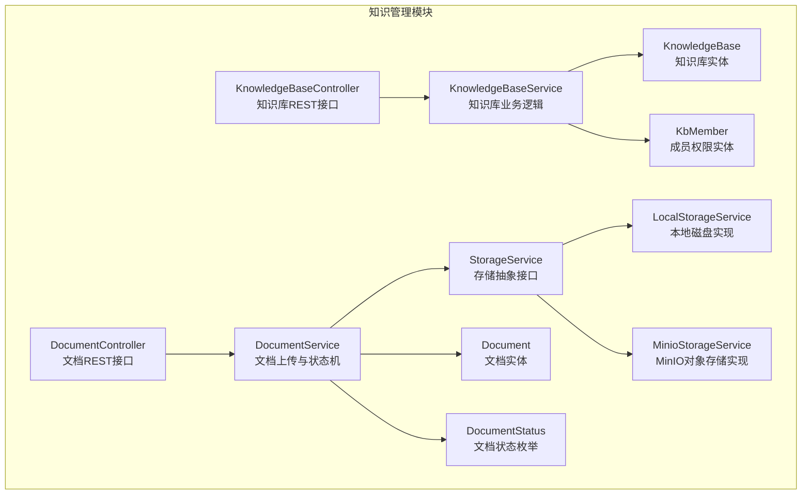
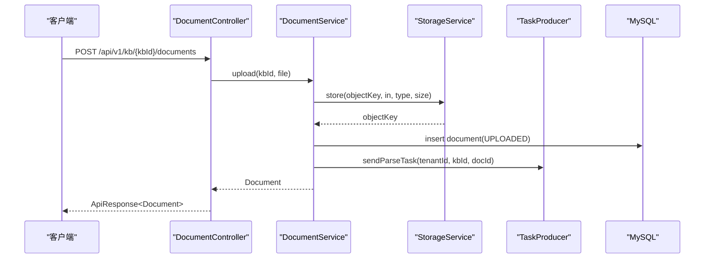
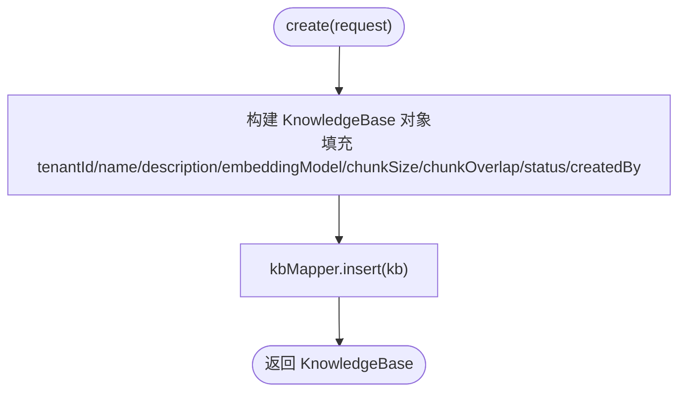
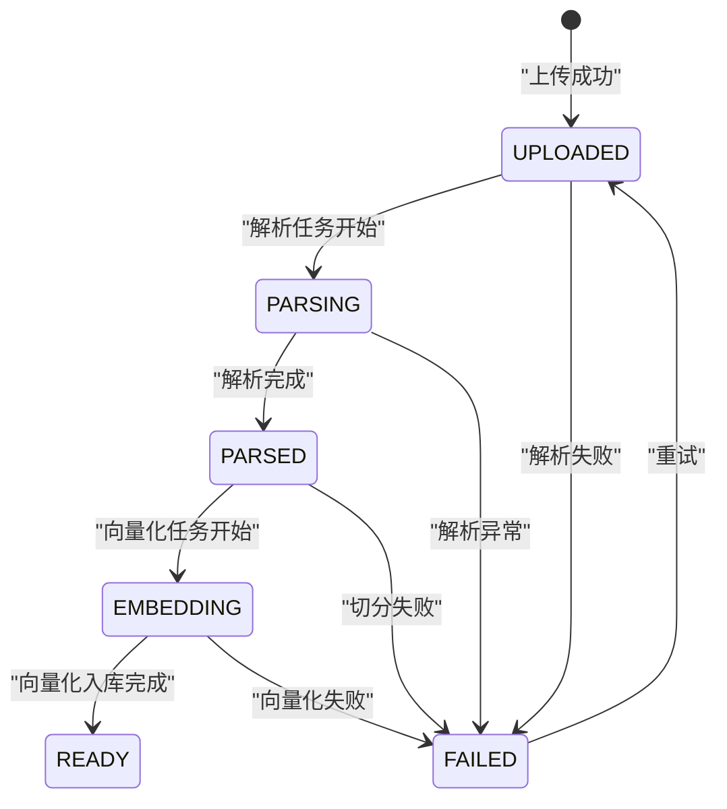
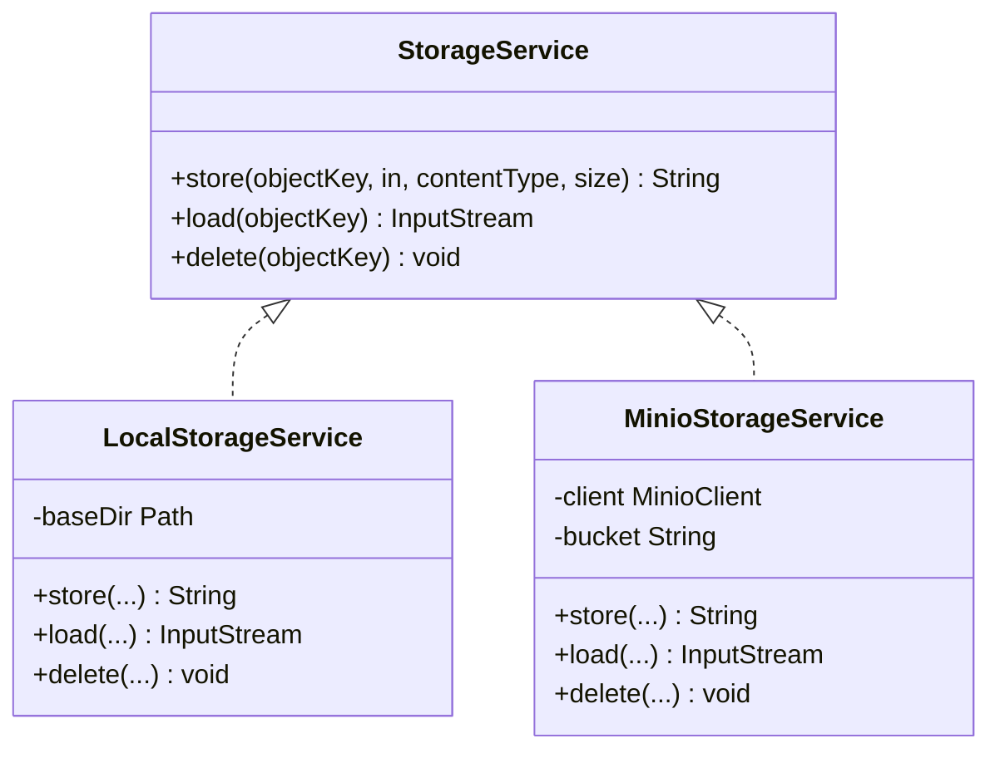
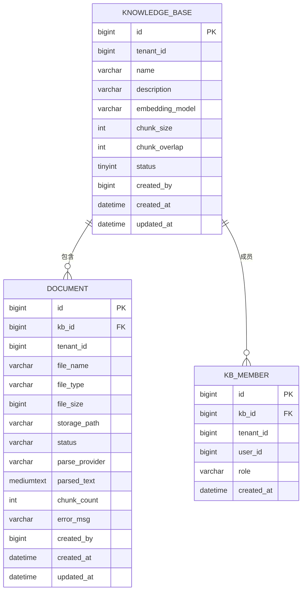
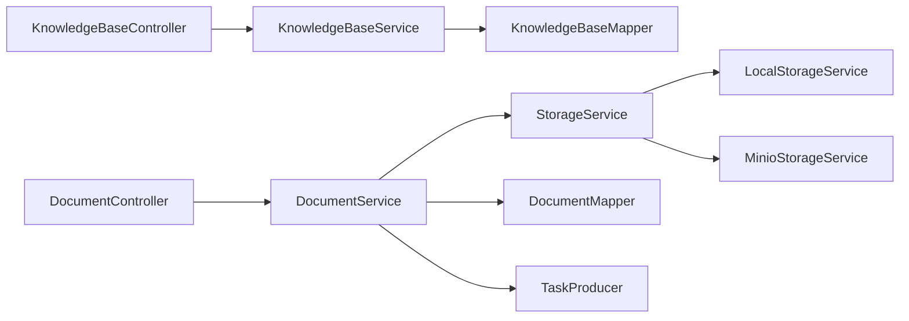

# 知识库管理系统

<cite>
**本文引用的文件**   
- [KnowledgeBaseController.java](file://src/main/java/com/agenthub/knowledge/controller/KnowledgeBaseController.java)
- [DocumentController.java](file://src/main/java/com/agenthub/knowledge/controller/DocumentController.java)
- [KnowledgeBaseService.java](file://src/main/java/com/agenthub/knowledge/service/KnowledgeBaseService.java)
- [DocumentService.java](file://src/main/java/com/agenthub/knowledge/service/DocumentService.java)
- [StorageService.java](file://src/main/java/com/agenthub/knowledge/storage/StorageService.java)
- [LocalStorageService.java](file://src/main/java/com/agenthub/knowledge/storage/LocalStorageService.java)
- [MinioStorageService.java](file://src/main/java/com/agenthub/knowledge/storage/MinioStorageService.java)
- [StorageProperties.java](file://src/main/java/com/agenthub/knowledge/storage/StorageProperties.java)
- [KnowledgeBase.java](file://src/main/java/com/agenthub/knowledge/entity/KnowledgeBase.java)
- [Document.java](file://src/main/java/com/agenthub/knowledge/entity/Document.java)
- [KbMember.java](file://src/main/java/com/agenthub/knowledge/entity/KbMember.java)
- [DocumentStatus.java](file://src/main/java/com/agenthub/knowledge/enums/DocumentStatus.java)
- [application.yml](file://src/main/resources/application.yml)
- [init-mysql.sql](file://sql/init-mysql.sql)
</cite>

## 目录
1. [简介](#简介)
2. [项目结构](#项目结构)
3. [核心组件](#核心组件)
4. [架构总览](#架构总览)
5. [详细组件分析](#详细组件分析)
6. [依赖关系分析](#依赖关系分析)
7. [性能与扩展性](#性能与扩展性)
8. [故障排查指南](#故障排查指南)
9. [结论](#结论)
10. [附录：API、配置与示例](#附录api配置与示例)

## 简介
本系统提供面向租户的知识库管理能力，支持文档上传、解析、分块、向量化与检索。整体采用“控制器 + 服务 + 存储抽象 + 任务队列”的分层架构，通过 MyBatis-Plus 实现多租户隔离，并通过 RocketMQ 或本地事件驱动异步处理文档流水线。

## 项目结构
知识库相关代码集中在 knowledge 包下，包含控制器、服务、实体、枚举、存储抽象及具体实现；数据库脚本位于 sql 目录；全局配置在 application.yml。

**图表来源**
- [KnowledgeBaseController.java:22-43](file://src/main/java/com/agenthub/knowledge/controller/KnowledgeBaseController.java#L22-L43)
- [DocumentController.java:20-50](file://src/main/java/com/agenthub/knowledge/controller/DocumentController.java#L20-L50)
- [KnowledgeBaseService.java:19-59](file://src/main/java/com/agenthub/knowledge/service/KnowledgeBaseService.java#L19-L59)
- [DocumentService.java:28-131](file://src/main/java/com/agenthub/knowledge/service/DocumentService.java#L28-L131)
- [StorageService.java:8-18](file://src/main/java/com/agenthub/knowledge/storage/StorageService.java#L8-L18)
- [LocalStorageService.java:17-64](file://src/main/java/com/agenthub/knowledge/storage/LocalStorageService.java#L17-L64)
- [MinioStorageService.java:17-81](file://src/main/java/com/agenthub/knowledge/storage/MinioStorageService.java#L17-L81)
- [KnowledgeBase.java:13-43](file://src/main/java/com/agenthub/knowledge/entity/KnowledgeBase.java#L13-L43)
- [Document.java:13-53](file://src/main/java/com/agenthub/knowledge/entity/Document.java#L13-L53)
- [KbMember.java:13-30](file://src/main/java/com/agenthub/knowledge/entity/KbMember.java#L13-L30)
- [DocumentStatus.java:11-25](file://src/main/java/com/agenthub/knowledge/enums/DocumentStatus.java#L11-L25)

**章节来源**
- [KnowledgeBaseController.java:1-45](file://src/main/java/com/agenthub/knowledge/controller/KnowledgeBaseController.java#L1-L45)
- [DocumentController.java:1-52](file://src/main/java/com/agenthub/knowledge/controller/DocumentController.java#L1-L52)
- [KnowledgeBaseService.java:1-61](file://src/main/java/com/agenthub/knowledge/service/KnowledgeBaseService.java#L1-L61)
- [DocumentService.java:1-138](file://src/main/java/com/agenthub/knowledge/service/DocumentService.java#L1-L138)
- [StorageService.java:1-19](file://src/main/java/com/agenthub/knowledge/storage/StorageService.java#L1-L19)
- [LocalStorageService.java:1-66](file://src/main/java/com/agenthub/knowledge/storage/LocalStorageService.java#L1-L66)
- [MinioStorageService.java:1-83](file://src/main/java/com/agenthub/knowledge/storage/MinioStorageService.java#L1-L83)
- [StorageProperties.java:1-34](file://src/main/java/com/agenthub/knowledge/storage/StorageProperties.java#L1-L34)
- [KnowledgeBase.java:1-44](file://src/main/java/com/agenthub/knowledge/entity/KnowledgeBase.java#L1-L44)
- [Document.java:1-54](file://src/main/java/com/agenthub/knowledge/entity/Document.java#L1-L54)
- [KbMember.java:1-31](file://src/main/java/com/agenthub/knowledge/entity/KbMember.java#L1-L31)
- [DocumentStatus.java:1-26](file://src/main/java/com/agenthub/knowledge/enums/DocumentStatus.java#L1-L26)

## 核心组件
- KnowledgeBaseController：暴露知识库的创建、查询、删除接口。
- DocumentController：暴露文档上传、列表、详情、重试等接口。
- KnowledgeBaseService：负责知识库的创建、查询、删除，以及基于租户上下文的数据隔离。
- DocumentService：负责文档上传、状态更新、重试，以及与存储和任务生产者的协作。
- StorageService 及其实现：统一文件存储抽象，支持本地磁盘与 MinIO 两种后端。
- 实体模型：KnowledgeBase、Document、KbMember 描述知识库、文档与成员权限。
- 状态枚举：DocumentStatus 定义文档处理流水线状态机。

**章节来源**
- [KnowledgeBaseController.java:22-43](file://src/main/java/com/agenthub/knowledge/controller/KnowledgeBaseController.java#L22-L43)
- [DocumentController.java:20-50](file://src/main/java/com/agenthub/knowledge/controller/DocumentController.java#L20-L50)
- [KnowledgeBaseService.java:25-59](file://src/main/java/com/agenthub/knowledge/service/KnowledgeBaseService.java#L25-L59)
- [DocumentService.java:41-131](file://src/main/java/com/agenthub/knowledge/service/DocumentService.java#L41-L131)
- [StorageService.java:8-18](file://src/main/java/com/agenthub/knowledge/storage/StorageService.java#L8-L18)
- [KnowledgeBase.java:13-43](file://src/main/java/com/agenthub/knowledge/entity/KnowledgeBase.java#L13-L43)
- [Document.java:13-53](file://src/main/java/com/agenthub/knowledge/entity/Document.java#L13-L53)
- [KbMember.java:13-30](file://src/main/java/com/agenthub/knowledge/entity/KbMember.java#L13-L30)
- [DocumentStatus.java:11-25](file://src/main/java/com/agenthub/knowledge/enums/DocumentStatus.java#L11-L25)

## 架构总览
系统以 REST 控制器为入口，调用服务层完成业务逻辑；文档上传后落库并投递 MQ 任务，由消费者执行解析、切分、向量化等步骤；文件持久化通过 StorageService 抽象，根据配置选择本地或 MinIO。

**图表来源**
- [DocumentController.java:27-31](file://src/main/java/com/agenthub/knowledge/controller/DocumentController.java#L27-L31)
- [DocumentService.java:41-76](file://src/main/java/com/agenthub/knowledge/service/DocumentService.java#L41-L76)
- [StorageService.java:10-11](file://src/main/java/com/agenthub/knowledge/storage/StorageService.java#L10-L11)

## 详细组件分析

### 知识库管理：KnowledgeBaseService
- 功能要点
  - 创建知识库时自动注入租户ID、默认分块大小与重叠参数，并设置初始状态。
  - 列表查询按租户隔离（由 MyBatis-Plus 租户插件自动追加过滤）。
  - require 方法用于校验知识库存在性，不存在则抛出业务异常。
  - delete 先校验存在性再删除，向量数据清理由 PG 侧按 kb_id 触发。
- 设计模式
  - 使用 MyBatis-Plus Mapper 进行数据访问。
  - 通过 TenantContext 获取当前租户上下文，保证数据隔离。
- 错误处理
  - 未找到知识库时抛出 BizException，携带 NOT_FOUND 错误码。

**图表来源**
- [KnowledgeBaseService.java:25-38](file://src/main/java/com/agenthub/knowledge/service/KnowledgeBaseService.java#L25-L38)

**章节来源**
- [KnowledgeBaseService.java:25-59](file://src/main/java/com/agenthub/knowledge/service/KnowledgeBaseService.java#L25-L59)

### 文档处理流程：DocumentService
- 功能要点
  - 允许的文件类型包括 pdf、docx、doc、txt、md、pptx、xlsx、html。
  - 上传流程：存储原始文件 → 落库文档记录（UPLOADED）→ 提交解析任务。
  - 提供列表、详情、重试等方法；并提供供消费者调用的状态更新方法。
- 状态机
  - UPLOADED → PARSING → PARSED → EMBEDDING → READY，任一阶段失败进入 FAILED。
- 与外部组件交互
  - 通过 TaskProducer 发送解析任务，后续由消费者完成解析、切分、向量化。
  - 通过 StorageService 写入原始文件，路径天然携带租户ID与知识库ID，实现物理隔离。

**图表来源**
- [DocumentStatus.java:11-25](file://src/main/java/com/agenthub/knowledge/enums/DocumentStatus.java#L11-L25)
- [DocumentService.java:95-102](file://src/main/java/com/agenthub/knowledge/service/DocumentService.java#L95-L102)

**章节来源**
- [DocumentService.java:33-131](file://src/main/java/com/agenthub/knowledge/service/DocumentService.java#L33-L131)
- [DocumentStatus.java:1-26](file://src/main/java/com/agenthub/knowledge/enums/DocumentStatus.java#L1-L26)

### 存储抽象层：StorageService 与实现
- 抽象接口
  - store：存储文件并返回可再次读取的路径。
  - load：按路径读取文件内容。
  - delete：删除文件。
- 本地实现（LocalStorageService）
  - 使用 Spring Boot 条件装配，当 agenthub.storage.type=local 时启用。
  - 基础目录从 StorageProperties.local.baseDir 读取，自动创建目录。
  - 写入前校验目标路径是否位于 baseDir 内，防止路径穿越。
- MinIO 实现（MinioStorageService）
  - 当 agenthub.storage.type=minio 时启用。
  - 启动时确保 bucket 存在，不存在则创建。
  - 使用 MinioClient 进行 put/get/remove 操作。

**图表来源**
- [StorageService.java:8-18](file://src/main/java/com/agenthub/knowledge/storage/StorageService.java#L8-L18)
- [LocalStorageService.java:17-64](file://src/main/java/com/agenthub/knowledge/storage/LocalStorageService.java#L17-L64)
- [MinioStorageService.java:17-81](file://src/main/java/com/agenthub/knowledge/storage/MinioStorageService.java#L17-L81)

**章节来源**
- [StorageService.java:1-19](file://src/main/java/com/agenthub/knowledge/storage/StorageService.java#L1-L19)
- [LocalStorageService.java:1-66](file://src/main/java/com/agenthub/knowledge/storage/LocalStorageService.java#L1-L66)
- [MinioStorageService.java:1-83](file://src/main/java/com/agenthub/knowledge/storage/MinioStorageService.java#L1-L83)
- [StorageProperties.java:1-34](file://src/main/java/com/agenthub/knowledge/storage/StorageProperties.java#L1-L34)

### REST API 接口说明

#### 知识库接口（KnowledgeBaseController）
- 创建知识库
  - 方法：POST
  - 路径：/api/v1/kb
  - 请求体：KnowledgeBaseRequest（名称、描述、embeddingModel、chunkSize、chunkOverlap）
  - 响应：ApiResponse<KnowledgeBase>
- 列出知识库
  - 方法：GET
  - 路径：/api/v1/kb
  - 响应：ApiResponse<List<KnowledgeBase>>
- 删除知识库
  - 方法：DELETE
  - 路径：/api/v1/kb/{kbId}
  - 响应：ApiResponse<Void>

**章节来源**
- [KnowledgeBaseController.java:29-43](file://src/main/java/com/agenthub/knowledge/controller/KnowledgeBaseController.java#L29-L43)

#### 文档接口（DocumentController）
- 上传文档
  - 方法：POST
  - 路径：/api/v1/kb/{kbId}/documents
  - 表单字段：file（MultipartFile）
  - 响应：ApiResponse<Document>
- 文档列表
  - 方法：GET
  - 路径：/api/v1/kb/{kbId}/documents
  - 响应：ApiResponse<List<Document>>
- 文档详情
  - 方法：GET
  - 路径：/api/v1/documents/{docId}
  - 响应：ApiResponse<Document>
- 失败重试
  - 方法：POST
  - 路径：/api/v1/documents/{docId}/retry
  - 响应：ApiResponse<Void>

**章节来源**
- [DocumentController.java:27-50](file://src/main/java/com/agenthub/knowledge/controller/DocumentController.java#L27-L50)

### 实体模型与关系
- KnowledgeBase：知识库主表，包含租户ID、名称、描述、embeddingModel、chunkSize、chunkOverlap、status、创建人及时间戳。
- Document：文档记录，包含 kbId、tenantId、文件名、类型、大小、storagePath、状态、解析提供者、解析文本、分块数量、错误信息、创建人及时间戳。
- KbMember：知识库成员权限表，包含 kbId、tenantId、userId、角色（OWNER/EDITOR/VIEWER）、创建时间。

**图表来源**
- [KnowledgeBase.java:13-43](file://src/main/java/com/agenthub/knowledge/entity/KnowledgeBase.java#L13-L43)
- [Document.java:13-53](file://src/main/java/com/agenthub/knowledge/entity/Document.java#L13-L53)
- [KbMember.java:13-30](file://src/main/java/com/agenthub/knowledge/entity/KbMember.java#L13-L30)
- [init-mysql.sql:49-92](file://sql/init-mysql.sql#L49-L92)
- [init-mysql.sql:64-72](file://sql/init-mysql.sql#L64-L72)

**章节来源**
- [KnowledgeBase.java:1-44](file://src/main/java/com/agenthub/knowledge/entity/KnowledgeBase.java#L1-L44)
- [Document.java:1-54](file://src/main/java/com/agenthub/knowledge/entity/Document.java#L1-L54)
- [KbMember.java:1-31](file://src/main/java/com/agenthub/knowledge/entity/KbMember.java#L1-L31)
- [init-mysql.sql:49-92](file://sql/init-mysql.sql#L49-L92)

## 依赖关系分析
- 控制器依赖服务：KnowledgeBaseController 依赖 KnowledgeBaseService；DocumentController 依赖 DocumentService。
- 服务依赖 Mapper 与上下文：KnowledgeBaseService 依赖 KnowledgeBaseMapper 与 TenantContext；DocumentService 依赖 DocumentMapper、KnowledgeBaseService、StorageService、TaskProducer。
- 存储抽象解耦：DocumentService 不关心底层存储实现，通过 StorageService 接口切换本地或 MinIO。
- 配置驱动：StorageProperties 通过 application.yml 控制存储类型与参数。

**图表来源**
- [KnowledgeBaseController.java:22-43](file://src/main/java/com/agenthub/knowledge/controller/KnowledgeBaseController.java#L22-L43)
- [DocumentController.java:20-50](file://src/main/java/com/agenthub/knowledge/controller/DocumentController.java#L20-L50)
- [KnowledgeBaseService.java:23-59](file://src/main/java/com/agenthub/knowledge/service/KnowledgeBaseService.java#L23-L59)
- [DocumentService.java:36-76](file://src/main/java/com/agenthub/knowledge/service/DocumentService.java#L36-L76)
- [StorageService.java:8-18](file://src/main/java/com/agenthub/knowledge/storage/StorageService.java#L8-L18)

**章节来源**
- [KnowledgeBaseController.java:1-45](file://src/main/java/com/agenthub/knowledge/controller/KnowledgeBaseController.java#L1-L45)
- [DocumentController.java:1-52](file://src/main/java/com/agenthub/knowledge/controller/DocumentController.java#L1-L52)
- [KnowledgeBaseService.java:1-61](file://src/main/java/com/agenthub/knowledge/service/KnowledgeBaseService.java#L1-L61)
- [DocumentService.java:1-138](file://src/main/java/com/agenthub/knowledge/service/DocumentService.java#L1-L138)
- [StorageService.java:1-19](file://src/main/java/com/agenthub/knowledge/storage/StorageService.java#L1-L19)

## 性能与扩展性
- 异步处理
  - 上传即返回，解析与向量化通过 MQ 异步执行，避免长请求阻塞。
- 存储可扩展
  - 通过 StorageService 抽象，轻松切换本地与 MinIO，便于横向扩展与高可用部署。
- 分块策略可调
  - 知识库维度配置 chunkSize 与 chunkOverlap，影响分块粒度与召回质量。
- 连接池与超时
  - MySQL HikariCP 最大连接数与最小空闲连接数已配置，可根据负载调整。
- 向量检索参数
  - vector-top-k、keyword-top-k、rrf-k 可在 application.yml 中调节，平衡召回与延迟。

[本节为通用指导，不直接分析具体文件]

## 故障排查指南
- 文件类型不支持
  - 现象：上传时报 PARAM_ERROR。
  - 原因：文件扩展名不在 ALLOWED_TYPES 白名单。
  - 处理：确认文件类型是否在 pdf/docx/doc/txt/md/pptx/xlsx/html 范围内。
- 文件存储失败
  - 现象：上传时报 FILE_ERROR。
  - 原因：本地目录不可写或 MinIO 连接失败。
  - 处理：检查 agenthub.storage.type 与对应配置；本地需确保 baseDir 可写；MinIO 需校验 endpoint、accessKey、secretKey、bucket。
- 知识库不存在
  - 现象：require 抛 NOT_FOUND。
  - 处理：确认 kbId 是否存在且属于当前租户。
- 文档处理失败
  - 现象：文档状态为 FAILED。
  - 处理：查看 errorMsg，必要时调用重试接口重新提交解析任务。

**章节来源**
- [DocumentService.java:41-76](file://src/main/java/com/agenthub/knowledge/service/DocumentService.java#L41-L76)
- [KnowledgeBaseService.java:46-53](file://src/main/java/com/agenthub/knowledge/service/KnowledgeBaseService.java#L46-L53)
- [DocumentService.java:95-102](file://src/main/java/com/agenthub/knowledge/service/DocumentService.java#L95-L102)

## 结论
本知识库管理系统通过清晰的层次结构与存储抽象，实现了租户隔离、异步文档处理与可扩展的对象存储。控制器与服务职责明确，实体模型与状态机清晰，配合 application.yml 的配置项，能够快速搭建并运行全链路 RAG 流程。建议在生产环境优先使用 MinIO 与 RocketMQ，并根据业务需求调优分块策略与向量检索参数。

[本节为总结性内容，不直接分析具体文件]

## 附录：API、配置与示例

### 文档上传示例
- 请求方式
  - 方法：POST
  - 路径：/api/v1/kb/{kbId}/documents
  - 表单字段：file（MultipartFile）
- 响应
  - 返回 Document 对象，包含 id、kbId、fileName、status 等字段。
- 状态轮询
  - 通过 GET /api/v1/documents/{docId} 轮询文档状态，直到 READY 或 FAILED。

**章节来源**
- [DocumentController.java:27-50](file://src/main/java/com/agenthub/knowledge/controller/DocumentController.java#L27-L50)
- [DocumentService.java:41-76](file://src/main/java/com/agenthub/knowledge/service/DocumentService.java#L41-L76)

### 存储配置
- 关键配置项（application.yml）
  - agenthub.storage.type：local | minio
  - agenthub.storage.local.base-dir：本地根目录
  - agenthub.storage.minio.endpoint/access-key/secret-key/bucket：MinIO 连接信息
- 行为说明
  - local：使用 LocalStorageService，自动创建 baseDir，写入前校验路径安全。
  - minio：使用 MinioStorageService，启动时确保 bucket 存在。

**章节来源**
- [application.yml:77-86](file://src/main/resources/application.yml#L77-L86)
- [StorageProperties.java:10-32](file://src/main/java/com/agenthub/knowledge/storage/StorageProperties.java#L10-L32)
- [LocalStorageService.java:23-45](file://src/main/java/com/agenthub/knowledge/storage/LocalStorageService.java#L23-L45)
- [MinioStorageService.java:25-44](file://src/main/java/com/agenthub/knowledge/storage/MinioStorageService.java#L25-L44)

### 数据库初始化
- 主要表
  - knowledge_base：知识库主表
  - kb_member：知识库成员权限表
  - document：文档记录表
- 索引与约束
  - 各表均含 tenant_id，MyBatis-Plus 租户插件自动追加过滤条件。
  - document 表对 kb_id 与 tenant_id 建立索引以提升查询性能。

**章节来源**
- [init-mysql.sql:49-92](file://sql/init-mysql.sql#L49-L92)
- [init-mysql.sql:64-72](file://sql/init-mysql.sql#L64-L72)