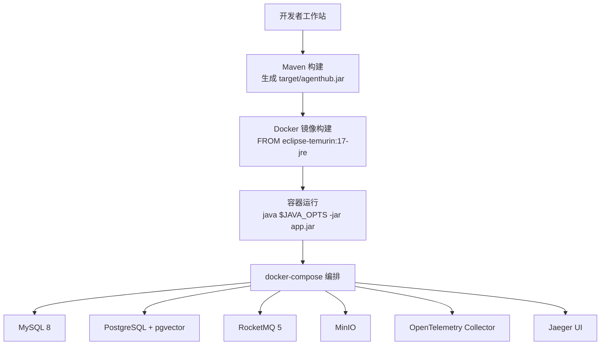
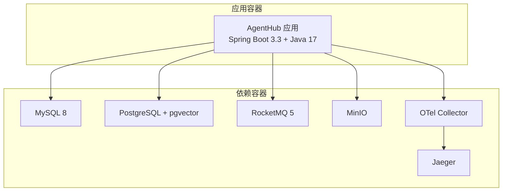
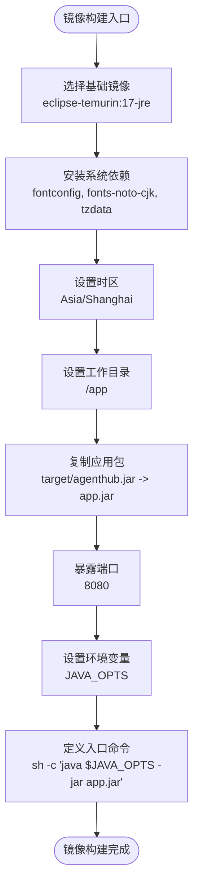
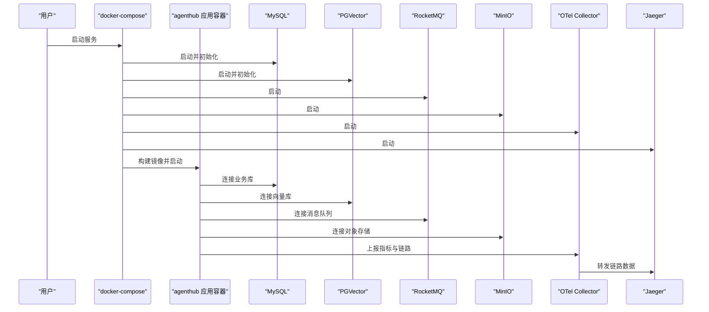
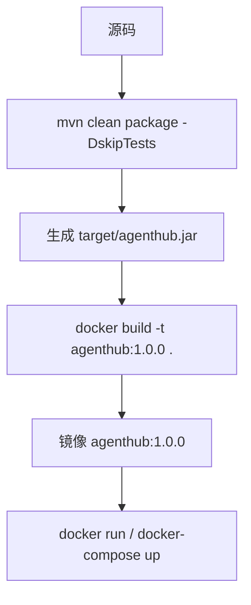
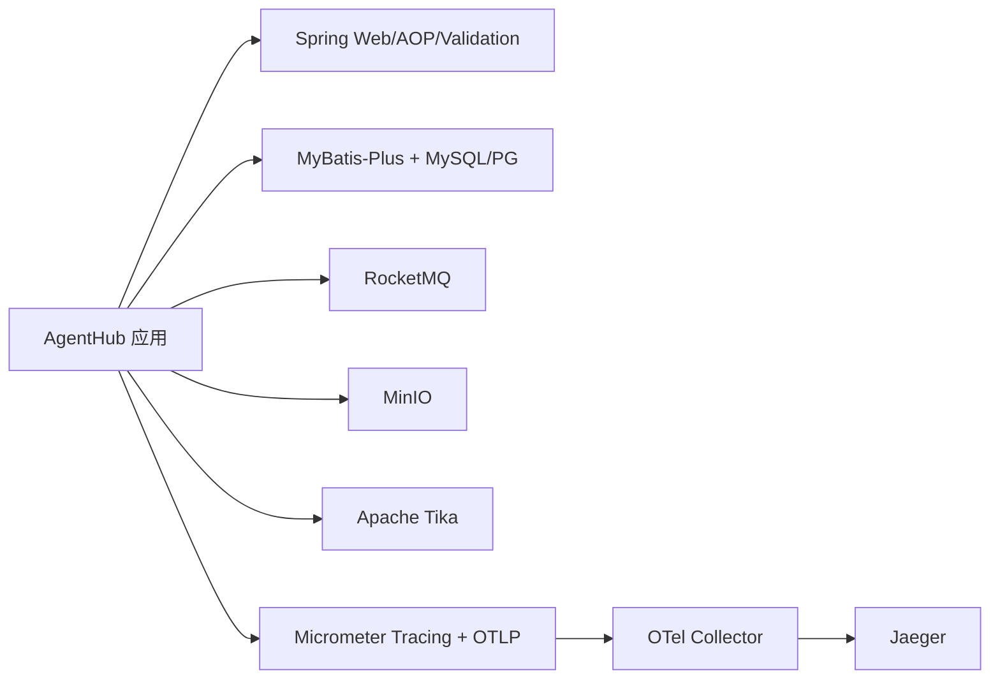

# 容器化部署

<cite>
**本文引用的文件**   
- [Dockerfile](file://Dockerfile)
- [README.md](file://README.md)
- [docker-compose.yml](file://docker-compose.yml)
- [pom.xml](file://pom.xml)
</cite>

## 目录
1. [简介](#简介)
2. [项目结构](#项目结构)
3. [核心组件](#核心组件)
4. [架构总览](#架构总览)
5. [详细组件分析](#详细组件分析)
6. [依赖关系分析](#依赖关系分析)
7. [性能与优化](#性能与优化)
8. [故障排查指南](#故障排查指南)
9. [结论](#结论)
10. [附录：构建与运行命令清单](#附录构建与运行命令清单)

## 简介
本章节面向希望将本项目以容器方式部署的读者，重点说明 Dockerfile 的关键配置项、镜像构建流程、环境变量与 JVM 参数调优建议，以及常见问题的排障思路。项目本身是一个基于 AgentScope Java 2.0 的企业级多租户 RAG + Harness Agent + MCP 工具平台，默认提供最小可运行的本地模式（进程内异步、本地存储、Mock 模型），并可通过 docker-compose 一键拉起 MySQL、PGVector、RocketMQ、MinIO、OTel Collector、Jaeger 等依赖。

## 项目结构
从容器化视角，关键文件如下：
- Dockerfile：定义应用镜像的基础镜像、时区与字体安装、工作目录、JAR 包拷贝、端口暴露、JVM 启动参数与环境变量。
- docker-compose.yml：编排所有依赖服务与应用容器，并提供默认的环境变量映射与数据卷。
- pom.xml：Spring Boot Maven 工程，打包产物为 agenthub.jar，供 Dockerfile COPY。
- README.md：包含快速启动步骤与常用 curl 示例，便于验证容器是否正常运行。

图示来源
- [Dockerfile:5-25](file://Dockerfile#L5-L25)
- [docker-compose.yml:13-173](file://docker-compose.yml#L13-L173)
- [pom.xml:173-189](file://pom.xml#L173-L189)

章节来源
- [Dockerfile:1-26](file://Dockerfile#L1-L26)
- [docker-compose.yml:1-181](file://docker-compose.yml#L1-L181)
- [pom.xml:1-191](file://pom.xml#L1-L191)
- [README.md:37-60](file://README.md#L37-L60)

## 核心组件
本节聚焦容器化相关的关键点：基础镜像选择、中文字体与时区、Java 内存参数、端口暴露、环境变量注入与 compose 编排。

- 基础镜像
  - 使用 eclipse-temurin:17-jre，提供轻量且稳定的 Java 17 运行时环境，适合生产部署。
- 中文字体与时区
  - 安装 fonts-noto-cjk 与 fontconfig，确保 PDF 解析（Tika）能正确渲染中文；同时设置 Asia/Shanghai 时区，保证日志与业务时间一致。
- JAR 包与工作目录
  - 将 Maven 打包产物 target/agenthub.jar 复制到 /app/app.jar，WORKDIR 设置为 /app。
- 端口暴露
  - 暴露 8080 端口，供外部访问 Spring Boot Web 服务。
- JVM 参数与环境变量
  - 通过 ENV JAVA_OPTS 设置初始堆与最大堆大小，ENTRYPOINT 使用 sh -c 执行 java $JAVA_OPTS -jar app.jar，便于在运行时覆盖 JVM 参数。

章节来源
- [Dockerfile:5-25](file://Dockerfile#L5-L25)

## 架构总览
下图展示容器化后的整体运行架构：应用容器依赖数据库、消息队列、对象存储与可观测性组件，并通过环境变量进行连接与功能开关。

图示来源
- [docker-compose.yml:13-173](file://docker-compose.yml#L13-L173)

## 详细组件分析

### Dockerfile 关键配置解析
- 基础镜像：eclipse-temurin:17-jre，提供精简的 Java 17 运行时。
- 系统依赖安装：apt-get 更新后安装 fontconfig、fonts-noto-cjk、tzdata，并清理 apt 缓存以减少镜像体积。
- 时区配置：将 /etc/localtime 软链接到 Asia/Shanghai，确保容器时间与宿主机一致。
- 工作目录与 JAR：WORKDIR /app，COPY target/agenthub.jar app.jar。
- 可选 OpenTelemetry Java Agent：注释掉的 COPY opentelemetry-javaagent.jar，可按需启用自动埋点。
- 端口与环境变量：EXPOSE 8080，ENV JAVA_OPTS="-Xms512m -Xmx1g"，ENTRYPOINT 使用 shell 形式执行 java 命令。

图示来源
- [Dockerfile:5-25](file://Dockerfile#L5-L25)

章节来源
- [Dockerfile:1-26](file://Dockerfile#L1-L26)

### docker-compose 编排与环境变量
- 依赖服务
  - MySQL：初始化脚本、字符集与排序规则、健康检查。
  - PostgreSQL + pgvector：向量库初始化脚本与健康检查。
  - RocketMQ：NameServer/Broker 端口映射与日志持久化。
  - MinIO：S3 API 与控制台端口映射。
  - Otel Collector：接收 OTLP 指标与链路数据。
  - Jaeger：可视化链路追踪。
- 应用服务 agenthub
  - build: . 表示使用当前目录的 Dockerfile 构建镜像。
  - depends_on：等待 MySQL 与 PG 健康检查通过后再启动。
  - environment：注入数据库连接、存储类型、LLM 模型、Agent 引擎、OTel 端点等环境变量。
  - ports：映射 8080 端口。
  - restart：unless-stopped 策略。

图示来源
- [docker-compose.yml:13-173](file://docker-compose.yml#L13-L173)

章节来源
- [docker-compose.yml:1-181](file://docker-compose.yml#L1-L181)

### Maven 打包与镜像构建流程
- Maven 打包
  - 使用 spring-boot-maven-plugin，最终产物名为 agenthub.jar（finalName）。
  - 排除 Lombok 编译期依赖，减小运行时代码体积。
- 镜像构建
  - 先执行 mvn clean package -DskipTests 生成 target/agenthub.jar。
  - 再执行 docker build -t agenthub:1.0.0 . 构建镜像。
  - 也可通过 docker-compose up -d 直接构建并启动应用。

图示来源
- [pom.xml:173-189](file://pom.xml#L173-L189)
- [README.md:37-60](file://README.md#L37-L60)

章节来源
- [pom.xml:173-189](file://pom.xml#L173-L189)
- [README.md:37-60](file://README.md#L37-L60)

### 环境变量与 JVM 参数调优
- JAVA_OPTS
  - 默认值：-Xms512m -Xmx1g，适用于开发或低负载场景。
  - 生产建议：根据容器资源限制与业务峰值调整初始堆与最大堆，避免频繁 GC 与 OOM。
  - 运行时覆盖：可在 docker run 或 docker-compose 的 environment 中覆盖 JAVA_OPTS。
- 其他环境变量（compose 中已注入）
  - 数据库连接：MYSQL_HOST/MYSQL_PORT/MYSQL_USER/MYSQL_PASSWORD、PG_HOST/PG_PORT/PG_USER/PG_PASSWORD/PG_DB。
  - 功能开关：MQ_TYPE、STORAGE_TYPE、LLM_DEFAULT_MODEL、EMBEDDING_MODEL、AGENT_ENGINE。
  - 可观测性：OTEL_EXPORTER_OTLP_ENDPOINT。

章节来源
- [Dockerfile:21-25](file://Dockerfile#L21-L25)
- [docker-compose.yml:146-173](file://docker-compose.yml#L146-L173)

### 中文字体对 PDF 解析的重要性
- Tika 作为文档解析器，在处理 PDF 时需要系统字体支持以正确提取与渲染中文内容。
- 安装 fonts-noto-cjk 与 fontconfig 可显著减少中文乱码或解析失败的概率。
- 若出现中文解析异常，优先检查容器内字体是否安装成功、PDF 是否含嵌入字体、以及 Tika 版本兼容性。

章节来源
- [Dockerfile:7-11](file://Dockerfile#L7-L11)

### 时区配置
- 通过 ln -sf /usr/share/zoneinfo/Asia/Shanghai /etc/localtime 设置容器时区。
- 影响日志时间戳、任务调度与业务时间一致性。
- 若发现时间偏差，检查宿主机的 TZ 与容器内的 localtime 是否一致。

章节来源
- [Dockerfile:8-11](file://Dockerfile#L8-L11)

## 依赖关系分析
- 应用层
  - Spring Boot 3.3 + Java 17，Web/AOP/Validation/JDBC/Actuator。
- 存储层
  - MySQL（业务数据）、PostgreSQL + pgvector（向量检索）。
- 中间件
  - RocketMQ（异步任务）、MinIO（对象存储）。
- 可观测性
  - Micrometer Tracing + OpenTelemetry OTLP 导出，Collector 转发至 Jaeger/Prometheus。
- 文档解析
  - Apache Tika（本地降级方案），MinerU（高精度解析，可选）。

图示来源
- [pom.xml:41-171](file://pom.xml#L41-L171)
- [docker-compose.yml:13-173](file://docker-compose.yml#L13-L173)

章节来源
- [pom.xml:41-171](file://pom.xml#L41-L171)
- [docker-compose.yml:13-173](file://docker-compose.yml#L13-L173)

## 性能与优化
- 基础镜像选择
  - eclipse-temurin:17-jre 是轻量运行时，适合生产；如需更小的镜像，可考虑 distroless 或 alpine 变体，但需验证字体与系统库兼容性。
- 多阶段构建
  - 当前 Dockerfile 未采用多阶段构建；可将 Maven 构建放在第一阶段，第二阶段仅拷贝 jar 与必要依赖，进一步缩小镜像体积。
- 镜像大小优化
  - 使用 --no-install-recommends 减少不必要的包。
  - 清理 apt 缓存与临时文件。
  - 按需安装字体，避免全量安装。
- JVM 参数调优
  - 根据容器资源限制设置 -Xms/-Xmx，避免过度分配导致 OOM。
  - 结合容器编排平台的资源限制（CPU/内存）与 JVM 参数协同调优。
- 可观测性与性能分析
  - 启用 OTel Collector 与 Jaeger，观察慢调用与热点方法。
  - 结合 Actuator 暴露指标，监控 GC、线程池与请求延迟。

[本节为通用指导，不直接分析具体文件]

## 故障排查指南
- 中文 PDF 解析乱码或失败
  - 确认容器内已安装 fonts-noto-cjk 与 fontconfig。
  - 检查 PDF 是否包含中文字体或嵌入字体。
  - 查看 Tika 解析日志，定位具体错误。
- 时区不一致
  - 检查 /etc/localtime 是否指向 Asia/Shanghai。
  - 核对宿主机与容器的时区设置。
- 应用无法启动或端口冲突
  - 确认 8080 端口未被占用。
  - 检查 JAVA_OPTS 是否合法，避免非法 JVM 参数。
- 依赖服务不可用
  - 检查 docker-compose 中各服务的 healthcheck 状态。
  - 确认环境变量（数据库地址、用户名、密码）是否正确。
- 链路追踪无数据
  - 检查 OTEL_EXPORTER_OTLP_ENDPOINT 是否与 Collector 端口匹配。
  - 确认 Collector 与 Jaeger 服务正常启动。

章节来源
- [Dockerfile:7-11](file://Dockerfile#L7-L11)
- [docker-compose.yml:30-54](file://docker-compose.yml#L30-L54)
- [docker-compose.yml:146-173](file://docker-compose.yml#L146-L173)

## 结论
通过合理选择基础镜像、安装必要的中文字体与时区、配置 JVM 参数与环境变量，并结合 docker-compose 编排依赖服务，可以快速实现项目的容器化部署。在生产环境中，建议进一步优化镜像体积、调整 JVM 参数、启用可观测性，并根据业务负载进行容量规划与性能调优。

[本节为总结性内容，不直接分析具体文件]

## 附录：构建与运行命令清单
- 构建应用镜像
  - mvn clean package -DskipTests && docker build -t agenthub:1.0.0 .
- 启动全部依赖与应用
  - docker compose up -d
- 查看应用日志
  - docker compose logs -f agenthub
- 本地 IDE 运行（仅依赖）
  - docker compose up -d mysql pgvector
  - mvn spring-boot:run

章节来源
- [README.md:37-60](file://README.md#L37-L60)
- [docker-compose.yml:1-10](file://docker-compose.yml#L1-L10)