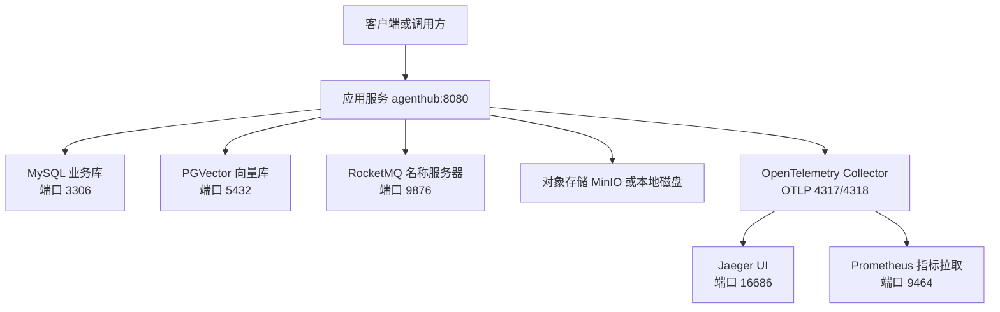
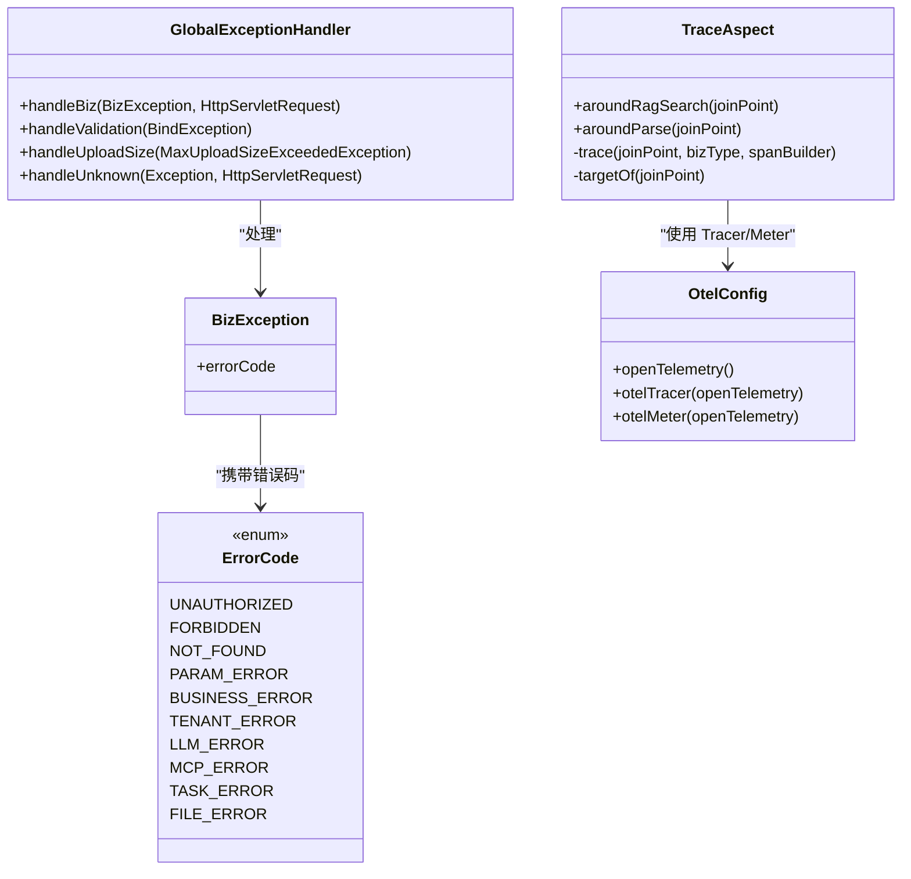
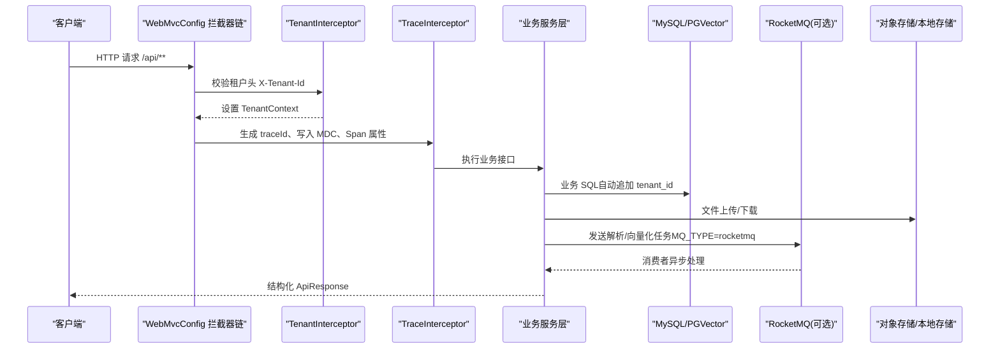

# 故障排查指南

<cite>
**本文引用的文件**   
- [README.md](file://README.md)
- [application.yml](file://src/main/resources/application.yml)
- [docker-compose.yml](file://docker-compose.yml)
- [Dockerfile](file://Dockerfile)
- [WebMvcConfig.java](file://src/main/java/com/agenthub/gateway/config/WebMvcConfig.java)
- [TraceInterceptor.java](file://src/main/java/com/agenthub/gateway/interceptor/TraceInterceptor.java)
- [SecurityProperties.java](file://src/main/java/com/agenthub/gateway/config/SecurityProperties.java)
- [OtelConfig.java](file://src/main/java/com/agenthub/tracing/config/OtelConfig.java)
- [TraceAspect.java](file://src/main/java/com/agenthub/tracing/aspect/TraceAspect.java)
- [GlobalExceptionHandler.java](file://src/main/java/com/agenthub/common/exception/GlobalExceptionHandler.java)
- [BizException.java](file://src/main/java/com/agenthub/common/exception/BizException.java)
- [ErrorCode.java](file://src/main/java/com/agenthub/common/exception/ErrorCode.java)
- [MybatisPlusConfig.java](file://src/main/java/com/agenthub/tenant/config/MybatisPlusConfig.java)
- [PgVectorStore.java](file://src/main/java/com/agenthub/rag/store/PgVectorStore.java)
- [LocalStorageService.java](file://src/main/java/com/agenthub/knowledge/storage/LocalStorageService.java)
- [MinioStorageService.java](file://src/main/java/com/agenthub/knowledge/storage/MinioStorageService.java)
- [StorageProperties.java](file://src/main/java/com/agenthub/knowledge/storage/StorageProperties.java)
- [McpServerConfig.java](file://src/main/java/com/agenthub/mcp/entity/McpServerConfig.java)
- [McpClientManager.java](file://src/main/java/com/agenthub/mcp/client/McpClientManager.java)
- [McpServerService.java](file://src/main/java/com/agenthub/mcp/service/McpServerService.java)
- [init-mysql.sql](file://sql/init-mysql.sql)
- [otel-collector-config.yaml](file://otel/otel-collector-config.yaml)
</cite>

## 目录
1. [引言](#引言)
2. [项目结构与运行环境](#项目结构与运行环境)
3. [核心可观测组件](#核心可观测组件)
4. [架构总览与依赖关系](#架构总览与依赖关系)
5. [日志收集与分析方法](#日志收集与分析方法)
6. [健康检查与状态解读](#健康检查与状态解读)
7. [常见问题诊断与解决方案](#常见问题诊断与解决方案)
8. [性能问题排查与调优](#性能问题排查与调优)
9. [网络连接问题诊断](#网络连接问题诊断)
10. [备份、恢复与灾难恢复](#备份恢复与灾难恢复)
11. [运维脚本与自动化检查建议](#运维脚本与自动化检查建议)
12. [结论](#结论)

## 引言
本指南面向生产与测试环境的运维人员、后端开发与平台负责人，目标是快速定位并解决 java-agent-hub 在启动、运行、扩展集成过程中的典型问题。文档覆盖应用日志、系统日志、数据库日志的查看与分析方法，说明 JVM 参数、连接池、缓存策略等性能调优要点，梳理外部 API、消息队列、对象存储、向量库等网络依赖的诊断路径，并给出健康检查端点、备份恢复、灾难恢复及自动化巡检建议。

## 项目结构与运行环境
java-agent-hub 是一个基于 Spring Boot 的企业级多租户 RAG + Agent + MCP 平台，默认通过 Docker Compose 一键拉起 MySQL、PostgreSQL（pgvector）、RocketMQ、MinIO、OpenTelemetry Collector、Jaeger 与应用服务。本地开发可使用 Mock LLM、进程内异步任务与本地文件存储，无需外部模型与 MQ。

**图表来源**
- [docker-compose.yml:11-173](file://docker-compose.yml#L11-L173)
- [application.yml:1-155](file://src/main/resources/application.yml#L1-L155)
- [otel-collector-config.yaml:1-33](file://otel/otel-collector-config.yaml#L1-L33)

**章节来源**
- [README.md:1-60](file://README.md#L1-L60)
- [docker-compose.yml:11-173](file://docker-compose.yml#L11-L173)
- [application.yml:1-155](file://src/main/resources/application.yml#L1-L155)

## 核心可观测组件
- Actuator 暴露 health、info、metrics、prometheus 端点，用于健康检查与指标采集。
- Micrometer Tracing 通过 OpenTelemetry 导出链路到 Collector，再转发到 Jaeger。
- AOP TraceAspect 对 RAG 检索与文档解析埋点，记录耗时、异常与租户标签。
- 全局异常处理器统一返回结构化错误响应，便于前端与监控告警消费。

**图表来源**
- [GlobalExceptionHandler.java:1-48](file://src/main/java/com/agenthub/common/exception/GlobalExceptionHandler.java#L1-L48)
- [BizException.java:1-22](file://src/main/java/com/agenthub/common/exception/BizException.java#L1-L22)
- [ErrorCode.java:1-26](file://src/main/java/com/agenthub/common/exception/ErrorCode.java#L1-L26)
- [TraceAspect.java:1-80](file://src/main/java/com/agenthub/tracing/aspect/TraceAspect.java#L1-L80)
- [OtelConfig.java:1-41](file://src/main/java/com/agenthub/tracing/config/OtelConfig.java#L1-L41)

**章节来源**
- [application.yml:31-44](file://src/main/resources/application.yml#L31-L44)
- [TraceAspect.java:1-80](file://src/main/java/com/agenthub/tracing/aspect/TraceAspect.java#L1-L80)
- [GlobalExceptionHandler.java:1-48](file://src/main/java/com/agenthub/common/exception/GlobalExceptionHandler.java#L1-L48)

## 架构总览与依赖关系
应用入口拦截器顺序为：租户认证拦截器 → 链路追踪拦截器。租户上下文经 ThreadLocal 传递，并在 AOP 埋点中作为 Span 标签；向量检索走 PGVector 直连 JDBC，显式拼接 tenant_id，确保跨租户隔离。

**图表来源**
- [WebMvcConfig.java:10-32](file://src/main/java/com/agenthub/gateway/config/WebMvcConfig.java#L10-L32)
- [TraceInterceptor.java:16-27](file://src/main/java/com/agenthub/gateway/interceptor/TraceInterceptor.java#L16-L27)
- [MybatisPlusConfig.java:16-28](file://src/main/java/com/agenthub/tenant/config/MybatisPlusConfig.java#L16-L28)
- [PgVectorStore.java:21-45](file://src/main/java/com/agenthub/rag/store/PgVectorStore.java#L21-L45)
- [application.yml:46-97](file://src/main/resources/application.yml#L46-L97)

**章节来源**
- [WebMvcConfig.java:10-32](file://src/main/java/com/agenthub/gateway/config/WebMvcConfig.java#L10-L32)
- [TraceInterceptor.java:16-27](file://src/main/java/com/agenthub/gateway/interceptor/TraceInterceptor.java#L16-L27)
- [MybatisPlusConfig.java:16-28](file://src/main/java/com/agenthub/tenant/config/MybatisPlusConfig.java#L16-L28)
- [PgVectorStore.java:21-45](file://src/main/java/com/agenthub/rag/store/PgVectorStore.java#L21-L45)

## 日志收集与分析方法
### 应用日志
- 日志级别由 application.yml 控制，com.agenthub 包默认 INFO，RocketMQ 日志默认 WARN。
- 全局异常处理器会记录业务异常与未知异常的请求方法与 URI，便于按时间窗口检索。
- 链路拦截器将 traceId 写入 MDC，可在日志中关联一次请求的全链路日志。

建议操作：
- 查看容器日志：`docker compose logs -f agenthub`
- 过滤关键字：结合 traceId、租户 ID、错误码进行筛选。
- 关注 `[BIZ]` 与 `[ERROR]` 前缀日志，快速定位业务失败与未捕获异常。

**章节来源**
- [application.yml:151-155](file://src/main/resources/application.yml#L151-L155)
- [GlobalExceptionHandler.java:21-45](file://src/main/java/com/agenthub/common/exception/GlobalExceptionHandler.java#L21-L45)
- [TraceInterceptor.java:16-27](file://src/main/java/com/agenthub/gateway/interceptor/TraceInterceptor.java#L16-L27)

### 系统日志与容器日志
- Docker Compose 编排了 MySQL、PGVector、RocketMQ、MinIO、Collector、Jaeger 等服务，各服务的健康检查与端口映射见 docker-compose.yml。
- 若应用启动失败，优先检查依赖服务是否 healthy，以及端口冲突、环境变量注入是否正确。

建议操作：
- 检查依赖健康：`docker compose ps`、`docker compose logs mysql/pgvector/rocketmq/minio`
- 检查应用端口：确认 8080 未被占用。
- 检查时区与字体：Dockerfile 已安装 CJK 字体与时区 Asia/Shanghai，避免 PDF 解析乱码。

**章节来源**
- [docker-compose.yml:11-173](file://docker-compose.yml#L11-L173)
- [Dockerfile:5-11](file://Dockerfile#L5-L11)

### 数据库日志
- MySQL：通过 `docker compose logs mysql` 查看初始化与运行日志；首次启动会自动执行 init-mysql.sql。
- PGVector：通过 `docker compose logs pgvector` 查看向量库初始化与运行日志；HNSW 索引与维度配置需与 embedding 输出一致。
- MyBatis-Plus 日志：SQL 日志实现为 Slf4jImpl，可通过调整 com.agenthub 日志级别观察 SQL 执行情况。

建议操作：
- 验证建库建表：检查 agenthub 与 agenthub_vector 库是否存在。
- 检查租户隔离：确认所有业务表含 tenant_id，且 MyBatis-Plus 插件生效。
- 检查向量维度：PGVector dimension 需与 embedding 模型输出维度一致（默认 1024）。

**章节来源**
- [init-mysql.sql:1-19](file://sql/init-mysql.sql#L1-L19)
- [application.yml:21-30](file://src/main/resources/application.yml#L21-L30)
- [application.yml:63-70](file://src/main/resources/application.yml#L63-L70)
- [PgVectorStore.java:21-45](file://src/main/java/com/agenthub/rag/store/PgVectorStore.java#L21-L45)

## 健康检查与状态解读
Actuator 暴露以下端点：
- `/actuator/health`：应用健康状态。
- `/actuator/info`：应用信息。
- `/actuator/metrics`：Micrometer 指标。
- `/actuator/prometheus`：Prometheus 格式指标。

安全配置允许免认证访问 `/actuator/**`，便于监控系统直接探测。

建议操作：
- 健康检查：`curl http://localhost:8080/actuator/health`
- 指标采集：`curl http://localhost:8080/actuator/prometheus`
- 链路可视化：打开 Jaeger UI `http://localhost:16686`，按租户 ID 过滤。

**章节来源**
- [application.yml:31-44](file://src/main/resources/application.yml#L31-L44)
- [application.yml:54-59](file://src/main/resources/application.yml#L54-L59)
- [README.md:138-143](file://README.md#L138-L143)

## 常见问题诊断与解决方案
### 1. 启动后无法访问 API
可能原因：
- 端口 8080 被占用。
- 依赖服务未就绪（MySQL、PGVector）。
- 租户认证头缺失或无效。

排查步骤：
- 检查端口与进程：`netstat -anp | grep 8080`
- 检查依赖健康：`docker compose ps`
- 检查租户头：请求必须携带 `X-Tenant-Id`，或使用登录接口获取会话。

**章节来源**
- [docker-compose.yml:136-173](file://docker-compose.yml#L136-L173)
- [application.yml:54-62](file://src/main/resources/application.yml#L54-L62)

### 2. 租户数据越权或查询不到
可能原因：
- TenantContext 未正确设置。
- 向量检索未显式拼接 tenant_id。

排查步骤：
- 检查拦截器顺序：Tenant → Trace。
- 检查 PGVector 查询是否包含 tenant_id。
- 检查 MyBatis-Plus 租户插件是否启用。

**章节来源**
- [WebMvcConfig.java:23-31](file://src/main/java/com/agenthub/gateway/config/WebMvcConfig.java#L23-L31)
- [MybatisPlusConfig.java:16-28](file://src/main/java/com/agenthub/tenant/config/MybatisPlusConfig.java#L16-L28)
- [PgVectorStore.java:21-45](file://src/main/java/com/agenthub/rag/store/PgVectorStore.java#L21-L45)

### 3. 文档解析失败或结果为空
可能原因：
- 解析器 provider 配置错误（tika/mineru）。
- MinerU 服务不可达或 GPU 资源不足。
- 本地存储目录无写权限。

排查步骤：
- 检查 agenthub.parser.provider 与 MINERU_HOST。
- 检查 MinIO 或本地存储配置。
- 查看解析链路 AOP 埋点与日志。

**章节来源**
- [application.yml:87-92](file://src/main/resources/application.yml#L87-L92)
- [docker-compose.yml:127-134](file://docker-compose.yml#L127-L134)
- [LocalStorageService.java:16-30](file://src/main/java/com/agenthub/knowledge/storage/LocalStorageService.java#L16-L30)
- [TraceAspect.java:33-37](file://src/main/java/com/agenthub/tracing/aspect/TraceAspect.java#L33-L37)

### 4. 向量检索慢或结果不准确
可能原因：
- PGVector 维度与 embedding 模型输出不一致。
- HNSW 索引未创建或损坏。
- TopK、RRF 参数不合理。

排查步骤：
- 检查 vector.dimension 与 embedding model 输出维度。
- 检查 PGVector 初始化 SQL 是否执行。
- 调整 rag.vector-top-k、rag.keyword-top-k、rag.rrf-k。

**章节来源**
- [application.yml:63-76](file://src/main/resources/application.yml#L63-L76)
- [PgVectorStore.java:21-45](file://src/main/java/com/agenthub/rag/store/PgVectorStore.java#L21-L45)

### 5. MCP Server 连接失败或工具未注册
可能原因：
- transportType/baseUrl/endpoint/command/envJson 配置错误。
- 目标 MCP Server 不可达或协议不匹配。
- 租户懒连接失败。

排查步骤：
- 检查 mcp_server_config 表记录。
- 查看 McpServerService.ensureConnectedForTenant 日志。
- 验证 STDIO 命令与环境变量。

**章节来源**
- [McpServerConfig.java:14-52](file://src/main/java/com/agenthub/mcp/entity/McpServerConfig.java#L14-L52)
- [McpClientManager.java:129-149](file://src/main/java/com/agenthub/mcp/client/McpClientManager.java#L129-L149)
- [McpServerService.java:111-131](file://src/main/java/com/agenthub/mcp/service/McpServerService.java#L111-L131)

### 6. 上传文件失败或大小超限
可能原因：
- 本地存储目录不可写。
- MinIO 连接失败或 bucket 不存在。
- 上传大小限制触发。

排查步骤：
- 检查 LocalStorageService 初始化日志。
- 检查 MinioStorageService 连接与 ensureBucket。
- 查看全局异常处理器对 MaxUploadSizeExceededException 的处理。

**章节来源**
- [LocalStorageService.java:16-30](file://src/main/java/com/agenthub/knowledge/storage/LocalStorageService.java#L16-L30)
- [MinioStorageService.java:17-33](file://src/main/java/com/agenthub/knowledge/storage/MinioStorageService.java#L17-L33)
- [GlobalExceptionHandler.java:36-39](file://src/main/java/com/agenthub/common/exception/GlobalExceptionHandler.java#L36-L39)

## 性能问题排查与调优
### JVM 参数调优
- Dockerfile 默认 `-Xms512m -Xmx1g`，可根据负载调整 JAVA_OPTS。
- 建议开启 GC 日志与堆转储，配合 Prometheus/Jaeger 分析热点。

建议操作：
- 修改 Dockerfile ENTRYPOINT 中的 JAVA_OPTS。
- 在容器环境中注入更合适的 JVM 参数。

**章节来源**
- [Dockerfile:23-25](file://Dockerfile#L23-L25)

### 数据库连接池配置
- MySQL 使用 HikariCP，默认最大连接数 20，最小空闲 5，连接超时 10s。
- PGVector 独立连接池，默认最大连接数 10。

建议操作：
- 根据并发与 QPS 调整 maximum-pool-size、minimum-idle、connection-timeout。
- 监控连接池耗尽与等待时间。

**章节来源**
- [application.yml:8-17](file://src/main/resources/application.yml#L8-L17)
- [PgVectorStore.java:36-44](file://src/main/java/com/agenthub/rag/store/PgVectorStore.java#L36-L44)

### 缓存策略优化
- 当前代码未内置通用缓存实现，建议在高频查询处引入 Redis 或本地缓存。
- 注意缓存失效与租户隔离，避免跨租户数据泄露。

[本节为通用建议，不直接分析具体文件]

### 异步任务与消息队列
- MQ_TYPE=local 时使用进程内事件，适合单机体验；生产建议切换 RocketMQ。
- RocketMQ 生产者超时、NameServer 地址需正确配置。

建议操作：
- 切换 MQ_TYPE=rocketmq 并配置 ROCKETMQ_NAMESRV。
- 监控 Topic 积压与消费延迟。

**章节来源**
- [application.yml:46-52](file://src/main/resources/application.yml#L46-L52)
- [application.yml:92-97](file://src/main/resources/application.yml#L92-L97)

## 网络连接问题诊断
### 外部 API 调用失败（LLM/Embedding）
可能原因：
- base-url、api-key 配置错误。
- 网络不可达或证书问题。
- 模型名与 provider 不匹配。

排查步骤：
- 检查 agenthub.llm.providers 与 agenthub.embedding.providers。
- 使用 curl 或 Postman 直接调用外部接口。
- 查看链路 Span 与错误日志。

**章节来源**
- [application.yml:98-140](file://src/main/resources/application.yml#L98-L140)
- [TraceAspect.java:39-66](file://src/main/java/com/agenthub/tracing/aspect/TraceAspect.java#L39-L66)

### 消息队列连接异常（RocketMQ）
可能原因：
- NameServer 地址错误或不可达。
- Broker 未启动或端口未暴露。
- 生产者组或 Topic 不存在。

排查步骤：
- 检查 docker-compose rocketmq 服务健康检查。
- 检查 ROCKETMQ_NAMESRV 环境变量。
- 查看 RocketMQ 日志与端口映射。

**章节来源**
- [docker-compose.yml:56-72](file://docker-compose.yml#L56-L72)
- [application.yml:46-52](file://src/main/resources/application.yml#L46-L52)

### 对象存储连接失败（MinIO）
可能原因：
- endpoint、access-key、secret-key 配置错误。
- bucket 不存在或权限不足。

排查步骤：
- 检查 StorageProperties 与 application.yml。
- 使用 MinIO Console 验证连接与桶权限。

**章节来源**
- [StorageProperties.java:9-33](file://src/main/java/com/agenthub/knowledge/storage/StorageProperties.java#L9-L33)
- [MinioStorageService.java:17-33](file://src/main/java/com/agenthub/knowledge/storage/MinioStorageService.java#L17-L33)

## 备份、恢复与灾难恢复
### 数据备份
- MySQL：使用官方 mysqldump 或 Percona XtraBackup 定期备份 agenthub 库。
- PGVector：使用 pg_dump 备份 agenthub_vector 库，注意 pgvector 扩展与 HNSW 索引。
- 文件存储：本地模式需备份 storage.local.base-dir；MinIO 模式需备份 bucket。

建议流程：
- 制定定时备份策略（cron 或云厂商备份方案）。
- 备份文件加密并异地保存。
- 定期演练恢复流程。

**章节来源**
- [docker-compose.yml:27-29](file://docker-compose.yml#L27-L29)
- [docker-compose.yml:47-49](file://docker-compose.yml#L47-L49)
- [docker-compose.yml:85-86](file://docker-compose.yml#L85-L86)
- [StorageProperties.java:20-24](file://src/main/java/com/agenthub/knowledge/storage/StorageProperties.java#L20-L24)

### 数据迁移
- 版本升级前导出结构定义与种子数据。
- 变更 PGVector 维度或索引时需评估重建成本。
- 迁移脚本应幂等，支持回滚。

[本节为通用建议，不直接分析具体文件]

### 灾难恢复流程
- 明确 RTO/RPO 目标。
- 准备备用集群与冷备数据。
- 恢复顺序：依赖服务 → 应用配置 → 数据导入 → 健康检查。

[本节为通用建议，不直接分析具体文件]

## 运维脚本与自动化检查建议
### 健康检查脚本
- 定期调用 `/actuator/health` 与 `/actuator/prometheus`。
- 检查依赖服务端口连通性（3306、5432、9876、9000、4317/4318、16686）。
- 统计错误率与延迟，超过阈值触发告警。

### 自动化巡检
- 检查连接池使用率、GC 停顿、线程池队列长度。
- 检查 RocketMQ 积压、MinIO 桶容量、PGVector 索引健康。
- 检查 Jaeger 链路异常比例与租户分布。

[本节为通用建议，不直接分析具体文件]

## 结论
本指南从日志、健康检查、常见故障、性能调优、网络诊断、备份恢复与自动化巡检等方面提供了系统化排查思路。实际排障时，建议以 traceId 为主线串联应用日志、链路 Span 与数据库 SQL，结合 Actuator 指标与 Jaeger 可视化快速定位瓶颈与异常根因。对于生产环境，务必完善连接池、JVM、消息队列、对象存储与向量库的监控与告警，并定期演练备份恢复流程。