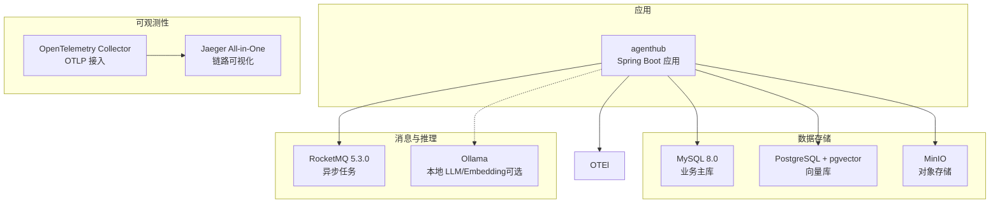
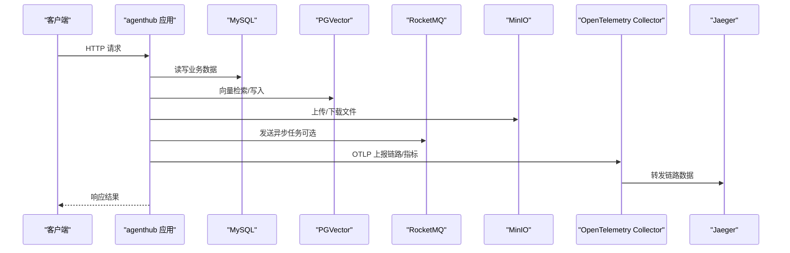
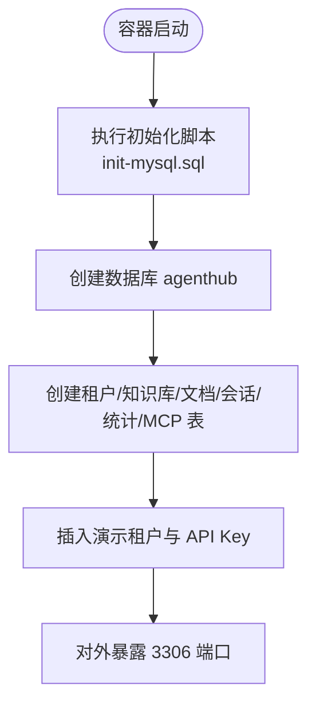
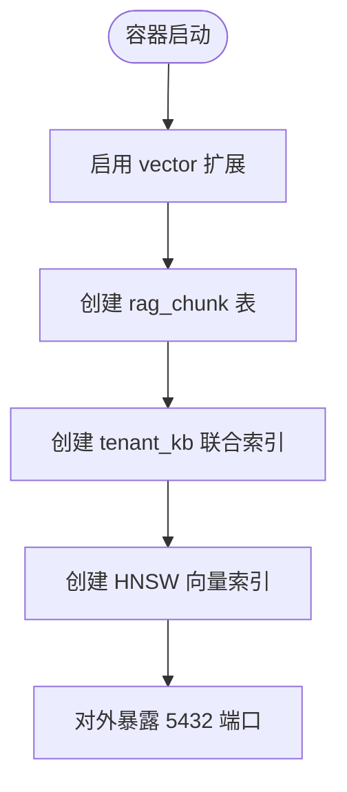
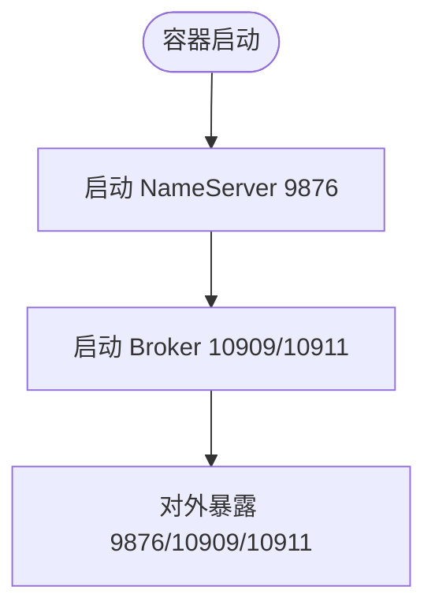
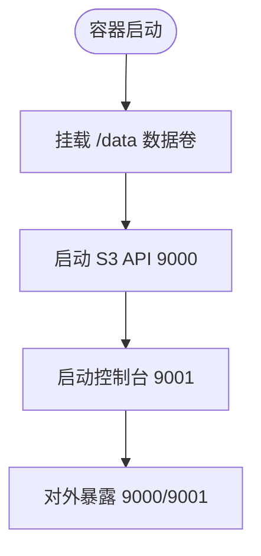
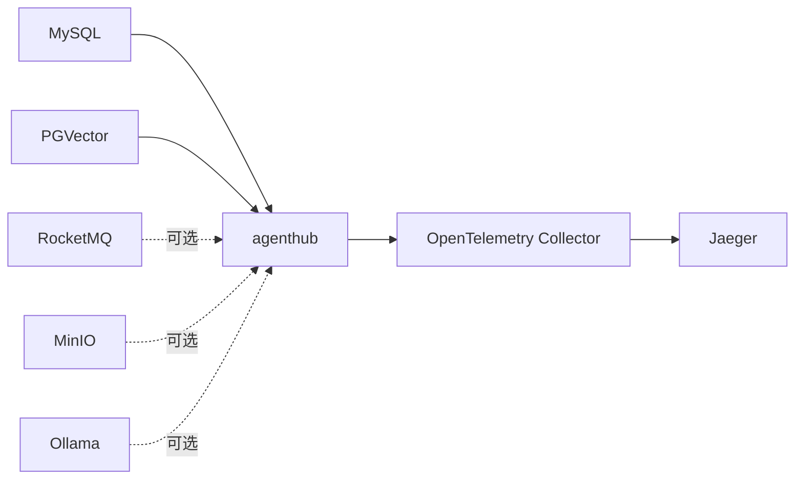
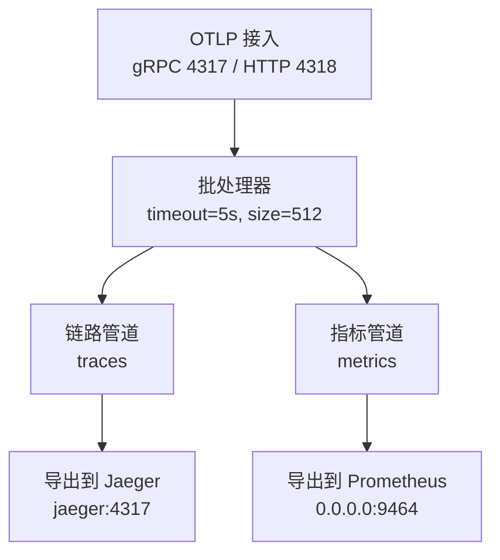

# 服务编排

<cite>
**本文引用的文件**   
- [docker-compose.yml](file://docker-compose.yml)
- [otel-collector-config.yaml](file://otel/otel-collector-config.yaml)
- [init-mysql.sql](file://sql/init-mysql.sql)
- [init-pgvector.sql](file://sql/init-pgvector.sql)
- [application.yml](file://src/main/resources/application.yml)
</cite>

## 目录
1. [简介](#简介)
2. [项目结构](#项目结构)
3. [核心组件](#核心组件)
4. [架构总览](#架构总览)
5. [详细组件分析](#详细组件分析)
6. [依赖关系与启动顺序](#依赖关系与启动顺序)
7. [OpenTelemetry Collector 配置详解](#opentelemetry-collector-配置详解)
8. [服务启停操作流程](#服务启停操作流程)
9. [网络、数据卷与环境变量说明](#网络数据卷与环境变量说明)
10. [常见问题排查](#常见问题排查)
11. [结论](#结论)

## 简介
本文件面向“java-agent-hub”项目的服务编排，围绕 docker-compose.yml 展开，完整说明 MySQL、PostgreSQL + pgvector、RocketMQ、MinIO、OpenTelemetry Collector、Jaeger 以及应用服务的配置要点。文档同时覆盖：
- 各服务的网络端口、数据卷挂载、初始化脚本注入
- OpenTelemetry Collector 的接收器、处理器链、导出器配置
- 服务间依赖关系与启动顺序控制
- 服务启动、停止、重启的标准操作流程
- 环境变量与业务配置的映射关系

## 项目结构
本项目采用“应用 + 外部依赖”的分层编排方式：
- 应用服务 agenthub：Spring Boot 应用，连接 MySQL、PGVector、可选 RocketMQ、MinIO、LLM/Embedding 后端，并通过 OTLP 上报链路到 OpenTelemetry Collector。
- 基础设施服务：MySQL、PostgreSQL（pgvector）、RocketMQ、MinIO、Ollama（可选）、OpenTelemetry Collector、Jaeger。
- 初始化脚本：MySQL 建库建表与种子数据；PostgreSQL 创建向量扩展、表与 HNSW 索引。
- 可观测性：应用通过 Micrometer Tracing + OTLP 将链路和指标发送到 OpenTelemetry Collector，Collector 转发至 Jaeger 与 Prometheus。

图表来源
- [docker-compose.yml:11-173](file://docker-compose.yml#L11-L173)
- [application.yml:31-44](file://src/main/resources/application.yml#L31-L44)

章节来源
- [docker-compose.yml:1-181](file://docker-compose.yml#L1-L181)
- [application.yml:1-155](file://src/main/resources/application.yml#L1-L155)

## 核心组件
- MySQL 8.0：业务主库，自动执行 init-mysql.sql 完成建库建表与种子数据。
- PostgreSQL + pgvector：向量数据库，自动执行 init-pgvector.sql 创建 rag_chunk 表与 HNSW 索引。
- RocketMQ 5.3.0：异步任务队列，用于文档解析与向量化等后台任务。
- MinIO：对象存储，支持本地磁盘模式或 S3 兼容接口。
- OpenTelemetry Collector：接收 OTLP gRPC/HTTP，批量处理后导出到 Jaeger 与 Prometheus。
- Jaeger：链路追踪可视化 UI。
- Ollama（可选）：本地大模型与 Embedding 服务，需 GPU 或大内存环境。
- agenthub：应用服务，默认使用 local MQ、local 存储、mock 模型，便于快速体验。

章节来源
- [docker-compose.yml:12-173](file://docker-compose.yml#L12-L173)
- [application.yml:46-149](file://src/main/resources/application.yml#L46-L149)

## 架构总览
下图展示应用与各依赖服务之间的调用关系，以及可观测性数据流：

图表来源
- [docker-compose.yml:137-173](file://docker-compose.yml#L137-L173)
- [otel-collector-config.yaml:1-34](file://otel/otel-collector-config.yaml#L1-L34)
- [application.yml:31-44](file://src/main/resources/application.yml#L31-L44)

## 详细组件分析

### MySQL 服务
- 镜像与容器名：mysql:8.0 / agenthub-mysql
- 端口：3306
- 环境变量：ROOT 密码、数据库名、用户与密码、时区
- 命令参数：设置字符集与排序规则为 utf8mb4
- 数据卷：持久化 /var/lib/mysql
- 初始化脚本：挂载 sql/init-mysql.sql 到 /docker-entrypoint-initdb.d
- 健康检查：使用 mysqladmin ping 检测可用性

图表来源
- [docker-compose.yml:12-34](file://docker-compose.yml#L12-L34)
- [init-mysql.sql:1-196](file://sql/init-mysql.sql#L1-L196)

章节来源
- [docker-compose.yml:12-34](file://docker-compose.yml#L12-L34)
- [init-mysql.sql:1-196](file://sql/init-mysql.sql#L1-L196)

### PostgreSQL + pgvector 服务
- 镜像与容器名：pgvector/pgvector:pg16 / agenthub-pgvector
- 端口：5432
- 环境变量：用户、密码、数据库名、时区
- 数据卷：持久化 /var/lib/postgresql/data
- 初始化脚本：挂载 sql/init-pgvector.sql 到 /docker-entrypoint-initdb.d
- 健康检查：使用 pg_isready 检测可用性

图表来源
- [docker-compose.yml:36-54](file://docker-compose.yml#L36-L54)
- [init-pgvector.sql:1-32](file://sql/init-pgvector.sql#L1-L32)

章节来源
- [docker-compose.yml:36-54](file://docker-compose.yml#L36-L54)
- [init-pgvector.sql:1-32](file://sql/init-pgvector.sql#L1-L32)

### RocketMQ 服务
- 镜像与容器名：apache/rocketmq:5.3.0 / agenthub-rocketmq
- 端口：9876（NameServer）、10909（Broker 对外）、10911（Broker 内部）
- 环境变量：JVM 参数
- 数据卷：持久化日志目录
- 健康检查：通过 NameServer 集群列表接口探测

图表来源
- [docker-compose.yml:56-72](file://docker-compose.yml#L56-L72)

章节来源
- [docker-compose.yml:56-72](file://docker-compose.yml#L56-L72)

### MinIO 服务
- 镜像与容器名：minio/minio:latest / agenthub-minio
- 命令：server /data --console-address ":9001"
- 端口：9000（S3 API）、9001（控制台）
- 环境变量：根用户与密码
- 数据卷：持久化 /data
- 健康检查：mc ready local

图表来源
- [docker-compose.yml:74-91](file://docker-compose.yml#L74-L91)

章节来源
- [docker-compose.yml:74-91](file://docker-compose.yml#L74-L91)

### Ollama 服务（可选）
- 镜像与容器名：ollama/ollama:latest / agenthub-ollama
- 端口：11434
- 数据卷：持久化 /root/.ollama
- profiles：llm（按需启用）

章节来源
- [docker-compose.yml:93-102](file://docker-compose.yml#L93-L102)

### OpenTelemetry Collector 服务
- 镜像与容器名：otel/opentelemetry-collector-contrib:0.111.0 / agenthub-otel-collector
- 命令：加载配置文件 /etc/otel-collector-config.yaml
- 端口：4317（OTLP gRPC）、4318（OTLP HTTP）、9464（Prometheus 拉取）
- 数据卷：只读挂载 otel/otel-collector-config.yaml
- 依赖：jaeger（确保 Jaeger 先启动）

章节来源
- [docker-compose.yml:103-115](file://docker-compose.yml#L103-L115)

### Jaeger 服务
- 镜像与容器名：jaegertracing/all-in-one:1.62.0 / agenthub-jaeger
- 环境变量：COLLECTOR_OTLP_ENABLED=true
- 端口：16686（UI）、4317（OTLP）

章节来源
- [docker-compose.yml:117-125](file://docker-compose.yml#L117-L125)

### 应用服务 agenthub
- 构建：基于 Dockerfile 构建镜像 agenthub:1.0.0
- 依赖：
  - mysql：service_healthy
  - pgvector：service_healthy
- 环境变量：
  - MySQL/PG 连接信息
  - MQ_TYPE、STORAGE_TYPE、LLM_DEFAULT_MODEL、EMBEDDING_MODEL、AGENT_ENGINE
  - OTEL_EXPORTER_OTLP_ENDPOINT 指向 otel-collector
- 端口：8080
- 重启策略：unless-stopped

章节来源
- [docker-compose.yml:136-173](file://docker-compose.yml#L136-L173)
- [application.yml:1-155](file://src/main/resources/application.yml#L1-L155)

## 依赖关系与启动顺序
- 应用服务 agenthub 依赖 MySQL 与 PGVector 的健康状态，确保数据库可用后再启动应用。
- OpenTelemetry Collector 依赖 Jaeger，确保链路导出目标就绪。
- RocketMQ、MinIO、Ollama 为可选依赖，可通过环境变量切换行为。

图表来源
- [docker-compose.yml:114-115](file://docker-compose.yml#L114-L115)
- [docker-compose.yml:141-145](file://docker-compose.yml#L141-L145)

章节来源
- [docker-compose.yml:114-115](file://docker-compose.yml#L114-L115)
- [docker-compose.yml:141-145](file://docker-compose.yml#L141-L145)

## OpenTelemetry Collector 配置详解
OpenTelemetry Collector 负责接收 OTLP 数据，经批处理处理器后分别导出到 Jaeger（链路）与 Prometheus（指标）。

- 接收器 receivers
  - otlp：同时启用 gRPC（4317）与 HTTP（4318）协议端点
- 处理器 processors
  - batch：批量聚合，超时 5s，批次大小 512
- 导出器 exporters
  - otlp/jaeger：导出链路到 jaeger:4317，TLS 不安全模式
  - prometheus：在 0.0.0.0:9464 暴露 Prometheus 拉取端点
- 服务 service pipelines
  - traces：receivers=[otlp], processors=[batch], exporters=[otlp/jaeger]
  - metrics：receivers=[otlp], processors=[batch], exporters=[prometheus]

图表来源
- [otel-collector-config.yaml:1-34](file://otel/otel-collector-config.yaml#L1-L34)

章节来源
- [otel-collector-config.yaml:1-34](file://otel/otel-collector-config.yaml#L1-L34)

## 服务启停操作流程

### 前置准备
- 构建应用镜像：mvn clean package -DskipTests && docker build -t agenthub:1.0.0 .
- 确认宿主机已安装 Docker 与 docker compose 插件

### 启动依赖服务
- 仅启动基础依赖（不构建应用镜像，本地 IDE 运行应用）：
  - docker compose up -d mysql pgvector
- 启动全部依赖（含 RocketMQ、MinIO、Otel、Jaeger）：
  - docker compose up -d mysql pgvector rocketmq minio otel-collector jaeger

### 启动应用服务
- 启动应用：
  - docker compose up -d agenthub

### 停止服务
- 停止所有服务：
  - docker compose down
- 停止并删除数据卷（谨慎操作，会清空持久化数据）：
  - docker compose down -v

### 重启服务
- 重启应用：
  - docker compose restart agenthub
- 重启特定依赖（例如 MySQL）：
  - docker compose restart mysql

### 查看状态与日志
- 查看服务状态：
  - docker compose ps
- 查看应用日志：
  - docker compose logs -f agenthub
- 查看依赖日志（以 MySQL 为例）：
  - docker compose logs -f mysql

章节来源
- [docker-compose.yml:1-9](file://docker-compose.yml#L1-L9)
- [docker-compose.yml:136-173](file://docker-compose.yml#L136-L173)

## 网络、数据卷与环境变量说明

### 网络与端口
- MySQL：3306
- PGVector：5432
- RocketMQ：9876、10909、10911
- MinIO：9000（API）、9001（控制台）
- OTEL Collector：4317（gRPC）、4318（HTTP）、9464（Prometheus）
- Jaeger：16686（UI）、4317（OTLP）
- agenthub：8080
- Ollama（可选）：11434

章节来源
- [docker-compose.yml:25-26](file://docker-compose.yml#L25-L26)
- [docker-compose.yml:45-46](file://docker-compose.yml#L45-L46)
- [docker-compose.yml:62-65](file://docker-compose.yml#L62-L65)
- [docker-compose.yml:82-84](file://docker-compose.yml#L82-L84)
- [docker-compose.yml:108-111](file://docker-compose.yml#L108-L111)
- [docker-compose.yml:123-125](file://docker-compose.yml#L123-L125)
- [docker-compose.yml:171-172](file://docker-compose.yml#L171-L172)
- [docker-compose.yml:98-99](file://docker-compose.yml#L98-L99)

### 数据卷挂载
- mysql-data:/var/lib/mysql
- pgvector-data:/var/lib/postgresql/data
- rocketmq-data:/home/rocketmq/logs
- minio-data:/data
- ollama-data:/root/.ollama

章节来源
- [docker-compose.yml:27-29](file://docker-compose.yml#L27-L29)
- [docker-compose.yml:47-49](file://docker-compose.yml#L47-L49)
- [docker-compose.yml:66-67](file://docker-compose.yml#L66-L67)
- [docker-compose.yml:85-86](file://docker-compose.yml#L85-L86)
- [docker-compose.yml:100-101](file://docker-compose.yml#L100-L101)
- [docker-compose.yml:175-181](file://docker-compose.yml#L175-L181)

### 环境变量与业务配置映射
- MySQL 连接：MYSQL_HOST、MYSQL_PORT、MYSQL_USER、MYSQL_PASSWORD
- PGVector 连接：PG_HOST、PG_PORT、PG_USER、PG_PASSWORD、PG_DB
- MQ 类型与地址：MQ_TYPE、ROCKETMQ_NAMESRV
- 存储类型与 MinIO：STORAGE_TYPE、MINIO_HOST、MINIO_ACCESS_KEY、MINIO_SECRET_KEY
- LLM/Embedding：LLM_DEFAULT_MODEL、EMBEDDING_MODEL、OLLAMA_BASE_URL
- Agent 引擎：AGENT_ENGINE
- OTLP 导出端点：OTEL_EXPORTER_OTLP_ENDPOINT

这些环境变量在 application.yml 中以 ${VAR:default} 形式读取，并在 docker-compose.yml 中为 agenthub 服务注入。

章节来源
- [docker-compose.yml:146-170](file://docker-compose.yml#L146-L170)
- [application.yml:8-12](file://src/main/resources/application.yml#L8-L12)
- [application.yml:64-70](file://src/main/resources/application.yml#L64-L70)
- [application.yml:77-86](file://src/main/resources/application.yml#L77-L86)
- [application.yml:92-97](file://src/main/resources/application.yml#L92-L97)
- [application.yml:98-149](file://src/main/resources/application.yml#L98-L149)
- [application.yml:31-44](file://src/main/resources/application.yml#L31-L44)

## 常见问题排查
- 应用无法连接 MySQL/PGVector
  - 检查 healthcheck 是否通过，确认服务已就绪
  - 核对环境变量中的 host/port/user/password/db 是否与 compose 一致
- RocketMQ 不可用
  - 确认 NameServer 9876 端口可达，Broker 10909/10911 正常
  - 检查 MQ_TYPE 是否为 rocketmq，ROCKETMQ_NAMESRV 是否正确
- MinIO 无法访问
  - 确认 9000/9001 端口开放，MINIO_HOST 与 access/secret key 正确
- OTEL/Jaeger 无链路
  - 确认 OTEL_EXPORTER_OTLP_ENDPOINT 指向 otel-collector:4318/v1/traces
  - 检查 otel-collector 是否成功启动且 jaeger 已就绪
- 向量检索失败
  - 确认 PGVector 已启用 vector 扩展，rag_chunk 表与 HNSW 索引存在
  - 核对 dimension 与 embedding 模型输出维度一致

章节来源
- [docker-compose.yml:30-34](file://docker-compose.yml#L30-L34)
- [docker-compose.yml:50-54](file://docker-compose.yml#L50-L54)
- [docker-compose.yml:68-72](file://docker-compose.yml#L68-L72)
- [docker-compose.yml:87-91](file://docker-compose.yml#L87-L91)
- [docker-compose.yml:114-115](file://docker-compose.yml#L114-L115)
- [docker-compose.yml:141-145](file://docker-compose.yml#L141-L145)
- [init-pgvector.sql:13-31](file://sql/init-pgvector.sql#L13-L31)

## 结论
通过 docker-compose.yml 的统一编排，项目实现了“应用 + 多依赖服务”的一键启动与可观测性闭环。MySQL 与 PGVector 提供结构化与向量数据能力，RocketMQ 与 MinIO 支撑异步任务与对象存储，OpenTelemetry Collector 与 Jaeger 实现链路可视化。配合环境变量与 profiles，可在不同环境下灵活启用 RocketMQ、MinIO、Ollama 等可选组件，满足从本地快速体验到生产部署的多场景需求。