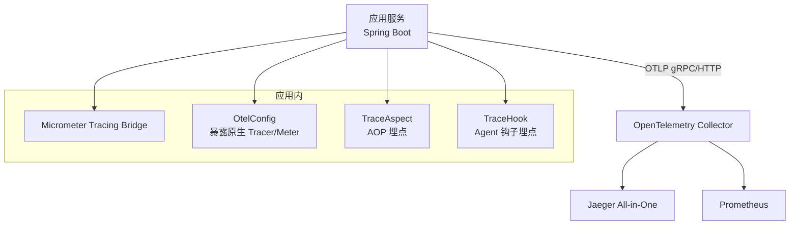
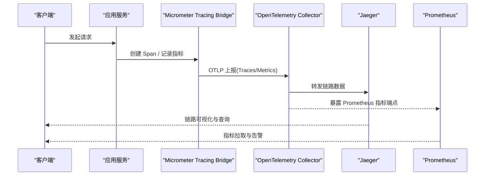
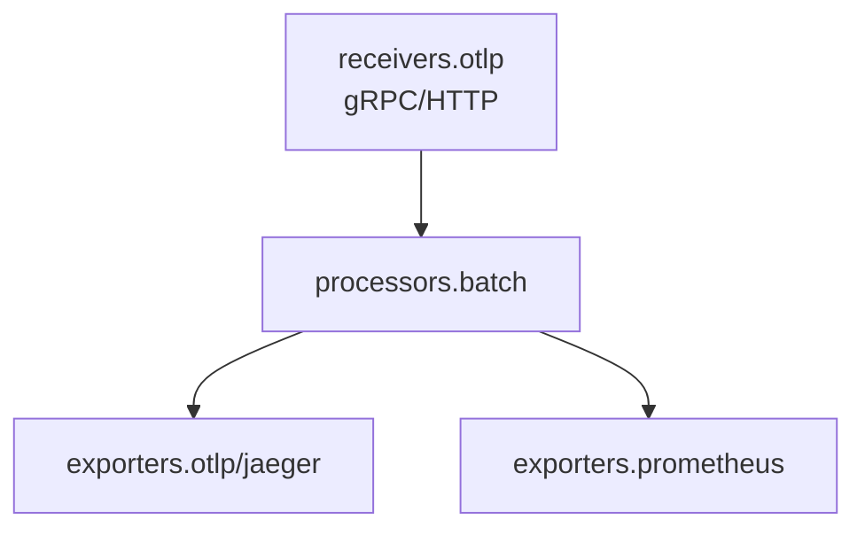
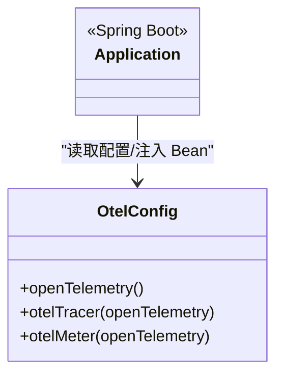
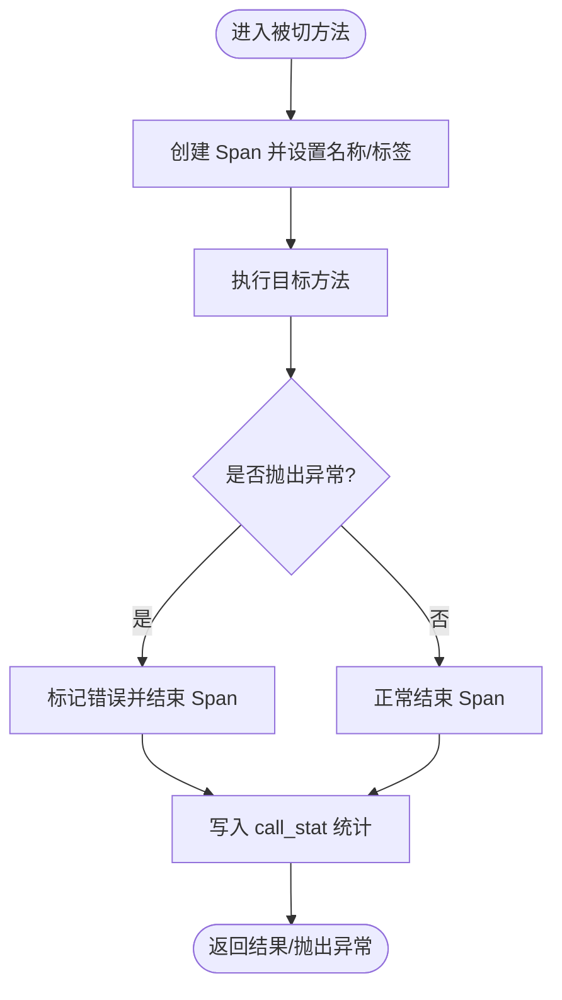
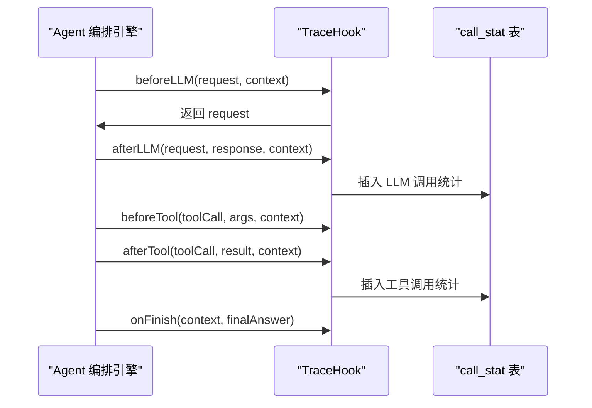
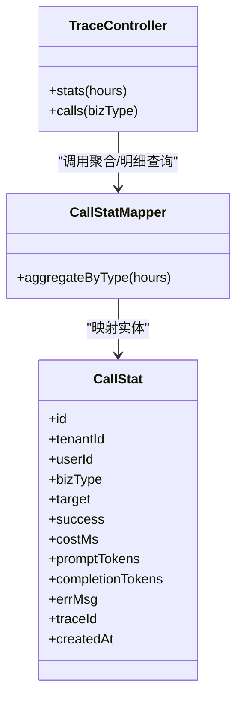
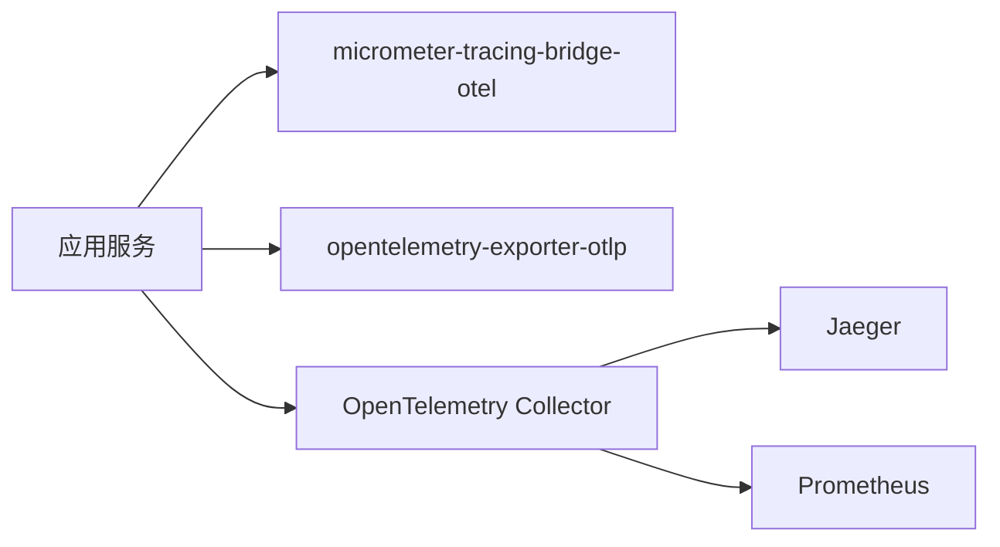

# 监控与追踪

<cite>
**本文引用的文件**   
- [otel-collector-config.yaml](file://otel/otel-collector-config.yaml)
- [application.yml](file://src/main/resources/application.yml)
- [OtelConfig.java](file://src/main/java/com/agenthub/tracing/config/OtelConfig.java)
- [TraceAspect.java](file://src/main/java/com/agenthub/tracing/aspect/TraceAspect.java)
- [TraceHook.java](file://src/main/java/com/agenthub/tracing/hook/TraceHook.java)
- [CallStat.java](file://src/main/java/com/agenthub/tracing/entity/CallStat.java)
- [CallStatMapper.java](file://src/main/java/com/agenthub/tracing/mapper/CallStatMapper.java)
- [TraceController.java](file://src/main/java/com/agenthub/tracing/controller/TraceController.java)
- [docker-compose.yml](file://docker-compose.yml)
- [pom.xml](file://pom.xml)
</cite>

## 目录
1. [简介](#简介)
2. [项目结构](#项目结构)
3. [核心组件](#核心组件)
4. [架构总览](#架构总览)
5. [详细组件分析](#详细组件分析)
6. [依赖关系分析](#依赖关系分析)
7. [性能与容量规划](#性能与容量规划)
8. [故障排查指南](#故障排查指南)
9. [结论](#结论)
10. [附录：Jaeger 查询与指标集成](#附录jaeger-查询与指标集成)

## 简介
本文件面向“监控与追踪”能力，重点说明 OpenTelemetry 在本项目的集成方式、OpenTelemetry Collector 配置、Java Agent 自动埋点（Micrometer Tracing Bridge + OTLP）、TraceAspect 切面实现原理、Jaeger 链路查询使用方式，以及 Prometheus 指标采集方案。目标是帮助读者快速搭建并理解从应用埋点到链路可视化的完整链路。

## 项目结构
本项目在可观测性方面采用如下组织方式：
- 应用侧通过 Spring Boot Actuator 的 Micrometer Tracing Bridge 将 Trace/Metrics 以 OTLP 协议上报到 OpenTelemetry Collector。
- Collector 负责批处理、转发链路到 Jaeger，并将指标暴露给 Prometheus 拉取。
- 业务层通过 AOP 切面和 Hook 对关键路径进行 Span 注入与统计落库，便于关联业务维度与链路 ID。

**图表来源**
- [application.yml:31-44](file://src/main/resources/application.yml#L31-L44)
- [otel-collector-config.yaml:1-34](file://otel/otel-collector-config.yaml#L1-L34)
- [docker-compose.yml:104-120](file://docker-compose.yml#L104-L120)

**章节来源**
- [application.yml:31-44](file://src/main/resources/application.yml#L31-L44)
- [otel-collector-config.yaml:1-34](file://otel/otel-collector-config.yaml#L1-L34)
- [docker-compose.yml:104-120](file://docker-compose.yml#L104-L120)

## 核心组件
- OpenTelemetry Collector 配置：定义 receivers、processors、exporters、service pipelines，统一接入链路和指标。
- Java 应用侧配置：通过 application.yml 启用 Micrometer OTLP 导出；OtelConfig 暴露原生 OpenTelemetry、Tracer、Meter。
- 埋点实现：TraceAspect 对 RAG 检索与文档解析做 AOP 埋点；TraceHook 在 Agent 编排生命周期中记录 LLM/工具调用。
- 统计存储：CallStat 实体与 CallStatMapper 提供聚合与明细查询接口，TraceController 对外暴露 REST API。

**章节来源**
- [otel-collector-config.yaml:1-34](file://otel/otel-collector-config.yaml#L1-L34)
- [application.yml:31-44](file://src/main/resources/application.yml#L31-L44)
- [OtelConfig.java:1-41](file://src/main/java/com/agenthub/tracing/config/OtelConfig.java#L1-L41)
- [TraceAspect.java:1-107](file://src/main/java/com/agenthub/tracing/aspect/TraceAspect.java#L1-L107)
- [TraceHook.java:1-111](file://src/main/java/com/agenthub/tracing/hook/TraceHook.java#L1-L111)
- [CallStat.java:1-53](file://src/main/java/com/agenthub/tracing/entity/CallStat.java#L1-L53)
- [CallStatMapper.java:1-30](file://src/main/java/com/agenthub/tracing/mapper/CallStatMapper.java#L1-L30)
- [TraceController.java:1-41](file://src/main/java/com/agenthub/tracing/controller/TraceController.java#L1-L41)

## 架构总览
下图展示从应用埋点到链路可视化与指标采集的整体流程。

**图表来源**
- [application.yml:31-44](file://src/main/resources/application.yml#L31-L44)
- [otel-collector-config.yaml:1-34](file://otel/otel-collector-config.yaml#L1-L34)
- [docker-compose.yml:104-120](file://docker-compose.yml#L104-L120)

## 详细组件分析

### OpenTelemetry Collector 配置结构
- receivers
  - otlp：同时开启 gRPC(4317) 与 HTTP(4318)，用于接收应用侧 OTLP 上报。
- processors
  - batch：批量处理器，设置超时与批次大小，提升吞吐。
- exporters
  - otlp/jaeger：将链路数据转发至 Jaeger（本地容器化部署）。
  - prometheus：暴露指标端点供 Prometheus 拉取。
- service.pipelines
  - traces：otlp → batch → otlp/jaeger
  - metrics：otlp → batch → prometheus

**图表来源**
- [otel-collector-config.yaml:1-34](file://otel/otel-collector-config.yaml#L1-L34)

**章节来源**
- [otel-collector-config.yaml:1-34](file://otel/otel-collector-config.yaml#L1-L34)

### Java 应用侧 OpenTelemetry 集成
- 通过 application.yml 的 management.otlp.tracing 与 management.otlp.metrics 启用 Micrometer Tracing Bridge 与 OTLP 指标导出。
- OtelConfig 暴露全局 OpenTelemetry 实例、Tracer、Meter，供需要细粒度 Span/指标的业务代码直接使用。
- 依赖版本由 pom.xml 管理，包含 micrometer-tracing-bridge-otel 与 opentelemetry-exporter-otlp。

**图表来源**
- [OtelConfig.java:1-41](file://src/main/java/com/agenthub/tracing/config/OtelConfig.java#L1-L41)
- [application.yml:31-44](file://src/main/resources/application.yml#L31-L44)
- [pom.xml:38,121-126](file://pom.xml#L38)
- [pom.xml:121-126](file://pom.xml#L121-L126)

**章节来源**
- [application.yml:31-44](file://src/main/resources/application.yml#L31-L44)
- [OtelConfig.java:1-41](file://src/main/java/com/agenthub/tracing/config/OtelConfig.java#L1-L41)
- [pom.xml:38](file://pom.xml#L38)
- [pom.xml:121-126](file://pom.xml#L121-L126)

### TraceAspect 切面实现原理
TraceAspect 基于 AspectJ Around 切面对指定方法进行拦截，完成以下动作：
- 创建 Micrometer Span，设置名称、租户标签、耗时标签。
- 捕获异常并标记错误。
- 异步写入 call_stat 表，附带 traceId，便于与链路关联。
- 针对 RAG 检索与文档解析两类方法分别命名 Span。

**图表来源**
- [TraceAspect.java:27-67](file://src/main/java/com/agenthub/tracing/aspect/TraceAspect.java#L27-L67)
- [TraceAspect.java:82-105](file://src/main/java/com/agenthub/tracing/aspect/TraceAspect.java#L82-L105)

**章节来源**
- [TraceAspect.java:1-107](file://src/main/java/com/agenthub/tracing/aspect/TraceAspect.java#L1-L107)

### TraceHook Agent 钩子埋点
TraceHook 实现 AgentHook 接口，在 Agent 编排的关键节点记录 LLM 调用与工具调用：
- beforeLLM/afterLLM：记录模型名、租户、耗时，并写入 token 用量。
- beforeTool/afterTool：记录工具名、耗时。
- onFinish：汇总整轮对话的工具调用次数等 Span 标签。
- record：构造 CallStat 并写入数据库，同时携带 traceId。

**图表来源**
- [TraceHook.java:37-82](file://src/main/java/com/agenthub/tracing/hook/TraceHook.java#L37-L82)
- [TraceHook.java:84-109](file://src/main/java/com/agenthub/tracing/hook/TraceHook.java#L84-L109)

**章节来源**
- [TraceHook.java:1-111](file://src/main/java/com/agenthub/tracing/hook/TraceHook.java#L1-L111)

### 调用统计模型与接口
- CallStat：记录租户、用户、业务类型、目标对象、成功与否、耗时、token 用量、错误信息、traceId、创建时间。
- CallStatMapper：提供按类型聚合的 SQL 查询（最近 N 小时）。
- TraceController：对外暴露 /api/v1/tracing/stats 与 /api/v1/tracing/calls 两个接口，分别返回聚合统计与最近调用明细。

**图表来源**
- [CallStat.java:1-53](file://src/main/java/com/agenthub/tracing/entity/CallStat.java#L1-L53)
- [CallStatMapper.java:1-30](file://src/main/java/com/agenthub/tracing/mapper/CallStatMapper.java#L1-L30)
- [TraceController.java:1-41](file://src/main/java/com/agenthub/tracing/controller/TraceController.java#L1-L41)

**章节来源**
- [CallStat.java:1-53](file://src/main/java/com/agenthub/tracing/entity/CallStat.java#L1-L53)
- [CallStatMapper.java:1-30](file://src/main/java/com/agenthub/tracing/mapper/CallStatMapper.java#L1-L30)
- [TraceController.java:1-41](file://src/main/java/com/agenthub/tracing/controller/TraceController.java#L1-L41)

## 依赖关系分析
- 应用依赖 Micrometer Tracing Bridge 与 OTLP Exporter，通过 application.yml 启用。
- Collector 依赖 docker-compose 提供的 jaeger 与自身配置文件。
- 版本管理集中在 pom.xml，确保 OTel 相关依赖版本一致。

**图表来源**
- [application.yml:31-44](file://src/main/resources/application.yml#L31-L44)
- [pom.xml:121-126](file://pom.xml#L121-L126)
- [docker-compose.yml:104-120](file://docker-compose.yml#L104-L120)

**章节来源**
- [application.yml:31-44](file://src/main/resources/application.yml#L31-L44)
- [pom.xml:121-126](file://pom.xml#L121-L126)
- [docker-compose.yml:104-120](file://docker-compose.yml#L104-L120)

## 性能与容量规划
- Collector 批处理
  - 合理调整 batch.timeout 与 send_batch_size，平衡延迟与吞吐。
- 应用侧 Span 数量
  - 避免过度细粒度 Span，优先在关键业务边界（RAG 检索、文档解析、LLM 调用、工具调用）打点。
- 指标采集
  - Prometheus 拉取频率与应用指标量需匹配，必要时在 Collector 侧增加批处理或采样策略。
- 存储与查询
  - Jaeger 与数据库（call_stat）需根据 QPS 与保留周期规划容量。

[本节为通用建议，不直接分析具体文件]

## 故障排查指南
- 链路未上报
  - 检查 application.yml 中 management.otlp.tracing.endpoint 是否正确指向 Collector。
  - 确认 Collector 的 receivers.otlp 端口已开放且未被防火墙阻断。
- 指标不可见
  - 检查 Collector 的 exporters.prometheus.endpoint 是否可达。
  - 确认 Prometheus 已正确配置抓取该端点。
- 统计落库失败
  - TraceAspect 与 TraceHook 在落库失败时仅记录警告日志，不影响主流程；可关注日志中的 bizType 与错误信息。
- 租户上下文缺失
  - 若 TenantContext 为空，TraceAspect 会忽略统计写入；请确保在请求入口设置租户上下文。

**章节来源**
- [application.yml:31-44](file://src/main/resources/application.yml#L31-L44)
- [otel-collector-config.yaml:1-34](file://otel/otel-collector-config.yaml#L1-L34)
- [TraceAspect.java:82-105](file://src/main/java/com/agenthub/tracing/aspect/TraceAspect.java#L82-L105)
- [TraceHook.java:84-109](file://src/main/java/com/agenthub/tracing/hook/TraceHook.java#L84-L109)

## 结论
本项目通过 Micrometer Tracing Bridge 与 OpenTelemetry Collector 实现了开箱即用的链路追踪与指标采集。TraceAspect 与 TraceHook 覆盖了 RAG 检索、文档解析、LLM 与工具调用的关键路径，配合 call_stat 表与 TraceController 提供业务维度的统计与明细查询。Collector 将链路转发至 Jaeger，指标暴露给 Prometheus，形成完整的可观测性闭环。

[本节为总结性内容，不直接分析具体文件]

## 附录：Jaeger 查询与指标集成

### Jaeger 查询接口使用说明
- 环境准备
  - 通过 docker-compose 启动 jaeger 与 otel-collector，确保 Collector 的 exporters.otlp/jaeger.endpoint 指向 jaeger 服务。
- 链路查看
  - 在 Jaeger UI 中按 Service、Operation、Time Range 筛选，结合 tenant.id、model、tool 等 Span Tag 过滤。
- 性能分析
  - 查看 Span 树与耗时分布，定位慢调用与瓶颈环节。
- 错误追踪
  - 利用 Span.error 与 call_stat.errMsg 快速定位异常堆栈与错误原因。

**章节来源**
- [docker-compose.yml:104-120](file://docker-compose.yml#L104-L120)
- [otel-collector-config.yaml:14-19](file://otel/otel-collector-config.yaml#L14-L19)
- [TraceAspect.java:50-67](file://src/main/java/com/agenthub/tracing/aspect/TraceAspect.java#L50-L67)
- [TraceHook.java:48-59](file://src/main/java/com/agenthub/tracing/hook/TraceHook.java#L48-L59)

### 监控指标定义与 Prometheus 集成
- 指标来源
  - 应用侧通过 Micrometer 暴露 JVM、HTTP、业务自定义指标。
  - Collector 通过 exporters.prometheus 暴露 OTLP 指标端点。
- 集成步骤
  - 在 Prometheus 中添加 scrape_config，抓取 Collector 的 prometheus exporter 端点。
  - 在 Grafana 中对接 Prometheus，构建仪表盘。
- 常用指标
  - JVM 内存、GC、线程数。
  - HTTP 请求计数、延迟、错误率。
  - 业务指标：RAG 检索耗时、文档解析耗时、LLM 调用耗时、工具调用耗时、token 用量。

**章节来源**
- [otel-collector-config.yaml:20-23](file://otel/otel-collector-config.yaml#L20-L23)
- [application.yml:31-44](file://src/main/resources/application.yml#L31-L44)