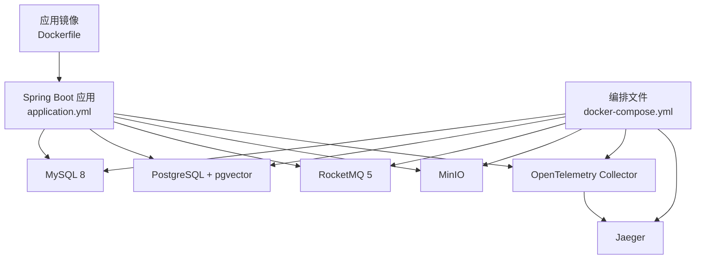
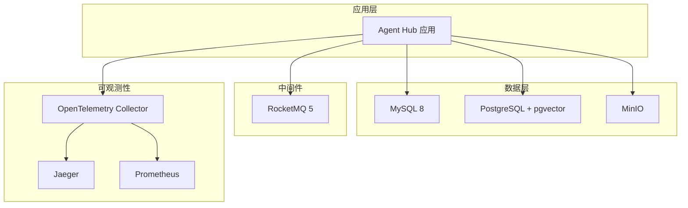
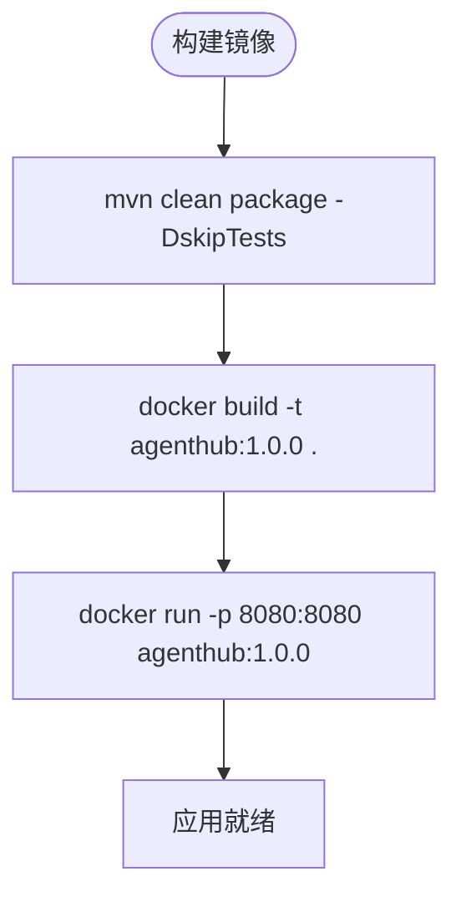
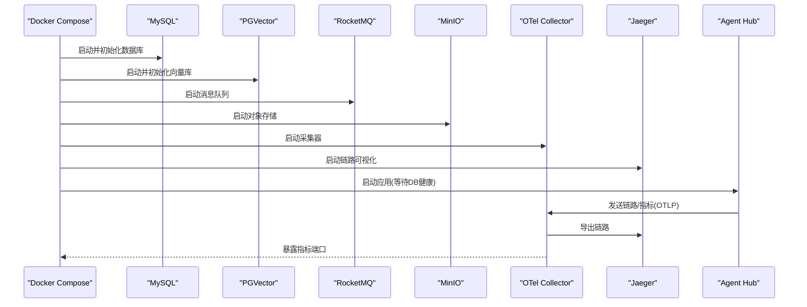
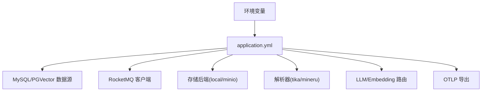
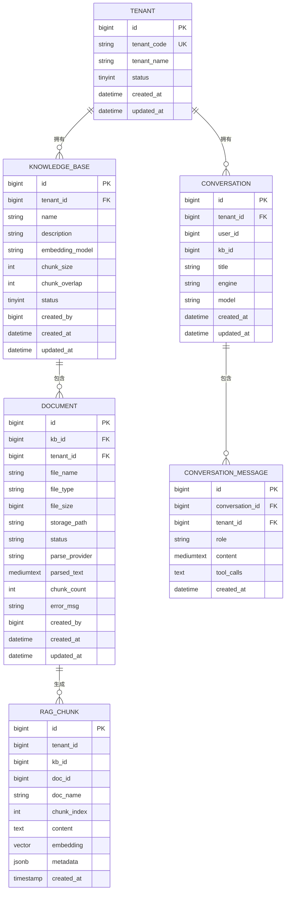
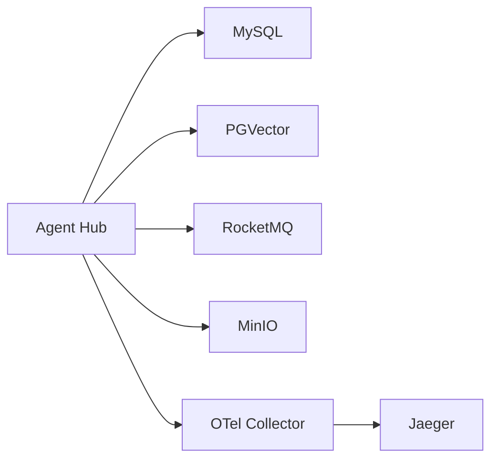
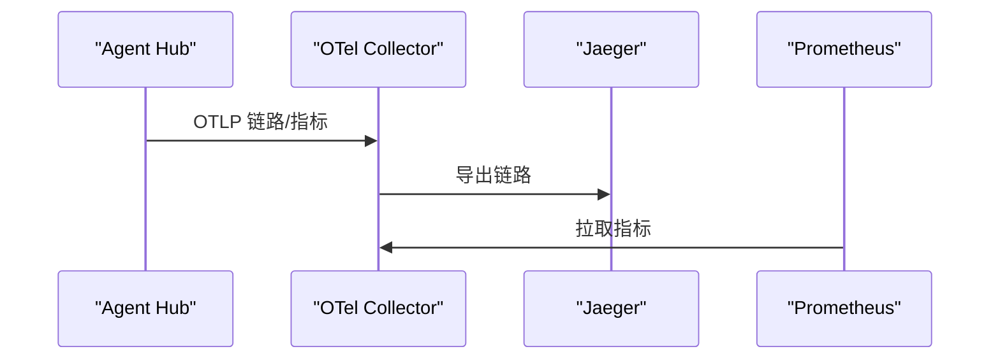

# 部署运维

<cite>
**本文引用的文件**   
- [Dockerfile](file://Dockerfile)
- [docker-compose.yml](file://docker-compose.yml)
- [application.yml](file://src/main/resources/application.yml)
- [otel-collector-config.yaml](file://otel/otel-collector-config.yaml)
- [init-mysql.sql](file://sql/init-mysql.sql)
- [init-pgvector.sql](file://sql/init-pgvector.sql)
</cite>

## 目录
1. [简介](#简介)
2. [项目结构](#项目结构)
3. [核心组件](#核心组件)
4. [架构总览](#架构总览)
5. [详细组件分析](#详细组件分析)
6. [依赖关系分析](#依赖关系分析)
7. [性能与容量规划](#性能与容量规划)
8. [监控与可观测性](#监控与可观测性)
9. [Kubernetes 部署最佳实践](#kubernetes-部署最佳实践)
10. [故障排查指南](#故障排查指南)
11. [备份与恢复策略](#备份与恢复策略)
12. [结论](#结论)

## 简介
本文面向生产环境，提供 Java Agent Hub 的容器化部署、编排、监控告警、故障排查与备份恢复等全链路运维文档。内容覆盖：
- Docker 镜像构建与运行
- docker-compose 一键拉起 MySQL、PostgreSQL + pgvector、RocketMQ、MinIO、OpenTelemetry Collector、Jaeger 等依赖
- Kubernetes 资源定义建议（Deployment、Service、ConfigMap、Secret）
- OpenTelemetry 链路追踪、Prometheus 指标采集、日志收集方案
- 常见问题诊断、性能调优与容量规划
- 数据备份与恢复策略

## 项目结构
仓库采用 Spring Boot 多模块业务组织方式，关键部署相关资产如下：
- 应用打包与运行：Dockerfile
- 本地与测试环境编排：docker-compose.yml
- 运行时配置：application.yml
- 可观测性采集：otel/otel-collector-config.yaml
- 数据库初始化脚本：sql/init-mysql.sql、sql/init-pgvector.sql

图示来源
- [Dockerfile:1-26](file://Dockerfile#L1-L26)
- [docker-compose.yml:1-181](file://docker-compose.yml#L1-L181)
- [application.yml:1-155](file://src/main/resources/application.yml#L1-L155)
- [otel-collector-config.yaml:1-34](file://otel/otel-collector-config.yaml#L1-L34)

章节来源
- [Dockerfile:1-26](file://Dockerfile#L1-L26)
- [docker-compose.yml:1-181](file://docker-compose.yml#L1-L181)
- [application.yml:1-155](file://src/main/resources/application.yml#L1-L155)

## 核心组件
- 应用服务：Java Agent Hub，暴露 HTTP API，默认端口 8080
- 业务数据库：MySQL 8，存储租户、知识库、文档、会话、统计等
- 向量数据库：PostgreSQL + pgvector，存储文本块与向量索引
- 消息队列：RocketMQ 5，用于文档解析与向量化异步任务
- 对象存储：MinIO，用于文档原始文件与解析产物存储
- 可观测性：OpenTelemetry Collector 接收 OTLP，导出链路至 Jaeger，指标暴露给 Prometheus

章节来源
- [application.yml:1-155](file://src/main/resources/application.yml#L1-L155)
- [docker-compose.yml:1-181](file://docker-compose.yml#L1-L181)

## 架构总览
Agent Hub 通过环境变量与 application.yml 组合完成依赖接入；OpenTelemetry 负责将链路和指标统一采集并转发到后端系统。

图示来源
- [docker-compose.yml:1-181](file://docker-compose.yml#L1-L181)
- [application.yml:1-155](file://src/main/resources/application.yml#L1-L155)
- [otel-collector-config.yaml:1-34](file://otel/otel-collector-config.yaml#L1-L34)

## 详细组件分析

### Docker 镜像构建与运行
- 基础镜像：eclipse-temurin:17-jre
- 时区与字体：Asia/Shanghai，安装中文字体以支持 PDF 解析
- 工作目录：/app
- 入口命令：java $JAVA_OPTS -jar app.jar
- 内存参数：可通过 JAVA_OPTS 调整堆大小
- 可选：挂载 OpenTelemetry Java Agent 实现自动埋点

图示来源
- [Dockerfile:1-26](file://Dockerfile#L1-L26)

章节来源
- [Dockerfile:1-26](file://Dockerfile#L1-L26)

### docker-compose 编排详解
- MySQL 8
  - 自动执行 sql/init-mysql.sql
  - 健康检查使用 mysqladmin ping
  - 持久化卷：mysql-data
- PostgreSQL + pgvector
  - 自动执行 sql/init-pgvector.sql
  - 健康检查使用 pg_isready
  - 持久化卷：pgvector-data
- RocketMQ 5
  - 暴露 NameServer 与 Broker 端口
  - 持久化卷：rocketmq-data
- MinIO
  - 暴露 S3 API 与控制台
  - 持久化卷：minio-data
- OpenTelemetry Collector
  - 接收 OTLP gRPC/HTTP
  - 导出链路到 Jaeger，指标暴露 Prometheus
- Jaeger
  - 可视化链路
- 应用 agenthub
  - 依赖 MySQL、PGVector 健康状态
  - 通过环境变量注入各依赖连接信息
  - 默认启用 local MQ、local 存储、Mock LLM/Embedding

图示来源
- [docker-compose.yml:1-181](file://docker-compose.yml#L1-L181)
- [otel-collector-config.yaml:1-34](file://otel/otel-collector-config.yaml#L1-L34)

章节来源
- [docker-compose.yml:1-181](file://docker-compose.yml#L1-L181)

### 应用运行时配置
- 服务器端口：8080
- 数据源
  - MySQL：主库，HikariCP 连接池
  - PGVector：独立 JDBC URL，由 PgVectorStore 管理
- MyBatis-Plus：驼峰映射、关闭 banner
- 可观测性
  - Micrometer Tracing + OTLP 导出
  - 暴露 /actuator/prometheus 指标端点
- RocketMQ：NameServer、Producer Group、超时
- 平台能力开关
  - 安全与租户头
  - 向量检索 TopK、RRF 融合
  - 存储类型：local/minio
  - 解析器：tika/mineru
  - MQ 模式：local/rocketmq
  - LLM/Embedding 路由与 Provider
  - Agent 引擎：builtin/agentscope

图示来源
- [application.yml:1-155](file://src/main/resources/application.yml#L1-L155)

章节来源
- [application.yml:1-155](file://src/main/resources/application.yml#L1-L155)

### 数据库初始化
- MySQL
  - 建库建表：租户、用户、API Key、知识库、成员、文档、会话、消息、Token 用量、调用统计、MCP Server 配置
  - 种子数据：演示租户、管理员账号、默认 API Key、演示知识库
- PostgreSQL + pgvector
  - 启用 vector 扩展
  - rag_chunk 表：包含 tenant_id/kb_id/doc_id/content/embedding/metadata
  - 索引：tenant+kb 联合索引、HNSW 余弦相似度向量索引

图示来源
- [init-mysql.sql:1-196](file://sql/init-mysql.sql#L1-L196)
- [init-pgvector.sql:1-32](file://sql/init-pgvector.sql#L1-L32)

章节来源
- [init-mysql.sql:1-196](file://sql/init-mysql.sql#L1-L196)
- [init-pgvector.sql:1-32](file://sql/init-pgvector.sql#L1-L32)

## 依赖关系分析
- 应用对 MySQL 的访问：通过 HikariCP 连接池，受 maximum-pool-size、minimum-idle、connection-timeout 控制
- 应用对 PGVector 的访问：独立 JDBC URL，维度需与 Embedding 模型一致
- 应用对 RocketMQ 的访问：NameServer 地址、Producer Group、超时时间
- 应用对 MinIO 的访问：endpoint、access-key、secret-key、bucket
- 应用对 OpenTelemetry 的访问：OTLP endpoint，默认指向 otel-collector

图示来源
- [application.yml:1-155](file://src/main/resources/application.yml#L1-L155)
- [docker-compose.yml:1-181](file://docker-compose.yml#L1-L181)

章节来源
- [application.yml:1-155](file://src/main/resources/application.yml#L1-L155)
- [docker-compose.yml:1-181](file://docker-compose.yml#L1-L181)

## 性能与容量规划
- JVM 堆内存
  - 默认 -Xms512m -Xmx1g，生产建议根据 QPS 与 GC 情况上调，避免频繁 Full GC
- 数据库连接池
  - HikariCP maximum-pool-size 建议与并发量匹配，避免连接耗尽
  - connection-timeout 不宜过小，防止瞬时抖动误判
- 向量检索
  - dimension 必须与 Embedding 模型输出维度一致
  - rrf-k、vector-top-k、keyword-top-k 影响召回与排序质量，可按业务场景调参
- 对象存储
  - 大文件上传建议使用分片上传，结合 MinIO 控制台或 SDK 优化
- 消息队列
  - RocketMQ Producer send-message-timeout 与重试策略需与下游消费能力匹配
- 解析器
  - MinerU 高精度但资源消耗高，Tika 作为降级方案

[本节为通用指导，不直接分析具体文件]

## 监控与可观测性
- 链路追踪
  - 应用通过 Micrometer Tracing 将链路以 OTLP 格式发送到 OpenTelemetry Collector
  - Collector 将链路导出到 Jaeger，便于可视化分析
- 指标采集
  - Collector 暴露 Prometheus 拉取端点，Prometheus 定期抓取
- 日志收集
  - 建议配合容器日志驱动（如 fluent-bit/filebeat）将 stdout/stderr 汇聚到 ELK/Loki

图示来源
- [application.yml:31-44](file://src/main/resources/application.yml#L31-L44)
- [otel-collector-config.yaml:1-34](file://otel/otel-collector-config.yaml#L1-L34)

章节来源
- [application.yml:31-44](file://src/main/resources/application.yml#L31-L44)
- [otel-collector-config.yaml:1-34](file://otel/otel-collector-config.yaml#L1-L34)

## Kubernetes 部署最佳实践
说明：当前仓库未提供 K8s 清单，以下为基于现有配置的推荐资源定义要点。

- Deployment
  - replicas：按 QPS 与资源预算设置初始副本数
  - resources：requests/limits 限制 CPU/内存，避免节点资源争用
  - envFrom：从 Secret/ConfigMap 注入敏感与非敏感配置
  - readinessProbe/livenessProbe：基于 /actuator/health 或自定义健康端点
  - strategy：滚动更新，保障零停机发布
- Service
  - type：ClusterIP 内部访问；如需外部暴露可使用 Ingress
  - ports：8080/TCP
- ConfigMap
  - 非敏感配置：server.port、agenthub.* 业务开关、parser.provider、storage.type、llm.providers、embedding.providers 等
- Secret
  - 敏感配置：MYSQL_USER/PASSWORD、PG_USER/PASSWORD、MINIO_ACCESS_KEY/SECRET_KEY、OPENAI_API_KEY 等
- PersistentVolumeClaim
  - 若使用本地存储（STORAGE_TYPE=local），需为 ./data/files 挂载 PVC
- HorizontalPodAutoscaler
  - 基于 CPU/内存或自定义指标（如请求延迟、队列积压）进行扩缩容
- NetworkPolicy
  - 仅允许必要端口互通，最小权限原则
- PodDisruptionBudget
  - 保证滚动升级期间至少保留一个可用实例

[本节为概念性指导，不直接分析具体文件]

## 故障排查指南
- 应用无法连接 MySQL
  - 检查 MYSQL_HOST/MYSQL_PORT/MYSQL_USER/MYSQL_PASSWORD 是否正确
  - 确认 MySQL 容器健康检查通过
  - 查看 init-mysql.sql 是否成功执行
- 向量检索失败或维度不一致
  - 核对 PG_HOST/PG_PORT/PG_DB/PG_USER/PG_PASSWORD
  - 确保 application.yml 中 vector.dimension 与 Embedding 模型输出维度一致
  - 检查 init-pgvector.sql 是否创建 vector 扩展与索引
- RocketMQ 消息堆积或发送失败
  - 检查 ROCKETMQ_NAMESRV 与 MQ_TYPE=rocketmq 是否启用
  - 观察 RocketMQ 容器健康检查与端口暴露
- MinIO 文件上传失败
  - 检查 STORAGE_TYPE=minio 以及 MINIO_HOST/MINIO_ACCESS_KEY/MINIO_SECRET_KEY
  - 确认 bucket 存在且权限正确
- 链路未上报
  - 检查 OTEL_EXPORTER_OTLP_ENDPOINT 是否指向 otel-collector
  - 确认 Collector 已启动且端口 4317/4318 可达
- 指标不可见
  - 确认 Collector 暴露 9464 端口，Prometheus 能拉取
- 日志定位
  - 查看容器 stdout/stderr
  - 开启 com.agenthub 日志级别 DEBUG 辅助定位

章节来源
- [docker-compose.yml:1-181](file://docker-compose.yml#L1-L181)
- [application.yml:1-155](file://src/main/resources/application.yml#L1-L155)

## 备份与恢复策略
- MySQL
  - 使用 mysqldump 或企业级备份工具定时备份 agenthub 库
  - 备份策略：全量 + 增量 binlog，保留周期按合规要求设定
  - 恢复流程：停止写入 → 导入备份 → 校验数据一致性 → 重启应用
- PostgreSQL + pgvector
  - 使用 pg_dump/pg_restore 或物理备份工具（如 WAL-G）备份 agenthub_vector 库
  - 注意 vector 扩展与 HNSW 索引重建耗时，建议在低峰期恢复
- MinIO
  - 使用 mc mirror 或官方备份工具同步桶数据
  - 跨地域复制可用于灾备
- RocketMQ
  - 定期归档 broker 日志与 commitlog，评估磁盘占用
  - 重要消息可双写至对象存储做二次备份
- 应用配置
  - 将 ConfigMap/Secret 纳入版本管理与备份体系

[本节为通用指导，不直接分析具体文件]

## 结论
本文提供了 Java Agent Hub 的生产部署与运维指南，涵盖容器化、编排、Kubernetes 资源建议、监控可观测性与故障排查、备份恢复等关键环节。实际落地时请结合业务规模与安全合规要求，完善资源配置、网络策略与审计机制，持续优化性能与稳定性。