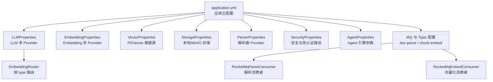
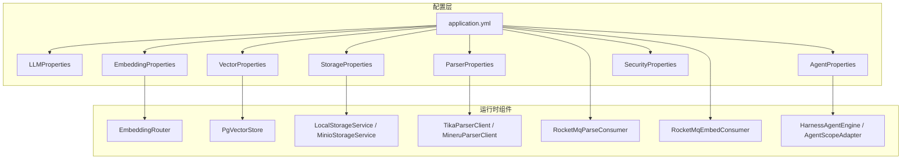
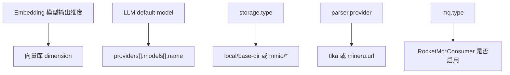

# 配置指南

<cite>
**本文引用的文件**   
- [application.yml](file://src/main/resources/application.yml)
- [LLMProperties.java](file://src/main/java/com/agenthub/llm/config/LLMProperties.java)
- [EmbeddingProperties.java](file://src/main/java/com/agenthub/rag/embedding/EmbeddingProperties.java)
- [VectorProperties.java](file://src/main/java/com/agenthub/rag/store/VectorProperties.java)
- [StorageProperties.java](file://src/main/java/com/agenthub/knowledge/storage/StorageProperties.java)
- [AgentProperties.java](file://src/main/java/com/agenthub/agent/config/AgentProperties.java)
- [ParserProperties.java](file://src/main/java/com/agenthub/parser/config/ParserProperties.java)
- [SecurityProperties.java](file://src/main/java/com/agenthub/gateway/config/SecurityProperties.java)
- [EmbeddingRouter.java](file://src/main/java/com/agenthub/rag/embedding/EmbeddingRouter.java)
- [RocketMqParseConsumer.java](file://src/main/java/com/agenthub/task/consumer/RocketMqParseConsumer.java)
- [RocketMqEmbedConsumer.java](file://src/main/java/com/agenthub/task/consumer/RocketMqEmbedConsumer.java)
- [McpServerConfig.java](file://src/main/java/com/agenthub/mcp/entity/McpServerConfig.java)
- [McpClientManager.java](file://src/main/java/com/agenthub/mcp/client/McpClientManager.java)
- [McpServerService.java](file://src/main/java/com/agenthub/mcp/service/McpServerService.java)
</cite>

## 目录
1. [简介](#简介)
2. [项目结构](#项目结构)
3. [核心组件](#核心组件)
4. [架构总览](#架构总览)
5. [详细组件分析](#详细组件分析)
6. [依赖关系分析](#依赖关系分析)
7. [性能与容量规划](#性能与容量规划)
8. [故障排查](#故障排查)
9. [结论](#结论)
10. [附录：环境差异与最佳实践](#附录环境差异与最佳实践)

## 简介
本指南面向 Java Agent Hub 的配置与部署，覆盖 application.yml 中的全部业务配置项与环境变量，包括 LLM 提供商、嵌入模型、向量存储、对象存储、解析器、异步任务队列、安全与租户、Agent 引擎以及 MCP 客户端等。文档同时给出不同运行环境的配置模板建议、配置项之间的依赖与优先级说明、常见场景的最佳实践，以及配置校验与安全加固建议。

## 项目结构
Java Agent Hub 采用 Spring Boot 模块化组织，关键配置集中在 application.yml，并通过 @ConfigurationProperties 将配置映射到各模块的 Properties 类中；运行时通过 Router/Client 根据配置动态选择实现（如 OpenAI/Ollama/Mock）。

图示来源
- [application.yml:1-155](file://src/main/resources/application.yml#L1-L155)
- [LLMProperties.java:12-42](file://src/main/java/com/agenthub/llm/config/LLMProperties.java#L12-L42)
- [EmbeddingProperties.java:12-32](file://src/main/java/com/agenthub/rag/embedding/EmbeddingProperties.java#L12-L32)
- [VectorProperties.java:9-24](file://src/main/java/com/agenthub/rag/store/VectorProperties.java#L9-L24)
- [StorageProperties.java:9-33](file://src/main/java/com/agenthub/knowledge/storage/StorageProperties.java#L9-L33)
- [ParserProperties.java:9-23](file://src/main/java/com/agenthub/parser/config/ParserProperties.java#L9-L23)
- [SecurityProperties.java:11-20](file://src/main/java/com/agenthub/gateway/config/SecurityProperties.java#L11-L20)
- [EmbeddingRouter.java:37-45](file://src/main/java/com/agenthub/rag/embedding/EmbeddingRouter.java#L37-L45)
- [RocketMqParseConsumer.java:18-33](file://src/main/java/com/agenthub/task/consumer/RocketMqParseConsumer.java#L18-L33)
- [RocketMqEmbedConsumer.java:18-33](file://src/main/java/com/agenthub/task/consumer/RocketMqEmbedConsumer.java#L18-L33)

章节来源
- [application.yml:1-155](file://src/main/resources/application.yml#L1-L155)

## 核心组件
本节概述所有可配置模块及其在 application.yml 中的归属前缀与关键字段。

- 服务器与基础
  - server.port：HTTP 端口
  - spring.application.name：应用名
  - spring.datasource.*：MySQL 主库连接池与连接信息
  - mybatis-plus.*：ORM 行为与日志
  - management.*：Micrometer/OTLP 可观测性导出

- 平台业务配置 agenthub.*
  - security：是否启用租户认证、免认证路径
  - tenant：租户 Header 名称
  - vector：PGVector 独立数据源与维度
  - rag：混合检索 TopK、RRF 融合参数
  - storage：本地或 MinIO 对象存储
  - parser：文档解析 Provider（tika/mineru）
  - mq：消息队列类型与 Topic 名称
  - llm：LLM 默认模型与 Provider 列表
  - embedding：Embedding 默认模型与 Provider 列表
  - agent：Agent 引擎与迭代/记忆窗口参数

章节来源
- [application.yml:1-155](file://src/main/resources/application.yml#L1-L155)

## 架构总览
下图展示配置如何驱动运行时组件的选择与装配，包括 LLM/Embedding 的多 Provider 路由、向量库、对象存储、解析器与 MQ 模式切换。

图示来源
- [application.yml:1-155](file://src/main/resources/application.yml#L1-L155)
- [EmbeddingRouter.java:37-45](file://src/main/java/com/agenthub/rag/embedding/EmbeddingRouter.java#L37-L45)
- [VectorProperties.java:9-24](file://src/main/java/com/agenthub/rag/store/VectorProperties.java#L9-L24)
- [StorageProperties.java:9-33](file://src/main/java/com/agenthub/knowledge/storage/StorageProperties.java#L9-L33)
- [ParserProperties.java:9-23](file://src/main/java/com/agenthub/parser/config/ParserProperties.java#L9-L23)
- [RocketMqParseConsumer.java:18-33](file://src/main/java/com/agenthub/task/consumer/RocketMqParseConsumer.java#L18-L33)
- [RocketMqEmbedConsumer.java:18-33](file://src/main/java/com/agenthub/task/consumer/RocketMqEmbedConsumer.java#L18-L33)
- [AgentProperties.java:9-31](file://src/main/java/com/agenthub/agent/config/AgentProperties.java#L9-L31)

## 详细组件分析

### LLM 提供商配置
- 配置前缀：agenthub.llm
- 关键字段
  - defaultModel：默认模型路由键，指向 providers[].models[].name
  - providers[]：Provider 列表
    - name：Provider 实例名
    - type：openai | ollama | mock
    - base-url：服务端地址（OpenAI 兼容接口或 Ollama）
    - api-key：鉴权密钥（OpenAI 兼容接口需要）
    - models[]：该 Provider 下可路由的模型
      - name：模型路由键
      - model：引擎侧真实模型名
      - temperature：采样温度
      - maxTokens：最大生成长度
- 环境变量
  - LLM_DEFAULT_MODEL：默认模型路由键
  - OPENAI_BASE_URL、OPENAI_API_KEY：OpenAI 兼容接口地址与密钥
  - OLLAMA_BASE_URL：Ollama 服务地址
- 使用要点
  - 切换 LLM 提供商时，确保 default-model 指向目标 provider.models[].name
  - Mock 模式用于无外部 LLM 的全链路演示

章节来源
- [application.yml:98-126](file://src/main/resources/application.yml#L98-L126)
- [LLMProperties.java:12-42](file://src/main/java/com/agenthub/llm/config/LLMProperties.java#L12-L42)

### 嵌入模型配置
- 配置前缀：agenthub.embedding
- 关键字段
  - default-model：默认 Embedding 路由键
  - providers[]：Embedding Provider 列表
    - name：路由键
    - type：openai | ollama | mock
    - base-url：服务端地址
    - api-key：OpenAI 兼容接口密钥
    - model：引擎模型名（如 bge-m3、text-embedding-3-small）
- 环境变量
  - EMBEDDING_MODEL：默认 Embedding 路由键
  - OPENAI_BASE_URL、OPENAI_API_KEY
  - OLLAMA_BASE_URL
- 路由逻辑
  - EmbeddingRouter 根据 ProviderConfig.type 创建对应客户端（OpenAI/Ollama/Mock）

章节来源
- [application.yml:126-140](file://src/main/resources/application.yml#L126-L140)
- [EmbeddingProperties.java:12-32](file://src/main/java/com/agenthub/rag/embedding/EmbeddingProperties.java#L12-L32)
- [EmbeddingRouter.java:37-45](file://src/main/java/com/agenthub/rag/embedding/EmbeddingRouter.java#L37-L45)

### 向量存储配置（PGVector）
- 配置前缀：agenthub.vector
- 关键字段
  - datasource.jdbc-url：PostgreSQL JDBC URL（含 PG_HOST、PG_PORT、PG_DB 环境变量）
  - datasource.username/password：数据库账号密码
  - dimension：向量维度，需与 Embedding 输出维度一致，并用于建表校验
- 环境变量
  - PG_HOST、PG_PORT、PG_DB、PG_USER、PG_PASSWORD
- 注意事项
  - 向量维度必须与所选 Embedding 模型的输出维度一致，否则写入会失败

章节来源
- [application.yml:63-70](file://src/main/resources/application.yml#L63-L70)
- [VectorProperties.java:9-24](file://src/main/java/com/agenthub/rag/store/VectorProperties.java#L9-L24)

### 存储服务配置（本地/MinIO）
- 配置前缀：agenthub.storage
- 关键字段
  - type：local | minio
  - local.base-dir：本地根目录
  - minio.endpoint/access-key/secret-key/bucket：MinIO 连接与桶名
- 环境变量
  - STORAGE_TYPE：存储后端类型
  - MINIO_HOST、MINIO_ACCESS_KEY、MINIO_SECRET_KEY
- 使用建议
  - 开发体验优先使用 local；生产建议使用 MinIO 或兼容 S3 的对象存储

章节来源
- [application.yml:77-86](file://src/main/resources/application.yml#L77-L86)
- [StorageProperties.java:9-33](file://src/main/java/com/agenthub/knowledge/storage/StorageProperties.java#L9-L33)

### 文档解析器配置
- 配置前缀：agenthub.parser
- 关键字段
  - provider：tika | mineru
  - mineru.url：MinerU WebAPI 地址
- 环境变量
  - PARSER_PROVIDER：解析器 Provider
  - MINERU_HOST：MinerU 主机
- 选型建议
  - Tika 作为本地降级方案；MinerU 提供高精度版面解析

章节来源
- [application.yml:87-92](file://src/main/resources/application.yml#L87-L92)
- [ParserProperties.java:9-23](file://src/main/java/com/agenthub/parser/config/ParserProperties.java#L9-L23)

### 异步任务与消息队列
- 配置前缀：agenthub.mq
- 关键字段
  - type：rocketmq | local（local 使用进程内事件）
  - topics.doc-parse：文档解析 Topic
  - topics.chunk-embed：向量化 Topic
- RocketMQ 相关
  - rocketmq.name-server：NameServer 地址
  - rocketmq.producer.group/send-message-timeout：生产者组与超时
- 消费者
  - RocketMqParseConsumer：消费 doc-parse
  - RocketMqEmbedConsumer：消费 chunk-embed
- 环境变量
  - MQ_TYPE：消息队列类型
  - ROCKETMQ_NAMESRV：NameServer 地址

章节来源
- [application.yml:46-52](file://src/main/resources/application.yml#L46-L52)
- [application.yml:92-98](file://src/main/resources/application.yml#L92-L98)
- [RocketMqParseConsumer.java:18-33](file://src/main/java/com/agenthub/task/consumer/RocketMqParseConsumer.java#L18-L33)
- [RocketMqEmbedConsumer.java:18-33](file://src/main/java/com/agenthub/task/consumer/RocketMqEmbedConsumer.java#L18-L33)

### RAG 检索参数
- 配置前缀：agenthub.rag
- 关键字段
  - vector-top-k：向量检索 TopK
  - keyword-top-k：关键词检索 TopK
  - rrf-k：RRF 融合参数
  - hybrid：是否启用混合检索
- 说明
  - 调整 TopK 与 rrf-k 可平衡召回率与相关性

章节来源
- [application.yml:72-76](file://src/main/resources/application.yml#L72-L76)

### Agent 引擎配置
- 配置前缀：agenthub.agent
- 关键字段
  - engine：builtin（内置 ReAct）| agentscope（对接 AgentScope HarnessAgent）
  - max-iterations：单轮最大工具调用迭代次数
  - memory-window：多轮记忆窗口大小
  - agentscope.default-model：AgentScope 模型 URI
  - agentscope.workspace：工作区目录
- 环境变量
  - AGENT_ENGINE：Agent 引擎类型

章节来源
- [application.yml:141-149](file://src/main/resources/application.yml#L141-L149)
- [AgentProperties.java:9-31](file://src/main/java/com/agenthub/agent/config/AgentProperties.java#L9-L31)

### 安全与租户
- 配置前缀：agenthub.security
- 关键字段
  - enabled：是否开启租户认证
  - skip-paths：免认证路径（Ant 风格）
- 租户 Header
  - agenthub.tenant.header：租户 ID Header 名称
  - agenthub.tenant.api-key-header：API Key Header 名称
- 环境变量
  - 无直接映射，但可通过 Spring 配置覆盖

章节来源
- [application.yml:54-62](file://src/main/resources/application.yml#L54-L62)
- [SecurityProperties.java:11-20](file://src/main/java/com/agenthub/gateway/config/SecurityProperties.java#L11-L20)

### MCP 客户端配置（运行时配置）
MCP Server 配置以运行时数据形式管理，非 application.yml 静态配置。

- 实体字段（McpServerConfig）
  - name：配置名（唯一标识，工具名前缀）
  - description：描述
  - transportType：stdio | sse | streamable-http
  - baseUrl：SSE/Streamable HTTP 服务地址
  - endpoint：Streamable HTTP 端点（默认 /mcp）
  - command：STDIO 启动命令
  - argsJson：STDIO 启动参数（JSON 数组字符串）
  - envJson：环境变量（JSON 对象字符串）
  - enabled：是否启用（启用后自动建立连接）
- 客户端管理器（McpClientManager）
  - 支持三种传输模式：streamable-http、sse、stdio
  - 按配置建立与 MCP Server 的连接，暴露工具发现与调用能力
- 服务层（McpServerService）
  - 提供配置的 CRUD、连接管理、按租户懒连接与错误处理

章节来源
- [McpServerConfig.java:14-52](file://src/main/java/com/agenthub/mcp/entity/McpServerConfig.java#L14-L52)
- [McpClientManager.java:24-35](file://src/main/java/com/agenthub/mcp/client/McpClientManager.java#L24-L35)
- [McpServerService.java:40-139](file://src/main/java/com/agenthub/mcp/service/McpServerService.java#L40-L139)

## 依赖关系分析
- Embedding 维度与向量库维度强耦合
  - agenthub.embedding.providers[].model 的输出维度必须等于 agenthub.vector.dimension
- LLM 与 Agent 引擎
  - agenthub.llm.default-model 应指向某个 provider.models[].name
  - agenthub.agent.engine=builtin 时使用内置 ReAct；agentscope 时需配置 agentscope.default-model
- 存储与解析
  - agenthub.storage.type=local 时仅需本地目录；minio 时需要完整连接信息
  - agenthub.parser.provider=mineru 时需要可用 MinerU 服务
- MQ 与消费者
  - agenthub.mq.type=rocketmq 时，RocketMqParseConsumer 与 RocketMqEmbedConsumer 生效，且需正确配置 topic 名称

图示来源
- [EmbeddingProperties.java:21-31](file://src/main/java/com/agenthub/rag/embedding/EmbeddingProperties.java#L21-L31)
- [VectorProperties.java:15-23](file://src/main/java/com/agenthub/rag/store/VectorProperties.java#L15-L23)
- [LLMProperties.java:21-41](file://src/main/java/com/agenthub/llm/config/LLMProperties.java#L21-L41)
- [StorageProperties.java:13-32](file://src/main/java/com/agenthub/knowledge/storage/StorageProperties.java#L13-L32)
- [ParserProperties.java:13-22](file://src/main/java/com/agenthub/parser/config/ParserProperties.java#L13-L22)
- [RocketMqParseConsumer.java:18-33](file://src/main/java/com/agenthub/task/consumer/RocketMqParseConsumer.java#L18-L33)
- [RocketMqEmbedConsumer.java:18-33](file://src/main/java/com/agenthub/task/consumer/RocketMqEmbedConsumer.java#L18-L33)

## 性能与容量规划
- 连接池与超时
  - spring.datasource.hikari.maximum-pool-size：根据并发与查询负载调优
  - rocketmq.producer.send-message-timeout：根据网络与消息体大小调整
- 向量检索
  - vector-top-k、keyword-top-k、rrf-k：TopK 越大召回越高但延迟上升；rrf-k 影响融合排序
- 解析与向量化
  - 使用 MQ 分离解析与向量化，便于独立扩容；chunk-embed 通常更耗时
- 对象存储
  - MinIO 集群规模与带宽决定上传/下载吞吐；合理设置分片与并发

[本节为通用指导，不直接分析具体文件]

## 故障排查
- 无法连接 PGVector
  - 检查 PG_HOST/PORT/DB/USER/PASSWORD 是否正确
  - 确认 dimension 与 Embedding 输出维度一致
- Embedding 调用失败
  - 核对 provider.type 与 base-url/api-key/model 是否匹配
  - Mock 模式仅用于演示，生产请配置真实 Provider
- 对象存储异常
  - MinIO 模式下检查 endpoint、access-key、secret-key、bucket
  - Local 模式下确认 base-dir 存在且有写权限
- MQ 消费者未消费
  - 确认 agenthub.mq.type=rocketmq 且 RocketMQ NameServer 可达
  - 核对 topics.doc-parse 与 topics.chunk-embed 是否与 broker 一致
- 安全拦截
  - 若启用了租户认证，确保请求携带正确的租户 Header；必要时将内部接口加入 skip-paths

章节来源
- [VectorProperties.java:15-23](file://src/main/java/com/agenthub/rag/store/VectorProperties.java#L15-L23)
- [EmbeddingRouter.java:37-45](file://src/main/java/com/agenthub/rag/embedding/EmbeddingRouter.java#L37-L45)
- [StorageProperties.java:26-32](file://src/main/java/com/agenthub/knowledge/storage/StorageProperties.java#L26-L32)
- [RocketMqParseConsumer.java:18-33](file://src/main/java/com/agenthub/task/consumer/RocketMqParseConsumer.java#L18-L33)
- [RocketMqEmbedConsumer.java:18-33](file://src/main/java/com/agenthub/task/consumer/RocketMqEmbedConsumer.java#L18-L33)
- [SecurityProperties.java:15-20](file://src/main/java/com/agenthub/gateway/config/SecurityProperties.java#L15-L20)

## 结论
通过 application.yml 与各 Properties 类的组合，Java Agent Hub 实现了 LLM/Embedding 多 Provider 路由、PGVector 向量库、对象存储、文档解析、异步任务与 Agent 编排的可插拔架构。合理配置这些选项可满足从本地演示到生产部署的多种场景。建议在上线前完成维度一致性校验、敏感信息外置、MQ 连通性验证与限流/重试策略评估。

[本节为总结性内容，不直接分析具体文件]

## 附录：环境差异与最佳实践

### 环境差异与模板建议
- 开发环境
  - 存储：local
  - 解析器：tika
  - MQ：local
  - LLM/Embedding：mock 或本地 Ollama
  - PGVector：本地 PostgreSQL + pgvector
- 测试环境
  - 存储：minio（容器化）
  - 解析器：mineru（可选）
  - MQ：rocketmq（本地或测试集群）
  - LLM/Embedding：OpenAI 兼容接口或 Ollama
- 生产环境
  - 存储：MinIO/S3 兼容对象存储
  - 解析器：mineru（高准确率）+ tika 降级
  - MQ：RocketMQ 集群，合理分区与副本
  - LLM/Embedding：企业级 LLM 网关或自有部署
  - PGVector：独立高性能数据库实例

[本节为概念性建议，不直接分析具体文件]

### 配置项依赖与优先级
- 依赖关系
  - embedding.model 输出维度 == vector.dimension
  - llm.default-model 必须存在于 providers[].models[].name
  - storage.type 决定 local 或 minio 子配置生效
  - parser.provider 决定是否需要 MinerU 服务
  - mq.type 决定 RocketMq*Consumer 是否启用
- 优先级
  - 环境变量 > application.yml > Properties 默认值
  - 例如：LLM_DEFAULT_MODEL 覆盖 agenthub.llm.default-model

章节来源
- [application.yml:10-12](file://src/main/resources/application.yml#L10-L12)
- [application.yml:66-68](file://src/main/resources/application.yml#L66-L68)
- [application.yml:83-85](file://src/main/resources/application.yml#L83-L85)
- [application.yml:91-91](file://src/main/resources/application.yml#L91-L91)
- [application.yml:94-98](file://src/main/resources/application.yml#L94-L98)
- [application.yml:100-100](file://src/main/resources/application.yml#L100-L100)
- [application.yml:127-127](file://src/main/resources/application.yml#L127-L127)

### 常见场景最佳实践
- 切换 LLM 提供商
  - 新增 providers 条目并更新 default-model 指向新模型路由键
  - 对外部 API 使用环境变量注入密钥，避免硬编码
- 切换存储后端
  - 将 STORAGE_TYPE=minio 并填写 MINIO_* 环境变量
  - 确保 bucket 已创建且具备读写权限
- 调整异步任务参数
  - 增大 RocketMQ producer 超时或调整 consumer 并行度以提升吞吐
  - 将 doc-parse 与 chunk-embed 拆分在不同消费者组，按需扩容
- 安全加固
  - 开启租户认证，仅将必要接口加入 skip-paths
  - 对敏感配置（API Key、数据库密码）使用环境变量或密钥管理服务

[本节为通用实践建议，不直接分析具体文件]