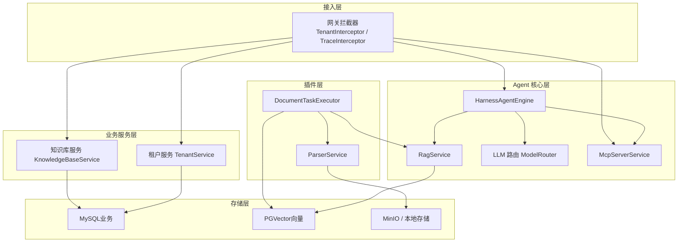
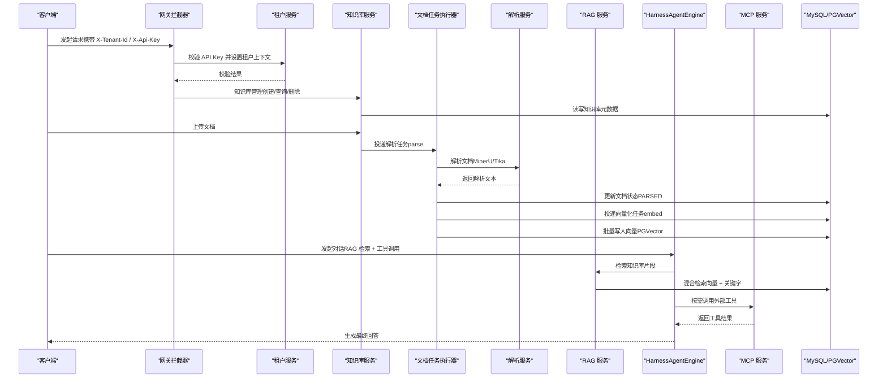
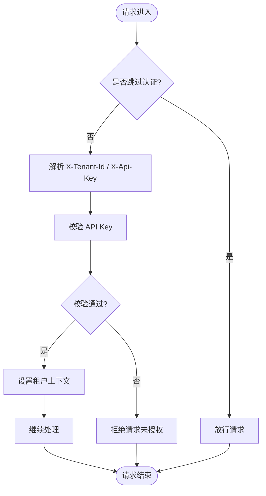
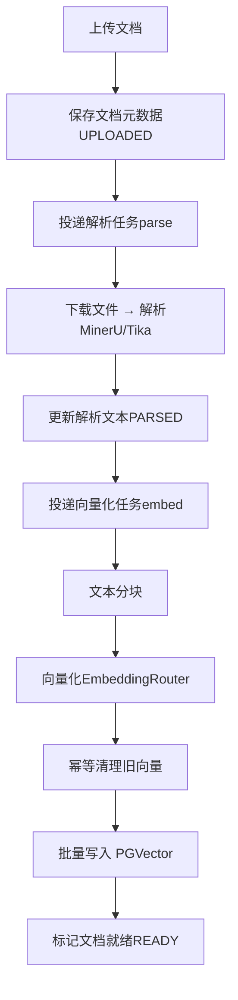
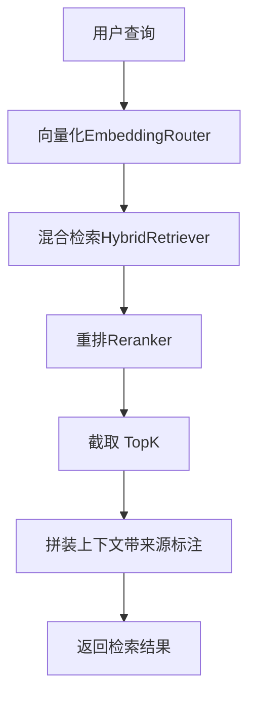
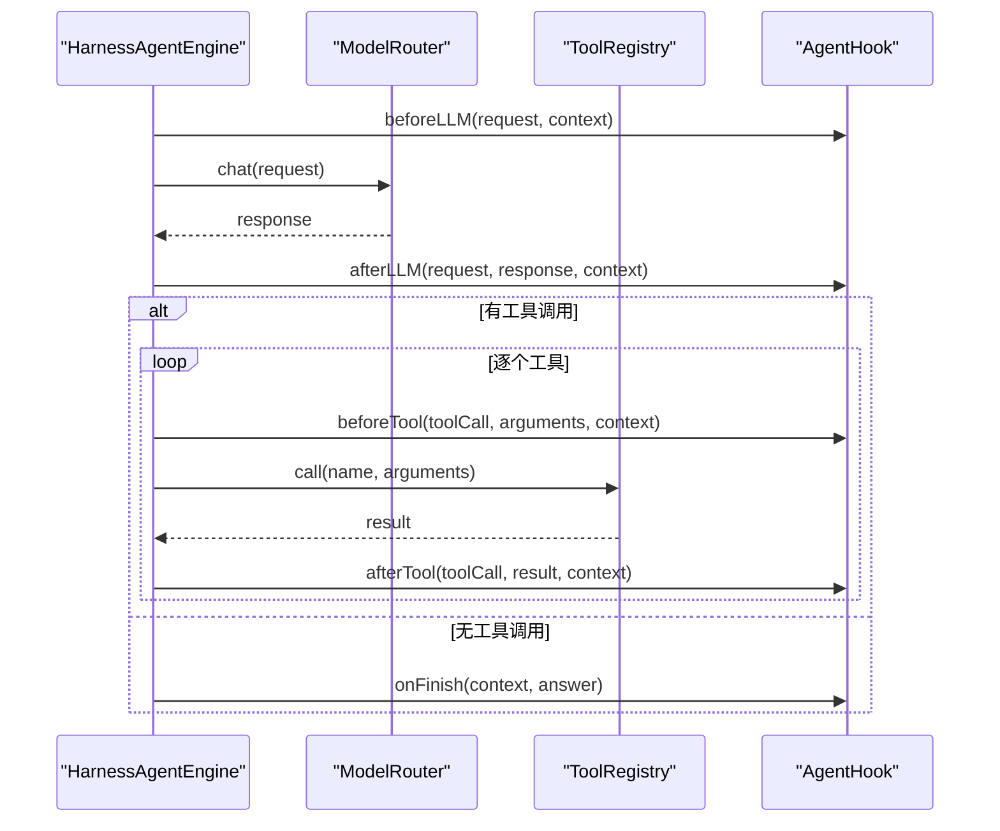
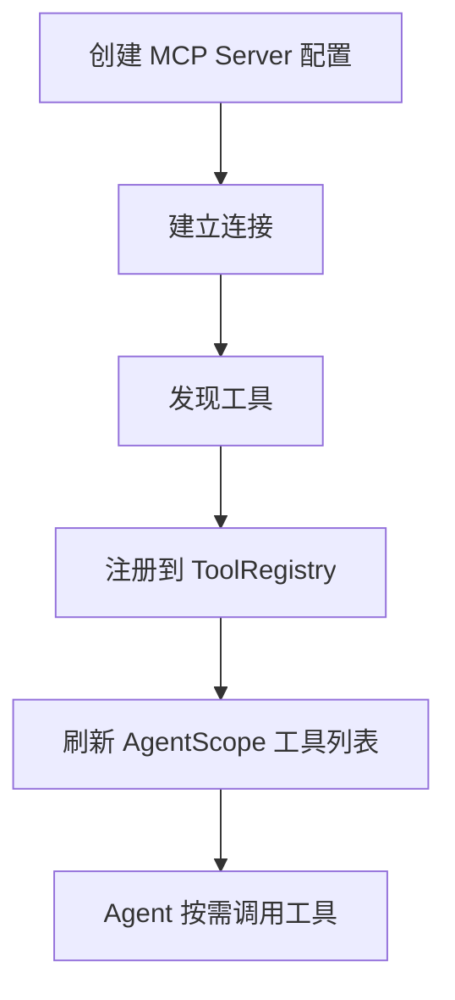
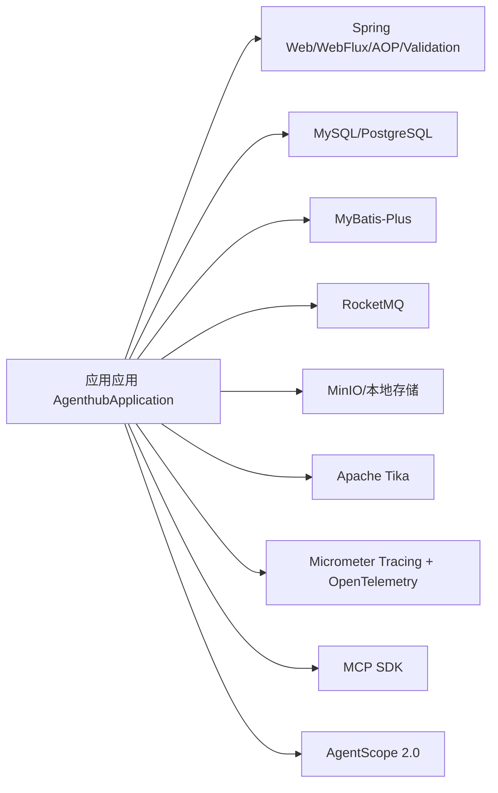

# 项目概述

<cite>
**本文引用的文件**   
- [README.md](file://README.md)
- [pom.xml](file://pom.xml)
- [application.yml](file://src/main/resources/application.yml)
- [docker-compose.yml](file://docker-compose.yml)
- [Dockerfile](file://Dockerfile)
- [AgenthubApplication.java](file://src/main/java/com/agenthub/AgenthubApplication.java)
- [TenantInterceptor.java](file://src/main/java/com/agenthub/gateway/interceptor/TenantInterceptor.java)
- [TraceInterceptor.java](file://src/main/java/com/agenthub/gateway/interceptor/TraceInterceptor.java)
- [TenantService.java](file://src/main/java/com/agenthub/tenant/service/TenantService.java)
- [KnowledgeBaseService.java](file://src/main/java/com/agenthub/knowledge/service/KnowledgeBaseService.java)
- [DocumentTaskExecutor.java](file://src/main/java/com/agenthub/task/executor/DocumentTaskExecutor.java)
- [ParserService.java](file://src/main/java/com/agenthub/parser/ParserService.java)
- [RagService.java](file://src/main/java/com/agenthub/rag/service/RagService.java)
- [HarnessAgentEngine.java](file://src/main/java/com/agenthub/agent/harness/HarnessAgentEngine.java)
- [McpServerService.java](file://src/main/java/com/agenthub/mcp/service/McpServerService.java)
</cite>

## 目录
1. [引言](#引言)
2. [项目结构](#项目结构)
3. [核心组件](#核心组件)
4. [架构总览](#架构总览)
5. [详细组件分析](#详细组件分析)
6. [依赖关系分析](#依赖关系分析)
7. [性能与可观测性](#性能与可观测性)
8. [快速开始指南](#快速开始指南)
9. [完整体验流程](#完整体验流程)
10. [故障排查指南](#故障排查指南)
11. [结论](#结论)

## 引言
Java Agent Hub 是一个面向 Java 后端开发者的企业级多租户 RAG + Harness Agent + MCP 工具平台。项目基于 AgentScope Java 2.0 构建，围绕“多租户数据隔离 → 文档解析 → 向量化 → 混合检索 → Agent 编排 → MCP 工具调用 → 全链路可观测”的完整链路展开，提供开箱即用的本地演示能力与生产可用的扩展点。

核心价值主张：
- 多租户数据隔离：MySQL 通过 MyBatis-Plus 租户插件自动追加 tenant_id；PGVector 显式携带 tenant_id；文件存储按租户目录物理隔离。
- 知识库与文档处理：上传即返回、异步解析（MinerU 对接 + Tika 降级）、文本切分、向量化、向量入库（PGVector + HNSW）。
- RAG 混合检索：向量检索 + 关键字检索 + RRF 融合 + 重排，支持过滤条件。
- 智能体编排：内置 ReAct 引擎与 AgentScope 2.0 HarnessAgent 双引擎，支持多轮对话与窗口记忆管理。
- MCP 工具调用：内置 MCP Client（stdio / sse / streamable-http），连接后工具自动注册，Agent 按需调用。
- LLM 路由：多模型配置，兼容 Ollama、OpenAI 格式接口，内置 Mock 模型零依赖跑通全链路。
- 全链路可观测：Agent Hook + AOP 埋点，token 消耗、调用耗时、异常统计落库，对接 OpenTelemetry（Jaeger/Prometheus）。

技术栈选择与优势：
- Java 17 + Spring Boot 3.3：现代生态、强类型、更好的并发与响应式能力。
- AgentScope 2.0：工程化 HarnessAgent 体系，便于接入多种模型与中间件。
- MyBatis-Plus：简化 CRUD，内置租户插件降低隔离成本。
- PGVector：PostgreSQL 原生向量检索，HNSW 索引兼顾精度与性能。
- RocketMQ：高吞吐异步任务，支撑解析与向量化流水线。
- MinIO：对象存储，配合本地模式快速体验。
- Micrometer Tracing + OpenTelemetry：统一链路追踪与指标采集。

## 项目结构
项目采用分层架构与模块化组织：
- 接入层 gateway：租户认证拦截器、traceId 透传、WebMvc 配置。
- 业务服务层 tenant / knowledge：租户、用户、API Key、知识库管理。
- Agent 核心层 agent / rag / llm / mcp：HarnessAgent 封装、RAG 检索、LLM 路由、MCP 工具桥接。
- 插件层 parser / task：文档解析（MinerU/Tika）、异步任务（RocketMQ/本地事件）。
- 存储层 MySQL（业务）+ PGVector（向量）+ MinIO/本地（文件）。

图表来源
- [AgenthubApplication.java:8-16](file://src/main/java/com/agenthub/AgenthubApplication.java#L8-L16)
- [TenantInterceptor.java:18-29](file://src/main/java/com/agenthub/gateway/interceptor/TenantInterceptor.java#L18-L29)
- [TraceInterceptor.java:16-27](file://src/main/java/com/agenthub/gateway/interceptor/TraceInterceptor.java#L16-L27)
- [TenantService.java:26-39](file://src/main/java/com/agenthub/tenant/service/TenantService.java#L26-L39)
- [KnowledgeBaseService.java:15-23](file://src/main/java/com/agenthub/knowledge/service/KnowledgeBaseService.java#L15-L23)
- [HarnessAgentEngine.java:21-36](file://src/main/java/com/agenthub/agent/harness/HarnessAgentEngine.java#L21-L36)
- [RagService.java:15-28](file://src/main/java/com/agenthub/rag/service/RagService.java#L15-L28)
- [McpServerService.java:23-38](file://src/main/java/com/agenthub/mcp/service/McpServerService.java#L23-L38)
- [ParserService.java:15-23](file://src/main/java/com/agenthub/parser/ParserService.java#L15-L23)
- [DocumentTaskExecutor.java:25-48](file://src/main/java/com/agenthub/task/executor/DocumentTaskExecutor.java#L25-L48)

章节来源
- [README.md:20-35](file://README.md#L20-L35)
- [AgenthubApplication.java:8-16](file://src/main/java/com/agenthub/AgenthubApplication.java#L8-L16)

## 核心组件
- 租户与鉴权：TenantService 负责租户创建、用户登录、API Key 签发与校验；TenantInterceptor 在请求入口解析 X-Tenant-Id 与 X-Api-Key，写入 TenantContext，供下游 MyBatis 租户插件使用。
- 知识库管理：KnowledgeBaseService 提供知识库创建、查询、删除，所有操作受租户上下文保护。
- 文档解析与向量化：ParserService 根据配置选择 MinerU 或 Tika；DocumentTaskExecutor 驱动“解析→分块→向量化→入库”的异步流水线。
- RAG 检索：RagService 组合 EmbeddingRouter、HybridRetriever、Reranker，完成“向量化→混合检索→重排→结果拼装”。
- Agent 编排：HarnessAgentEngine 实现内置 ReAct 循环，结合 ToolRegistry 与 AgentHook，支持多轮对话与工具调用。
- MCP 工具：McpServerService 管理 MCP Server 配置、连接、工具注册与调用，支持 stdio/sse/streamable-http。

章节来源
- [TenantService.java:26-129](file://src/main/java/com/agenthub/tenant/service/TenantService.java#L26-L129)
- [TenantInterceptor.java:18-77](file://src/main/java/com/agenthub/gateway/interceptor/TenantInterceptor.java#L18-L77)
- [KnowledgeBaseService.java:15-61](file://src/main/java/com/agenthub/knowledge/service/KnowledgeBaseService.java#L15-L61)
- [ParserService.java:15-39](file://src/main/java/com/agenthub/parser/ParserService.java#L15-L39)
- [DocumentTaskExecutor.java:25-123](file://src/main/java/com/agenthub/task/executor/DocumentTaskExecutor.java#L25-L123)
- [RagService.java:15-71](file://src/main/java/com/agenthub/rag/service/RagService.java#L15-L71)
- [HarnessAgentEngine.java:21-149](file://src/main/java/com/agenthub/agent/harness/HarnessAgentEngine.java#L21-L149)
- [McpServerService.java:23-158](file://src/main/java/com/agenthub/mcp/service/McpServerService.java#L23-L158)

## 架构总览
系统采用分层架构与异步流水线设计：
- 接入层：租户认证拦截器与链路追踪拦截器，确保每个请求具备租户上下文与 traceId。
- 业务服务层：租户与知识库管理，承载基础资源与权限边界。
- Agent 核心层：HarnessAgentEngine 作为编排中枢，协调 RAG 检索、LLM 调用与 MCP 工具执行。
- 插件层：ParserService 与 DocumentTaskExecutor 解耦解析与向量化，支持 MQ 与本地事件两种模式。
- 存储层：MySQL 承载业务数据，PGVector 承载向量数据，MinIO/本地存储承载原始文件。

图表来源
- [TenantInterceptor.java:31-50](file://src/main/java/com/agenthub/gateway/interceptor/TenantInterceptor.java#L31-L50)
- [KnowledgeBaseService.java:25-38](file://src/main/java/com/agenthub/knowledge/service/KnowledgeBaseService.java#L25-L38)
- [DocumentTaskExecutor.java:49-62](file://src/main/java/com/agenthub/task/executor/DocumentTaskExecutor.java#L49-L62)
- [ParserService.java:30-37](file://src/main/java/com/agenthub/parser/ParserService.java#L30-L37)
- [RagService.java:39-54](file://src/main/java/com/agenthub/rag/service/RagService.java#L39-L54)
- [HarnessAgentEngine.java:52-106](file://src/main/java/com/agenthub/agent/harness/HarnessAgentEngine.java#L52-L106)
- [McpServerService.java:75-84](file://src/main/java/com/agenthub/mcp/service/McpServerService.java#L75-L84)

## 详细组件分析

### 租户与鉴权组件
- TenantInterceptor：解析请求头中的 X-Tenant-Id 与 X-Api-Key，调用 TenantService.verifyApiKey 进行校验，成功后将租户信息写入 TenantContext，并在 afterCompletion 中清理 ThreadLocal，防止线程池复用导致的数据泄露。
- TenantService：提供租户创建、用户登录、API Key 签发与校验。密码与 API Key 仅保存哈希值，演示使用 SHA-256，生产建议替换为 BCrypt/Argon2 或 HMAC-SHA256。

图表来源
- [TenantInterceptor.java:31-77](file://src/main/java/com/agenthub/gateway/interceptor/TenantInterceptor.java#L31-L77)
- [TenantService.java:94-109](file://src/main/java/com/agenthub/tenant/service/TenantService.java#L94-L109)

章节来源
- [TenantInterceptor.java:18-77](file://src/main/java/com/agenthub/gateway/interceptor/TenantInterceptor.java#L18-L77)
- [TenantService.java:26-129](file://src/main/java/com/agenthub/tenant/service/TenantService.java#L26-L129)

### 知识库与文档处理组件
- KnowledgeBaseService：提供知识库创建、查询、删除，所有操作受租户上下文保护，MyBatis-Plus 租户插件自动附加 tenant_id。
- ParserService：根据配置选择 MinerU 或 Tika 解析器，返回解析后的文档内容。
- DocumentTaskExecutor：驱动“解析→分块→向量化→入库”的异步流水线，支持幂等清理旧向量与失败重试。

图表来源
- [KnowledgeBaseService.java:25-38](file://src/main/java/com/agenthub/knowledge/service/KnowledgeBaseService.java#L25-L38)
- [ParserService.java:30-37](file://src/main/java/com/agenthub/parser/ParserService.java#L30-L37)
- [DocumentTaskExecutor.java:64-121](file://src/main/java/com/agenthub/task/executor/DocumentTaskExecutor.java#L64-L121)

章节来源
- [KnowledgeBaseService.java:15-61](file://src/main/java/com/agenthub/knowledge/service/KnowledgeBaseService.java#L15-L61)
- [ParserService.java:15-39](file://src/main/java/com/agenthub/parser/ParserService.java#L15-L39)
- [DocumentTaskExecutor.java:25-123](file://src/main/java/com/agenthub/task/executor/DocumentTaskExecutor.java#L25-L123)

### RAG 检索组件
- RagService：组合 EmbeddingRouter、HybridRetriever、Reranker，完成“向量化→混合检索→重排→结果拼装”，支持 kbIds 过滤与 topK 限制。
- HybridRetriever：实现向量检索与关键字检索的 RRF 融合，提升召回质量。
- Reranker：对候选片段进行重排，提高相关性。

图表来源
- [RagService.java:39-69](file://src/main/java/com/agenthub/rag/service/RagService.java#L39-L69)

章节来源
- [RagService.java:15-71](file://src/main/java/com/agenthub/rag/service/RagService.java#L15-L71)

### Agent 编排组件
- HarnessAgentEngine：实现内置 ReAct 循环，组装消息、调用 LLM、执行工具、回填结果，直到收敛或超过最大迭代次数。
- ToolRegistry：统一管理工具定义与调用，支持 MCP 工具动态注册。
- AgentHook：生命周期钩子，在 LLM 调用前后与工具执行前后插入逻辑，便于监控与审计。

图表来源
- [HarnessAgentEngine.java:52-106](file://src/main/java/com/agenthub/agent/harness/HarnessAgentEngine.java#L52-L106)
- [HarnessAgentEngine.java:108-149](file://src/main/java/com/agenthub/agent/harness/HarnessAgentEngine.java#L108-L149)

章节来源
- [HarnessAgentEngine.java:21-149](file://src/main/java/com/agenthub/agent/harness/HarnessAgentEngine.java#L21-L149)

### MCP 工具组件
- McpServerService：管理 MCP Server 配置、连接、工具注册与调用，支持 stdio/sse/streamable-http。
- ToolRegistry：接收 MCP 工具注册，命名规则为 mcp__{server}__{tool}，供内置引擎直接调用。
- AgentScopeAdapter：当使用 AgentScope 引擎时，刷新工具列表以生效。

图表来源
- [McpServerService.java:40-84](file://src/main/java/com/agenthub/mcp/service/McpServerService.java#L40-L84)
- [McpServerService.java:117-131](file://src/main/java/com/agenthub/mcp/service/McpServerService.java#L117-L131)

章节来源
- [McpServerService.java:23-158](file://src/main/java/com/agenthub/mcp/service/McpServerService.java#L23-L158)

## 依赖关系分析
项目依赖包括 Web/AOP/Validation、MySQL/PostgreSQL、MyBatis-Plus、MinIO、RocketMQ、Tika、Micrometer Tracing + OpenTelemetry、MCP SDK、AgentScope 2.0 等。

图表来源
- [pom.xml:41-151](file://pom.xml#L41-L151)

章节来源
- [pom.xml:1-191](file://pom.xml#L1-L191)

## 性能与可观测性
- 异步流水线：默认 local 模式（进程内异步）便于本地调试，生产可切换 RocketMQ 提升吞吐。
- 向量检索：PGVector + HNSW 索引，支持 TopK 与 RRF 融合，提升召回与排序质量。
- 可观测性：Micrometer Tracing + OTLP 导出到 Collector，Jaeger 可视化链路，Prometheus 暴露指标；Span 携带 tenant.id 标签，可按租户过滤。

章节来源
- [application.yml:31-44](file://src/main/resources/application.yml#L31-L44)
- [README.md:138-143](file://README.md#L138-L143)

## 快速开始指南
方式一：Docker Compose 一键启动（推荐）
- 构建应用镜像：mvn clean package -DskipTests && docker build -t agenthub:1.0.0 .
- 启动全部依赖：docker compose up -d
- 查看日志：docker compose logs -f agenthub

方式二：IDE 本地运行（只起数据库）
- 启动依赖：docker compose up -d mysql pgvector
- 运行应用：IDEA 直接运行 AgenthubApplication，或 mvn spring-boot:run

默认配置即最小可运行 demo：MQ_TYPE=local（进程内异步）、STORAGE_TYPE=local（本地磁盘）、mock-chat/mock-embed（内置 Mock 模型），无需任何外部 LLM 与 MQ 即可跑通全链路。

章节来源
- [README.md:37-60](file://README.md#L37-L60)
- [docker-compose.yml:1-10](file://docker-compose.yml#L1-L10)
- [Dockerfile:1-26](file://Dockerfile#L1-L26)

## 完整体验流程
从租户登录到知识库管理再到 Agent 对话的完整示例：
- 登录：POST /api/v1/tenant/login，传入租户编码、用户名与密码。
- 创建知识库：POST /api/v1/kb，携带租户认证头。
- 上传文档：POST /api/v1/kb/{kbId}/documents，上传文件后轮询文档状态至 READY。
- Agent 对话：POST /api/v1/agent/chat，传入 kbId 与问题，系统自动触发 RAG 检索与工具调用。

章节来源
- [README.md:62-87](file://README.md#L62-L87)

## 故障排查指南
- 租户认证失败：检查 X-Tenant-Id 与 X-Api-Key 是否匹配，确认 API Key 是否启用且未过期。
- 文档解析失败：确认 ParserProvider 配置（MinerU/Tika），检查 MinerU 服务可用性；查看文档状态是否为 FAILED。
- 向量化失败：确认 EmbeddingModel 与 PGVector dimension 一致；检查 PGVector 连接与表结构。
- Agent 未收敛：调整 max-iterations，检查工具调用是否返回有效结果；查看 AgentHook 埋点日志。
- 链路不可见：确认 OTLP 端点与 Collector 配置，检查 Jaeger UI 是否可访问。

章节来源
- [TenantInterceptor.java:70-77](file://src/main/java/com/agenthub/gateway/interceptor/TenantInterceptor.java#L70-L77)
- [DocumentTaskExecutor.java:77-80](file://src/main/java/com/agenthub/task/executor/DocumentTaskExecutor.java#L77-L80)
- [DocumentTaskExecutor.java:117-120](file://src/main/java/com/agenthub/task/executor/DocumentTaskExecutor.java#L117-L120)
- [HarnessAgentEngine.java:104-106](file://src/main/java/com/agenthub/agent/harness/HarnessAgentEngine.java#L104-L106)
- [README.md:138-143](file://README.md#L138-L143)

## 结论
Java Agent Hub 以企业级多租户为核心，围绕 RAG、Harness Agent 与 MCP 工具构建了完整的 LLM 应用架构。通过分层架构、异步流水线与双引擎设计，项目在本地演示与生产部署之间提供了平滑的演进路径。借助 PGVector、RocketMQ、AgentScope 2.0 与 OpenTelemetry，系统在可扩展性、性能与可观测性方面均具备良好基础，适合在企业内部知识管理与智能助手场景中落地。